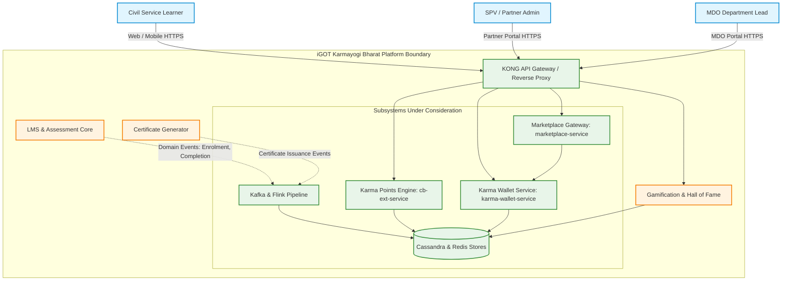
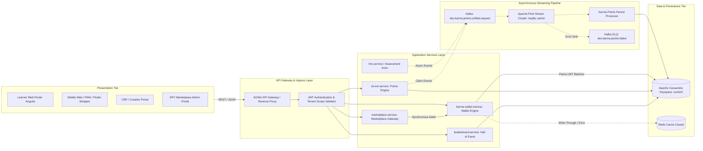
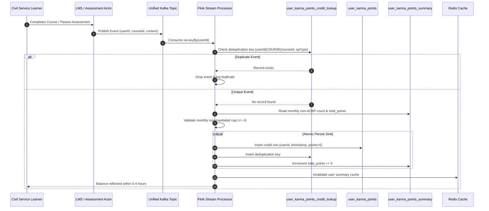
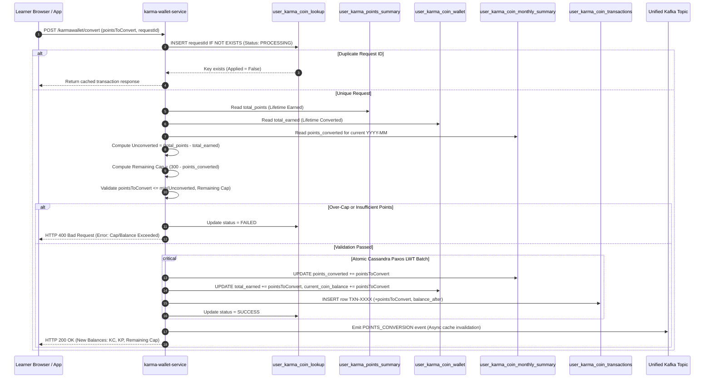
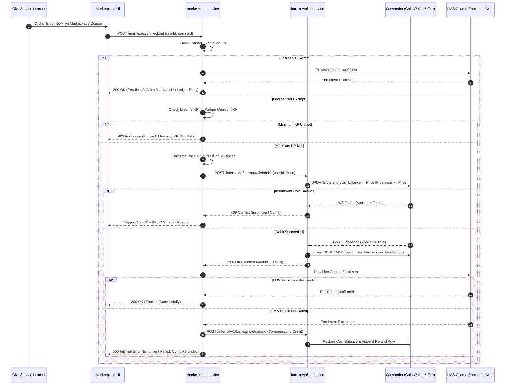

# Karma Points — High-Level Design (HLD)

## Karma Points, Karma Coins, and Karma Wallet Ecosystem

**Platform:** iGOT Karmayogi Bharat<br>**Role:** Senior Solution Architect<br>**Traceability Baseline:** Stages 1–4 Technical Architecture, IEEE 29148 SRS, and IEEE 1016 SDD Specifications<br>**Status:** Approved for Engineering Baseline

## 1. Executive Summary & Architecture Drivers

### 1.1 Executive Summary

The iGOT Karmayogi Bharat platform provides competency-driven training to civil servants across India under the National Programme for Civil Services Capacity Building (NPCSCB). To shift civil service learning from administrative compliance to user-driven engagement, the platform establishes a **Dual-Currency Credit-Based Learning System**:

1. **Karma Points (KP):** Cumulative, non-diminishing reputation currency recording verified lifetime learning efforts (login, enrolment, completion, assessment, rating, live events, ACBP compliance). Points never diminish, cannot be spent, and drive institutional leaderboards and Wall of Fame recognition.
2. **Karma Coins (KC):** Spendable digital utility currency minted exclusively by converting eligible Karma Points at a fixed **1 KP = 1 KC** ratio within a **300 KP monthly calendar cap**. Coins carry no expiration date, accumulate indefinitely, and are redeemable exclusively for paid/partner courses on the iGOT Marketplace.
3. **Karma Wallet:** The user-facing ledger, balance manager, and transactional gateway that enforces the two-currency model, coordinates point-to-coin conversion via Cassandra Lightweight Transactions (Paxos/CAS), tracks running coin balances, and displays an append-only audit trail.

### 1.2 Key Architecture Drivers

**KEY ARCHITECTURE DRIVERS**

| Driver Category | Architectural Imperative |
|---|---|
| Currency Isolation | Spending actions (coin conversions/debits) must have ZERO mathematical impact on lifetime points or MDO leaderboards. |
| Asymmetric Consistency | Earning absorbs high-velocity async events (SLA <= 4h); Conversions require strict atomic consistency (Cassandra Paxos LWT). |
| Inflation Control | Enforce a hard 300 KP calendar-month cap with zero rollover to prevent market run. |
| Full Auditability | Append-only ledger; every balance mutation requires an immutable transaction record. |

- **Driver 1: Strict Currency & Reputation Isolation** (`NFR-DAT-004`)<br>Converting Karma Points into Karma Coins or redeeming coins on Marketplace courses must have zero impact on lifetime earned Karma Points (`total_points`), departmental leaderboards, or profile badges. Competency records and spendable utilities must remain separate.
- **Driver 2: Asymmetric Consistency Model (**`NFR-DAT-001`, `NFR-PERF-004`)
  - *Karma Points Earning:* High-velocity, asynchronous, event-driven stream processing (Kafka + Flink + Cassandra) absorbing millions of daily learning signals with an eventual consistency SLA .
  - *Karma Wallet Conversion & Redemption:* Synchronous, ACID-compliant transactions using Apache Cassandra Lightweight Transactions (LWT / Paxos consensus) to prevent over-conversion, race conditions, or negative coin balances.

- **Driver 3: Anti-Inflationary Cap Enforcement (**`FR-KC-002`, `FR-KC-005`)<br>A strict conversion cap of **300 Karma Points per UTC calendar month** must be enforced at the persistence tier with zero rollover of unused allowances.
- **Driver 4: Auditability & Ledger Immutability** (`NFR-DAT-002`)<br>All coin minting and redemption must be recorded in an append-only transaction ledger with sequential transaction IDs (`TXN-XXXXXX`) and running balance snapshots (`balance_after`).
- **Driver 5: Resilient Partner Integration** (`FR-MP-001–008`)<br>Support SPV Partner settings (Partner Multipliers up to 100, Minimum KP eligibility gates) and provide an exemption bypass for institutional cohorts without financial ledger pollution.

## 2. System Context and External Boundaries



### Context Boundary Descriptions

1. **Civil Service Learner:** Interacts via Web (`/home`, `/profile/karma-wallet`), Mobile App, and Course TOC. Converts points, tracks coin balances, and enrols in Marketplace courses.
2. **SPV / Marketplace Partner Administrator:** Configures partner-specific coin multipliers (max 100), sets Minimum KP gating prerequisites, and uploads approved exemption rosters.
3. **MDO Department Lead:** Views aggregated competency metrics via MDO Channel Leaderboards and the Wall of Fame without reading spendable coin balances.
4. **LMS & Assessment Core:** Publishes discrete completion and assessment mastery domain events to the streaming pipeline.
5. **Certificate Generator:** Publishes verified certificate issuance events to Kafka, triggering completion reward handlers.

## 3. Logical and Component Architecture



### 3.1 Component Directory and Functional Allocations

#### 1. Ingress & API Management Layer

- **KONG API Gateway:** Serves as the single edge entry point for all client traffic (`/apis/proxies/v8/...`, `/apis/public/v8/...`, `/apis/internal/v1/...`). Terminates TLS, validates JWT tokens, extracts authenticated user headers (`x-authenticated-userid`), and routes to downstream microservice pods.
- **Internal Routing Security:** Blocks public ingress to `/apis/internal/*` routes; internal service-to-service communication relies on mutual TLS (mTLS).

#### 2. Microservice Layer

- `cb-ext-service` (Karma Points Service):
  - Serves lifetime balance queries (`POST /apis/proxies/v8/user/totalkarmapoints`).
  - Serves paginated points credit ledger history (`POST /apis/proxies/v8/karmapoints/read`).
  - Manages retroactive ACBP claiming (`POST /apis/proxies/v8/claimkarmapoints/`) and pushes verified claims to Kafka.

- `karma-wallet-service`:
  - Computes dynamic summary metrics (Wallet Balance, Convertible Remaining, Total Converted, Unconverted Pool).
  - Executes point-to-coin conversion via Cassandra Paxos LWT batches, enforcing the 300 KP monthly cap.
  - Manages append-only coin transactions and serves date-filtered transaction histories.
  - Provides an authenticated internal debit endpoint for course redemptions.

- `marketplace-service`:
  - Enforces Minimum KP thresholds and manages Partner Exemption Lists.
  - Calculates Course Coin Prices via configured partner multipliers.
  - Orchestrates course checkout: calls `karma-wallet-service` for coin debits and triggers LMS enrolment actors.
  - Handles shortfall detection (evaluates Case B1, B2, and C prompts).

- `leaderboard-service`:
  - Runs batch aggregations over `user_karma_points` to generate monthly and all-time MDO rankings.
  - Maintains the Wall of Fame without reading spendable coin tables.

#### 3. Asynchronous Streaming Tier

- **Unified Kafka Topic** (`dev.karma.points.unified.request`): Consolidates all earning triggers into a single stream partitioned by `keyBy(userId)`.
- **Apache Flink Cluster:** Evaluates stateful deduplication against `user_karma_points_credit_lookup`, enforces the 4-course non-mandated monthly cap, and computes late ACBP penalties.
- **Persist Processor:** Commits evaluated point allocations to Cassandra ledgers and summary counters.

## 4. Multi-Portal Integration Architecture

The ecosystem provides coordinated functionality across four distinct platform portals:

**MULTI-PORTAL INTEGRATION MATRIX**

| Portal Surface | Primary Responsibilities | Key Integrated Features |
|---|---|---|
| Learner Web Portal | Earning visibility, wallet management, conversion, and marketplace checkout | • Header KP counter & tooltip<br>• 4 Wallet Summary Cards<br>• Case B1/B2/C shortfall modals<br>• Date-filtered Coin History |
| Mobile Surface (PWA / App) | Responsive web & mobile app parity for on-the-go civil servants | • Optimized modal conversions<br>• Simplified lazy-loaded ledger<br>• Native biometric auth hooks |
| SPV / Marketplace Admin Portal | Commercial governance, partner pricing, and eligibility rules | • Partner Multiplier config<br>• Minimum KP threshold rules<br>• Exemption roster upload (CSV) |
| MDO Channel / Admin Portal | Institutional competency tracking and gamification | • MDO Learner Leaderboard<br>• Wall of Fame department view<br>• Alphabetical tie-breaking |

1. **Learner Web Portal:** Provides primary user access. Renders header points counters, Course TOC badges, the Karma Wallet landing page (`/profile/karma-wallet`), conversion modals, and checkout shortfall flows.
2. **Mobile Surface (PWA & Flutter App Wrapper):** Ensures interface parity across smaller viewports (`KB-15300`). Utilizes lazy loading for transaction tables and provides modal dialogs for point-to-coin conversion.
3. **SPV Marketplace Admin Portal:** Allows SPV administrators to manage partner course catalogs, set partner multipliers (up to 100 max), configure Minimum KP eligibility gates, and upload cohort exemption rosters.
4. **MDO Channel Portal:** Displays departmental progress via the Learner Leaderboard and Wall of Fame widgets. Queries read-only aggregation tables isolated from coin transactions.

## 5. End-to-End Dynamic Flows and Sequences

### 5.1 Flow 1: Asynchronous Points Earning & Flink Processing



### 5.2 Flow 2: Synchronous Point-to-Coin Conversion (Cassandra Paxos LWT)



### 5.3 Flow 3: Marketplace Course Redemption & Coordinated Checkout



## 6. Data Architecture and Distributed Persistence

The persistence tier relies on Apache Cassandra (keyspace: `sunbird`), optimized for linear horizontal scalability, and Redis for balance caching:

```text
========================================================================================
CASSANDRA KEYSPACE: sunbird
========================================================================================

POINTS DATA STORES (Asynchronous Stream Writes / Monotonic Increment)
--------------------------------------------------------------------------------------
1.
user_karma_points : Append-only points credit ledger 2.
user_karma_points_credit_lookup : Idempotency deduplication guard (composite key) 3.
user_karma_points_summary : Cumulative lifetime points counter (total_points)

COIN &

WALLET DATA STORES (Synchronous Paxos LWT / ACID Transactions)
--------------------------------------------------------------------------------------
4.
user_karma_coin_wallet : Authoritative spendable balance (current_coin_balance) 5.
user_karma_coin_monthly_summary : 300 KP calendar-month cap enforcement (YYYY-MM) 6.
user_karma_coin_transactions : Append-only coin audit trail (balance_after snapshot) 7.
user_karma_coin_lookup : Request UUID idempotency filter
```

### 6.1 Schema Specifications (CQL)

```sql
-- 1. Append-Only Points Credit Ledger
CREATE TABLE sunbird.user_karma_points (
    userid text,
    credit_date timestamp,
    context_type text,
    operation_type text,
    context_id text,
    addinfo text,
    points int,
    PRIMARY KEY (userid, credit_date, context_type, operation_type, context_id)
) WITH CLUSTERING ORDER BY (credit_date DESC, context_type ASC, operation_type ASC, context_id ASC);

-- 2. Points Deduplication Guard
CREATE TABLE sunbird.user_karma_points_credit_lookup (
    user_karma_points_key text,  -- Composite: userid|context_type|context_id
    operation_type text,
    credit_date timestamp,
    PRIMARY KEY (user_karma_points_key, operation_type)
) WITH CLUSTERING ORDER BY (operation_type ASC);

-- 3. Points Running Cumulative Summary
CREATE TABLE sunbird.user_karma_points_summary (
    userid text PRIMARY KEY,
    addinfo text,  -- JSON: {"claimedNonACBPCourseKarmaQuota": 4, "formattedMonth": "2026|10"}
    total_points int
);

-- 4. Authoritative Spendable Coin Wallet
CREATE TABLE sunbird.user_karma_coin_wallet (
    userid text PRIMARY KEY,
    current_coin_balance int,
    total_earned int,
    total_redeemed int,
    last_updated timestamp
);

-- 5. Monthly Conversion Quotas (Cap Enforcement)
CREATE TABLE sunbird.user_karma_coin_monthly_summary (
    userid text,
    year_month text,  -- Format: "YYYY-MM"
    points_converted int,  -- Max 300
    last_conversion_date timestamp,
    PRIMARY KEY (userid, year_month)
);

-- 6. Append-Only Financial Coin Ledger
CREATE TABLE sunbird.user_karma_coin_transactions (
    userid text,
    transaction_date timestamp,
    transaction_id text,
    amount int,
    balance_after int,
    context_id text,
    context_name text,
    context_type text,
    transaction_type text,  -- EARNED / REDEEMED
    PRIMARY KEY (userid, transaction_date, transaction_id)
) WITH CLUSTERING ORDER BY (transaction_date DESC, transaction_id ASC);

-- 7. Request-Level Idempotency Filter
CREATE TABLE sunbird.user_karma_coin_lookup (
    request_id text PRIMARY KEY,
    created_date timestamp,
    response_payload text,
    status text,  -- PROCESSING / SUCCESS / FAILED
    userid text
);
```

### 6.2 Redis Cache Data Model

- **Key:** `user:karmaCoins:{userId}`
- **Type:** Hash
  - `balance`: Integer string (Spendable coins)
  - `total_earned`: Integer string
  - `ttl`: 3600 seconds

- **Write Invalidation:** Updated directly via write-through caching on conversion and redemption commits, or invalidated asynchronously via `POINTS_CONVERSION` Kafka events.

## 7. Security, Access Control, and Telemetry

### 7.1 Security Architecture

- **Edge Authentication:** KONG API Gateway authenticates user bearer JWTs against the Keycloak identity provider.
- **Identity Scoping:** All service controllers enforce identity scoping:<br><br>Cross-account balance queries or conversion attempts return `HTTP 403 Forbidden`.
- **Zero Trust Internal Routing:** Internal wallet debit/refund APIs (`/apis/internal/v1/*`) are unreachable via external gateway routing and enforce mutual TLS (mTLS) with IP allowlisting across Kubernetes pods.

### 7.2 Telemetry and Observability (`KB-15301`)

The platform generates standard Sunbird V3.0 telemetry events across all wallet interactions for compliance and auditing:

```json
{
  "eid": "INTERACT",
  "ets": 1793178915000,
  "ver": "3.0",
  "mid": "INTERACT.1793178915000.8a1294",
  "actor": {
    "id": "usr-88129-ab4",
    "type": "User"
  },
  "context": {
    "channel": "0128501930136535040",
    "pdata": {
      "id": "org.sunbird.karmawallet",
      "ver": "1.0.0"
    },
    "env": "KarmaWallet",
    "cdata": [
      {
        "id": "TXN-089124",
        "type": "TransactionId"
      },
      {
        "id": "120",
        "type": "PointsConverted"
      },
      {
        "id": "120",
        "type": "CoinsCredited"
      }
    ]
  },
  "object": {
    "id": "POINTS_CONVERSION",
    "type": "WalletAction"
  },
  "edata": {
    "id": "convert-points-button",
    "type": "CLICK",
    "pageid": "karma-wallet-dashboard",
    "subtype": "CONVERSION_SUCCESS"
  }
}
```

## 8. Reliability, Scalability, and Disaster Recovery

### 8.1 Scalability & Concurrency Strategy

- **Horizontal Microservice Scaling:** `karma-wallet-service` and `cb-ext-service` run as stateless Kubernetes pods behind horizontal pod autoscalers (HPA) targeting 70% CPU/Memory utilization.
- **Stream Partition Serialization:** The Flink pipeline partitions incoming events via `keyBy(userId)`. This ensures that all events for a single learner process through a single task slot, eliminating race conditions on read-modify-write operations for `user_karma_points_summary`.
- **Cassandra Partition Bounding:** The coin transactions table (`user_karma_coin_transactions`) uses clustering keys with strict 1-year query bounds to prevent tombstone and latency degradation on high-velocity accounts.

### 8.2 Failure Modes and Resilience Matrix

| Failure Scenario | Detection Mechanism | Automated Recovery / Mitigation Strategy |
|---|---|---|
| **Cassandra Node Outage during Conversion** | LWT Paxos consensus timeout () | Client receives HTTP 504 Gateway Timeout. Idempotent retry using identical `requestId` ensures the Paxos batch commits only once or aborts cleanly. |
| **LMS Provisioning Failure Post-Debit** | LMS enrolment actor throws downstream exception | `marketplace-service` catches failure and synchronously invokes internal refund endpoint, restoring coin balance and appending a compensating ledger row. |
| **Flink Consumer Node Crash** | Kafka consumer group rebalance & Flink heartbeat failure | Flink recovers from the last checkpointed Kafka offset; replayed events are safely deduplicated via `user_karma_points_credit_lookup`. |
| **Upstream Event Producer Loss** | Automated reconciliation cron scanning LMS enrolment logs (`KB-14235`) | Identifies missing first-enrolment credits and backfills `user_karma_points` and `summary` tables using idempotent batch repairs. |

## 9. Requirements-to-Architecture Traceability Matrix

This matrix maps requirements from the IEEE 29148 SRS to components and design elements in this HLD:

| SRS Requirement ID | Requirement Summary | Architectural Component | HLD Section & Design Element |
|---|---|---|---|
| **FR-KP-001–002** | First Login & Enrolment Points (+5) | Flink Pipeline & Persist Processor | Section 5.1 (Flow 1), Section 6.1 (`user_karma_points`) |
| **FR-KP-003–004** | Course Completion Cap (/month) | Flink Quota Evaluator Function | Section 5.1 (Flow 1, steps 8–9) |
| **FR-KP-005–008** | Assessment & Rating Deduplication | Flink Async Deduplication Filter | Section 5.1 (Flow 1), Section 6.1 (`credit_lookup`) |
| **FR-KP-009–013** | ACBP Points & Claim API | `cb-ext-service` / Flink ACBP Handler | Section 3.1 (Component Directory), Section 5.1 |
| **FR-KP-014–015** | Live Event Attendance Points (+10) | Event Streaming Handler | Section 1.1, Section 3.1 (Component Directory) |
| **FR-KP-016–020** | Points Storage, Dedup & Summary API | Cassandra Persistence / `cb-ext-service` | Section 6.1 (CQL Schemas 1–3) |
| **FR-KC-001–006** | 1:1 Ratio, 300 KP Cap, UTC Monthly Reset | `karma-wallet-service` Conversion Engine | Section 5.2 (Flow 2), Section 6.1 (`monthly_summary`) |
| **FR-KC-007–010** | Max Convertible Math & Irreversibility | `karma-wallet-service` Conversion Engine | Section 1.1, Section 5.2 (Flow 2, steps 9–10) |
| **FR-KC-011–015** | Pool Decrement & Coin Balance Invariants | Cassandra LWT Paxos Execution | Section 5.2 (Flow 2, step 12), Section 6.1 (`coin_wallet`) |
| **FR-KC-016** | Leaderboard & Gamification Isolation | CQRS Read-Model Isolation | Section 1.2 (Driver 1), Section 3.1 |
| **FR-KW-001–004** | 3 UI Access Points & 4 Summary Cards | Web & Mobile Presentation Layer | Section 4 (Multi-Portal Matrix) |
| **FR-KW-005–008** | Convert API, RequestId & LWT Atomicity | `karma-wallet-service` API & Paxos Batch | Section 5.2 (Flow 2), Section 6.1 (`coin_lookup`) |
| **FR-KW-009–011** | Append-Only Coin Ledger & Running Balance | Cassandra Transactions Table | Section 5.2 (Flow 2, step 12), Section 6.1 (`transactions`) |
| **FR-KW-012–015** | History Filters & 1-Year Bound | `karma-wallet-service` History Engine | Section 6.1 (`transactions`), Section 8.1 |
| **FR-MP-001–004** | Partner Multiplier, Price & Min KP Gate | `marketplace-service` Course Gateway | Section 5.3 (Flow 3, steps 7–10) |
| **FR-MP-005–008** | Exemption List Bypass & Zero Coin Debit | `marketplace-service` Exemption Handler | Section 5.3 (Flow 3, steps 3–6) |
| **FR-MP-009–011** | Full Coin Tender & Atomic Coin Debit | `karma-wallet-service` Internal Debit API | Section 5.3 (Flow 3, steps 11–13) |
| **FR-MP-012–016** | Shortfall Cases B1, B2, C & Zero State | Marketplace Checkout UI Coordinator | Section 5.3 (Flow 3, step 16) |
| **FR-PR-001–004** | Unified Kafka Topic, Flink `keyBy`, DLQ | Streaming Infrastructure Tier | Section 3.1 (Component Directory), Section 5.1 |
| **FR-PR-005–006** | Missed Enrolment Reconciliation Engine | Standalone Batch Recovery Job | Section 8.2 (Resilience Matrix, `KB-14235`) |
| **NFR-PERF-001–002** | Latency (<800ms Convert, <300ms Summary) | Cassandra Paxos LWT & Redis Cache | Section 6.2 (Redis Cache), Section 8.1 |
| **NFR-DAT-001–003** | Paxos Atomicity & Audit Immutability | Cassandra Storage Engine | Section 5.2 (Flow 2), Section 6.1 |

## 10. Open Technical Decisions and Architecture Assumptions

1. **Course Revocation Policy:** If an administrative body revokes learner access after course commencement, the current design provides no automated coin restoration endpoint. Administrative revocations forfeit coins unless manually re-credited via an operational runbook.
2. **Annual Marketplace Enrolment Limits** (`KB-12140`): Annual enrolment limits were descoped in Q10. If SPV leadership reinstates annual quotas, a new tracking table (`sunbird.user_marketplace_annual_quota`) and validation filter will be introduced.
3. **Internal Debit Coordination:** The internal debit call between `marketplace-service` and `karma-wallet-service` relies on synchronous HTTP/REST with mTLS. Under high concurrency, an asynchronous reservation pattern with timed expiration locks may be required.
