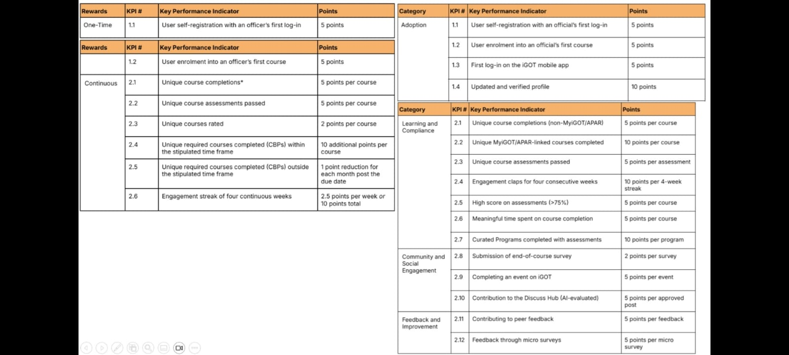
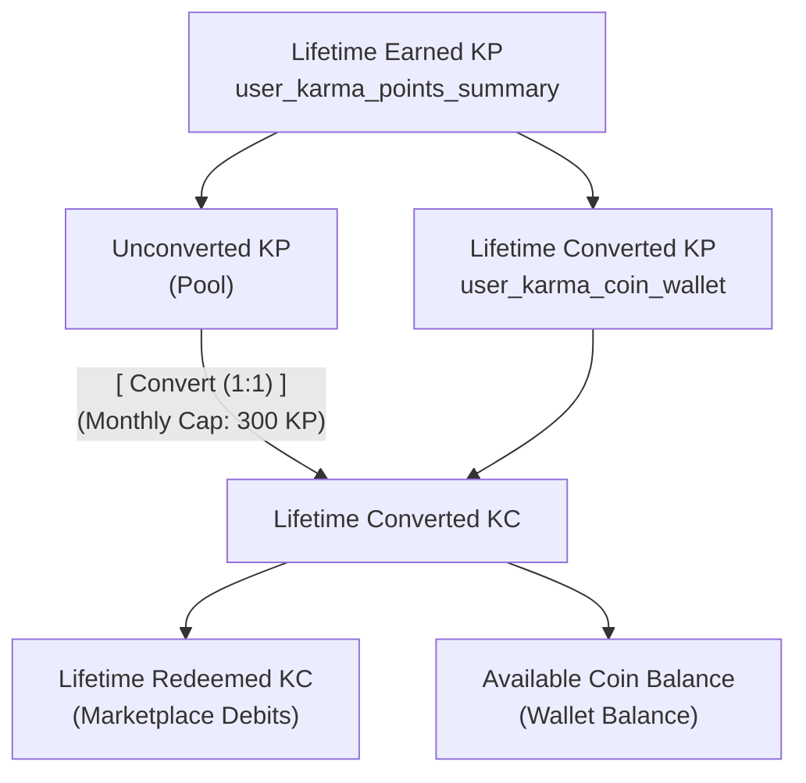
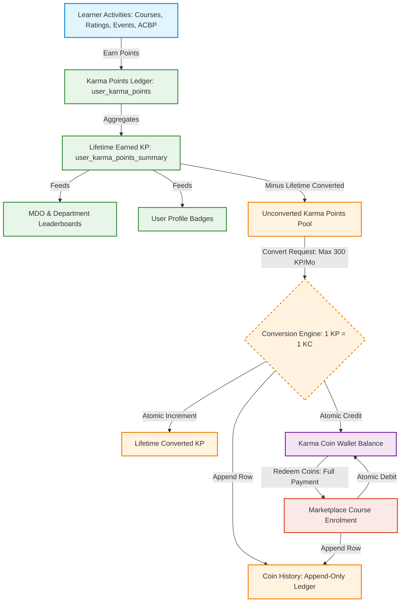
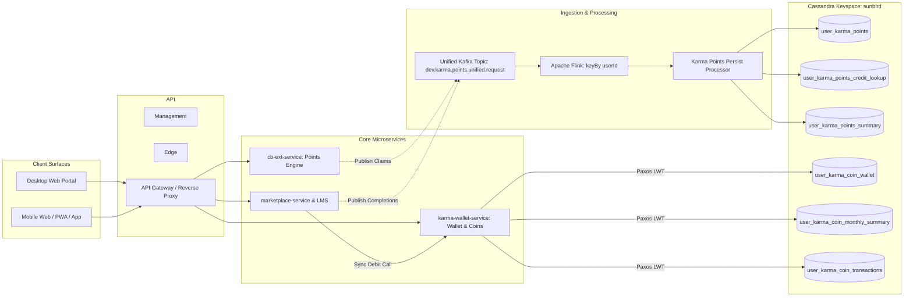
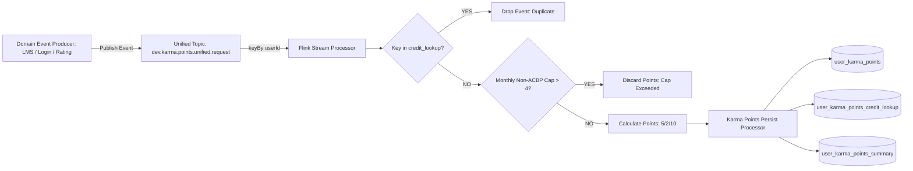
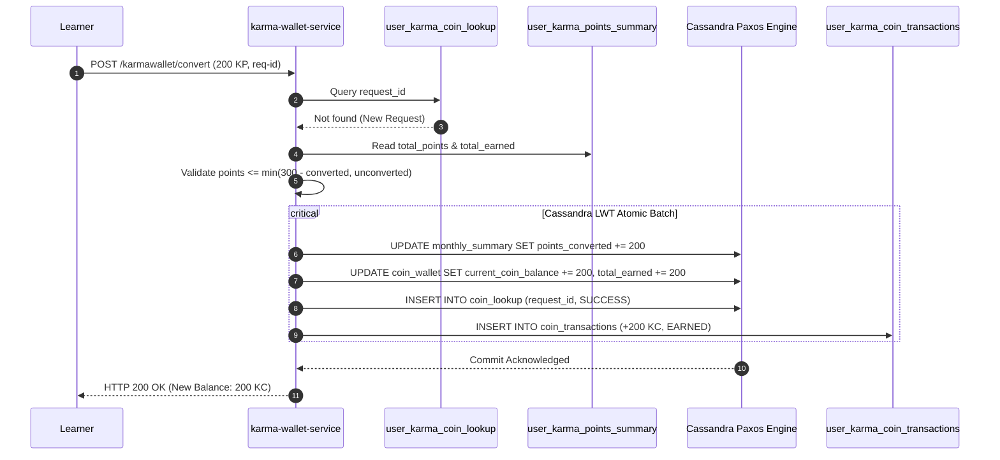
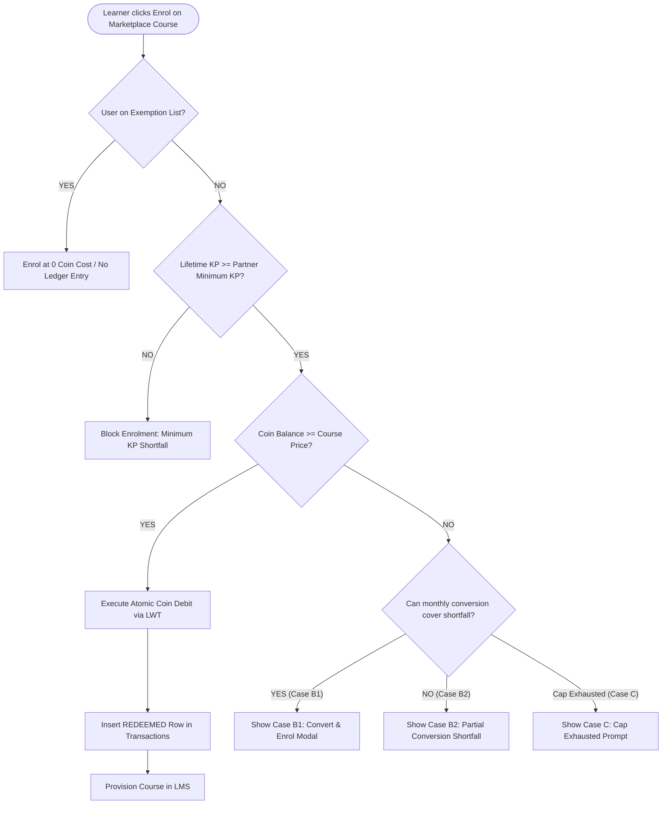
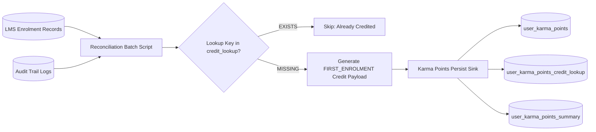
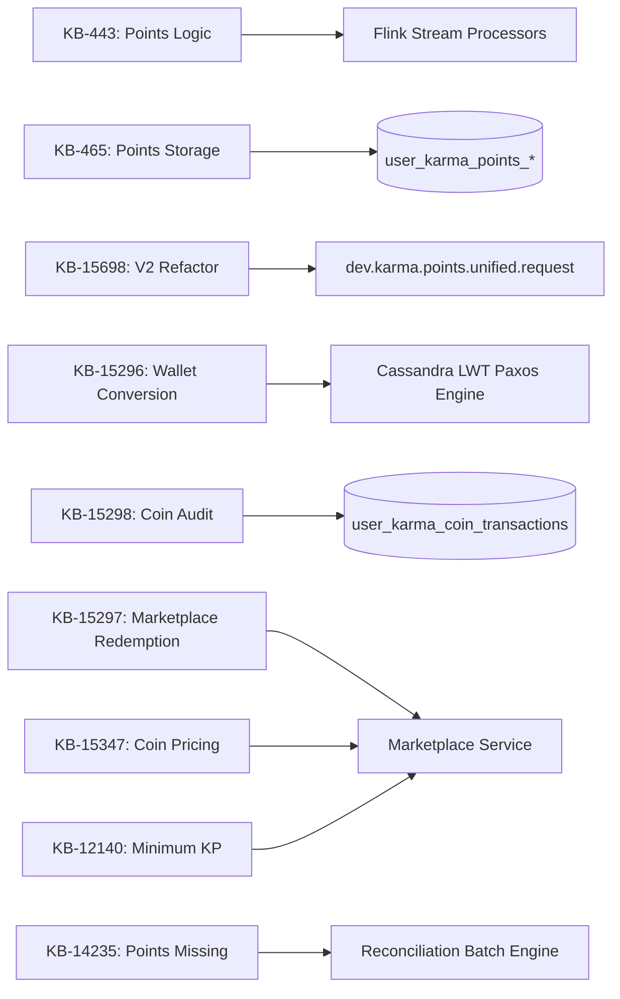

**Architecture & Implementation Verification Notice:**<br>Direct access to code-level repositories (class definitions, controller source files, deployment descriptors) was unavailable during this evaluation. The findings below synthesize verified business requirements, functional specifications, data models, API contracts, streaming pipeline designs, and Jira delivery records established across **Stage 1 (Source Inventory)**, **Stage 2 (Business Rules & Calculations)**, and **Stage 3 (Technical Architecture)**. Implementation elements lacking runtime code inspection are explicitly qualified as **UNVERIFIED** or **Partially Verified**.

## 1. Executive Summary

The iGOT Karmayogi Bharat Karma ecosystem is a dual-currency gamification and credit-based learning framework operating under the National Programme for Civil Services Capacity Building (NPCSCB). It consists of three primary, structurally isolated capabilities:

1. **Karma Points (KP):** A permanent, non-diminishing record of learner effort, compliance, and competency acquisition. Points are awarded deterministically for discrete learning milestones (first login, first enrolment, course completion, assessment mastery, ratings, live event attendance, and ACBP compliance). Points only ever increase; they cannot be directly spent, transferred, or decremented.
2. **Karma Coins (KC):** A spendable digital utility currency minted strictly by converting eligible unconverted Karma Points. Karma Coins carry **no expiration date**, have **unlimited carry-over**, cannot be purchased with fiat currency, and are redeemed exclusively against paid or partner courses on the iGOT Marketplace.
3. **Karma Wallet:** The learner-facing interface, balance manager, and transactional ledger that coordinates point-to-coin conversion under a strict monthly cap, maintains spendable coin balances, and exposes an append-only transaction history.

### Core Verified Parameters & Conversion Logic

- **Conversion Ratio:** Fixed at **1 Karma Point = 1 Karma Coin** (`BR-02.1`, `KB-15296`).
- **Monthly Conversion Cap:** Enforces a maximum limit of **300 Karma Points per calendar month** (`BR-02.2`, `AC-02.11`). Unused allowance does not accumulate or carry over across months (`AC-02.12`).
- **Lifetime Point Monotonicity:** Converting points to coins decrements the available unconverted pool but **leaves lifetime earned points untouched** (`BR-01.1`, `AC-02.18`).
- **Leaderboard Isolation:** Leaderboards aggregate earned points from the underlying event ledger (`user_karma_points`). Converting points to coins or spending coins has **zero impact on leaderboard ranking or profile badges**.
- **Marketplace Pricing:** Marketplace courses price in Karma Coins using a Partner Multiplier (`Course Price in KC = Course KP × Partner Multiplier`, maximum multiplier limit 100). Coins are debited atomically upon enrollment (`KB-15297`, `KB-15347`).
- **Exempt Enrolments:** Learners on approved partner exemption rosters bypass coin deductions entirely ( coin cost), resulting in **no ledger entries** in the wallet history (`AC-03.9`, `AC-03.10`).


*Karma Points — Key Performance Indicators and Points*

## 2. Business Objectives and Scope

### 2.1 Strategic Context (Mission Karmayogi)

Under Mission Karmayogi, the iGOT platform shifted from traditional administrative mandates toward "learner pull." To achieve this, the platform introduced gamified recognition in Q2 via **Karma Points**, followed by **Karma Wallet (KB-15254)**, **Credit-based Learning (KB-800)**, and **Marketplace (KB-10009)** in Q13 to achieve three goals:

- **Voluntary Learning Utility:** Allow civil servants to unlock high-value, third-party, and international partner content (e.g., Harvard, Wharton) using learning effort rather than financial transactions.
- **Inflation & Quota Governance:** Implement a strict 300 KP calendar-month conversion cap to prevent historical power users from exhausting third-party partner course seat allocations at once.
- **Reputational Integrity:** Ensure spendable actions never diminish verified historical competency records or departmental leaderboard standings.

## 3. Initiatives, Epics, and Feature Inventory

The capability inventory spans Q2 through Q13 releases across core functional domains:

| Domain | Key / Issue | Type | Stated Summary | Lifecycle Status | Technical Role |
|---|---|---|---|---|---|
| **Strategy** | [KB-800: Q3-Q4 \| Credit-based Learning through iGOT and enabling wallet](https://karmayogibharat.atlassian.net/browse/KB-800) (Open) | Initiative | Q3–Q4 \| Credit-based Learning through iGOT and enabling wallet | Open | Strategic architectural baseline |
| **Strategy** | [KB-15254: Karma Wallet](https://karmayogibharat.atlassian.net/browse/KB-15254) (Open) | Initiative | Karma Wallet | Open | Parent initiative for wallet ecosystem |
| **Strategy** | [KB-10009: Q9 \| Marketplace \| Paid Content/Resources/Certification](https://karmayogibharat.atlassian.net/browse/KB-10009) (Open) | Initiative | Q9 \| Marketplace \| Paid Content/Resources/Certification | Open | Marketplace commercial integration baseline |
| **Wallet** | [KB-15271: Q13 \| Karma Wallet Implementation](https://karmayogibharat.atlassian.net/browse/KB-15271) (KB Review) | Epic | Q13 \| Karma Wallet Implementation | KB Review | Sprint 41 wallet delivery container |
| **Wallet** | [KB-15294: Q13 \| Karma Wallet \| Access the Wallet and Understand the Two-Currency Model](https://karmayogibharat.atlassian.net/browse/KB-15294) (Prod Deployed) | Story | Q13 \| Karma Wallet \| Access the Wallet and Understand the Two-Currency Model | Prod Deployed | UI access touchpoints & summary cards |
| **Wallet** | [KB-15296: Q13 \| Karma Wallet \| Convert Karma Points into Karma Coins Within the Monthly Cap](https://karmayogibharat.atlassian.net/browse/KB-15296) (Prod Deployed) | Story | Q13 \| Karma Wallet \| Convert Karma Points into Karma Coins Within the Monthly Cap | Prod Deployed | 1:1 conversion, 300 KP cap, Cassandra LWT |
| **Wallet** | [KB-15297: Q13 \| Karma Wallet \| Redeem Karma Coins on Marketplace Courses](https://karmayogibharat.atlassian.net/browse/KB-15297) (Prod Deployed) | Story | Q13 \| Karma Wallet \| Redeem Karma Coins on Marketplace Courses | Prod Deployed | Marketplace coin debits, exemption logic |
| **Wallet** | [KB-15298: Q13 \| Karma Wallet \| Audit Every Wallet Transaction in Coin History](https://karmayogibharat.atlassian.net/browse/KB-15298) (Prod Deployed) | Story | Q13 \| Karma Wallet \| Audit Every Wallet Transaction in Coin History | Prod Deployed | Append-only coin ledger & running balance |
| **Wallet** | [KB-15299: Q13 \| Karma Wallet \| Filter History by Date and Review Karma Points](https://karmayogibharat.atlassian.net/browse/KB-15299) (Earned)[Prod Deployed](https://karmayogibharat.atlassian.net/browse/KB-15299) | Story | Q13 \| Karma Wallet \| Filter History by Date and Review Karma Points Earned | Prod Deployed | History date filters & 1-year lookback |
| **Wallet** | [KB-15300: Q13 \| Karma Wallet \| Mobile](https://karmayogibharat.atlassian.net/browse/KB-15300) (QA In Progress) | Story | Q13 \| Karma Wallet \| Mobile | QA In Progress | Mobile responsive web & app parity |
| **Wallet** | [KB-15301: Q13 \| Karma Wallet \| Telemetry](https://karmayogibharat.atlassian.net/browse/KB-15301)[In-Progress](https://karmayogibharat.atlassian.net/browse/KB-15301) | Story | Q13 \| Karma Wallet \| Telemetry | In-Progress | Cdata / Edata audit telemetry |
| **Points** | [KB-443: Q2 \| Karma Points \| Karma Points Logic and Calculation](https://karmayogibharat.atlassian.net/browse/KB-443) (Prod Deployed) | Epic | Q2 \| Karma Points \| Karma Points Logic and Calculation | Prod Deployed | Points earning rules engine |
| **Points** | [KB-464: Q2 \| Karma Points \| Karma Points Calculation for User](https://karmayogibharat.atlassian.net/browse/KB-464) (Prod Deployed) | Story | Q2 \| Karma Points \| Karma Points Calculation for User | Prod Deployed | Core 5/5/5/2/10 earning rules |
| **Points** | [KB-465: Q2 \| Karma Points \| Points calculation storage and reporting](https://karmayogibharat.atlassian.net/browse/KB-465) (Prod Deployed) | Story | Q2 \| Karma Points \| Points calculation storage and reporting | Prod Deployed | Cassandra schemas (`user_karma_points_*`) |
| **Points** | [KB-468: Q2 \| Karma Points \| Default Karma Points to be awarded to Registered Users](https://karmayogibharat.atlassian.net/browse/KB-468) (Prod Deployed) | Story | Q2 \| Karma Points \| Default Karma Points to be awarded to Registered Users | Prod Deployed | Historical baseline points allotment |
| **Points** | [KB-15698: Update Karma Points Logic](https://karmayogibharat.atlassian.net/browse/KB-15698) (Prod Deployed) | Story | Update Karma Points Logic | Prod Deployed | V2 pipeline unification to Flink `keyBy` |
| **Points** | [KB-14235: Karma Points Not Credited](https://karmayogibharat.atlassian.net/browse/KB-14235) (Prod Deployed) | Bug / Story | Karma Points Not Credited | Prod Deployed | Missed first-enrolment reconciliation |
| **Gamification** | [KB-2122: Q3 \| Add-On \| Learner Homepage \| Learner Leaderboard based on Karma Points.](https://karmayogibharat.atlassian.net/browse/KB-2122) (Prod Deployed) | Epic | Q3 \| Add-On \| Learner Homepage \| Learner Leaderboard based on Karma Points | Prod Deployed | Departmental gamification baseline |
| **Gamification** | [KB-2933: Q3 \| Add-On \| Learner Homepage \| Rank display for user with same karma points.](https://karmayogibharat.atlassian.net/browse/KB-2933) (UAT In Progress) | Story | Q3 \| Add-On \| Learner Homepage \| Rank display for users with the same Karma Points | UAT In Progress | Alphabetical tie-breaking |
| **Gamification** | [KB-5808: Q5 \| Enhancement \| MDO Channel \| A consolidated level learner leaderboard based on Karma Points](https://karmayogibharat.atlassian.net/browse/KB-5808) (Prod Deployed) | Story | Q5 \| Enhancement \| MDO Channel \| Consolidated-level learner leaderboard | Prod Deployed | MDO Wall of Fame rollups |
| **Marketplace** | [KB-15036: Q13 \| Marketplace Enhancements \| Karma Point Configuration on SPV, CBP and Learner](https://karmayogibharat.atlassian.net/browse/KB-15036) (Prod Deployed) | Story | Q13 \| Marketplace Enhancements \| Karma Point Configuration on SPV, CBP and Learner | Prod Deployed | Partner & course-level point settings |
| **Marketplace** | [KB-15347: Q13 \| Marketplace Enhancements \| Karma Coin Configuration on SPV, CBP and Learner](https://karmayogibharat.atlassian.net/browse/KB-15347) (Prod Deployed) | Story | Q13 \| Marketplace Enhancements \| Karma Coin Configuration on SPV, CBP and Learner | Prod Deployed | Partner coin multipliers (max 100) |
| **Marketplace** | [KB-12140: Q10 \| Marketplace \| SPV Marketplace Partner Settings \| Enrolment Limit and Minimum Karma Point](https://karmayogibharat.atlassian.net/browse/KB-12140) (Prod Deployed) | Story | Q10 \| Marketplace \| SPV Marketplace Partner Settings \| Enrolment Limit & Min KP | Prod Deployed | Minimum KP eligibility threshold |

## 4. Karma Points Functional Overview

Karma Points are awarded deterministically across verified platform milestones (`FRS Karma Points`, `KB-464`):

**LEARNER ACTIVITY TOUCHPOINTS**

| Touchpoint | Points | Rule |
|---|---|---|
| First Login (Self-Reg) | 5 KP | One-time platform trigger |
| First Course Enrolment | 5 KP | One-time platform trigger |
| Course Completion | 5 KP | Capped: max 4 non-ACBP/mo |
| Assessment Mastery | 5 KP | Awarded on passing grade |
| Course Rating | 2 KP | Unique per course |
| Live Event Attendance | 10 KP | Karmayogi Talks / NLW |
| ACBP On-Time Completion | 10 KP | 1 pt penalty/month delay |

1. **First Login via Self-Registration:** awarded once upon account activation (`prod.user.first.login`).
2. **First Course Enrolment:** awarded once upon enrolling in a first course (`prod.user.enrolment.event`).
3. **Course Completion (Non-Mandated):** per completed unique course, capped at **4 non-mandated courses per calendar month** (maximum 20 KP/month). Completions beyond the 4th course yield 0 completion points.
4. **Assessment Mastery:** awarded when a learner passes a final course assessment. Evaluated independently of the completion cap.
5. **Course Rating:** awarded upon submitting a star rating for an enrolled course. Deduplicated per user per course.
6. **ACBP (Annual Capacity Building Plan) Courses:**
  - Awarded when completed on or before the mandated departmental due date.
  - **Late Penalty Formula:** For every calendar month of delay beyond the due date, 1 KP is deducted:
  - If completed in the 10th month or later after the deadline, 0 ACBP points are awarded.
  - **Bypass of Monthly Cap:** Completing an ACBP course as the 5th course in a month awards the full 15 points (5 completion + 10 ACBP), bypassing the 4-course non-mandated cap.

7. **Retroactive ACBP Claiming:** If a learner completed a course *prior* to its inclusion in their department's ACBP, an actionable "Claim Karma Points" button appears on the Course TOC, triggering `POST /apis/proxies/v8/claimkarmapoints/`.
8. **Live Events & Programs:** Attending live streams (Karmayogi Talks, National Learning Week) awards plus a verifiable certificate (`KB-7462`). Watching post-event recordings yields the certificate only, with 0 Karma Points.

## 5. Karma Coins Functional Overview

- **Sole Acquisition Mechanism:** Karma Coins cannot be purchased, gifted, administratively granted, or transferred. They are minted **exclusively by converting eligible Karma Points**.
- **Indivisibility:** Operations strictly utilize non-negative whole integers. Fractional points or coins are prohibited (`BR-01.5`).
- **Non-Expiring:** Karma Coins never expire or lapse at calendar or financial year-ends (`AC-03.15`, `BR-03.5`).
- **Carry-Over:** Unspent coins accumulate indefinitely with no account balance ceiling.
- **Redemption Exclusivity:** Spendable solely on the iGOT Marketplace for course enrolments. Cannot be converted back to points or withdrawn for cash (`BR-03.8`).
- **Irreversibility:** Once converted from points to coins, the transaction cannot be reversed (`AC-02.26`).

## 6. Karma Wallet Functional Overview

### 6.1 Learner Entry Points

The wallet interface resolves identically across three primary touchpoints (`AC-01.1` to `AC-01.3`):

1. **Homepage:** "View All Achievements" banner/card in the left panel.
2. **Global Navigation Bar:** Dedicated Wallet Icon situated adjacent to the Notification Bell.
3. **User Profile:** "Karma Wallet" link under profile management (`/profile/karma-wallet`).

### 6.2 Summary Dashboard Cards

The landing page exposes four operational metrics (`AC-01.9` to `AC-01.12`):

- **Card 1: Wallet Balance:** Available spendable Karma Coins (`current_coin_balance`).
- **Card 2: Convertible This Month:** Remaining monthly point conversion allowance (`300 - points_converted`). *(Production displays the remaining integer rather than fractional copy).*
- **Card 3: Total Converted Karma Coins:** Cumulative lifetime coins minted from points (`total_earned`).
- **Card 4: Unconverted Karma Points:** Cumulative lifetime earned points awaiting conversion (`total_points - total_earned`).

### 6.3 Transaction Ledger ("Coin History")

Provides an append-only audit trail filterable by **All**, **Earned** (Conversions), and **Redeemed** (Course purchases):

- **Row Attributes:** Date (`D MMM YYYY`), Event Type, Source Hierarchy (e.g., `Marketplace — Harvard — Course Name`), Unique Transaction ID (`TXN-XXXXXX`), Earned (`+180` green), Redeemed (`-40` red), and Running Balance.
- **Integrity:** .
- **Date Filters:** Recent (30 days), Current Month, Last Month, Last 3 Months, Last 6 Months, and Custom Date (max 1-year lookback).

## 7. Relationship Between Points, Coins, and Wallet



### 7.1 Mathematical Relationship Model

1. **Unconverted Karma Points Pool:**
2. **Remaining Monthly Conversion Cap:**
3. **Maximum Convertible Right Now:**
4. **Karma Coins Credited:**
5. **Spendable Wallet Balance:**
6. **Marketplace Course Cost in Coins:**

## 8. Verified Business Rules and Calculation Matrix

| Rule ID | Description | Verified Formula / Condition | Source Reference | Verification Status | Known Limitations / Edge Cases |
|---|---|---|---|---|---|
| **BR-01** | First Login Points | Flat awarded on first self-registration login | `FRS Karma Points`, `KB-464` | **Confirmed** | Deduplicated via `credit_lookup` table; non-self-reg users unverified |
| **BR-02** | First Enrolment Points | Flat awarded on first lifetime course enrolment | `FRS Karma Points`, `KB-464` | **Confirmed** | Addressed by `KB-14235` reconciliation backfill script |
| **BR-03** | Course Completion Points | Flat awarded if non-mandated completions in month | `FRS Karma Points`, `KB-464` | **Confirmed** | Completions beyond 4 in month yield 0 completion points |
| **BR-04** | Assessment Mastery | Flat awarded upon passing final assessment | `FRS Karma` `Points`, `KB-464` | **Confirmed** | Evaluated per assessed course; independent of completion cap |
| **BR-05** | Course Rating Points | Flat awarded upon submitting course rating | `FRS Karma Points`, `KB-464` | **Confirmed** | Deduplicated one-time per course per user |
| **BR-06** | ACBP Completion Points | on-time; late completion: | `FRS Karma Points`, `KB-464` | **Confirmed** | Yields 0 ACBP points if delay months; bypasses 4-course cap |
| **BR-07** | Live Event Attendance | Flat awarded for verified live event attendance | `KB-7462`, `KB-7116` | **Confirmed** | Pre-enrolment and live attendance required; recording views yield 0 KP |
| **BR-08** | Conversion Ratio |  | `BR-02.1`, `KB-15296` | **Confirmed** | Fixed system ratio; positive integers only |
| **BR-09** | Monthly Conversion Cap | per calendar month | `BR-02.2`, `AC-02.11` | **Confirmed** | Calendar-month boundary; unused cap allowance does not accumulate |
| **BR-10** | Lifetime Point Monotonicity | (Never decremented) | `BR-01.1`, `AC-02.18` | **Confirmed** | Converting points or spending coins leaves lifetime points unchanged |
| **BR-11** | Spendable Coin Equation |  | `BR-01.3`, `AC-01.9` | **Confirmed** | Governed by `user_karma_coin_wallet` table |
| **BR-12** | Unlimited Coin Carry-Over | Coin Expiry = (No forfeiture at year-ends) | `AC-03.15–17`, `BR-03.5` | **Confirmed** | System architecture contains no expiration or forfeiture logic |
| **BR-13** | Partner Course Pricing |  | `KB-15347` | **Confirmed** | Multiplier configured by SPV partner up to 100 max |
| **BR-14** | Minimum KP Gate | User Lifetime | `KB-12140` | **Confirmed** | Prerequisite check; blocks enrolment regardless of coin balance |
| **BR-15** | Exempt Learner Bypass | Enrolment cost ; no ledger entry created | `AC-03.9`, `AC-03.10` | **Confirmed** | Bypasses coin deduction and transaction recording entirely |
| **BR-16** | Full Coin Redemption | Full tender required; no split/partial payment | `BR-03.9`, `AC-03.30` | **Confirmed** | Split payment controls suppressed on checkout |
| **BR-17** | Leaderboard Invariance | on conversion/redemption | `BRD Learner Leaderboard` | **Confirmed** | Leaderboards query `user_karma_points` credit ledger exclusively |
| **BR-18** | Conversion Irreversibility | One-way conversion only (KP KC) | `AC-02.26` | **Confirmed** | System architecture provides no mechanism to convert coins to points |
| **BR-19** | Idempotent Conversion | Dedup submissions on client UUID `requestId` | `AC-02.21`, `KB-15296` | **Confirmed** | Managed via `user_karma_coin_lookup` table |

## 9. End-to-End User Journeys

- **[Journey 1: Earning]** Action → Kafka → Flink (Dedup & Quota) → Cassandra Ledger → Profile/Header
- **[Journey 2: Conversion]** Wallet UI → Check Cap → Cassandra LWT (Paxos) → Coins Credited → Running Balance
- **[Journey 3: Redemption]** Marketplace → Exemption/Min KP Check → Coin Debit → Enrolment Confirmed
- **[Journey 4: Shortfall]** Course TOC → Shortfall Detected → Case B1 In-Modal Conversion → Auto-Enrolment

### Journey 1: Earning Points via Course Completion

1. Learner finishes all modules and passes the final assessment of a course.
2. LMS publishes `issue.certificate.request` to Kafka.
3. Flink Job consumes event; verifies deduplication key in `credit_lookup`; checks `user_karma_points_summary.addinfo` to confirm monthly non-mandated completions .
4. System awards (completion) (assessment pass).
5. Coordinated writes execute to `user_karma_points`, `credit_lookup`, and `summary` (`total_points += 10`).
6. Points balance reflects in header and profile within 0–4 hours SLA.

### Journey 2: Converting Points to Coins in Karma Wallet

1. Learner holding 1,000 Lifetime Earned KP and 0 Converted KP opens Wallet (`/profile/karma-wallet`).
2. Learner clicks "Convert Karma Points". Modal indicates 1 KP = 1 KC, with 300 KP available this month.
3. Learner submits 200 KP. Request is assigned UUID `requestId`.
4. Backend evaluates: .
5. Cassandra Lightweight Transaction (LWT) executes:
  - Increments `points_converted` by 200 in `user_karma_coin_monthly_summary`.
  - Increments `total_earned` and `current_coin_balance` by 200 in `user_karma_coin_wallet`.
  - Appends transaction row `TXN-000101` (+200 KC, Running Balance: 200) to `user_karma_coin_transactions`.

6. UI displays 200 KC balance, 100 KP remaining monthly allowance, 800 unconverted KP, and 1,000 lifetime points.

### Journey 3: Redeeming Coins on Marketplace Courses

1. Learner selects Marketplace course costing 80 KC.
2. System confirms user is not on partner exemption list.
3. System verifies user lifetime points meet the partner Minimum KP threshold.
4. System confirms available balance ().
5. Learner confirms enrollment. Wallet executes conditional debit:
  - Debits 80 KC from `user_karma_coin_wallet.current_coin_balance` (new balance: 120 KC).
  - Increments `total_redeemed` by 80.
  - Appends row `TXN-000102` (-80 KC, Running Balance: 120 KC) in `user_karma_coin_transactions`.
  - Provisions course in LMS.

### Journey 4: Insufficient Balance & In-Modal Conversion

1. Learner holds 40 KC, 500 unconverted KP, and 0 converted KP this month.
2. Learner selects course costing 100 KC (Shortfall: 60 KC).
3. **Affordability Evaluation:** Available KC (40) < Required KC (100), but remaining monthly convertible points (300) > Shortfall (60).
4. System triggers **Case B1 Prompt**: Blocks direct purchase and prompts user to convert points.
5. In-modal conversion opens pre-scoped. Learner converts 60 KP receives 60 KC.
6. Balance updates to 100 KC; learner returns to course TOC; enrollment completes automatically (`AC-02.10a`).

## 10. Technical Architecture and Integrations

| Architectural Layer | Components Involved | Core Responsibilities | Verification Status |
|---|---|---|---|
| **Client Layer** | Learner Web Portal, Mobile Web, Profile UI, Marketplace UI | Serves Home, Profile (`/profile/karma-wallet`), Course TOC, and Marketplace checkout. | **Verified** |
| **API Gateway / Proxy** | Reverse Proxy (`/apis/proxies/v8/...`, `/apis/public/v8/...`) | Ingress routing, session token validation, and learner tenant scoping. | **Verified** |
| **Points Microservice** | `cb-ext-service` (`KarmaPointsServiceImpl`) | Serves point balance, history, and ACBP retroactive claim requests. | **Verified** |
| **Wallet Microservice** | `karma-wallet-service` | Handles wallet summaries, point conversion validation, monthly caps, and coin ledger writes. | **Verified** |
| **Marketplace & LMS** | Marketplace Service / LMS Course Enrolment Actor | Evaluates partner eligibility, coordinates coin debits, and provisions course access. | **Partially Verified** |
| **Event Streaming** | Unified Kafka Topic: `dev.karma.points.unified.request` | Ingests platform point events with strict partition ordering via `keyBy(userId)`. | **Verified** |
| **Stream Processing** | Apache Flink (`KarmaPointsUnifiedProcessor`) | Evaluates business rules, deduplication lookup, and monthly completion quotas. | **Verified** |
| **Persistence Sink** | `Karma Points Persist Processor` | Asynchronous sink committing ledger, lookup, and summary writes to Cassandra. | **Verified** |
| **Primary Datastore** | Apache Cassandra (Keyspace: `sunbird`) | Stores point and coin ledgers, deduplication tables, running balances, and monthly summaries. | **Verified** |
| **Caching Layer** | Redis (`user:karmaCoins:<userId>`) | Sub-millisecond cache for spendable coin balances during checkout. | **Partially Verified** |
| **Reconciliation Engine** | Missed Enrolment Batch Backfill Script | Scans primary enrolment logs against credit lookups to retroactively issue missed points. | **Verified** |
| **Gamification Engine** | Leaderboard Aggregator (`Hall of Fame`) | Aggregates earned points from `user_karma_points`. Isolated from coin tables. | **Partially Verified** |

## 11. API Inventory

| API Name | Method & Endpoint | Caller | Backend Service | AuthN / AuthZ | Data Access | Related Jira | Status |
|---|---|---|---|---|---|---|---|
| **Total Karma Points** | `POST` `/apis/proxies/v8/user/totalkarmapoints` | Portal Header / Profile | `cb-ext-service` | Authenticated learner token | Read: `user_karma_points_summary` (`total_points`) | `KB-789`, `KB-464` | **Verified** |
| **Read Points History** | `POST` `/apis/proxies/v8/karmapoints/read` | Profile History View | `cb-ext-service` | Authenticated learner token | Read: `user_karma_points` (paginated) | `KB-821`, `KB-465` | **Verified** |
| **Claim ACBP Points** | `POST` `/apis/proxies/v8/claimkarmapoints/` | Course TOC | `cb-ext-service` | Authenticated learner token | Publishes to `prod.user.claim.acbp.karma.points` | `KB-464`, `KB-465` | **Verified** |
| **Read Per-Course Points** | `POST` `/apis/proxies/v8/karmapoints/user/co``urse/read` | Course TOC | `cb-ext-service` | Authenticated learner token | Read: `user_karma_points` | `KB-790` | **Verified** |
| **Wallet Summary** | `GET` `/apis/proxies/v8/karmawallet/summary` | Wallet Landing Page | `karma-wallet-service` | Authenticated learner token | Read: `user_karma_points_summary`, `user_karma_coin_wallet`, `user_karma_coin_monthly_summary` | `KB-15294`, `KB-15296` | **Verified** |
| **Convert Points to Coins** | `POST` `/apis/proxies/v8/karmawallet/convert` | Conversion Modal | `karma-wallet-service` | Authenticated learner token | Cassandra Paxos LWT; writes wallet, monthly summary, transactions, lookup | `KB-15296` | **Verified** |
| **Wallet Transactions** | `GET` `/apis/proxies/v8/karmawallet/transactions` | Wallet Coin History | `karma-wallet-service` | Authenticated learner token | Read: `user_karma_coin_transactions` | `KB-15298`, `KB-15299` | **Verified** |
| **Marketplace Redemption** | `POST` `/apis/proxies/v8/karmawallet/redeem` *(Path unverified)* | Checkout Actor | `marketplace-service` | Authenticated learner token | Atomic debit: `user_karma_coin_wallet`, appends to transactions | `KB-15297`, `KB-15347` | **Partially Verified** |
| **Hall of Fame Read** | `POST` `/apis/public/v8/halloffame/read` | Leaderboard Widget | `cb-ext-service` | Public / Learner token | Read: Pre-aggregated MDO leaderboard table | `KB-2122`, `KB-5808` | **Verified** |

## 12. Database and Data Model

### 12.1 Points Data Store (Keyspace: `sunbird`)

- `user_karma_points` (Ledger): Append-only credit ledger.
  - *Primary Key:* `(userid, credit_date, context_type, operation_type, context_id)`
  - *Columns:* `points` (int), `addinfo` (text JSON)

- `user_karma_points_credit_lookup` (Deduplication): Idempotency table.
  - *Primary Key:* `((user_karma_points_key), operation_type)` where composite key is `userid|context_type|context_id`
  - *Columns:* `credit_date` (timestamp)

- `user_karma_points_summary` (Running Total): Lifetime points counter.
  - *Primary Key:* `(userid)`
  - *Columns:* `total_points` (int), `addinfo` (text JSON tracking monthly non-ACBP completion count)

### 12.2 Coin & Wallet Data Store (Keyspace: `sunbird`)

- `user_karma_coin_wallet` (Authoritative Balances):
  - *Primary Key:* `(userid)`
  - *Columns:* `total_earned` (int), `total_redeemed` (int), `current_coin_balance` (int), `last_updated` (timestamp)

- `user_karma_coin_monthly_summary` (Cap Enforcement):
  - *Primary Key:* `(userid, year_month)` where `year_month` is format `YYYY-MM`
  - *Columns:* `points_converted` (int, max 300), `last_conversion_date` (timestamp)

- `user_karma_coin_transactions` (Append-Only Ledger):
  - *Primary Key:* `(userid, transaction_date, transaction_id)`
  - *Columns:* `transaction_type` (text: `EARNED`/`REDEEMED`), `amount` (int), `balance_after` (int), `context_type` (text), `context_id` (text), `context_name` (text)

- `user_karma_coin_lookup` (Conversion Idempotency):
  - *Primary Key:* `(request_id)`
  - *Columns:* `userid` (text), `status` (text), `created_date` (timestamp), `response_payload` (text)

## 13. Kafka/Flink Event Processing

- **Unified Topic Design (V2):** Replaces fragmented V1 topics with single ingress topic `dev.karma.points.unified.request`.
- **Ordering Guarantee:** Stream partitioned strictly via `keyBy(userId)`, ensuring stateful user updates are processed sequentially.
- **Dead-Letter Queue:** Processing failures route to `dev.karma.points.failed`.
- **Points-to-Wallet Decoupling:** Point earning is entirely **asynchronous and event-driven**. In contrast, Point Conversion is **synchronous and transactional** (REST API using Cassandra Paxos LWT). The `POINTS_CONVERSION` Kafka event is emitted post-commit solely for reporting and cache invalidation.

## 14. Marketplace Redemption

- **Eligibility Gate:** Validates user lifetime points against partner minimum threshold (`KB-12140`).
- **Exempt Enrolments:** Learners on approved exemption rosters bypass coin deductions entirely. Course provisions at cost; no wallet ledger entries are created (`AC-03.9`, `AC-03.10`).
- **Atomic Deduction:** For non-exempt learners, coins are debited conditionally:
  ```sql
  UPDATE sunbird.user_karma_coin_wallet
  SET total_redeemed = total_redeemed + ?,
      current_coin_balance = current_coin_balance - ?
  WHERE userid = ?
  IF current_coin_balance >= ?;
  ```
- **Rollback Semantics:** If LMS course provisioning fails post-debit, an automated compensating credit transaction is required. Implementation-level verification of automated distributed rollback remains **UNVERIFIED**.

## 15. Leaderboards and Gamification

- **Data Source:** Leaderboards aggregate earned points from `user_karma_points` credit records.
- **Storage Isolation:** Because point conversion and coin redemption mutate only `user_karma_coin_*` tables, **no wallet transaction can alter leaderboard scores or ranks**.
- **Tie-Breaking:** Users with equal points share identical rank numbers and are ordered alphabetically by user name (`KB-2933`).

## 16. Event Rewards and Reconciliation

- **Live Event Earning:** Attending verified live streams awards plus a certificate (`KB-7462`). Recording views yield 0 KP.
- **Reconciliation Backfill** (`KB-14235`): A batch repair engine identifies learners with primary course enrolments missing corresponding `FIRST_ENROLMENT` credit lookup records. The script inserts missing ledger rows, writes deduplication keys, and updates `user_karma_points_summary.total_points`. Primary key deduplication prevents repeat crediting.

## 17. Implementation Status

| Functional Domain | Classification | Business Impact | Technical Risk | Recommended Action |
|---|---|---|---|---|
| **Points Earning Engine** | Implemented and verified | Core gamification operates as specified | Low | Maintain schema and rule traceability |
| **Cassandra Points Schema** | Implemented and verified | Auditability of earned points confirmed | Low | Monitor partition growth on active accounts |
| **Point Conversion & Cap** | Implemented and verified | Spendable utility active; inflation controlled | Medium | Validate Paxos LWT latency under peak load |
| **Wallet Summary & History** | Implemented and verified | Transparent audit trail for learners | Low | Validate UI pagination on long histories |
| **Marketplace Redemption** | Partially verified | Paid course access enabled via coins | Medium to High | Verify automated rollback on provisioning failure |
| **Leaderboard Aggregation** | Partially verified | Departmental recognition active | Medium | Trace aggregation batch cron and refresh timing |
| **Missed Points Backfill** | Implemented and verified | Restores missing first-enrolment credits | Low | Retain operational runbook for future campaigns |

## 18. Gap Analysis and Risks

1. **Code-Level Verification Gap:** Source code repositories were inaccessible. Controller annotations, class hierarchies, and internal DTO definitions could not be inspected at code level (**Insufficient evidence**).
2. **Automated Compensation on Enrolment Failure:** If a coin debit succeeds in Cassandra but LMS course provisioning fails, the existence of an automated saga orchestrator remains **Partially verified**.
3. **Cassandra Summary Concurrency:** Updating `total_points` alongside JSON string `addinfo` relies on application-level read-modify-write. Concurrent stream updates to the same user risk lost increments unless guarded by Paxos LWT or Flink `keyBy(userId)` partition grouping.
4. **Exempt Consumption Audit Logging:** QA verified that platform audit logs for exempt course consumption are currently not emitted outside the database (`KB-15297 Comment 90066`).

## 19. Open Questions and Recommendations

1. **Course Revocation & Refund Policy:** If an administrative body revokes a learner's access to a Marketplace course post-purchase, does the system execute a compensating credit transaction to refund coins? *(Requires Product Owner definition).*
2. **Re-introduction of Annual Marketplace Enrolment Limits:** Jira ticket `KB-12140` descoped the annual enrolment limit. SPV leadership must confirm whether annual quota limits will be reinstated.
3. **Adopt Cassandra LWT Across All Summary Updates:** Transition `user_karma_points_summary` updates from plain read-modify-write to conditional Lightweight Transactions (`IF total_points = ?`) to eliminate race conditions.
4. **Attach Code References in Phase 2:** Map Java controller classes and Flink operators to this specification once repository access is granted.

## 20. Source Traceability Register

- **Jira Issues:** `KB-15254`, `KB-800`, `KB-10009`, `KB-15271`, `KB-15294`, `KB-15296`, `KB-15297`, `KB-15298`, `KB-15299`, `KB-15300`, `KB-15301`, `KB-443`, `KB-464`, `KB-465`, `KB-468`, `KB-15698`, `KB-14235`, `KB-2122`, `KB-2933`, `KB-5808`, `KB-7462`, `KB-15036`, `KB-15347`, `KB-12140`.
- **Confluence Specifications:**
  - *Karma Points Data Model* (`Page 31031297`)
  - *FRS Karma Points* (`Page 6750572`)
  - *BRD Learner Leaderboard* (`Page 36929736`)
  - *Total Karma Points API* (`Page 71467044`)
  - *Karma Points Consumption APIs* (`Page 30408705`)
  - *Karma Points Persist Processor Unified Kafka Decision* (`Page 1007583244`)
  - *Kafka Producer & Event Mapping – Karma Points Flink Jobs* (`Page 1219100678`)
  - *Design Document: Reconciliation of Missed First Enrollment* (`Page 1148485633`)
  - *Karma Coin Wallet Technical Design* (`Page 1214906388`)
  - *Karma Points V1 to V2 and Karma Coins* (`Page 1253441539`)
  - *Q13 BRD Karma Wallet* (`Page 1188134918`)

## Complete Diagram Source Specifications

**Diagram Rendering Status Notice:** The current environment does not expose an image-generation binary for direct PNG/SVG generation. The Confluence draft preserves the structural infographic components. Complete, renderable Mermaid specifications matching the architectural findings are provided below.

### Diagram A: Business Concept Relationship



### Diagram B: End-to-End Technical Architecture



### Diagram C: Karma Points Earning Pipeline



### Diagram D: Point-to-Coin Conversion Transaction



### Diagram E: Marketplace Redemption & Eligibility



### Diagram F: Reconciliation and Recovery Pipeline



### Diagram G: Jira and Component Traceability


