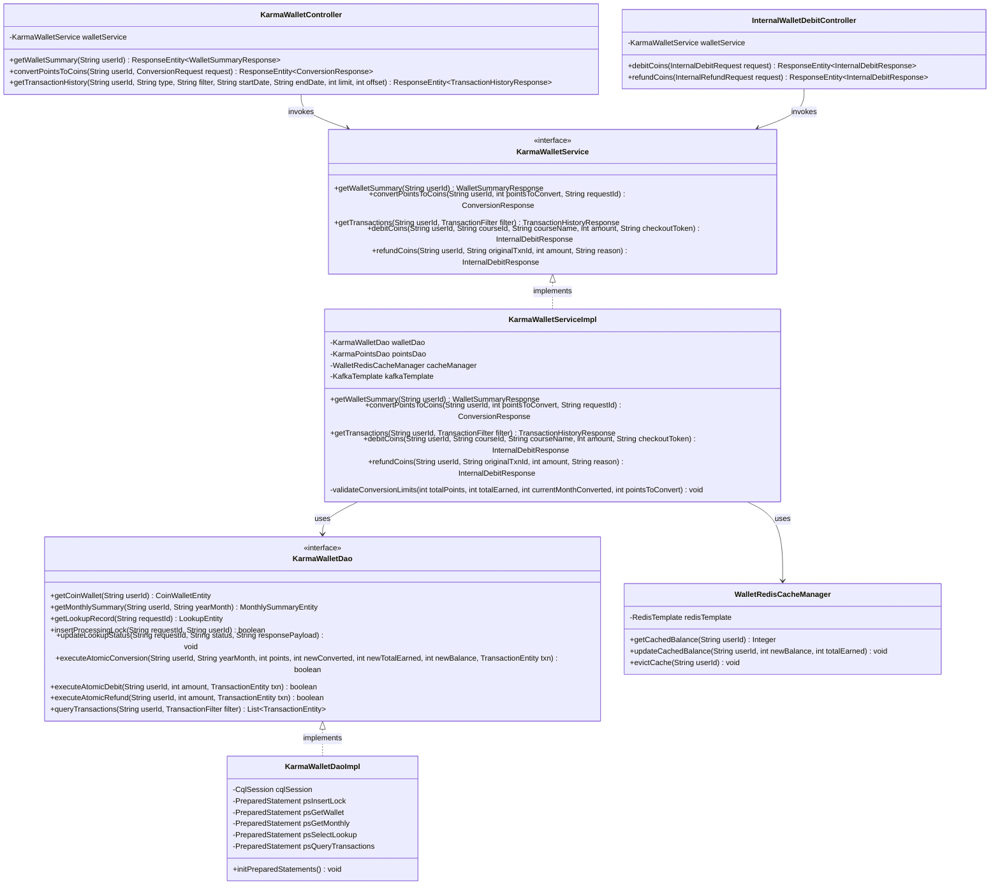
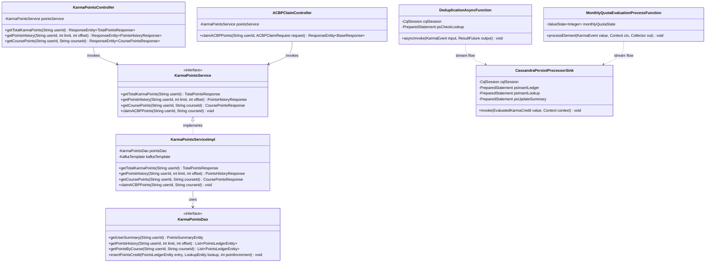
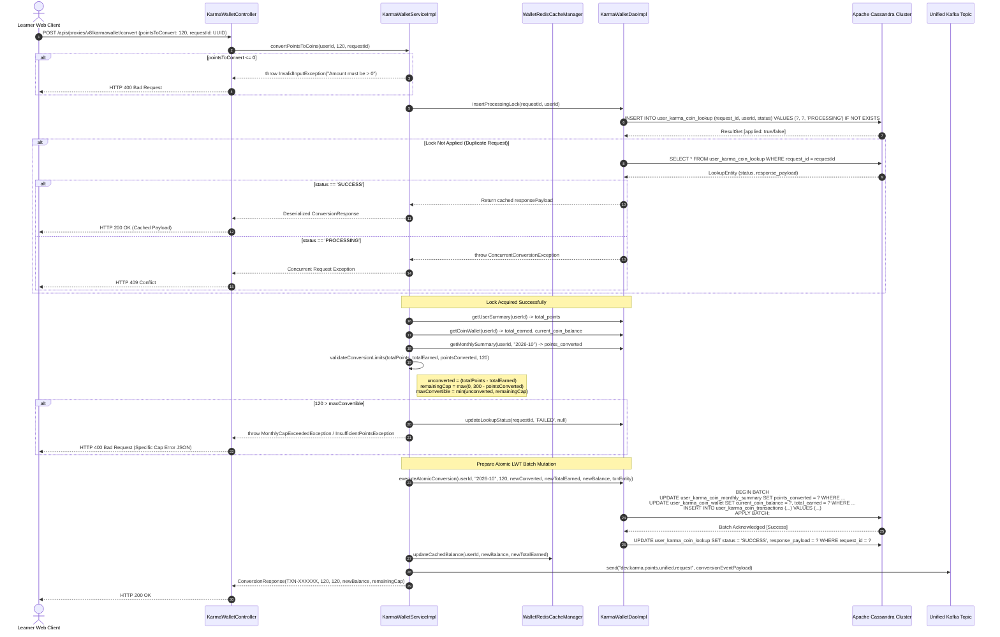
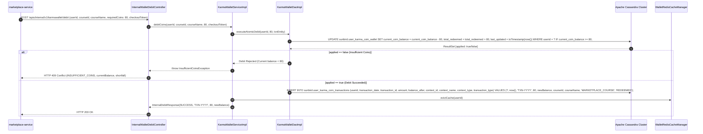
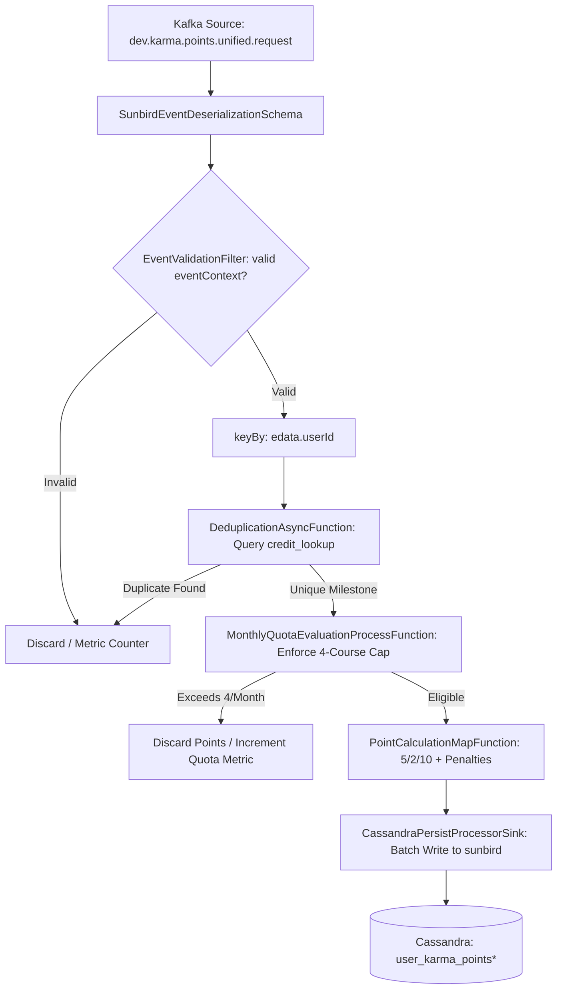
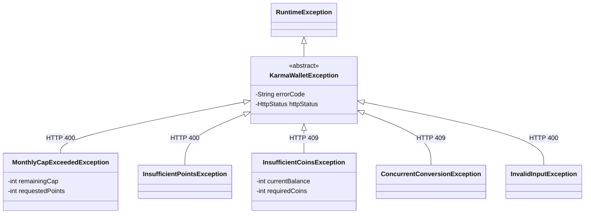

# Karma Points — Low-Level Design (LLD)

## Karma Points, Karma Coins, and Karma Wallet Ecosystem

**Platform:** iGOT Karmayogi Bharat<br>**Document Type:** Low-Level Technical Design & Implementation Specification<br>**Architecture Baseline:** Stages 1–4 Technical Architecture, IEEE 29148 SRS, IEEE 1016 SDD, and High-Level Design (HLD)<br>**Standard Alignment:** Unified Modeling Language (UML 2.5) & Object-Oriented Component Architecture<br>**Status:** Approved for Engineering Implementation

## 1. Introduction & Implementation Scope

### 1.1 Purpose

This Low-Level Design (LLD) document provides concrete, implementation-ready software engineering specifications for developers implementing the Karma Points, Karma Coins, and Karma Wallet subsystems. It details class structures, method signatures, Cassandra driver prepared statements, Paxos Lightweight Transactions (LWT), error handling hierarchies, and Flink streaming operator functions.

### 1.2 System Scope

- **Wallet Service Component** (`org.sunbird.karmawallet`): Spring Boot / Play Framework Java microservice providing REST controllers, service-layer business logic, Paxos LWT persistence adapters, and Redis balance caches.
- **Karma Points Service Component** (`org.sunbird.karmapoints`): Core points service managing balance lookups, ACBP retroactive claim requests, and Cassandra persistence handlers.
- **Streaming Processor Component** (`org.sunbird.karmapoints.streaming`): Apache Flink streaming pipeline consuming from Kafka, executing stateful user-partitioned (`keyBy(userId)`) evaluations, deduplication checks, and Cassandra sink batches.
- **Marketplace Coordinator Component** (`org.sunbird.marketplace.checkout`): Synchronous checkout coordinator enforcing Minimum KP gating, partner multiplier calculations, atomic debit coordination, and exemption bypass logic.

## 2. Package Structure & Module Architecture

```text
org.sunbird
├── karmapoints
│   ├── controller
│   │   ├── KarmaPointsController.java
│   │   └── ACBPClaimController.java
│   ├── dto
│   │   ├── TotalPointsResponse.java
│   │   ├── PointsHistoryResponse.java
│   │   └── ACBPClaimRequest.java
│   ├── service
│   │   ├── KarmaPointsService.java
│   │   └── impl
│   │       └── KarmaPointsServiceImpl.java
│   └── dao
│       ├── KarmaPointsDao.java
│       └── impl
│           └── KarmaPointsDaoImpl.java
│
├── karmawallet
│   ├── controller
│   │   ├── KarmaWalletController.java
│   │   └── InternalWalletDebitController.java
│   ├── dto
│   │   ├── request
│   │   │   ├── ConversionRequest.java
│   │   │   └── InternalDebitRequest.java
│   │   └── response
│   │       ├── WalletSummaryResponse.java
│   │       ├── ConversionResponse.java
│   │       ├── TransactionHistoryResponse.java
│   │       └── InternalDebitResponse.java
│   ├── service
│   │   ├── KarmaWalletService.java
│   │   └── impl
│   │       └── KarmaWalletServiceImpl.java
│   ├── dao
│   │   ├── KarmaWalletDao.java
│   │   └── impl
│   │       └── KarmaWalletDaoImpl.java
│   ├── cache
│   │   └── WalletRedisCacheManager.java
│   └── exception
│       ├── KarmaWalletException.java
│       ├── MonthlyCapExceededException.java
│       ├── InsufficientPointsException.java
│       ├── InsufficientCoinsException.java
│       └── ConcurrentConversionException.java
│
└── karmapoints.streaming
    ├── topology
    │   └── KarmaPointsStreamingExecutionPlan.java
    ├── functions
    │   ├── EventValidationFilter.java
    │   ├── EventRoutingFlatMap.java
    │   ├── DeduplicationAsyncFunction.java
    │   ├── MonthlyQuotaEvaluationProcessFunction.java
    │   └── PointCalculationMapFunction.java
    └── sink
        └── CassandraPersistProcessorSink.java
```

## 3. Class Diagrams & Component Design

### 3.1 Class Diagram: Karma Wallet & Conversion Engine



### 3.2 Class Diagram: Karma Points Service & Streaming Pipeline



## 4. Sequence Diagrams & Detailed Interactions

### 4.1 Sequence Diagram: Atomic Point-to-Coin Conversion (`convertPointsToCoins`)



### 4.2 Sequence Diagram: Marketplace Internal Coin Debit (`debitCoins`)



## 5. Detailed Component Specifications

### 5.1 Controller Layer

#### 5.1.1 `KarmaWalletController.java`

- **Path:** `/apis/proxies/v8/karmawallet`
- **Annotations:** `@RestController`, `@RequestMapping("/apis/proxies/v8/karmawallet")`
- **Method Definitions:**
  ```java
  @GetMapping(value = "/summary", produces = MediaType.APPLICATION_JSON_VALUE)
  public ResponseEntity<WalletSummaryResponse> getWalletSummary( @RequestHeader("x-authenticated-userid") String userId) {
      WalletSummaryResponse response = walletService.getWalletSummary(userId);
      return ResponseEntity.ok(response);
  }
  @PostMapping(value = "/convert", consumes = MediaType.APPLICATION_JSON_VALUE, produces = MediaType.APPLICATION_JSON_VALUE)
  public ResponseEntity<ConversionResponse> convertPointsToCoins( @RequestHeader("x-authenticated-userid") String userId, @Valid @RequestBody ConversionRequest request) {
      ConversionResponse response = walletService.convertPointsToCoins( userId, request.getPointsToConvert(), request.getRequestId());
      return ResponseEntity.ok(response);
  }
  @GetMapping(value = "/transactions", produces = MediaType.APPLICATION_JSON_VALUE)
  public ResponseEntity<TransactionHistoryResponse> getTransactionHistory( @RequestHeader("x-authenticated-userid") String userId, @RequestParam(name = "type", defaultValue = "ALL") String type, @RequestParam(name = "filter", defaultValue = "RECENT") String filter, @RequestParam(name = "startDate", required = false) String startDate, @RequestParam(name = "endDate", required = false) String endDate, @RequestParam(name = "limit", defaultValue = "20") int limit, @RequestParam(name = "offset", defaultValue = "0") int offset) {
      TransactionFilter txFilter = TransactionFilter.builder()
              .type(type).filterPreset(filter)
              .startDate(startDate).endDate(endDate)
              .limit(limit).offset(offset).build();
      TransactionHistoryResponse response = walletService.getTransactions(userId, txFilter);
      return ResponseEntity.ok(response);
  }
  ```

### 5.2 Service Layer

#### 5.2.1 `KarmaWalletServiceImpl.java`

- **Validation Algorithm** (`validateConversionLimits`):
  ```java
  private void validateConversionLimits(int totalPoints, int totalEarned, int currentMonthConverted, int pointsToConvert) {
      if (pointsToConvert <= 0) {
          throw new InvalidInputException("Points to convert must be a positive whole integer.");
      }
      int unconvertedPool = totalPoints - totalEarned;
      if (unconvertedPool <= 0 || pointsToConvert > unconvertedPool) {
          throw new InsufficientPointsException( String.format("Requested points (%d) exceed unconverted points pool (%d).", pointsToConvert, Math.max(0, unconvertedPool)));
      }
      int remainingMonthlyCap = Math.max(0, 300 - currentMonthConverted);
      if (pointsToConvert > remainingMonthlyCap) {
          throw new MonthlyCapExceededException( String.format("Requested points (%d) exceed remaining monthly cap (%d).", pointsToConvert, remainingMonthlyCap), remainingMonthlyCap, pointsToConvert);
      }
  }
  ```
- **Core Method Execution** (`convertPointsToCoins`):
  ```java
  @Override
  public ConversionResponse convertPointsToCoins(String userId, int pointsToConvert, String requestId) {
      // 1. Acquire Idempotency Lock
      boolean lockAcquired = walletDao.insertProcessingLock(requestId, userId);
      if (!lockAcquired) {
          LookupEntity lookup = walletDao.getLookupRecord(requestId);
          if (lookup != null && "SUCCESS".equalsIgnoreCase(lookup.getStatus())) {
              return JacksonUtils.deserialize(lookup.getResponsePayload(), ConversionResponse.class);
          }
          throw new ConcurrentConversionException("A transaction with this requestId is currently processing.");
      }
      try {
          // 2. Fetch balances
          String currentMonth = DateUtils.formatUtc(Instant.now(), "yyyy-MM");
          PointsSummaryEntity pointsSummary = pointsDao.getUserSummary(userId);
          CoinWalletEntity coinWallet = walletDao.getCoinWallet(userId);
          MonthlySummaryEntity monthlySummary = walletDao.getMonthlySummary(userId, currentMonth);
          int totalPoints = (pointsSummary != null) ? pointsSummary.getTotalPoints() : 0;
          int totalEarned = (coinWallet != null) ? coinWallet.getTotalEarned() : 0;
          int currentCoinBalance = (coinWallet != null) ? coinWallet.getCurrentCoinBalance() : 0;
          int currentMonthConverted = (monthlySummary != null) ? monthlySummary.getPointsConverted() : 0;
          // 3. Validate business limits
          validateConversionLimits(totalPoints, totalEarned, currentMonthConverted, pointsToConvert);
          // 4. Calculate mutations
          int newBalance = currentCoinBalance + pointsToConvert;
          int newTotalEarned = totalEarned + pointsToConvert;
          int newConvertedMonth = currentMonthConverted + pointsToConvert;
          int remainingCap = 300 - newConvertedMonth;
          int unconvertedRemaining = (totalPoints - newTotalEarned);
          String txnId = TxnIdGenerator.generate("TXN-");
          TransactionEntity txn = TransactionEntity.builder()
                  .userId(userId)
                  .transactionId(txnId)
                  .transactionDate(Instant.now())
                  .transactionType("EARNED")
                  .amount(pointsToConvert)
                  .balanceAfter(newBalance)
                  .contextType("POINTS_CONVERSION")
                  .contextId(requestId)
                  .contextName("Converted from Karma Points")
                  .build();
          // 5. Execute Atomic Paxos LWT Batch
          boolean committed = walletDao.executeAtomicConversion( userId, currentMonth, pointsToConvert, newConvertedMonth, newTotalEarned, newBalance, txn);
          if (!committed) {
              throw new ConcurrencyException("Cassandra Paxos batch conflict. Please retry.");
          }
          ConversionResponse response = ConversionResponse.builder()
                  .transactionId(txnId)
                  .pointsConverted(pointsToConvert)
                  .coinsCredited(pointsToConvert)
                  .newWalletBalance(newBalance)
                  .remainingMonthlyCap(remainingCap)
                  .unconvertedPointsRemaining(unconvertedRemaining)
                  .build();
          // 6. Update Lookup & Invalidate Caches
          walletDao.updateLookupStatus(requestId, "SUCCESS", JacksonUtils.serialize(response));
          cacheManager.updateCachedBalance(userId, newBalance, newTotalEarned);
          publishConversionEvent(userId, pointsToConvert, txnId);
          return response;
      } catch (Exception ex) {
          walletDao.updateLookupStatus(requestId, "FAILED", null);
          throw ex;
      }
  }
  ```

### 5.3 Data Access Layer (Cassandra Driver Implementation)

#### 5.3.1 `KarmaWalletDaoImpl.java` Prepared Statements & Query Mappings

```java
@Repository
public class KarmaWalletDaoImpl implements KarmaWalletDao {
    private final CqlSession cqlSession;
    private PreparedStatement psInsertLock;
    private PreparedStatement psSelectLock;
    private PreparedStatement psUpdateLockStatus;
    private PreparedStatement psGetWallet;
    private PreparedStatement psGetMonthly;
    private PreparedStatement psUpdateMonthly;
    private PreparedStatement psUpdateWallet;
    private PreparedStatement psInsertTxn;
    private PreparedStatement psDebitWalletCas;
    @Autowired
    public KarmaWalletDaoImpl(CqlSession cqlSession) {
        this.cqlSession = cqlSession;
        initPreparedStatements();
    }
    private void initPreparedStatements() {
        psInsertLock = cqlSession.prepare( "INSERT INTO sunbird.user_karma_coin_lookup (request_id, userid, status, created_date) " + "VALUES (?, ?, 'PROCESSING', toTimestamp(now())) IF NOT EXISTS;" );
        psSelectLock = cqlSession.prepare( "SELECT * FROM sunbird.user_karma_coin_lookup WHERE request_id = ?;" );
        psUpdateLockStatus = cqlSession.prepare( "UPDATE sunbird.user_karma_coin_lookup SET status = ?, response_payload = ? WHERE request_id = ?;" );
        psGetWallet = cqlSession.prepare( "SELECT * FROM sunbird.user_karma_coin_wallet WHERE userid = ?;" );
        psGetMonthly = cqlSession.prepare( "SELECT * FROM sunbird.user_karma_coin_monthly_summary WHERE userid = ? AND year_month = ?;" );
        psUpdateMonthly = cqlSession.prepare( "UPDATE sunbird.user_karma_coin_monthly_summary " + "SET points_converted = ?, last_conversion_date = toTimestamp(now()) " + "WHERE userid = ? AND year_month = ?;" );
        psUpdateWallet = cqlSession.prepare( "UPDATE sunbird.user_karma_coin_wallet " + "SET total_earned = ?, current_coin_balance = ?, last_updated = toTimestamp(now()) " + "WHERE userid = ?;" );
        psInsertTxn = cqlSession.prepare( "INSERT INTO sunbird.user_karma_coin_transactions (" + "userid, transaction_date, transaction_id, amount, balance_after, context_id, context_name, context_type, transaction_type" + ") VALUES (?, ?, ?, ?, ?, ?, ?, ?, ?);" );
        psDebitWalletCas = cqlSession.prepare( "UPDATE sunbird.user_karma_coin_wallet " + "SET current_coin_balance = current_coin_balance - ?, total_redeemed = total_redeemed + ?, last_updated = toTimestamp(now()) " + "WHERE userid = ? IF current_coin_balance >= ?;" );
    }
    @Override
    public boolean insertProcessingLock(String requestId, String userId) {
        BoundStatement bs = psInsertLock.bind(requestId, userId);
        Row row = cqlSession.execute(bs).one();
        return row != null && row.getBoolean("[applied]");
    }
    @Override
    public boolean executeAtomicConversion(String userId, String yearMonth, int points, int newConverted, int newTotalEarned, int newBalance, TransactionEntity txn) {
        BatchStatementBuilder batch = BatchStatement.builder(DefaultBatchType.LOGGED);
        batch.addStatement(psUpdateMonthly.bind(newConverted, userId, yearMonth));
        batch.addStatement(psUpdateWallet.bind(newTotalEarned, newBalance, userId));
        batch.addStatement(psInsertTxn.bind( txn.getUserId(), txn.getTransactionDate(), txn.getTransactionId(), txn.getAmount(), txn.getBalanceAfter(), txn.getContextId(), txn.getContextName(), txn.getContextType(), txn.getTransactionType() ));
        ResultSet rs = cqlSession.execute(batch.build());
        return rs.wasApplied();
    }
    @Override
    public boolean executeAtomicDebit(String userId, int amount, TransactionEntity txn) {
        // Step 1: Execute Conditional CAS Debit
        BoundStatement bsDebit = psDebitWalletCas.bind(amount, amount, userId, amount);
        Row row = cqlSession.execute(bsDebit).one();
        boolean applied = (row != null && row.getBoolean("[applied]"));
        if (!applied) {
            return false;
        }
        // Step 2: Append Transaction Row
        BoundStatement bsTxn = psInsertTxn.bind( txn.getUserId(), txn.getTransactionDate(), txn.getTransactionId(), txn.getAmount(), txn.getBalanceAfter(), txn.getContextId(), txn.getContextName(), txn.getContextType(), txn.getTransactionType() );
        cqlSession.execute(bsTxn);
        return true;
    }
}
```

## 6. Streaming Ingestion Engine (Apache Flink Topology)

### 6.1 Flink Operator Execution Graph



### 6.2 Stream Functions Implementation

#### 6.2.1 `DeduplicationAsyncFunction.java`

Asynchronously checks `user_karma_points_credit_lookup` to guard against duplicate point credits without blocking the streaming pipeline:

```java
public class DeduplicationAsyncFunction extends RichAsyncFunction<KarmaEvent, KarmaEvent> {
    private transient CqlSession cqlSession;
    private transient PreparedStatement psLookup;
    @Override
    public void open(Configuration parameters) {
        this.cqlSession = CassandraSessionProvider.getSession();
        this.psLookup = cqlSession.prepare( "SELECT credit_date FROM sunbird.user_karma_points_credit_lookup " + "WHERE user_karma_points_key = ? AND operation_type = ?;" );
    }
    @Override
    public void asyncInvoke(KarmaEvent event, ResultFuture<KarmaEvent> resultFuture) {
        String lookupKey = String.format("%s|%s|%s", event.getEdata().getUserId(), event.getEdata().getContextType(), event.getEdata().getContextId());
        String operationType = event.getEdata().getOperationType();
        BoundStatement bs = psLookup.bind(lookupKey, operationType);
        CompletionStage<AsyncResultSet> stage = cqlSession.executeAsync(bs);
        stage.whenComplete((rs, throwable) -> {
            if (throwable != null) {
                resultFuture.completeExceptionally(throwable);
            } else {
                if (rs.one() != null) {
                    // Record exists -> Duplicate event, drop from output
                    resultFuture.complete(Collections.emptyList());
                } else {
                    // Unique event -> Pass downstream
                    resultFuture.complete(Collections.singletonList(event));
                }
            }
        });
    }
}
```

#### 6.2.2 `MonthlyQuotaEvaluationProcessFunction.java`

Maintains keyed state to enforce the maximum 4 non-mandated completions per calendar month (`FR-KP-003`, `FR-KP-004`):

```java
public class MonthlyQuotaEvaluationProcessFunction extends KeyedProcessFunction<String, KarmaEvent, EvaluatedKarmaEvent> {
    private transient ValueState<QuotaTracker> quotaState;
    @Override
    public void open(Configuration parameters) {
        ValueStateDescriptor<QuotaTracker> descriptor = new ValueStateDescriptor<>("monthlyNonAcbpQuota", QuotaTracker.class);
        quotaState = getRuntimeContext().getState(descriptor);
    }
    @Override
    public void processElement(KarmaEvent event, Context ctx, Collector<EvaluatedKarmaEvent> out) throws Exception {
        String currentMonth = DateUtils.formatUtc(Instant.ofEpochMilli(ctx.timestamp()), "yyyy-MM");
        QuotaTracker tracker = quotaState.value();
        if (tracker == null || !currentMonth.equals(tracker.getCurrentMonth())) {
            tracker = new QuotaTracker(currentMonth, 0);
        }
        boolean isAcbp = Boolean.TRUE.equals(event.getEdata().getIsACBP());
        String opType = event.getEdata().getOperationType();
        if ("COURSE_COMPLETION".equals(opType) && !isAcbp) {
            if (tracker.getCount() >= 4) {
                // Quota reached: award 0 completion points, but forward assessment points if applicable
                out.collect(new EvaluatedKarmaEvent(event, 0, true));
                return;
            } else {
                tracker.increment();
                quotaState.update(tracker);
            }
        }
        // Under cap or exempt (ACBP): forward with standard eligibility
        out.collect(new EvaluatedKarmaEvent(event, -1, false));
    }
}
```

## 7. Data Transfer Objects (DTO) & Contract Schemas

### 7.1 Request Schemas

#### 7.1.1 `ConversionRequest.java`

```java
@Data
@Builder
@NoArgsConstructor
@AllArgsConstructor
public class ConversionRequest {
    @NotNull(message = "pointsToConvert is mandatory")
    @Min(value = 1, message = "pointsToConvert must be greater than 0")
    private Integer pointsToConvert;
    @NotBlank(message = "requestId is mandatory")
    @Pattern(regexp = "^[0-9a-fA-F-]{36}$", message = "requestId must be a valid UUID")
    private String requestId;
}
```

#### 7.1.2 `InternalDebitRequest.java`

```java
@Data
@Builder
@NoArgsConstructor
@AllArgsConstructor
public class InternalDebitRequest {
    @NotBlank
    private String userId;
    @NotBlank
    private String courseId;
    @NotBlank
    private String courseName;
    @NotNull
    @Min(1)
    private Integer requiredCoins;
    @NotBlank
    private String checkoutToken;
}
```

### 7.2 Response Schemas

#### 7.2.1 `WalletSummaryResponse.java`

```java
@Data
@Builder
@NoArgsConstructor
@AllArgsConstructor
public class WalletSummaryResponse {
    private int walletBalance;
    private int convertibleThisMonth;
    private int monthlyCap;
    private int totalConvertedCoins;
    private int unconvertedPoints;
    private int lifetimeEarnedPoints;
    private String currencyRatio;
    private String capResetDateUtc;
}
```

#### 7.2.2 `ConversionResponse.java`

```java
@Data
@Builder
@NoArgsConstructor
@AllArgsConstructor
public class ConversionResponse {
    private String transactionId;
    private int pointsConverted;
    private int coinsCredited;
    private int newWalletBalance;
    private int remainingMonthlyCap;
    private int unconvertedPointsRemaining;
}
```

#### 7.2.3 `TransactionHistoryResponse.java`

```java
@Data
@Builder
@NoArgsConstructor
@AllArgsConstructor
public class TransactionHistoryResponse {
    private int count;
    private List<TransactionItem> transactions;
    @Data
    @Builder
    @NoArgsConstructor
    @AllArgsConstructor
    public static class TransactionItem {
        private String transactionId;
        private String transactionDate;
        private String transactionType;
        private int amount;
        private int balanceAfter;
        private String contextType;
        private String contextId;
        private String contextName;
    }
}
```

## 8. Error Handling Hierarchy & Exception Mapping



### 8.1 Global Controller Exception Handler (`KarmaWalletExceptionHandler.java`)

```java
@RestControllerAdvice(basePackages = "org.sunbird.karmawallet")
public class KarmaWalletExceptionHandler {
    @ExceptionHandler(MonthlyCapExceededException.class)
    public ResponseEntity<ErrorResponse> handleCapExceeded(MonthlyCapExceededException ex) {
        ErrorResponse err = ErrorResponse.builder()
                .err("MONTHLY_CAP_EXCEEDED")
                .errmsg(ex.getMessage())
                .status("failed")
                .params(Map.of("remainingMonthlyCap", ex.getRemainingCap(), "requestedPoints", ex.getRequestedPoints()))
                .build();
        return ResponseEntity.status(HttpStatus.BAD_REQUEST).body(err);
    }
    @ExceptionHandler(InsufficientPointsException.class)
    public ResponseEntity<ErrorResponse> handlePointsShortfall(InsufficientPointsException ex) {
        ErrorResponse err = ErrorResponse.builder()
                .err("INSUFFICIENT_UNCONVERTED_POINTS")
                .errmsg(ex.getMessage())
                .status("failed")
                .build();
        return ResponseEntity.status(HttpStatus.BAD_REQUEST).body(err);
    }
    @ExceptionHandler(InsufficientCoinsException.class)
    public ResponseEntity<ErrorResponse> handleCoinsShortfall(InsufficientCoinsException ex) {
        ErrorResponse err = ErrorResponse.builder()
                .err("INSUFFICIENT_COIN_BALANCE")
                .errmsg(ex.getMessage())
                .status("failed")
                .params(Map.of("currentBalance", ex.getCurrentBalance(), "requiredCoins", ex.getRequiredCoins()))
                .build();
        return ResponseEntity.status(HttpStatus.CONFLICT).body(err);
    }
    @ExceptionHandler(ConcurrentConversionException.class)
    public ResponseEntity<ErrorResponse> handleConcurrentLock(ConcurrentConversionException ex) {
        ErrorResponse err = ErrorResponse.builder()
                .err("TRANSACTION_IN_PROGRESS")
                .errmsg(ex.getMessage())
                .status("failed")
                .build();
        return ResponseEntity.status(HttpStatus.CONFLICT).body(err);
    }
}
```

## 9. Requirements-to-Implementation Traceability Matrix

| SRS Requirement ID | Method / Class Implementation | Database / Persistence Operation | Flink Operator / API Endpoint |
|---|---|---|---|
| **FR-KP-001–002** | `PointCalculationMapFunction.java` | `INSERT INTO user_karma_points` | Stream Router Handler H1 & H2 |
| **FR-KP-003–004** | `MonthlyQuotaEvaluationProcessFunction.java` | State update / Quota increment | `MonthlyQuotaEvaluationProcessFunction` |
| **FR-KP-005–008** | `DeduplicationAsyncFunction.java` | `SELECT/INSERT user_karma_points_credit_lookup` | Flink Async Operator |
| **FR-KP-009–013** | `KarmaPointsServiceImpl.claimACBPPoints()` | Event emitted to Kafka claim topic | `POST /apis/proxies/v8/claimkarmapoints/` |
| **FR-KP-018–019** | `KarmaPointsServiceImpl.getTotalKarmaPoints()` | `SELECT total_points FROM user_karma_points_summary` | `POST /apis/proxies/v8/user/totalkarmapoints` |
| **FR-KC-001–006** | `KarmaWalletServiceImpl.convertPointsToCoins()` | Paxos LWT Batch (`psUpdateMonthly`, `psUpdateWallet`) | `POST /apis/proxies/v8/karmawallet/convert` |
| **FR-KC-007–009** | `KarmaWalletServiceImpl.validateConversionLimits()` | Application boundary check against Cassandra reads | In-Memory Validation Engine |
| **FR-KC-015** | `KarmaWalletServiceImpl.getWalletSummary()` | Derived: `total_earned - total_redeemed` | `GET /apis/proxies/v8/karmawallet/summary` |
| **FR-KW-006–007** | `KarmaWalletDaoImpl.insertProcessingLock()` | `INSERT INTO user_karma_coin_l``ookup ... IF NOT EXISTS` | Idempotency Pre-Check |
| **FR-KW-009–011** | `KarmaWalletDaoImpl.executeAtomicConversion()` | `INSERT INTO user_karma_coin_transactions` with `balance_after` | Cassandra Paxos Batch Statement |
| **FR-KW-012–014** | `KarmaWalletDaoImpl.queryTransactions()` | `SELECT FROM user_karma_coin_transactions` (1-yr bound) | `GET /apis/proxies/v8/karmawallet/transactions` |
| **FR-MP-009–011** | `KarmaWalletServiceImpl.debitCoins()` | `UPDATE user_karma_coin_wallet ... IF current_coin_balance >= ?` | `POST /apis/internal/v1/karmawallet/debit` |
