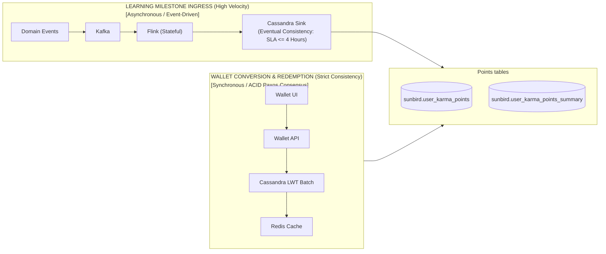
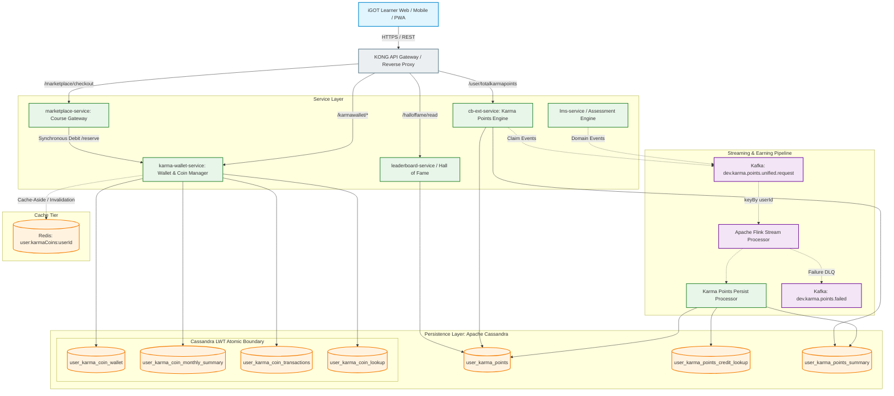
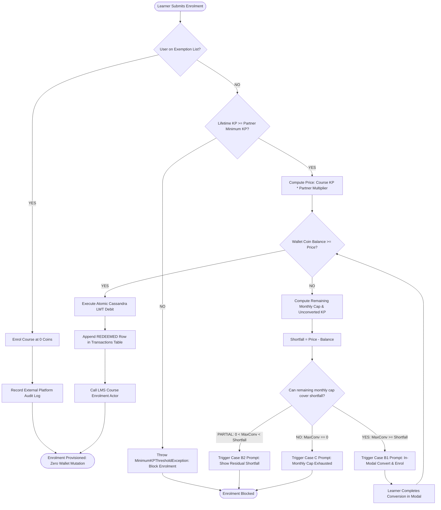
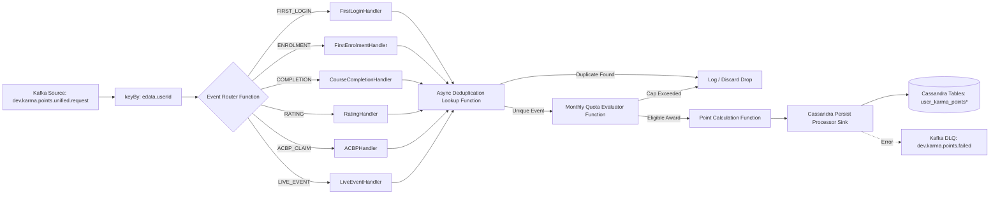

# Karma Points — Software Design Description (SDD)

## Karma Points, Karma Coins, and Karma Wallet Ecosystem

**Standard Alignment:** IEEE Std 1016-2009 (Standard for Information Technology — Systems Design — Software Design Descriptions)<br>**System Under Consideration:** iGOT Karmayogi Bharat Platform — Dual-Currency Credit-Based Learning Ecosystem<br>**Traceability Baseline:** Stages 1–4 Technical Architecture & IEEE 29148 SRS Baseline (`FR-KP-*`, `FR-KC-*`, `FR-KW-*`, `FR-MP-*`, `FR-PR-*`, `NFR-*`)<br>**Target Roles:** Solution Architects, Backend/Frontend Engineers, Data Architects, Platform Engineers, QA Automation Leads<br>**Status:** Approved for Technical Baseline

## 1. Introduction

### 1.1 Purpose

This Software Design Description (SDD) defines the detailed technical architecture, component decomposition, interface specifications, data schemas, transaction lifecycle models, and concurrency control mechanisms for the Karma Points, Karma Coins, and Karma Wallet subsystems of the iGOT Karmayogi Bharat platform. It translates the functional and quality requirements specified in the IEEE 29148 SRS into an executable software and data design.

### 1.2 System Scope

The subsystem provides:

1. **Asynchronous Karma Points Pipeline:** Event-driven stream processing of platform milestones (login, enrolment, completion, assessment, rating, live events, ACBP compliance) using Apache Kafka, Apache Flink, and Apache Cassandra.
2. **Synchronous Karma Wallet & Conversion Engine:** ACID-compliant, one-way conversion of Karma Points into spendable Karma Coins governed by a 300 KP calendar-month cap using Cassandra Lightweight Transactions (Paxos/CAS).
3. **Marketplace Redemption & Gating Gateway:** Gating of third-party/paid courses via partner Minimum KP thresholds, atomic full-tender coin debits, partner multiplier calculations, and exemption bypass logic.
4. **Append-Only Ledgers & Read Models:** Partition-bounded Cassandra tables for auditable financial transactions and independent gamification/leaderboard data models.
5. **Compensating Reconciliation Engine:** Batch recovery jobs for missed point allocations and data consistency verification.

### 1.3 Definitions, Acronyms, and Abbreviations

- **CAS:** Compare-And-Swap (Cassandra Lightweight Transactions / Paxos consensus).
- **CQRS:** Command Query Responsibility Segregation.
- **DLQ:** Dead-Letter Queue.
- **LWT:** Lightweight Transaction (Cassandra atomic condition execution via Paxos).
- **MDO:** Ministry, Department, and Organization.
- **NPCSCB:** National Programme for Civil Services Capacity Building (Mission Karmayogi).
- **SDD:** Software Design Description (IEEE 1016-2009).
- **SPV:** Special Purpose Vehicle (Karmayogi Bharat).
- **TOC:** Table of Contents (Course overview and landing page).

### 1.4 References

1. **IEEE Std 1016-2009:** Standard for Information Technology — Systems Design — Software Design Descriptions.
2. **ISO/IEC/IEEE 29148:2018:** Systems and Software Engineering — Requirements Engineering.
3. **Jira Issues & Epics:** `KB-15254`, `KB-15271`, `KB-15294`, `KB-15296`, `KB-15297`, `KB-15298`, `KB-15299`, `KB-15300`, `KB-15301`, `KB-443`, `KB-464`, `KB-465`, `KB-468`, `KB-15698`, `KB-14235`, `KB-2122`, `KB-2933`, `KB-5808`, `KB-7462`, `KB-15036`, `KB-15347`, `KB-12140`.
4. **Technical & Architectural Documents:**
  - *Karma Points Data Model* (Confluence Page `31031297`)
  - *FRS Karma Points* (Confluence Page `6750572`)
  - *Karma Points V1 to V2 and Karma Coins* (Confluence Page `1253441539`)
  - *Karma Coin Wallet Technical Design* (Confluence Page `1214906388`)
  - *Karma Points Persist Processor Unified Kafka Decision* (Confluence Page `1007583244`)
  - *Kafka Producer & Event Mapping – Karma Points Flink Jobs* (Confluence Page `1219100678`)
  - *Design Document: Reconciliation of Missed First Enrollment* (Confluence Page `1148485633`)

## 2. Design Rationale and Architectural Trade-Offs

### 2.1 Architectural Paradigm: Asymmetric Consistency (CQRS & Event-Driven Ingress)

A foundational design requirement is balancing high-velocity learning events (millions of completion/enrolment events per day) with zero-tolerance financial integrity for spendable wallet balances.



#### Decision Matrix

| Architectural Aspect | Chosen Design | Alternative Evaluated | Rationale & Trade-Off |
|---|---|---|---|
| **Points Earning** | Event-Driven Streaming (Kafka + Flink + Cassandra) | Synchronous REST Calls from LMS | Prevents LMS course completion blocking during network spikes; absorbs high concurrency through stream buffering. Acceptable eventual consistency SLA (). |
| **Points Conversion** | Synchronous REST + Cassandra LWT (Paxos) | Asynchronous Kafka Conversion Worker | Conversion must guarantee real-time coin availability for immediate course purchase; asynchronous processing would introduce race conditions where users exceed the 300 KP cap. |
| **Coin Spend (Redemption)** | Coordinated REST via Conditional CAS Debit | Saga Distributed Choreography | Single-point coin deduction with atomic CAS check prevents double spending. Full 2-phase saga rejected to minimize latency at checkout. |
| **Stream Ordering** | Single Unified Kafka Topic keyed by `userId` | Multi-Topic Architecture (V1) | Eliminates out-of-order race conditions between first enrolment, completion, and rating events. Ensures deterministic stream state in Flink. |

### 2.2 Currency Isolation & Leaderboard Immunity

To prevent monetary spending from distorting civil service merit and competency tracking, the system strictly isolates the read and write models:

- **Gamification Model:** Aggregates points earned from `user_karma_points`. It has zero dependency on, and executes zero queries against, `user_karma_coin_*` tables.
- **Conversion Immutability:** When points convert into coins, `user_karma_points_summary.total_points` is untouched; instead, `user_karma_coin_wallet.total_earned` increments, shrinking the derived unconverted pool () without modifying lifetime historical achievements.

## 3. System Architecture and Component Decomposition

### 3.1 High-Level Component Diagram



### 3.2 Component Descriptions and Responsibilities

#### 3.2.1 `cb-ext-service` (Karma Points Service)

- **Package/Module:** `org.sunbird.karmapoints`
- **Responsibilities:**
  - Exposes user point balance query endpoints (`/user/totalkarmapoints`).
  - Exposes course-level points display endpoints (`/karmapoints/user/course/read`).
  - Serves retroactive ACBP claiming requests (`/claimkarmapoints/`), validating completion metadata and pushing claim payloads to Kafka.
  - Supplies paginated points credit histories to user profiles.

#### 3.2.2 `karma-wallet-service`

- **Package/Module:** `org.sunbird.karmawallet`
- **Responsibilities:**
  - Computes dynamic summary metrics (Wallet Balance, Convertible Remaining, Total Converted, Unconverted Points).
  - Executes atomic conversion of Karma Points into Karma Coins using Cassandra LWT Paxos batches.
  - Validates and enforces the 300 KP calendar-month cap and single-transaction boundaries.
  - Appends structured, immutable transaction records to `user_karma_coin_transactions`.
  - Provides paginated and date-filtered coin transaction history.
  - Exposes internal authenticated coin debit/redemption interfaces for `marketplace-service`.

#### 3.2.3 `marketplace-service` & LMS Enrolment Coordinator

- **Responsibilities:**
  - Evaluates SPV Partner settings (Partner Multiplier, Minimum KP Gate).
  - Evaluates Partner Exemption Rosters; bypasses wallet deductions for exempt civil servants.
  - Calculates Course Coin Price: .
  - Orchestrates two-phase checkout: validates user balance, calls `karma-wallet-service` debit endpoint, and triggers LMS course provisioning upon success.
  - Handles shortfall detection and triggers Case B1/B2/C client prompt payloads.

#### 3.2.4 Stream Ingestion & Processing Tier (Kafka + Apache Flink)

- **Ingress Topic:** `dev.karma.points.unified.request` (V2 Unified Architecture).
- **Stream Keying:** Grouped strictly by `keyBy(userId)` to serialize user state transitions and eliminate Cassandra counter race conditions.
- **Flink Operators:**
  - `EventValidationFilter`: Verifies schema conformance and drops malformed events.
  - `DeduplicationAsyncFunction`: Queries `user_karma_points_credit_lookup` asynchronously to filter duplicate event contexts.
  - `QuotaEvaluationFunction`: Evaluates monthly 4-course non-ACBP caps against local operator state or Cassandra cache.
  - `PointCalculationFunction`: Maps event payloads to discrete integer point formulas (5, 5, 2, 10, or late ACBP penalties).

- **Sink:** `KarmaPointsPersistSink` batching inserts into Cassandra.

#### 3.2.5 Data Layer (Apache Cassandra Keyspace: `sunbird`)

- Multi-DC replication factor (typically RF=3 per datacenter).
- Uses `LOCAL_QUORUM` consistency for standard point writes and `LOCAL_SERIAL` / `LOCAL_QUORUM` for Lightweight Transactions on coin tables.

## 4. Interface and API Specifications

### 4.1 Total Karma Points API

- **Endpoint:** `POST /apis/proxies/v8/user/totalkarmapoints`
- **Caller:** Learner Portal Web / Mobile (Header Counter, Profile Page)
- **Auth:** Bearer Token (JWT), Scoped to Authenticated `userId`
- **Request Headers:**
  ```http
  Authorization: Bearer <JWT>
  Content-Type: application/json
  x-authenticated-userid: <userId>
  ```
- **Request Payload:** Empty JSON `{}` (identifies user via context).
- **Response Payload (HTTP 200 OK):**
  ```json
  {
    "id": "api.karmapoints.total",
    "ver": "v1",
    "ts": "2026-10-28T09:15:00.000Z",
    "params": {
      "resmsgid": "b3e0c4f8-4e4b-4df2-8941-45a7b62071aa",
      "status": "successful"
    },
    "responseCode": "OK",
    "result": {
      "totalPoints": 1341
    }
  }
  ```

### 4.2 Karma Wallet Summary API

- **Endpoint:** `GET /apis/proxies/v8/karmawallet/summary`
- **Caller:** Karma Wallet Dashboard Page
- **Auth:** Bearer Token (JWT), Authenticated Learner
- **Response Payload (HTTP 200 OK):**
  ```json
  {
    "id": "api.karmawallet.summary",
    "ver": "v1",
    "ts": "2026-10-28T09:15:01.000Z",
    "params": {
      "resmsgid": "c71e21b0-9b3f-42e1-8cb5-1811467a4211",
      "status": "successful"
    },
    "responseCode": "OK",
    "result": {
      "walletBalance": 492,
      "convertibleThisMonth": 180,
      "monthlyCap": 300,
      "totalConvertedCoins": 1321,
      "unconvertedPoints": 1341,
      "lifetimeEarnedPoints": 2662,
      "currencyRatio": "1 KP = 1 KC",
      "capResetDateUtc": "2026-11-01T00:00:00.000Z"
    }
  }
  ```

### 4.3 Convert Points to Coins API

- **Endpoint:** `POST /apis/proxies/v8/karmawallet/convert`
- **Caller:** Wallet Conversion Modal / Marketplace Case B1 In-Modal Prompt
- **Auth:** Bearer Token (JWT), Authenticated Learner
- **Request Payload:**
  ```json
  {
    "request": {
      "pointsToConvert": 120,
      "requestId": "9c8a14d5-827b-4b21-9311-50e58fa2f1c3"
    }
  }
  ```
- **Success Response (HTTP 200 OK):**
  ```json
  {
    "id": "api.karmawallet.convert",
    "ver": "v1",
    "ts": "2026-10-28T09:15:05.120Z",
    "params": {
      "resmsgid": "f51270d4-1a3e-4b68-b715-4fa7216a91f4",
      "status": "successful"
    },
    "responseCode": "OK",
    "result": {
      "transactionId": "TXN-089124",
      "pointsConverted": 120,
      "coinsCredited": 120,
      "newWalletBalance": 612,
      "remainingMonthlyCap": 60,
      "unconvertedPointsRemaining": 1221
    }
  }
  ```
- **Error Response: Monthly Cap Exceeded (HTTP 400 Bad Request):**
  ```json
  {
    "id": "api.karmawallet.convert",
    "ver": "v1",
    "ts": "2026-10-28T09:15:05.120Z",
    "params": {
      "resmsgid": "f51270d4-1a3e-4b68-b715-4fa7216a91f4",
      "err": "MONTHLY_CAP_EXCEEDED",
      "errmsg": "Requested points (120) exceed remaining monthly conversion allowance (60).",
      "status": "failed"
    },
    "responseCode": "CLIENT_ERROR",
    "result": {
      "remainingMonthlyCap": 60,
      "requestedPoints": 120
    }
  }
  ```

### 4.4 Wallet Transaction History API

- **Endpoint:** `GET /apis/proxies/v8/karmawallet/transactions?type={ALL|EARNED|REDEEMED}&filter={RECENT|CURRENT_MONTH|LAST_MONTH|LAST_3_MONTHS|LAST_6_MONTHS|CUSTOM}&startDate={YYYY-MM-DD}&endDate={YYYY-MM-DD}&limit=20&offset=0`
- **Caller:** Wallet Coin History Tab
- **Auth:** Bearer Token (JWT), Authenticated Learner
- **Response Payload (HTTP 200 OK):**
  ```json
  {
    "id": "api.karmawallet.transactions",
    "ver": "v1",
    "ts": "2026-10-28T09:15:10.000Z",
    "params": {
      "resmsgid": "e81d1134-2e1a-4d77-9831-2917711ab34e",
      "status": "successful"
    },
    "responseCode": "OK",
    "result": {
      "count": 2,
      "transactions": [
        {
          "transactionId": "TXN-089124",
          "transactionDate": "2026-10-28T09:15:05.000Z",
          "transactionType": "EARNED",
          "amount": 120,
          "balanceAfter": 612,
          "contextType": "POINTS_CONVERSION",
          "contextId": "9c8a14d5-827b-4b21-9311-50e58fa2f1c3",
          "contextName": "Converted from Karma Points"
        },
        {
          "transactionId": "TXN-087612",
          "transactionDate": "2026-10-20T14:32:10.000Z",
          "transactionType": "REDEEMED",
          "amount": 80,
          "balanceAfter": 492,
          "contextType": "MARKETPLACE_COURSE",
          "contextId": "do_11389104821",
          "contextName": "Marketplace — Harvard — Leadership Principles"
        }
      ]
    }
  }
  ```

### 4.5 Internal Wallet Debit API (Marketplace Coordination)

- **Endpoint:** `POST /apis/internal/v1/karmawallet/debit`
- **Caller:** `marketplace-service` (mTLS Authenticated Internal Call)
- **Request Payload:**
  ```json
  {
    "userId": "usr-88129-ab4",
    "courseId": "do_11389104821",
    "courseName": "Marketplace — Harvard — Leadership Principles",
    "requiredCoins": 80,
    "checkoutToken": "chk-991204-71"
  }
  ```
- **Success Response (HTTP 200 OK):**
  ```json
  {
    "status": "SUCCESS",
    "transactionId": "TXN-089125",
    "debitedAmount": 80,
    "remainingBalance": 532
  }
  ```
- **Failure Response: Insufficient Balance (HTTP 409 Conflict):**
  ```json
  {
    "status": "FAILED",
    "err": "INSUFFICIENT_COIN_BALANCE",
    "currentBalance": 40,
    "requiredCoins": 80,
    "shortfall": 40
  }
  ```

## 5. Detailed Data Design and Schemas

### 5.1 Cassandra Physical Data Models (Keyspace: `sunbird`)

```text
==========================================================================================
CASSANDRA KEYSPACE: sunbird
==========================================================================================

TABLE: user_karma_points (Points Credit Ledger)
----------------------------------------------------------------------------------------
*
userid : text (PARTITION KEY)
*
credit_date : timestamp (CLUSTERING KEY, DESC)
*
context_type : text (CLUSTERING KEY, ASC)
*
operation_type : text (CLUSTERING KEY, ASC)
*
context_id : text (CLUSTERING KEY, ASC)
addinfo : text (JSON metadata: course name, flags)
points : int (Integer point credit: 2, 5, 10)

TABLE: user_karma_points_credit_lookup (Deduplication Guard)
----------------------------------------------------------------------------------------
*
user_karma_points_key : text (PARTITION KEY: userid|context_type|context_id)
*
operation_type : text (CLUSTERING KEY, ASC)
credit_date : timestamp

TABLE: user_karma_points_summary (Running Cumulative Points Summary)
----------------------------------------------------------------------------------------
*
userid : text (PARTITION KEY)
addinfo : text (JSON: {"claimedNonACBPCourseKarmaQuota": int, ...})
total_points : int (Monotonic cumulative lifetime earned points)

TABLE: user_karma_coin_wallet (Authoritative Spendable Coin Balance)
----------------------------------------------------------------------------------------
*
userid : text (PARTITION KEY)
current_coin_balance : int (Spendable balance: total_earned - total_redeemed)
total_earned : int (Cumulative lifetime converted coins)
total_redeemed : int (Cumulative lifetime redeemed coins)
last_updated : timestamp

TABLE: user_karma_coin_monthly_summary (Monthly Conversion Quota Enforcement)
----------------------------------------------------------------------------------------
*
userid : text (PARTITION KEY)
*
year_month : text (CLUSTERING KEY, ASC: "YYYY-MM")
points_converted : int (Points converted in this calendar month, max 300)
last_conversion_date : timestamp

TABLE: user_karma_coin_transactions (Append-Only Financial Ledger)
----------------------------------------------------------------------------------------
*
userid : text (PARTITION KEY)
*
transaction_date : timestamp (CLUSTERING KEY, DESC)
*
transaction_id : text (CLUSTERING KEY, ASC)
amount : int (Positive integer)
balance_after : int (Snapshot of balance immediately post-commit)
context_id : text (UUID or Course ID)
context_name : text (Human readable source display string)
context_type : text (POINTS_CONVERSION / MARKETPLACE_COURSE)
transaction_type : text (EARNED / REDEEMED)

TABLE: user_karma_coin_lookup (Conversion Request Idempotency)
----------------------------------------------------------------------------------------
*
request_id : text (PARTITION KEY: UUID from client)
created_date : timestamp
response_payload : text (Cached JSON response for idempotent replays)
status : text (PROCESSING / SUCCESS / FAILED)
userid : text
```

### 5.2 DDL Specifications

```sql
-- 1. Points Ledger
CREATE TABLE sunbird.user_karma_points (
    userid text,
    credit_date timestamp,
    context_type text,
    operation_type text,
    context_id text,
    addinfo text,
    points int,
    PRIMARY KEY (userid, credit_date, context_type, operation_type, context_id)
) WITH CLUSTERING ORDER BY (credit_date DESC, context_type ASC, operation_type ASC, context_id ASC);

-- 2. Points Deduplication Table
CREATE TABLE sunbird.user_karma_points_credit_lookup (
    user_karma_points_key text,
    operation_type text,
    credit_date timestamp,
    PRIMARY KEY (user_karma_points_key, operation_type)
) WITH CLUSTERING ORDER BY (operation_type ASC);

-- 3. Points Running Summary
CREATE TABLE sunbird.user_karma_points_summary (
    userid text PRIMARY KEY,
    addinfo text,
    total_points int
);

-- 4. Authoritative Coin Wallet
CREATE TABLE sunbird.user_karma_coin_wallet (
    userid text PRIMARY KEY,
    current_coin_balance int,
    total_earned int,
    total_redeemed int,
    last_updated timestamp
);

-- 5. Monthly Conversion Quotas
CREATE TABLE sunbird.user_karma_coin_monthly_summary (
    userid text,
    year_month text,
    points_converted int,
    last_conversion_date timestamp,
    PRIMARY KEY (userid, year_month)
);

-- 6. Append-Only Coin Ledger
CREATE TABLE sunbird.user_karma_coin_transactions (
    userid text,
    transaction_date timestamp,
    transaction_id text,
    amount int,
    balance_after int,
    context_id text,
    context_name text,
    context_type text,
    transaction_type text,
    PRIMARY KEY (userid, transaction_date, transaction_id)
) WITH CLUSTERING ORDER BY (transaction_date DESC, transaction_id ASC);

-- 7. Request Idempotency Guard
CREATE TABLE sunbird.user_karma_coin_lookup (
    request_id text PRIMARY KEY,
    created_date timestamp,
    response_payload text,
    status text,
    userid text
);
```

### 5.3 Caching Tier Structure (Redis)

- **Key Format:** `user:karmaCoins:{userId}`
- **Data Structure:** Hash
  - `balance`: Integer string (spendable coins)
  - `total_earned`: Integer string
  - `last_sync`: Epoch timestamp (ms)

- **TTL Policy:** 3600 seconds with cache-aside write-through on successful conversion and redemption commits.

## 6. Detailed Process Logic and Algorithms

### 6.1 Point-to-Coin Conversion Transaction Algorithm (Paxos LWT)

```text
==========================================================================================
ALGORITHM 1: ATOMIC POINT-TO-COIN CONVERSION
==========================================================================================
Input: userId (String), pointsToConvert (Integer), requestId (UUID String)
Output: ConversionResult Object (Success + Balances OR Exception)
1. IF pointsToConvert <= 0 THEN
2. THROW InvalidInputException("Conversion amount must be a positive integer.");
3. END IF
4. // Step 1: Idempotency Check via Cassandra CAS
5. INSERT INTO sunbird.user_karma_coin_lookup (request_id, userid, status, created_date) VALUES (requestId, userId, 'PROCESSING', now()) IF NOT EXISTS;
6. IF CAS_RESULT.applied == FALSE THEN
7. lookupRow = SELECT * FROM sunbird.user_karma_coin_lookup WHERE request_id = requestId;
8. IF lookupRow.status == 'SUCCESS' THEN
9. RETURN Deserialize(lookupRow.response_payload);
10. ELSE
11. THROW ConcurrentRequestException("Transaction currently in flight.");
12. END IF
13. END IF
14. Try:
15. // Step 2: Read Current Balances
16. currentMonthStr = FormatDateUtc(now(), "yyyy-MM");
17. summaryRow = SELECT total_points FROM sunbird.user_karma_points_summary WHERE userid = userId;
18. walletRow = SELECT total_earned, current_coin_balance FROM sunbird.user_karma_coin_wallet WHERE userid = userId;
19. monthlyRow = SELECT points_converted FROM sunbird.user_karma_coin_monthly_summary WHERE userid = userId AND year_month = currentMonthStr;
20. totalPoints = (summaryRow != null) ? summaryRow.total_points : 0;
21. totalEarned = (walletRow != null) ? walletRow.total_earned : 0;
22. currentBalance = (walletRow != null) ? walletRow.current_coin_balance : 0;
23. pointsConverted = (monthlyRow != null) ? monthlyRow.points_converted : 0;
24. // Step 3: Enforce Cap and Pool Invariants
25. unconvertedPool = totalPoints - totalEarned;
26. remainingCap = MAX(0, 300 - pointsConverted);
27. maxConvertible = MIN(unconvertedPool, remainingCap);
28. IF pointsToConvert > maxConvertible THEN
29. UPDATE sunbird.user_karma_coin_lookup SET status = 'FAILED' WHERE request_id = requestId;
30. THROW LimitExceededException("Requested points exceed available convertible allowance.");
31. END IF
32. // Step 4: Execute Atomic Paxos LWT Batch Commit
33. newBalance = currentBalance + pointsToConvert;
34. newTotalEarned = totalEarned + pointsToConvert;
35. newConverted = pointsConverted + pointsToConvert;
36. txnId = GenerateTxnId(); // Format: TXN-XXXXXX
37. timestampNow = now();
38. BEGIN BATCH
39. UPDATE sunbird.user_karma_coin_monthly_summary SET points_converted = newConverted, last_conversion_date = timestampNow WHERE userid = userId AND year_month = currentMonthStr;
40. UPDATE sunbird.user_karma_coin_wallet SET total_earned = newTotalEarned, current_coin_balance = newBalance, last_updated = timestampNow WHERE userid = userId;
41. INSERT INTO sunbird.user_karma_coin_transactions ( userid, transaction_date, transaction_id, amount, balance_after, context_id, context_name, context_type, transaction_type ) VALUES ( userId, timestampNow, txnId, pointsToConvert, newBalance, requestId, 'Converted from Karma Points', 'POINTS_CONVERSION', 'EARNED' );
42. APPLY BATCH;
43. // Step 5: Finalize and Publish Side Effects
44. resultPayload = BuildSuccessPayload(txnId, pointsToConvert, newBalance, (remainingCap - pointsToConvert));
45. UPDATE sunbird.user_karma_coin_lookup SET status = 'SUCCESS', response_payload = Serialize(resultPayload) WHERE request_id = requestId;
46. Redis.HSET("user:karmaCoins:" + userId, "balance", newBalance);
47. Kafka.Publish("dev.karma.points.unified.request", BuildConversionEvent(userId, pointsToConvert, txnId));
48. RETURN resultPayload;
49. Catch Exception e:
50. UPDATE sunbird.user_karma_coin_lookup SET status = 'FAILED' WHERE request_id = requestId;
51. THROW e;
==========================================================================================
```

### 6.2 Marketplace Redemption & Shortfall Decision Logic



## 7. Stream Processing Design (Apache Flink Topology)

### 7.1 Unified Kafka Topic Architecture (V2 Pipeline)

- **Topic Name:** `dev.karma.points.unified.request`
- **Partitioning Strategy:** Hash partition on `key = edata.userId`.
- **Ordering Guarantee:** All stateful milestones for a given learner partition to the exact same Kafka broker and Flink task slot.

### 7.2 Flink Stream Processing Topology



### 7.3 Domain Event Ingress Schemas

#### Course Completion & Certificate Request Event

```json
{
  "eid": "BE_JOB_REQUEST",
  "ets": 1793178905000,
  "mid": "LP.1793178905000.7b1892",
  "actor": {
    "id": "activity-aggregate-updater",
    "type": "System"
  },
  "context": {
    "pdata": {
      "id": "prod.diksha.learning-service",
      "ver": "5.2.0"
    },
    "channel": "0128501930136535040"
  },
  "object": {
    "id": "do_11389104821",
    "type": "Course"
  },
  "edata": {
    "action": "issue-certificate",
    "iteration": 1,
    "courseId": "do_11389104821",
    "batchId": "01389105991",
    "userId": "usr-88129-ab4",
    "assessmentScore": 85.0,
    "isAssessmentPassed": true,
    "isACBP": false
  }
}
```

## 8. Failure Handling, Rollback, and Data Reconciliation

### 8.1 Distributed Transaction Boundaries & Compensating Actions

| Distributed Operation | Primary Failure Point | Detection Mechanism | Compensating Action / Recovery Strategy |
|---|---|---|---|
| **Point Conversion** | Cassandra Paxos LWT Network Timeout | `karma-wallet-service` client timeout | Idempotent retry using identical `requestId`. Cassandra Paxos ensures the transaction commits only once or aborts. |
| **Marketplace Redemption** | LMS Enrolment fails after coin debit | LMS provisioning actor throws exception | **Compensating Refund:** `marketplace-service` catches exception and synchronously invokes `POST /apis/internal/v1/karmawallet/refund` with `TXN-XXXXXX`, appending a compensating `EARNED` row and restoring `current_coin_balance`. |
| **Points Earning Sink** | Cassandra node outage during Flink persist | Flink Cassandra sink exception | Flink checkpointing retains Kafka consumer offsets; job restarts from last valid checkpoint and replays stream without point loss. |

### 8.2 Missed First-Enrolment Batch Reconciliation Engine (`KB-14235`)

When streaming events fail silently due to upstream producer defects, the automated batch reconciliation engine repairs state:

```text
==========================================================================================
RECONCILIATION ENGINE ALGORITHM (FIRST ENROLMENT REPAIR)
==========================================================================================
1. SCAN primary LMS database: Enrolment table for all users WHERE status = 1 (Enrolled).
2. FOR EACH distinct user in batch:
3. lookupKey = user.id + "|COURSE|" + user.first_enrolled_course_id;
4. lookupRecord = SELECT * FROM sunbird.user_karma_points_credit_lookup WHERE user_karma_points_key = lookupKey AND operation_type = 'FIRST_ENROLMENT';
5. IF lookupRecord == NULL THEN
6. // Missing Credit Detected: Execute Atomic Backfill Repair
7. BEGIN BATCH
8. INSERT INTO sunbird.user_karma_points ( userid, credit_date, context_type, operation_type, context_id, addinfo, points ) VALUES ( user.id, user.first_enrolment_date, 'COURSE', 'FIRST_ENROLMENT', user.first_enrolled_course_id, '{"reconciled": true}', 5 );
9. INSERT INTO sunbird.user_karma_points_credit_lookup ( user_karma_points_key, operation_type, credit_date ) VALUES ( lookupKey, 'FIRST_ENROLMENT', user.first_enrolment_date );
10. UPDATE sunbird.user_karma_points_summary SET total_points = total_points + 5 WHERE userid = user.id;
11. APPLY BATCH;
12. LogRepairSuccess(user.id, user.first_enrolled_course_id);
13. END IF
14. END FOR
==========================================================================================
```

## 9. Security, Access Control, and Telemetry

### 9.1 Authentication and Authorization Enforcement

1. **API Gateway Scoping:** KONG validates JWT signatures and extracts `x-authenticated-userid`.
2. **Controller-Level Guard:** All endpoints verify:<br><br>Any mismatched operation yields immediate `HTTP 403 Forbidden`.
3. **Internal API mTLS:** Internal endpoints (`/apis/internal/v1/*`) are unreachable via external gateway routing and enforce mutual TLS authentication between service pods.

### 9.2 Telemetry Event Schema (`KB-15301`)

All wallet actions emit standard platform telemetry (Sunbird Telemetry Spec 3.0) for compliance and analytical auditing:

```json
{
  "eid": "INTERACT",
  "ets": 1793178915000,
  "ver": "3.0",
  "mid": "INTERACT.1793178915000.8a1294",
  "actor": {
    "id": "usr-88129-ab4",
    "type": "User"
  },
  "context": {
    "channel": "0128501930136535040",
    "pdata": {
      "id": "org.sunbird.karmawallet",
      "ver": "1.0.0"
    },
    "env": "KarmaWallet",
    "cdata": [
      {
        "id": "TXN-089124",
        "type": "TransactionId"
      },
      {
        "id": "120",
        "type": "PointsConverted"
      },
      {
        "id": "120",
        "type": "CoinsCredited"
      }
    ]
  },
  "object": {
    "id": "POINTS_CONVERSION",
    "type": "WalletAction"
  },
  "edata": {
    "id": "convert-points-button",
    "type": "CLICK",
    "pageid": "karma-wallet-dashboard",
    "subtype": "CONVERSION_SUCCESS"
  }
}
```

## 10. Requirements-to-Design Traceability Matrix

This matrix maps every functional requirement from the IEEE 29148 SRS to its explicit design element in this SDD.

| SRS Requirement ID | Requirement Summary | Architectural Component | SDD Section & Design Element |
|---|---|---|---|
| **FR-KP-001–002** | First Login & First Enrolment Points (+5) | Flink Stream Processor / Persist Processor | Section 7.2 (Handlers H1 & H2), Section 5.1 (`user_karma_points`) |
| **FR-KP-003–004** | Course Completion Cap (/month) | Flink Quota Evaluator Function | Section 7.2 (`QuotaFilter`), Section 5.1 (`user_karma_points_summary.a``ddinfo`) |
| **FR-KP-005–008** | Assessment Mastery & Rating Deduplication | Flink Calculation / Async Dedup Lookup | Section 7.2 (`H4`, `DedupFilter`), Section 5.1 (`user_karma_points_credit_lookup`) |
| **FR-KP-009–013** | ACBP Points, Late Penalties & Claim API | `cb-ext-service` / Flink ACBP Handler | Section 4.1 (`cb-ext-service`), Section 7.2 (`H5`) |
| **FR-KP-014–015** | Live Event Attendance vs Recording | Flink Live Event Handler | Section 7.2 (`H6`), Section 3.2.4 |
| **FR-KP-016–020** | Points Storage, Dedup & Summary API | Cassandra Persistence / `cb-ext-service` | Section 4.1 (API), Section 5.1 (DDL Schemas) |
| **FR-KC-001–006** | 1:1 Ratio, 300 KP Cap, UTC Monthly Reset | `karma-wallet-service` Conversion Engine | Section 6.1 (Algorithm 1, lines 16–27), Section 5.1 (`monthly_summary`) |
| **FR-KC-007–010** | Max Convertible Math & Irreversibility | `karma-wallet-service` Conversion Engine | Section 6.1 (Algorithm 1, lines 24–31) |
| **FR-KC-011–015** | Pool Decrement & Coin Balance Invariants | Cassandra LWT Paxos Execution | Section 6.1 (Algorithm 1, lines 38–42), Section 2.2 |
| **FR-KC-016** | Leaderboard & Gamification Isolation | Read Model CQRS Isolation | Section 2.2, Section 3.1 (`LeaderboardSvc`) |
| **FR-KW-001–004** | 3 UI Access Points & 4 Summary Cards | Web/Mobile Frontend Presentation Layer | Section 4.2 (Summary API Contract), Section 3.2.1 |
| **FR-KW-005–008** | Convert API, RequestId & LWT Atomicity | `karma-wallet-service` API & Paxos Batch | Section 4.3 (API Contract), Section 6.1 (Algorithm 1) |
| **FR-KW-009–011** | Append-Only Coin Ledger & Balance After | Cassandra Transactions Table | Section 5.1 (`user_karma_coin_transactions`), Section 6.1 (line 41) |
| **FR-KW-012–015** | Transaction History Filters & 1-Year Bound | `karma-wallet-service` History Engine | Section 4.4 (History API Contract), Section 5.1 |
| **FR-MP-001–004** | Partner Multiplier, Price & Min KP Gate | `marketplace-service` Course Gateway | Section 4.5, Section 6.2 (Flowchart: `MinKPCheck`, `CalcPrice`) |
| **FR-MP-005–008** | Exemption List Bypass & Zero Coin Debit | `marketplace-service` Exemption Handler | Section 6.2 (Flowchart: `ExCheck`, `FreeAccess`) |
| **FR-MP-009–011** | Full Coin Tender & Atomic Coin Debit | `karma-wallet-service` Internal Debit API | Section 4.5 (Internal Debit API), Section 6.2 (`LWTDebit`) |
| **FR-MP-012–016** | Shortfall Cases B1, B2, C & Zero State | Marketplace Checkout UI Coordinator | Section 6.2 (Flowchart: `EvalCase`, `CaseB1`, `CaseB2`, `CaseC`) |
| **FR-PR-001–004** | Unified Kafka Topic, Flink `keyBy`, DLQ | Streaming Infrastructure Tier | Section 7.1, Section 7.2 (Topology Diagram) |
| **FR-PR-005–006** | Missed Enrolment Reconciliation Engine | Standalone Batch Recovery Cron | Section 8.2 (Reconciliation Algorithm) |
| **NFR-PERF-001–002** | API Latency (<800ms Convert, <300ms Summary) | Cassandra Paxos LWT & Redis Cache | Section 5.3 (Redis Caching), Section 6.1 |
| **NFR-DAT-001–003** | Paxos Atomicity & Audit Immutability | Cassandra Storage Engine | Section 5.1 (Keyspace DDL), Section 6.1 (LWT Batch) |

## 11. Unresolved Technical Decisions and Assumptions

1. **Course Revocation Compensating Flow:** If an administrative body revokes learner access after course commencement, the current design provides no automated coin restoration endpoint; it requires an administrative manual backfill via Cassandra scripts. *(Assumption: Administrative course revocations forfeit coins unless manually re-credited).*
2. **Annual Marketplace Enrolment Limit Re-Introduction** (`KB-12140`): Annual enrolment limits were descoped in Q10. If SPV leadership reinstates annual quotas, a new tracking table `sunbird.user_marketplace_annual_quota` will be required.
3. **Internal Debit Protocol:** The internal debit call between `marketplace-service` and `karma-wallet-service` assumes synchronous HTTP/REST with mTLS. Under high concurrency, an asynchronous reservation pattern with timed expiration locks may be required.
