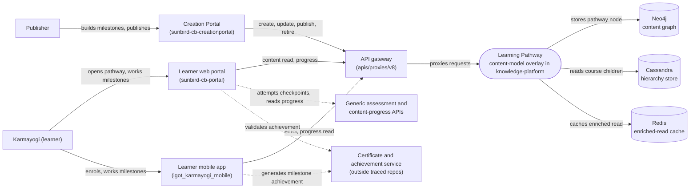

# Learning Pathway — Context Diagram

## System boundary

Learning Pathway is a content-model overlay, not a standalone service. Inside the feature
are the pathway-specific pieces: the authoring service in the Creation Portal, the
client-side milestone unlock logic on learner web and mobile, and the pathway-aware
enriched read and cache invalidation in the generic content service. Outside it are the
Karmayogi and Publisher actors, the API gateway, the content graph, hierarchy and cache
stores, the generic assessment and progress APIs, and the certificate service.

## Diagram

## Elements

| Element | Role | Detailed in |
|---|---|---|
| Learning Pathway (content-model overlay) | Central feature: pathway is a content entry with `courseCategory` set to Learning Pathway; milestones live in one JSON field; only the enriched read and cache invalidation are pathway-aware | [hld.md](hld.md) |
| Karmayogi (learner) | Works through milestones in order, collects milestone achievements | [use-cases.md](use-cases.md) |
| Publisher | Authors the pathway, milestones, assessments and access rules | [use-cases.md](use-cases.md) |
| Creation Portal | Authoring front end; sole HTTP boundary for create, update, publish, retire, search | [apis.md](apis.md) |
| Learner web portal | Standard course viewer; computes milestone lock state client-side | [hld.md](hld.md) |
| Learner mobile app | Dedicated learner-path screen; enrol call; client-side unlock engine | [apis.md](apis.md) |
| API gateway | Path in front of the content service | [apis.md](apis.md) |
| Generic assessment and content-progress APIs | Checkpoint and entry-gate attempts; progress input to unlock computation | [use-cases.md](use-cases.md) |
| Certificate and achievement service | Issues and validates milestone and pathway certificates; implementation not in the traced repos | [apis.md](apis.md) |
| Neo4j | Content graph holding the pathway node | [hld.md](hld.md) |
| Cassandra | Hierarchy store for course children | [hld.md](hld.md) |
| Redis | Read-through cache for the enriched read | [apis.md](apis.md) |

> **Verification boundary:** elements and interactions come from the feature's own pages
> (index, use cases, APIs, HLD), each read in full; the LLD and operations manual were not
> read for this diagram. A read-only spot-check of the workspace clones of
> `knowledge-platform`, `sunbird-cb-creationportal`, `igot_karmayogi_mobile` and
> `sunbird-cb-portal` did not locate the pathway-specific code on their currently
> checked-out branches, so nothing here is confirmed against source. Dashed links are
> those the docs describe as reaching services or configuration outside the traced repos.
