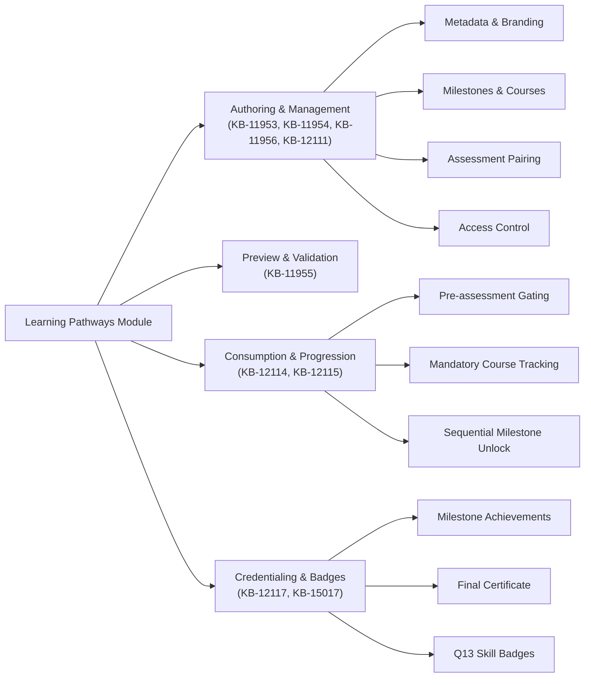
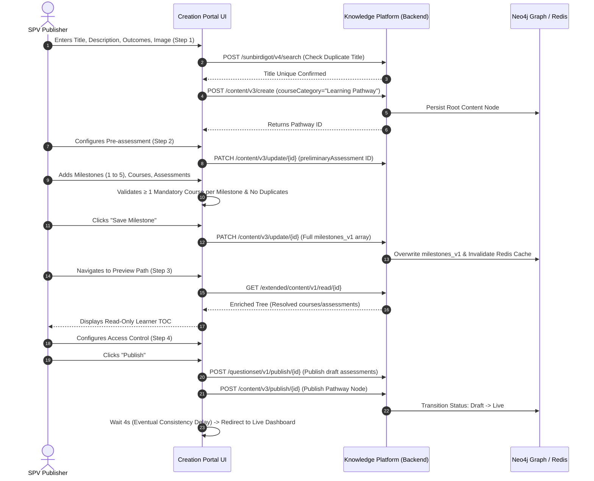
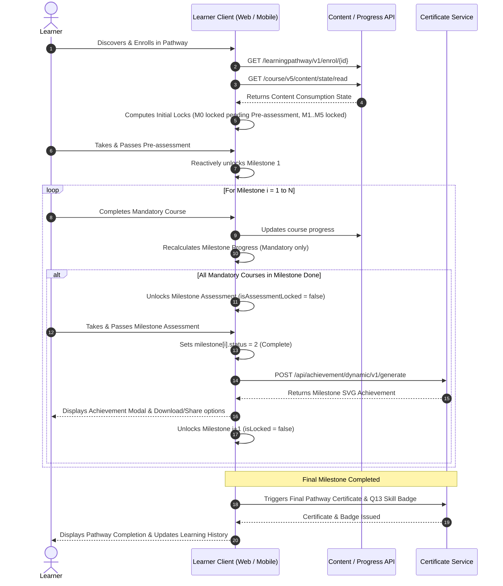
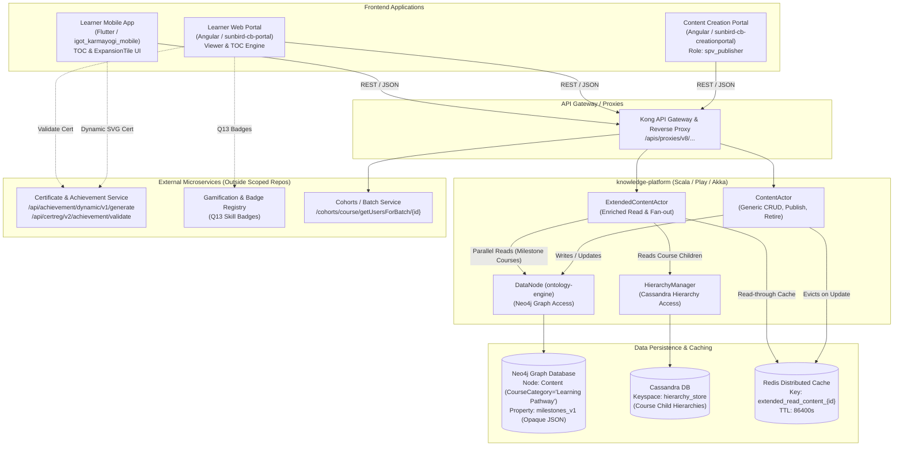
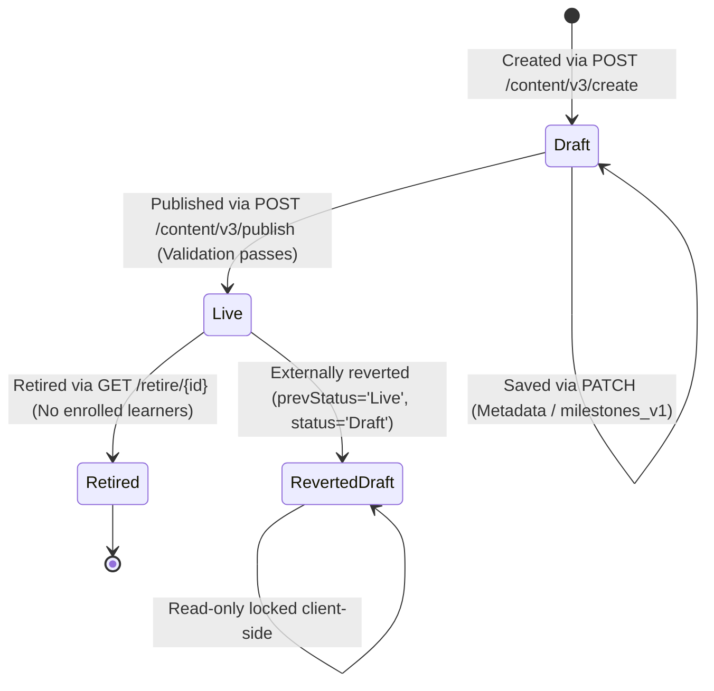

## 2. Executive Summary

The **Learning Pathways** feature on iGOT Karmayogi introduces a structured, milestone-based curriculum mechanism that organizes independent courses and assessments into coherent, progressive journeys. Designed to move learners beyond fragmented course consumption, Learning Pathways enables civil servants to pursue competency mastery, formal credentials, and specialized career development.

Key aspects established across business specifications, Jira records, and technical architecture:

- **Business Functionality (Q10 Baseline):** Authored exclusively by the **SPV Publisher** through a 4-step wizard in the Content Creation Portal (`Create Path` → `Learning Structure` → `Preview Path` → `Access Control`). A pathway supports up to 5 sequential milestones, an upfront mandatory Pre-assessment, mandatory and optional courses per milestone, and a mandatory milestone-level assessment. Progression is strictly gated: learners unlock Milestone 1 only after clearing the Pre-assessment, and unlock Milestone *N+1* only upon completing all mandatory courses and the milestone assessment of Milestone *N*.
- **Headline Architectural Reality:** Static code tracing across `sunbird-cb-creationportal`, `sunbird-cb-portal`, `igot_karmayogi_mobile`, and `knowledge-platform` confirms that **no dedicated Learning Pathway microservice or standalone relational database schema exists**. Learning Pathway is implemented as a **content-model overlay** on the existing Sunbird Knowledge Platform content graph (`contentType: "Course"`, `primaryCategory: "Course"`, `courseCategory: "Learning Pathway"`). Milestones, courses, and assessment identifiers are stored as an opaque JSON string/array inside a single metadata property, `milestones_v1`, on the pathway node in Neo4j.
- **Progress & Unlocking Execution:** Milestone locking and unlocking are **entirely derived client-side** (in Angular on web and Flutter on mobile) using generic content progress read APIs (`/api/course/v5/content/state/read`). There is no backend "unlock" or "milestone state" API. The only pathway-aware backend component is `ExtendedContentActor.extendedRead()`, which enriches the pathway node by fanning out reads to referenced courses (Neo4j/Cassandra) and assessments, caching results in Redis.
- **Credentialing & Extended Scope:** Completing a milestone triggers an achievement badge/SVG certificate (mobile `/api/achievement/dynamic/v1/generate`), while completing the full pathway issues a final completion certificate. In **Q13** ([KB-15017](https://karmayogibharat.atlassian.net/browse/KB-15017)), the capability was extended under the Gamification framework to attach **Skill Badges** to pathways, awarding badges exclusively upon 100% completion of the pathway.

## 3. Business Context and Problem Statement

### 3.1 Business Need & Existing Challenges

Prior to Learning Pathways, learning content on iGOT Karmayogi existed primarily as standalone courses. This presented several operational and pedagogical challenges:

1. **Fragmented Learning Journeys:** Learners had to self-curate courses without guided sequencing, leading to high drop-off rates and incomplete skill acquisition.
2. **Lack of Enforced Prerequisites:** Advanced competencies require foundational knowledge, yet the platform lacked automated pedagogical gating to prevent learners from skipping core concepts.
3. **Absence of Phased Milestone Recognition:** Learners had to complete entire extensive programs before receiving recognition, reducing motivation across multi-week training programs.
4. **Governance & Specialization Needs:** The Karmayogi Bharat SPV required a standardized mechanism to bundle strategic civil service training into recognizable, branded "iGOT Specializations" with controlled access across Ministries, Departments, and Organizations (MDOs).

### 3.2 Expected Improvements & Strategic Relevance

- **Guided Step-by-Step Progression:** Transform individual courses into pedagogical paths with clear stages.
- **Competency Rigor:** Enforce readiness through mandatory pre-assessments and validate level progression through milestone assessments.
- **Incremental Recognition:** Boost learner retention through milestone achievement popups, badges, and final certificates.
- **Enterprise Access Control:** Allow SPV Publishers to target pathways to specific cadres, roles, or organizations, or publish them publicly.

### 3.3 Measurable Success Indicators

- *Documented in Sources:* Pathway completion percentage, milestone completion rates, and enrolled learner counts (tracked via Looker and SPV Publisher dashboards).
- *Industry Standard Indicators (Suggested / Unverified in Source Documentation):* Reduction in learner drop-off across sequenced courses, increase in average learning hours per enrolled civil servant, and assessment pass rates on first attempts.

## 4. Objectives and Expected Benefits

| Stakeholder / Persona | Documented Objectives & Benefits |
|---|---|
| **Learners (Civil Servants)** | • Structured, goal-oriented learning paths removing uncertainty about what to learn next. • Progressive feedback through visual steppers and lock/unlock indicators. • Incremental milestone credentials, verifiable certificates, and digital Skill Badges shareable across profiles and social platforms. |
| **SPV Publishers / Content Creators** | • Standardized 4-step wizard to curate, sequence, and validate courses and assessments without coding. • Automated pedagogical sequencing (mandatory pre-assessments and milestone gates). • Centralized Content Portal dashboard to manage Draft, Live, and Retired pathways with safeguard checks against deleting populated paths. |
| **MDO Administrators & SPV Leadership** | • Targeted capacity-building programs aligned with specific civil service competencies. • Granular visibility and access control based on user roles and organization hierarchies. • Audit-ready tracking and analytics reporting via Looker dashboards. |
| **iGOT Learning Ecosystem** | • Increased content reusability (existing live public courses become building blocks for multiple specialized pathways). • Scalable architecture leveraging existing platform content actors and evaluation pipelines without building duplicate microservices. |

## 5. Scope

### 5.1 In Scope (Confirmed Baseline Capabilities)

- **Creation Workflow:** 4-step wizard (`Create Path`, `Learning Structure`, `Preview Path`, `Access Control`) restricted to the `spv_publisher` role.
- **Milestone Configuration:** Support for 1 to 5 sequential milestones per pathway.
- **Curriculum Assembly:** Associating live, public courses with mandatory or optional flags; cross-milestone duplicate course prevention.
- **Assessment Configuration:** Mandatory pathway Pre-assessment (preceding Milestone 1); exactly one mandatory assessment per milestone.
- **Progression Engine:** Client-side sequential locking logic; automatic unlocking upon completing mandatory courses and passing assessments.
- **Publisher Management:** Dashboard with Live and Draft tabs, server-side pagination, search (min 2 chars), column sorting, and delete protection checking enrolled learners.
- **Credentialing:** Milestone achievement popups, SVG milestone certificates, final pathway completion certificate, and learner profile registry integration.

### 5.2 Out of Scope (Explicitly Excluded in BRD/FRS)

- Automated email, SMS, or push notifications for pathway events (marked out of scope in Q10 BRD/FRS).
- Custom certificate design templates beyond platform-approved certificate layouts.
- External third-party course ingestion or LTI (Learning Tools Interoperability) protocol integrations.
- Gamification mechanics beyond milestone achievements, certificates, and Q13 Badges.
- Dynamic, AI-driven adaptive pathway sequencing based on runtime learner performance (paths are statically configured).
- Pathway branching, versioning, or rollback history.
- Bulk CSV/Excel uploading of milestones or courses.
- In-line editing of individual course competencies within the Learning Pathway module.
- Blended learning journeys or scheduling instructor-led training (ILT) sessions within the pathway.

### 5.3 Related & Extended Scope

- **Q13 Skill Badges (**[**KB-15017**](https://karmayogibharat.atlassian.net/browse/KB-15017) **/** [**Q13 BRD**](https://karmayogibharat.atlassian.net/wiki/spaces/TPT/pages/1248755721/Q13+BRD+Skill+Badge+-+Learner+Pathway)**):** Extending the platform Gamification framework to bind verifiable skill badges to Learning Pathways, awarded strictly upon 100% path completion.
- **Curated Collections / Explore Integration:** Surfacing pathways through the learner portal's home-page curated strips (`content-strip-multiple`) and the Curated Collections module (`/app/curatedCollections`).
- **Karma Points Integration:** Promotional display of Karma points (e.g., 25 points on mobile About tab); actual backend awarding pipeline remains unverified in core repos.

## 6. Stakeholders and User Personas

| Stakeholder / Persona | Responsibilities & Permissions | Relevant Interactions | Supporting Source |
|---|---|---|---|
| **SPV Publisher** | • Primary administrator and author of Learning Pathways. • Authorized via `spv_publisher` role guard in creation portal. • Designs structure, selects courses, configures assessments, defines access rules, publishes, edits metadata, and retires paths. | • Step 1–4 Creation Stepper • Content Portal Dashboard (`/author/learning-path`) • Live Delete Guard Modals | Q10 BRD §6.1, FRS §1, SRS §4, As-Built §1.1–1.5 |
| **Learner (Public Civil Servant)** | • Registered platform user across various MDOs. • Discovers, enrolls, and consumes pathway content. • Takes assessments and earns credentials. | • Learner Web Portal (`/app/toc`, `/viewer`) • Karmayogi Mobile App (`LearnerPathContentPage`) • Milestone Achievement & Certificate Modals | Q10 BRD §7.5, FRS §7.5, SRS §4, As-Built §1.6–1.8 |
| **Content** **Reviewer (CR) / Approver** | • Organizational reviewer role. *(Note: Standard course authoring requires Reviewer approval; for Learning Pathways, the SPV Publisher directly publishes without a formal multi-stage approval queue).* | • Implicit authoring governance. | Q10 FRS Acronyms table (referenced, but direct workflow omitted) |
| **SPV Operations / NOC / QA** | • Monitors platform health, search indexing consistency, and operational triage. | • Verifies data indexing delays, cache eviction, and batch enrollment states. | Operations Manual, As-Built §1.5 |

## 7. Feature Overview and Key Capabilities



### 7.1 Pathway Metadata Creation ([KB-11953](https://karmayogibharat.atlassian.net/browse/KB-11953))

- **Description:** First step of authoring where basic branding and descriptors are configured.
- **Behavior:** Captures Title (10–70 chars, regex-validated, unique check), Description (250–1000 plain chars), Learning Outcome (250–1000 plain chars via CKEditor), and Card Image (max 4MB, JPG/JPEG/PNG).
- **Technical Flow:** Calls `POST .../action/content/v3/create` with `courseCategory: "Learning Pathway"` to create the root content node in Neo4j.

### 7.2 Pedagogical Structure & Course Assembly ([KB-11954](https://karmayogibharat.atlassian.net/browse/KB-11954))

- **Description:** Defining the multi-level curriculum.
- **Behavior:**
  - Allows adding up to 5 milestones. Milestones can be reordered via drag-and-drop.
  - Authors pick live, public courses. Courses can be flagged as **Mandatory** or **Optional**. Every milestone must contain ≥ 1 mandatory course.
  - Cross-milestone duplicate prevention blocks adding a course already present in another milestone.
  - Pre-assessment is configured at the top level and immediately persisted via PATCH.
  - Milestone assessment is configured per milestone (attempts, passing score, questionset link).

- **Technical Flow:** Persisted by whole-array replacement of the `milestones_v1` metadata property via `PATCH .../action/content/v3/update/{id}`.

### 7.3 Read-Only Learner Preview ([KB-11955](https://karmayogibharat.atlassian.net/browse/KB-11955))

- **Description:** High-fidelity simulation of the learner experience prior to publishing.
- **Behavior:** Displays the path header, About tab, Content hierarchy, locked/unlocked indicators, and computed durations. The "Start my journey" action is disabled for the publisher.
- **Technical Flow:** Thin Angular wrapper (`lp-preview-path.component.ts`) delegating rendering to the shared `@sunbird-cb/toc` (`ws-app-app-toc-home-v2`) component using enriched data from `GET .../extended/content/v1/read/{id}`.

### 7.4 Enterprise Access Control ([KB-11956](https://karmayogibharat.atlassian.net/browse/KB-11956))

- **Description:** Restricting visibility and enrollment to specific cohorts.
- **Behavior:** Integrates with platform access widgets (`sb-uic-access-control`). Allows open public access or custom targeting by user group, organization, or role. Access settings must be confirmed before publish is permitted.
- **Technical Flow:** Stores access flags (`accessSettingsEnabled`) on the pathway content node.

### 7.5 Content Portal Lifecycle Management ([KB-12111](https://karmayogibharat.atlassian.net/browse/KB-12111))

- **Description:** Administrative management grid for SPV Publishers (`/author/learning-path`).
- **Behavior:** Tabbed view (Live vs. Draft) with search (min 2 chars), sort, pagination (10/20/30/50). Live pathways restrict edits to minor metadata. Retiring a live pathway executes an active check via `/cohorts/course/getUsersForBatch/{id}` to block deletion if learners are enrolled.

### 7.6 Learner Progression & Milestone Unlocking ([KB-12115](https://karmayogibharat.atlassian.net/browse/KB-12115))

- **Description:** Gated consumption rules ensuring prerequisite completion.
- **Behavior:** All milestones begin locked. Pre-assessment completion unlocks Milestone 1. Within a milestone, completing all mandatory courses unlocks the milestone assessment. Passing the assessment unlocks the subsequent milestone reactively without a page reload.

### 7.7 Credentials & Certifications ([KB-12117](https://karmayogibharat.atlassian.net/browse/KB-12117))

- **Description:** Awarding achievements and formal certificates.
- **Behavior:** Completing a milestone opens an achievement modal rendering an SVG certificate (`/api/achievement/dynamic/v1/generate`) with native share/download options. Completing the final milestone generates the master pathway certificate registered in the learner's profile history.

### 7.8 Skill Badges Integration ([KB-15017](https://karmayogibharat.atlassian.net/browse/KB-15017))

- **Description:** Gamification enhancement extending skill badges to Learning Pathways.
- **Behavior:** SPV Publishers attach pre-configured Skill Badges to pathways. Completion criteria dropdown is disabled (hardcoded to 100% full pathway completion). Badges are displayed on the learner's My Learning / Gamification dashboard and SPV analytics.

## 8. End-to-End Functional Workflow

### 8.1 Authoring & Publication Sequence (SPV Publisher)



### 8.2 Learner Consumption & Progression Sequence



## 9. Business Rules and Functional Constraints

| Rule ID | Business Rule | Applicable Scenario | Expected Behavior | Source |
|---|---|---|---|---|
| **BR-01** | Mandatory Metadata Integrity | Step 1 Authoring | Title, Description, Learning Outcome, and Image are mandatory. "Next" is disabled until valid. | Q10 BRD §7.1, FRS RQ-01, SRS §5.1 |
| **BR-02** | Title Constraints & Uniqueness | Step 1 Authoring | 10–70 alphanumeric characters plus allowed symbols (`. - _ $ / : [ ] !`). Duplicate title triggers inline error. | Q10 BRD §7.1, FRS RQ-01, KB-11953 |
| **BR-03** | Text Length Bounds | Step 1 Authoring | Description and Learning Outcome enforce 250–1000 plain text characters (HTML stripped before count). | As-Built §1.1, Q10 BRD §7.1 |
| **BR-04** | Milestone Limits | Step 2 Structure | Minimum 1, maximum 5 milestones. Add Milestone button is hard-capped and disabled at 5. | Q10 BRD §7.2, SRS §3.3.2, KB-11954 |
| **BR-05** | Mandatory Course Requirement | Step 2 Structure | Each milestone must contain at least one course marked as Mandatory (`isMandatory: true`). | Q10 BRD §7.2, FRS RQ-05, KB-11954 |
| **BR-06** | Cross-Milestone Course Deduplication | Step 2 Structure | A course cannot be added to Milestone *Y* if already present in Milestone *X*. System displays a blocking message. | Q10 BRD §7.2, FRS RQ-04, As-Built §1.2 |
| **BR-07** | Course Eligibility Filter | Step 2 Course Picker | Only courses with status `Live` and public visibility are returned in the picker search. | Q10 BRD §3, As-Built §1.2 |
| **BR-08** | Pre-assessment Gating | Step 2 & Learner Progression | Exactly one pre-assessment configured at root. Milestone 1 remains locked until pre-assessment is cleared. | Q10 BRD §7.2, SRS §5.7, KB-11954 |
| **BR-09** | Milestone Assessment Gating | Learner Consumption | Milestone assessment unlocks only when all mandatory courses in that milestone are 100% complete. | Q10 BRD §7.3, FRS RQ-06, SRS §5.7 |
| **BR-10** | Milestone Progression Gating | Learner Consumption | Milestone *N+1* unlocks only when Milestone *N* has `status = 2` (mandatory courses complete + assessment passed). | Q10 BRD §7.3, FRS RQ-07, SRS §5.7 |
| **BR-11** | Assessment Attempts & Cool-off | Assessment Gating | *Requirement:* Max 5 attempts; 7-day cool-off period upon exhaustion. *(Implementation Finding: Confirmed missing in code).* | Q10 FRS RQ-06, SRS §5.7, As-Built §1.7 |
| **BR-12** | Access Control Prerequisite | Step 4 Authoring | Pathway cannot be published unless access control is configured (`accessSettingsEnabled` set; ≥ 1 group if restricted). | Q10 BRD §7.4, SRS §5.4, KB-11956 |
| **BR-13** | Live Pathway Edit Restrictions | Post-Publish Management | For Live pathways, structural fields (milestones, courses, assessments) are locked. Only descriptions and image can be edited. | Q10 BRD §3, SRS §5.5, KB-12111 |
| **BR-14** | Enrolled Learner Deletion Guard | Content Portal Delete | Live pathways check active batch enrollments. If enrolled learners exist, deletion is completely blocked. | As-Built §1.5, KB-12111 |
| **BR-15** | Q13 Skill Badge Award Criteria | Gamification Extension | Completion criteria dropdown is disabled. Badge is awarded strictly upon 100% completion of the entire pathway. | Q13 BRD BR-02/03, KB-15017 |

## 10. High-Level Architecture Overview

Learning Pathway is implemented as an **overlay on the Sunbird Knowledge Platform content graph**, rather than an independent microservice. It leverages the standard Play/Akka architecture, storing nodes in Neo4j, hierarchies in Cassandra, and caching read models in Redis.



### Component Responsibility Matrix

| Component | Repository / Technology | Key Responsibilities | Primary Data Stores / Interfaces |
|---|---|---|---|
| **Creation Stepper & Modules** | `sunbird-cb-creationportal` (Angular) | • Orchestrates 4-step authoring wizard. • Client-side reactive form validation and duplicate title checking. • Assembles `milestones_v1` JSON and computes aggregate durations. | Browser Local State, REST via `learner-pathway.service.ts` |
| **Learner Web Viewer / TOC** | `sunbird-cb-portal` (Angular) | • Evaluates milestone lock states reactively upon progress updates. • Enforces mandatory-only course tracking and triggers milestone completion popups. | Browser RxJS Subjects, REST via generic content progress |
| **Learner Mobile (TOC Feature)** | `igot_karmayogi_mobile` (Flutter) | • Renders accordion-based milestone list. • Implements client-side unlock calculation in `toc_helper.dart`. • Triggers SVG certificate generation and native sharing. | Flutter Provider (`TocRepository`), REST APIs |
| **ContentActor** | `knowledge-platform` (Scala / Akka) | • Generic Content CRUD actors. • Handles create, update, publish, and retire operations. • Invalidates Redis cache on `milestones_v1` updates. | Neo4j (`DataNode`), Redis Cache |
| **ExtendedContentActor** | `knowledge-platform` (Scala / Akka) | • Sole pathway-specific backend component. • Performs enriched read by fanning out queries to Neo4j and Cassandra. • Merges course and assessment hierarchies into a unified JSON tree. | Neo4j, Cassandra, Redis |
| **DataNode / HierarchyManager** | `ontology-engine` (Scala) | • Manages graph nodes in Neo4j and hierarchy blobs in Cassandra. | Neo4j, Cassandra |

## 11. API and Integration Overview

### 11.1 Documented API Endpoints

| Method | Endpoint / Route | System / Component | Purpose | Caller | Response / Outcome | Source |
|---|---|---|---|---|---|---|
| `POST` | `apis/proxies/v8/action/content/v3/create` | Content Service | Creates pathway root node or media assets | Creation Portal | `{ result: { identifier } }` | As-Built §2.1, LLD §2 |
| `PATCH` | `apis/proxies/v8/action/content/v3/update/{id}` | Content Service | Replaces `milestones_v1`, updates metadata or access | Creation Portal | `{ result: { versionKey } }` | As-Built §2.1, LLD §2 |
| `GET` | `apis/proxies/v8/action/content/v3/read/{id}?``mode=edit` | Content Service | Reads raw pathway node for editing | Creation Portal | `{ result: { content:` `{ ... } } }` | As-Built §2.1, LLD §2 |
| `POST` | `apis/proxies/v8/sunbirdigot/v4/search` | Search Service | Searches pathways, picks live courses, verifies title uniqueness | Creation Portal | `{ result: { content: [...], count } }` | As-Built §2.1, LLD §2 |
| `POST` | `apis/proxies/v8/questionset/v1/publish/{id}` | Assessment Service | Publishes referenced draft assessments | Creation Portal | Assessment state set to Live | As-Built §2.1, LLD §2 |
| `POST` | `apis/proxies/v8/action/content/v3/publish/{id}` | Content Service | Publishes pathway content node | Creation Portal | Pathway status set to Live | As-Built §2.1, LLD §2 |
| `GET` | `apis/proxies/v8/learningpathway/v1/retire/{id}` | Content Service | Retires/deletes a learning pathway | Creation Portal | Node marked retired *(uses GET with side-effects)* | As-Built §2.1, LLD §2 |
| `GET` | `apis/proxies/v8/extended/content/v1/read/{id}` | `ExtendedContentActor` | Enriched read fanning out course/assessment details | Creation Portal / Web | Fully resolved hierarchical JSON tree | As-Built §2.1, LLD §2 |
| `GET` | `apis/protected/v8/cohorts/course/getUsersForBatch/{id}` | Cohorts Service | Checks enrolled learner count before deletion | Creation Portal | Returns user list or count | As-Built §2.1, LLD §2 |
| `GET` | `/api/learningpathway/v1/enrol/{id}` | Enrollment Service | Enrolls a learner into a pathway | Mobile App | Enrollment confirmation | As-Built §2.3, LLD §2 |
| `GET` | `/api/course/v5/content/state/read` | LMS / Progress Service | Reads learner progress across courses | Web / Mobile | Generic content progress map | As-Built §2.3, LLD §2 |
| `POST` | `/api/achievement/dynamic/v1/generate` | Certificate Service | Generates dynamic SVG milestone certificate | Mobile App | SVG certificate payload | As-Built §2.3, LLD §2 |
| `POST` | `/api/certreg/v2/achievement/validate` | Certificate Registry | Validates milestone/pathway certificate authenticity | Learner Web | Verification status & metadata | As-Built §2.3, LLD §2 |

### 11.2 Integration Gaps & Observations

1. **Absence of Dedicated Progress API:** There is no `/api/learningpathway/v1/progress/{id}` endpoint. Progress and unlocking states are calculated purely on the client side.
2. **REST Convention Deviation:** Pathway retirement utilizes an HTTP `GET` request (`.../retire/{id}`) despite performing destructive state modification.
3. **External Service Boundaries:** The services handling certificate SVG rendering, QR verification, and Karma point awards reside outside the core `knowledge-platform` codebase and operate as decoupled microservices.

## 12. Data and State Management

### 12.1 Underlying Data Model

Learning Pathway records do not utilize relational tables or foreign keys. All data is structured around a **single Neo4j graph node** of type `Content`:

```text
Content Node (Neo4j)
├── identifier: "do_1138..." (String, Primary Key)
├── contentType: "Course"
├── primaryCategory: "Course"
├── courseCategory: "Learning Pathway" (Discriminator)
├── title: String (10-70 chars)
├── description: String (250-1000 chars)
├── purpose: String (Learning Outcomes)
├── preliminaryAssessment: String (QuestionSet Identifier)
├── accessSettingsEnabled: Boolean
├── duration: Number (Sum of milestone durations)
├── status: "Draft" | "Live" | "Retired"
├── versionKey: String (Optimistic concurrency token)
└── milestones_v1: String / Array (Opaque JSON Blob)
    └── [
          {
            "id": "uuid-v4",
            "index": 1,
            "name": "Milestone Title",
            "description": "Milestone Description",
            "courses": [
              { "identifier": "do_course_123", "name": "Course Title", "isMandatory": true, "duration": 3600 }
            ],
            "assessmentDetail": { "identifier": "do_assess_456", "duration": 1800 }
          }
        ]
```

### 12.2 Lifecycle State Transitions



### 12.3 Milestone & Progression States

Progression tracking is maintained client-side via two independent status evaluations:

- **Milestone Completion State** (`status`): Binary on mobile (`0 = Incomplete`, `2 = Complete`). Note: While data models define a 3-state convention (`0 = Not Started`, `1 = In Progress`, `2 = Complete`), code tracing confirms no path emits `1`.
- **Lock Flags (**`isLocked`, `isAssessmentLocked`):
  - `milestone[0].isLocked = !preliminaryAssessmentCompleted`
  - `milestone[i].isLocked = (milestone[i-1].status < 2)` (for *i > 0*)
  - `milestone[i].assessment.isAssessmentLocked = (mandatoryCoursesComplete == false)`

## 13. Security and Access Control

- **Authoring Role-Based Access Control (RBAC):** Gated at the Angular route level via `learning-pathway.guard.ts`, enforcing that the user possesses the `spv_publisher` role. No granular per-action permissions (e.g., separate rights for draft saving vs. publishing vs. retirement) exist within the module.
- **Learner Visibility & Enrollment Control:** Handled via integration with `@sunbird-cb/access-settings`. Publishers configure public access or custom targeting by MDO organization, role, or user group. Access rules are resolved during content search and enrollment gating.
- **Backend Authorization & Input Validation:**
  - Backend CRUD routes require standard platform session/auth tokens.
  - Optimistic locking is enforced on writes via `versionKey`.
  - **Critical Architecture Finding:** There is **no server-side JSON schema validation** for the `milestones_v1` payload in `knowledge-platform`. Validation rules (string lengths, course counts, assessment requirements) are executed exclusively by the Angular creation portal. The backend accepts and persists any JSON structure passed into the `milestones_v1` property.

## 14. Error Handling and Exceptional Scenarios

| Scenario | Observed System Behavior & Handling | Technical Recovery / Fallback |
|---|---|---|
| **Duplicate Pathway Title** | Frontend invokes search API during Step 1; matching title triggers inline error and blocks progression. | User must enter a distinct title. |
| **Missing Mandatory Fields** | "Next" button remains disabled; inline validation warnings display under empty required fields. | FormArray validators prevent navigation. |
| **Invalid Assessment Hierarchy** | Step 2 "Next" executes `validateStepperTwo()`, checking question counts and sections against live assessment data. | Surfaces errors in `ValidationErrorsDialogComponent` and halts wizard. |
| **Delete Live Path with Enrolled Learners** | Dashboard checks `/cohorts/course/getUsersForBatch/{id}` prior to confirming deletion. | Hard blocking dialog informs publisher that populated pathways cannot be deleted. |
| **Search Index Lag after Publish/Retire** | Writes to Neo4j experience eventual-consistency delays before reflecting in Elasticsearch search results. | Hardcoded client delays (4s on publish, 5s on retire) temporarily mask indexing latency before page refresh. |
| **Certificate Generation Network Failure** | Mobile app surfaces a generic toast message (`"Something went wrong"`) if SVG generation fails. | No automated exponential backoff; user must re-trigger by reopening the achievement view. |
| **Concurrent Authoring Conflicts** | Two publishers updating the same pathway simultaneously. | Enforced via Sunbird `versionKey`; the stale transaction receives an HTTP 400/409 error. |

## 15. Non-Functional Requirements (NFRs)

- **Performance & Response Times:** Average API response times are targeted at **3 to 5 seconds** under normal load (per SRS §8.2).
- **System Capacity & Concurrency:** Production environment is specified to support **25,000 concurrent users** distributed across portal login, course consumption, profile views, and mobile sessions (SRS §8.2, §8.5).
- **Caching & Throughput:** Redis caching (`extended_read_content_{id}`) with a default TTL of 86,400 seconds (24 hours) buffers enriched read load. Cache entries are evicted automatically by `ContentActor` whenever `milestones_v1` or `preliminaryAssessment` fields are updated.
- **Maintainability & Recovery:** Recovery Time Objective (RTO) is defined as **8 hours** for business-critical workflows and **48 hours** for auxiliary subsystems (SRS §8.4).
- **Client Compatibility:**
  - Web: Mozilla Firefox 122+, Google Chrome 118+, Internet Explorer 11 (legacy reference in SRS).
  - Mobile: Android versions up to 13; iOS versions up to 17 (SRS §8.6).

## 16. Dependencies and Assumptions

### 16.1 System Dependencies

1. **Sunbird Knowledge Platform Content Engine:** Reuses generic `ContentActor`, `DataNode`, and Neo4j graph nodes.
2. **Questionset / Assessment Service:** Standalone service providing question authoring, section weighting, hierarchy traversal, and evaluation.
3. **Course LMS & Progress Pipeline:** Relies on generic course state tracking (`/api/course/v5/content/state/read`) for calculating item completions.
4. **Cohorts & Batch Service:** Required to determine learner enrollment counts prior to pathway deletion.
5. **Dynamic Certificate & Registry Services:** Decoupled services responsible for SVG certificate generation and QR code verification.
6. **Platform Gamification Engine (Q13):** Manages Skill Badge metadata, asset SVGs, and profile badge allocations.

### 16.2 Key Assumptions

- All courses curated into milestones are published with public access enabled.
- Pathway sequencing rules are deterministic and fixed (no runtime adaptive branching).
- Client devices maintain stable network connectivity to synchronize course completion states.
- Looker serves as the centralized reporting and business intelligence visualization layer.

## 17. Skill Badge Learner Pathway Relationship

In Quarter 13, the **Skill Badge - Learner Pathway** initiative ([KB-15017](https://karmayogibharat.atlassian.net/browse/KB-15017) / [Q13 BRD](https://karmayogibharat.atlassian.net/wiki/spaces/TPT/pages/1248755721/Q13+BRD+Skill+Badge+-+Learner+Pathway)) expanded the capabilities established in Q10. The table below delineates the functional boundaries:

| Dimension / Aspect | Core Learning Pathways (Q10 Baseline) | Skill Badge Learner Pathway (Q13 Extension) | Evidence & Source |
|---|---|---|---|
| **Primary Objective** | Pedagogical structuring, course sequencing, and milestone-based progression. | Gamification, public skill recognition, and high-visibility credentialing. | Q10 BRD vs. Q13 BRD §1 |
| **Authoring Interaction** | 4-step wizard in Content Portal creating milestones, courses, and assessments. | SPV Publisher selects and applies an official badge asset to an existing pathway. | KB-11953 vs. KB-15017 |
| **Completion Criteria** | Multi-level: Pre-assessment + individual milestone completion + overall pathway. | Hardcoded to 100% full pathway completion (criteria dropdown is disabled/greyed out). | Q13 BRD BR-02, BR-03 |
| **Awarding Mechanism** | Dynamic SVG certificate modal per milestone; final completion certificate. | Digital Skill Badge added to learner Gamification profile and shared across records. | KB-12117 vs. KB-15018 |
| **Dashboard Footprint** | SPV Live/Draft listing; learner TOC tree view. | SPV Publisher dashboard displays badge uptake; Learner Gamification dashboard shows badges. | Q13 BRD BR-05, BR-06 |
| **Reporting Integration** | Course completion progress and Looker tabular dashboards. | Enriched reporting capturing pathway badge issuance alongside course metrics. | Q13 BRD BR-07 |

## 18. Implementation Status and As-Built Assessment

| Functional Capability | Jira Reference | Requirements Status | As-Built Implementation Status | Evidence Category |
|---|---|---|---|---|
| **Creation Stepper (Step 1)** | [KB-11953](https://karmayogibharat.atlassian.net/browse/KB-11953) | Specified in BRD/FRS/SRS | **Fully Implemented.** Title, description, outcome, image, and duplicate checking operational. | Confirmed by As-Built Doc & Code |
| **Learning Structure (Step** **2)** | [KB-11954](https://karmayogibharat.atlassian.net/browse/KB-11954) | Specified in BRD/FRS/SRS | **Substantially Implemented.** Max 5 milestones, drag-and-drop, and deduplication functional. Course filter UI is a stub. | Confirmed by As-Built Doc & Code |
| **Preview Path (Step 3)** | [KB-11955](https://karmayogibharat.atlassian.net/browse/KB-11955) | Specified in BRD/FRS/SRS | **Fully Implemented.** Delegated to shared `@sunbird-cb/toc` renderer in read-only mode. | Confirmed by As-Built Doc & Code |
| **Access Control (Step 4)** | [KB-11956](https://karmayogibharat.atlassian.net/browse/KB-11956) | Specified in BRD/FRS/SRS | **Fully Implemented.** Integrated with shared `@sunbird-cb/access-settings` widget. | Confirmed by As-Built Doc & Code |
| **Content Portal Management** | [KB-12111](https://karmayogibharat.atlassian.net/browse/KB-12111) | Specified in BRD/FRS/SRS | **Fully Implemented.** Live/Draft listing, pagination, sorting, and enrolled learner delete guard active. | Confirmed by As-Built Doc & Code |
| **Learner Landing & Discovery** | [KB-12114](https://karmayogibharat.atlassian.net/browse/KB-12114) | Specified in BRD/FRS/SRS | **Partially Implemented / Unverified.** Discovery infrastructure exists (`content-strip-multiple`), but pathway inclusion is config-driven. Dead DLP/CDP route exists. | Inconsistent / Unverified |
| **Sequential Gating & Unlock** | [KB-12115](https://karmayogibharat.atlassian.net/browse/KB-12115) | Specified in BRD/FRS/SRS | **Substantially Implemented.** Client-side unlock logic operational on web and mobile. Attempt limits and cool-off missing. | Confirmed by As-Built Doc & Code |
| **Achievements & Certificates** | [KB-12117](https://karmayogibharat.atlassian.net/browse/KB-12117) | Specified in BRD/FRS/SRS | **Partially Implemented.** SVG milestone achievements active on mobile. QR generation and Karma award-once unverified. | Confirmed by As-Built Doc & Code |
| **Skill Badges Extension** | [KB-15017](https://karmayogibharat.atlassian.net/browse/KB-15017) | Specified in Q13 BRD | **Deployed.** Badges attachable to pathways, criteria locked, UAT feedback closed. | Reported by Jira (KB Review / Prod Deployed) |

## 19. Requirements Traceability Matrix

| Requirement / Capability | BRD Ref. | FRS / SRS Ref. | Jira Ticket | HLD / LLD Ref. | As-Built Implementation Evidence | Assessment Status |
|---|---|---|---|---|---|---|
| **Pathway Metadata Creation** | Q10 BRD §7.1 (BR-1–6) | FRS RQ-01, SRS §5.1 | [KB-11953](https://karmayogibharat.atlassian.net/browse/KB-11953) | HLD §2, LLD §2, §3 | `lp-create-path.component.ts`, `POST /content/v3/create` | **Verified Implemented** |
| **Milestone & Course Assembly** | Q10 BRD §7.2 (BR-7–16) | FRS RQ-03–05, SRS §5.2 | [KB-11954](https://karmayogibharat.atlassian.net/browse/KB-11954) | HLD §2, LLD §2, §3 | `lp-learning-structure.component.ts`, `lp-milestone.component.ts`, `PATCH /content/v3/update` | **Verified Implemented** (Course filter stubbed) |
| **Pre & Milestone Assessments** | Q10 BRD §7.2 (BR-17–20) | FRS RQ-06, SRS §5.2 | [KB-11954](https://karmayogibharat.atlassian.net/browse/KB-11954) | HLD §2, LLD §2, §5 | `validateStepperTwo()`, `@sunbird-cb/consumption`, Questionset APIs | **Verified Implemented** |
| **Learner Preview Mode** | Q10 BRD §6.5 | FRS RQ-02, SRS §5.3 | [KB-11955](https://karmayogibharat.atlassian.net/browse/KB-11955) | HLD §2, LLD §3 | `lp-preview-path.component.ts`, `ExtendedContentActor.extendedRead` | **Verified Implemented** |
| **Access Control Configuration** | Q10 BRD §7.4 (BR-26–28) | FRS RQ-02, SRS §5.4 | [KB-11956](https://karmayogibharat.atlassian.net/browse/KB-11956) | HLD §2, LLD §3 | `lp-access-control.component.ts`, `@sunbird-cb/access-settings` | **Verified Implemented** |
| **Publisher Dashboard & Lifecycle** | Q10 BRD §7.6 (BR-35–40) | FRS RQ-08, SRS §5.5 | [KB-12111](https://karmayogibharat.atlassian.net/browse/KB-12111) | HLD §2, LLD §2, §3 | `lp-dashboard.component.ts`, `/cohorts/course/getUsersForBatch` | **Verified Implemented** |
| **Learner Landing & Catalog** | Q10 BRD §7.7 (BR-41–44) | FRS RQ-08, SRS §5.6 | [KB-12114](https://karmayogibharat.atlassian.net/browse/KB-12114) | HLD §2, §3b | `content-strip-multiple.component.ts`, `/app/curatedCollections` | **Partially Verified** (Configuration dependent) |
| **Sequential Unlocking Engine** | Q10 BRD §7.3 (BR-21–25) | FRS RQ-07, SRS §5.7 | [KB-12115](https://karmayogibharat.atlassian.net/browse/KB-12115) | HLD §3c, LLD §4d–e | `viewer.component.ts`, `toc_helper.dart` | **Verified Implemented** (Client-side derived) |
| **Assessment Attempts & Cool-off** | Q10 FRS RQ-06 | SRS §5.7 (Rule 6) | [KB-12115](https://karmayogibharat.atlassian.net/browse/KB-12115) | LLD §5, §6 | Traced across web, mobile, and backend code | **Missing / Gap** |
| **Milestone Achievements & Certs** | Q10 BRD §7.8 (BR-45–48) | FRS RQ-08, SRS §5.8 | [KB-12117](https://karmayogibharat.atlassian.net/browse/KB-12117) | HLD §3d, LLD §2 | `MilestoneAchievement`, `/api/achievement/dynamic/v1/generate` | **Verified Implemented** (QR/Karma unverified) |
| **Skill Badges Extension** | Q13 BRD §7 (BR-01–08) | N/A | [KB-15017](https://karmayogibharat.atlassian.net/browse/KB-15017) | Jira Linked Issues | Content Portal badge settings, `KB-15376`, `KB-15377` | **Verified Implemented** |
