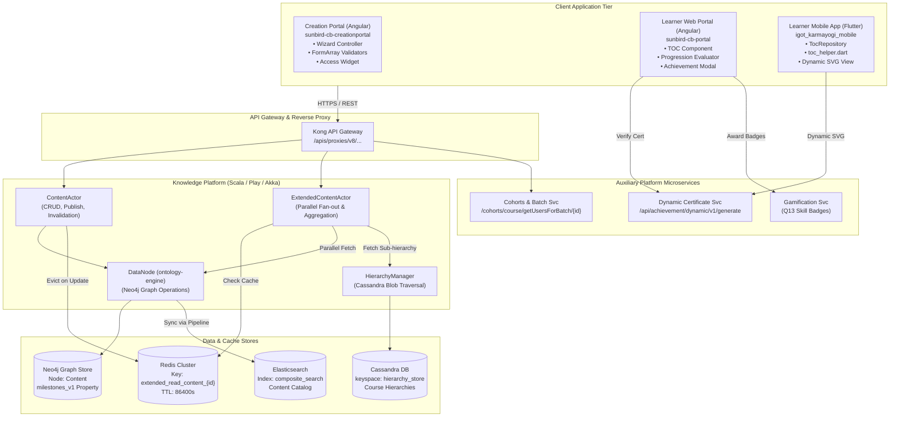
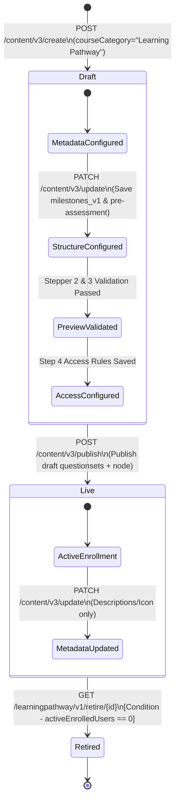
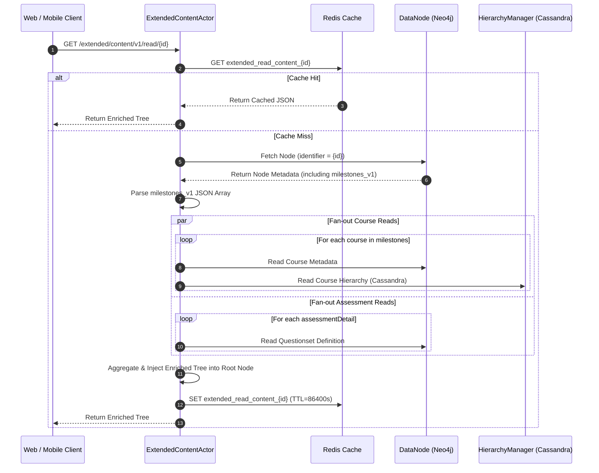

# Learning Pathways — Software Design Document (SDD)

## Learning Pathways — iGOT Karmayogi

## 1. Introduction

### 1.1 Purpose

This Software Design Document (SDD) provides a formal, comprehensive architectural and low-level software design description for the **Learning Pathways** capability within the iGOT Karmayogi platform. It details component decompositions, data models, persistence structures, interface contracts, internal execution pipelines, state machines, and technical trade-offs across the Web Creation Portal, Web Learner Portal, Karmayogi Mobile Application, and the Knowledge Platform backend.

### 1.2 System Context & Scope

Learning Pathways transforms standalone course consumption into milestone-driven curricula ("iGOT Specializations"). The subsystem spans:

1. **Authoring & Lifecycle Management:** 4-step wizard and dashboard in `sunbird-cb-creationportal` restricted to the `spv_publisher` role.
2. **Knowledge Platform (KP) Backend:** Scala/Play/Akka actors managing graph nodes, enriched hierarchy aggregation, and Redis caching.
3. **Learner Table of Contents (TOC) & Consumption:** Progressive unlocking engines implemented in Angular (`sunbird-cb-portal`) and Flutter (`igot_karmayogi_mobile`).
4. **Credentialing & Gamification:** Dynamic SVG milestone achievement generation (`/api/achievement/dynamic/v1/generate`), completion certificates, and Q13 Skill Badges (`KB-15017`).

## 2. Architectural Decisions, Rationale & Design Trade-offs

| Architectural Decision | Chosen Design Approach | Alternatives Considered | Technical Rationale & Trade-offs |
|---|---|---|---|
| **AD-01: Backend Microservice Topology** | **Content Model Overlay:** Reuse existing Sunbird Knowledge Platform primitives (`ContentActor`, `DataNode`) without creating a dedicated Learning Pathway microservice. | Standalone Spring Boot / Go microservice with isolated database. | **Rationale:** Minimizes operational footprint, reuses established RBAC, publishing pipelines, and search indexing infrastructure. **Trade-off:** High reliance on generic content schemas; business logic must be partially enforced at client or actor boundaries. |
| **AD-02: Structural Data Persistence** | **Opaque JSON Blob** (`milestones_v1`): Store the entire milestone, course, and assessment hierarchy as a serialized JSON string/array on the Neo4j `Content` node. | Normalized graph edges (`(Pathway)-[:HAS_MILESTONE]->(Milestone)-[:CONTAINS]->(Course)`) in Neo4j or relational schema in PostgreSQL. | **Rationale:** High read performance for whole-tree fetching; avoids deep recursive graph traversals or multi-table joins. **Trade-off:** Lacks native graph referential integrity; whole-array overwrite required on updates; requires client or actor schema validation. |
| **AD-03: Progression & Unlocking Execution** | **Client-Side Derived Progression:** Evaluate milestone locks, prerequisite states, and unlock transitions dynamically within Angular and Flutter UI engines. | Centralized backend Progression Engine microservice computing state on every content transition. | **Rationale:** Zero backend write load during progression transitions; leverages cached generic content progress states (`/api/course/v5/content/state/read`). **Trade-off:** Logic duplication across Web (TypeScript) and Mobile (Dart); potential progression drift if clients diverge. |
| **AD-04: Hierarchy Read Optimization** | **Actor Fan-Out + Redis Caching:** `ExtendedContentActor` resolves course and assessment hierarchies in parallel, caching the aggregated JSON in Redis with 24h TTL. | Direct client fan-out (client makes separate course reads) or non-cached Neo4j traversal. | **Rationale:** Reduces network roundtrips from client from to ; buffers read load for high-concurrency learner browsing. **Trade-off:** Cache invalidation must be strictly enforced on pathway updates. |

## 3. System Architecture & Decomposition

### 3.1 High-Level Architecture



### 3.2 Component Decomposition & Responsibilities

#### 3.2.1 Frontend Subsystem (`sunbird-cb-creationportal`)

- `lp-create-path.component.ts` (Step 1 Controller): Manages reactive form controls for metadata (Title, Description, Learning Outcome, Card Image). Executes case-insensitive title deduplication via Search API.
- `lp-learning-structure.component.ts` (Step 2 Controller): Manages FormArray instances representing up to 5 milestones. Interfaces with the course picker modal, enforces mandatory course rule, prevents cross-milestone course duplicates, and validates questionset existence via `validateStepperTwo()`.
- `lp-preview-path.component.ts` (Step 3 Controller): Wraps `@sunbird-cb/toc` (`ws-app-app-toc-home-v2`) in read-only mode to render the learner view prior to publication.
- `lp-access-control.component.ts` (Step 4 Controller): Integrates `@sunbird-cb/access-settings` to bind public or restricted cohort policies (`accessSettingsEnabled`).
- `lp-dashboard.component.ts`: Manages Live/Draft grids, server-side pagination, search debouncing, and deletion prevention guards.

#### 3.2.2 Backend Subsystem (`knowledge-platform`)

- `ContentActor`: Standard Sunbird Play/Akka actor handling generic lifecycle transitions (`create`, `update`, `publish`, `retire`). Intercepts update requests to synchronously evict Redis cache entries for `extended_read_content_{id}`.
- `ExtendedContentActor`: Specialized actor executing enriched reads:
  - Retrieves base pathway node from Neo4j (`DataNode`).
  - Extracts and parses `milestones_v1` JSON.
  - Spawns parallel Akka actors to resolve course node metadata (Neo4j) and child hierarchies (Cassandra `HierarchyManager`).
  - Merges resolved courses and questionset schemas into a composite response.
  - Writes the compiled payload to Redis.

#### 3.2.3 Learner Subsystem (`sunbird-cb-portal` & `igot_karmayogi_mobile`)

- `viewer.component.ts` (Web): RxJS-based reactive progress listener. Evaluates milestone and assessment unlock flags based on generic course state updates (`/api/course/v5/content/state/read`).
- `toc_helper.dart` (Mobile): Implements static gating algorithms for Flutter UI. Evaluates binary milestone completion statuses (`0 = Incomplete`, `2 = Complete`) and toggles `isLocked` / `isAssessmentLocked` states.

## 4. Data Design & Persistence Model

### 4.1 Neo4j Graph Model (`Content` Node)

A Learning Pathway is persisted as a single node in Neo4j with label `:Content`.

```text
Node Label: Content
Properties:
├── IL_UNIQUE_ID: "do_1138..." (String, System PK)
├── identifier: "do_1138..." (String, Logical ID)
├── contentType: "Course" (String)
├── primaryCategory: "Course" (String)
├── courseCategory: "Learning Pathway" (String, Sub-category discriminator)
├── name: "Cybersecurity Specialization" (String, 10-70 chars)
├── description: "Foundational..." (String, 250-1000 chars)
├── purpose: "<p>Learners will...</p>" (String, Rich-text HTML)
├── appIcon: "https://.../appIcon.png" (String, Cloud Storage URL)
├── preliminaryAssessment: "do_11394..." (String, Questionset ID)
├── accessSettingsEnabled: true (Boolean)
├── status: "Draft" | "Live" | "Retired" (String, Lifecycle state)
├── duration: 18000 (Number, Summed seconds)
├── versionKey: "1698403200000" (String, Optimistic lock token)
└── milestones_v1: "[{...}]" (String / Array, Opaque JSON Blob)
```

### 4.2 `milestones_v1` JSON Structure & Schema Definition

The internal structure of the `milestones_v1` attribute is governed by the following JSON schema:

```json
{
  "$schema": "http://json-schema.org/draft-07/schema#",
  "title": "MilestonesV1Payload",
  "type": "array",
  "minItems": 1,
  "maxItems": 5,
  "items": {
    "type": "object",
    "required": [
      "id",
      "index",
      "name",
      "description",
      "courses",
      "assessmentDetail"
    ],
    "properties": {
      "id": {
        "type": "string",
        "format": "uuid"
      },
      "index": {
        "type": "integer",
        "minimum": 1,
        "maximum": 5
      },
      "name": {
        "type": "string",
        "minLength": 1,
        "maxLength": 100
      },
      "description": {
        "type": "string",
        "minLength": 1,
        "maxLength": 500
      },
      "courses": {
        "type": "array",
        "minItems": 1,
        "items": {
          "type": "object",
          "required": [
            "identifier",
            "name",
            "isMandatory"
          ],
          "properties": {
            "identifier": {
              "type": "string"
            },
            "name": {
              "type": "string"
            },
            "isMandatory": {
              "type": "boolean"
            },
            "duration": {
              "type": "number"
            }
          }
        }
      },
      "assessmentDetail": {
        "type": "object",
        "required": [
          "identifier"
        ],
        "properties": {
          "identifier": {
            "type": "string"
          },
          "name": {
            "type": "string"
          },
          "duration": {
            "type": "number"
          },
          "passingPercentage": {
            "type": "number"
          }
        }
      }
    }
  }
}
```

### 4.3 Redis Caching Strategy

```text
Cache Key Schema:  extended_read_content_{contentId}
Data Format:       GZIP-compressed JSON String
TTL:               86,400 seconds (24 Hours)
Eviction Trigger:  ContentActor intercepts PATCH /content/v3/update/{id} and POST /content/v3/publish/{id}
                   -> DEL extended_read_content_{contentId}
```

### 4.4 Pathway Lifecycle State Transition Model



## 5. Interface Design & API Specifications

### 5.1 External REST APIs

#### 5.1.1 Create Pathway Node

- **Endpoint:** `POST /apis/proxies/v8/action/content/v3/create`
- **Headers:** `Authorization: Bearer {token}`, `Content-Type: application/json`
- **Request Payload:**

```json
{
  "request": {
    "content": {
      "name": "Public Financial Management",
      "description": "Comprehensive pathway covering government financial rules.",
      "purpose": "<p>Understand GFR 2017 rules.</p>",
      "appIcon": "https://igot-prod.s3.nic.in/assets/icons/pfm.png",
      "contentType": "Course",
      "primaryCategory": "Course",
      "courseCategory": "Learning Pathway"
    }
  }
}
```

- **Response Payload (HTTP 200 OK):**

```json
{
  "id": "api.content.create",
  "ver": "3.0",
  "ts": "2026-10-27T10:00:00Z",
  "responseCode": "OK",
  "result": {
    "identifier": "do_1138947261548175361",
    "versionKey": "1698403200000"
  }
}
```

#### 5.1.2 Update Pathway Milestones & Structure

- **Endpoint:** `PATCH /apis/proxies/v8/action/content/v3/update/{id}`
- **Headers:** `Authorization: Bearer {token}`, `Content-Type: application/json`
- **Request Payload:**

```json
{
  "request": {
    "content": {
      "versionKey": "1698403200000",
      "preliminaryAssessment": "do_113948572019284992",
      "milestones_v1": [
        {
          "id": "b78b5e98-7512-4cf3-a77b-607212458123",
          "index": 1,
          "name": "Milestone 1: Fundamentals",
          "description": "Basic concepts and definitions.",
          "courses": [
            {
              "identifier": "do_113812345678901234",
              "name": "Introduction to GFR",
              "isMandatory": true,
              "duration": 7200
            }
          ],
          "assessmentDetail": {
            "identifier": "do_113998765432109876",
            "name": "Milestone 1 Knowledge Check",
            "duration": 1800,
            "passingPercentage": 75
          }
        }
      ]
    }
  }
}
```

- **Response Payload (HTTP 200 OK):**

```json
{
  "id": "api.content.update",
  "ver": "3.0",
  "responseCode": "OK",
  "result": {
    "identifier": "do_1138947261548175361",
    "versionKey": "1698403250000"
  }
}
```

#### 5.1.3 Extended Content Read (Hierarchy Aggregation)

- **Endpoint:** `GET /apis/proxies/v8/extended/content/v1/read/{id}`
- **Headers:** `Authorization: Bearer {token}`
- **Response Structure:** Returns the base content metadata merged with fully expanded course objects (resolved from Cassandra `hierarchy_store`) and questionset definitions.

#### 5.1.4 Cohort Verification Pre-Deletion Check

- **Endpoint:** `GET /apis/protected/v8/cohorts/course/getUsersForBatch/{id}`
- **Headers:** `Authorization: Bearer {token}`
- **Response Payload (HTTP 200 OK):**

```json
{
  "result": {
    "count": 0,
    "users": []
  }
}
```

- **Handling:** If `result.count > 0`, client blocks deletion modal.

#### 5.1.5 Dynamic SVG Achievement Generation

- **Endpoint:** `POST /api/achievement/dynamic/v1/generate`
- **Headers:** `Authorization: Bearer {token}`, `Content-Type: application/json`
- **Request Payload:**

```json
{
  "request": {
    "userId": "712020:2b1926b8-ba53-4277-9b45-3508667c6b3d",
    "pathwayId": "do_1138947261548175361",
    "milestoneId": "b78b5e98-7512-4cf3-a77b-607212458123",
    "milestoneName": "Milestone 1: Fundamentals",
    "recipientName": "Vishnu Bansal"
  }
}
```

- **Response Payload:** Returns dynamic SVG payload with cryptographic signature.

## 6. Detailed Logic & Component Design

### 6.1 ExtendedContentActor Execution Pipeline



### 6.2 Client-Side Progression & Unlocking Logic

The progressive unlocking state is evaluated dynamically using the algorithm implemented in `viewer.component.ts` (Web) and `toc_helper.dart` (Mobile).

#### Formal Logic Specification:

Let:

- be the completion status of the Pre-assessment.
- denote Milestone for .
- be the set of courses in .
- .
- be the progress percentage of course .
- be the milestone assessment for .
- be the completion/passing status of .

#### Procedural Algorithm (Mobile Dart Reference):

```dart
void evaluateProgressAndLocks({
  required PathwayContent pathway,
  required Map<String, CourseProgress> userProgressMap,
}) {
  // 1. Evaluate Pre-assessment
  bool preAssessmentCompleted = userProgressMap[pathway.preliminaryAssessment]?.isCompleted ?? false;

  // 2. Iterate through Milestones
  bool previousMilestoneCompleted = preAssessmentCompleted;
  for (int i = 0; i < pathway.milestones.length; i++) {
    var milestone = pathway.milestones[i];

    // Evaluate Milestone Lock
    if (i == 0) {
      milestone.isLocked = !preAssessmentCompleted;
    } else {
      milestone.isLocked = !previousMilestoneCompleted;
    }

    // Evaluate Mandatory Courses Progress
    var mandatoryCourses = milestone.courses.where((c) => c.isMandatory).toList();
    bool allMandatoryDone = mandatoryCourses.isNotEmpty &&
        mandatoryCourses.every((c) => (userProgressMap[c.identifier]?.completionPercentage ?? 0) >= 100);

    // Evaluate Assessment Lock
    milestone.isAssessmentLocked = !allMandatoryDone;

    // Evaluate Milestone Completion Status
    bool assessmentPassed = userProgressMap[milestone.assessmentDetail.identifier]?.isPassed ?? false;
    if (allMandatoryDone && assessmentPassed) {
      milestone.status = 2; // Completed
      previousMilestoneCompleted = true;
    } else {
      milestone.status = 0; // Incomplete
      previousMilestoneCompleted = false;
    }
  }
}
```

## 7. Security, Authentication & Access Control

### 7.1 Authoring Access Control & Role Enforcement

- **Route Protection:** Handled via Angular `CanActivate` guard (`learning-pathway.guard.ts`).
- **Rule:** The user token must contain the role `spv_publisher`. Attempts to access `/author/learning-path/*` without this role trigger an immediate redirect to `/unauthorized`.
- **API Validation:** Upstream Kong Gateway validates standard session bearer tokens.

### 7.2 Learner Cohort Scoping

- **Public Mode:** Pathway node property `accessSettingsEnabled = false` or target cohorts set to `["all"]`. Content is globally indexed and enrollable.
- **Restricted Mode:** `accessSettingsEnabled = true`. Target MDO IDs, user group IDs, or role strings are stored on the node. The learner portal search filters query results against the user's token claims (`user.orgId`, `user.roles`).

### 7.3 Data Sanitation

- **CKEditor Rich-Text Sanitization:** Input from Step 1 `Learning Outcome` (`purpose`) is processed through a strict DOMPurify pipeline to strip script tags, objects, and unsafe iframe embeds prior to REST dispatch.

## 8. Non-Functional, Deployment & Operational Design

### 8.1 Deployment Architecture & Topology

The Learning Pathways logic executes across standard containerized Kubernetes pods:

- `sunbird-cb-creationportal`: Nginx static web container serving Angular SPA.
- `sunbird-cb-portal`: Nginx static web container serving learner Angular SPA.
- `knowledge-platform`: Scaled Scala/Play instances deployed in the backend pod network.
- `Redis`: Multi-node cluster with in-memory persistence and automatic eviction policies (`volatile-lru`).

### 8.2 Observability & Telemetry Pipeline

All user actions dispatch standard Sunbird telemetry events to the platform pipeline (`telemetry-service` Kafka Apache Flink):

1. `INTERACT` Event: Dispatched when a publisher saves a milestone, reorders drag-and-drop cards, or clicks preview.
2. `ASSESS` Event: Dispatched upon submission of pre-assessment or milestone assessment.
3. `AUDIT` Event: Dispatched by `ContentActor` when a pathway transitions from `Draft` to `Live` or `Retired`.

## 9. Requirements Traceability Matrix (SRS to SDD)

| SRS Requirement ID | Requirement Summary | SDD Component / Module | Implementation Artifact / Endpoint |
|---|---|---|---|
| **FR-META-001** | `spv_publisher` Role Access | Authoring Guard | `learning-pathway.guard.ts` |
| **FR-META-002–006** | Metadata Bounds & Unique Title | Step 1 Form Controller | `lp-create-path.component.ts`, `/sunbirdigot/v4/search` |
| **FR-META-007** | Root Content Node Creation | Knowledge Platform Actor | `ContentActor`, `POST .../action/content/v3/create` |
| **FR-STRUCT-001–004** | Milestones Count (1–5) & Reorder | Step 2 Controller | `lp-learning-structure.component.ts`, `lp-milestone.component.ts` |
| **FR-STRUCT-005–008** | Course Selection & Mandatory Rule | Step 2 Picker & Validator | `validateStepperTwo()`, Course Search Modal |
| **FR-STRUCT-009** | `milestones_v1` Array Persistence | Content Actor / Graph Node | `PATCH .../action/content/v3/update/{id}`, Neo4j Node |
| **FR-ASSESS-001–004** | Pre & Milestone Assessment Gating | Questionset Linkage | `preliminaryAssessment` property, Questionset Service |
| **FR-PREV-001–003** | Read-Only Learner Preview | Step 3 Preview Component | `lp-preview-path.component.ts`, `@sunbird-cb/toc` |
| **FR-ACC-001–004** | Enterprise Access & Publishing | Step 4 Access Controller | `lp-access-control.component.ts`, `POST .../publish` |
| **FR-ADMIN-001–005** | Dashboard & Enrolled Delete Barrier | Content Portal Admin | `lp-dashboard.component.ts`, `/cohorts/course/getUsersForBatch` |
| **FR-TOC-001–004** | Learner TOC & Duration Roll-ups | Learner Viewer Subsystem | `ExtendedContentActor`, `viewer.component.ts` |
| **FR-PROG-001–006** | Progressive Milestone Unlocking | Progression Engine | `viewer.component.ts` (Web), `toc_helper.dart` (Mobile) |
| **FR-CERT-001–003** | Dynamic Achievements & Certs | Certificate Integration | `POST /api/achievement/dynamic/v1/generate` |
| **FR-BADGE-001–004** | Q13 Skill Badges Integration | Gamification Subsystem | Content Portal Badge settings, Gamification Engine |

## 10. Technical Debt, Risks & Unresolved Architectural Decisions

### 10.1 Technical Debt & Architectural Risks

| Risk ID | Priority | Description | Technical Implication | Architectural Recommendation |
|---|---|---|---|---|
| **ARCH-RISK-01** | CRITICAL | Missing Server-Side Enforcement of Assessment Attempts and Cool-off (GAP-01) | The 5-attempt limit and 7-day cool-off specified in the SRS are entirely absent from the codebase. Learners can invoke assessment APIs repeatedly without restriction. | Extend the questionset evaluation actor to query an assessment attempt log in Cassandra before issuing a test session token. |
| **ARCH-RISK-02** | HIGH | Lack of Backend JSON Schema Validation for milestones_v1 (GAP-02) | The backend ContentActor treats milestones_v1 as an arbitrary JSON blob without validating structure. A direct API call bypassing the Angular UI can commit corrupted JSON into Neo4j, crashing clients. | Introduce a JSON-schema validation step in ContentActor.scala prior to persisting the Neo4j node. |
| **ARCH-RISK-03** | MEDIUM | Eventual Consistency Masking via Hardcoded Client Timers (GAP-05) | lp-dashboard.component.ts utilizes setTimeout() delays (4s on publish, 5s on retire) to allow Elasticsearch indexing to catch up. This introduces fragile UX timing issues under cluster load. | Replace hardcoded client sleep calls with an active polling mechanism or WebSocket index ack. |
