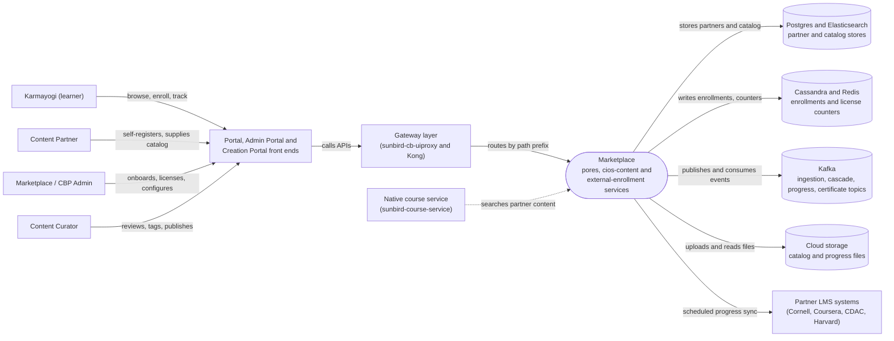

# Marketplace — Context Diagram

## System boundary

Inside the feature are the services that hold marketplace data and rules: `cb-pores-service`
(partner master record and registration), `cios-content-service` (catalog ingestion and
progress sync) and `cb_external_enrollment_service` (enrollment and license-limit checks).
Outside it are the learners, partners, admins and curators who use it through the Portal,
Admin Portal and Creation Portal front ends, the gateway layer in front, the native course
service that keeps a parallel external-course path, and the partners' own LMS systems.

## Diagram

## Elements

| Element | Role | Detailed in |
|---|---|---|
| Marketplace (`cb-pores-service`, `cios-content-service`, `cb_external_enrollment_service`) | Central system: partner master data, catalog ingestion and search, enrollment with license limits | [hld.md](hld.md) |
| Karmayogi (learner) | Discovers, enrolls in, progresses through and is certified for partner courses | [use-cases.md](use-cases.md) |
| Content Partner | Self-registers or is onboarded; supplies its catalog | [use-cases.md](use-cases.md) |
| Marketplace / CBP Admin | Onboards partners; configures licensing, SSO and certificate templates | [use-cases.md](use-cases.md) |
| Content Curator | Reviews ingested courses, tags competencies, sets enrollment metadata, publishes | [use-cases.md](use-cases.md) |
| Portal, Admin Portal and Creation Portal | Learner, admin and curator front ends | [hld.md](hld.md) |
| Gateway layer (`sunbird-cb-uiproxy`, Kong) | Passthrough proxy with role whitelist; Kong routes each path prefix to a backend | [apis.md](apis.md) |
| Native course service (`sunbird-course-service`) | Separate external-course enrollment and badge-merge path; searches partner content | [hld.md](hld.md) |
| Partner LMS systems | External systems whose progress is synced back by scheduler jobs | [apis.md](apis.md) |
| Postgres and Elasticsearch | Partner records, registrations and ingested catalog (separate stores per service) | [hld.md](hld.md) |
| Cassandra and Redis | Enrollment records, license counters and caches | [hld.md](hld.md) |
| Kafka | Ingestion queue, partner activate/deactivate cascade, progress and certificate events | [hld.md](hld.md) |
| Cloud storage | Uploaded catalog and progress files, generated logs | [hld.md](hld.md) |

> **Verification boundary:** elements and interactions come from the feature's own pages.
> index, use cases, APIs and HLD were read in full; the LLD, operations manual and
> as-built requirements were not read for this diagram. No source repositories were
> spot-checked for this diagram, so it relies on those pages' own verification notes. The
> three services are drawn as one node because the pages describe them as a single
> feature boundary. Not covered: the third-party `@sunbird-cb/collection-v2` package behind
> the learner detail page, and Kong path rewrites beyond what the APIs page records.
