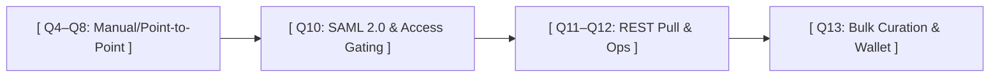
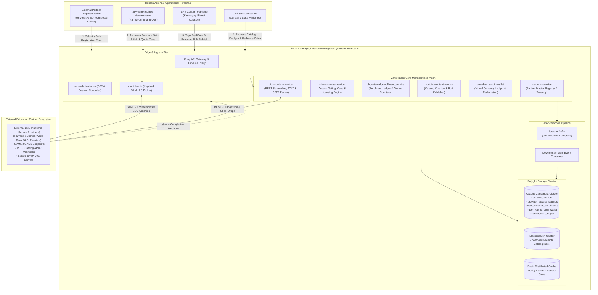
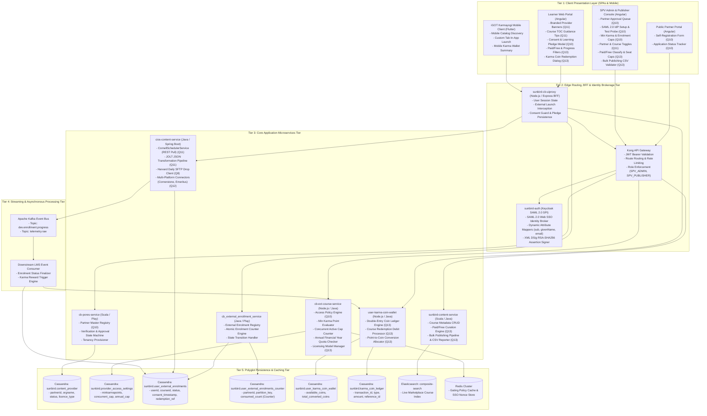
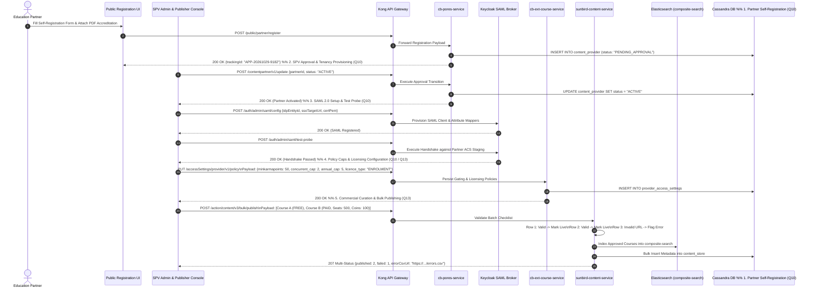
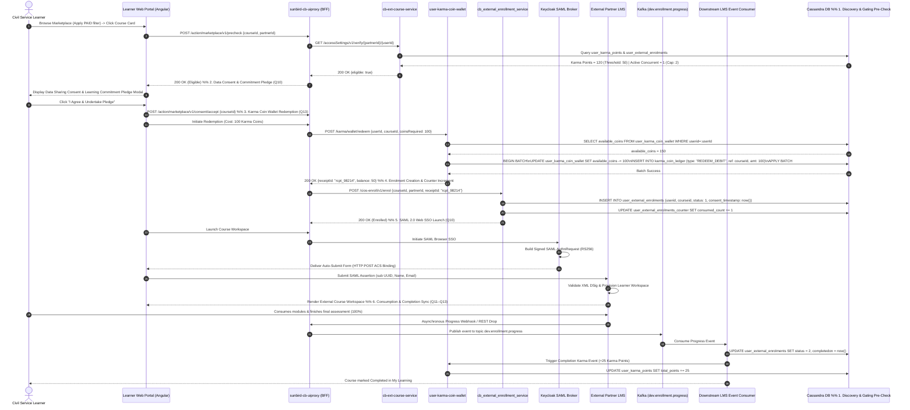

# Marketplace — High-Level Design (HLD)

## 1. Executive Summary & Architectural Tenets

### 1.1 Architectural Vision

The **iGOT Karmayogi Marketplace** enables civil servants across India to access specialized, accredited learning programs from premier external educational institutions, multilateral bodies, and commercial ed-tech providers (e.g., Harvard, eCornell, World Bank OLC, Emeritus, Simplilearn).

Architecturally, the subsystem bridges internal iGOT microservices (Identity, Catalog, Gamification, and Progress Tracking) with heterogeneous external Learning Management Systems (Canvas, Blackboard, Moodle, Cornerstone, and bespoke partner platforms).

### 1.2 Core Architectural Tenets

1. **Federated Identity with Zero Credential Disclosure:** Civil servants authenticate natively via iGOT Keycloak. Outbound Single Sign-On (SSO) delivers cryptographically signed SAML 2.0 assertions carrying pseudonymous identifiers (`sub` UUIDs). No government credentials, passwords, or sensitive national identifiers (Aadhaar, PAN) cross the external platform boundary.
2. **Fail-Safe, Multi-Tiered Access Gating:** Access control evaluation (Minimum Karma Points, concurrent active course limits, annual consumption quotas) operates on an explicit **default-deny** paradigm. System timeouts or downstream database unreachability immediately deny access, preventing unmetered commercial seat leakage.
3. **Double-Entry Gamification Ledger:** **Karma Points** serve as a non-spendable merit metric and access gating threshold; **Karma Coins** operate as spendable virtual tokens housed in an atomic, double-entry ledger (`user-karma-coin-wallet`) used exclusively for commercial seat redemption.
4. **Decoupled Asynchronous Consumption Pipeline:** High-volume telemetry, course progress updates, and completion notifications are decoupled from synchronous user transactions via Apache Kafka (`dev.enrollment.progress`), isolating core persistence stores from external network spikes.
5. **Progressive Architectural Layering:** Each milestone cleanly extends earlier foundations:



## 2. Chronological Architectural Evolution (Q4 to Q13)

**MARKETPLACE ARCHITECTURAL MILESTONES**

| Milestone 1<br>Q4 – Q8 | Milestone 2<br>Q10 | Milestone 3<br>Q11 – Q12 | Milestone 4<br>Q13 |
|---|---|---|---|
| • Custom CIOS API | • Public Self-Reg | • eCornell REST Pull | • Enrolment vs User Licensing |
| • Manual DB Seeds | • Keycloak SAML | • JOLT Transformations | • PAID vs FREE Classification |
| • SFTP Batch Drop | • Min Karma Gate | • Multi-Provider Hub | • Bulk Publishing + CSV Error |
| • Blended Curation | • Concurrent Caps | • Admin Status Toggles | • Karma Wallet Coin Redeem |
| • Static Redirects | • Consent Pledge | • Branded TOC Guidance | • Atomic Cassandra Ledger |

### 2.1 Milestone Evolution Breakdown

- **Milestone 1 (Q4–Q8: CIOS Foundation & Bespoke Bridges):** Custom REST endpoints in `cios-content-service` and manual database seeding in Cassandra. Partner progress ingestion relied on custom daily SFTP batch drop clients (Harvard) and point-to-point APIs (Illumine) ([KB-3192: Q4 | Marketplace | CIOS | non-LTI API Integration for Content sharing](https://karmayogibharat.atlassian.net/browse/KB-3192) (KB Review), [KB-8529: Q7 | Ad-Hoc | Marketplace Integrations | Content Partner Integrations | Harvard-iGOT Marketplace Courses Integration](https://karmayogibharat.atlassian.net/browse/KB-8529) (Open)).
- **Milestone 2 (Q10: Standards-Based Onboarding, Federation & Governance):** Transitioned to enterprise standards:
  - Public-facing self-registration portal (`/public/marketplace/partner-register`) and SPV verification queue ([KB-11986: Q10 | Marketplace | Marketplace Partner Self registration and Track application status](https://karmayogibharat.atlassian.net/browse/KB-11986) (Prod Deployed)).
  - Keycloak SAML 2.0 Identity Provider (IdP) brokerage with dynamic user attribute mapping ([KB-11984: Q10 | Marketplace | External/Internal Content Providers SSO Integration | SSO Configuration by SPV Admin](https://karmayogibharat.atlassian.net/browse/KB-11984) (Prod Deployed)).
  - Multi-dimensional policy engine in `cb-ext-course-service` enforcing Minimum Karma Point thresholds, concurrent active caps, and annual limits ([KB-12140: Q10 | Marketplace | SPV Marketplace Partner Settings | Enrolment Limit and Minimum Karma Point](https://karmayogibharat.atlassian.net/browse/KB-12140) (Prod Deployed)).
  - Mandatory data-sharing consent and civil service learning commitment pledge modal ([KB-12333: Q10 | Marketplace | External Content Access Settings | Visibility](https://karmayogibharat.atlassian.net/browse/KB-12333) (Prod Deployed)).

- **Milestone 3 (Q11–Q12: Ingestion Automation & Operational Control):** Automated background pull pipelines:
  - `CornellSchedulerService` executing periodic REST pulls with JOLT transformations ([KB-12784: Older Ticket | Q11 | Marketplace | Marketplace Integrations | E-Cornell 207 Courses Integration](https://karmayogibharat.atlassian.net/browse/KB-12784) (In-Progress)).
  - Expanded platform connectors (World Bank OLC / Cornerstone LMS, Emeritus, Simplilearn).
  - Administrative lifecycle controls enabling SPV administrators to toggle partner and course availability (`ACTIVE` / `DEACTIVATED`) ([KB-13054: Q11 | Marketplace | Marketplace Enhancements and New Integrations | Deactivate/Activate a Marketplace Provider, and SSO Integration](https://karmayogibharat.atlassian.net/browse/KB-13054) (Prod Deployed)).
  - Learner discovery guidance: branded partner banners and Table of Contents (TOC) tips ([KB-12836: Q11 | Marketplace | Marketplace Enhancements and New Integrations | Adding a banner for the respective Provider on the Providers Course Listing Page](https://karmayogibharat.atlassian.net/browse/KB-12836) (Prod Deployed)).

- **Milestone 4 (Q13: Commercial Licensing, Bulk Publishing & Karma Wallet):** Commercial governance and gamification:
  - Formalized licensing models: `Course Enrolment Licensing` vs. `User Licensing` ([KB-14750: Q13 | Marketplace Enhancements | Partner Licensing Administration](https://karmayogibharat.atlassian.net/browse/KB-14750) (Prod Deployed)).
  - Commercial catalog classification (`PAID` vs. `FREE`) with strict seat capacity ceilings ([KB-14751: Q13 | Marketplace Enhancements | Marketplace Publishing Controls](https://karmayogibharat.atlassian.net/browse/KB-14751) (Prod Deployed)).
  - Asynchronous bulk publishing engine with schema checklist validation and downloadable CSV error reports ([KB-14751: Q13 | Marketplace Enhancements | Marketplace Publishing Controls](https://karmayogibharat.atlassian.net/browse/KB-14751) (Prod Deployed)).
  - Virtual currency integration: civil servants redeem earned **Karma Coins** via the personal **Karma Wallet** (`user-karma-coin-wallet`) to unlock paid commercial seats ([KB-15297: Q13 | Karma Wallet | Redeem Karma Coins on Marketplace Courses](https://karmayogibharat.atlassian.net/browse/KB-15297) (Prod Deployed)).

## 3. High-Level System Context (C4 Level-1)

The system context diagram illustrates the organizational boundaries, human actors, internal platform boundaries, external education provider systems, and the bidirectional flows of identity, telemetry, and catalog data.



## 4. Multi-Tier End-to-End Logical & Component Architecture

The diagram below details the 5-tier architecture tracing data and control flow from client presentation layers down to backend polyglot databases.



## 5. End-to-End Sequence Architectures

### 5.1 Flow 1: Creation, Onboarding, Curation & Bulk Publication Lifecycle (Q10–Q13)

This sequence traces the provider's lifecycle from public registration to administrative approval, SAML federation setup, commercial curation, and bulk publishing with error reporting.



### 5.2 Flow 2: Learner Consumption Lifecycle: Discovery, Gating, Pledge, Coin Redemption & SSO (Q13 Baseline)

This sequence details the complete learner journey: catalog filtering, prerequisite gating evaluation, commitment pledge signing, atomic Karma Coin wallet redemption, SAML SSO redirection, and asynchronous progress completion synchronization.



## 6. Persistence & Polyglot Data Architecture

**PERSISTENCE TIER ARCHITECTURE**

- **[ Apache Cassandra Cluster (sunbird keyspace) ]**
    - `content_provider`: Partner tenancy, legal status, SSO configurations, licensing model
    - `provider_access_settings`: Gating policies (minkarmapoints, concurrent_cap, annual_cap)
    - `user_external_enrolments`: Primary consumption store `((userid), courseid, partnerid)`
    - `user_external_enrolments_counter`: High-speed atomic seat counters per partner and course
    - `user_karma_coin_wallet`: Personal virtual currency balance `((userid), available_coins)`
    - `karma_coin_ledger`: Immutable double-entry transaction audit log `((userid), transaction_id)`
- **[ Elasticsearch Cluster ]**
    - Index: `composite-search`
    - Documents: Live marketplace course cards, provider branding, PAID/FREE commercial tags
- **[ Redis In-Memory Cluster ]**
    - Cache: Provider policy rules, Keycloak SAML nonces, active session tokens (1-hour TTL)

### 6.1 Cassandra Data Definition Language (DDL) Specifications

```sql
-- Keyspace Definition
CREATE KEYSPACE IF NOT EXISTS sunbird WITH replication = {'class': 'NetworkTopologyStrategy', 'datacenter1': 3};

-- 1. Partner Master Registry (Provisioned Q10 via Self-Registration)
CREATE TABLE IF NOT EXISTS sunbird.content_provider (
    partnerid text,
    orgname text,
    entitytype text,  -- "ACADEMIC", "COMMERCIAL", "GOVERNMENT"
    nodal_name text,
    nodal_email text,
    website text,
    status text,  -- "PENDING_APPROVAL", "ACTIVE", "REJECTED", "DEACTIVATED"
    sso_enabled boolean,
    licence_type text,  -- "ENROLMENT" or "USER" (Introduced Q13)
    createdon timestamp,
    updatedon timestamp,
    PRIMARY KEY (partnerid)
);

-- 2. Partner Access & Gating Policies Store (Q10)
CREATE TABLE IF NOT EXISTS sunbird.provider_access_settings (
    partnerid text,
    minkarmapoints int,  -- Read-only eligibility threshold
    concurrent_cap int,
    -- Max active concurrent courses per learner (Default: 2)
    annual_cap int,
    -- Max courses per learner per Financial Year
    createdon timestamp,
    updatedon timestamp,
    PRIMARY KEY (partnerid)
);

-- 3. User External Enrolment Registry (Q10 Active & Historical Store)
CREATE TABLE IF NOT EXISTS sunbird.user_external_enrolments (
    userid text,
    courseid text,
    partnerid text,
    licencetype text,  -- "ENROLMENT" or "USER" (Q13)
    status int,  -- 0: Enrolled, 1: In-Progress, 2: Completed, 3: Suspended
    completionpercentage int,  -- 0 to 100%
    enrolleddate timestamp,
    completedon timestamp,
    consent_timestamp timestamp,
    -- Timestamp of data-sharing pledge confirmation (Q10)
    redemption_ref text,  -- Karma Coin redemption receipt ID (Q13)
    PRIMARY KEY ((userid), courseid, partnerid)
) WITH CLUSTERING ORDER BY (courseid ASC, partnerid ASC);
CREATE INDEX IF NOT EXISTS idx_user_ext_enrol_partner ON sunbird.user_external_enrolments (partnerid);
CREATE INDEX IF NOT EXISTS idx_user_ext_enrol_status ON sunbird.user_external_enrolments (status);

-- 4. External Enrolment Counter Table (Fast Atomic Quota Tracking)
CREATE TABLE IF NOT EXISTS sunbird.user_external_enrolments_counter (
    partnerid text,
    partition_key text,  -- "TOTAL_ENROLMENTS" or specific Course ID
    consumed_count counter,
    PRIMARY KEY (partnerid, partition_key)
);

-- 5. User Karma Coin Wallet Balance Store (Introduced Q13)
CREATE TABLE IF NOT EXISTS sunbird.user_karma_coin_wallet (
    userid text,
    available_coins int,
    total_converted_coins int,
    last_updated timestamp,
    PRIMARY KEY (userid)
);

-- 6. Karma Coin Double-Entry Ledger Store (Introduced Q13)
CREATE TABLE IF NOT EXISTS sunbird.karma_coin_ledger (
    userid text,
    transaction_id text,
    transaction_type text,  -- "CONVERT_CREDIT", "REDEEM_DEBIT", "CREDIT_REFUND"
    amount int,
    reference_id text,  -- Marketplace Course ID or Receipt ID
    createdon timestamp,
    PRIMARY KEY ((userid), transaction_id)
) WITH CLUSTERING ORDER BY (transaction_id DESC);
```

## 7. API Interface Specifications & Contract Catalog

| Lifecycle Stage | HTTP Method | Endpoint Path | Source Component | Target Service | Auth / Security | Payload Attributes | Success / Error Response | Jira & Spec Traceability |
|---|---|---|---|---|---|---|---|---|
| **Registration** | `POST` | `/public/partner/register` | Public UI | `cb-pores-service` | Public (Rate Limited) | `orgName`, `entityType`, `nodalEmail`, `docPdf` | `200 OK` (`trackingId`) / `400 Bad Request` | [KB-11986: Q10 \| Marketplace \| Marketplace Partner Self registration and Track application status](https://karmayogibharat.atlassian.net/browse/KB-11986) (Prod Deployed), Page 688193565 |
| **Approval** | `POST` | `/contentpartner/``v1/update` | SPV Console | `cb-pores-service` | Bearer JWT (`SPV_ADMIN`) | `partnerId`, `status:` `"ACTIVE"` | `200 OK` (Tenancy provisioned) | [KB-10599: Q10 \| Marketplace \| SPV onboarding of External Content Providers](https://karmayogibharat.atlassian.net/browse/KB-10599) (Prod Deployed) |
| **SAML Setup** | `POST` | `/auth/admin/saml/config` | SPV Console | Keycloak SPI | Bearer JWT (`SPV_ADMIN`) | `idpEntityId`, `ssoTargetUrl`, `certPem` | `200 OK` (Client registered) | [KB-11984: Q10 \| Marketplace \| External/Internal Content Providers SSO Integration \| SSO Configuration by SPV Admin](https://karmayogibharat.atlassian.net/browse/KB-11984) (Prod Deployed), Page 683573249 |
| **Gating Setup** | `PUT` | `/accessSettings/provider/v1/policy` | SPV Console | `cb-ext-course-service` | Bearer JWT (`SPV_ADMIN`) | `minkarmapoints`, `concurrent_cap`, `licence_type` | `200 OK` (Policies saved) | [KB-12140: Q10 \| Marketplace \| SPV Marketplace Partner Settings \| Enrolment Limit and Minimum Karma Point](https://karmayogibharat.atlassian.net/browse/KB-12140) (Prod Deployed), Page 647790612 |
| **Bulk Publish** | `POST` | `/action/content/v3/bulk/publish` | Content Portal | `sunbird-content-service` | Bearer JWT (`SPV_PUBLISHER`) | `courses: [{id, pricingType, seatCap}]` | `207 Multi-Status` + Error CSV | [KB-14751: Q13 \| Marketplace Enhancements \| Marketplace Publishing Controls](https://karmayogibharat.atlassian.net/browse/KB-14751) (Prod Deployed), Page 1095630850 |
| **Gating Check** | `GET` | `/accessSettings/v1/verify/{pId}/{uId}` | BFF Proxy | `cb-ext-course-service` | Bearer JWT (Learner) | Path: `partnerId`, `userId` | `200 OK` / `403 Forbidden` (Shortfall) | [KB-12140: Q10 \| Marketplace \| SPV Marketplace Partner Settings \| Enrolment Limit and Minimum Karma Point](https://karmayogibharat.atlassian.net/browse/KB-12140) (Prod Deployed), Page 647790612 |
| **Consent** | `POST` | `/action/marketplace/v1/consent/accept` | Learner Web | `sunbird-cb-uiproxy` | Session Cookie | `courseId`, `pledgeAccepted: true` | `200 OK` (Consent logged) | [KB-12333: Q10 \| Marketplace \| External Content Access Settings \| Visibility](https://karmayogibharat.atlassian.net/browse/KB-12333) (Prod Deployed), Page 570458133 |
| **Redemption** | `POST` | `/karma/wallet/redeem` | BFF Proxy | `user-karma-coin-wallet` | Bearer JWT (Learner) | `userId`, `courseId`, `coinsRequired` | `200 OK` (`receiptId`) / `400 Insufficient` | [KB-15297: Q13 \| Karma Wallet \| Redeem Karma Coins on Marketplace Courses](https://karmayogibharat.atlassian.net/browse/KB-15297) (Prod Deployed), Page 1349255170 |
| **Enrolment** | `POST` | `/cios-enroll/v1/enrol` | BFF Proxy | `cb_external_enrollment_service` | Bearer JWT (Learner) | `courseId`, `partnerId`, `redemptionRef` | `200 OK` (Enrolment active) | [KB-14750: Q13 \| Marketplace Enhancements \| Partner Licensing Administration](https://karmayogibharat.atlassian.net/browse/KB-14750) (Prod Deployed) |
| **Progress Ingest** | `POST` | `/action/marketplace/v1/telemetry` | Partner LMS | `cios-content-service` | OAuth2 / Webhook Token | `userId`, `courseId`, `progress: 100` | `202 Accepted` (Queued to Kafka) | Page 1361903617 |

## 8. Non-Functional & Security Architecture

### 8.1 Security Architecture & Trust Boundaries

1. **SAML 2.0 Web Browser SSO:** Outbound assertions are cryptographically signed using **RSA-SHA256** signatures with 2048-bit X.509 certificates managed within Keycloak keystores and rotated annually.
2. **Data Minimization Guarantee:** Outbound assertions strictly suppress civil service personal identifiers (Aadhaar, employee codes, salary bands). Outbound identity is restricted to:
  - `sub`: Pseudonymous user UUID.
  - `givenName` and `surname`: Display name for certificate minting.
  - `email`: Official email (only when partner contract mandates LMS workspace creation).

3. **Double-Spending Prevention:** Karma Coin debits are bounded by Cassandra atomic batches (`BEGIN BATCH ... APPLY BATCH`), guaranteeing zero balance overdraft under concurrent redemption requests.

### 8.2 Reliability, High Availability & Fail-Safe Defaults

1. **Default-Deny Access Policy:** If `cb-ext-course-service` or Cassandra experiences connectivity failure during eligibility pre-check, the system defaults to an immediate **access denial** (`HTTP 503 / 403`), preventing unauthorized commercial seat leakage.
2. **Idempotent Kafka Pipelines:** Downstream consumers on `dev.enrollment.progress` utilize composite unique deduplication keys (`userid + courseid + partnerid`). Duplicate completion events from Kafka partition rebalances are safely ignored.

## 9. Architecture Traceability Matrix (HLD to SRS & Engineering Sources)

| SRS Requirement ID | Architectural Component | Concrete Engineering Artifact | Verification Reference | Implementation Status |
|---|---|---|---|---|
| **FR-M1-001** | Ingestion Engine | `cios-content-service` (`CiosIngestController`) | [KB-3192: Q4 \| Marketplace \| CIOS \| non-LTI API Integration for Content sharing](https://karmayogibharat.atlassian.net/browse/KB-3192) (KB Review) | Deprecated |
| **FR-M1-002** | Blended Curation | `cb-pores-service` & Content Portal | [KB-6649: Q6 l CIOS l Onboarding and Management of Marketplace Content Partners & Course Publishing](https://karmayogibharat.atlassian.net/browse/KB-6649) (KB Approved) | Implemented |
| **FR-M1-003** | Harvard SFTP Drop | `cios-content-service` (`HarvardSFTPClient`) | [KB-8529: Q7 \| Ad-Hoc \| Marketplace Integrations \| Content Partner Integrations \| Harvard-iGOT Marketplace Courses Integration](https://karmayogibharat.atlassian.net/browse/KB-8529) (Open) | Implemented |
| **FR-M2-001** | Public Self-Registration | `cb-pores-service` (`PartnerRegistrationController`) | [KB-11986: Q10 \| Marketplace \| Marketplace Partner Self registration and Track application status](https://karmayogibharat.atlassian.net/browse/KB-11986) (Prod Deployed), Page 688193565 | Implemented |
| **FR-M2-002** | SPV Partner Approval | `cb-pores-service` (`PartnerWorkflowService`) | [KB-10599: Q10 \| Marketplace \| SPV onboarding of External Content Providers](https://karmayogibharat.atlassian.net/browse/KB-10599) (Prod Deployed), Page 688193565 | Implemented |
| **FR-M2-003** | SAML 2.0 IdP Setup | Keycloak SPI (`sunbird-auth`) | [KB-11984: Q10 \| Marketplace \| External/Internal Content Providers SSO Integration \| SSO Configuration by SPV Admin](https://karmayogibharat.atlassian.net/browse/KB-11984) (Prod Deployed), Page 683573249 | Implemented |
| **FR-M2-004** | User Attribute Mapping | Keycloak Protocol Mappers (`sunbird-auth`) | [KB-12438: Q10 \| Marketplace \| Configure SSO User Attribute Mapping and Provisioning](https://karmayogibharat.atlassian.net/browse/KB-12438) (Prod Deployed) | Implemented |
| **FR-M2-005** | SSO Connection Test | Keycloak Admin Probe (`SPV_ADMIN`) | [KB-12436: Q10 \| Marketplace \| Enable, Disable, and Test SSO Integration](https://karmayogibharat.atlassian.net/browse/KB-12436) (Prod Deployed) | Implemented |
| **FR-M2-006** | Minimum Karma Gating | `cb-ext-course-service` (`KarmaGatingValidator`) | [KB-12140: Q10 \| Marketplace \| SPV Marketplace Partner Settings \| Enrolment Limit and Minimum Karma Point](https://karmayogibharat.atlassian.net/browse/KB-12140) (Prod Deployed), Page 647790612 | Implemented |
| **FR-M2-007** | Concurrent Enrolment Cap | `cb-ext-course-service` (`EnrolmentCapValidator`) | [KB-12140: Q10 \| Marketplace \| SPV Marketplace Partner Settings \| Enrolment Limit and Minimum Karma Point](https://karmayogibharat.atlassian.net/browse/KB-12140) (Prod Deployed), Page 647790612 | Implemented |
| **FR-M2-008** | Annual Consumption Limit | `cb-ext-course-service` (`AnnualCapValidator`) | [KB-12140: Q10 \| Marketplace \| SPV Marketplace Partner Settings \| Enrolment Limit and Minimum Karma Point](https://karmayogibharat.atlassian.net/browse/KB-12140) (Prod Deployed), Page 647790612 | Implemented |
| **FR-M2-009** | Consent & Pledge Modal | `sunbird-cb-uiproxy` (`ConsentGuardHandler`) | [KB-12333: Q10 \| Marketplace \| External Content Access Settings \| Visibility](https://karmayogibharat.atlassian.net/browse/KB-12333) (Prod Deployed), Page 570458133 | Implemented |
| **FR-M3-001** | eCornell REST Pull | `cios-content-service` (`CornellSchedulerService`) | [KB-12784: Older Ticket \| Q11 \| Marketplace \| Marketplace Integrations \| E-Cornell 207 Courses Integration](https://karmayogibharat.atlassian.net/browse/KB-12784) (In-Progress), Page 776699905 | Implemented |
| **FR-M3-002** | Multi-Platform Adapters | `cios-content-service` (`CornerstoneConnector`) | [KB-14288: Q12 \| Marketplace Integrations \| iGOT-World Bank OLC (Cornerstone) Integration](https://karmayogibharat.atlassian.net/browse/KB-14288) (Open) | Implemented |
| **FR-M3-003** | Partner Status Toggles | `cb-pores-service` & `sunbird-``content-service` | [KB-13054: Q11 \| Marketplace \| Marketplace Enhancements and New Integrations \| Deactivate/Activate a Marketplace Provider, and SSO Integration](https://karmayogibharat.atlassian.net/browse/KB-13054) (Prod Deployed) | Implemented |
| **FR-M3-004** | Banners & TOC Guidance | `sunbird-cb-uiproxy` (`TOCBannerDecorator`) | [KB-12836: Q11 \| Marketplace \| Marketplace Enhancements and New Integrations \| Adding a banner for the respective Provider on the Providers Course Listing Page](https://karmayogibharat.atlassian.net/browse/KB-12836) (Prod Deployed) | Implemented |
| **FR-M4-001** | Licensing Models | `cb-ext-course-service` (`LicenceModelManager`) | [KB-14750: Q13 \| Marketplace Enhancements \| Partner Licensing Administration](https://karmayogibharat.atlassian.net/browse/KB-14750) (Prod Deployed), Page 1095630850 | Implemented |
| **FR-M4-002** | Paid/Free Classify & Caps | `sunbird-content-service` (`PricingMetadataHandler`) | [KB-14751: Q13 \| Marketplace Enhancements \| Marketplace Publishing Controls](https://karmayogibharat.atlassian.net/browse/KB-14751) (Prod Deployed), Page 1095630850 | Implemented |
| **FR-M4-003** | Bulk Publishing Engine | `content-publish-pipeline` (`BulkPublishWorker`) | [KB-14751: Q13 \| Marketplace Enhancements \| Marketplace Publishing Controls](https://karmayogibharat.atlassian.net/browse/KB-14751) (Prod Deployed), Page 1275527178 | Implemented |
| **FR-M4-004** | Commercial Badges | `sunbird-cb-uiproxy` & Angular Search Component | [KB-14752: Q13 \| Marketplace Enhancements \| Learner Discovery and Behaviour](https://karmayogibharat.atlassian.net/browse/KB-14752) (Prod Deployed) | Implemented |
| **FR-M4-005** | Karma Coin Course Redeem | `user-karma-coin-wallet` (`RedemptionService`) | [KB-15297: Q13 \| Karma Wallet \| Redeem Karma Coins on Marketplace Courses](https://karmayogibharat.atlassian.net/browse/KB-15297) (Prod Deployed), Page 1349255170 | Implemented |
| **FR-M4-006** | Completion Karma Accrual | `DownstreamLMSConsumer` & Kafka Event Bus | [KB-15698: Update Karma Points Logic](https://karmayogibharat.atlassian.net/browse/KB-15698) (Prod Deployed), Page 1253441539 | Implemented |

<br><br>
