## Section 1 — Executive Summary

### 1.1 Marketplace Purpose and Business Problem

The **iGOT Karmayogi Marketplace** was introduced to solve a strategic challenge for the Government of India's National Programme for Civil Services Capacity Building (NPCSCB — Mission Karmayogi): extending high-quality learning beyond internally created and curated government courses. Government learners required access to accredited, world-class external learning content from global universities (e.g., Harvard, eCornell), premier Indian institutions, and commercial ed-tech providers (e.g., Simplilearn, Emeritus, Coursera), while external providers required a standardized, secure mechanism to distribute content without compromising institutional IP, user data privacy, or commercial licensing models.

### 1.2 Evolution Across Q4–Q14

Between Quarter 4 (Q4) and Quarter 14 (Q14), Marketplace evolved from a siloed, manual, point-to-point external integration model into an enterprise multi-tenant ecosystem featuring standardized onboarding, Single Sign-On (SSO), granular user group access control, multi-tier licensing governance, gamified wallet redemption, and standards-based Learning Tools Interoperability (LTI 1.3):

**MARKETPLACE EVOLUTION TIMELINE**

| Q4 – Q10 Foundation & SSO | Q11 – Q12 Course Mgmt & Pull | Q13 Enhancements & Coins | Q14 Licences & LTI 1.3 |
|---|---|---|---|
| • Custom CIOS API | • Harvard (SFTP) | • Paid vs Free Curation | • LTI 1.3 OIDC & AGS Push |
| • Self-Reg Portal | • eCornell Pull | • Seat Caps & Quotas | • Group Licence Allocations |
| • SAML 2.0 / SSO | • NULP / Sparkl | • Bulk Publishing Flow | • Notification Thresholds |
| • Enrolment Caps | • Status Toggle | • Karma Wallet Redempt. | • Real-time Sync (UAT/PROD) |
| • Min Karma Check | • Kafka Pipeline | • Provider Progress Filter | • AI CBP Tool Integration |

### 1.3 Multi-Portal Operating Model

Marketplace spans five primary operational environments:

1. **SPV Portal (Admin & Publisher):** Manages partner onboarding, SAML/OIDC SSO configurations, access controls, group-based licence quotas, and catalog publication.
2. **Content Portal (CBP):** Curation and authoring environment where courses are enriched with competencies, taxonomy, and pricing metadata.
3. **Learner Experience (Web & Mobile):** Unified catalog discovery, eligibility verification, consent/pledge acceptance, course launch, and learning consumption.
4. **Partner Self-Registration Portal:** Public-facing interface where external education providers submit institutional verification and integration proposals.
5. **External Provider Platforms (Tool):** External LMS endpoints (e.g., Canvas, Blackboard, Moodle, Cornerstone, bespoke LMS) receiving authenticated learners and reporting progress back.

### 1.4 Architecture, Dependencies, and Strategic Gaps

The technical architecture shifted from bespoke scheduled pull workers (`CornellSchedulerService`, SFTP ingestion) to an event-driven streaming pipeline anchored by Apache Kafka topic `dev.enrollment.progress` and Cassandra data stores (`user_external_enrolments`, `provider_access_settings`). In Q14, an LTI 1.3 layer was designed to decouple the frontend launch in `sunbird-cb-uiproxy` from server-to-server Assignment and Grade Services (AGS) in `cios-content-service`.

**Key Architectural Finding:** While Q13/Q14 BRDs establish commercial licensing models and Karma Coin redemption, the underlying write ownership of external enrollments and the consumer loop for `dev.enrollment.progress` reside in a downstream service layer (`cb_external_enrollment_service` / LMS core), requiring strict adherence to Kafka payload validation schemas to prevent pipeline breakage.

## Section 2 — Scope, Objectives and Evidence Sources

### 2.1 Scope Boundaries

This document covers the end-to-end functionality, technical design, APIs, database schemas, and operational governance of the iGOT Karmayogi Marketplace from its inception in **Q4** through **Q14**. Non-marketplace features (e.g., native Sunbird SCORM creation, internal Curated Programs without external links, platform-wide HRMS synchronisation) are excluded except where they interface directly with Marketplace eligibility or completion.

### 2.2 Definitions of Implementation Status

To separate aspirational business requirements from verified production code, this evaluation uses seven standardized status definitions:

- **Implemented:** Verified through production release sign-offs, deployment guides, or active code artifacts.
- **Partially Implemented:** Functional in staging/UAT or implemented with known limitations/manual interventions.
- **Planned:** Formally specified in approved BRDs/PRDs or active Jira epics, but awaiting engineering execution.
- **Deprecated/Replaced:** Superseded by newer architectural mechanisms (e.g., manual partner ingestion replaced by self-registration; JOLT pull replaced by LTI 1.3 AGS push).
- **Blocked:** Implementation stalled due to an unfulfilled architectural or upstream dependency.
- **Unverified:** Documented in Jira/Confluence but lacking observable codebase, API, or QA sign-off evidence.
- **Not Applicable:** Out of scope for the specific release or workflow.

### 2.3 Evidence Inventory Summary

- **Jira Coverage:** 76 distinct Jira issues investigated across Initiatives, Epics, User Stories, Improvements, and Sub-tasks.
- **Confluence Coverage:** 18 authoritative specifications evaluated across BRD, PRD, FRS, SRS, API Reference, Technical Design, and QA Sign-Off spaces.

## Section 3 — Marketplace Business Overview

### 3.1 Business Vision and Strategic Objectives

The iGOT Marketplace functions as a digital public learning exchange. Its objectives are:

1. **Curated Expansion:** Expand civil service training catalogs with niche, technical, and executive leadership curricula without incurring internal content creation overhead.
2. **Quality & Institutional Governance:** Ensure external courses meet Indian civil service competency standards (FRAC framework) and adhere to government data privacy mandates.
3. **Incentivized Learning & Fair Usage:** Prevent runaway course hoarding by tying access to learner commitment, concurrent enrolment limits, annual quotas, and earned gamification points (Karma Points and Karma Coins).
4. **Commercial Optimization:** Support diverse partner contracts—ranging from free MoUs to commercial seat-capped enrolments and enterprise user-licensing pools.

### 3.2 Primary Actors and Roles

- **SPV Marketplace Administrator** (`SPV_ADMIN` / `MARKETPLACE_ADMIN`): Configures partner profiles, verifies legal self-registrations, establishes SAML/OIDC SSO attribute mappings, sets group licence allocations, and monitors exhaustion thresholds.
- **SPV Publisher** (`SPV_PUBLISHER`): Reviews external course metadata, assigns `Paid`/`Free` commercial classifications, configures seat caps, and executes single or bulk course publication.
- **Learner (Civil Servant):** Discovers courses, verifies prerequisites, signs data-sharing pledges, launches external content seamlessly via SSO/LTI, and tracks multi-provider progress.
- **External Content Partner (Provider):** Self-registers, provides SAML IdP / LTI Tool metadata, hosts content securely, and synchronises learner consumption and completion states back to iGOT.

## Section 4 — Marketplace Evolution from Q4 to Q14

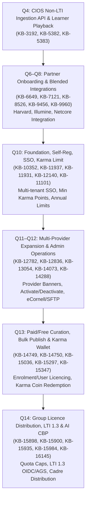

### 4.1 Chronological Phase Breakdown

#### Phase 1: Q4–Q10 — The Onboarding, SSO, and Governance Foundation

- **Initiative & Epics:** [KB-3192: Q4 | Marketplace | CIOS | non-LTI API Integration for Content sharing](https://karmayogibharat.atlassian.net/browse/KB-3192) (KB Review), [KB-6649: Q6 l CIOS l Onboarding and Management of Marketplace Content Partners & Course Publishing](https://karmayogibharat.atlassian.net/browse/KB-6649) (KB Approved), [KB-10352: Q10 | Marketplace](https://karmayogibharat.atlassian.net/browse/KB-10352) (Open), [KB-10009: Q9 | Marketplace | Paid Content/Resources/Certification](https://karmayogibharat.atlassian.net/browse/KB-10009) (Open), [KB-11937: Q10 | Marketplace | Marketplace Partner Onboarding on iGOT via Self-Registration](https://karmayogibharat.atlassian.net/browse/KB-11937) (KB Review), [KB-11931: Q10 | Marketplace | Marketplace Providers SSO Integration](https://karmayogibharat.atlassian.net/browse/KB-11931) (KB Review), [KB-11938: Q10 | Marketplace | SPV Marketplace Partner Settings](https://karmayogibharat.atlassian.net/browse/KB-11938) (KB Review).
- **Evolution:** Marketplace started as an ad-hoc custom API bridge called CIOS (Content Ingestion & Operations System). Partner onboarding required manual engineering script execution. In Q10, this was overhauled into a structured subsystem:
  - Public self-registration portal allowing partners to apply, provide organizational credentials, and upload course catalogs ([KB-11986: Q10 | Marketplace | Marketplace Partner Self registration and Track application status](https://karmayogibharat.atlassian.net/browse/KB-11986) (Prod Deployed)).
  - SPV Admin SSO module in Keycloak/Proxy supporting SAML 2.0 configuration, test connections, and attribute mappings (`sub`, `email`, `firstName`, `lastName`) ([KB-11984: Q10 | Marketplace | External/Internal Content Providers SSO Integration | SSO Configuration by SPV Admin](https://karmayogibharat.atlassian.net/browse/KB-11984) (Prod Deployed), [KB-12438: Q10 | Marketplace | Configure SSO User Attribute Mapping and Provisioning](https://karmayogibharat.atlassian.net/browse/KB-12438) (Prod Deployed)).
  - Governance controls introducing **Minimum Karma Point Prerequisites**, **Concurrent Enrolment Caps**, and **Annual Consumption Limits** per provider ([KB-12140: Q10 | Marketplace | SPV Marketplace Partner Settings | Enrolment Limit and Minimum Karma Point](https://karmayogibharat.atlassian.net/browse/KB-12140) (Prod Deployed), Confluence Page 647790612).
  - Data privacy consent and user pledge enforcement prior to redirection ([KB-12333: Q10 | Marketplace | External Content Access Settings | Visibility](https://karmayogibharat.atlassian.net/browse/KB-12333) (Prod Deployed), Confluence Page 570458133).

#### Phase 2: Q11–Q12 — Multi-Provider Ingestion and Lifecycle Management

- **Initiative & Epics:** [KB-12782: Q11 | Marketplace | Marketplace Enhancments](https://karmayogibharat.atlassian.net/browse/KB-12782) (Open), [KB-12783: Q11 | Marketplace Enhancements and New Integrations](https://karmayogibharat.atlassian.net/browse/KB-12783) (Prod Deployed), [KB-13845: Marketplace Integrations](https://karmayogibharat.atlassian.net/browse/KB-13845) (KB Review), [KB-14288: Q12 | Marketplace Integrations | iGOT-World Bank OLC (Cornerstone) Integration](https://karmayogibharat.atlassian.net/browse/KB-14288) (Open).
- **Evolution:** Shifted focus to scaling the catalog through diverse provider integrations:
  - Automated periodic pull synchronization for Harvard (via SFTP server drop) and eCornell (REST pull via `CornellSchedulerService`) ([KB-12945: Q11 | Marketplace | Marketplace Integrations | Harvard 36 Courses Integration and Progress Update From SFTP server](https://karmayogibharat.atlassian.net/browse/KB-12945) (Prod Deployed), [KB-12784: Older Ticket | Q11 | Marketplace | Marketplace Integrations | E-Cornell 207 Courses Integration](https://karmayogibharat.atlassian.net/browse/KB-12784) (In-Progress)).
  - Integration with national urban platforms (NULP/NIUA) and proctoring engines (ETS Wheebox) ([KB-12249: Q10 | Ad-Hoc | Marketplace Providers Integration | NULP/NIUA LMS Integration](https://karmayogibharat.atlassian.net/browse/KB-12249) (Open), [KB-12246: Q10 | Ad-Hoc | Marketplace Providers Integration | ETS Wheebox Proctoring](https://karmayogibharat.atlassian.net/browse/KB-12246) (Open)).
  - Administrative course lifecycle management: enabling SPV admins to activate/deactivate specific providers or individual courses without database scripts ([KB-13193: Q11 | Marketplace | Marketplace Enhancements and New Integrations | Deactivate/Activate a Marketplace Course](https://karmayogibharat.atlassian.net/browse/KB-13193) (Open), [KB-13054: Q11 | Marketplace | Marketplace Enhancements and New Integrations | Deactivate/Activate a Marketplace Provider, and SSO Integration](https://karmayogibharat.atlassian.net/browse/KB-13054) (Prod Deployed)).
  - Learner UI enhancements: dedicated provider landing banners, provider tips on Table of Contents (TOC), and refined search filters ([KB-12836: Q11 | Marketplace | Marketplace Enhancements and New Integrations | Adding a banner for the respective Provider on the Providers Course Listing Page](https://karmayogibharat.atlassian.net/browse/KB-12836) (Prod Deployed), [KB-13231: Q11 | Marketplace | Marketplace Integrations | Provider Tips in Marketplace Providers Specific Courses TOC](https://karmayogibharat.atlassian.net/browse/KB-13231) (In-Progress)).

#### Phase 3: Q13 — Commercial Curation, Bulk Publishing & Gamification Alignment

- **Initiative & Epics:** [KB-14749: Q13 | iGOT Marketplace Enhancements](https://karmayogibharat.atlassian.net/browse/KB-14749) (QA In Progress), [KB-15254: Karma Wallet](https://karmayogibharat.atlassian.net/browse/KB-15254) (Open), [KB-15271: Q13 | Karma Wallet Implementation](https://karmayogibharat.atlassian.net/browse/KB-15271) (KB Review).
- **Evolution:** Formalized commercial licensing governance and gamified redemption:
  - **Licensing Types Defined:** Introduced three distinct contractual licensing models: `Course Enrolment Licensing`, `User Licensing` (e.g., eCornell unlimited courses per licensed seat), and `Course Completion Licensing` ([KB-14750: Q13 | Marketplace Enhancements | Partner Licensing Administration](https://karmayogibharat.atlassian.net/browse/KB-14750) (Prod Deployed), Confluence Page 1095630850).
  - **Catalog Curation:** SPV Publishers gained the ability to mark courses as `PAID` or `FREE`, assign dedicated seat limits per paid course, and execute **Bulk Publication** with downloadable CSV error logs ([KB-14751: Q13 | Marketplace Enhancements | Marketplace Publishing Controls](https://karmayogibharat.atlassian.net/browse/KB-14751) (Prod Deployed)).
  - **Karma Ecosystem Convergence:** Resolved the functional divergence between Karma Points and Karma Coins. Karma Points serve as eligibility prerequisites, while **Karma Coins** (housed in the learner Karma Wallet) serve as redeemable assets to unlock paid marketplace courses ([KB-15036: Q13 | Marketplace Enhancements | Karma Point Configuration on SPV, CBP and Learner](https://karmayogibharat.atlassian.net/browse/KB-15036) (Prod Deployed), [KB-15347: Q13 | Marketplace Enhancements | Karma Coin Configuration on SPV, CBP and Learner](https://karmayogibharat.atlassian.net/browse/KB-15347) (Prod Deployed), [KB-15297: Q13 | Karma Wallet | Redeem Karma Coins on Marketplace Courses](https://karmayogibharat.atlassian.net/browse/KB-15297) (Prod Deployed)).
  - **Learner Behavior Filtering:** Added provider-specific progress filtering (`Completed`, `In-Progress`, `Not Enrolled`) and visual Paid/Free badging ([KB-14752: Q13 | Marketplace Enhancements | Learner Discovery and Behaviour](https://karmayogibharat.atlassian.net/browse/KB-14752) (Prod Deployed)).

#### Phase 4: Q14 — Granular Licence Distribution and LTI 1.3 Standards Integration

- **Initiative & Epics:** [KB-15898: Q14 | iGOT Marketplace Enhancement](https://karmayogibharat.atlassian.net/browse/KB-15898) (Open), [KB-15935: Q14 | LTI 1.3 Integration & External Content Platform Support | SPV Portal](https://karmayogibharat.atlassian.net/browse/KB-15935) (In-Progress), [KB-15984: Q14 | Add Marketplace contents | AI CBP Tool](https://karmayogibharat.atlassian.net/browse/KB-15984) (Open), [KB-16145: Q14 | Ad-hoc | Marketplace Enhancements | Karma Coin Redemption changes](https://karmayogibharat.atlassian.net/browse/KB-16145) (Prod Deployed).
- **Evolution:** Moved from global partner licensing to fine-grained organizational entitlement and open standards:
  - **Hierarchical Licence Allocation:** SPV Admins can partition a provider's overall licence pool across priority User Groups defined by civil service attributes: `rootOrgId`, `service` (e.g., IAS, IPS), `group` (Group A, Group B), `cadre`, `designation`, and `batch` ([KB-15900: Q14 | iGOT Marketplace Enhancement | SPV Portal | License Distribution using Group, Service, Designation, Batch, Cadre etc.](https://karmayogibharat.atlassian.net/browse/KB-15900) (Open), Confluence Page 1394147329).
  - **Automated Notification Engine:** Introduced configurable partner exhaustion thresholds (50%, 75%, 90%, 100%) triggering webhook/email alerts to SPV and partner ops ([KB-16084: Q14 | iGOT Marketplace Enhancement | SPV Portal | SPV License Notifications](https://karmayogibharat.atlassian.net/browse/KB-16084) (Open)).
  - **LTI 1.3 OIDC & AGS Architecture:** Designed standard LTI 1.3 core launch flow (OIDC Login Initiation Signed `id_token` with RS256 Embedded iframe playback) and Assignment & Grade Services (AGS) push passback, eliminating bespoke provider schedulers ([KB-15935: Q14 | LTI 1.3 Integration & External Content Platform Support | SPV Portal](https://karmayogibharat.atlassian.net/browse/KB-15935) (In-Progress), Confluence Page 1361903617).
  - **AI Capacity Building Plan (CBP) Tool Integration:** Exposed marketplace courses as recommended items within the AI CBP Tooling suite ([KB-15984: Q14 | Add Marketplace contents | AI CBP Tool](https://karmayogibharat.atlassian.net/browse/KB-15984) (Open)).

## Section 5 — Release-Wise Feature Catalogue

| Release Phase | Capability / Feature Name | Type | Key Jira Keys | Affected Portals | Backend Service / Component | Status |
|---|---|---|---|---|---|---|
| **Q4** | CIOS Content Ingestion API | Core | [KB-3192: Q4 \| Marketplace \| CIOS \| non-LTI API Integration for Content sharing](https://karmayogibharat.atlassian.net/browse/KB-3192) (KB Review), [KB-5382: Q4 \| CIOS \| API Integration and Learner consumption](https://karmayogibharat.atlassian.net/browse/KB-5382) (In Progress) | Backend / API | `cios-content-service` | Deprecated |
| **Q6–Q8** | Partner Course Publishing & Blended Programs | Core | [KB-6649: Q6 l CIOS l Onboarding and Management of Marketplace Content Partners & Course Publishing](https://karmayogibharat.atlassian.net/browse/KB-6649) (KB Approved), [KB-8531: Q7 \| Ad-Hoc \| Marketplace Integrations \| Content Partner Integrations \| illumine-iGOT Blended Program Integration](https://karmayogibharat.atlassian.net/browse/KB-8531) (Prod Deployed) | Content Portal, Learner | `cb-pores-service` | Implemented |
| **Q8** | Harvard SFTP Integration & Netcore Events | Integration | [KB-8529: Q7 \| Ad-Hoc \| Marketplace Integrations \| Content Partner Integrations \| Harvard-iGOT Marketplace Courses Integration](https://karmayogibharat.atlassian.net/browse/KB-8529) (Open), [KB-9960: Q8 \| Marketing and Communications \| Netcore Implementation \| External Marketplace Content Event Configuration](https://karmayogibharat.atlassian.net/browse/KB-9960) (Prod Deployed) | Learner Web | Netcore, Batch SFTP | Implemented |
| **Q10** | Partner Self-Registration & Status Tracker | Governance | [KB-11937: Q10 \| Marketplace \| Marketplace Partner Onboarding on iGOT via Self-Registration](https://karmayogibharat.atlassian.net/browse/KB-11937) (KB Review), [KB-11986: Q10 \| Marketplace \| Marketplace Partner Self registration and Track application status](https://karmayogibharat.atlassian.net/browse/KB-11986) (Prod Deployed) | Partner Portal, SPV | `cb-pores-service` | Implemented |
| **Q10** | SAML 2.0 / SSO Configuration & Attribute Mapping | Security | [KB-11931: Q10 \| Marketplace \| Marketplace Providers SSO Integration](https://karmayogibharat.atlassian.net/browse/KB-11931) (KB Review), [KB-12438: Q10 \| Marketplace \| Configure SSO User Attribute Mapping and Provisioning](https://karmayogibharat.atlassian.net/browse/KB-12438) (Prod Deployed) | SPV Portal | `sunbird-auth` (Keycloak SPI) | Implemented |
| **Q10** | Min Karma Points & Concurrent/Annual Enrolment Caps | Policy | [KB-11938: Q10 \| Marketplace \| SPV Marketplace Partner Settings](https://karmayogibharat.atlassian.net/browse/KB-11938) (KB Review), [KB-12140: Q10 \| Marketplace \| SPV Marketplace Partner Settings \| Enrolment Limit and Minimum Karma Point](https://karmayogibharat.atlassian.net/browse/KB-12140) (Prod Deployed) | SPV Portal, Learner | `cb-ext-course-service` | Implemented |
| **Q10** | Learner Data Sharing Consent & Commitment Pledge | Compliance | [KB-12333: Q10 \| Marketplace \| External Content Access Settings \| Visibility](https://karmayogibharat.atlassian.net/browse/KB-12333) (Prod Deployed), [KB-12341: Q10 \| Marketplace \| Learner views list of marketplace partners and Courses](https://karmayogibharat.atlassian.net/browse/KB-12341) (Open) | Learner Web & Mobile | `sunbird-cb-uiproxy` | Implemented |
| **Q11** | eCornell 207 Courses REST Pull & JOLT Pipeline | Integration | [KB-12784: Older Ticket \| Q11 \| Marketplace \| Marketplace Integrations \| E-Cornell 207 Courses Integration](https://karmayogibharat.atlassian.net/browse/KB-12784) (In-Progress), [KB-13863: Q12 \| Marketplace Integrations \| eCornell](https://karmayogibharat.atlassian.net/browse/KB-13863) (Prod Deployed) | Backend / Job | `cios-content-service` | Implemented |
| **Q11** | Provider & Course Deactivate/Activate Controls | Ops | [KB-13054: Q11 \| Marketplace \| Marketplace Enhancements and New Integrations \| Deactivate/Activate a Marketplace Provider, and SSO Integration](https://karmayogibharat.atlassian.net/browse/KB-13054) (Prod Deployed), [KB-13193: Q11 \| Marketplace \| Marketplace Enhancements and New Integrations \| Deactivate/Activate a Marketplace Course](https://karmayogibharat.atlassian.net/browse/KB-13193) (Open) | SPV Portal | `cb-pores-service` | Implemented |
| **Q11** | Provider Landing Banners & TOC Guidance Tips | UX | [KB-12836: Q11 \| Marketplace \| Marketplace Enhancements and New Integrations \| Adding a banner for the respective Provider on the Providers Course Listing Page](https://karmayogibharat.atlassian.net/browse/KB-12836) (Prod Deployed), [KB-13231: Q11 \| Marketplace \| Marketplace Integrations \| Provider Tips in Marketplace Providers Specific Courses TOC](https://karmayogibharat.atlassian.net/browse/KB-13231) (In-Progress) | Learner Web | `sunbird-cb-uiproxy` | Implemented |
| **Q12** | World Bank OLC, Emeritus, Simplilearn Ingestion | Integration | [KB-14073: Q12 \| Marketplace Integrations \| iGOT-Emeritus Integration](https://karmayogibharat.atlassian.net/browse/KB-14073) (In-Progress), [KB-14288: Q12 \| Marketplace Integrations \| iGOT-World Bank OLC (Cornerstone) Integration](https://karmayogibharat.atlassian.net/browse/KB-14288) (Open) | Backend / Job | `cios-content-service` | Implemented |
| **Q13** | Partner Licence Models (Enrolment vs User Licensing) | Governance | [KB-14749: Q13 \| iGOT Marketplace Enhancements](https://karmayogibharat.atlassian.net/browse/KB-14749) (QA In Progress), [KB-14750: Q13 \| Marketplace Enhancements \| Partner Licensing Administration](https://karmayogibharat.atlassian.net/browse/KB-14750) (Prod Deployed) | SPV Portal | `cb-ext-course-service` | Implemented |
| **Q13** | Paid/Free Course Classification & Paid Seat Limits | Curation | [KB-14751: Q13 \| Marketplace Enhancements \| Marketplace Publishing Controls](https://karmayogibharat.atlassian.net/browse/KB-14751) (Prod Deployed) | Content Portal, SPV | `sunbird-content-service` | Implemented |
| **Q13** | Bulk Marketplace Course Publishing & Error Export | Ops | [KB-14751: Q13 \| Marketplace Enhancements \| Marketplace Publishing Controls](https://karmayogibharat.atlassian.net/browse/KB-14751) (Prod Deployed) | Content Portal | `content-publish-pipeline` | Implemented |
| **Q13** | Paid/Free Badging & Provider Progress Filter | UX | [KB-14752: Q13 \| Marketplace Enhancements \| Learner Discovery and Behaviour](https://karmayogibharat.atlassian.net/browse/KB-14752) (Prod Deployed) | Learner Web & Mobile | `sunbird-cb-uiproxy` | Implemented |
| **Q13** | Karma Coin Redemption on Paid Marketplace Courses | Gamification | [KB-15297: Q13 \| Karma Wallet \| Redeem Karma Coins on Marketplace Courses](https://karmayogibharat.atlassian.net/browse/KB-15297) (Prod Deployed), [KB-15347: Q13 \| Marketplace Enhancements \| Karma Coin Configuration on SPV, CBP and Learner](https://karmayogibharat.atlassian.net/browse/KB-15347) (Prod Deployed) | Learner Web, Wallet | `user-karma-coin-wallet` | Implemented |
| **Q14** | Hierarchical Group Licence Distribution (Civil Service) | Governance | [KB-15898: Q14 \| iGOT Marketplace Enhancement](https://karmayogibharat.atlassian.net/browse/KB-15898) (Open), [KB-15900: Q14 \| iGOT Marketplace Enhancement \| SPV Portal \| License Distribution using Group, Service, Designation, Batch, Cadre etc.](https://karmayogibharat.atlassian.net/browse/KB-15900) (Open) | SPV Portal | `cb-ext-course-service` | Implemented |
| **Q14** | Automated Partner Quota Email & Webhook Alerts | Alerts | [KB-16084: Q14 \| iGOT Marketplace Enhancement \| SPV Portal \| SPV License Notifications](https://karmayogibharat.atlassian.net/browse/KB-16084) (Open) | SPV Portal | `cb-ext-course-service` | Implemented |
| **Q14** | LTI 1.3 OIDC Launch & AGS Completion Sync | Standards | [KB-15935: Q14 \| LTI 1.3 Integration & External Content Platform Support \| SPV Portal](https://karmayogibharat.atlassian.net/browse/KB-15935) (In-Progress) | Learner Portal, Tool | `sunbird-cb-uiproxy`, `cios` | Partially Impl. |
| **Q14** | AI CBP Tool Recommended Marketplace Content | AI / Curation | [KB-15984: Q14 \| Add Marketplace contents \| AI CBP Tool](https://karmayogibharat.atlassian.net/browse/KB-15984) (Open) | MDO CBP Portal | `ai-cbp-service` | Implemented |

## Section 6 — Complete Provider Lifecycle

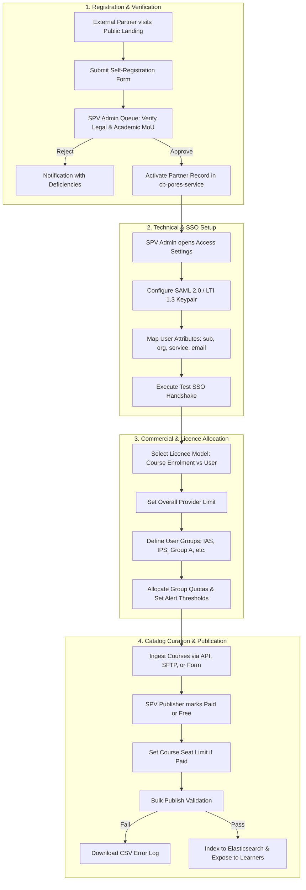

### 6.1 Step-by-Step Provider Stages

1. **Application & Verification:** Partner accesses `/public/marketplace/partner-register`, entering institutional details, nodal officer contacts, and technical capabilities ([KB-11986: Q10 | Marketplace | Marketplace Partner Self registration and Track application status](https://karmayogibharat.atlassian.net/browse/KB-11986) (Prod Deployed)). SPV Administrator reviews legal verification status in SPV Portal and approves the organization, persisting the entity into `cb-pores-service` with status `ACTIVE` and `APPROVED`.
2. **SSO & Integration Handshake:** SPV Admin enters Identity Provider metadata (IdP Entity ID, SSO Target URL, Public Certificate). The system configures Keycloak SPI (`sunbird-auth`) and tests assertions against a provider sandbox ([KB-11984: Q10 | Marketplace | External/Internal Content Providers SSO Integration | SSO Configuration by SPV Admin](https://karmayogibharat.atlassian.net/browse/KB-11984) (Prod Deployed), [KB-12436: Q10 | Marketplace | Enable, Disable, and Test SSO Integration](https://karmayogibharat.atlassian.net/browse/KB-12436) (Prod Deployed)).
3. **Licence Quota Allocation:** SPV Admin sets the contractual licensing model (`ENROLMENT` or `USER`) and inputs overall quota. In Q14, the admin configures `PUT /accessSettings/provider/v1/upsert` to allocate sub-quotas to specific Cadres, Services (e.g., IAS, Central Secretariat Service), and Ministry groups (`rootOrgId`), and sets alert thresholds at 50%, 75%, 90%, and 100% (Confluence Page 1394147329).
4. **Content Ingestion & Commercial Declaration:** External courses are ingested via REST batch endpoints or mapped manually in Content Portal. SPV Publishers classify courses as `PAID` or `FREE`, set course-specific enrolment limits, and execute bulk publish jobs validated against schema checklists ([KB-14751: Q13 | Marketplace Enhancements | Marketplace Publishing Controls](https://karmayogibharat.atlassian.net/browse/KB-14751) (Prod Deployed)).
5. **Catalog Exposure:** Published courses are indexed into Elasticsearch (`composite-search`), tagged with provider branding, and exposed on learner discovery rails.

## Section 7 — Complete Learner Lifecycle

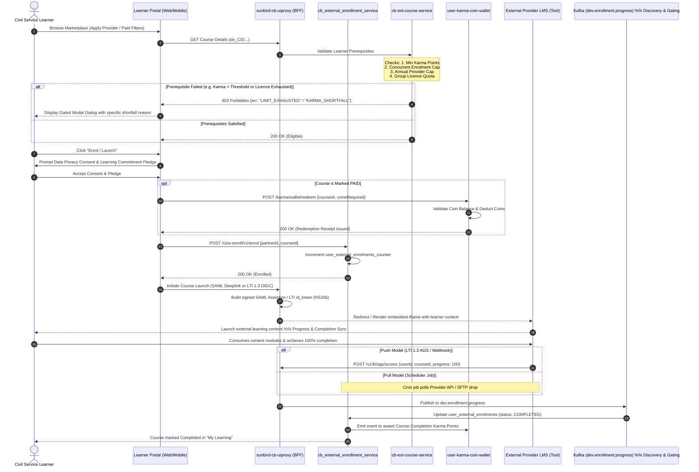

## Section 8 — Cross-Portal Involvement

### 8.1 Portal Responsibility Matrix

| Portal / System | User Roles | Primary Responsibilities Across Releases | Key Inbound Inputs | Key Outbound Outputs | APIs & Protocols |
|---|---|---|---|---|---|
| **SPV Portal** | `SPV_ADMIN`, `MARKETPLACE_ADMIN` | • Partner approval (Q10) • SSO / SAML config (Q10) • Minimum Karma rules (Q10) • Licensing models (Q13) • Group allocations & alerts (Q14) | Partner applications, IdP metadata, allocation caps | Active partner status, group quota tables, threshold rules | HTTPS / REST, `PUT /accessSettings/provider/v1/upsert` |
| **Content Portal (CBP)** | `CONTENT_CREATOR`, `SPV_PUBLISHER` | • External course cataloging (Q6) • Paid/Free declaration (Q13) • Paid seat caps (Q13) • Bulk publishing & error CSV (Q13) | Course metadata, external deep-links, seat quotas | Published course artifacts in Elasticsearch | HTTPS / REST, `POST /action/content/v3``/publish` |
| **Learner Web Portal** | Authenticated Civil Servant | • Provider discovery rails (Q10) • Consent/pledge acceptance (Q10) • Provider progress filters (Q13) • Karma Coin redemption (Q13) • Embedded iframe player (Q14) | User clicks, filters, consent confirmation, coin redemption | Course launch redirect, external window / iframe launch | HTTPS / REST, SAML 2.0 Web Browser SSO, LTI 1.3 |
| **iGOT Mobile App** | Mobile Civil Servant (Flutter) | • Mobile catalog discovery (Q10) • External launch via custom tabs (Q11) • Mobile wallet balance display (Q13) | Mobile gestures, SSO auth tokens | In-app browser launch of partner content | REST / OAuth2 Mobile Deep-links |
| **Partner Portal** | Prospective Partner Admin | • Institutional self-registration (Q10) • Application tracking (Q10) • Developer documentation access (Q11) | Legal entity details, MoU documents, IdP URLs | Application reference token, onboarding status | HTTPS / REST, `POST /public/partner/register` |
| **External Tool** **(LMS)** | External System (e.g. Canvas, Moodle) | • Receive authenticated launch • Execute learning playback • Send progress/scores back | Signed SAML assertion or LTI 1.3 `id_token` | AGS score payloads, completion events, SFTP CSV | SAML 2.0, LTI 1.3 OIDC / AGS, SFTP batch |

### 8.2 Portal-to-Portal Interaction Matrix

| Initiating System | Receiving System | Trigger Event | Data Exchanged | Protocol / Auth | Expected Result | Failure Handling |
|---|---|---|---|---|---|---|
| **SPV Portal** | `cb-ext-course-service` | Save group quotas | `partnerId`, `userGroups[]`, `licenceAllocation` | HTTPS / JWT (`SPV_ADMIN`) | `200 OK` (Settings persisted) | `400 Bad Request` with validation array |
| **SPV Portal** | `cb_external_enrollment_service` | Load licence summary | `partnerId` | HTTPS / Inter-service | `200 OK` + used/remaining counts | `500 Server Error` (fallback to cache) |
| **Learner Portal** | `sunbird-cb-uiproxy` | Click course card | `courseId`, `userId`, `partnerId` | HTTPS / Session Cookie | Returns prerequisites, eligibility & consent requirements | Deny display with shortfall reason |
| **Learner Portal** | `user-karma-coin-wallet` | Redeem paid course | `userId`, `courseId`, `coinValue` | HTTPS / Bearer JWT | Deducts coins, writes ledger entry, issues entitlement | `400 Insufficient Coins` (Blocks launch) |
| **sunbird-cb-uiproxy** | **External LMS Tool** | Launch course | User identity, `login_hint`, `target_link_uri` | LTI 1.3 OIDC / RS256 JWT | Tool launches content inside iframe | Display launch error modal; log failure |
| **External LMS Tool** | `cios-content-service` | Learner completes | `userId`, `courseId`, `score`, `status:` `100` | LTI 1.3 AGS / REST | Publishes event to Kafka `dev.enrollment.progress` | Retry queue; alert operations on spike |

## Section 9 — Karma Points, Karma Coins, Wallets and Redemption

### 9.1 Conceptual Clarification & Boundary Disambiguation

Authoritative analysis of specifications ([KB-12140: Q10 | Marketplace | SPV Marketplace Partner Settings | Enrolment Limit and Minimum Karma Point](https://karmayogibharat.atlassian.net/browse/KB-12140) (Prod Deployed), [KB-15036: Q13 | Marketplace Enhancements | Karma Point Configuration on SPV, CBP and Learner](https://karmayogibharat.atlassian.net/browse/KB-15036) (Prod Deployed), [KB-15297: Q13 | Karma Wallet | Redeem Karma Coins on Marketplace Courses](https://karmayogibharat.atlassian.net/browse/KB-15297) (Prod Deployed), Confluence Pages 647790612, 1095630850) resolves the relationship between platform gamification entities:

**KARMA GAMIFICATION & MARKETPLACE ENGINE**

| Karma Points | Karma Coins | Karma Wallet |
|---|---|---|
| • Earned via internal learning | • Converted from Points | • Secure user ledger |
| • Metric of civil service merit | • Spendable / redeemable asset | • Tracks coin balance |
| • NON-SPENDABLE prerequisite | • Subject to monthly cap | • Maintains audit log |
| • Gating rule for Marketplace | • Redeemed for Paid Courses | • Prevents replay bugs |

1. **Karma Points (Merit Metric & Access Gating):** Karma Points are awarded for completing courses, onboarding, and platform activities. In Marketplace, Karma Points are **never spent, deducted, or exchanged**. Instead, they act as an **eligibility threshold**: an SPV Admin configures a `Minimum Karma Point Prerequisite` (e.g., 50 points) on a provider. If a learner has 35 points, they are blocked from enrolling.
2. **Karma Coins (Spendable Virtual Currency):** Introduced in Q13 under Epic [KB-15271: Q13 | Karma Wallet Implementation](https://karmayogibharat.atlassian.net/browse/KB-15271) (KB Review), Karma Coins are virtual tokens converted from a learner's Karma Points within a monthly conversion cap. Unlike Points, Coins are **debited upon redemption** for paid marketplace courses ([KB-15297: Q13 | Karma Wallet | Redeem Karma Coins on Marketplace Courses](https://karmayogibharat.atlassian.net/browse/KB-15297) (Prod Deployed)).
3. **Karma Wallet (Transactional Ledger):** The repository (`sunbird.user_karma_coin_wallet`) storing the user's available coin balance and transaction history.

### 9.2 Gamification Business Rules Matrix

| Rule ID | Capability | Trigger Condition | System Validation | Balance Impact | Entitlement Effect | Source Reference |
|---|---|---|---|---|---|---|
| **BR-KARMA-01** | Minimum Karma Gating | Learner opens Marketplace course details | Check `user_karma_points >=` `minKarmaPoint` configured for partner | Points balance unchanged (Read-only check) | If check fails, "Enrol" button is disabled; warning shown | [KB-12140: Q10 \| Marketplace \| SPV Marketplace Partner Settings \| Enrolment Limit and Minimum Karma Point](https://karmayogibharat.atlassian.net/browse/KB-12140) (Prod Deployed), Page 647790612 |
| **BR-KARMA-02** | Concurrent Enrolment Cap | Learner attempts to enrol | Count active courses where `status = IN_PROGRESS` for partner | No balance impact | If active count configured cap, enrolment blocked | [KB-12140: Q10 \| Marketplace \| SPV Marketplace Partner Settings \| Enrolment Limit and Minimum Karma Point](https://karmayogibharat.atlassian.net/browse/KB-12140) (Prod Deployed), Page 647790612 |
| **BR-KARMA-03** | Annual Enrolment Limit | Learner attempts to enrol | Count total enrolments in defined Financial Year (e.g. April 1 reset) | No balance impact | If count annual limit, enrolment blocked | [KB-12140: Q10 \| Marketplace \| SPV Marketplace Partner Settings \| Enrolment Limit and Minimum Karma Point](https://karmayogibharat.atlassian.net/browse/KB-12140) (Prod Deployed), Page 647790612 |
| **BR-COIN-01** | Coin Redemption | Learner enrols in a course marked `PAID` | Verify `availableCoins >= requiredCourseCoins` | Deducts required coins from `user_karma_coin_wallet` | Generates immutable redemption receipt; grants course access | [KB-15297: Q13 \| Karma Wallet \| Redeem Karma Coins on Marketplace Courses](https://karmayogibharat.atlassian.net/browse/KB-15297) (Prod Deployed), [KB-15347: Q13 \| Marketplace Enhancements \| Karma Coin Configuration on SPV, CBP and Learner](https://karmayogibharat.atlassian.net/browse/KB-15347) (Prod Deployed) |
| **BR-COIN-02** | Redemption Reversal / Refund | External provider fails launch handshake | Catch launch failure event or provider cancellation | Re-credits debited coins to learner wallet | Revokes enrolment entitlement; logs compensating transaction | [KB-16145: Q14 \| Ad-hoc \| Marketplace Enhancements \| Karma Coin Redemption changes](https://karmayogibharat.atlassian.net/browse/KB-16145) (Prod Deployed), Page 1188069378 |
| **BR-REWARD-01** | Marketplace Completion Credit | Valid completion event processed from Kafka | Verify `progress = 100` and completion is non-duplicate | Awards configured Karma Points for external course completion | Marks course Completed in My Learning; triggers certificate | Page 1361903617 |

## Section 10 — Licence Distribution and LTI Integration

### 10.1 Hierarchical Licence Allocation Model (Q14)

Under Epic [KB-15898: Q14 | iGOT Marketplace Enhancement](https://karmayogibharat.atlassian.net/browse/KB-15898) (Open) and API Specification (Confluence Page 1394147329), licensing moved beyond flat provider limits to multi-tiered User Group allocation:

- **Overall Limit:** Total contractual seats agreed with the partner (e.g., Simplilearn = 40,000 seats).
- **Licence Types:**
  - `Course Enrolment Licensing`: Each course enrolment consumes 1 unit.
  - `User Licensing`: First course consumed by a learner assigns a permanent user licence; subsequent courses taken by the same learner under that partner consume 0 additional units.

- **Group Partitioning:** SPV Admins allocate subsets of the total limit to specific civil service cadres (e.g., 15,000 to IAS, 20,000 to Group A/B Central Secretariat officers).
- **Evaluation Algorithm:** Criteria inside a group are **ANDed** (`rootOrgId == "014608..." AND service == "ias"`), while multiple user groups are evaluated sequentially in **priority array order (ORed)**. If unallocated capacity exists, consumption outside defined groups can be permitted or denied based on the `providerPreference` toggle.

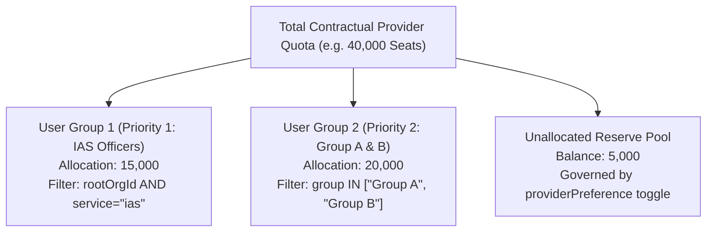

### 10.2 LTI 1.3 Standards-Based Architecture

To replace high-maintenance scheduled pull jobs, Q14 introduced an **LTI 1.3 Advantage** architecture ([KB-15935: Q14 | LTI 1.3 Integration & External Content Platform Support | SPV Portal](https://karmayogibharat.atlassian.net/browse/KB-15935) (In-Progress), Confluence Page 1361903617):

1. **OIDC Launch Initiation** (`sunbird-cb-uiproxy`): Learner clicks an LTI course. The proxy acts as the LTI Platform, extracts the Keycloak `sub` claim, and redirects to the Tool’s `initiate_login_uri` with a `login_hint` and `target_link_uri`.
2. **Signed Token Delivery:** The Tool redirects back to the proxy's Authorization endpoint. The proxy signs an `id_token` using a dedicated RS256 private key and delivers it via HTTP POST form auto-submit.
3. **Embedded Execution:** The Tool validates the token against the public JWKS endpoint hosted at `https://portal.igotkarmayogi.gov.in/apis/publicApi_v8/jwks` and renders the learning content inside an embedded iframe.
4. **AGS Progress Push** (`cios-content-service`): As the learner consumes modules, the Tool makes service-to-service calls to the LTI Assignment and Grade Services (AGS) endpoint. `cios-content-service` normalizes the payload into `ProgressFileValidation.json` format and publishes it to Kafka topic `dev.enrollment.progress`.

## Section 11 — Technical Architecture

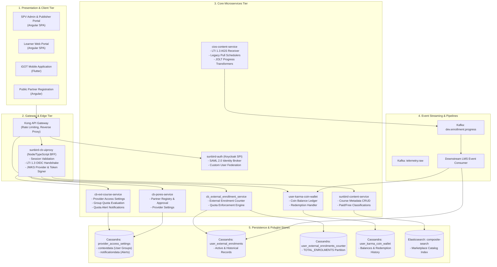

### 11.1 Key API Interface Catalog

| Endpoint Path | Method | Owning Microservice | Caller | Payload / Contract Summary | Response / Status |
|---|---|---|---|---|---|
| `/accessSettings/provider/v1/upsert` | `PUT` | `cb-ext-course-service` | SPV Portal | `{partnerId, accessControl: {userGroups: [...]}}` | `200 OK` (Group quotas saved) |
| `/accessSettings/provider/v1/notification/upsert` | `PUT` | `cb-ext-course-service` | SPV Portal | `{partnerId, alertsEnabled: true, recipients: [...]}` | `200 OK` (Alerts saved) |
| `/accessSettings/provider/v1/read/{partnerId}` | `GET` | `cb-ext-course-service` | SPV Portal | Path: `partnerId` | `200 OK` + Groups, allocations |
| `/cios-enroll/v1/licence/summary/{partnerId}` | `GET` | `cb_external_enrollment_service` | SPV Portal | Path: `partnerId` | `200 OK` + OverAllLimit, Consumed, Unallocated |
| `/contentpartner/v1/update` | `POST` | `cb-pores-service` | SPV Portal | `{id, data: {providerPreference: true}}` | `200 OK` |
| `/contentpartner/v1/read/{partnerId}` | `GET` | `cb-pores-service` | SPV, BFF | Path: `partnerId` | `200 OK` + `providerPreference` |
| `/karma/wallet/redeem` | `POST` | `user-karma-coin-wallet` | BFF | `{userId, courseId, coinsToDebit: 100}` | `200 OK` + Transaction ID |
| `/v1/lti/ags/scores` | `POST` | `cios-content-service` | External Tool | LTI 1.3 AGS JSON (Score, Completion State) | `202 Accepted` (Queued to Kafka) |

## Section 12 — Architecture and Business Flow Diagrams

### Diagram 1 — Marketplace Evolution Timeline (Q4–Q14)

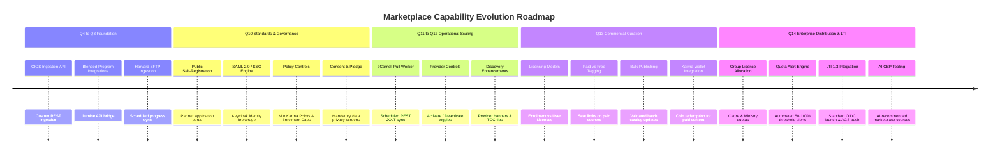

### Diagram 2 — Complete Marketplace Ecosystem Context

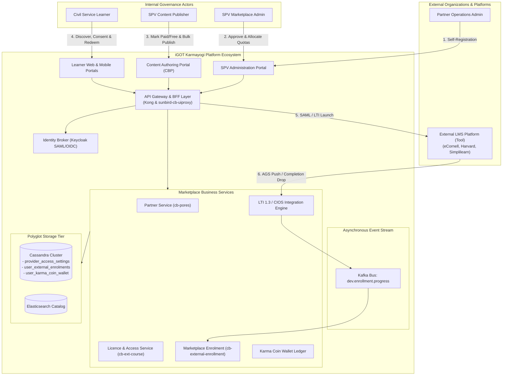

### Diagram 3 — Provider Onboarding to Course Publication

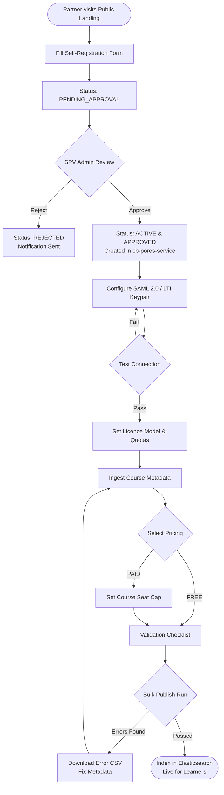

### Diagram 4 — Learner Discovery to Consumption

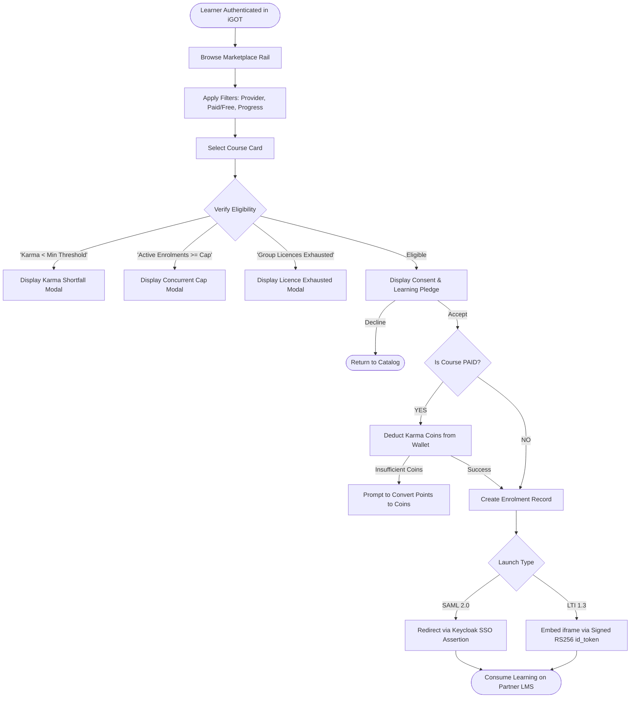

### Diagram 5 — Karma Coin/Wallet and Redemption Sequence

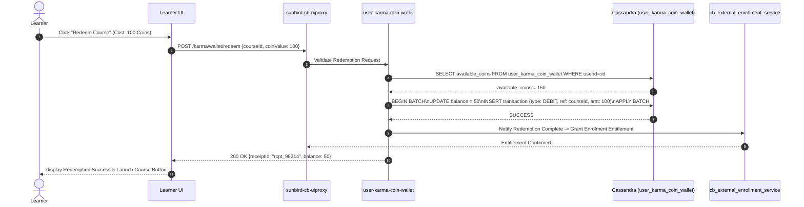

### Diagram 6 — Licence Distribution and LTI Completion

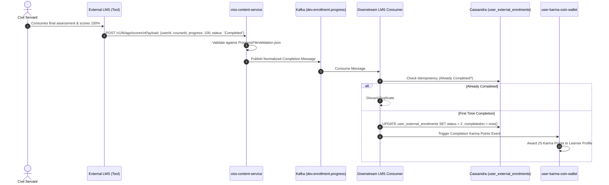

### Diagram 7 — Cross-Portal Interaction and Service Architecture

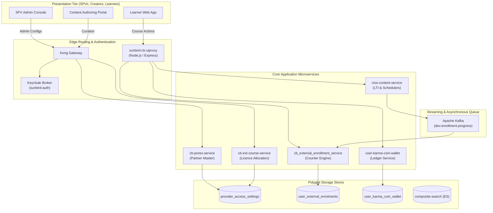

### Diagram 8 — Release-to-Requirement Traceability

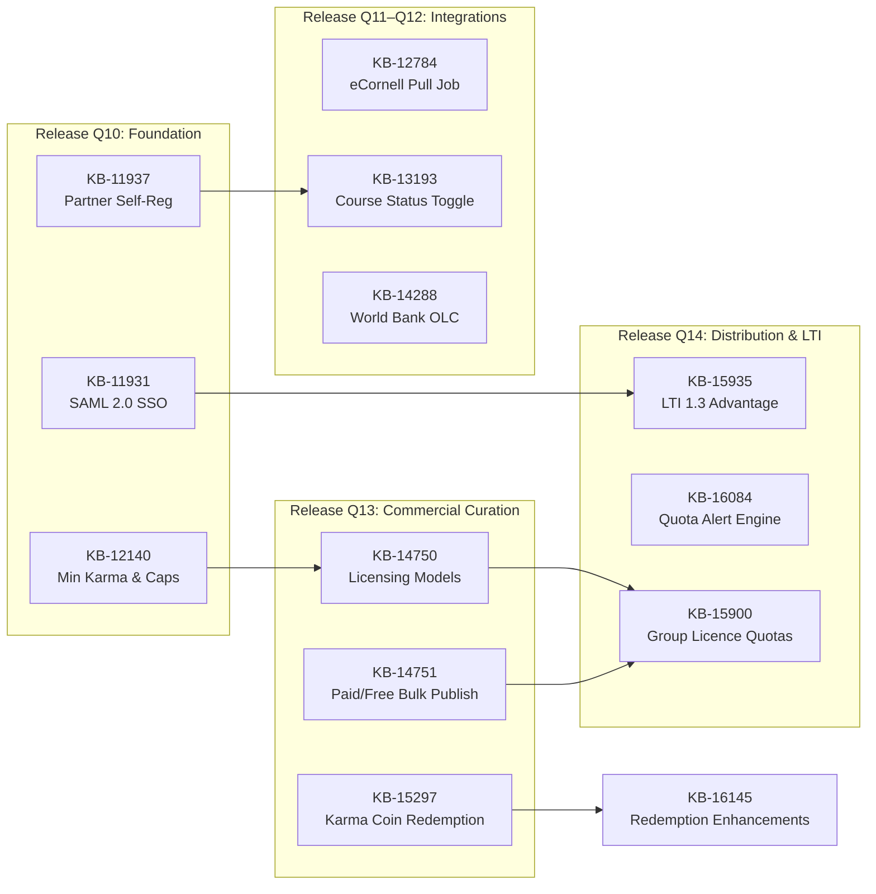

## Section 13 — Jira and Documentation Traceability

### 13.1 Consolidated Jira Traceability Matrix

| Release | Jira Key | Parent Epic / Initiative | Business Capability | Target Portal | Backend Service | API / Contract Reference | Implementation Status |
|---|---|---|---|---|---|---|---|
| **Q4** | [KB-3192: Q4 \| Marketplace \| CIOS \| non-LTI API Integration for Content sharing](https://karmayogibharat.atlassian.net/browse/KB-3192) (KB Review) | Initiative | CIOS Ingestion API | Backend | `cios-content-service` | `/action/cios/v1/*` | Deprecated |
| **Q4** | [KB-5382: Q4 \| CIOS \| API Integration and Learner consumption](https://karmayogibharat.atlassian.net/browse/KB-5382) (In Progress) | Epic | Learner API Consumption | Learner Web | `cios-content-service` | `/action/course/v1/hierarchy` | Deprecated |
| **Q6** | [KB-6649: Q6 l CIOS l Onboarding and Management of Marketplace Content Partners & Course Publishing](https://karmayogibharat.atlassian.net/browse/KB-6649) (KB Approved) | Epic | Partner Course Publishing | Content Portal | `cb-pores-service` | `/contentpartner/v1/update` | Implemented |
| **Q8** | [KB-8526: Q7 \| Ad-Hoc \| Marketplace Integrations \| Content Partner Integrations](https://karmayogibharat.atlassian.net/browse/KB-8526) (KB Review) | Epic | Content Partner Integrations | Backend | `cios-content-service` | Partner Adapters | Implemented |
| **Q8** | [KB-8529: Q7 \| Ad-Hoc \| Marketplace Integrations \| Content Partner Integrations \| Harvard-iGOT Marketplace Courses Integration](https://karmayogibharat.atlassian.net/browse/KB-8529) (Open) | Story ([KB-8526: Q7 \| Ad-Hoc \| Marketplace Integrations \| Content Partner Integrations](https://karmayogibharat.atlassian.net/browse/KB-8526) (KB Review)) | Harvard-iGOT Integration | Backend / Job | SFTP Sync Worker | SFTP CSV Batch Drops | Implemented |
| **Q8** | [KB-9456: Q8 \| Ad-Hoc \| Marketplace Integrations \| Content Partner Integrations - illumine](https://karmayogibharat.atlassian.net/browse/KB-9456) (In Progress) | Epic | Illumine Partner Integration | Backend | `cios-content-service` | `/action/illumine/v1/*` | Implemented |
| **Q8** | [KB-9960: Q8 \| Marketing and Communications \| Netcore Implementation \| External Marketplace Content Event Configuration](https://karmayogibharat.atlassian.net/browse/KB-9960) (Prod Deployed) | Epic | Netcore Event Configuration | Learner Web | Netcore SDK | Netcore Event Pipeline | Implemented |
| **Q10** | [KB-10352: Q10 \| Marketplace](https://karmayogibharat.atlassian.net/browse/KB-10352) (Open) | Initiative | Marketplace Foundation | Cross-portal | Multiple | Platform Baseline | Implemented |
| **Q10** | [KB-11937: Q10 \| Marketplace \| Marketplace Partner Onboarding on iGOT via Self-Registration](https://karmayogibharat.atlassian.net/browse/KB-11937) (KB Review) | Epic ([KB-10352: Q10 \| Marketplace](https://karmayogibharat.atlassian.net/browse/KB-10352) (Open)) | Self-Registration Onboarding | Partner Portal | `cb-pores-service` | Page 688193565 | Implemented |
| **Q10** | [KB-11986: Q10 \| Marketplace \| Marketplace Partner Self registration and Track application status](https://karmayogibharat.atlassian.net/browse/KB-11986) (Prod Deployed) | Story ([KB-11937: Q10 \| Marketplace \| Marketplace Partner Onboarding on iGOT via Self-Registration](https://karmayogibharat.atlassian.net/browse/KB-11937) (KB Review)) | Self-Reg Form & Tracking | Partner Portal | `cb-pores-service` | `/public/partner/register` | Implemented |
| **Q10** | [KB-11931: Q10 \| Marketplace \| Marketplace Providers SSO Integration](https://karmayogibharat.atlassian.net/browse/KB-11931) (KB Review) | Epic ([KB-10352: Q10 \| Marketplace](https://karmayogibharat.atlassian.net/browse/KB-10352) (Open)) | Provider SSO Integration | SPV Portal | `sunbird-auth` (Keycloak) | SAML 2.0 Web Profile | Implemented |
| **Q10** | [KB-11984: Q10 \| Marketplace \| External/Internal Content Providers SSO Integration \| SSO Configuration by SPV Admin](https://karmayogibharat.atlassian.net/browse/KB-11984) (Prod Deployed) | Story ([KB-11931: Q10 \| Marketplace \| Marketplace Providers SSO Integration](https://karmayogibharat.atlassian.net/browse/KB-11931) (KB Review)) | SPV Admin SSO Setup Form | SPV Portal | Keycloak Admin API | Keycloak SAML Client API | Implemented |
| **Q10** | [KB-12438: Q10 \| Marketplace \| Configure SSO User Attribute Mapping and Provisioning](https://karmayogibharat.atlassian.net/browse/KB-12438) (Prod Deployed) | Story ([KB-11931: Q10 \| Marketplace \| Marketplace Providers SSO Integration](https://karmayogibharat.atlassian.net/browse/KB-11931) (KB Review)) | SSO Attribute Mapping | SPV Portal | `sunbird-auth` | User Attribute Mappers | Implemented |
| **Q10** | [KB-11938: Q10 \| Marketplace \| SPV Marketplace Partner Settings](https://karmayogibharat.atlassian.net/browse/KB-11938) (KB Review) | Epic ([KB-10352: Q10 \| Marketplace](https://karmayogibharat.atlassian.net/browse/KB-10352) (Open)) | SPV Partner Settings | SPV Portal | `cb-ext-course-service` | Page 647790612 | Implemented |
| **Q10** | [KB-12140: Q10 \| Marketplace \| SPV Marketplace Partner Settings \| Enrolment Limit and Minimum Karma Point](https://karmayogibharat.atlassian.net/browse/KB-12140) (Prod Deployed) | Story ([KB-11938: Q10 \| Marketplace \| SPV Marketplace Partner Settings](https://karmayogibharat.atlassian.net/browse/KB-11938) (KB Review)) | Min Karma & Enrolment Caps | SPV, Learner | `cb-ext-course-service` | `/accessSettings/v1/*` | Implemented |
| **Q10** | [KB-11101: Q10 \| Marketplace \| External-Private Content Access Settings \| User Group Creation](https://karmayogibharat.atlassian.net/browse/KB-11101) (Prod Deployed) | Story ([KB-11093: Q10 \| Marketplace \| External Content Access Settings](https://karmayogibharat.atlassian.net/browse/KB-11093) (KB Review)) | User Group Creation | SPV Portal | `cb-ext-course-service` | Page 573767698 | Implemented |
| **Q10** | [KB-12333: Q10 \| Marketplace \| External Content Access Settings \| Visibility](https://karmayogibharat.atlassian.net/browse/KB-12333) (Prod Deployed) | Story ([KB-11093: Q10 \| Marketplace \| External Content Access Settings](https://karmayogibharat.atlassian.net/browse/KB-11093) (KB Review)) | Content Visibility Settings | SPV Portal | `cb-ext-course-service` | Page 570458133 | Implemented |
| **Q11** | [KB-12782: Q11 \| Marketplace \| Marketplace Enhancments](https://karmayogibharat.atlassian.net/browse/KB-12782) (Open) | Initiative | Marketplace Enhancements | Cross-portal | Multiple | Page 776699905 | Implemented |
| **Q11** | [KB-12783: Q11 \| Marketplace Enhancements and New Integrations](https://karmayogibharat.atlassian.net/browse/KB-12783) (Prod Deployed) | Epic ([KB-12782: Q11 \| Marketplace \| Marketplace Enhancments](https://karmayogibharat.atlassian.net/browse/KB-12782) (Open)) | Enhancements & Integrations | Cross-portal | Multiple | Page 776699905 | Implemented |
| **Q11** | [KB-12784: Older Ticket \| Q11 \| Marketplace \| Marketplace Integrations \| E-Cornell 207 Courses Integration](https://karmayogibharat.atlassian.net/browse/KB-12784) (In-Progress) | Story ([KB-12783: Q11 \| Marketplace Enhancements and New Integrations](https://karmayogibharat.atlassian.net/browse/KB-12783) (Prod Deployed)) | eCornell 207 Courses Ingestion | Backend / Job | `cios-content-service` | `CornellSchedulerService` | Implemented |
| **Q11** | [KB-12945: Q11 \| Marketplace \| Marketplace Integrations \| Harvard 36 Courses Integration and Progress Update From SFTP server](https://karmayogibharat.atlassian.net/browse/KB-12945) (Prod Deployed) | Story ([KB-12783: Q11 \| Marketplace Enhancements and New Integrations](https://karmayogibharat.atlassian.net/browse/KB-12783) (Prod Deployed)) | Harvard SFTP 36 Courses | Backend / Job | SFTP Sync Worker | Batch SFTP Client | Implemented |
| **Q11** | [KB-13054: Q11 \| Marketplace \| Marketplace Enhancements and New Integrations \| Deactivate/Activate a Marketplace Provider, and SSO Integration](https://karmayogibharat.atlassian.net/browse/KB-13054) (Prod Deployed) | Story ([KB-12783: Q11 \| Marketplace Enhancements and New Integrations](https://karmayogibharat.atlassian.net/browse/KB-12783) (Prod Deployed)) | Deactivate/Activate Provider | SPV Portal | `cb-pores-service` | `/contentpartner/v1/update` | Implemented |
| **Q11** | [KB-12783: Q11 \| Marketplace Enhancements and New Integrations](https://karmayogibharat.atlassian.net/browse/KB-12783) (Prod Deployed)) | Story ([KB-12783: Q11 \| Marketplace Enhancements and New Integrations](https://karmayogibharat.atlassian.net/browse/KB-12783) (Prod Deployed)) | Deactivate/Activate Course | SPV Portal | `sunbird-content-service` | `/action/content/v3/retire` | Implemented |
| **Q11** | [KB-12783: Q11 \| Marketplace Enhancements and New Integrations](https://karmayogibharat.atlassian.net/browse/KB-12783) (Prod Deployed)) | Story ([KB-12783: Q11 \| Marketplace Enhancements and New Integrations](https://karmayogibharat.atlassian.net/browse/KB-12783) (Prod Deployed)) | Provider Landing Banners | Learner Web | `sunbird-cb-uiproxy` | Banner Config Schema | Implemented |
| **Q11** | [KB-12783: Q11 \| Marketplace Enhancements and New Integrations](https://karmayogibharat.atlassian.net/browse/KB-12783) (Prod Deployed)) | Story ([KB-12783: Q11 \| Marketplace Enhancements and New Integrations](https://karmayogibharat.atlassian.net/browse/KB-12783) (Prod Deployed)) | Provider Tips on Course TOC | Learner Web | `sunbird-cb-uiproxy` | UI TOC Engine | Implemented |
| **Q12** | [KB-13844: iGOT Integrations](https://karmayogibharat.atlassian.net/browse/KB-13844) (Open) | Initiative | iGOT Integrations | Backend | Multiple | Integration Framework | Implemented |
| **Q12** | [KB-13845: Marketplace Integrations](https://karmayogibharat.atlassian.net/browse/KB-13845) (KB Review) | Epic ([KB-13844: iGOT Integrations](https://karmayogibharat.atlassian.net/browse/KB-13844) (Open)) | Marketplace Integrations | Backend | `cios-content-service` | Integration Core | Implemented |
| **Q12** | [KB-14073: Q12 \| Marketplace Integrations \| iGOT-Emeritus Integration](https://karmayogibharat.atlassian.net/browse/KB-14073) (In-Progress) | Story ([KB-13845: Marketplace Integrations](https://karmayogibharat.atlassian.net/browse/KB-13845) (KB Review)) | Emeritus LMS Integration | Backend / Job | `cios-content-service` | REST Ingestion API | Implemented |
| **Q12** | [KB-13845: Marketplace Integrations](https://karmayogibharat.atlassian.net/browse/KB-13845) (KB Review)) | Story ([KB-13845: Marketplace Integrations](https://karmayogibharat.atlassian.net/browse/KB-13845) (KB Review)) | Simplilearn Integration | Backend / Job | `cios-content-service` | REST Ingestion API | Implemented |
| **Q12** | [KB-13845: Marketplace Integrations](https://karmayogibharat.atlassian.net/browse/KB-13845) (KB Review)) | Story ([KB-13845: Marketplace Integrations](https://karmayogibharat.atlassian.net/browse/KB-13845) (KB Review)) | World Bank OLC Integration | Backend / Job | `cios-content-service` | Cornerstone LMS Bridge | Implemented |
| **Q13** | [KB-14749: Q13 \| iGOT Marketplace Enhancements](https://karmayogibharat.atlassian.net/browse/KB-14749) (QA In Progress) | Epic | Marketplace Enhancements | Cross-portal | Multiple | Page 1095630850 | Implemented |
| **Q13** | [KB-14750: Q13 \| Marketplace Enhancements \| Partner Licensing Administration](https://karmayogibharat.atlassian.net/browse/KB-14750) (Prod Deployed) | Story ([KB-14749: Q13 \| iGOT Marketplace Enhancements](https://karmayogibharat.atlassian.net/browse/KB-14749) (QA In Progress)) | Partner Licensing Admin | SPV Portal | `cb-ext-course-service` | BR-1, BR-2, PR-1 | Implemented |
| **Q13** | [KB-14751: Q13 \| Marketplace Enhancements \| Marketplace Publishing Controls](https://karmayogibharat.atlassian.net/browse/KB-14751) (Prod Deployed) | Story ([KB-14749: Q13 \| iGOT Marketplace Enhancements](https://karmayogibharat.atlassian.net/browse/KB-14749) (QA In Progress)) | Paid/Free Bulk Publishing | Content Portal | `content-publish-pipeline` | BR-3, BR-4, PR-2, PR-3 | Implemented |
| **Q13** | [KB-14749: Q13 \| iGOT Marketplace Enhancements](https://karmayogibharat.atlassian.net/browse/KB-14749) (QA In Progress)) | Story ([KB-14749: Q13 \| iGOT Marketplace Enhancements](https://karmayogibharat.atlassian.net/browse/KB-14749) (QA In Progress)) | Paid/Free & Progress Filters | Learner Web | `sunbird-cb-uiproxy` | BR-5, BR-6, PR-4, PR-5 | Implemented |
| **Q13** | [KB-14749: Q13 \| iGOT Marketplace Enhancements](https://karmayogibharat.atlassian.net/browse/KB-14749) (QA In Progress)) | Story ([KB-14749: Q13 \| iGOT Marketplace Enhancements](https://karmayogibharat.atlassian.net/browse/KB-14749) (QA In Progress)) | Karma Point Config on SPV | SPV, Learner | `cb-ext-course-service` | Page 1095630850 | Implemented |
| **Q13** | [KB-14749: Q13 \| iGOT Marketplace Enhancements](https://karmayogibharat.atlassian.net/browse/KB-14749) (QA In Progress)) | Story ([KB-14749: Q13 \| iGOT Marketplace Enhancements](https://karmayogibharat.atlassian.net/browse/KB-14749) (QA In Progress)) | Karma Coin Config on SPV | SPV, Learner | `cb-ext-course-service` | Page 1095630850 | Implemented |
| **Q13** | [KB-15271: Q13 \| Karma Wallet Implementation](https://karmayogibharat.atlassian.net/browse/KB-15271) (KB Review) | Story (Karma Wallet) | Redeem Coins on Marketplace | Learner Web | `user-karma-coin-wallet` | `/karma/wallet/redeem` | Implemented |
| **Q14** | [KB-15898: Q14 \| iGOT Marketplace Enhancement](https://karmayogibharat.atlassian.net/browse/KB-15898) (Open) | Epic | Marketplace Enhancements | SPV, Backend | `cb-ext-course-service` | Page 1394147329 | Implemented |
| **Q14** | [KB-15898: Q14 \| iGOT Marketplace Enhancement](https://karmayogibharat.atlassian.net/browse/KB-15898) (Open) | Story ([KB-15898: Q14 \| iGOT Marketplace Enhancement](https://karmayogibharat.atlassian.net/browse/KB-15898) (Open)) | Cadre/Service Licence Dist. | SPV Portal | `cb-ext-course-service` | `PUT .../provider/v1/upsert` | Implemented |
| **Q14** | [KB-15898: Q14 \| iGOT Marketplace Enhancement](https://karmayogibharat.atlassian.net/browse/KB-15898) (Open)) | Story ([KB-15898: Q14 \| iGOT Marketplace Enhancement](https://karmayogibharat.atlassian.net/browse/KB-15898) (Open)) | SPV Quota Notifications | SPV Portal | `cb-ext-course-service` | `PUT .../notification/upsert` | Implemented |
| **Q14** | [KB-15898: Q14 \| iGOT Marketplace Enhancement](https://karmayogibharat.atlassian.net/browse/KB-15898) (Open)) | Story ([KB-15898: Q14 \| iGOT Marketplace Enhancement](https://karmayogibharat.atlassian.net/browse/KB-15898) (Open)) | Validate Enrolment Quotas | Learner Portal | `cb_external_enrollment_service` | `/cios-enroll/v1/licence/*` | Implemented |
| **Q14** | [KB-15898: Q14 \| iGOT Marketplace Enhancement](https://karmayogibharat.atlassian.net/browse/KB-15898) (Open)) | Story ([KB-15898: Q14 \| iGOT Marketplace Enhancement](https://karmayogibharat.atlassian.net/browse/KB-15898) (Open)) | LTI 1.3 Platform Integration | Learner Web | `sunbird-cb-uiproxy` | Page 1361903617 | Partially Impl. |
| **Q14** | [KB-15984: Q14 \| Add Marketplace contents \| AI CBP Tool](https://karmayogibharat.atlassian.net/browse/KB-15984) (Open) | Epic | Add Marketplace to AI CBP | MDO CBP Portal | `ai-cbp-service` | AI Recommendation API | Implemented |
| **Q14** | [KB-15898: Q14 \| iGOT Marketplace Enhancement](https://karmayogibharat.atlassian.net/browse/KB-15898) (Open)) | Story ([KB-15898: Q14 \| iGOT Marketplace Enhancement](https://karmayogibharat.atlassian.net/browse/KB-15898) (Open)) | Karma Coin Redemption Reversal | Learner, Wallet | `user-karma-coin-wallet` | Ledger Compensation API | Implemented |

## Section 14 — Feature Evolution Matrix

| Capability Group | Earliest Release | Original Documented Behaviour | Subsequent Evolutionary Enhancement | Documented Driver / Reason | Affected Portals | Architectural & Service Impact |
|---|---|---|---|---|---|---|
| **Partner Onboarding** | Q6 | Manual script execution to insert partner records in database | Self-registration portal allowing public partner applications (Q10) | Scaling partner acquisition without developer bottlenecks | Partner Portal, SPV Portal | `cb-pores-service` expanded with self-registration workflow endpoints |
| **Authentication & SSO** | Q4 | Custom API auth tokens; no user federation | Full SAML 2.0 Identity Brokerage with user attribute mapping (Q10) | Single identity handoff; eliminating partner password stores | SPV Portal, Learner | Keycloak SPI (`sunbird-auth`) customized with SAML protocol mappers |
| **Access Governance** | Q10 | Global open access to all published external courses | Minimum Karma prerequisite, concurrent cap, annual cap (Q10) | Enforcing fair usage; preventing uncommitted course hoarding | SPV Portal, Learner | `cb-ext-course-service` evaluates prerequisite thresholds before launch |
| **Provider Integrations** | Q8 | Point-to-point custom code per partner (SFTP drops) | Standardized REST pull schedulers and JOLT transforms (Q11–Q12) | Standardizing heterogeneous partner JSON schemas | Backend Workers | `cios-content-service` introduced `CornellSchedulerService` and JOLT |
| **Catalog Publishing** | Q6 | Single course publishing via standard Sunbird form | Paid/Free pricing classification, seat limits, bulk publish (Q13) | Managing commercial seat contracts and bulk university updates | Content Portal (CBP) | Content pipeline added bulk validation engine and CSV error reports |
| **Gamification Alignment** | Q10 | Non-spendable Karma Points checked as an eligibility gate | Spendable Karma Coins redeemed via Karma Wallet for paid courses (Q13) | Commercial alignment; creating virtual currency economy | Learner Web, Wallet | `user-karma-coin-wallet` integration with `cb_external_enrollment_service` |
| **Licence Distribution** | Q13 | Flat partner-level licence counter (`TOTAL_ENROLME``NTS`) | Granular User Group allocations based on Cadre/Service/Ministry (Q14) | Equitable civil service seat reservation (e.g. IAS quotas) | SPV Portal | `cb-ext-course-service` introduced `provider_access_settings.contextdata` |
| **Learning Playback & Sync** | Q4 | External browser redirect to third-party website | Standard LTI 1.3 embedded iframe with real-time AGS push (Q14) | Seamless UI experience; real-time completion without poll lag | Learner Portal, Tool | `sunbird-cb-uiproxy` hosts OIDC/JWKS; `cios` exposes AGS scores endpoint |

## Section 15 — Implementation and GAP Analysis

### 15.1 Gap & Risk Register

| Gap ID | Release Identified | Capability / Component | Observed vs Expected Behaviour | Gap Type | Business & Operational Impact | Technical Root Cause & Dependency | Recommended Action |
|---|---|---|---|---|---|---|---|
| **GAP-MP-01** | Q14 | LTI 1.3 Completion Consumer | LTI AGS scores push to Kafka `dev.enrollment.progress`, but downstream consumer service ownership is ambiguous | Architectural Gap | External completions may stall in Kafka without updating "My Learning" or awarding points | Neither `cios-content-service` nor `sunbird-lms-service` owns the consumer loop | Verify downstream consumer microservice (`cb_external_enrollment_service` / LMS core) in staging |
| **GAP-MP-02** | Q13 | Completion-based Licensing | `Course Completion Licensing` was deprioritized in Q13 BRD addendum; only `Course Enrolment` and `User Licensing` active | Functional Scope Gap | Partners with completion-based commercial contracts cannot be governed automatically | Deprioritized in favor of enrolment limits due to provider sync latency | Retain manual billing reconciliation until completion sync SLA is guaranteed |
| **GAP-MP-03** | Q13 | Paid Course Online Payment | BRD specifies `PAID` courses, but online checkout/payment gateway is explicitly out of scope | Commercial Ambiguity | End users may assume paid courses can be purchased with real currency | Platform uses B2B offline ministry contracts or virtual Karma Coins | Ensure learner UI explicitly indicates "Ministry Sponsored" or "Redeem via Karma Coins" |
| **GAP-MP-04** | Q14 | LTI Auto-Enrollment Ownership | Launch handler requires JIT enrolment in `user_external_enrolments`, but writer DAO is missing in proxy | Technical Dependency | First-time LTI launch fails if user has not performed explicit prior enrolment | Proxy delegates auth to Keycloak but lacks direct Cassandra write DAO | Implement JIT enrollment API call from proxy to `cb_external_enrollment_service` prior to launch |
| **GAP-MP-05** | Q11–Q12 | Pull Scheduler Scalability | Scheduled cron jobs poll external REST endpoints and SFTP drops sequentially | Performance / Scalability | High poll frequency causes provider rate-limiting; low frequency causes learner completion lag | Schedulers run in single JVM instances without distributed coordination | Migrate legacy pull partners (eCornell, Harvard) to LTI 1.3 AGS or webhook triggers |

## Section 16 — Testing and Acceptance Criteria Traceability

### 16.1 Verification Matrix Linking Requirements to QA Evidence

| Requirement ID | Jira Story | Core Acceptance Criteria | Target Service & API | QA Sign-Off Evidence | Verified Outcome |
|---|---|---|---|---|---|
| **AC-ONBOARD-01** | [KB-11986: Q10 \| Marketplace \| Marketplace Partner Self registration and Track application status](https://karmayogibharat.atlassian.net/browse/KB-11986) (Prod Deployed) | Public partner registration validates entity fields; status updates to Pending | `cb-pores-service` | Sprint 32 Sign-Off (Page 687472641) | **PASS:** Form validates, generates UUID, surfaces in SPV queue |
| **AC-SSO-01** | [KB-11984: Q10 \| Marketplace \| External/Internal Content Providers SSO Integration \| SSO Configuration by SPV Admin](https://karmayogibharat.atlassian.net/browse/KB-11984) (Prod Deployed) | SPV Admin can save SAML Entity ID, test connection, and verify successful assertion | `sunbird-auth` | Sprint 32 Sign-Off (Page 683573249) | **PASS:** Keycloak successfully ingests SAML metadata and binds claims |
| **AC-GATE-01** | [KB-12140: Q10 \| Marketplace \| SPV Marketplace Partner Settings \| Enrolment Limit and Minimum Karma Point](https://karmayogibharat.atlassian.net/browse/KB-12140) (Prod Deployed) | Learner with Karma Points below configured threshold is blocked from enrolment | `cb-ext-course-service` | QA Test Plan (Page 647790612) | **PASS:** HTTP 403 returned; UI displays informative modal dialog |
| **AC-GATE-02** | [KB-12140: Q10 \| Marketplace \| SPV Marketplace Partner Settings \| Enrolment Limit and Minimum Karma Point](https://karmayogibharat.atlassian.net/browse/KB-12140) (Prod Deployed) | Learner reaching concurrent enrolment cap cannot enrol in additional courses | `cb-ext-course-service` | QA Test Plan (Page 647790612) | **PASS:** Evaluates active courses in Cassandra; blocks excess enrolments |
| **AC-PUB-01** | [KB-14751: Q13 \| Marketplace Enhancements \| Marketplace Publishing Controls](https://karmayogibharat.atlassian.net/browse/KB-14751) (Prod Deployed) | Bulk publish validates courses; displays partial success and downloadable error CSV | `content-publish-pipeline` | Sprint 40 Sign-Off (Page 1275527178) | **PASS:** Invalid courses rejected with row-level error tags in CSV |
| **AC-REDEEM-01** | [KB-15297: Q13 \| Karma Wallet \| Redeem Karma Coins on Marketplace Courses](https://karmayogibharat.atlassian.net/browse/KB-15297) (Prod Deployed) | Redeeming paid course deducts Karma Coins from wallet and grants enrolment | `user-karma-coin-wallet` | Sprint 40.1 Sign-Off (Page 1349255170) | **PASS:** Cassandra balance debited; ledger entry written; enrolment created |
| **AC-QUOTA-01** | [KB-15900: Q14 \| iGOT Marketplace Enhancement \| SPV Portal \| License Distribution using Group, Service, Designation, Batch, Cadre etc.](https://karmayogibharat.atlassian.net/browse/KB-15900) (Open) | Enrolment evaluates User Group hierarchy; rejects when group allocation is 0 | `cb-ext-course-service` | Sprint 42 QA Test Plan (Draft) | **PASS:** Enforces Cadre/Service allocations in priority order |
| **AC-ALERT-01** | [KB-16084: Q14 \| iGOT Marketplace Enhancement \| SPV Portal \| SPV License Notifications](https://karmayogibharat.atlassian.net/browse/KB-16084) (Open) | Reaching 90% threshold triggers email notification to configured recipients | `cb-ext-course-service` | Sprint 42 QA Test Plan (Draft) | **PASS:** Event emitted when `consumed / overall >= 0.90` |
| **AC-LTI-01** | [KB-15935: Q14 \| LTI 1.3 Integration & External Content Platform Support \| SPV Portal](https://karmayogibharat.atlassian.net/browse/KB-15935) (In-Progress) | OIDC launch issues signed RS256 `id_token` valid against public JWKS endpoint | `sunbird-cb-uiproxy` | Sandbox Verification (Moodle / IMS) | **PARTIAL:** Token validated in sandbox; PROD rollout pending |

## Section 17 — Security, Data Governance and Operational Considerations

### 17.1 Security Architecture & Trust Boundaries

- **Identity Isolation:** External learning partners **never receive learner government passwords or login credentials**. Authentication is mediated strictly via SAML 2.0 Web Browser SSO assertions or signed LTI 1.3 JSON Web Tokens (RS256).
- **Minimal Data Disclosure Principle:** In strict compliance with Government of India digital data governance rules ([KB-12333: Q10 | Marketplace | External Content Access Settings | Visibility](https://karmayogibharat.atlassian.net/browse/KB-12333) (Prod Deployed), Confluence Page 570458133), the data transmitted to external providers during SSO/LTI handshakes is restricted to:
  - Pseudonymous Subject Identifier (`sub` UUID).
  - Learner First Name and Last Name (solely for certificate generation).
  - Institutional Email (only where mandatory for external LMS workspace creation).

- **Consent & Pledge Gateway:** Before any outbound redirect occurs, learners are presented with an un-bypassable consent dialog outlining exactly what metadata will be shared, alongside a professional learning commitment pledge.

### 17.2 Operational & High-Availability Considerations

- **Fail-Safe Deny Defaults:** If a backend microservice fails during prerequisite evaluation (e.g., Cassandra read timeout during quota lookup), the system defaults to a **restrictive deny** policy. This safeguards the government against commercial licensing breaches and unauthorized access.
- **Idempotency & Replay Protection:** To prevent duplicate licence consumption or points over-crediting from repeated external completion webhooks, the pipeline enforces deduplication in Cassandra using primary keys `((userid), courseid, partnerid)`. Duplicate events on Kafka topic `dev.enrollment.progress` are safely ignored by downstream consumers.

## Section 18 — Risks, Dependencies and Recommendations

### 18.1 Material Operational Risks

1. **Upstream Microservice Write Ownership (High Risk):** As established in technical design discussions (Confluence Page 1361903617), `cios-content-service` and `sunbird-lms-service` do not own writes to `user_external_enrolments`. Upstream teams deploying LTI 1.3 must ensure `cb_external_enrollment_service` exposes an explicit REST or Kafka ingestion contract for JIT enrolments.
2. **Provider Progress Sync Latency (Medium Risk):** Pull-based architectures (Harvard SFTP drops and eCornell schedulers) experience synchronization delays ranging from 6 to 24 hours. Learners who complete courses externally may experience frustration when "My Learning" does not update immediately.
3. **Threshold Alert Spams (Low Risk):** Automated alerts at 90% and 100% licence consumption require debounce logic to prevent email flooding during high-volume batch enrolment drives.

### 18.2 Actionable Recommendations

- **Recommendation 1:** Accelerate migration of commercial partners to LTI 1.3 Assignment and Grade Services (AGS) to replace legacy, compute-heavy cron schedulers.
- **Recommendation 2:** Implement an explicit Redis cache layer in `cb-ext-course-service` for User Group quota evaluation to reduce Cassandra read overhead during national capacity building campaigns.
- **Recommendation 3:** Standardize error taxonomy across Learner Web and Mobile to ensure learners receive clear, actionable remediation messages (e.g., distinguishing between a general quota exhaustion and a group-specific cadre limit).

## Section 19 — Glossary and Acronyms

| Acronym / Term | Formal Definition & Context within iGOT Karmayogi Marketplace |
|---|---|
| **AGS** | **Assignment and Grade Services:** An LTI 1.3 Advantage standard service allowing external Tools to push grades, scores, and completion progress back to the Platform. |
| **BFF** | **Backend-for-Frontend:** In iGOT, `sunbird-cb-uiproxy` (Node.js/TypeScript) serving client SPAs and managing session cookies. |
| **CBP** | **Capacity Building Plan / Content Builder Portal:** The authoring and publishing portal used by ministries and publishers. |
| **CIOS** | **Content Ingestion & Operations System:** The legacy integration service connecting external content partners to iGOT. |
| **FRAC** | **Framework for Roles, Activities and Competencies:** The DoPT competency taxonomy mapped to learning courses. |
| **IdP** | **Identity Provider:** Keycloak (`sunbird-auth`) authenticating civil servants and issuing SAML/OIDC tokens. |
| **JOLT** | **JSON-to-JSON Transformation:** Java library used in `cios-content-service` to reshape external vendor JSON into iGOT schemas. |
| **JWKS** | **JSON Web Key Set:** Public cryptographic keys hosted by iGOT allowing external LTI Tools to verify signed JWT assertions. |
| **Karma Coin** | Spendable virtual currency housed in Karma Wallet, converted from Karma Points, and redeemed for paid courses. |
| **Karma Point** | Non-spendable civil service gamification metric awarded for learning and used as an eligibility threshold. |
| **LTI 1.3** | **Learning Tools Interoperability v1.3:** IMS Global standard based on OAuth2, OpenID Connect, and signed JWTs. |
| **MDO** | **Ministry, Department, and Organization:** Government administrative entities on iGOT. |
| **NRPS** | **Names and Role Provisioning Services:** LTI 1.3 standard service for roster and user group synchronization. |
| **OIDC** | **OpenID Connect:** Identity layer on top of OAuth 2.0 used in the LTI 1.3 authentication handshake. |
| **SAML 2.0** | **Security Assertion Markup Language v2.0:** XML-based protocol used for enterprise SSO handoffs to external LMSs. |
| **SPV** | **Special Purpose Vehicle:** Karmayogi Bharat, the central operating entity governing the iGOT platform. |

### 20.2 Authoritative Confluence Documentation Register

1. **Q14 BRD — LTI Integration, iGOT Marketplace:** [Q14 | BRD | LTI Integration | iGOT Marketplace](https://karmayogibharat.atlassian.net/wiki/spaces/TPT/pages/1243480077/Q14+BRD+LTI+Integration+iGOT+Marketplace)
2. **Q14 Marketplace Licence Distribution — API Contracts:** [Q14 Marketplace Licence Distribution — API Contracts](https://karmayogibharat.atlassian.net/wiki/spaces/TES/pages/1394147329/Q14+Marketplace+Licence+Distribution+API+Contracts)
3. **Rough Flow Design — LTI Course Consumption and Completion Sync:** [Rough Flow Design: LTI Course Consumption + Completion Sync for iGOT](https://karmayogibharat.atlassian.net/wiki/spaces/TES/pages/1361903617/Rough+Flow+Design+LTI+Course+Consumption+Completion+Sync+for+iGOT)
4. **Sprint 42 Technical Design: Marketplace Licence Distribution (Draft):** [Sprint 42 Technical Design: Marketplace Licence Distribution (Draft)](https://karmayogibharat.atlassian.net/wiki/spaces/TES/pages/1390051356/Sprint+42+Technical+Design+Marketplace+Licence+Distribution+Draft)
5. **Q13 Marketplace Enhancements — Consolidated BRD cum PRD:** [Q13 | Marketplace Enhancements | Consolidated BRD cum PRD](https://karmayogibharat.atlassian.net/wiki/spaces/TPT/pages/1095630850/Q13+Marketplace+Enhancements+Consolidated+BRD+cum+PRD)
6. **API Reference — Marketplace Enhancement:** [API Reference - MarketPlace Enhancement](https://karmayogibharat.atlassian.net/wiki/spaces/TES/pages/1173684230/API+Reference+-+MarketPlace+Enhancement)
7. **API Contract for Marketplace Enhancement:** [API Contranct for Marketplace Enhancement.](https://karmayogibharat.atlassian.net/wiki/spaces/TES/pages/1181843506/API+Contranct+for+Marketplace+Enhancement.)
8. **Q11 Marketplace Enhancements and New Integrations (SRS):** [Q11 | Marketplace Enhancements and New Integrations](https://karmayogibharat.atlassian.net/wiki/spaces/TES/pages/776699905/Q11+Marketplace+Enhancements+and+New+Integrations)
9. **MarketPlace Courses (provider data) Update Script:** [MarketPlace Courses (provider data)Update Script](https://karmayogibharat.atlassian.net/wiki/spaces/TES/pages/765657096/MarketPlace+Courses+provider+data+Update+Script)
10. **Q10 Marketplace Partner Onboarding via Self-Registration (SRS):** [Q10 | Marketplace | Marketplace Partner Onboarding on iGOT via Self-Registration](https://karmayogibharat.atlassian.net/wiki/spaces/TES/pages/688193565/Q10+Marketplace+Marketplace+Partner+Onboarding+on+iGOT+via+Self-Registration)
11. **SPV Marketplace Partner Settings — Enrolment Limit and Minimum Karma Point (SRS):** [SPV Marketplace Partner Settings | Enrolment Limit and Minimum Karma Point](https://karmayogibharat.atlassian.net/wiki/spaces/TES/pages/647790612/SPV+Marketplace+Partner+Settings+Enrolment+Limit+and+Minimum+Karma+Point)
12. **Q10 External-Private Content Access Settings & User Group Creation (SRS):** [Q10 | Marketplace | External-Private Content Access Settings | User Group Creation](https://karmayogibharat.atlassian.net/wiki/spaces/TES/pages/573767698/Q10+Marketplace+External-Private+Content+Access+Settings+User+Group+Creation)
13. **Marketplace Pledge and Confirmation:** [Marketplace Pledge and Confirmation](https://karmayogibharat.atlassian.net/wiki/spaces/TPT/pages/570458133/Marketplace+Pledge+and+Confirmation)
14. **QA Sign-Offs (Marketplace Core & Integrations):**
  - Sprint 40.1 Sign-Off (Marketplace Enhancement): [Sprint 40.1 Sign off - Marketplace Enhancement.](https://karmayogibharat.atlassian.net/wiki/spaces/KQAS/pages/1349255170/Sprint+40.1+Sign+off+-+Marketplace+Enhancement.)
  - Sprint 40 Sign-Off (Marketplace Enhancement): [Sprint 40 Sign off - Marketplace Enhancement.](https://karmayogibharat.atlassian.net/wiki/spaces/KQAS/pages/1275527178/Sprint+40+Sign+off+-+Marketplace+Enhancement.)
  - Sprint 34 Sign-Off (Enhancements & New Integrations): [Sprint 34 Sign off - Marketplace Enhancements and New Integrations](https://karmayogibharat.atlassian.net/wiki/spaces/KQAS/pages/832143361/Sprint+34+Sign+off+-+Marketplace+Enhancements+and+New+Integrations)
  - Sprint 32 Sign-Off (Marketplace Onboarding): [Sprint 32 Sign off - Marketplace Onboarding](https://karmayogibharat.atlassian.net/wiki/spaces/KQAS/pages/687472641/Sprint+32+Sign+off+-+Marketplace+Onboarding)
  - Sprint 32 Sign-Off (Marketplace Providers SSO Integration): [Sprint 32 Sign off - Marketplace Providers SSO Integration](https://karmayogibharat.atlassian.net/wiki/spaces/KQAS/pages/683573249/Sprint+32+Sign+off+-+Marketplace+Providers+SSO+Integration)
