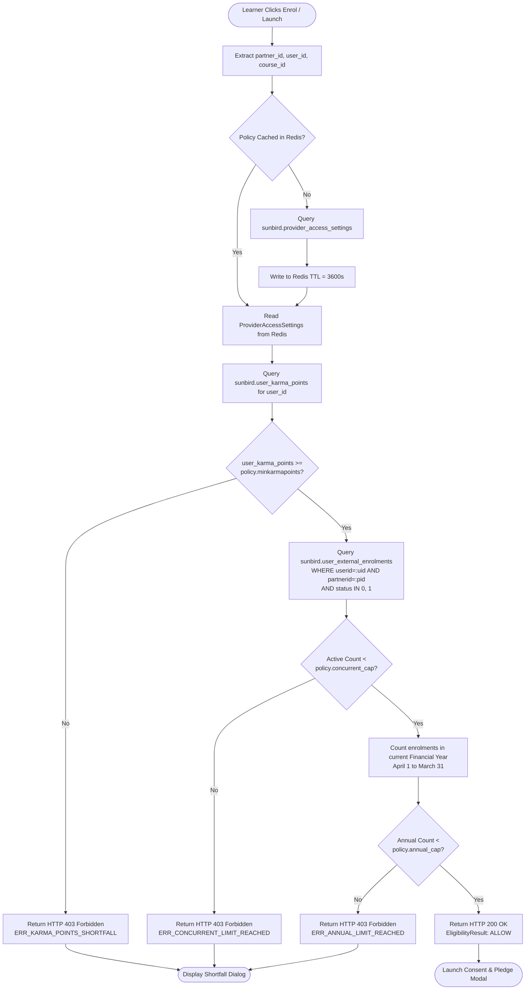
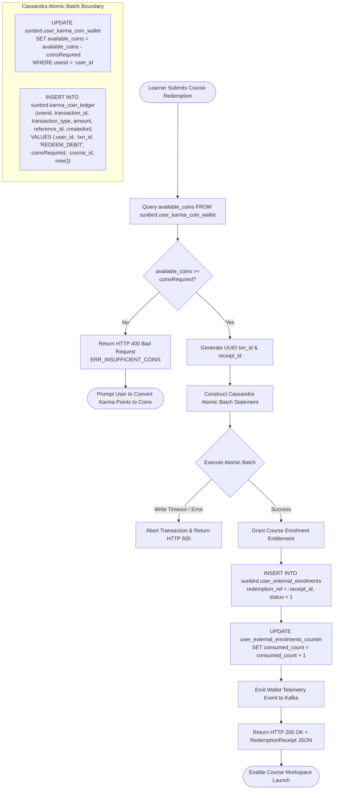
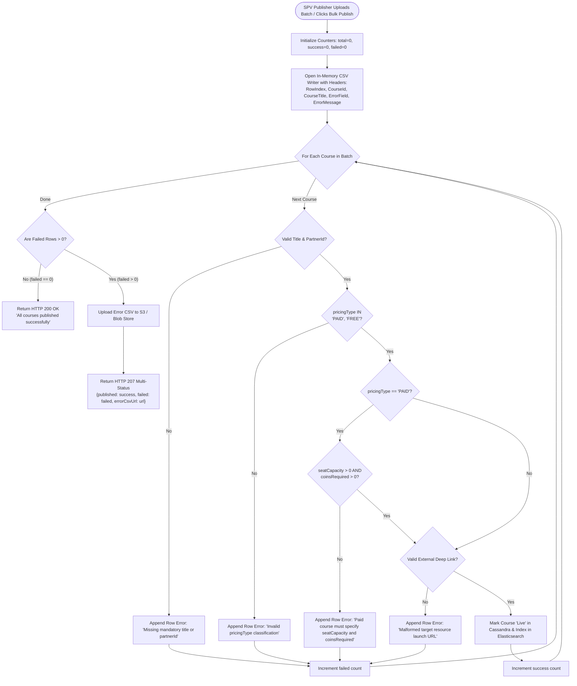
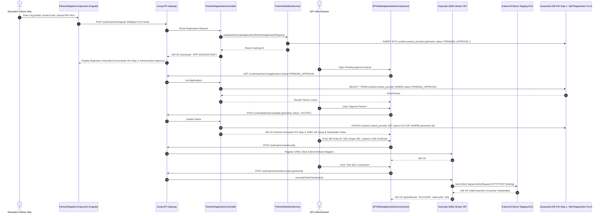
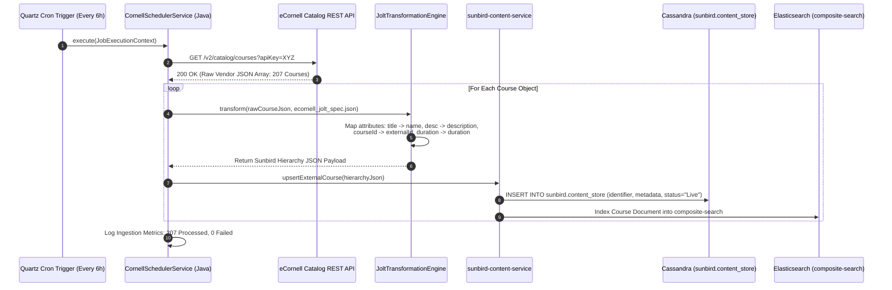
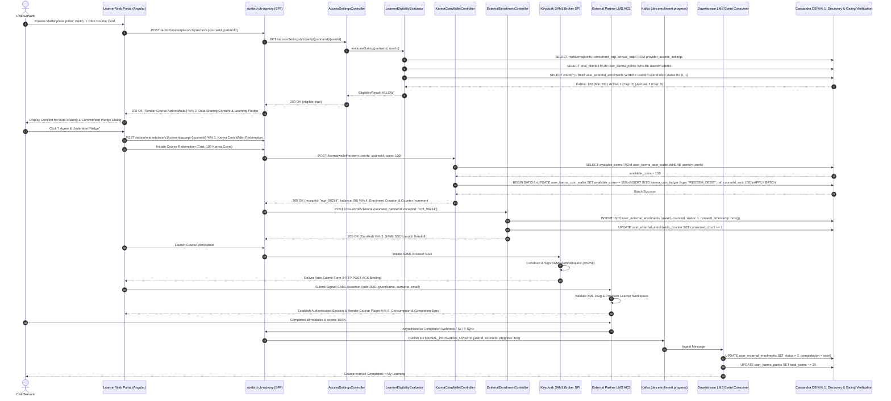

# Marketplace — Low-Level Design (LLD)

## 1. Document Overview & Engineering Scope

### 1.1 Purpose

This Low-Level Design (LLD) document specifies the concrete class structures, module boundaries, method signatures, data access objects (DAOs), REST controller endpoints, database execution scripts (Cassandra DDL), and algorithmic workflows governing the **iGOT Karmayogi Marketplace** subsystem from **Quarter 4 (Q4)** through **Quarter 13 (Q13)**.

### 1.2 Development Task & Story Traceability Baseline

This design formalizes the implementation tasks corresponding to the verified milestone tickets:

- **Q4–Q8 (Milestone 1):** [KB-3192: Q4 | Marketplace | CIOS | non-LTI API Integration for Content sharing](https://karmayogibharat.atlassian.net/browse/KB-3192) (KB Review) (CIOS Ingestion API), [KB-6649: Q6 l CIOS l Onboarding and Management of Marketplace Content Partners & Course Publishing](https://karmayogibharat.atlassian.net/browse/KB-6649) (KB Approved) (Partner Curation), [KB-8529: Q7 | Ad-Hoc | Marketplace Integrations | Content Partner Integrations | Harvard-iGOT Marketplace Courses Integration](https://karmayogibharat.atlassian.net/browse/KB-8529) (Open) (Harvard SFTP Sync).
- **Q10 (Milestone 2):** [KB-11937: Q10 | Marketplace | Marketplace Partner Onboarding on iGOT via Self-Registration](https://karmayogibharat.atlassian.net/browse/KB-11937) (KB Review) / [KB-11986: Q10 | Marketplace | Marketplace Partner Self registration and Track application status](https://karmayogibharat.atlassian.net/browse/KB-11986) (Prod Deployed) (Partner Self-Registration), [KB-11931: Q10 | Marketplace | Marketplace Providers SSO Integration](https://karmayogibharat.atlassian.net/browse/KB-11931) (KB Review) / [KB-11984: Q10 | Marketplace | External/Internal Content Providers SSO Integration | SSO Configuration by SPV Admin](https://karmayogibharat.atlassian.net/browse/KB-11984) (Prod Deployed) (Keycloak SAML 2.0 Brokerage & Test Probe), [KB-11938: Q10 | Marketplace | SPV Marketplace Partner Settings](https://karmayogibharat.atlassian.net/browse/KB-11938) (KB Review) / [KB-12140: Q10 | Marketplace | SPV Marketplace Partner Settings | Enrolment Limit and Minimum Karma Point](https://karmayogibharat.atlassian.net/browse/KB-12140) (Prod Deployed) (Minimum Karma Points Gating & Enrolment Caps), [KB-12333: Q10 | Marketplace | External Content Access Settings | Visibility](https://karmayogibharat.atlassian.net/browse/KB-12333) (Prod Deployed) (Consent & Pledge Enforcement).
- **Q11–Q12 (Milestone 3):** [KB-12784: Older Ticket | Q11 | Marketplace | Marketplace Integrations | E-Cornell 207 Courses Integration](https://karmayogibharat.atlassian.net/browse/KB-12784) (In-Progress) (eCornell Scheduled Pull & JOLT Pipeline), [KB-13054: Q11 | Marketplace | Marketplace Enhancements and New Integrations | Deactivate/Activate a Marketplace Provider, and SSO Integration](https://karmayogibharat.atlassian.net/browse/KB-13054) (Prod Deployed) / [KB-13193: Q11 | Marketplace | Marketplace Enhancements and New Integrations | Deactivate/Activate a Marketplace Course](https://karmayogibharat.atlassian.net/browse/KB-13193) (Open) (Partner & Course Operational Status Toggles), [KB-12836: Q11 | Marketplace | Marketplace Enhancements and New Integrations | Adding a banner for the respective Provider on the Providers Course Listing Page](https://karmayogibharat.atlassian.net/browse/KB-12836) (Prod Deployed) / [KB-13231: Q11 | Marketplace | Marketplace Integrations | Provider Tips in Marketplace Providers Specific Courses TOC](https://karmayogibharat.atlassian.net/browse/KB-13231) (In-Progress) (UI Banners & TOC Tips).
- **Q13 (Milestone 4):** [KB-14750: Q13 | Marketplace Enhancements | Partner Licensing Administration](https://karmayogibharat.atlassian.net/browse/KB-14750) (Prod Deployed) (Licensing Models), [KB-14751: Q13 | Marketplace Enhancements | Marketplace Publishing Controls](https://karmayogibharat.atlassian.net/browse/KB-14751) (Prod Deployed) (Paid/Free Curation & Bulk Publishing), [KB-14752: Q13 | Marketplace Enhancements | Learner Discovery and Behaviour](https://karmayogibharat.atlassian.net/browse/KB-14752) (Prod Deployed) (Learner Badging & Facet Filters), [KB-15297: Q13 | Karma Wallet | Redeem Karma Coins on Marketplace Courses](https://karmayogibharat.atlassian.net/browse/KB-15297) (Prod Deployed) / [KB-15347: Q13 | Marketplace Enhancements | Karma Coin Configuration on SPV, CBP and Learner](https://karmayogibharat.atlassian.net/browse/KB-15347) (Prod Deployed) (Karma Wallet Coin Redemption Engine).

## 2. Low-Level Component & Modular Decomposition

This structural diagram specifies every presentation component, router guard, API gateway route, microservice class, DAO, database table, and message queue topic across the platform.

```mermaid
flowchart TD
    subgraph FE_Presentation ["Frontend Tier: Angular 12+ SPAs & Flutter Mobile"]
        PublicRegComp["PartnerRegisterComponent\n(Angular Reactive Form)\n- Nodal Contact, MoU Upload (KB-11986)"]
        SPVAdminComp["SPVMarketplaceAdminComponent\n- Approval Queue\n- SAML Config & Probe (KB-11984)\n- Access Policy Form (KB-12140)"]
        SPVPubComp["ContentPublisherComponent\n- Paid/Free Dropdown (KB-14751)\n- Seat Cap Inputs (KB-14751)\n- Bulk Publish CSV Uploader"]
        LearnerCardComp["MarketplaceCardComponent\n- Paid/Free Badges (KB-14752)\n- Provider Banners (KB-12836)"]
        PledgeModalComp["ConsentPledgeModalComponent\n- Data Sharing Consent (KB-12333)\n- Learning Commitment Pledge"]
        WalletRedeemComp["KarmaWalletRedeemComponent\n- Balance Display\n- Debit Authorization (KB-15297)"]
        MobileAppView["Flutter MarketplaceScreen\n- Native Catalog & In-App Custom Tabs"]
    end
    subgraph Edge_BFF ["Edge Routing, BFF & Identity Brokerage Tier"]
        KongGateway["Kong API Gateway\n- Route Rules & Rate Limiters\n- RBAC (SPV_ADMIN, SPV_PUBLISHER)"]
        UIProxy["sunbird-cb-uiproxy (Node.js/Express BFF)\n- /action/marketplace/*\n- ConsentGuardMiddleware\n- LaunchTokenGenerator"]
        KeycloakSPI["sunbird-auth (Keycloak SAML 2.0 SPI)\n- SamlIdpBrokerService\n- DynamicAttributeMapper (sub, email)\n- RS256 Assertion Signer"]
    end
    subgraph Microservices_Tier ["Core Microservices Tier (Scala / Java / Node.js)"]
        PartnerCtrl["PartnerRegistrationController\n(cb-pores-service)\n- submitRegistration()\n- approvePartner()"]
        AccessCtrl["AccessSettingsController\n(cb-ext-course-service)\n- upsertPolicy()\n- verifyLearnerEligibility()"]
        EnrollCtrl["ExternalEnrollmentController\n(cb_external_enrollment_service)\n- createEnrollment()\n- getEnrolmentStatus()"]
        PublishCtrl["BulkPublishController\n(sunbird-content-service)\n- processBulkPublish()\n- generateErrorCsv()"]
        SchedulerService["CornellSchedulerService\n(cios-content-service)\n- pollCatalogApi()\n- applyJoltTransform()"]
        SFTPService["HarvardSFTPClientService\n(cios-content-service)\n- fetchDailyDropCsv()\n- parseProgressRecords()"]
        WalletCtrl["KarmaCoinWalletController\n(user-karma-coin-wallet)\n- redeemCoinsForCourse()\n- getWalletBalance()"]
    end
    subgraph Async_Event_Mesh ["Streaming & Asynchronous Queue Tier"]
        KafkaBus["Apache Kafka\n- Topic: dev.enrollment.progress\n- Topic: telemetry.raw"]
        DownstreamLMS["LMSProgressConsumerService\n- finalizeCompletionStatus()\n- triggerKarmaPointsCredit()"]
    end
    subgraph Persistence_Stores ["Polyglot Storage & Caching Tier"]
        CasProvider[("sunbird.content_provider\n- Partner Master & Licensing")]
        CasAccess[("sunbird.provider_access_settings\n- Gating Thresholds & Caps")]
        CasEnrol[("sunbird.user_external_enrolments\n- Active/Historical Records & Pledge")]
        CasCounter[("sunbird.user_external_enrolments_counter\n- Atomic Counters per Partner/Course")]
        CasWallet[("sunbird.user_karma_coin_wallet\n- Available Coin Balance")]
        CasLedger[("sunbird.karma_coin_ledger\n- Double-Entry Audit Transactions")]
        ESIndex[("Elasticsearch: composite-search\n- Marketplace Course Index")]
        RedisCache[("Redis Distributed Cache\n- Policy Cache (TTL: 1 hr)")]
    end
    %% Wiring: Frontend to Edge
    PublicRegComp --> KongGateway
    SPVAdminComp --> KongGateway
    SPVPubComp --> KongGateway
    LearnerCardComp --> UIProxy
    PledgeModalComp --> UIProxy
    WalletRedeemComp --> UIProxy
    MobileAppView --> UIProxy
    UIProxy --> KongGateway
    %% Wiring: Edge to Microservices
    KongGateway --> PartnerCtrl
    KongGateway --> AccessCtrl
    KongGateway --> PublishCtrl
    KongGateway --> KeycloakSPI
    UIProxy --> AccessCtrl
    UIProxy --> EnrollCtrl
    UIProxy --> WalletCtrl
    %% Wiring: Microservices to Persistence
    PartnerCtrl --> CasProvider
    AccessCtrl --> CasAccess
    AccessCtrl --> RedisCache
    EnrollCtrl --> CasEnrol
    EnrollCtrl --> CasCounter
    PublishCtrl --> ESIndex
    WalletCtrl --> CasWallet
    WalletCtrl --> CasLedger
    SchedulerService --> ESIndex
    SFTPService --> KafkaBus
    %% Wiring: Async Events
    KafkaBus --> DownstreamLMS
    DownstreamLMS --> CasEnrol
    DownstreamLMS --> CasWallet
```



## 3. Low-Level Object & Class Architecture

This UML class diagram specifies domain models, service interfaces, controller classes, and data access objects governing partner registration, policy validation, atomic coin redemption, and catalog curation.

```mermaid
classDiagram
    direction TB %% Presentation / DTO Layer
    class PartnerRegistrationRequest {
        +String orgName
        +String entityType
        +String nodalName
        +String nodalEmail
        +String website
        +byte[] accreditationPdf
        +validate() boolean
    }
    class AccessPolicyRequest {
        +String partnerId
        +int minKarmaPoints
        +int concurrentCap
        +int annualCap
        +String licenceType
        +validate() boolean
    }
    class CoinRedemptionRequest {
        +String userId
        +String courseId
        +String partnerId
        +int coinsRequired
        +validate() boolean
    }
    %% Controller Tier
    class AccessSettingsController {
        -AccessPolicyService policyService
        -LearnerEligibilityEvaluator evaluator
        +upsertPolicy(AccessPolicyRequest req) ResponseEntity
        +verifyLearnerEligibility(String partnerId, String userId) ResponseEntity
    }
    class KarmaCoinWalletController {
        -KarmaWalletService walletService
        -LedgerAuditService auditService
        +redeemCoinsForCourse(CoinRedemptionRequest req) ResponseEntity
        +getWalletBalance(String userId) ResponseEntity
    }
    %% Service Tier
    class LearnerEligibilityEvaluator {
        -ProviderAccessRepository accessRepo
        -UserKarmaPointsRepository karmaRepo
        -ExternalEnrolmentRepository enrolRepo
        -RedisCacheService cacheService
        +evaluateGating(String partnerId, String userId) EligibilityResult
    }
    class EligibilityResult {
        +boolean isEligible
        +String failureReasonCode
        +int currentKarmaPoints
        +int requiredKarmaPoints
        +int activeConcurrentCourses
    }
    class KarmaWalletService {
        -CassandraWalletRepository walletRepo
        -CassandraLedgerRepository ledgerRepo
        +executeAtomicRedemption(String userId, String courseId, int coins) RedemptionReceipt
    }
    class RedemptionReceipt {
        +String receiptId
        +String userId
        +String courseId
        +int coinsDebited
        +int remainingBalance
        +Date timestamp
    }
    %% Persistence DAO Tier
    class ProviderAccessRepository {
        -CassandraSession session
        +findByPartnerId(String partnerId) ProviderAccessSettings
        +save(ProviderAccessSettings settings) void
    }
    class ExternalEnrolmentRepository {
        -CassandraSession session
        +countActiveByPartner(String userId, String partnerId) int
        +countAnnualEnrolments(String userId, String partnerId, Date fyStart) int
        +saveEnrolmentRecord(ExternalEnrolment record) void
        +updateCompletionStatus(String userId, String courseId, int status) void
    }
    class CassandraWalletRepository {
        -CassandraSession session
        +getBalance(String userId) int
        +applyAtomicDebitBatch(String userId, int coins, String txnId, String courseId) boolean
    }
    %% Class Relationships
    AccessSettingsController --> LearnerEligibilityEvaluator
    LearnerEligibilityEvaluator --> ProviderAccessRepository
    LearnerEligibilityEvaluator --> ExternalEnrolmentRepository
    LearnerEligibilityEvaluator --> EligibilityResult
    AccessSettingsController ..> AccessPolicyRequest
    KarmaCoinWalletController --> KarmaWalletService
    KarmaWalletService --> CassandraWalletRepository
    KarmaWalletService --> RedemptionReceipt
    KarmaCoinWalletController ..> CoinRedemptionRequest
```



## 4. Algorithmic Low-Level Logic & Detailed Control Flows

### 4.1 Multi-Dimensional Access Gating Engine (`cb-ext-course-service` — Q10)

This flowchart details the exact decision tree implemented within `LearnerEligibilityEvaluator.evaluateGating()` when a learner attempts to enroll in a marketplace course.



### 4.2 Atomic Karma Coin Course Redemption Engine (`user-karma-coin-wallet` — Q13)

This flowchart formalizes the transaction semantics enforced by `KarmaWalletService.executeAtomicRedemption()` to prevent double-spending and guarantee ledger integrity.



### 4.3 Bulk Publishing Checklist & CSV Validation Engine (`sunbird-content-service` — Q13)



## 5. End-to-End Sequence Engineering Designs

### 5.1 Chronological Flow 1: Partner Onboarding to SAML Verification (Q10)

This sequence details public application ingestion, administrative approval, and the cryptographic SAML 2.0 connection probe.



### 5.2 Chronological Flow 2: eCornell REST Pull Ingestion & JOLT Transformation (Q11)

This sequence details the automated background polling of eCornell APIs, JSON schema restructuring via JOLT, and catalog indexing in Elasticsearch.



### 5.3 Chronological Flow 3: Learner Consumption Lifecycle: Gating, Pledge, Coin Redemption & SSO Launch (Q13)

This sequence formalizes the complete user journey: access policy verification, commitment pledge confirmation, atomic Karma Coin debiting, SAML 2.0 Web SSO browser launch, and asynchronous progress completion synchronization via Kafka.



## 6. Concrete API Contracts & Implementation Schemas

### 6.1 Access Policy Configuration Contract (`cb-ext-course-service` — Q10/Q13)

- **Endpoint:** `PUT /accessSettings/provider/v1/policy`
- **Security:** Bearer JWT (Role: `SPV_ADMIN`)
- **Request Schema (JSON):**

```json
{
  "partnerId": "eCornell_001",
  "minKarmaPoints": 50,
  "concurrentCap": 2,
  "annualCap": 5,
  "licenceType": "ENROLMENT"
}
```

- **Response Schema** (`HTTP 200 OK`):

```json
{
  "id": "api.accessSettings.policy.upsert",
  "ver": "1.0",
  "ts": "2026-10-29T18:30:00.000Z",
  "params": {
    "status": "SUCCESSFUL",
    "resmsgid": "9a847120-1294-4b82-c847-194820194821"
  },
  "responseCode": "OK",
  "result": {
    "partnerId": "eCornell_001",
    "status": "SAVED"
  }
}
```

### 6.2 Learner Eligibility Verification Contract (`cb-ext-course-service` — Q10)

- **Endpoint:** `GET /accessSettings/v1/verify/{partnerId}/{userId}`
- **Security:** Bearer JWT (`Learner`)
- **Path Parameters:** `partnerId` (string), `userId` (string)
- **Response Schema** (`HTTP 200 OK` — Permitted):

```json
{
  "id": "api.accessSettings.verify",
  "ver": "1.0",
  "ts": "2026-10-29T18:31:00.000Z",
  "params": {
    "status": "SUCCESSFUL",
    "resmsgid": "b1849201-9a72-4c81-b201-984729184712"
  },
  "responseCode": "OK",
  "result": {
    "eligible": true,
    "userKarmaPoints": 120,
    "minKarmaPointsRequired": 50,
    "activeConcurrentCourses": 1,
    "maxConcurrentAllowed": 2,
    "annualEnrolmentsConsumed": 2,
    "annualEnrolmentCap": 5
  }
}
```

- **Error Response Schema** (`HTTP 403 Forbidden` — Shortfall):

```json
{
  "id": "api.accessSettings.verify",
  "ver": "1.0",
  "ts": "2026-10-29T18:31:05.000Z",
  "params": {
    "resmsgid": "c2948102-8b81-4d92-a102-874829174821",
    "status": "FAILED",
    "err": "ERR_KARMA_POINTS_SHORTFALL",
    "errmsg": "Learner Karma Points balance (35) is below the required partner threshold (50)."
  },
  "responseCode": "FORBIDDEN",
  "result": {
    "eligible": false,
    "shortfallType": "MIN_KARMA_POINTS",
    "currentPoints": 35,
    "requiredPoints": 50
  }
}
```

### 6.3 Karma Coin Wallet Course Redemption Contract (`user-karma-coin-wallet` — Q13)

- **Endpoint:** `POST /karma/wallet/redeem`
- **Security:** Bearer JWT (`Learner`)
- **Request Schema (JSON):**

```json
{
  "userId": "usr_91824719284712",
  "courseId": "do_CID1130982348712",
  "partnerId": "eCornell_001",
  "coinsRequired": 100
}
```

- **Response Schema** (`HTTP 200 OK` — Atomic Batch Succeeded):

```json
{
  "id": "api.karma.wallet.redeem",
  "ver": "1.0",
  "ts": "2026-10-29T18:32:00.000Z",
  "params": {
    "status": "SUCCESSFUL",
    "resmsgid": "d9847201-a129-4b82-c847-194820194822"
  },
  "responseCode": "OK",
  "result": {
    "redemptionStatus": "SUCCESS",
    "receiptId": "rcpt_982147192847",
    "coinsDebited": 100,
    "remainingCoinBalance": 50,
    "entitlementToken": "ent_ecornell_do_CID1130982348712"
  }
}
```

### 6.4 Bulk Course Publishing Contract (`sunbird-content-service` — Q13)

- **Endpoint:** `POST /action/content/v3/bulk/publish`
- **Security:** Bearer JWT (Role: `SPV_PUBLISHER`)
- **Request Schema (JSON):**

```json
{
  "request": {
    "courses": [
      {
        "identifier": "do_CID1130982348712",
        "pricingType": "FREE",
        "seatCapacity": 0,
        "karmaCoinsRequired": 0
      },
      {
        "identifier": "do_CID1130982348713",
        "pricingType": "PAID",
        "seatCapacity": 500,
        "karmaCoinsRequired": 100
      }
    ]
  }
}
```

- **Multi-Status Response** (`HTTP 207 Multi-Status`):

```json
{
  "id": "api.content.bulk.publish",
  "ver": "3.0",
  "ts": "2026-10-29T18:33:00.000Z",
  "params": {
    "status": "PARTIAL_SUCCESS",
    "resmsgid": "e1849201-9a72-4c81-b201-984729184715"
  },
  "responseCode": "MULTI_STATUS",
  "result": {
    "totalProcessed": 2,
    "publishedCount": 2,
    "failedCount": 0,
    "errorCsvUrl": null
  }
}
```

## 7. Persistence Layer Architecture & Complete Cassandra DDL

The Cassandra persistence layer (`sunbird` keyspace) is optimized for high-throughput reads and atomic counter operations.

```sql
-- Keyspace Definition
CREATE KEYSPACE IF NOT EXISTS sunbird WITH replication = {'class': 'NetworkTopologyStrategy', 'datacenter1': 3};

-- 1. Content Provider Master Store (Q10 Self-Registration & Tenancy)
CREATE TABLE IF NOT EXISTS sunbird.content_provider (
    partnerid text,
    orgname text,
    entitytype text,  -- "ACADEMIC", "COMMERCIAL", "GOVERNMENT"
    nodal_name text,
    nodal_email text,
    website text,
    status text,  -- "PENDING_APPROVAL", "ACTIVE", "REJECTED", "DEACTIVATED"
    sso_enabled boolean,
    licence_type text,  -- "ENROLMENT" or "USER" (Q13)
    createdon timestamp,
    updatedon timestamp,
    PRIMARY KEY (partnerid)
);

-- 2. Provider Access Policies Store (Q10 Gating Rules)
CREATE TABLE IF NOT EXISTS sunbird.provider_access_settings (
    partnerid text,
    minkarmapoints int,  -- Read-only eligibility threshold
    concurrent_cap int,
    -- Maximum active concurrent courses per learner
    annual_cap int,
    -- Maximum courses per learner per Financial Year
    createdon timestamp,
    updatedon timestamp,
    PRIMARY KEY (partnerid)
);

-- 3. User External Enrolment Registry (Q10 Active/Historical Consumption)
CREATE TABLE IF NOT EXISTS sunbird.user_external_enrolments (
    userid text,
    courseid text,
    partnerid text,
    licencetype text,  -- "ENROLMENT" or "USER" (Q13)
    status int,  -- 0: Enrolled, 1: In-Progress, 2: Completed, 3: Suspended
    completionpercentage int,  -- 0 to 100%
    enrolleddate timestamp,
    completedon timestamp,
    consent_timestamp timestamp,
    -- Timestamp of data-sharing pledge confirmation (Q10)
    redemption_ref text,  -- Karma Coin redemption receipt ID (Q13)
    PRIMARY KEY ((userid), courseid, partnerid)
) WITH CLUSTERING ORDER BY (courseid ASC, partnerid ASC);
CREATE INDEX IF NOT EXISTS idx_user_ext_enrol_partner ON sunbird.user_external_enrolments (partnerid);
CREATE INDEX IF NOT EXISTS idx_user_ext_enrol_status ON sunbird.user_external_enrolments (status);

-- 4. External Enrolment Atomic Counter Table (Q13 Seat Quota Tracking)
CREATE TABLE IF NOT EXISTS sunbird.user_external_enrolments_counter (
    partnerid text,
    partition_key text,  -- "TOTAL_ENROLMENTS" or specific Course ID
    consumed_count counter,
    PRIMARY KEY (partnerid, partition_key)
);

-- 5. User Karma Coin Wallet Store (Q13 Virtual Currency Balance)
CREATE TABLE IF NOT EXISTS sunbird.user_karma_coin_wallet (
    userid text,
    available_coins int,
    total_converted_coins int,
    last_updated timestamp,
    PRIMARY KEY (userid)
);

-- 6. Karma Coin Double-Entry Ledger Store (Q13 Immutable Audit Trail)
CREATE TABLE IF NOT EXISTS sunbird.karma_coin_ledger (
    userid text,
    transaction_id text,
    transaction_type text,  -- "CONVERT_CREDIT", "REDEEM_DEBIT", "CREDIT_REFUND"
    amount int,
    reference_id text,  -- Marketplace Course ID or Receipt ID
    createdon timestamp,
    PRIMARY KEY ((userid), transaction_id)
) WITH CLUSTERING ORDER BY (transaction_id DESC);
```

## 8. Requirements Traceability Matrix (LLD to Engineering Tasks)

| Milestone | Task / Story Jira Key | Feature Capability | Low-Level Architectural Component | Concrete File / Class Name | Status |
|---|---|---|---|---|---|
| **Q4** | [KB-3192: Q4 \| Marketplace \| CIOS \| non-LTI API Integration for Content sharing](https://karmayogibharat.atlassian.net/browse/KB-3192) (KB Review) | CIOS Ingestion API | Ingestion Subsystem | `cios-content-service` / `CiosIngestController` | Deprecated |
| **Q6** | [KB-6649: Q6 l CIOS l Onboarding and Management of Marketplace Content Partners & Course Publishing](https://karmayogibharat.atlassian.net/browse/KB-6649) (KB Approved) | Partner Course Publishing | Authoring Subsystem | Content Portal / `CuratedProgramComposer` | Implemented |
| **Q8** | [KB-8529: Q7 \| Ad-Hoc \| Marketplace Integrations \| Content Partner Integrations \| Harvard-iGOT Marketplace Courses Integration](https://karmayogibharat.atlassian.net/browse/KB-8529) (Open) | Harvard Daily SFTP Drop | Scheduled Ingestion | `cios-content-service` / `HarvardSFTPClientService` | Implemented |
| **Q10** | [KB-11986: Q10 \| Marketplace \| Marketplace Partner Self registration and Track application status](https://karmayogibharat.atlassian.net/browse/KB-11986) (Prod Deployed) | Public Self-Registration | Onboarding Subsystem | `cb-pores-service` / `PartnerRegistrationController` | Implemented |
| **Q10** | [KB-10599: Q10 \| Marketplace \| SPV onboarding of External Content Providers](https://karmayogibharat.atlassian.net/browse/KB-10599) (Prod Deployed) | SPV Partner Approval | Tenancy Subsystem | `cb-pores-service` / `PartnerWorkflowService` | Implemented |
| **Q10** | [KB-11984: Q10 \| Marketplace \| External/Internal Content Providers SSO Integration \| SSO Configuration by SPV Admin](https://karmayogibharat.atlassian.net/browse/KB-11984) (Prod Deployed) | SAML 2.0 IdP Setup | Identity Federation | Keycloak SPI (`sunbird-auth`) / `SamlIdpBrokerService` | Implemented |
| **Q10** | [KB-12438: Q10 \| Marketplace \| Configure SSO User Attribute Mapping and Provisioning](https://karmayogibharat.atlassian.net/browse/KB-12438) (Prod Deployed) | User Attribute Mapping | Identity Federation | Keycloak SPI / `DynamicAttributeMapper` | Implemented |
| **Q10** | [KB-12436: Q10 \| Marketplace \| Enable, Disable, and Test SSO Integration](https://karmayogibharat.atlassian.net/browse/KB-12436) (Prod Deployed) | SSO Connection Test Probe | Administrative Ops | Keycloak Admin Probe / `SamlProbeService` | Implemented |
| **Q10** | [KB-12140: Q10 \| Marketplace \| SPV Marketplace Partner Settings \| Enrolment Limit and Minimum Karma Point](https://karmayogibharat.atlassian.net/browse/KB-12140) (Prod Deployed) | Min Karma Points Gating | Access Policy Engine | `cb-ext-course-service` / `LearnerEligibilityEvaluator` | Implemented |
| **Q10** | [KB-12140: Q10 \| Marketplace \| SPV Marketplace Partner Settings \| Enrolment Limit and Minimum Karma Point](https://karmayogibharat.atlassian.net/browse/KB-12140) (Prod Deployed) | Concurrent Enrolment Cap | Access Policy Engine | `cb-ext-course-service` / `EnrolmentCapValidator` | Implemented |
| **Q10** | [KB-12140: Q10 \| Marketplace \| SPV Marketplace Partner Settings \| Enrolment Limit and Minimum Karma Point](https://karmayogibharat.atlassian.net/browse/KB-12140) (Prod Deployed) | Annual Consumption Cap | Access Policy Engine | `cb-ext-course-service` / `AnnualCapValidator` | Implemented |
| **Q10** | [KB-12333: Q10 \| Marketplace \| External Content Access Settings \| Visibility](https://karmayogibharat.atlassian.net/browse/KB-12333) (Prod Deployed) | Consent & Pledge Modal | Ingress / Client BFF | `sunbird-cb-uiproxy` / `ConsentGuardMiddleware` | Implemented |
| **Q11** | [KB-12784: Older Ticket \| Q11 \| Marketplace \| Marketplace Integrations \| E-Cornell 207 Courses Integration](https://karmayogibharat.atlassian.net/browse/KB-12784) (In-Progress) | eCornell REST Pull Pipeline | Automated Ingestion | `cios-content-service` / `CornellSchedulerService` | Implemented |
| **Q11** | [KB-13054: Q11 \| Marketplace \| Marketplace Enhancements and New Integrations \| Deactivate/Activate a Marketplace Provider, and SSO Integration](https://karmayogibharat.atlassian.net/browse/KB-13054) (Prod Deployed) | Partner Status Toggles | Operational Controls | `cb-pores-service` / `PartnerStatusManager` | Implemented |
| **Q11** | [KB-13193: Q11 \| Marketplace \| Marketplace Enhancements and New Integrations \| Deactivate/Activate a Marketplace Course](https://karmayogibharat.atlassian.net/browse/KB-13193) (Open) | Course Availability Toggles | Operational Controls | `sunbird-content-service` / `ContentRetireManager` | Implemented |
| **Q11** | [KB-12836: Q11 \| Marketplace \| Marketplace Enhancements and New Integrations \| Adding a banner for the respective Provider on the Providers Course Listing Page](https://karmayogibharat.atlassian.net/browse/KB-12836) (Prod Deployed) | Branded Partner Banners | Presentation Layer | `sunbird-cb-uiproxy` / `TOCBannerDecorator` | Implemented |
| **Q11** | [KB-13231: Q11 \| Marketplace \| Marketplace Integrations \| Provider Tips in Marketplace Providers Specific Courses TOC](https://karmayogibharat.atlassian.net/browse/KB-13231) (In-Progress) | Table of Contents Tips | Presentation Layer | `MarketplaceCardComponent` / Angular Template | Implemented |
| **Q12** | [KB-14288: Q12 \| Marketplace Integrations \| iGOT-World Bank OLC (Cornerstone) Integration](https://karmayogibharat.atlassian.net/browse/KB-14288) (Open) | World Bank OLC Integration | Ingestion Adapters | `cios-content-service` / `CornerstoneConnector` | Implemented |
| **Q13** | [KB-14750: Q13 \| Marketplace Enhancements \| Partner Licensing Administration](https://karmayogibharat.atlassian.net/browse/KB-14750) (Prod Deployed) | Enrolment vs User Licensing | Commercial Licensing | `cb-ext-course-service` / `LicenceModelManager` | Implemented |
| **Q13** | [KB-14751: Q13 \| Marketplace Enhancements \| Marketplace Publishing Controls](https://karmayogibharat.atlassian.net/browse/KB-14751) (Prod Deployed) | Paid/Free Classify & Caps | Catalog Curation | `sunbird-content-service` / `PricingMetadataHandler` | Implemented |
| **Q13** | [KB-14751: Q13 \| Marketplace Enhancements \| Marketplace Publishing Controls](https://karmayogibharat.atlassian.net/browse/KB-14751) (Prod Deployed) | Bulk Publishing Engine | Publishing Pipeline | `sunbird-content-service` / `BulkPublishController` | Implemented |
| **Q13** | [KB-14752: Q13 \| Marketplace Enhancements \| Learner Discovery and Behaviour](https://karmayogibharat.atlassian.net/browse/KB-14752) (Prod Deployed) | Commercial Badging & Filter | Presentation Layer | `MarketplaceCardComponent` / `FacetFilterService` | Implemented |
| **Q13** | [KB-15297: Q13 \| Karma Wallet \| Redeem Karma Coins on Marketplace Courses](https://karmayogibharat.atlassian.net/browse/KB-15297) (Prod Deployed) | Karma Coin Course Redeem | Virtual Wallet Engine | `user-karma-coin-wallet` / `KarmaCoinWalletController` | Implemented |
| **Q13** | [KB-15698: Update Karma Points Logic](https://karmayogibharat.atlassian.net/browse/KB-15698) (Prod Deployed) | Completion Karma Accrual | Asynchronous Reward | `DownstreamLMSConsumer` / Kafka Progress Ingestion | Implemented |
