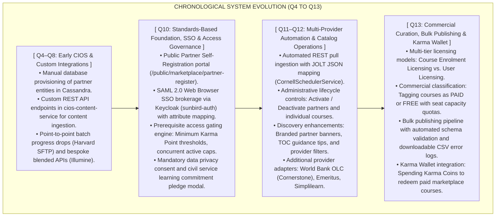
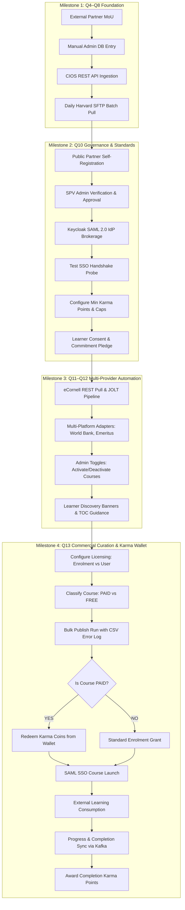
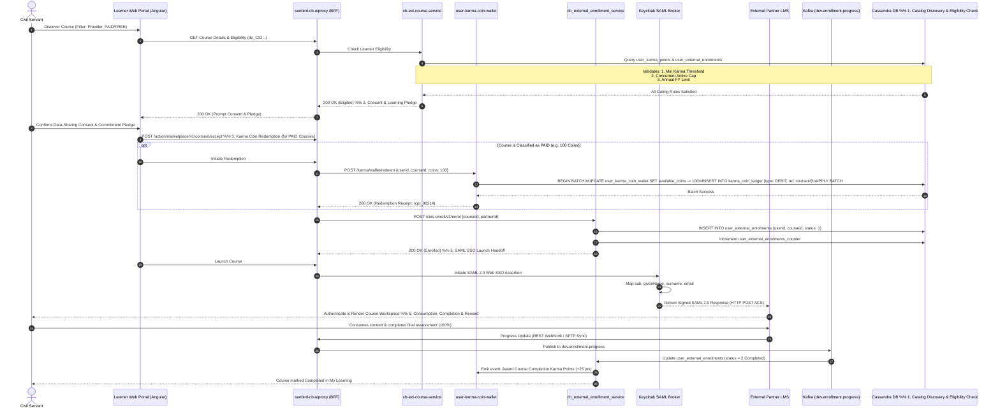

# Marketplace — Software Requirements Specification (SRS)

## 1. Introduction & Executive Baseline

### 1.1 Purpose

This Software Requirements Specification (SRS) defines the end-to-end, testable functional and non-functional requirements for the **iGOT Karmayogi Marketplace** subsystem, tracing its architectural and business evolution in strict chronological order from its inception in **Quarter 4 (Q4)** through the delivery of commercial curation and Karma Coin Wallet redemption in **Quarter 13 (Q13)**.

### 1.2 System Scope & Problem Statement

The iGOT Karmayogi platform (under Mission Karmayogi — National Programme for Civil Services Capacity Building) established Marketplace to solve a core business bottleneck: civil servants required specialized technical, managerial, and domain-specific courses from premier external institutions (e.g., Harvard, eCornell, World Bank OLC, Indian institutes) without forcing external providers to relinquish intellectual property or host native SCORM packages inside iGOT.

The system's scope evolved forward across four distinct architectural milestones:

1. **Milestone 1 (Q4–Q8):** Point-to-point Content Ingestion and Operations System (CIOS) API and manual partner integration scripts.
2. **Milestone 2 (Q10):** Institutionalized public partner self-registration, Keycloak SAML 2.0 Identity Provider (IdP) federation, data-sharing consent/pledges, and fair-use access gating (Minimum Karma Points, concurrent caps, and annual consumption limits).
3. **Milestone 3 (Q11–Q12):** Multi-provider automated REST pull schedulers (JOLT transforms), SFTP batch pipelines, provider-level operational status toggles, and learner discovery guidance.
4. **Milestone 4 (Q13):** Contractual licensing models (Course Enrolment vs. User Licensing), commercial classification (`PAID` vs. `FREE`), seat-capped bulk catalog publishing, and gamified virtual currency redemption via the learner **Karma Wallet** (`user-karma-coin-wallet`).

### 1.3 Definitions, Acronyms and Conventions

- **CIOS:** Content Ingestion & Operations System (legacy custom REST bridge).
- **IdP / SP:** Identity Provider (Keycloak / `sunbird-auth`) and Service Provider (External LMS).
- **Karma Point:** Non-spendable civil service merit score used as an eligibility gating threshold.
- **Karma Coin:** Spendable virtual token stored in the learner Karma Wallet, converted from Karma Points within monthly caps, and redeemed for paid external courses.
- **Normative Standards:** Requirements tagged with `[FR-...]` enforce mandatory system behaviors (`SHALL`), recommended behaviors (`SHOULD`), or optional configurations (`MAY`) in compliance with RFC 2119.

## 2. Overall System Description & Progressive Architecture

The system architecture expanded forward as new capabilities were layered on top of the core platform:



### 2.1 User Classes and Roles Across Phases

- **Prospective Content Partner (Q10+):** Submits legal, academic, and administrative details through public self-registration.
- **SPV Marketplace Administrator** (`SPV_ADMIN`):
  - *Q10:* Approves partners, configures SAML IdP metadata, defines minimum Karma Point thresholds, and sets concurrent/annual caps.
  - *Q11–Q12:* Toggles provider and course availability states.
  - *Q13:* Configures partner contractual licensing models (`ENROLMENT` vs. `USER`).

- **SPV Content Publisher** (`SPV_PUBLISHER`):
  - *Q4–Q10:* Reviews and publishes individual external courses.
  - *Q13:* Classifies courses as `PAID` or `FREE`, sets paid seat capacities, and runs bulk publishing jobs.

- **Civil Service Learner:**
  - *Q4–Q8:* Consumes redirected course content.
  - *Q10:* Evaluated against Karma thresholds, accepts privacy consent, and signs commitment pledges.
  - *Q13:* Filters courses by commercial status, tracks provider-specific progress, and redeems Karma Coins from their personal wallet.

## 3. Detailed Functional Requirements (Chronological Progression: Q4 to Q13)

### 3.1 Milestone 1 (Q4–Q8): CIOS Foundation & Point-to-Point Integrations

- **[FR-M1-001] CIOS Non-LTI Content Ingestion API**
  - **Milestone:** Q4 | **Traceability:** [KB-3192: Q4 | Marketplace | CIOS | non-LTI API Integration for Content sharing](https://karmayogibharat.atlassian.net/browse/KB-3192) (KB Review), [KB-5382: Q4 | CIOS | API Integration and Learner consumption](https://karmayogibharat.atlassian.net/browse/KB-5382) (In Progress)
  - **Description:** The system SHALL provide REST ingestion endpoints within `cios-content-service` allowing approved external content providers to push course metadata structures into iGOT.
  - **Inputs:** Course Title, Provider Unique ID, Description, Resource URL / Deep Link, Duration, and Content MIME-type.
  - **Processing:** The system SHALL parse the payload, generate a unique Sunbird content identifier (`do_CID...`), and persist the metadata in Cassandra (`sunbird.content_store`).
  - **Status:** Deprecated (Superseded by Q10 self-registration and Q11 automated pull pipelines).

- **[FR-M1-002] Partner Content Publishing & Blended Course Aggregation**
  - **Milestone:** Q6–Q8 | **Traceability:** [KB-6649: Q6 l CIOS l Onboarding and Management of Marketplace Content Partners & Course Publishing](https://karmayogibharat.atlassian.net/browse/KB-6649) (KB Approved), [KB-7121: Q6 l CIOS l Onboarding of Marketplace Content Partners](https://karmayogibharat.atlassian.net/browse/KB-7121) (Prod Deployed), [KB-8531: Q7 | Ad-Hoc | Marketplace Integrations | Content Partner Integrations | illumine-iGOT Blended Program Integration](https://karmayogibharat.atlassian.net/browse/KB-8531) (Prod Deployed)
  - **Description:** The Content Portal SHALL allow publishers to aggregate external partner courses into blended training programs.
  - **Processing:** The system SHALL verify partner association in `cb-pores-service` and bind external URL launch targets to composite curriculum trees.
  - **Status:** Implemented.

- **[FR-M1-003] Harvard Daily SFTP Progress Synchronization**
  - **Milestone:** Q8 | **Traceability:** [KB-8526: Q7 | Ad-Hoc | Marketplace Integrations | Content Partner Integrations](https://karmayogibharat.atlassian.net/browse/KB-8526) (KB Review), [KB-8529: Q7 | Ad-Hoc | Marketplace Integrations | Content Partner Integrations | Harvard-iGOT Marketplace Courses Integration](https://karmayogibharat.atlassian.net/browse/KB-8529) (Open)
  - **Description:** The system SHALL maintain a scheduled SFTP batch ingestion client that connects daily to a secure drop server hosted by Harvard.
  - **Processing:** Ingest CSV export files, validate record checksums, match external student IDs against iGOT user UUIDs, extract completion status, and write completion records to `user_external_enrolments`.
  - **Status:** Implemented.

### 3.2 Milestone 2 (Q10): Standards-Based Onboarding, SAML SSO & Access Gating

#### 3.2.1 Institutional Self-Registration & Verification

- **[FR-M2-001] Public Partner Self-Registration Workflow**
  - **Milestone:** Q10 | **Traceability:** [KB-11937: Q10 | Marketplace | Marketplace Partner Onboarding on iGOT via Self-Registration](https://karmayogibharat.atlassian.net/browse/KB-11937) (KB Review), [KB-11986: Q10 | Marketplace | Marketplace Partner Self registration and Track application status](https://karmayogibharat.atlassian.net/browse/KB-11986) (Prod Deployed), Confluence Page 688193565
  - **Description:** The system SHALL provide an unauthenticated public interface (`/public/marketplace/partner-register`) for prospective educational entities to submit institutional credentials.
  - **Inputs:** Organization Name, Legal Entity Type, Official Website, Nodal Officer (Name, Designation, Official Email, Phone), Capabilities Narrative, and Supporting Verification Attachments (PDF format, ).
  - **Processing:** Enforce field validations, restrict attachments to valid PDF signatures, persist the submission in `cb-pores-service` with status `PENDING_APPROVAL`, and emit an administrative notification.
  - **Outputs:** Application Tracking Number (`APP-YYYYMMDD-XXXX`) displayed to applicant and sent via email.
  - **Status:** Implemented.

- **[FR-M2-002] SPV Administrative Partner Verification & Tenancy Provisioning**
  - **Milestone:** Q10 | **Traceability:** [KB-10528: Q10 | Marketplace | SPV iGOT External Partner Onboarding](https://karmayogibharat.atlassian.net/browse/KB-10528) (KB Review), [KB-10599: Q10 | Marketplace | SPV onboarding of External Content Providers](https://karmayogibharat.atlassian.net/browse/KB-10599) (Prod Deployed)
  - **Description:** The SPV Portal SHALL provide an administrative review interface for partner applications.
  - **Processing:**
    - If `Approved`, the system transitions status to `ACTIVE`, provisions a persistent `partnerId` in `sunbird.content_provider`, and sets up organizational tenancy.
    - If `Rejected`, mandatory reviewer comments SHALL be captured, status set to `REJECTED`, and rejection feedback emailed to the applicant.

  - **Status:** Implemented.

#### 3.2.2 Keycloak SAML 2.0 Federation & Attribute Mapping

- **[FR-M2-003] SAML 2.0 Identity Provider (IdP) Configuration**
  - **Milestone:** Q10 | **Traceability:** [KB-11931: Q10 | Marketplace | Marketplace Providers SSO Integration](https://karmayogibharat.atlassian.net/browse/KB-11931) (KB Review), [KB-11984: Q10 | Marketplace | External/Internal Content Providers SSO Integration | SSO Configuration by SPV Admin](https://karmayogibharat.atlassian.net/browse/KB-11984) (Prod Deployed), Sprint 32 Sign-Off
  - **Description:** The system SHALL permit the `SPV_ADMIN` to register partner SAML 2.0 federation metadata in Keycloak (`sunbird-auth`).
  - **Inputs:** `partnerId`, `idpEntityId`, `ssoTargetUrl`, `publicCertificatePem`, `signAssertion` (boolean), `nameIdFormat`.
  - **Processing:** Validate X.509 certificate expiry, register the client within the Keycloak realm, and bind assertion parameters.
  - **Status:** Implemented.

- **[FR-M2-004] User Attribute Mapping Engine**
  - **Milestone:** Q10 | **Traceability:** [KB-12438: Q10 | Marketplace | Configure SSO User Attribute Mapping and Provisioning](https://karmayogibharat.atlassian.net/browse/KB-12438) (Prod Deployed)
  - **Description:** The system SHALL map internal iGOT user profile attributes to outbound SAML assertion elements:
    - `sub` (iGOT User UUID) External SAML NameID
    - `firstName` `givenName`
    - `lastName` `surname`
    - `primaryEmail` `email` (only when `email_required == true`)
    - `rootOrgId` `organization`

  - **Data Privacy Rule:** No sensitive personal identifiers (Aadhaar, mobile, salary grade) SHALL ever be mapped or transmitted.
  - **Status:** Implemented.

- **[FR-M2-005] SSO Handshake Connection Testing Probe**
  - **Milestone:** Q10 | **Traceability:** [KB-12436: Q10 | Marketplace | Enable, Disable, and Test SSO Integration](https://karmayogibharat.atlassian.net/browse/KB-12436) (Prod Deployed)
  - **Description:** The SPV Portal SHALL provide a "Test SSO Connection" action allowing administrators to validate the SAML handshake against the partner's staging Assertion Consumer Service (ACS) endpoint before activating the partner for learners.
  - **Status:** Implemented.

#### 3.2.3 Fair-Use Access Gating & Learner Consent

- **[FR-M2-006] Minimum Karma Points Prerequisite Gating**
  - **Milestone:** Q10 | **Traceability:** [KB-11938: Q10 | Marketplace | SPV Marketplace Partner Settings](https://karmayogibharat.atlassian.net/browse/KB-11938) (KB Review), [KB-12140: Q10 | Marketplace | SPV Marketplace Partner Settings | Enrolment Limit and Minimum Karma Point](https://karmayogibharat.atlassian.net/browse/KB-12140) (Prod Deployed), Confluence Page 647790612
  - **Description:** The system SHALL evaluate a learner's current Karma Points balance prior to permitting enrollment in external marketplace courses.
  - **Processing:** Upon learner enrollment initiation, `cb-ext-course-service` queries `sunbird.user_karma_points`.
  - **Enforcement:** If denied, the UI SHALL display a locked dialog indicating the point shortfall. Karma Points SHALL NOT be debited or altered; this check is strictly read-only.
  - **Status:** Implemented.

- **[FR-M2-007] Concurrent Active Enrolment Capping**
  - **Milestone:** Q10 | **Traceability:** [KB-12140: Q10 | Marketplace | SPV Marketplace Partner Settings | Enrolment Limit and Minimum Karma Point](https://karmayogibharat.atlassian.net/browse/KB-12140) (Prod Deployed)
  - **Description:** The system SHALL block enrollment if the learner has active concurrent courses with that specific partner (default: ).
  - **Processing:** Query `user_external_enrolments` where `partnerid = :partnerId AND userid = :userId AND status IN (0, 1)`. If active count reaches , enrollment is rejected with error code `ERR_CONCURRENT_LIMIT_REACHED`.
  - **Status:** Implemented.

- **[FR-M2-008] Annual Consumption Limit**
  - **Milestone:** Q10 | **Traceability:** [KB-12140: Q10 | Marketplace | SPV Marketplace Partner Settings | Enrolment Limit and Minimum Karma Point](https://karmayogibharat.atlassian.net/browse/KB-12140) (Prod Deployed)
  - **Description:** The system SHALL track total external course enrollments within a Financial Year cycle (April 1 to March 31). If the learner reaches the configured annual limit for that provider, subsequent enrollments are blocked until April 1.
  - **Status:** Implemented.

- **[FR-M2-009] Data-Sharing Consent & Learning Commitment Pledge**
  - **Milestone:** Q10 | **Traceability:** [KB-12333: Q10 | Marketplace | External Content Access Settings | Visibility](https://karmayogibharat.atlassian.net/browse/KB-12333) (Prod Deployed), [KB-12341: Q10 | Marketplace | Learner views list of marketplace partners and Courses](https://karmayogibharat.atlassian.net/browse/KB-12341) (Open), Confluence Page 570458133
  - **Description:** Prior to executing SSO redirection, the system SHALL require the learner to accept an un-bypassable modal dialog containing:
    - *Consent for Data Sharing:* Acknowledgment that name and official email will be shared with the provider for course workspace creation.
    - *Learning Commitment Pledge:* Formal undertaking to complete the subsidized course within the designated timeframe.

  - **Persistence:** The confirmation timestamp SHALL be stored in `user_external_enrolments.consent_timestamp`.
  - **Status:** Implemented.

### 3.3 Milestone 3 (Q11–Q12): Multi-Provider Ingestion, Automation & Admin Operations

- **[FR-M3-001] eCornell Automated REST Ingestion & JOLT Pipeline**
  - **Milestone:** Q11 | **Traceability:** [KB-12784: Older Ticket | Q11 | Marketplace | Marketplace Integrations | E-Cornell 207 Courses Integration](https://karmayogibharat.atlassian.net/browse/KB-12784) (In-Progress), [KB-13863: Q12 | Marketplace Integrations | eCornell](https://karmayogibharat.atlassian.net/browse/KB-13863) (Prod Deployed), Confluence Page 776699905
  - **Description:** The system SHALL execute a background ingestion scheduler (`CornellSchedulerService` in `cios-content-service`) polling the eCornell REST APIs.
  - **Processing:** Ingest course catalogs, apply JOLT JSON mapping transformations to conform to Sunbird course hierarchy models, and update Cassandra and Elasticsearch catalog indices.
  - **Status:** Implemented.

- **[FR-M3-002] Multi-Platform Partner Adapters**
  - **Milestone:** Q12 | **Traceability:** [KB-14073: Q12 | Marketplace Integrations | iGOT-Emeritus Integration](https://karmayogibharat.atlassian.net/browse/KB-14073) (In-Progress), [KB-14074: Q12 | Marketplace Integrations | iGOT-Simplilearn Integration](https://karmayogibharat.atlassian.net/browse/KB-14074) (Prod Deployed), [KB-14288: Q12 | Marketplace Integrations | iGOT-World Bank OLC (Cornerstone) Integration](https://karmayogibharat.atlassian.net/browse/KB-14288) (Open)
  - **Description:** The system SHALL maintain dedicated integration connectors for World Bank Open Learning Campus (Cornerstone LMS), Emeritus, and Simplilearn.
  - **Status:** Implemented.

- **[FR-M3-003] Administrative Partner & Course Availability Toggles**
  - **Milestone:** Q11 | **Traceability:** [KB-13054: Q11 | Marketplace | Marketplace Enhancements and New Integrations | Deactivate/Activate a Marketplace Provider, and SSO Integration](https://karmayogibharat.atlassian.net/browse/KB-13054) (Prod Deployed), [KB-13193: Q11 | Marketplace | Marketplace Enhancements and New Integrations | Deactivate/Activate a Marketplace Course](https://karmayogibharat.atlassian.net/browse/KB-13193) (Open)
  - **Description:** The SPV Portal SHALL provide administrative toggles to activate or deactivate entire content partners or specific courses. Deactivating a course SHALL suppress it from discovery without invalidating the access of currently enrolled learners.
  - **Status:** Implemented.

- **[FR-M3-004] Branded Discovery Banners & Table of Contents Guidance**
  - **Milestone:** Q11 | **Traceability:** [KB-12836: Q11 | Marketplace | Marketplace Enhancements and New Integrations | Adding a banner for the respective Provider on the Providers Course Listing Page](https://karmayogibharat.atlassian.net/browse/KB-12836) (Prod Deployed), [KB-13231: Q11 | Marketplace | Marketplace Integrations | Provider Tips in Marketplace Providers Specific Courses TOC](https://karmayogibharat.atlassian.net/browse/KB-13231) (In-Progress)
  - **Description:** The Learner Portal SHALL dynamically render branded partner banners on catalog views and display "Provider Tips" on course Table of Contents (TOC) pages to inform learners about external platform navigation and requirements.
  - **Status:** Implemented.

### 3.4 Milestone 4 (Q13): Commercial Licensing, Bulk Publishing & Karma Wallet Redemption

#### 3.4.1 Commercial Curation & Licensing Models

- **[FR-M4-001] Partner Licensing Model Configuration**
  - **Milestone:** Q13 | **Traceability:** [KB-14749: Q13 | iGOT Marketplace Enhancements](https://karmayogibharat.atlassian.net/browse/KB-14749) (QA In Progress), [KB-14750: Q13 | Marketplace Enhancements | Partner Licensing Administration](https://karmayogibharat.atlassian.net/browse/KB-14750) (Prod Deployed), Confluence Page 1095630850
  - **Description:** The SPV Portal SHALL permit administrators to set the commercial licensing model governing a content partner:
    - `Course Enrolment Licensing`: Every external course enrollment debits one license seat from the contractual pool.
    - `User Licensing`: A learner's initial enrollment reserves a user license; subsequent enrollments by that same learner under that partner consume zero additional license units.

  - **Status:** Implemented.

- **[FR-M4-002] Paid/Free Course Classification & Seat Capacities**
  - **Milestone:** Q13 | **Traceability:** [KB-14751: Q13 | Marketplace Enhancements | Marketplace Publishing Controls](https://karmayogibharat.atlassian.net/browse/KB-14751) (Prod Deployed), Confluence Page 1095630850
  - **Description:** The Content Portal SHALL provide SPV Publishers with a commercial classification dropdown (`PAID` or `FREE`) for every marketplace course.
  - **Processing:** If tagged as `PAID`, a mandatory `Paid Seat Capacity` quota SHALL be defined. The system SHALL decrement available seats upon enrollment and lock the course when seats reach zero.
  - **Status:** Implemented.

- **[FR-M4-003] Bulk Publishing Pipeline with CSV Error Reporting**
  - **Milestone:** Q13 | **Traceability:** [KB-14751: Q13 | Marketplace Enhancements | Marketplace Publishing Controls](https://karmayogibharat.atlassian.net/browse/KB-14751) (Prod Deployed), Sprint 40 Sign-Off
  - **Description:** The Content Portal SHALL provide a bulk course publishing pipeline that validates batches of marketplace courses against schema checklists (Title, External URL, Partner ID, Pricing Type, Seat Cap).
  - **Outputs:** Successful records are published to `Live`; failed records generate a downloadable CSV log with row-level validation error reasons.
  - **Status:** Implemented.

- **[FR-M4-004] Commercial Badging & Provider Progress Facets**
  - **Milestone:** Q13 | **Traceability:** [KB-14752: Q13 | Marketplace Enhancements | Learner Discovery and Behaviour](https://karmayogibharat.atlassian.net/browse/KB-14752) (Prod Deployed)
  - **Description:** The Learner Portal SHALL display visible `PAID` or `FREE` badges on course cards and provide filters allowing learners to filter by `Partner`, `Pricing`, and progress state (`Completed`, `In-Progress`, `Not Enrolled`).
  - **Status:** Implemented.

#### 3.4.2 Karma Wallet Integration & Virtual Coin Redemption

- **[FR-M4-005] Karma Coin Redemption on Paid Marketplace Courses**
  - **Milestone:** Q13 | **Traceability:** [KB-15297: Q13 | Karma Wallet | Redeem Karma Coins on Marketplace Courses](https://karmayogibharat.atlassian.net/browse/KB-15297) (Prod Deployed), [KB-15347: Q13 | Marketplace Enhancements | Karma Coin Configuration on SPV, CBP and Learner](https://karmayogibharat.atlassian.net/browse/KB-15347) (Prod Deployed), Confluence Page 1095630850
  - **Description:** The system SHALL permit learners to redeem **Karma Coins** accumulated in their personal Karma Wallet (`user-karma-coin-wallet`) to unlock marketplace courses marked as `PAID`.
  - **Redemption Sequence:**
    - Learner clicks "Redeem Course" on a paid course requiring Karma Coins.
    - BFF invokes `POST /karma/wallet/redeem`.
    - The wallet service checks `available_coins >= C`.
    - Upon validation, the service executes an atomic database transaction debiting coins from `user_karma_coin_wallet`, records an immutable transaction in `karma_coin_ledger` (`type: "DEBIT"`, `ref: courseId`), and grants the enrollment entitlement.

  - **Error Handling:** If available coins are insufficient, enrollment is blocked (`HTTP 400 Bad Request`), and the user is prompted to convert earned Karma Points into Coins within their monthly quota.
  - **Status:** Implemented.

- **[FR-M4-006] Completion-Driven Karma Points Accrual**
  - **Milestone:** Q13 | **Traceability:** Confluence Page 1361903617
  - **Description:** When a verified 100% completion event for a marketplace course is processed from Kafka, the system SHALL emit an asynchronous event awarding configured **Karma Points** to the learner's merit profile.
  - **Status:** Implemented.

## 4. End-to-End Behavioral Workflows (Forward Evolution: Q4 to Q13)

### 4.1 Chronological Lifecycle Evolution Flowchart



### 4.2 End-to-End Q13 Consumption & Wallet Redemption Sequence



## 5. Interface & Data Specifications (Q4–Q13 Baseline)

### 5.1 Core API Contracts

#### 5.1.1 Minimum Karma & Enrolment Cap Validation (`cb-ext-course-service`)

- **Endpoint:** `GET /accessSettings/v1/verify/{partnerId}/{userId}`
- **Method:** `GET` | **Auth:** Bearer JWT
- **Success Response** (`HTTP 200 OK` — Permitted):

```json
{
  "id": "api.accessSettings.verify",
  "ver": "1.0",
  "ts": "2026-10-29T18:00:00.000Z",
  "responseCode": "OK",
  "result": {
    "eligible": true,
    "userKarmaPoints": 120,
    "minKarmaPointsRequired": 50,
    "activeConcurrentCourses": 1,
    "maxConcurrentAllowed": 2,
    "annualEnrolmentsConsumed": 2,
    "annualEnrolmentCap": 5
  }
}
```

- **Failure Response** (`HTTP 403 Forbidden` — Gating Shortfall):

```json
{
  "id": "api.accessSettings.verify",
  "ver": "1.0",
  "params": {
    "status": "FAILED",
    "err": "ERR_KARMA_POINTS_SHORTFALL",
    "errmsg": "Learner Karma Points balance (35) is below the required partner threshold (50)."
  },
  "responseCode": "FORBIDDEN",
  "result": {
    "eligible": false
  }
}
```

#### 5.1.2 Karma Coin Redemption Endpoint (`user-karma-coin-wallet`)

- **Endpoint:** `POST /karma/wallet/redeem`
- **Method:** `POST` | **Auth:** Bearer JWT (`Learner`)
- **Inbound Request Payload:**

```json
{
  "userId": "usr_91824719284712",
  "courseId": "do_CID1130982348712",
  "partnerId": "eCornell_001",
  "coinsRequired": 100
}
```

- **Success Response** (`HTTP 200 OK`):

```json
{
  "id": "api.karma.wallet.redeem",
  "ver": "1.0",
  "ts": "2026-10-29T18:02:00.000Z",
  "responseCode": "OK",
  "result": {
    "redemptionStatus": "SUCCESS",
    "receiptId": "rcpt_9821471928",
    "coinsDebited": 100,
    "remainingCoinBalance": 50,
    "entitlementToken": "ent_ecornell_do_CID1130982348712"
  }
}
```

### 5.2 Physical Database Schemas (Apache Cassandra DDL)

```sql
-- Keyspace Definition
CREATE KEYSPACE IF NOT EXISTS sunbird WITH replication = {'class': 'NetworkTopologyStrategy', 'datacenter1': 3};

-- 1. Partner Registry Store (Provisioned Q10 via Self-Reg)
CREATE TABLE IF NOT EXISTS sunbird.content_provider (
    partnerid text,
    orgname text,
    entitytype text,
    nodal_name text,
    nodal_email text,
    website text,
    status text,  -- "PENDING_APPROVAL", "ACTIVE", "REJECTED", "DEACTIVATED"
    sso_enabled boolean,
    licence_type text,  -- "ENROLMENT" or "USER" (Introduced Q13)
    createdon timestamp,
    updatedon timestamp,
    PRIMARY KEY (partnerid)
);

-- 2. Partner Access & Gating Policies Store (Q10)
CREATE TABLE IF NOT EXISTS sunbird.provider_access_settings (
    partnerid text,
    minkarmapoints int,  -- Read-only eligibility threshold
    concurrent_cap int,
    -- Max active concurrent courses per learner
    annual_cap int,
    -- Max courses per learner per Financial Year
    createdon timestamp,
    updatedon timestamp,
    PRIMARY KEY (partnerid)
);

-- 3. User External Enrolment Registry (Active & Historical Consumption)
CREATE TABLE IF NOT EXISTS sunbird.user_external_enrolments (
    userid text,
    courseid text,
    partnerid text,
    licencetype text,  -- "ENROLMENT" or "USER" (Q13)
    status int,  -- 0: Enrolled, 1: In-Progress, 2: Completed
    completionpercentage int,  -- 0 to 100%
    enrolleddate timestamp,
    completedon timestamp,
    consent_timestamp timestamp,
    -- Timestamp of data-sharing pledge confirmation (Q10)
    redemption_ref text,  -- Karma Coin redemption receipt ID (Q13)
    PRIMARY KEY ((userid), courseid, partnerid)
) WITH CLUSTERING ORDER BY (courseid ASC, partnerid ASC);
CREATE INDEX IF NOT EXISTS idx_ext_enrol_partner ON sunbird.user_external_enrolments (partnerid);
CREATE INDEX IF NOT EXISTS idx_ext_enrol_status ON sunbird.user_external_enrolments (status);

-- 4. User Karma Coin Wallet & Ledger Store (Introduced Q13)
CREATE TABLE IF NOT EXISTS sunbird.user_karma_coin_wallet (
    userid text,
    available_coins int,
    total_converted_coins int,
    last_updated timestamp,
    PRIMARY KEY (userid)
);
CREATE TABLE IF NOT EXISTS sunbird.karma_coin_ledger (
    userid text,
    transaction_id text,
    transaction_type text,  -- "CONVERT_CREDIT", "REDEEM_DEBIT", "CREDIT_REFUND"
    amount int,
    reference_id text,  -- Course ID or Redemption Receipt ID
    createdon timestamp,
    PRIMARY KEY ((userid), transaction_id)
) WITH CLUSTERING ORDER BY (transaction_id DESC);
```

## 6. Non-Functional Requirements (Q4–Q13 Scope)

- **[NFR-PERF-001] Redirection & Launch Latency:** The system SHALL complete prerequisite gating validation, consent verification, and SAML assertion delivery within at the 95th percentile under a concurrent load of 3,000 active launches.
- **[NFR-SEC-001] SAML Assertion Security:** Outbound SAML assertions SHALL be cryptographically signed using SHA-256 with XML DSig. Private keys SHALL be managed inside Keycloak keystores and rotated annually.
- **[NFR-SEC-002] Data Minimization Compliance:** The system SHALL NOT transmit any government learner credentials, passwords, national identifiers (Aadhaar, PAN), or salary information across the SAML bridge to external providers.
- **[NFR-REL-001] Fail-Safe Deny Default:** If `cb-ext-course-service` or Cassandra experiences connectivity failure during eligibility evaluation, the system SHALL default to **access denial**, preventing unauthorized external seat consumption.
- **[NFR-REL-002] Atomic Coin Redemption:** Redemption operations on `user_karma_coin_wallet` and `karma_coin_ledger` SHALL execute within atomic database transactions to eliminate race conditions and double-spending vulnerabilities.

## 7. Requirements Traceability Matrix (RTM: Q4 to Q13)

| Requirement ID | Capability Description | Phase / Milestone | Primary Jira Key | Confluence Authority Reference | Verification Method | Status |
|---|---|---|---|---|---|---|
| **FR-M1-001** | CIOS Content Ingestion API | Q4 | [KB-3192: Q4 \| Marketplace \| CIOS \| non-LTI API Integration for Content sharing](https://karmayogibharat.atlassian.net/browse/KB-3192) (KB Review) | Historical Baseline | Automated API Test | Deprecated |
| **FR-M1-002** | Partner Course Publishing | Q6–Q8 | [KB-6649: Q6 l CIOS l Onboarding and Management of Marketplace Content Partners & Course Publishing](https://karmayogibharat.atlassian.net/browse/KB-6649) (KB Approved) | Page 21266503 | Inspection | Implemented |
| **FR-M1-003** | Harvard Daily SFTP Progress Sync | Q8 | [KB-8529: Q7 \| Ad-Hoc \| Marketplace Integrations \| Content Partner Integrations \| Harvard-iGOT Marketplace Courses Integration](https://karmayogibharat.atlassian.net/browse/KB-8529) (Open) | Page 776699905 | SFTP Ingestion Test | Implemented |
| **FR-M2-001** | Public Partner Self-Registration | Q10 | [KB-11986: Q10 \| Marketplace \| Marketplace Partner Self registration and Track application status](https://karmayogibharat.atlassian.net/browse/KB-11986) (Prod Deployed) | Page 688193565 | System Test | Implemented |
| **FR-M2-002** | SPV Partner Approval Workflow | Q10 | [KB-10599: Q10 \| Marketplace \| SPV onboarding of External Content Providers](https://karmayogibharat.atlassian.net/browse/KB-10599) (Prod Deployed) | Page 688193565 | Demonstration | Implemented |
| **FR-M2-003** | SAML 2.0 IdP Configuration | Q10 | [KB-11984: Q10 \| Marketplace \| External/Internal Content Providers SSO Integration \| SSO Configuration by SPV Admin](https://karmayogibharat.atlassian.net/browse/KB-11984) (Prod Deployed) | Page 683573249 | Security Audit / Test | Implemented |
| **FR-M2-004** | User Attribute Mapping Engine | Q10 | [KB-12438: Q10 \| Marketplace \| Configure SSO User Attribute Mapping and Provisioning](https://karmayogibharat.atlassian.net/browse/KB-12438) (Prod Deployed) | Page 683573249 | Inspection | Implemented |
| **FR-M2-005** | SSO Handshake Connection Probe | Q10 | [KB-12436: Q10 \| Marketplace \| Enable, Disable, and Test SSO Integration](https://karmayogibharat.atlassian.net/browse/KB-12436) (Prod Deployed) | Page 683573249 | Test | Implemented |
| **FR-M2-006** | Minimum Karma Points Threshold | Q10 | [KB-12140: Q10 \| Marketplace \| SPV Marketplace Partner Settings \| Enrolment Limit and Minimum Karma Point](https://karmayogibharat.atlassian.net/browse/KB-12140) (Prod Deployed) | Page 647790612 | Automated API Test | Implemented |
| **FR-M2-007** | Concurrent Enrolment Cap | Q10 | [KB-12140: Q10 \| Marketplace \| SPV Marketplace Partner Settings \| Enrolment Limit and Minimum Karma Point](https://karmayogibharat.atlassian.net/browse/KB-12140) (Prod Deployed) | Page 647790612 | Automated API Test | Implemented |
| **FR-M2-008** | Annual Consumption Quotas | Q10 | [KB-12140: Q10 \| Marketplace \| SPV Marketplace Partner Settings \| Enrolment Limit and Minimum Karma Point](https://karmayogibharat.atlassian.net/browse/KB-12140) (Prod Deployed) | Page 647790612 | System Test | Implemented |
| **FR-M2-009** | Data Consent & Commitment Pledge | Q10 | [KB-12333: Q10 \| Marketplace \| External Content Access Settings \| Visibility](https://karmayogibharat.atlassian.net/browse/KB-12333) (Prod Deployed) | Page 570458133 | UI Automation Test | Implemented |
| **FR-M3-001** | eCornell Ingestion & JOLT Pipeline | Q11 | [KB-12784: Older Ticket \| Q11 \| Marketplace \| Marketplace Integrations \| E-Cornell 207 Courses Integration](https://karmayogibharat.atlassian.net/browse/KB-12784) (In-Progress) | Page 776699905 | Background Worker Log | Implemented |
| **FR-M3-002** | Multi-Platform Adapters (World Bank) | Q12 | [KB-14288: Q12 \| Marketplace Integrations \| iGOT-World Bank OLC (Cornerstone) Integration](https://karmayogibharat.atlassian.net/browse/KB-14288) (Open) | Page 776699905 | Integration Test | Implemented |
| **FR-M3-003** | Partner & Course Availability Toggle | Q11 | [KB-13054: Q11 \| Marketplace \| Marketplace Enhancements and New Integrations \| Deactivate/Activate a Marketplace Provider, and SSO Integration](https://karmayogibharat.atlassian.net/browse/KB-13054) (Prod Deployed) | Page 776699905 | Test | Implemented |
| **FR-M3-004** | Branded Banners & TOC Guidance | Q11 | [KB-12836: Q11 \| Marketplace \| Marketplace Enhancements and New Integrations \| Adding a banner for the respective Provider on the Providers Course Listing Page](https://karmayogibharat.atlassian.net/browse/KB-12836) (Prod Deployed) | UI Specification | UI Test | Implemented |
| **FR-M4-001** | Enrolment vs User Licensing | Q13 | [KB-14750: Q13 \| Marketplace Enhancements \| Partner Licensing Administration](https://karmayogibharat.atlassian.net/browse/KB-14750) (Prod Deployed) | Page 1095630850 | Demonstration | Implemented |
| **FR-M4-002** | Paid/Free Classify & Seat Caps | Q13 | [KB-14751: Q13 \| Marketplace Enhancements \| Marketplace Publishing Controls](https://karmayogibharat.atlassian.net/browse/KB-14751) (Prod Deployed) | Page 1095630850 | Demonstration | Implemented |
| **FR-M4-003** | Bulk Publishing with Error CSV | Q13 | [KB-14751: Q13 \| Marketplace Enhancements \| Marketplace Publishing Controls](https://karmayogibharat.atlassian.net/browse/KB-14751) (Prod Deployed) | Page 1275527178 | Performance / Stress | Implemented |
| **FR-M4-004** | Paid/Free Badging & Status Filters | Q13 | [KB-14752: Q13 \| Marketplace Enhancements \| Learner Discovery and Behaviour](https://karmayogibharat.atlassian.net/browse/KB-14752) (Prod Deployed) | Page 1095630850 | UI Test | Implemented |
| **FR-M4-005** | Karma Coin Course Redemption | Q13 | [KB-15297: Q13 \| Karma Wallet \| Redeem Karma Coins on Marketplace Courses](https://karmayogibharat.atlassian.net/browse/KB-15297) (Prod Deployed) | Page 1349255170 | End-to-End Test | Implemented |
| **FR-M4-006** | Completion Karma Points Accrual | Q13 | [KB-15698: Update Karma Points Logic](https://karmayogibharat.atlassian.net/browse/KB-15698) (Prod Deployed) | Page 1253441539 | Kafka Pipeline Test | Implemented |
