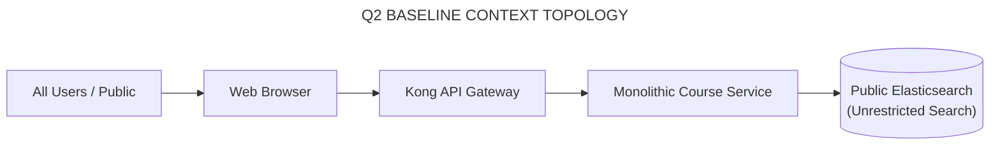
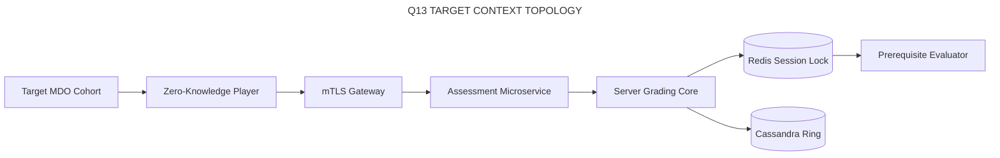
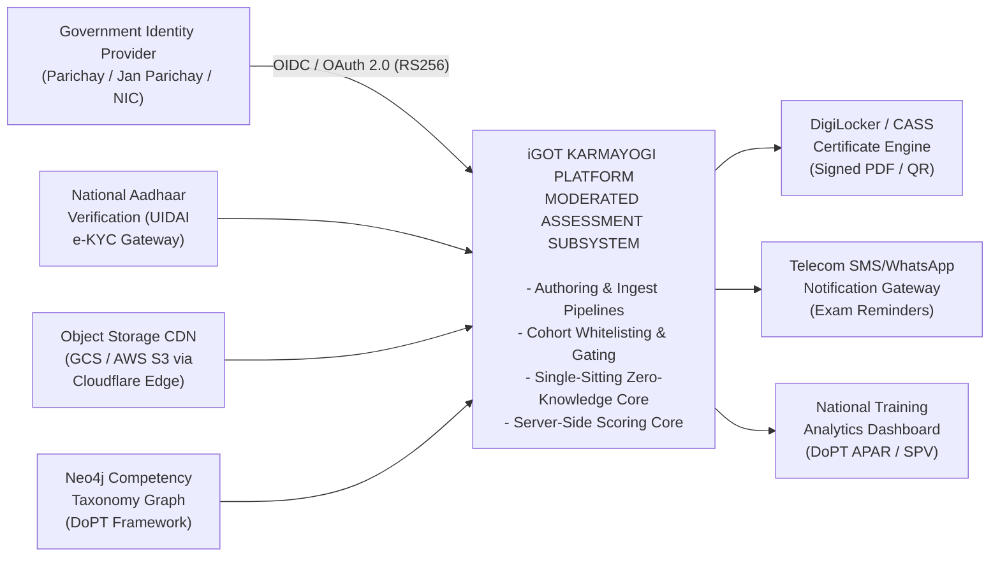
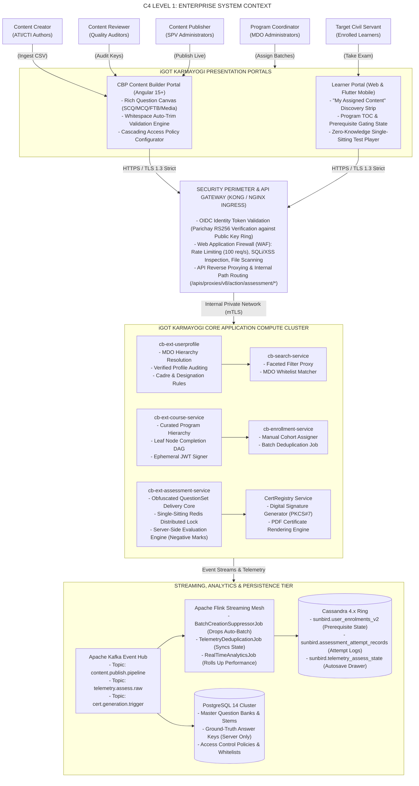
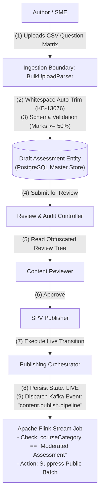
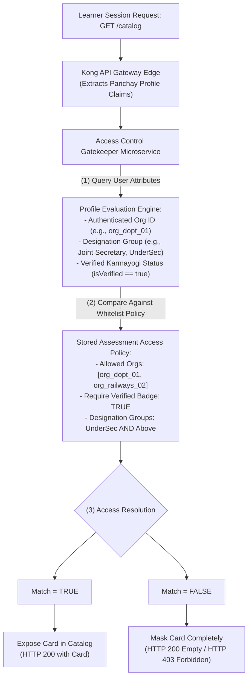
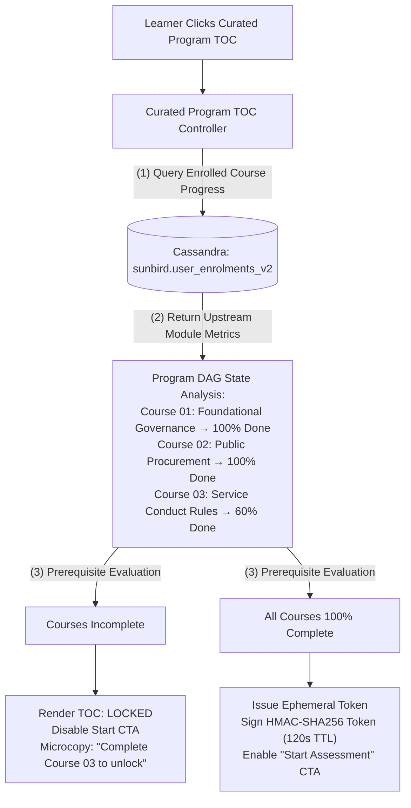
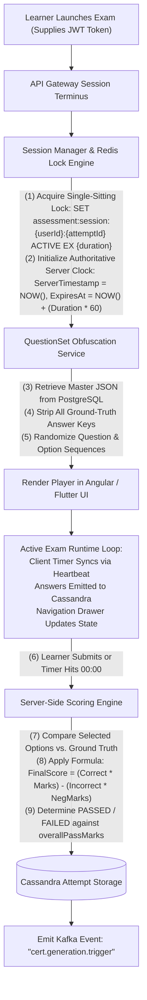
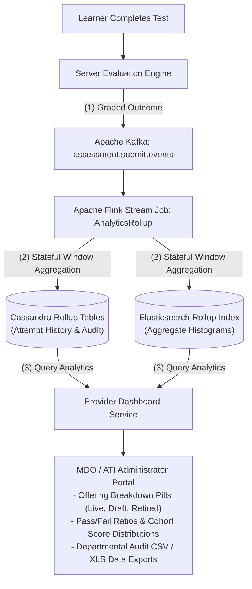
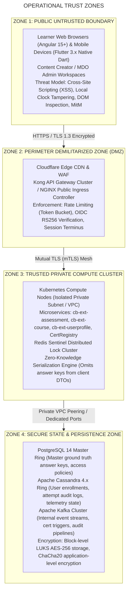

# Moderated Assessment — System Context Diagram & Boundary Architecture Specification

## 2. Purpose, Scope & System Boundary Definition

### 2.1 Purpose

This document defines the **System Context Architecture** for the **Moderated Assessment Subsystem** within the iGOT Karmayogi digital learning and competency-building platform. It delineates external user personas, third-party enterprise integrations, peripheral platform subsystems, operational trust boundaries, and network data flows governing the entire lifecycle from assessment authoring to proctored learner consumption and certified competency reporting.

### 2.2 System Boundary & Scope

The **Moderated Assessment Subsystem Boundary** encompasses:

- **Authoring & Ingestion Perimeter:** Tools for creating rich question banks (SCQ, MCQ, FTB inline dropdowns, and media up to 400 MB), schema sanitization, and workflow moderation.
- **Access Control & Gating Engine:** Whitelisting algorithms verifying Ministry, Department, and Organization (MDO) hierarchies, cadre, designation groups, and Verified Karmayogi claims.
- **Prerequisite Assessment Locking:** Dependency validation engines that enforce 100% completion of foundational learning modules in Curated Programs before unlocking L2 evaluations.
- **Zero-Knowledge Player Runtime:** Single-sitting execution, server-side timer synchronization, autosave telemetry, and answer obfuscation.
- **Server-Side Grading & Credentialing:** Server-side negative marking algorithms, Cassandra persistence, and event-driven certificate triggers.

## 3. Architectural Context Evolution (Q2 Baseline vs. Q13 Modern Architecture)

### 3.1 Q2 Baseline Context: Shared LMS Monolith & Open Proxy

In Quarter 2 (Q2), assessment execution operated without dedicated moderation or cohort-isolation boundaries:

- Assessments were authored as generic quizzes or open standalone tests.
- The platform automatically triggered public, self-enrollment batch generation via Flink streaming jobs.
- Catalog visibility was open; assessments appeared across platform-wide search results regardless of learner department or competency path.
- Grading was partially delegated to client runtimes, risking key exposure and local clock tampering.

### 3.2 Q13 Target Architecture: Decoupled, Proctored & Cohort-Gated Ecosystem

By Quarter 13 (Q13), the platform completed a micro-architectural transformation driven by targeted Epics ([KB-1936: Q3 | Content Portal Redesign | Content access settings, batch management and user consumption](https://karmayogibharat.atlassian.net/browse/KB-1936) (Prod Deployed), [KB-3958: Q4 | Assessments Creation and Consumption](https://karmayogibharat.atlassian.net/browse/KB-3958) (Prod Deployed), [KB-8065: Q8 | L2 Assessments/CAP | Creation of L2 Assessments/CAP](https://karmayogibharat.atlassian.net/browse/KB-8065) (KB Approved), [KB-9603: Q8 | Access Control | User Group based Access Control](https://karmayogibharat.atlassian.net/browse/KB-9603) (Prod Deployed), [KB-13097: Q11 |Tech Debt | Frontend and Backend Service enhancement](https://karmayogibharat.atlassian.net/browse/KB-13097) (Open)):

- **Decoupled Assessment Microservice:** Dedicated `cb-ext-assessment-service` enforcing zero-knowledge payload delivery.
- **Suppressed Auto-Batching:** Stream-level interception in Apache Flink blocks automatic open batch creation for `courseCategory = "Moderated Assessment"`.
- **Prerequisite Assessment Locking:** L2 assessments inside Curated Programs remain locked until upstream module completion is verified.
- **Strict Cohort Whitelisting:** Multi-attribute access matching MDO IDs, designation groups, and verified credentials.

## 4. Primary System Actors & External Stakeholders

**ACTOR ROLE & INTERACTION MODEL**

| Actor / Persona | Operational Responsibility | Target Surface / Interface |
|---|---|---|
| **Content Creator** (ATIs, CTIs, MDO SMEs) | Ingests CSVs, drafts questions, configures pass mark (>=50%), defines negative marking. | CBP Content Builder Portal (Angular 15+ Web) |
| **Content Reviewer** (Quality Auditors) | Audits question difficulty, verifies answer keys, approves or rejects with remarks. | CBP Review & Moderation Canvas (Angular 15+ Web) |
| **Content Publisher** (SPV Administrator) | Issues final publishing token, transitions state to Live, confirms access policies. | CBP Publishing Workspace (Angular 15+ Web) |
| **Program Coordinator** (MDO Admin) | Creates manual batches, maps whitelisted cohorts, uploads participant lists. | MDO Administration Portal (Angular 15+ Web) |
| **Target Civil Servant** (Learner) | Discovers eligible tests, signs honor code, completes single-sitting exams, views scores. | Learner Portal & Mobile App (Angular 15+ Web / Flutter 3.x Mobile) |
| **Department Auditor** (DoPT / SPV Leadership) | Monitors completion rates, reviews score distributions, exports audit CSVs. | National Training Dashboard (Metabase / Custom Angular Views) |

## 5. Connected External Systems & Enterprise Integrations

1. **Government Identity Provider (Parichay / NIC SSO):** Authenticates civil servants via OpenID Connect (OIDC), providing signed JWT assertions with user ID, department code, and designation.
2. **Aadhaar e-KYC Verification Gateway:** Validates government profile authenticity, populating the `isVerified: true` claim required for Verified Karmayogi gating ([KB-9603: Q8 | Access Control | User Group based Access Control](https://karmayogibharat.atlassian.net/browse/KB-9603) (Prod Deployed)).
3. **DigiLocker National Credential Registry:** Ingests digitally signed XML/PDF certificates emitted upon successful evaluation.
4. **Cloud CDN & Object Storage (GCS / S3):** Distributes static media question prompts (MP4 videos up to 400 MB, audio clips, and reference PDFs) via signed time-limited URLs ([KB-3971: Q4 | Assessments | Adding Questions | Fill in the blanks](https://karmayogibharat.atlassian.net/browse/KB-3971) (Prod Deployed)).
5. **Neo4j Competency Taxonomy Service:** Maps assessment questions to national civil service behavioral, domain, and functional competencies.
6. **National Training Analytics & DoPT Dashboard:** Consumes assessment completion records for annual performance appraisals (APAR) and cross-ministry training metrics ([KB-15322: Q13 | MDO Portal | APAR Creation Enhancements - Phase 2](https://karmayogibharat.atlassian.net/browse/KB-15322) (Prod Deployed)).

## 6. Level 1: Enterprise System Context Diagram

This C4 Level 1 diagram illustrates the boundary between primary human actors, external enterprise systems, and the iGOT Karmayogi Moderated Assessment Subsystem.

## 7. Level 2: Subsystem Interaction & Boundary Context Diagrams

### 7.1 Authoring, Bulk Ingestion & Moderation Lifecycle Context

This context boundary diagram illustrates how question banks are authored, validated, sanitized, reviewed, and published without triggering public batching.

### 7.2 Access Control, Whitelisting & User Segmentation Context

This context boundary defines how learner discovery requests are evaluated against multi-tiered organizational attributes.

### 7.3 Curated Program Gating & Prerequisite Locking Context (L2 Assessments)

This context boundary illustrates the dependency validation engine gating final assessments within Curated Programs.

### 7.4 High-Integrity Single-Sitting Runtime & Telemetry Context

This context boundary details runtime test delivery: single-sitting enforcement, countdown synchronization, and continuous autosave state logging.

### 7.5 Server-Side Evaluation, Certification & Analytics Context

This context boundary defines the automated grading, certification dispatch, and dashboard rollup data pipelines.

## 8. Data Flow Context Matrix (Inbound vs. Outbound Boundary Interactions)

**DATA FLOW & BOUNDARY PROTOCOL MATRIX**

| Flow ID | Source System | Destination System | Protocol / Wire | Payload & Data Elements | Security & Encryption |
|---|---|---|---|---|---|
| **F-01** | Content Creator (CBP) | Kong API Gateway | HTTPS / REST | Multi-part CSV / JSON Question stems, options | TLS 1.3, Bearer JWT |
| **F-02** | Kong API Gateway | cb-ext-assessment | mTLS / REST | Sanitized QuestionSet with ground-truth keys | Internal Mesh mTLS |
| **F-03** | cb-ext-assessment | PostgreSQL Master | JDBC / HikariCP | Ingested nodes, sections, ground truth, access rules | Encrypted EBS / LUKS |
| **F-04** | cb-ext-assessment | Apache Kafka Cluster | Kafka TCP | "content.publish.pipeline" Event with category meta | TLS Auth, SASL/SCRAM |
| **F-05** | Learner Portal / App | Kong API Gateway | HTTPS / REST | OIDC auth token, profile lookup, catalog request | TLS 1.3, RS256 Tokens |
| **F-06** | cb-ext-course | Cassandra Ring | CQL (Binary) | Query module progress in user_enrolments_v2 | Encrypted at rest, Private VPC subnets |
| **F-07** | cb-ext-course | Learner Player Client | HTTPS / REST | Ephemeral launch token with 120-second TTL | Signed HMAC-SHA256, Short-lived TTL |
| **F-08** | cb-ext-assessment | Redis Sentinel Ring | Redis Binary | Distributed session lock with examination duration | In-memory AUTH, Isolated Redis subnet |
| **F-09** | cb-ext-assessment | Learner Player Client | HTTPS / REST | Obfuscated question array, server timestamps (no keys | Zero-knowledge, No keys in payload |
| **F-10** | Learner Player Client | cb-ext-assessment | HTTPS / REST | Selected option IDs, time spent, answer submission | TLS 1.3, Nonce validation |
| **F-11** | cb-ext-assessment | Cassandra Ring | CQL (Binary) | Writes attempt record and final evaluation status | ChaCha20 encrypted JSON string blob |
| **F-12** | cb-ext-assessment | Apache Kafka Cluster | Kafka TCP | "cert.generation.trigger" with score and status | TLS Auth, SASL/SCRAM |
| **F-13** | CertRegistry Worker | DigiLocker Connector | HTTPS / REST | Signed PDF certificate, candidate Aadhaar ref | PKCS#7 Digital Sign, Government e-Sign API |

## 9. Security, Perimeter & Trust Boundary Architecture

### 9.1 Zero-Knowledge Data Boundary Design

- Ground truth answer keys (`answer_key` JSONB in PostgreSQL) never cross the boundary from Zone 3 to Zone 1.
- During learner assessment initialization, Jackson serialization filters dynamically strip all validation properties, sending only randomized option IDs, obfuscated stems, and difficulty metadata to the client.

### 9.2 Anti-Tampering & Clock Boundary Enforcement

- Examination countdown limits are governed entirely within Zone 3. The client receives an authoritative `expiresAt` epoch timestamp.
- Client heartbeat requests emit every 60 seconds. If the delta between client device time and the server timestamp exceeds seconds, the server forces a clock resynchronization.

## 10. Traceability Matrix: Requirements, Evolution to Context Boundaries

| Requirement & Evolution Epic | Jira Reference | Context Architecture Boundary / Entity | Target Subsystem / Integration | Verification Method |
|---|---|---|---|---|
| **Moderated Assessment Category Isolation** | [KB-1936: Q3 \| Content Portal Redesign \| Content access settings, batch management and user consumption](https://karmayogibharat.atlassian.net/browse/KB-1936) (Prod Deployed), [KB-2044: Q3 \| Content Portal Redesign \| Create assessment](https://karmayogibharat.atlassian.net/browse/KB-2044) (Prod Deployed) | Ingestion & Publishing Boundary | `cb-ext-assessment` / PostgreSQL Master | Metadata Assertion Test |
| **Auto-Batch Suppression Pipeline** | [KB-3958: Q4 \| Assessments Creation and Consumption](https://karmayogibharat.atlassian.net/browse/KB-3958) (Prod Deployed), [KB-3959: Q4 \| Assessments \| Assessment creation - for Invite only users](https://karmayogibharat.atlassian.net/browse/KB-3959) (Prod Deployed) | Streaming Event Boundary | Apache Flink `BatchCreationSuppressorJob` | Stream Processing Test |
| **Pass Mark Floor 50% Rule** | [KB-11683: Content Creator - Passing criteria for courses should not be below 50%](https://karmayogibharat.atlassian.net/browse/KB-11683) (Prod Deployed) | Ingestion Pre-Flight Boundary | CBP Form Validation / Ingestion Gateway | Unit Validation Suite |
| **Bulk CSV Auto-Trim Sanitization** | [KB-13076: Q11 \| Ad-Hoc \| Comprehensive Assessments and APAR Enhancements](https://karmayogibharat.atlassian.net/browse/KB-13076) (Open) | Ingestion Boundary | `BulkUploadParser` Subsystem | Malformed CSV Ingest Test |
| **MDO Cohort Whitelisting** | [KB-1950: Q3 \| Content Portal Redesign \| Learner consumption for all types of content](https://karmayogibharat.atlassian.net/browse/KB-1950) (Prod Deployed), [KB-9603: Q8 \| Access Control \| User Group based Access Control](https://karmayogibharat.atlassian.net/browse/KB-9603) (Prod Deployed) | Security Perimeter / Gateway | `AccessControlGatekeeper` / Redis | Mock HTTP 403 Audit |
| **Faceted Elasticsearch Cataloging** | [KB-7869: Q7 \| Search & listing \| NLP & Elastic search \| Learner Portal](https://karmayogibharat.atlassian.net/browse/KB-7869) (Prod Deployed), [KB-7871: Q7 \| Search & listing \| Filters \| Learner Portal](https://karmayogibharat.atlassian.net/browse/KB-7871) (Prod Deployed) | Discovery Boundary | `cb-search-service` / Elasticsearch | Query Benchmark Suite |
| **Curated Program L2 Gating / Locking** | [KB-8065: Q8 \| L2 Assessments/CAP \| Creation of L2 Assessments/CAP](https://karmayogibharat.atlassian.net/browse/KB-8065) (KB Approved), [KB-8841: Q8 \| Learning Path \| Curated Program \| Add Final Assessment](https://karmayogibharat.atlassian.net/browse/KB-8841) (Prod Deployed) | Program Dependency Boundary | `cb-ext-course` / Cassandra `user_enrolments` | Incomplete DAG Test |
| **Single-Sitting Session Lock (No Pause)** | [SRS - Assessments](https://karmayogibharat.atlassian.net/wiki/spaces/TES/pages/87392295) | Runtime Player Boundary | Redis Sentinel (`SET session:* ACTIVE EX`) | Concurrency Test (JMeter) |
| **Server-Side Scoring & Negative Marks** | [KB-3958: Q4 \| Assessments Creation and Consumption](https://karmayogibharat.atlassian.net/browse/KB-3958) (Prod Deployed) | Evaluation Compute Boundary | Server Evaluation Core / PostgreSQL | Scoring Logic Check |
| **Gated Certificate Issuance Trigger** | [KB-8841: Q8 \| Learning Path \| Curated Program \| Add Final Assessment](https://karmayogibharat.atlassian.net/browse/KB-8841) (Prod Deployed), [KBN-8807: GCPQA \| Deployment /config changes of cb-ext-assessment service Closed](https://karmayogibharat.atlassian.net/browse/KBN-8807) | Credentialing Boundary | `CertRegistry` / DigiLocker Connector | End-to-End Pipeline Test |
| **Provider Dashboard Rollup Metrics** | [KB-5761: Q5 \| Enhancement \| ATIs, CTIs and Content Provider Digitization](https://karmayogibharat.atlassian.net/browse/KB-5761) (KB Approved), [KB-6378: Q5 \| Content Portal \| Dashboard for content provider Need Information](https://karmayogibharat.atlassian.net/browse/KB-6378) | Reporting & Analytics Boundary | Flink Analytics Job / Elasticsearch | Metabase Dashboard Test |
| **Kubernetes Actuator Autoscaling (HPA)** | [KB-13097: Q11 \|Tech Debt \| Frontend and Backend Service enhancement](https://karmayogibharat.atlassian.net/browse/KB-13097) (Open) | Cloud Infrastructure Boundary | Kubernetes HPA Controller / Spring Actuator | Load Test () |
