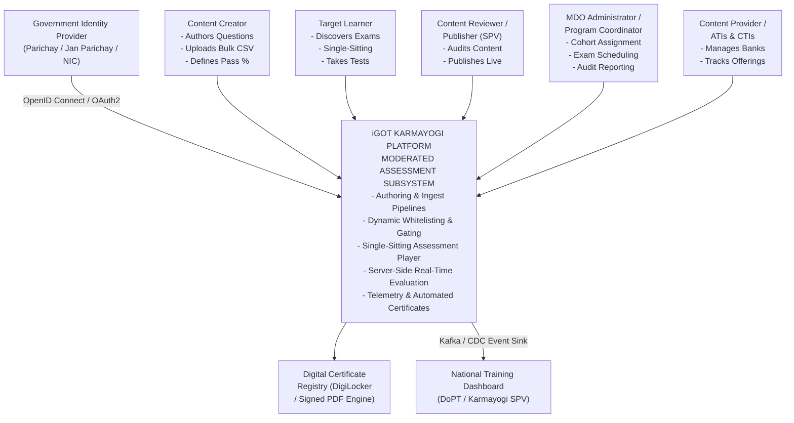
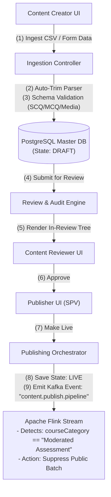
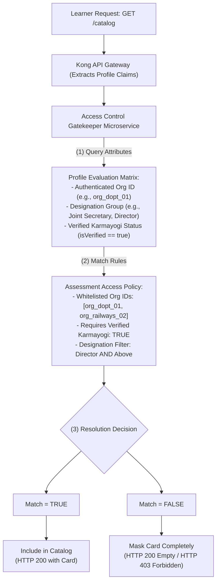
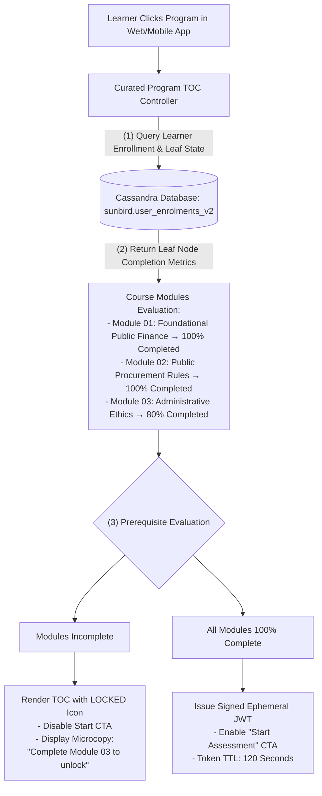
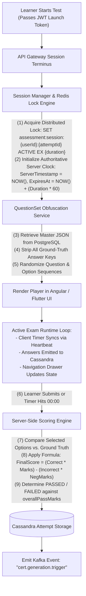
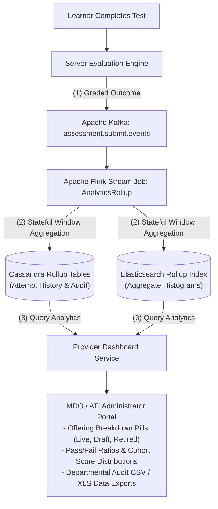
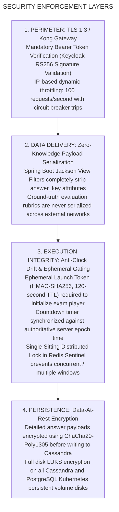
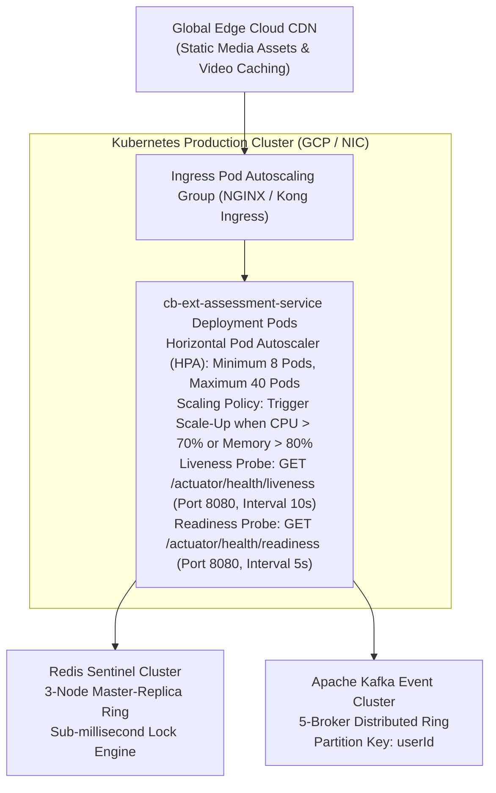

# Moderated Assessment — High-Level Design (HLD) & Architectural Blueprint

## 2. Executive Architectural Vision & Evolution

### 2.1 The Architectural Transition

The **Moderated Assessment Subsystem** delivers high-stakes, cohort-restricted, and competency-aligned civil service evaluations across Indian Ministries, Departments, and Organizations (MDOs). Its architectural evolution addressed four fundamental distributed systems challenges:

**EVOLUTIONARY ARCHITECTURE TRANSFORMATION**

| | |
|---|---|
| Q2 (Monolithic / Open Proxy) | • Direct LMS proxy pass-through to legacy OpenSunbird engines.<br>• Universal public visibility; automated open batch generation. |
| Q3 (Domain Decomposition) | • Independent microservice domain: cb-ext-assessment-service.<br>• CourseCategory = "Moderated Assessment" with Flink batch suppression. |
| Q4 (Schema & Player Maturity) | • QuestionSet v3: Rich media, HOTS, and inline dropdown FTB pools.<br>• Full feature parity between Angular Web and Flutter Mobile engines. |
| Q5 (Provider Analytics) | • Administrative Training Institute (ATI) onboarding & Offerings pills.<br>• Real-time Cassandra rollups for participation and score analytics. |
| Q7 (Faceted Discovery Engine) | • Elasticsearch faceted query proxying matching secureSettings.org.<br>• Multi-attribute query filtering with NLP term tokenization. |
| Q8 (Gated Execution & Locking) | • Curated Program L2 Assessment Prerequisite Locking Engine.<br>• Dynamic User Group policy enforcement with cascading condition resets. |
| Q11 - Q13 (Resilience & Scale) | • Kubernetes HPA pod autoscaling driven by Spring Boot Actuator probes.<br>• Ingestion schema sanitization (CSV auto-trim) & duplicate batch dedup. |

## 3. System Context Diagram (C4 Context Tier)

The system context diagram illustrates the interaction boundaries between external enterprise actors, peripheral administrative portals, external identity providers, and the central iGOT Karmayogi Moderated Assessment Engine.



## 4. Multi-Tier High-Level Design (HLD) Architecture Diagram

This end-to-end multi-tier architecture illustrates the complete platform stack: presentation components, security perimeters, microservice applications, message queues, stateful stream processors, and polyglot persistence engines.

```mermaid
flowchart TD
    subgraph L1["1. PRESENTATION LAYER (CLIENT APPLICATIONS)"]
        CBP["CBP Content Portal (Angular 15+)<br/>- Sectional Question Authoring Canvas<br/>- Bulk CSV Ingest & Auto-Trim Validation<br/>- Access Control Rule Matrix (MDO/Cadre)<br/>- Moderation & Review Lifecycle Management"]
        LP["Learner Portal (Web & Flutter Mobile)<br/>- #quot;My Assigned Content#quot; Cohort Discovery<br/>- Curated Program TOC & Prerequisite Gating<br/>- Zero-Knowledge Single-Sitting Test Player<br/>- Real-Time Navigation Drawer & Autosave Pings"]
    end
    subgraph L2["2. EDGE & SECURITY PERIMETER LAYER"]
        KONG["Kong API Gateway / Ingress Controller Cluster<br/>- JWT Authentication Verification (Keycloak / Parichay RS256 Validation)<br/>- WAF Threat Inspection (SQLi, XSS Sanitization, File Ingest Scanning)<br/>- Token Bucket Rate Limiting (100 req/s baseline, 150 req/s burst per User Node)<br/>- Path-Based Routing & Session Encryption Terminus (/apis/proxies/v8/action/assessment/*)"]
    end
    subgraph L3["3. CORE APPLICATION MICROSERVICES LAYER (KUBERNETES COMPUTE CLUSTER)"]
        UPS["cb-ext-userprofile<br/>- MDO Hierarchy Mapper<br/>- Verified Profile Checker<br/>- Cadre/Designation Rules"]
        CRS["cb-ext-course-service<br/>- Program TOC Builder<br/>- Prerequisite Evaluator<br/>- Ephemeral JWT Issuer"]
        ASS["cb-ext-assessment-service<br/>- QuestionSet Delivery (Obfuscated JSON)<br/>- Single-Sitting Session Engine (Redis Lock)<br/>- Server-Side Grading Core (Negative Marks)"]
        SRCH["cb-search-service<br/>- Elasticsearch Proxy<br/>- secureSettings Filter<br/>- Faceted Search Aggregator"]
        ENR["cb-enrollment-service<br/>- Manual Batch Assigner<br/>- Cohort Whitelisting<br/>- Duplicate Batch Dedup"]
        CERT["CertRegistry Service<br/>- Digital Signature Rendering (QR Engine)<br/>- PDF Generation on Kafka Evaluation Event<br/>- DigiLocker Push Connector"]
        UPS --> SRCH
        CRS --> ENR
        ASS --> CERT
    end
    subgraph L4["4. ASYNCHRONOUS EVENT STREAMING & PIPELINE LAYER"]
        KAFKA["Apache Kafka Cluster<br/>Topics:<br/>- content.publish.pipeline (Publishes Live metadata)<br/>- telemetry.assess.raw (Player interactions, answer ticks, question durations)<br/>- assessment.submit.events (Graded submission results, final score percentages)<br/>- cert.generation.trigger (Passed candidate records dispatched to certificate workers)"]
        FLINK["Apache Flink Stream Cluster<br/>- BatchCreationSuppressorJob (Suppresses auto-batch creation for courseCategory = #quot;Moderated Assessment#quot;)<br/>- TelemetryValidationJob (De-duplicates telemetry ticks and writes state to Cassandra)<br/>- RealTimeAnalyticsJob (Pushes aggregate scores to Elasticsearch for Provider Dashboards)"]
        KAFKA --> FLINK
    end
    subgraph L5["5. POLYGLOT PERSISTENCE & DATA STORAGE TIER"]
        PG[("PostgreSQL 14 Cluster<br/>- Master Question Banks<br/>- Answer Keys & Ground Truth<br/>- Access Whitelist Policies")]
        CAS[("Cassandra 4.x Ring<br/>- sunbird.user_enrolments_v2<br/>- assessment_attempt_records<br/>- telemetry_assess_state")]
        ES[("Elasticsearch 7.x Cluster<br/>- igot_content_index<br/>- secureSettings Facet Indices<br/>- Provider Analytics Rollup Documents")]
    end
    CBP -->|"HTTPS (TLS 1.3 Strict) / JSON-REST"| KONG
    LP -->|"HTTPS (TLS 1.3 Strict) / JSON-REST"| KONG
    KONG -->|"Mutual TLS (mTLS) Internal Routing"| L3
    L3 --> KAFKA
    FLINK --> L5
```



## 5. End-to-End Functional Architecture

### 5.1 Subsystem 1: Authoring, Ingestion & Moderation Lifecycle (Frontend to Backend)



- **Bulk Question Ingest & Whitespace Normalization** ([KB-13076: Q11 | Ad-Hoc | Comprehensive Assessments and APAR Enhancements](https://karmayogibharat.atlassian.net/browse/KB-13076) (Open)): The ingestion controller executes an automated regex trimming routine (`string.trim().replaceAll("\\s+", " ")`) across option matrices, stems, and boolean indicators.
- **Three-Stage Lifecycle Governance** ([KB-2044: Q3 | Content Portal Redesign | Create assessment](https://karmayogibharat.atlassian.net/browse/KB-2044) (Prod Deployed)): Assets transition across strict role gates:
- **Auto-Batch Suppression Engine** ([KB-3958: Q4 | Assessments Creation and Consumption](https://karmayogibharat.atlassian.net/browse/KB-3958) (Prod Deployed)): Upon reaching `Live`, the Flink streaming pipeline drops automatic batch generation, keeping the assessment hidden until a Program Coordinator creates dedicated MDO batches.

### 5.2 Subsystem 2: Access Control, Whitelisting & User Segmentation Architecture



- **Dynamic User Group Evaluation** ([KB-9603: Q8 | Access Control | User Group based Access Control](https://karmayogibharat.atlassian.net/browse/KB-9603) (Prod Deployed)): Access decisions combine organization membership, designation hierarchy, and profile verification status:
- **Cascading Reset Subsystem** ([KB-9603: Q8 | Access Control | User Group based Access Control](https://karmayogibharat.atlassian.net/browse/KB-9603) (Prod Deployed)): Modifying higher-tier organizational boundaries within the admin UI triggers an automatic cascade that invalidates and resets dependent child rules (Cadre, Service, Designation), preventing policy discrepancies.

### 5.3 Subsystem 3: Prerequisite Locking & Curated Program Gating (L2 Architecture)



- **Hierarchical State Traversal (**[KB-8065: Q8 | L2 Assessments/CAP | Creation of L2 Assessments/CAP](https://karmayogibharat.atlassian.net/browse/KB-8065) (KB Approved)**,** [KB-8841: Q8 | Learning Path | Curated Program | Add Final Assessment](https://karmayogibharat.atlassian.net/browse/KB-8841) (Prod Deployed)**):** The prerequisite evaluator traverses the program's directed acyclic graph (DAG) in Neo4j and validates leaf progress in Cassandra.
- **Ephemeral Launch Token:** Upon verifying 100% completion across all upstream courses, the service generates an HMAC-SHA256 signed JWT containing `userId`, `assessmentId`, and an expiration timestamp (120-second TTL), required by the player initialization API.

### 5.4 Subsystem 4: High-Integrity Single-Sitting Assessment Player Engine



- **Zero-Knowledge Data Delivery:** Correct answers and grading rubrics remain on the server; the client application only receives obfuscated stems, option IDs, and point weights.
- **Single-Sitting Session Constraint:** If a learner navigates away or closes their session, the Redis lock detects an interrupted connection and auto-submits the attempt.
- **Clock Drift Compensation:** The client timer synchronizes with server-side heartbeat timestamps, correcting for any local clock tampering.

### 5.5 Subsystem 5: Provider Digitization & Analytics Reporting Architecture



- **Near-Real-Time Rollup Pipelines (**[KB-5761: Q5 | Enhancement | ATIs, CTIs and Content Provider Digitization](https://karmayogibharat.atlassian.net/browse/KB-5761) (KB Approved)**,** [KB-6378: Q5 | Content Portal | Dashboard for content provider Need Information](https://karmayogibharat.atlassian.net/browse/KB-6378)**):** Evaluation events published to Kafka are aggregated by Apache Flink into five-minute sliding windows and committed directly to Elasticsearch and Cassandra.
- **Provider Offering Dashboards (**[KB-5762: Q5 | Enhancement | [Web] ATIs, CTIs and Content Provider Digitization](https://karmayogibharat.atlassian.net/browse/KB-5762) (Prod Deployed)**):** MDO administrators and training institutes track live participation rates, cohort score distributions, and accreditation metrics through centralized dashboard APIs.

## 6. Microservices Topology & Inter-Service Communications

**MICROSERVICE INTERACTION MATRIX**

| Source Service | Target Service | Transport / Protocol | Payload / Business Purpose |
|---|---|---|---|
| Learner Web / Mobile Client | Kong API Gateway | HTTPS / REST (TLS 1.3) | User actions, answers |
| Kong API Gateway | cb-ext-assessment-service | mTLS / HTTP REST | Proxy assessment traffic |
| cb-ext-course-service | Cassandra | CQL (Binary Protocol) | Read leaf node completion |
| cb-ext-course-service | cb-ext-assessment-service | Internal REST / JWT | Issue L2 launch token |
| cb-ext-assessment-service | Redis Sentinel | Redis Serialization | Attempt session locking |
| cb-ext-assessment-service | PostgreSQL Master | JDBC / HikariCP Pool | Master QuestionSet schema |
| cb-ext-assessment-service | Apache Kafka Cluster | Kafka Producer (TCP) | Telemetry, eval events |
| Apache Flink Stream Cluster | Cassandra Ring | Cassandra Sink (CQL) | Write attempt summaries |
| Apache Flink Stream Cluster | Elasticsearch Cluster | ES REST High-Level | Index facet metadata |
| CertRegistry Microservice | PostgreSQL / ObjectStore | Internal Worker / S3 | Render signed PDF certs |

## 7. Data Tier Architecture & Storage Schemas

### 7.1 Master Metadata Schema (PostgreSQL)

**POSTGRESQL RELATIONAL TOPOLOGY**

**cbp_assessment_nodes**

| | | | |
|---|---|---|---|
| PK | identifier | VARCHAR(64) | Unique assessment node identifier (do_xxxx) |
| | title | VARCHAR(255) | Assessment display title |
| | course_category | VARCHAR(64) | "Moderated Assessment" |
| | status | VARCHAR(32) | Draft, InReview, Live, Retired |
| | duration_minutes | INT | Total exam duration |
| | overall_pass_marks | INT | Minimum passing threshold (>= 50%) |
| | negative_marking_rate | NUMERIC(3,2) | Proportion deducted on incorrect options |
| | created_by | VARCHAR(64) | Author UUID |

cbp_assessment_nodes 1 : N cbp_assessment_questions

**cbp_assessment_questions**

| | | | |
|---|---|---|---|
| PK | question_id | VARCHAR(64) | Unique question UUID |
| FK | assessment_id | VARCHAR(64) | References cbp_assessment_nodes(identifier) |
| | q_type | VARCHAR(32) | SCQ, MCQ, FTB_DROPDOWN, MTF |
| | difficulty_level | VARCHAR(16) | easy, medium, difficult, hot |
| | question_payload | JSONB | Obfuscated question stem, media, option distractor |
| | answer_key | JSONB | Ground truth correct options (Server-Only) |
| | marks | NUMERIC(4,2) | Positive score weight |
| | negative_marks | NUMERIC(4,2) | Deduction score weight |

### 7.2 Distributed Telemetry & Attempt Model (Apache Cassandra)

```sql
-- Keyspace Definition
CREATE KEYSPACE IF NOT EXISTS sunbird WITH replication = {'class': 'NetworkTopologyStrategy', 'datacenter1': 3};

-- Primary User Enrollment & Batch Verification
CREATE TABLE sunbird.user_enrolments_v2 (
    userid text,
    courseid text,
    batchid text,
    active boolean,
    completionpercentage int,
    status int,  -- 0: Not Started, 1: In Progress, 2: Completed
    enrolled_date timestamp,
    completed_on timestamp,
    issued_certificates list<frozen<map<text, text>>>,
    PRIMARY KEY ((userid), courseid, batchid)
);

-- Master Assessment Attempt Records (Clustered by Attempt Timestamp)
CREATE TABLE sunbird.assessment_attempt_records (
    user_id text,
    assessment_id text,
    attempt_id uuid,
    batch_id text,
    start_time timestamp,
    submit_time timestamp,
    time_spent_seconds int,
    score_obtained double,
    max_score double,
    percentage double,
    result_status text,  -- 'PASSED' or 'FAILED'
    detailed_answers text,  -- Encrypted JSON string of learner responses
    PRIMARY KEY ((user_id, assessment_id), attempt_id)
) WITH CLUSTERING ORDER BY (attempt_id DESC);
```

## 8. Security Architecture, Zero-Trust Delivery & Anti-Tampering



## 9. Infrastructure, Deployment & Scalability Architecture



- **Kubernetes Elasticity** ([KB-13097: Q11 |Tech Debt | Frontend and Backend Service enhancement](https://karmayogibharat.atlassian.net/browse/KB-13097) (Open)): Assessment delivery microservices scale out from 8 to 40 pods within 45 seconds during morning exam peaks, maintaining latencies under 800 ms across 25,000 concurrent sessions.
- **Health Probes:** Spring Boot Actuator endpoints (`/actuator/health/liveness` and `/actuator/health/readiness`) report pod health, allowing the Kubernetes controller to cycle degraded pods.

## 10. Traceability Matrix (Requirements to HLD Architectural Modules)

| SRS / Evolution Requirement | Jira Reference | High-Level Design (HLD) Module | Target Component / Technology | Architectural Validation Method |
|---|---|---|---|---|
| **Moderated Assessment Category Definition** | [KB-1936: Q3 \| Content Portal Redesign \| Content access settings, batch management and user consumption](https://karmayogibharat.atlassian.net/browse/KB-1936) (Prod Deployed), [KB-2044: Q3 \| Content Portal Redesign \| Create assessment](https://karmayogibharat.atlassian.net/browse/KB-2044) (Prod Deployed) | Authoring & Lifecycle Subsystem | `cb-ext-assessment-service` / Postgres | Schema Assertion Test |
| **Pass Mark Floor 50% Constraint** | [KB-11683: Content Creator - Passing criteria for courses should not be below 50%](https://karmayogibharat.atlassian.net/browse/KB-11683) (Prod Deployed), [KB-3958: Q4 \| Assessments Creation and Consumption](https://karmayogibharat.atlassian.net/browse/KB-3958) (Prod Deployed) | Ingestion & Validation Gateway | Ingestion Validation Aspect / Spring | Unit Test Verification |
| **Auto-Batch Generation Suppression** | [KB-3958: Q4 \| Assessments Creation and Consumption](https://karmayogibharat.atlassian.net/browse/KB-3958) (Prod Deployed), [KB-3959: Q4 \| Assessments \| Assessment creation - for Invite only users](https://karmayogibharat.atlassian.net/browse/KB-3959) (Prod Deployed) | Streaming & Pipeline Layer | Apache Flink `BatchCreationSuppressor` | Stream Processing Simulation |
| **MDO Cohort Whitelisting** | [KB-1950: Q3 \| Content Portal Redesign \| Learner consumption for all types of content](https://karmayogibharat.atlassian.net/browse/KB-1950) (Prod Deployed), [KB-9603: Q8 \| Access Control \| User Group based Access Control](https://karmayogibharat.atlassian.net/browse/KB-9603) (Prod Deployed) | Access Control & Segmentation | `AccessGatekeeper` / Redis Sentinel | HTTP Mock 403 Audit |
| **Batch Duplicate Reconciliation** | [Data Reconciliation – Duplicate Batch Enrolment Cleanup](https://karmayogibharat.atlassian.net/wiki/spaces/TES/pages/1148747777) | Batch Management Engine | `cb-enrollment-service` / Cassandra | Deduplication Test Routine |
| **Faceted Elasticsearch Cataloging** | [KB-7869: Q7 \| Search & listing \| NLP & Elastic search \| Learner Portal](https://karmayogibharat.atlassian.net/browse/KB-7869) (Prod Deployed), [KB-7871: Q7 \| Search & listing \| Filters \| Learner Portal](https://karmayogibharat.atlassian.net/browse/KB-7871) (Prod Deployed) | Catalog & Discovery Subsystem | `cb-search-service` / Elasticsearch | Faceted Query Latency Test |
| **Curated Program L2 Gating / Locking** | [KB-8065: Q8 \| L2 Assessments/CAP \| Creation of L2 Assessments/CAP](https://karmayogibharat.atlassian.net/browse/KB-8065) (KB Approved), [KB-8841: Q8 \| Learning Path \| Curated Program \| Add Final Assessment](https://karmayogibharat.atlassian.net/browse/KB-8841) (Prod Deployed) | Prerequisite Locking Subsystem | `PrerequisiteEvaluator` / Neo4j / Cassandra | Mock DAG Completion Test |
| **Single-Sitting Session Lock (No Pause)** | [SRS - Assessments](https://karmayogibharat.atlassian.net/wiki/spaces/TES/pages/87392295) | Assessment Player Subsystem | `SessionManager` / Redis TTL Locks | Multi-Window Browser Test |
| **Authoritative Countdown Clock Sync** | [KB-2178: Q3 \| User Experience \| Viewer- Navigation, About, Content, Discussions [ Desktop]](https://karmayogibharat.atlassian.net/browse/KB-2178) (Prod Deployed), [KB-1582: Q3 \| User Experience \| Learner Journey \| ToC [Desktop ]](https://karmayogibharat.atlassian.net/browse/KB-1582) (Prod Deployed) | Assessment Player Subsystem | `TimerSyncService` / Player Client | Client Clock Drift Injection |
| **Negative Marking Server Scoring** | [KB-3958: Q4 \| Assessments Creation and Consumption](https://karmayogibharat.atlassian.net/browse/KB-3958) (Prod Deployed) | Server Evaluation Subsystem | `ScoringEngine` / `cb-ext-assessment` | Mathematical Precision Check |
| **Gated Certificate Issuance Trigger** | [KB-8841: Q8 \| Learning Path \| Curated Program \| Add Final Assessment](https://karmayogibharat.atlassian.net/browse/KB-8841) (Prod Deployed), [KBN-8807: GCPQA \| Deployment /config changes of cb-ext-assessment service Closed](https://karmayogibharat.atlassian.net/browse/KBN-8807) | Evaluation & Scoring Pipeline | `CertRegistry` / Kafka Worker | End-to-End Pipeline Test |
| **Provider Offerings Dashboard Metrics** | [KB-5761: Q5 \| Enhancement \| ATIs, CTIs and Content Provider Digitization](https://karmayogibharat.atlassian.net/browse/KB-5761) (KB Approved), [KB-6378: Q5 \| Content Portal \| Dashboard for content provider Need Information](https://karmayogibharat.atlassian.net/browse/KB-6378) | Provider Reporting Subsystem | Flink Analytics Job / Cassandra | Dashboard Aggregate Test |
| **Kubernetes Actuator Autoscaling (HPA)** | [KB-13097: Q11 \|Tech Debt \| Frontend and Backend Service enhancement](https://karmayogibharat.atlassian.net/browse/KB-13097) (Open) | Cloud Infrastructure Layer | Kubernetes HPA / Spring Boot Probes | Distributed Load Test (JMeter) |
