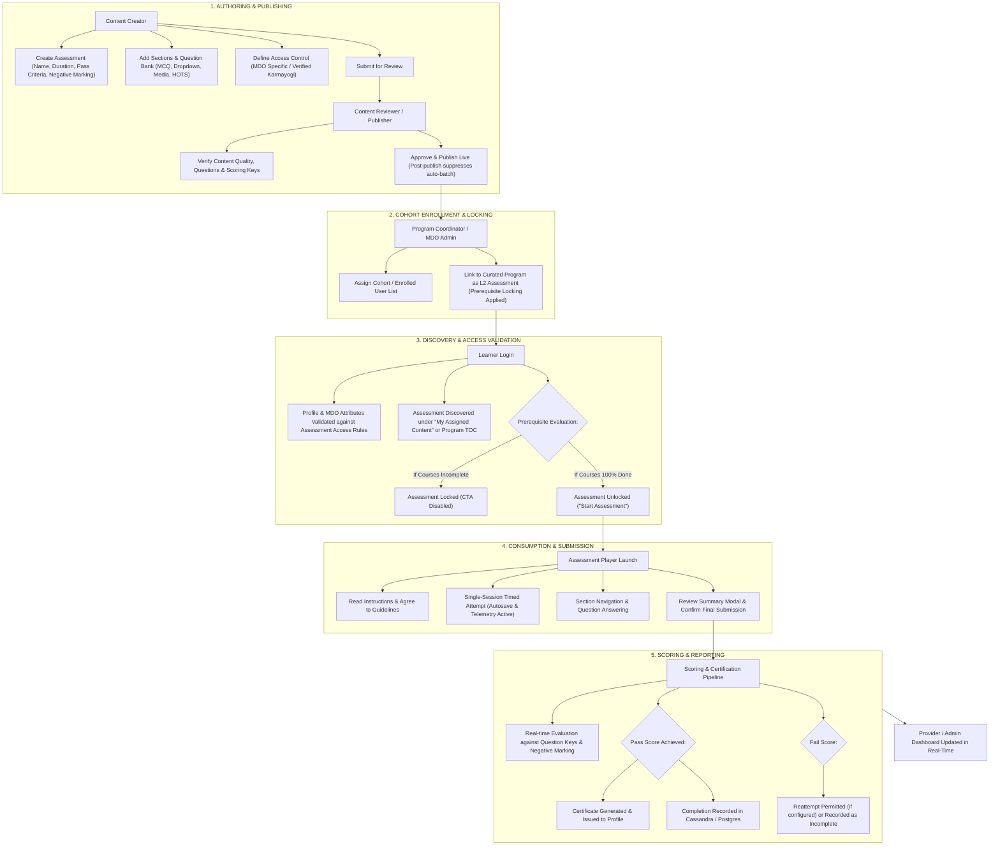
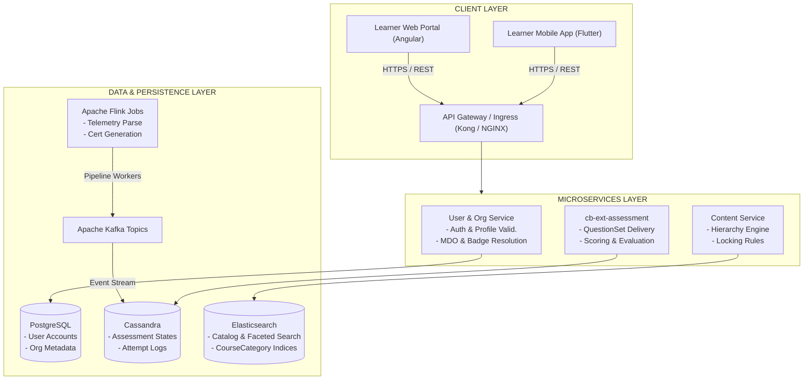

# Moderated Assessment – Evolution and Consumption Overview Summary

## 1. Executive Summary

The **Moderated Assessment** framework within the **iGOT Karmayogi** platform provides a controlled, competency-aligned, and secure evaluation mechanism for government officials across Ministries, Departments, and Organizations (MDOs). Developed and enhanced across successive product releases (spanning Q2 through Q14 and Sprints 19–41), Moderated Assessments expand upon traditional formative quizzes and open assessments by introducing:

- **Cohort-Restricted & Role-Based Access Control:** Target specific MDOs, user groups, or verified Karmayogi profiles.
- **Prerequisite Assessment Locking:** Enforcing complete modular consumption before unlocking final/L2 assessments.
- **Advanced Question Formats & Hierarchies:** Single-choice, multiple-choice, fill-in-the-blanks with randomized dropdowns, match-the-following, and rich multimedia (images, audio, video up to 400 MB, PDF).
- **High-Integrity Session Control:** Enforcing single-session sittings, strict countdown timers, and autosave state synchronization.
- **Gated Certification Pipelines:** Tying certificate generation strictly to passing grades in final evaluations.

## 2. Feature Background and Business Context

Civil service capacity-building requires rigorous evaluation models that validate measurable competency acquisition rather than passive learning hours. Early implementations of assessments on iGOT Karmayogi were predominantly self-paced, open to all registered learners, and lacked mechanisms to restrict tests to departmental cohorts or enforce sequential learning.

**Key Challenges Addressed:**

1. **Unrestricted Assessment Exposure:** Highly specialized, department-specific examinations were exposed to platform-wide search, diluting assessment integrity.
2. **Absence of Prerequisite Enforcement:** Learners could attempt final assessments without consuming foundational training modules.
3. **Limited Authoring & Question Types:** Earlier evaluation models supported only simple text-based multiple-choice formats without rich media or granular difficulty levels.
4. **Unregulated Certification:** Certificates were frequently issued based on modular completion percentages rather than verified competency mastery.

## 3. Business Objectives

- **Competency Validation:** Measure specific cognitive, domain, and behavioral competencies aligned with the Karmayogi National Competency Framework.
- **Controlled Access & Integrity:** Prevent unauthorized attempts and ensure only targeted MDO cohorts or verified Karmayogi profiles can access and consume assessments.
- **Enforced Learning Pathways:** Enforce assessment locking to mandate completion of prerequisite courses within Curated Programs prior to final evaluation attempts.
- **Multi-Tiered Scoring & Granularity:** Provide multi-level scoring, sectional cut-offs, negative marking, question randomization, and HOTS (Higher Order Thinking Skills) categorization.
- **Standardized Certification:** Bind certificate issuance strictly to passing final moderated evaluations.

## 4. Moderated Assessment – Feature Scope

- **Curated Program Gating (L2 Assessments):** Linking final assessments to curated programs with prerequisites.
- **Invite-Only / Cohort Moderation:** Custom cohort access restricted to designated participant batches.
- **Rich Question Formats:** Text, image, audio, video (up to 400 MB), PDF, fill-in-the-blanks (with dropdowns), single-choice, multiple-choice, match-the-following, and paragraph-based questions.
- **Session Integrity:** Single-sitting completion rules, prohibition of pause/resume during test consumption, and instruction acknowledgments.
- **Provider Digitization & Reporting:** Dashboards providing real-time visibility into batch participation, completion rates, and score distributions.

## 7. Core Functional Capabilities

### Assessment Creation

- **Authoring Environment:** Authorized Content Creators build structured assessments using the Content Builder UI. Creators configure assessment metadata (`name`, `description`, `posterImage`, `duration`, `overallPassMarks`, `negativeMarkingPercentage`, `randomization`, `showMarks`).
- **Section & Question Bank Configuration:** Assessments can be partitioned into distinct sections with custom instructions and cut-offs. Questions can be imported via CSV/Excel bulk upload or authored manually.
- **Difficulty & HOTS Schemas:** Each question is categorized into difficulty levels (`easy`, `medium`, `difficult`, `hot`), driving automated score calculations.
- **Publishing Lifecycle:** Staged multi-role lifecycle: `Draft` `Under Review` `For Publish` `Live` (MimeType: `application/vnd.sunbird.questionset`).

### Assessment Management

- **Cohort Assignment:** Post-publication automatic batch creation is suppressed for moderated/invite-only categories. Program Coordinators and MDO Administrators explicitly attach target batches or user lists.
- **Recall & Versioning:** Creators can recall content to draft if no active learners have enrolled, preserving question bank integrity.

### Assessment Access

- **Eligibility Evaluation:** Authenticated learners are evaluated against their user profile attributes (Organization, Designation, Cadre, Service, and Verified Karmayogi badge).
- **Restricted Discovery:** Unassigned learners cannot view restricted assessment cards in public catalog views.

### Assessment Consumption

- **Single-Session Delivery:** Learners must complete the assessment in a single sitting. Exiting the browser or closing the app records the current attempt without pause capability.
- **Instruction Acknowledgment:** The learner must explicitly check the confirmation box indicating adherence to guidelines before the "Start Assessment" CTA is enabled.

## 8. Access Control and User Segmentation

### Access-Control Matrix

| User Role / Persona | Assessment Visibility | Assessment Access / Consumption | Authoring & Management Permissions | Source Reference |
|---|---|---|---|---|
| **Public / Non-Target Learner** | Hidden from Search/Catalog | Denied (HTTP 403 / No Access Card) | None | [KB-1950: Q3 \| Content Portal Redesign \| Learner consumption for all types of content](https://karmayogibharat.atlassian.net/browse/KB-1950) (Prod Deployed) |
| **MDO Enrolled Learner** | Visible under Catalog / Learn Strip | Full access if prerequisites (if any) are met | None | [KB-1950: Q3 \| Content Portal Redesign \| Learner consumption for all types of content](https://karmayogibharat.atlassian.net/browse/KB-1950) (Prod Deployed), [KB-9789: Q8 \| Access Control \| My Assigned Content Need Information](https://karmayogibharat.atlassian.net/browse/KB-9789) |
| **Verified Karmayogi** | Visible if assessment specifies Verified status | Permitted only when Verified badge is active | None | [KB-9603: Q8 \| Access Control \| User Group based Access Control](https://karmayogibharat.atlassian.net/browse/KB-9603) (Prod Deployed), [KB-753: Q2 \| CBP \| Create New CBP Plan](https://karmayogibharat.atlassian.net/browse/KB-753) (Prod Deployed) |
| **Content Creator** | Authoring Workspace (`My Content`) | Test execution in Draft/Review stage | Full authoring, metadata configuration, question uploads | [KB-2044: Q3 \| Content Portal Redesign \| Create assessment](https://karmayogibharat.atlassian.net/browse/KB-2044) (Prod Deployed), [KB-8841: Q8 \| Learning Path \| Curated Program \| Add Final Assessment](https://karmayogibharat.atlassian.net/browse/KB-8841) (Prod Deployed) |
| **Content Reviewer** | Review Workspace (`For Review`) | Preview and evaluation mode | Content review, pass/reject with remarks | [KB-1936: Q3 \| Content Portal Redesign \| Content access settings, batch management and user consumption](https://karmayogibharat.atlassian.net/browse/KB-1936) (Prod Deployed) |
| **Content Publisher / SPV** | Publishing Workspace (`For Publish`) | Verification mode | Publish live, manage global access settings | [KB-10075: KB-9603 \| Access Control section is not being displayed for SPV/Content Publisher](https://karmayogibharat.atlassian.net/browse/KB-10075) (Done), [KB-9603: Q8 \| Access Control \| User Group based Access Control](https://karmayogibharat.atlassian.net/browse/KB-9603) (Prod Deployed) |
| **Program Coordinator** | Program / Cohort Management UI | Progress tracking | Assign cohort batches, bulk upload participant lists | [KB-3958: Q4 \| Assessments Creation and Consumption](https://karmayogibharat.atlassian.net/browse/KB-3958) (Prod Deployed), [KB-3959: Q4 \| Assessments \| Assessment creation - for Invite only users](https://karmayogibharat.atlassian.net/browse/KB-3959) (Prod Deployed) |
| **MDO / SPV Administrator** | Provider & Administrative Dashboards | Aggregate metrics view | Monitor completion rates, view audit logs | [KB-6378: Q5 \| Content Portal \| Dashboard for content provider Need Information](https://karmayogibharat.atlassian.net/browse/KB-6378), [KB-5761: Q5 \| Enhancement \| ATIs, CTIs and Content Provider Digitization](https://karmayogibharat.atlassian.net/browse/KB-5761) (KB Approved) |

## 9. Catalog, Search and Listing Filters

### Implemented Filters

| Filter Identifier | Business Purpose | Filtering Logic | Target Surface | Jira Reference |
|---|---|---|---|---|
| **Content Category** | Categorize evaluation formats | `courseCategory` in (`Moderated Assessment`, `Standalone Assessment`) | Web & Mobile Catalog | [KB-9333: Q8 \| Implement Course Catalog Filters \| Course Catelog \| Learner Portal & Mobile App & M-Site](https://karmayogibharat.atlassian.net/browse/KB-9333) (Prod Deployed), [KB-9337: Q8 \| Course catalog \| Mobile App](https://karmayogibharat.atlassian.net/browse/KB-9337) (Open) |
| **MDO / Provider** | Discover organization-specific tests | Filters by `secureSettings.organisation` matching user org | Explore & Search Pages | [KB-7871: Q7 \| Search & listing \| Filters \| Learner Portal](https://karmayogibharat.atlassian.net/browse/KB-7871) (Prod Deployed), [KB-7872: Q7 \| Search & listing \| Filters \| Mobile App](https://karmayogibharat.atlassian.net/browse/KB-7872) (Prod Deployed) |
| **Access Setting** | Distinguish public vs custom access | Facet on `accessSettings` (`All Users`, `MDO Specific`, `Invite-Only`) | Content Portal & Admin | [KB-1939: Q3 \| Content Portal Redesign \| "Applying Filters" in content portal](https://karmayogibharat.atlassian.net/browse/KB-1939) (Prod Deployed), [KB-9603: Q8 \| Access Control \| User Group based Access Control](https://karmayogibharat.atlassian.net/browse/KB-9603) (Prod Deployed) |
| **Duration Range** | Search by available assessment time | Buckets: `<30m`, `30–60m`, `60–90m`, `>90m` | Learner Search Filters | [KB-9333: Q8 \| Implement Course Catalog Filters \| Course Catelog \| Learner Portal & Mobile App & M-Site](https://karmayogibharat.atlassian.net/browse/KB-9333) (Prod Deployed) |
| **Competency Theme** | Align to national competency areas | Matches competency tags against taxonomy graph in Neo4j | Learner Explore Hub | [KB-9333: Q8 \| Implement Course Catalog Filters \| Course Catelog \| Learner Portal & Mobile App & M-Site](https://karmayogibharat.atlassian.net/browse/KB-9333) (Prod Deployed), [KB-753: Q2 \| CBP \| Create New CBP Plan](https://karmayogibharat.atlassian.net/browse/KB-753) (Prod Deployed) |

## 10. Table of Contents (TOC) and Assessment Player

### Table of Contents (TOC) Engine

- **Metadata & Badges:** Displays title, duration, number of questions, passing percentage, and provider accreditation.
- **Assessment Locking Visualization:** When integrated into Curated Programs (L2 Assessment), the assessment row displays a locked icon with the prerequisite requirement (e.g., *"Complete all previous courses to unlock"*). Upon 100% completion of prerequisite modules, the CTA shifts to **"Start Assessment"** or **"Take Test"** ([KB-8065: Q8 | L2 Assessments/CAP | Creation of L2 Assessments/CAP](https://karmayogibharat.atlassian.net/browse/KB-8065) (KB Approved), [KB-8841: Q8 | Learning Path | Curated Program | Add Final Assessment](https://karmayogibharat.atlassian.net/browse/KB-8841) (Prod Deployed)).

### Assessment Player Engine

- **Instruction Screen:** Mandates user acceptance of terms, test rules, and time constraints before launching the question sequence.
- **Question Presentation & Navigation:**
  - **Question Types Supported:** Single Choice (Radio), Multiple Choice (Checkboxes), Fill-in-the-Blanks (Inline Dropdowns with randomized options), Match the Following, and Media Prompts (Audio/Video streams up to 400 MB).
  - **Status Indicators:** Color-coded navigation grid indicating Answered (Green), Unanswered/Skipped (Grey), and Flagged for Review (Purple/Yellow).
  - **Autosave & Telemetry:** Every selection emits an immediate state change telemetry packet (`ASSESS` / `INTERACT`) to ensure recovery in case of connection dropouts.

- **Submission Summary Modal:** On clicking "Submit", a confirmation dialog summarizes total questions, total attempted, unanswered items, and remaining time before final submission.

## 11. Provider Digitization, Dashboards & Reporting

- **Digitization Workflows:** Administrative Training Institutes (ATIs) and Central Training Institutes (CTIs) utilize standardized templates to digitize legacy question banks directly into the QuestionSet engine ([KB-5761: Q5 | Enhancement | ATIs, CTIs and Content Provider Digitization](https://karmayogibharat.atlassian.net/browse/KB-5761) (KB Approved)).
- **Provider & MDO Dashboards:**
  - **Offerings Overview:** Aggregates live, draft, and retired assessments categorized under moderated, invite-only, and open streams ([KB-5762: Q5 | Enhancement | [Web] ATIs, CTIs and Content Provider Digitization](https://karmayogibharat.atlassian.net/browse/KB-5762) (Prod Deployed), [KB-6378: Q5 | Content Portal | Dashboard for content provider Need Information](https://karmayogibharat.atlassian.net/browse/KB-6378)).
  - **Cohort Performance:** Real-time visibility into learner pass/fail distributions, average scores, and competency-level gap analyses.
  - **Export Capabilities:** Secure CSV/XLS export of participant attempt records and assessment scores for departmental auditing.

## 12. End-to-End Functional Workflows

### Complete Operational Lifecycle

## 13. Technical Architecture and Component Interactions

## 14. Requirement-to-Implementation Gap Analysis

| Functional Area | Original Requirement | Implemented Behaviour | Gap / Operational Note | Status | Source Evidence |
|---|---|---|---|---|---|
| **Auto-Batch Suppression** | Prevent open public batch generation upon publish. | Suppressed in Flink `BatchCreation.scala` for `Moderated Assessment` & `Invite-Only`. | Program Coordinators must manually initialize cohorts. | **Implemented** | [KB-3958: Q4 \| Assessments Creation and Consumption](https://karmayogibharat.atlassian.net/browse/KB-3958) (Prod Deployed), [KB-3959: Q4 \| Assessments \| Assessment creation - for Invite only users](https://karmayogibharat.atlassian.net/browse/KB-3959) (Prod Deployed) |
| **Prerequisite Locking** | Lock L2 assessment until 100% course prerequisite progress. | Content service checks leaf-node completion before unlocking assessment node. | Operates strictly within Curated Programs; not retroactive to legacy programs. | **Implemented** | [KB-8065: Q8 \| L2 Assessments/CAP \| Creation of L2 Assessments/CAP](https://karmayogibharat.atlassian.net/browse/KB-8065) (KB Approved), [KB-8841: Q8 \| Learning Path \| Curated Program \| Add Final Assessment](https://karmayogibharat.atlassian.net/browse/KB-8841) (Prod Deployed) |
| **Pause & Resume** | Allow learners to pause and resume timed tests. | Disallowed; enforced single-sitting completion to prevent malpractice. | Intentional design decision to safeguard examination integrity. | **Not Implemented (By Design)** | [SRS - Assessments](https://karmayogibharat.atlassian.net/wiki/spaces/TES/pages/87392295/SRS+-+Assessments) |
| **Bulk Question Upload** | Support Excel/CSV bulk import for rapid digitisation. | Bulk upload API validates CSV schemas and auto-trims whitespace. | Validation error summaries displayed inline during draft authoring. | **Implemented** | [KB-5328: Q4 \|Assessment \| Bulk upload](https://karmayogibharat.atlassian.net/browse/KB-5328) (Prod Deployed), [KB-13076: Q11 \| Ad-Hoc \| Comprehensive Assessments and APAR Enhancements](https://karmayogibharat.atlassian.net/browse/KB-13076) (Open) |
| **Verified Karmayogi Gating** | Restrict specific assessments to Verified badge holders. | Verified flag checked in access-control layer during enrollment. | Learners obtaining the badge post-publish receive automated access. | **Implemented** | [KB-9603: Q8 \| Access Control \| User Group based Access Control](https://karmayogibharat.atlassian.net/browse/KB-9603) (Prod Deployed), [KB-753: Q2 \| CBP \| Create New CBP Plan](https://karmayogibharat.atlassian.net/browse/KB-753) (Prod Deployed) |

## 15. Comparison with Other Assessment Types

| Capability | Moderated Assessment | General In-Course Quiz | Comprehensive Assessment | Standalone Assessment |
|---|---|---|---|---|
| **Primary Objective** | Targeted competency validation & gated certification | Formative modular check within a course | Multi-domain summative evaluation (e.g., APAR) | Independent skill diagnostic / self-assessment |
| **Access Restriction** | MDO-specific, User Group, or Verified Profile | Open to any enrolled course learner | Department-wide / Cadre-specific | Open platform-wide or Invite-Only |
| **Batch Initialization** | Suppressed; manual cohort assignment | Automatic upon publishing course | Scheduled / Batch-managed | Automatic (Public) or Coordinator-assigned |
| **Prerequisite Gating** | Supported (L2 assessment locking) | Inherent module sequence | Typically standalone | None (Direct enrollment) |
| **Question Hierarchy** | Easy, Medium, Difficult, HOTS | Uniform / Basic MCQ | Weighted sections with diverse question sets | Sectional difficulty supported |
| **Certificate Binding** | Directly gates Curated Program certificate | Aggregated into course progress percentage | Independent Assessment Certificate | Standalone Completion Certificate |

## 16. Current Functional State, Known Limitations and Recommendations

### Current Functional State

Moderated Assessments are operational in production across the Web Portal and Mobile App. The system actively supports prerequisite-gated Curated Programs, cohort-restricted evaluations, and rich-media question banks with autosave and scoring telemetry.

### Known Limitations

1. **Network Sensitivity for Media Streaming:** Assessments containing heavy video prompts (up to 400 MB) require stable network throughput; aggressive buffering on low-bandwidth connections can impact the countdown timer.
2. **Access Control Condition Resets:** Modifying higher-level access conditions (e.g., Ministry/Organization) resets dependent designations and cadres, requiring creators to re-enter child criteria.

### Recommendations

1. **Offline Player Caching for Mobile:** Pre-fetch and cryptographically cache multimedia assets on mobile devices prior to timer initialization.
2. **Granular Negative Marking:** Allow section-level and question-level negative marking percentages rather than an assessment-wide global setting.
