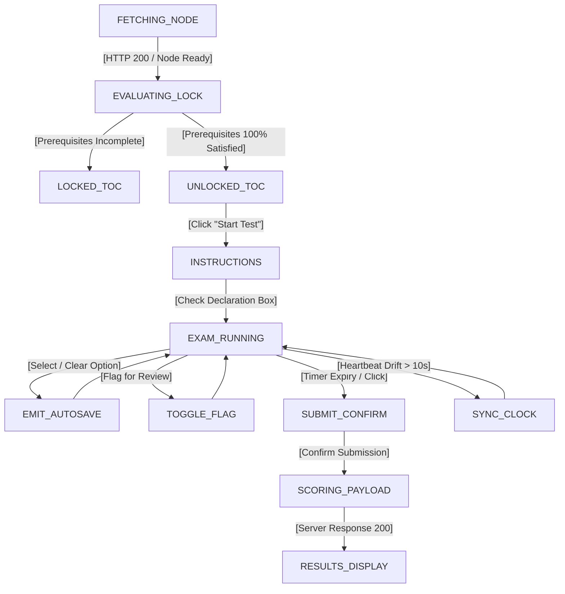
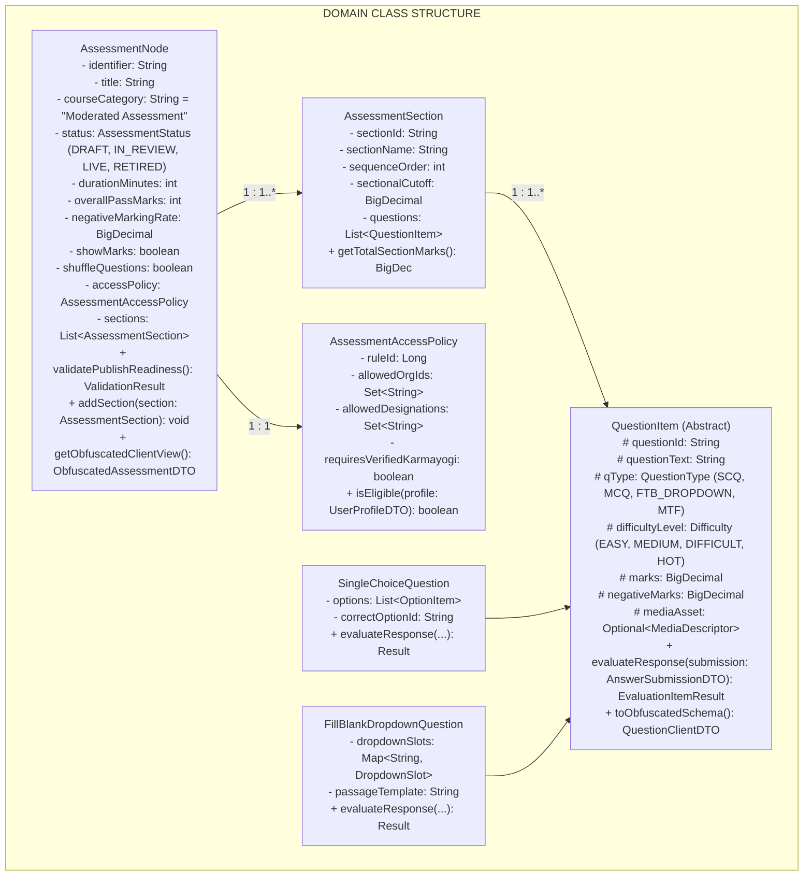
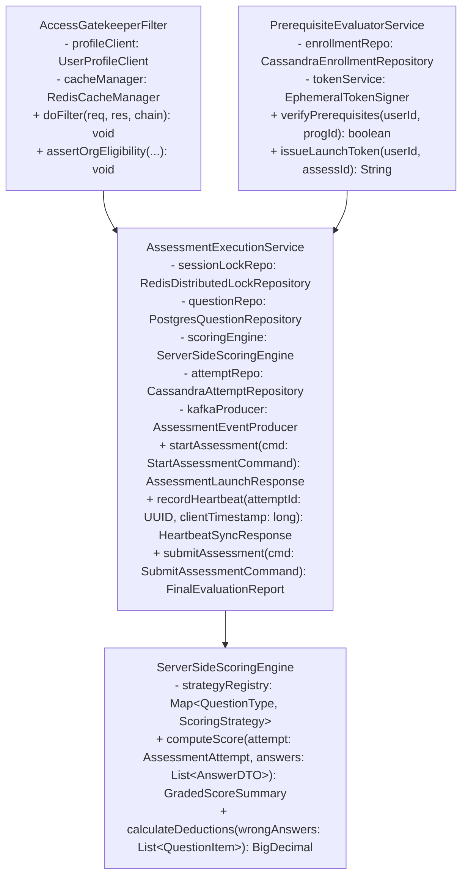
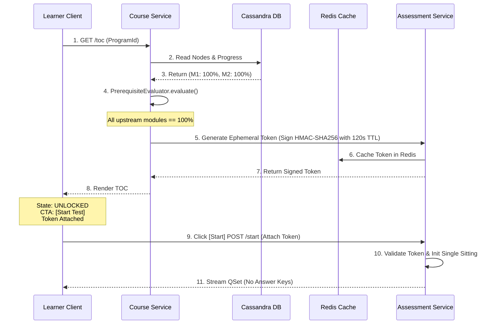
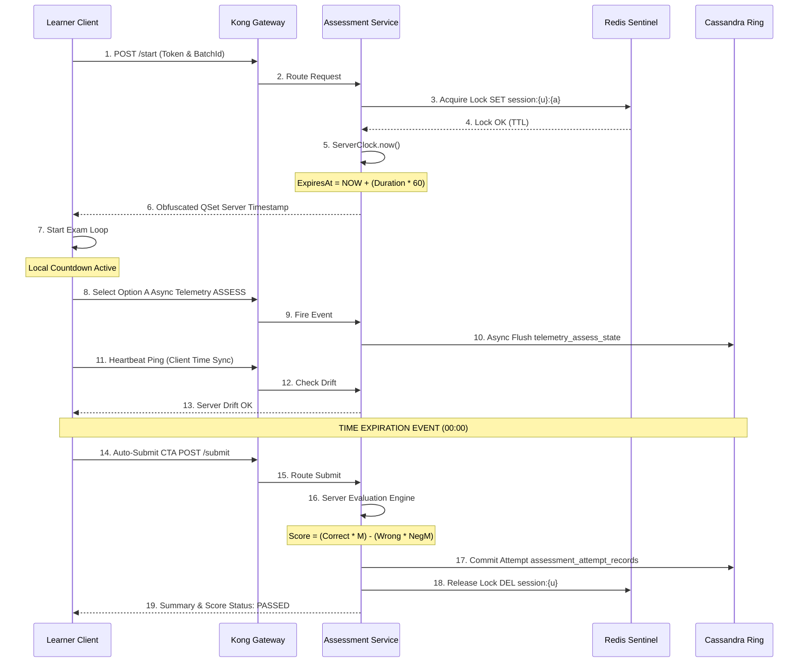

# Moderated Assessment — Low-Level Design (LLD) Document

## 2. Micro-Architectural Evolution & Low-Level Design Strategy

Across the **Q2–Q13 product evolution**, the internal mechanics of assessment delivery evolved from a basic LMS proxy into a resilient, decoupled evaluation platform:

**LLD COMPONENT EVOLUTION MATRIX**

| Layer / Subsystem | Q2 - Q4 Baseline Implementation | Q8 - Q13 Target Implementation |
|---|---|---|
| Ingestion & Schema | • Basic JSON text parsing<br/>• Single question type (SCQ)<br/>• Manual UI authoring | • BulkUploadParser with regex auto-trim<br/>• Multi-format (SCQ, MCQ, FTB, Media)<br/>• HOTS / Difficulty taxonomy metadata |
| Access & Batching | • Open Cassandra batch generation<br/>• Unrestricted Elasticsearch index<br/>• No profile validation | • Suppressed auto-batch in Flink stream<br/>• Org & designation whitelist filtering<br/>• Verified Karmayogi gating validator |
| Gating & Locking | • Linear assessment access<br/>• Direct URL navigation permitted | • PrerequisiteEvaluator DAG engine<br/>• Ephemeral signed HMAC-SHA256 tokens |
| Player Runtime | • Client-side timing controls<br/>• Answer keys exposed in payload<br/>• Unrestricted window switching | • Server-authoritative countdown sync<br/>• Zero-knowledge payload serialization<br/>• Redis distributed single-sitting lock |
| Scoring & Certs | • Client-computed score submission<br/>• Course completion triggered certs | • Server-side negative marking engine<br/>• Event-driven CertRegistry gating |

## 3. Frontend Architecture & Component Blueprints

The presentation tier is structured into two decoupled codebases: the **CBP Content Builder (Angular 15+)** for authoring and moderation, and the **Learner Assessment Engine (Angular 15+ Web & Flutter 3.x Dart Mobile)** for runtime consumption.

### 3.1 CBP Content Builder Component Hierarchy (Angular)

```text
[ContentBuilderComponent]
│
├── [AssessmentMetadataFormComponent]
│   └── Controls: Title, Duration, Pass% (>=50%), NegativeMarkingRate, Shuffle
│
├── [AccessControlConfigComponent]
│   ├── [MdoHierarchySelectorComponent] (Cascading Ministry/Dept/Org picker)
│   └── [UserGroupRuleBuilderComponent] (Designation, Cadre, Verified Badge)
│
├── [QuestionBankManagerComponent]
│   ├── [CsvBulkUploadComponent] (Pre-flight regex auto-trim & validation)
│   └── [QuestionCanvasComponent]
│       ├── [ScqEditorComponent]
│       ├── [McqEditorComponent]
│       ├── [FtbDropdownEditorComponent] (Inline slots & distractor pools)
│       └── [MediaUploadAdapterComponent] (Video up to 400 MB, Audio, PDF)
│
└── [ModerationWorkflowActionComponent]
    └── Actions: SaveDraft(), SubmitForReview(), Approve(), RejectWithRemarks()
```

### 3.2 Learner Assessment Player Component Hierarchy (Web & Mobile Parity)

```text
[AssessmentPlayerShellComponent]
│
├── [PreFlightGateComponent]
│   ├── [InstructionScreenComponent]
│   └── [MandatoryDeclarationCheckboxComponent] (Unlocks "Start Assessment")
│
├── [AssessmentRuntimeContainerComponent]
│   ├── [AuthoritativeTimerHeaderComponent] (Server-synchronized countdown)
│   │
│   ├── [QuestionViewportComponent]
│   │   ├── [StemRendererComponent] (Sanitized HTML & MathJax support)
│   │   ├── [MediaStreamAdapterComponent] (HTTP Live Streaming / MP4 player)
│   │   └── [InteractiveOptionMatrixComponent] (Radio, Checkbox, Dropdowns)
│   │
│   ├── [QuestionNavigationDrawerComponent]
│   │   └── Status Indicators: Answered (Green), Flagged (Yellow), Unanswered
│   │
│   └── [AutosaveTelemetryDispatcher] (Background emitter on interaction)
│
└── [SubmissionReviewModalComponent]
    └── Summary Grid: Attempted, Flagged, Unanswered, Time Remaining -> Submit()
```

### 3.3 Client State Machine (Finite State Machine Blueprint)

The learner consumption journey is governed by a strict, deterministic state machine implemented via RxJS / State Pattern to eliminate client-side race conditions.



## 4. Backend Class Diagrams & Object-Oriented Decomposition

### 4.1 Domain Model & Entity Relationships (`cb-ext-assessment-service`)



### 4.2 Core Service & Engine Decomposition



## 5. Algorithmic Pseudo-Code & Core Logic

### 5.1 Bulk Question Ingestion Parser with Sanitization

```python
def parse_and_sanitize_csv(file_stream, assessment_id, section_id):
    """
    Parses and sanitizes CSV question banks.
    Enforces whitespace auto-trimming and schema validations (FR-CRT-006, KB-13076).
    """
    import csv, re
    parsed_questions = []
    validation_errors = []
    reader = csv.DictReader(file_stream)
    row_index = 1

    for row in reader:
        row_index += 1
        sanitized_row = {}

        # Step 1: Clean whitespace across all cells
        for key, val in row.items():
            clean_key = key.strip() if key else ""
            clean_val = re.sub(r'[\r\n\t]+', ' ', val.strip()) if val else ""
            sanitized_row[clean_key] = clean_val

        q_type = sanitized_row.get("QuestionType", "").upper()
        q_text = sanitized_row.get("QuestionText", "")
        marks_str = sanitized_row.get("Marks", "1.0")
        neg_marks_str = sanitized_row.get("NegativeMarks", "0.0")
        diff_level = sanitized_row.get("Difficulty", "medium").lower()

        # Step 2: Validate mandatory attributes
        if not q_text or len(q_text) < 5:
            validation_errors.append(f"Row {row_index}: Question text missing or too short.")
            continue

        marks = float(marks_str)
        neg_marks = float(neg_marks_str)

        # Step 3: Parse options based on type
        if q_type == "SCQ":
            correct_flags = []
            options = []
            for i in range(1, 6):
                opt_text = sanitized_row.get(f"Option_{i}", "")
                is_correct = sanitized_row.get(f"IsCorrect_{i}", "").upper() == "TRUE"
                if opt_text:
                    opt_id = f"opt_{i}"
                    options.append({"id": opt_id, "text": opt_text})
                    if is_correct:
                        correct_flags.append(opt_id)

            # Assert SCQ rule: Exactly one correct option
            if len(correct_flags) != 1:
                validation_errors.append(f"Row {row_index}: SCQ must contain exactly 1 correct answer.")
                continue

            question_payload = {
                "question_id": f"q_{assessment_id}_{row_index}",
                "section_id": section_id,
                "q_type": "SCQ",
                "difficulty_level": diff_level,
                "question_text": q_text,
                "marks": marks,
                "negative_marks": neg_marks,
                "options": options,
                "answer_key": {"correct_option": correct_flags[0]}
            }
            parsed_questions.append(question_payload)

    if validation_errors:
        raise BulkValidationException(errors=validation_errors)

    return batch_insert_postgres(parsed_questions)
```

### 5.2 Server-Side Scoring Algorithm with Negative Marking

```python
def evaluate_assessment_submission(assessment_id, user_id, attempt_id, submitted_answers):
    """
    Executes authoritative server-side grading.
    Applies negative deductions and pass/fail rules (FR-EVL-001, FR-EVL-002).
    """
    # Step 1: Fetch ground-truth assessment definition and answer keys
    assessment = db.query(AssessmentNode).filter_by(identifier=assessment_id).first()
    master_questions = db.query(QuestionItem).filter_by(assessment_id=assessment_id).all()
    q_map = {q.question_id: q for q in master_questions}

    total_max_marks = Decimal('0.00')
    total_obtained_marks = Decimal('0.00')
    correct_count = 0
    incorrect_count = 0
    unattempted_count = 0
    detailed_results = []

    for q_id, master_q in q_map.items():
        total_max_marks += master_q.marks
        user_answer = next((ans for ans in submitted_answers if ans['questionId'] == q_id), None)

        # Case A: Unattempted Question
        if not user_answer or not user_answer.get('selectedOptions'):
            unattempted_count += 1
            detailed_results.append({
                "questionId": q_id,
                "status": "UNATTEMPTED",
                "awardedMarks": Decimal('0.00')
            })
            continue

        # Case B: Evaluate SCQ
        if master_q.q_type == "SCQ":
            selected = user_answer['selectedOptions'][0]
            correct_option = master_q.answer_key['correct_option']

            if selected == correct_option:
                correct_count += 1
                total_obtained_marks += master_q.marks
                detailed_results.append({
                    "questionId": q_id,
                    "status": "CORRECT",
                    "awardedMarks": master_q.marks
                })
            else:
                incorrect_count += 1
                deduction = master_q.negative_marks
                total_obtained_marks -= deduction
                detailed_results.append({
                    "questionId": q_id,
                    "status": "INCORRECT",
                    "awardedMarks": -deduction
                })

    # Floor score at zero if negative marks exceed earned marks
    final_score = max(Decimal('0.00'), total_obtained_marks)
    percentage = (final_score / total_max_marks) * 100 if total_max_marks > 0 else 0

    # Evaluate passing criteria (FR-EVL-003)
    is_passed = percentage >= assessment.overall_pass_marks
    result_status = "PASSED" if is_passed else "FAILED"

    # Step 2: Commit outcome to Cassandra
    cassandra_session.execute("""
        INSERT INTO sunbird.assessment_attempt_records (
            user_id, assessment_id, attempt_id, submit_time,
            score_obtained, max_score, percentage, result_status
        ) VALUES (%s, %s, %s, toTimestamp(now()), %s, %s, %s, %s)
    """, (user_id, assessment_id, attempt_id, float(final_score),
          float(total_max_marks), float(percentage), result_status))

    # Step 3: Trigger certificate pipeline if passed
    if is_passed:
        kafka_producer.send('cert.generation.trigger', {
            "userId": user_id,
            "assessmentId": assessment_id,
            "score": float(final_score),
            "percentage": float(percentage)
        })

    return {
        "attemptId": attempt_id,
        "status": result_status,
        "scoreObtained": float(final_score),
        "maxScore": float(total_max_marks),
        "percentage": float(percentage),
        "correctCount": correct_count,
        "incorrectCount": incorrect_count,
        "unattemptedCount": unattempted_count
    }
```

## 6. End-to-End Sequence Diagrams

### 6.1 Program TOC Leaf Completion & L2 Assessment Unlocking Sequence

This sequence details how `cb-ext-course-service` evaluates prerequisite completion across upstream modules, generates an HMAC-SHA256 ephemeral token, and unlocks the L2 assessment node on the client interface.



### 6.2 Assessment Session Lifecycle: Execution, Autosave, Expiry, and Submission

This sequence details runtime test execution: acquiring the single-sitting Redis distributed lock, synchronizing countdown timers, flushing async autosave telemetry, and handling automated submission on time expiry.



## 7. Database Physical Schema & Query Optimization

### 7.1 PostgreSQL Ingestion & Relational Master DDL

```sql
-- Core Moderated Assessment Metadata Entity
CREATE TABLE cbp_assessment_nodes (
    identifier VARCHAR(64) PRIMARY KEY,
    title VARCHAR(255) NOT NULL,
    description TEXT,
    course_category VARCHAR(64) DEFAULT 'Moderated Assessment' NOT NULL,
    primary_category VARCHAR(64) DEFAULT 'Course' NOT NULL,
    status VARCHAR(32) NOT NULL CHECK (status IN ('Draft', 'InReview', 'Live', 'Retired')),
    duration_minutes INT NOT NULL CHECK (duration_minutes BETWEEN 5 AND 360),
    overall_pass_marks INT NOT NULL CHECK (overall_pass_marks BETWEEN 50 AND 100),
    negative_marking_rate NUMERIC(3,2) DEFAULT 0.00 CHECK (negative_marking_rate BETWEEN 0.00 AND 1.00),
    show_marks BOOLEAN DEFAULT TRUE,
    shuffle_questions BOOLEAN DEFAULT TRUE,
    shuffle_options BOOLEAN DEFAULT TRUE,
    max_attempts INT DEFAULT 1 CHECK (max_attempts >= 1),
    created_by VARCHAR(64) NOT NULL,
    created_on TIMESTAMP WITH TIME ZONE DEFAULT CURRENT_TIMESTAMP NOT NULL,
    updated_on TIMESTAMP WITH TIME ZONE DEFAULT CURRENT_TIMESTAMP NOT NULL
);

-- Sectional Partitions
CREATE TABLE cbp_assessment_sections (
    section_id VARCHAR(64) PRIMARY KEY,
    assessment_id VARCHAR(64) NOT NULL REFERENCES cbp_assessment_nodes(identifier) ON DELETE CASCADE,
    section_name VARCHAR(128) NOT NULL,
    sequence_order INT NOT NULL,
    sectional_cutoff NUMERIC(4,2) DEFAULT 0.00
);

-- Question Items (Ground-Truth Answer Keys Kept on Backend)
CREATE TABLE cbp_assessment_questions (
    question_id VARCHAR(64) PRIMARY KEY,
    section_id VARCHAR(64) NOT NULL REFERENCES cbp_assessment_sections(section_id) ON DELETE CASCADE,
    q_type VARCHAR(32) NOT NULL CHECK (q_type IN ('SCQ', 'MCQ', 'FTB_DROPDOWN', 'MTF')),
    difficulty_level VARCHAR(16) NOT NULL CHECK (difficulty_level IN ('easy', 'medium', 'difficult', 'hot')),
    question_text TEXT NOT NULL,
    question_payload JSONB NOT NULL,  -- Stems, options, randomized distractor pools
    answer_key JSONB NOT NULL,
    -- Strictly internal ground-truth answers
    marks NUMERIC(4,2) NOT NULL DEFAULT 1.00,
    negative_marks NUMERIC(4,2) NOT NULL DEFAULT 0.00,
    created_at TIMESTAMP WITH TIME ZONE DEFAULT CURRENT_TIMESTAMP
);

-- Access Whitelists (MDO & Designation Groups)
CREATE TABLE cbp_assessment_access_rules (
    rule_id SERIAL PRIMARY KEY,
    assessment_id VARCHAR(64) NOT NULL REFERENCES cbp_assessment_nodes(identifier) ON DELETE CASCADE,
    org_id VARCHAR(64) NOT NULL,
    designation_group VARCHAR(64),
    requires_verified_karmayogi BOOLEAN DEFAULT FALSE,
    created_at TIMESTAMP WITH TIME ZONE DEFAULT CURRENT_TIMESTAMP
);
CREATE INDEX idx_q_section ON cbp_assessment_questions(section_id);
CREATE INDEX idx_access_org ON cbp_assessment_access_rules(org_id, assessment_id);
```

### 7.2 Cassandra Attempt & Telemetry Schema DDL

```sql
-- User Enrollment State (Checked for Prerequisite Locking)
CREATE TABLE sunbird.user_enrolments_v2 (
    userid text,
    courseid text,
    batchid text,
    active boolean,
    completionpercentage int,
    status int,  -- 0: Not Started, 1: In Progress, 2: Completed
    enrolled_date timestamp,
    completed_on timestamp,
    issued_certificates list<frozen<map<text, text>>>,
    PRIMARY KEY ((userid), courseid, batchid)
);

-- Master Assessment Attempt History Table
CREATE TABLE sunbird.assessment_attempt_records (
    user_id text,
    assessment_id text,
    attempt_id uuid,
    batch_id text,
    start_time timestamp,
    submit_time timestamp,
    time_spent_seconds int,
    score_obtained double,
    max_score double,
    percentage double,
    result_status text,  -- 'PASSED' or 'FAILED'
    detailed_answers text,  -- Encrypted JSON string of learner responses
    PRIMARY KEY ((user_id, assessment_id), attempt_id)
) WITH CLUSTERING ORDER BY (attempt_id DESC);

-- Runtime Autosave Telemetry Storage
CREATE TABLE sunbird.telemetry_assess_state (
    attempt_id uuid,
    question_id text,
    selected_option_ids set<text>,
    updated_at timestamp,
    PRIMARY KEY (attempt_id, question_id)
);
```

## 8. Microservice REST & Event Data Contracts

### 8.1 API Contract: `POST /apis/proxies/v8/action/assessment/v3/start`

- **Method:** `POST`
- **Path:** `/apis/proxies/v8/action/assessment/v3/start`
- **Headers:** `Authorization: Bearer <JWT>`, `Content-Type: application/json`
- **Request Payload:**

```json
{
  "request": {
    "assessmentId": "do_113894726482",
    "batchId": "batch_cohort_dopt_01",
    "unlockToken": "eyJhbGciOiJIUzI1NiIsInR5cCI6IkpXVCJ9.eyJuZXh0Tm9kZSI6ImRvXzExMzg5NDcyNjQ4MiIsInVzZXJJZCI6InVzZXJfZGV2XzAxIn0.abcdef..."
  }
}
```

- **Success Response Contract** (`HTTP 200 OK` - Zero-Knowledge Obfuscated):

```json
{
  "id": "api.assessment.start",
  "ver": "3.0",
  "ts": "2026-10-31T11:52:10Z",
  "responseCode": "OK",
  "result": {
    "attemptId": "a1b2c3d4-e5f6-7a8b-9c0d-1e2f3a4b5c6d",
    "assessmentName": "Union Budget & Fiscal Policy Assessment 2026",
    "durationMinutes": 60,
    "serverTimestamp": 1793445130000,
    "expiresAt": 1793448730000,
    "overallPassMarks": 60,
    "showMarks": true,
    "shuffleQuestions": true,
    "sections": [
      {
        "sectionId": "sec_fiscal_01",
        "name": "Section A: Quantitative Analysis",
        "questions": [
          {
            "questionId": "q_101",
            "qType": "SCQ",
            "questionText": "What is the capital expenditure outlay under Union Budget 2026?",
            "difficultyLevel": "medium",
            "marks": 2.0,
            "options": [
              {
                "id": "opt_3",
                "text": "13.2 Lakh Crore"
              },
              {
                "id": "opt_1",
                "text": "11.11 Lakh Crore"
              },
              {
                "id": "opt_4",
                "text": "8.7 Lakh Crore"
              },
              {
                "id": "opt_2",
                "text": "9.5 Lakh Crore"
              }
            ]
          },
          {
            "questionId": "q_102",
            "qType": "FTB_DROPDOWN",
            "questionText": "The primary objective of fiscal consolidation is to reduce [BLANK_1] while maintaining [BLANK_2].",
            "difficultyLevel": "hot",
            "marks": 4.0,
            "dropdownSlots": [
              {
                "slotId": "BLANK_1",
                "distractorPool": [
                  {
                    "id": "d1_opt_1",
                    "text": "capital assets"
                  },
                  {
                    "id": "d1_opt_2",
                    "text": "fiscal deficit"
                  },
                  {
                    "id": "d1_opt_3",
                    "text": "foreign reserves"
                  }
                ]
              },
              {
                "slotId": "BLANK_2",
                "distractorPool": [
                  {
                    "id": "d2_opt_1",
                    "text": "macroeconomic stability"
                  },
                  {
                    "id": "d2_opt_2",
                    "text": "import tariffs"
                  },
                  {
                    "id": "d2_opt_3",
                    "text": "monetary divergence"
                  }
                ]
              }
            ]
          }
        ]
      }
    ]
  }
}
```

### 8.2 API Contract: `POST /apis/proxies/v8/action/assessment/v3/submit`

- **Method:** `POST`
- **Path:** `/apis/proxies/v8/action/assessment/v3/submit`
- **Headers:** `Authorization: Bearer <JWT>`, `Content-Type: application/json`
- **Request Payload:**

```json
{
  "request": {
    "assessmentId": "do_113894726482",
    "attemptId": "a1b2c3d4-e5f6-7a8b-9c0d-1e2f3a4b5c6d",
    "batchId": "batch_cohort_dopt_01",
    "timeSpentSeconds": 3150,
    "answers": [
      {
        "questionId": "q_101",
        "qType": "SCQ",
        "selectedOptions": [
          "opt_1"
        ],
        "timeSpentSeconds": 45
      },
      {
        "questionId": "q_102",
        "qType": "FTB_DROPDOWN",
        "selectedSlots": [
          {
            "slotId": "BLANK_1",
            "selectedOptionId": "d1_opt_2"
          },
          {
            "slotId": "BLANK_2",
            "selectedOptionId": "d2_opt_1"
          }
        ],
        "timeSpentSeconds": 85
      }
    ]
  }
}
```

- **Success Response Contract** (`HTTP 200 OK`):

```json
{
  "id": "api.assessment.submit",
  "ver": "3.0",
  "ts": "2026-10-31T11:58:30Z",
  "responseCode": "OK",
  "result": {
    "attemptId": "a1b2c3d4-e5f6-7a8b-9c0d-1e2f3a4b5c6d",
    "status": "PASSED",
    "scoreObtained": 6.0,
    "maxScore": 6.0,
    "percentage": 100.0,
    "passingCriteriaPercent": 60.0,
    "totalQuestions": 2,
    "correctCount": 2,
    "incorrectCount": 0,
    "unattemptedCount": 0,
    "negativeMarksDeducted": 0.0,
    "certificateIssued": true,
    "certificateRefId": "cert_dopt_2026_987654"
  }
}
```

### 8.3 Kafka Event Data Contract: `cert.generation.trigger`

- **Topic:** `cert.generation.trigger`
- **Producer:** `cb-ext-assessment-service`
- **Consumer:** `CertRegistry` Microservice
- **Payload:**

```json
{
  "eid": "BE_JOB_REQUEST",
  "ets": 1793445510000,
  "mid": "LP.1793445510000.9a8b-7c6d",
  "actor": {
    "id": "cb-ext-assessment-service",
    "type": "System"
  },
  "context": {
    "pdata": {
      "id": "igot.assessment.service",
      "ver": "3.0"
    }
  },
  "edata": {
    "action": "issue-certificate",
    "iteration": 1,
    "userId": "usr_987654321",
    "assessmentId": "do_113894726482",
    "batchId": "batch_cohort_dopt_01",
    "courseCategory": "Moderated Assessment",
    "score": 6.0,
    "maxScore": 6.0,
    "percentage": 100.0,
    "status": "PASSED",
    "templateId": "template_dopt_national_01"
  }
}
```

## 9. Error Handling, Resilience & Failure Modes

**FAULT RECOVERY & CIRCUIT BREAKER BEHAVIOR**

| Failure Mode | Impacted Layer | Detection Mechanism | Mitigation / Recovery Action |
|---|---|---|---|
| Telemetry Ingestion Drop | Client Telemetry Sync | HTTP 500 / Timeout from API | IndexedDB offline buffer on Web; SQLite buffer on Mobile app. |
| Client Clock Drift (Local Time Tampering) | Assessment Player | Heartbeat epoch delta against server timestamp | If \|delta\| > 10s: Resync with server timestamp and reset timer. |
| Redis Session Crash (Distributed Lock Lost) | Single-Sitting Engine | RedisConnectionException on lock verification | Fallback to Cassandra attempt table to verify active session. |
| Cassandra Write Failure | Evaluation Subsystem | WriteTimeoutException on attempt insert | Publish attempt to Kafka retry topic (assessment.dlq). |
| Heavy Media Asset Stall (400 MB Video Timeout) | Question Viewport (Client) | Media playback error / HTML5 Video Stall Event | Fallback to alternate CDN mirror; timer automatically compensates. |

## 10. Traceability Matrix: Requirements to Micro-Architectural Components

| SRS Requirement | Low-Level Design (LLD) Class / Module | Concrete Implementation File / Schema | Verification & Test Method |
|---|---|---|---|
| **FR-CRT-001 (Category Def)** | `AssessmentNode` Entity | `cbp_assessment_nodes.course_category` | Schema assertion test |
| **FR-CRT-002 (Pass % >= 50)** | `MetadataValidatorAspect` | `MetadataValidationAspect.java` | Spring validation unit test |
| **FR-CRT-004 (Rich Media / HOTS)** | `QuestionItem` Hierarchy | `QuestionCanvasComponent.ts` | Cypress component test |
| **FR-CRT-006 (CSV Auto-Trim)** | `BulkUploadParser` | `parse_and_sanitize_csv()` (Section 5.1) | PyTest / JUnit regex test |
| **FR-ACC-001 (MDO Whitelisting)** | `AccessGatekeeperFilter` | `AccessGatekeeperFilter.java` | MockMvc HTTP 403 test |
| **FR-TOC-002 (L2 Prereq Gating)** | `PrerequisiteEvaluatorService` | `PrerequisiteEvaluatorService.java` | Cassandra mock progress test |
| **FR-PLY-003 (Single-Sitting Lock)** | `AssessmentExecutionService` | Redis Key: `session:{userId}:{attemptId}` | Concurrent browser test |
| **FR-PLY-004 (Authoritative Clock)** | `AuthoritativeTimerHeader` | `TimerSyncService.ts` | Clock manipulation test |
| **FR-EVL-002 (Negative Marking)** | `ServerSideScoringEngine` | `evaluate_submission()` (Section 5.2) | Scoring unit test |
| **FR-EVL-005 (Certificate Trigger)** | `AssessmentEventProducer` | Kafka Topic: `cert.generation.trigger` | Kafka consumer integration test |
