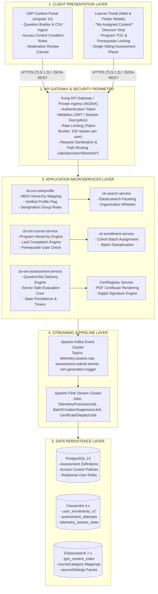
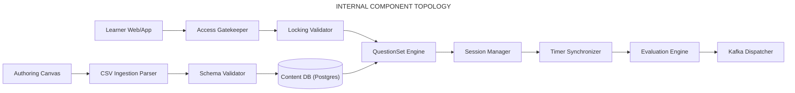
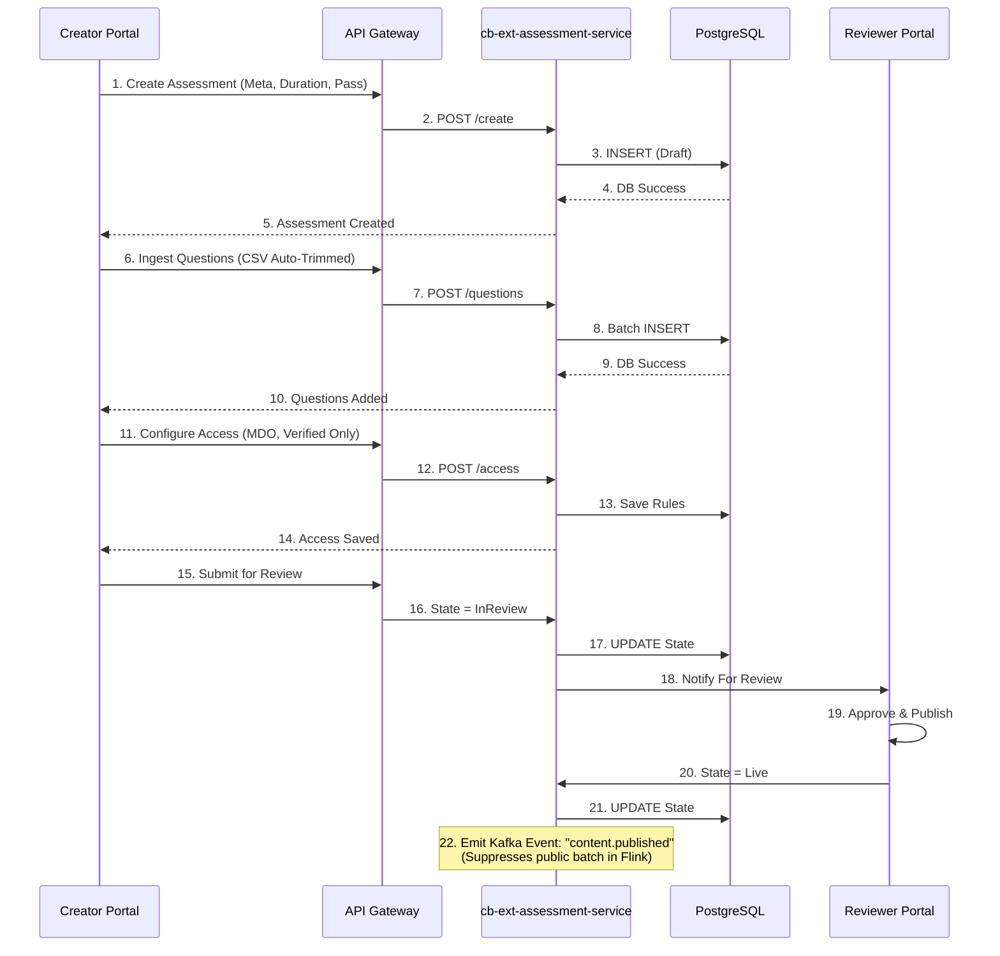
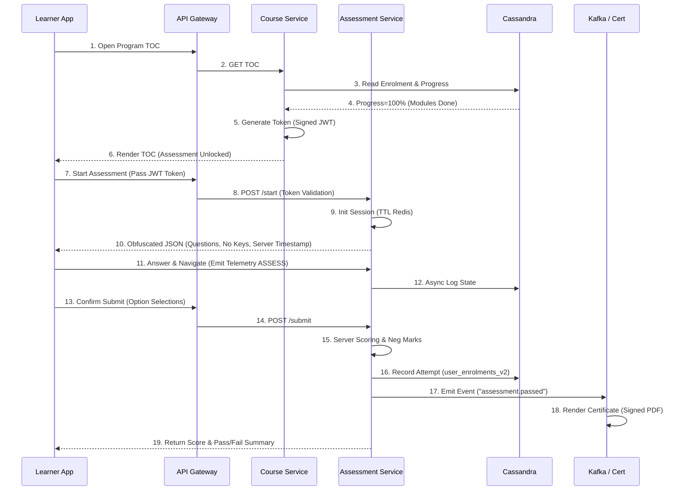
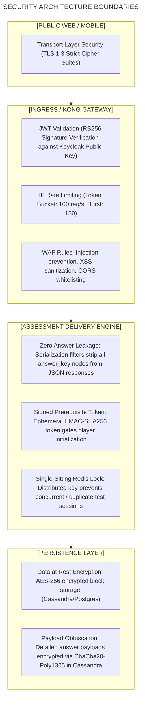

# Moderated Assessment — Software Design Document (SDD)

## 2. Design Rationale & Architectural Evolution (Q2 – Q13)

### 2.1 Context and Technical Rationale

The iGOT Karmayogi platform requires a specialized, high-integrity assessment subsystem capable of delivering formal civil service evaluations. The transition from generic, unproctored quizzes to the **Moderated Assessment** architectural model addressed key engineering and domain problems:

1. **Unregulated Batching vs. Strict Cohort Whitelisting:** Generic course quizzes relied on automatic batch creation upon publication. Moderated Assessments mandate suppression of automatic batching and require program-coordinator-driven cohort whitelisting.
2. **Prerequisite Gating (L2 Evaluation):** Curated pathways require hard-stop evaluation nodes where the final examination remains cryptographically locked until upstream learning modules are complete.
3. **High-Integrity Consumption:** Mandating single-session delivery, synchronized backend countdown timers, and defense against client-side tampering (e.g., clock modification, local answer key inspection).
4. **Rich Question Taxonomy:** Ingesting and rendering structured JSON schemas including media streams (up to 400 MB video), randomized fill-in-the-blank dropdown pools, and Higher Order Thinking Skills (HOTS) difficulty categorizations.

### 2.2 Architectural Evolution Milestones

**Q2 - Q13 ARCHITECTURAL TIMELINE**

| | |
|---|---|
| Q2 Baseline | Monolithic LMS assessment proxy; auto-batch enabled; public ES index |
| Q3 Redesign | cb-ext-assessment-service; courseCategory introduced; auto-batch suppressed |
| Q4 Rich Schemas | QuestionSet v3 JSON schema; HOTS & difficulty definitions; Flutter player |
| Q5 Digitization | Provider dashboard microservices; Cassandra attempt reporting rollups |
| Q7 Search & NLP | Elasticsearch facet mapping; secureSettings.organisation indexing |
| Q8 Locking Engine | Hierarchy leaf-node completion validator; User Group cascading reset |
| Q11-Q13 Hardening | Spring Boot Actuator health endpoints; duplicate batch reconciliation; APAR |

- **Q2 – Baseline Architecture (**[**KB-764**](https://karmayogibharat.atlassian.net/browse/KB-764)**,** [**KB-753**](https://karmayogibharat.atlassian.net/browse/KB-753)**):** Assessments relied on generic OpenSunbird LMS proxy layers (`cb-ext-course-service`). Every published assessment was indexed into public Elasticsearch clusters without access controls, and Flink streaming jobs created public batches automatically.
- **Q3 – Dedicated Moderation Domain (**[**KB-1936**](https://karmayogibharat.atlassian.net/browse/KB-1936)**,** [**KB-2044**](https://karmayogibharat.atlassian.net/browse/KB-2044)**,** [**KB-1950**](https://karmayogibharat.atlassian.net/browse/KB-1950)**):** Decoupled the assessment engine into `cb-ext-assessment-service`. Introduced `courseCategory = "Moderated Assessment"`. Flink job `BatchCreation.scala` was re-engineered to inspect category metadata and drop batch creation events for moderated items.
- **Q4 – Advanced Question Taxonomy & Mobile Parity (**[**KB-3958**](https://karmayogibharat.atlassian.net/browse/KB-3958)**,** [**KB-3971**](https://karmayogibharat.atlassian.net/browse/KB-3971)**):** Deployed the QuestionSet JSON schema supporting inline dropdown fill-in-the-blanks, multimedia attachments, and `questionLevelDefinition` (Easy, Medium, Difficult, HOTS). The Flutter-based mobile player achieved full parity with Angular Web.
- **Q5 – Provider Digitization Architecture (**[**KB-5761**](https://karmayogibharat.atlassian.net/browse/KB-5761)**,** [**KB-6378**](https://karmayogibharat.atlassian.net/browse/KB-6378)**):** Implemented dedicated reporting rollups in Apache Cassandra to aggregate cohort-level progress, pass/fail ratios, and score distribution histograms for Administrative Training Institutes (ATIs).
- **Q7 – Faceted Indexing & Discovery Engine (**[**KB-7869**](https://karmayogibharat.atlassian.net/browse/KB-7869)**,** [**KB-7871**](https://karmayogibharat.atlassian.net/browse/KB-7871)**):** Reworked `cb-search-service` to include `secureSettings.organisation` nested facets in Elasticsearch. Search queries match the authenticated learner's profile organization against assessment whitelist arrays.
- **Q8 – Prerequisite Assessment Locking & Conditional Access (**[**KB-8065**](https://karmayogibharat.atlassian.net/browse/KB-8065)**,** [**KB-8841**](https://karmayogibharat.atlassian.net/browse/KB-8841)**,** [**KB-9603**](https://karmayogibharat.atlassian.net/browse/KB-9603)**):** Integrated the hierarchy validation engine. The TOC evaluation pipeline checks upstream leaf nodes for 100% completion in `user_enrolments_v2` before emitting an assessment launch token.
- **Q11 – Q13 Platform Hardening & Health Actuators (**[**KB-13097**](https://karmayogibharat.atlassian.net/browse/KB-13097)**,** [**KB-13076**](https://karmayogibharat.atlassian.net/browse/KB-13076)**,** [**KB-15322**](https://karmayogibharat.atlassian.net/browse/KB-15322)**):** Standardized Kubernetes autoscaling (HPA) via Spring Boot Actuator metrics (`cb-ext-assessment-service`). Implemented data reconciliation routines to clean up duplicate batch enrollments. Added auto-trimming and schema validations for bulk CSV ingestion.

## 3. High-Level Design (HLD) & Architectural Decomposition

### 3.1 Layered Architecture Overview



### 3.2 End-to-End System Subsystems

1. **Authoring & Publishing Subsystem (CBP):** Handles question modeling, section construction, difficulty grading, CSV ingestion, and the three-tier review/approval lifecycle (`Draft` $\rightarrow$ `Review` $\rightarrow$ `Publish`).
2. **Access Control & Segmentation Subsystem:** Inspects user credentials, evaluates organizational belonging against `secureSettings.organisation`, checks Verified Karmayogi claims, and enforces cascading condition resets.
3. **Catalog & Discovery Subsystem:** Indexes live assessment metadata into Elasticsearch. Executes query filtering based on the calling user's organizational context.
4. **Prerequisite Gating Subsystem:** Analyzes learner course-completion state in Cassandra before rendering the TOC. Toggles the Assessment leaf node between `LOCKED` and `ACTIVE`.
5. **Assessment Consumption & Evaluation Subsystem:** Initializes the single-sitting runtime session, streams randomized question hierarchies without answer keys, captures answer events, enforces countdown boundaries, grades responses server-side, and initiates certification pipelines.

## 4. Component-Level Low-Level Design (LLD)

### 4.1 Component Decomposition & Responsibilities



#### 4.1.1 `QuestionBuilderComponent` & `BulkUploadParser`

- **Package/Scope:** Front-End (Angular) & Back-End ingestion controller in `cb-ext-assessment-service`.
- **Design Pattern:** Strategy Pattern for parsing multiple question formats (SCQ, MCQ, FTB, MTF, Media).
- **CSV Parsing Specification:**
  - Ingests CSV/Excel streams. Implements an automatic trimming step (`string.trim()`) across all cells to strip leading/trailing whitespace, tabs, and carriage returns (`\r\n`).
  - Validates that SCQ records contain exactly one boolean `TRUE` marker in option columns.
  - Ensures option text size does not exceed 1,000 characters and media URLs adhere to signed S3/GCS bucket structures.

#### 4.1.2 `AccessControlGatekeeper`

- **Package/Scope:** `org.sunbird.assessment.interceptor.AccessGatekeeper`
- **Responsibilities:**
  - Intercepts `read` and `enroll` requests.
  - Queries `cb-ext-userprofile` to extract `userOrgId`, `designationId`, and `isVerified` flags.
  - Evaluates access criteria:<br>$$\text{Access Granted} \iff (\text{OrgId} \in \text{Assessment.allowedOrgs}) \land (\text{RequiresVerified} \implies \text{isVerified} == \text{true})$$
  - Rejects unauthorized requests with an `HTTP 403 Forbidden` response (`ERR_ACCESS_DENIED_COHORT_RESTRICTED`).

#### 4.1.3 `PrerequisiteLockingValidator`

- **Package/Scope:** `org.sunbird.course.service.PrerequisiteEvaluator`
- **Responsibilities:**
  - When an assessment is embedded as an L2 leaf node in a Curated Program, this component evaluates the completion status of all sibling course nodes.
  - Queries Cassandra `user_enrolments_v2` for the calling `userId` and `programId`.
  - Computes progress across mandatory modules:<br>$$\text{Unlocked} \iff \forall m \in M_{\text{mandatory}}, \quad \text{Progress}(m) == 100%$$
  - Emits an ephemeral signed JWT `unlockToken` valid for 120 seconds, allowing the player to initialize the assessment.

#### 4.1.4 `AssessmentExecutionEngine` & `SessionManager`

- **Package/Scope:** `org.sunbird.assessment.engine.SessionManager`
- **Responsibilities:**
  - Generates a unique `attemptId` (UUIDv4) upon assessment start.
  - Computes the server-side expiry:<br>$$\text{ExpiresAt} = \text{CurrentTimestamp} + (\text{AssessmentDuration} \times 60)$$
  - In-memory cache (Redis) tracks active attempts with TTL: `SET assessment:session:{userId}:{attemptId} ACTIVE EX {durationSeconds}`.
  - Enforces the single-sitting constraint: If a new `start` request is received while a session is active, it rejects the attempt or forces submission of the existing session.

#### 4.1.5 `ServerEvaluationEngine`

- **Package/Scope:** `org.sunbird.assessment.eval.ScoringEngine`
- **Responsibilities:**
  - Retrieves the ground-truth question definition and scoring keys directly from PostgreSQL or internal cache.
  - Matches student response arrays against correct option IDs.
  - Applies negative marking algorithms:<br>$$\text{ItemScore}(q) = \begin{cases} \text{Marks}(q), & \text{Correct} \ -(\text{NegativeRate} \times \text{Marks}(q)), & \text{Incorrect} \ 0, & \text{Unattempted} \end{cases}$$
  - Aggregates total score, derives percentage, evaluates against `overallPassMarks`, and writes attempt results directly to Cassandra.

## 5. End-to-End Functional Workflows & Sequence Diagrams

### 5.1 Assessment Creation, Review, and Publication Workflow



### 5.2 Learner Discovery, Prerequisite Locking, and Player Consumption Workflow



## 6. Detailed Interface & API Specifications

### 6.1 API Specification Index

| Endpoint | Method | Path | Security Scope | Target Microservice |
|---|---|---|---|---|
| **API-01** | `POST` | `/apis/proxies/v8/action/assessment/v3/create` | `CONTENT_CREATOR` | `cb-ext-assessment-service` |
| **API-02** | `POST` | `/apis/proxies/v8/action/assessment/v3/questions/bulk` | `CONTENT_CREATOR` | `cb-ext-assessment-service` |
| **API-03** | `POST` | `/apis/proxies/v8/action/assessment/v3/access/set` | `CONTENT_CREATOR`, `SPV_ADMIN` | `cb-ext-assessment-service` |
| **API-04** | `POST` | `/apis/proxies/v8/action/assessment/v3/start` | `AUTHENTICATED_LEARNER` | `cb-ext-assessment-service` |
| **API-05** | `POST` | `/apis/proxies/v8/action/assessment/v3/submit` | `AUTHENTICATED_LEARNER` | `cb-ext-assessment-service` |
| **API-06** | `GET` | `/apis/proxies/v8/action/assessment/v3/report/{assessmentId}` | `PROGRAM_COORDINATOR`, `MDO_ADMIN` | `cb-ext-assessment-service` |

### 6.2 Selected API Contracts

#### 6.2.1 Bulk Question Ingest API (API-02)

- **Description:** Ingests tabular question banks via multipart form data or base64 JSON payload. Automatically strips whitespace and validates SCQ/MCQ integrity.
- **Request Contract:**

```json
{
  "request": {
    "assessmentId": "do_113894726482",
    "sectionId": "sec_quantitative_01",
    "questions": [
      {
        "qType": "SCQ",
        "questionText": "What is the capital expenditure outlay under Union Budget 2026?",
        "difficultyLevel": "medium",
        "competencyId": "comp_fin_analysis_001",
        "marks": 2.0,
        "negativeMarks": 0.5,
        "options": [
          {
            "id": "opt_1",
            "text": "11.11 Lakh Crore",
            "isCorrect": true
          },
          {
            "id": "opt_2",
            "text": "9.5 Lakh Crore",
            "isCorrect": false
          },
          {
            "id": "opt_3",
            "text": "13.2 Lakh Crore",
            "isCorrect": false
          },
          {
            "id": "opt_4",
            "text": "8.7 Lakh Crore",
            "isCorrect": false
          }
        ]
      },
      {
        "qType": "FTB_DROPDOWN",
        "questionText": "The primary objective of fiscal consolidation is to reduce [BLANK_1] while maintaining [BLANK_2].",
        "difficultyLevel": "hot",
        "competencyId": "comp_policy_eval_002",
        "marks": 4.0,
        "negativeMarks": 1.0,
        "dropdownSlots": [
          {
            "slotId": "BLANK_1",
            "correctOptionId": "d1_opt_2",
            "distractorPool": [
              {
                "id": "d1_opt_1",
                "text": "capital assets"
              },
              {
                "id": "d1_opt_2",
                "text": "fiscal deficit"
              },
              {
                "id": "d1_opt_3",
                "text": "foreign reserves"
              }
            ]
          },
          {
            "slotId": "BLANK_2",
            "correctOptionId": "d2_opt_1",
            "distractorPool": [
              {
                "id": "d2_opt_1",
                "text": "macroeconomic stability"
              },
              {
                "id": "d2_opt_2",
                "text": "import tariffs"
              },
              {
                "id": "d2_opt_3",
                "text": "monetary divergence"
              }
            ]
          }
        ]
      }
    ]
  }
}
```

- **Success Response** (`HTTP 201 Created`):

```json
{
  "id": "api.assessment.questions.bulk",
  "ver": "3.0",
  "ts": "2026-10-31T11:48:22Z",
  "responseCode": "OK",
  "result": {
    "assessmentId": "do_113894726482",
    "ingestedQuestionsCount": 2,
    "sectionTotalMarks": 6.0,
    "validationErrors": []
  }
}
```

#### 6.2.2 Assessment Initialization & Start API (API-04)

- **Description:** Initializes an active assessment sitting. Validates cohort eligibility and prerequisite tokens. Returns the obfuscated question set with correct answers stripped out.
- **Request Contract:**

```json
{
  "request": {
    "assessmentId": "do_113894726482",
    "batchId": "batch_cohort_dopt_01",
    "unlockToken": "eyJhbGciOiJIUzI1NiIsInR5cCI6IkpXVCJ9.eyJuZXh0Tm9kZSI6ImRvXzExMzg5NDcyNjQ4MiIsInVzZXJJZCI6InVzZXJfZGV2XzAxIn0.abcdef..."
  }
}
```

- **Success Response** (`HTTP 200 OK` - Client Obfuscated):

```json
{
  "id": "api.assessment.start",
  "ver": "3.0",
  "ts": "2026-10-31T11:48:25Z",
  "responseCode": "OK",
  "result": {
    "attemptId": "8f9a2b1c-4d3e-4f5a-9b1c-7e8f9a0b1c2d",
    "assessmentName": "National Governance Moderated Assessment 2026",
    "durationMinutes": 60,
    "serverTimestamp": 1793444905000,
    "expiresAt": 1793448505000,
    "overallPassMarks": 60,
    "showMarks": true,
    "shuffleQuestions": true,
    "sections": [
      {
        "sectionId": "sec_quantitative_01",
        "name": "Section A: Quantitative Analysis",
        "questions": [
          {
            "questionId": "q_101",
            "qType": "SCQ",
            "questionText": "What is the capital expenditure outlay under Union Budget 2026?",
            "difficultyLevel": "medium",
            "marks": 2.0,
            "options": [
              {
                "id": "opt_3",
                "text": "13.2 Lakh Crore"
              },
              {
                "id": "opt_1",
                "text": "11.11 Lakh Crore"
              },
              {
                "id": "opt_4",
                "text": "8.7 Lakh Crore"
              },
              {
                "id": "opt_2",
                "text": "9.5 Lakh Crore"
              }
            ]
          }
        ]
      }
    ]
  }
}
```

#### 6.2.3 Assessment Submission & Evaluation API (API-05)

- **Description:** Submits student responses for server-side evaluation. Computes scores, negative deductions, pass/fail status, and commits attempt records to Cassandra.
- **Request Contract:**

```json
{
  "request": {
    "assessmentId": "do_113894726482",
    "attemptId": "8f9a2b1c-4d3e-4f5a-9b1c-7e8f9a0b1c2d",
    "batchId": "batch_cohort_dopt_01",
    "timeSpentSeconds": 3210,
    "answers": [
      {
        "questionId": "q_101",
        "qType": "SCQ",
        "selectedOptions": [
          "opt_1"
        ],
        "timeSpentSeconds": 45
      },
      {
        "questionId": "q_102",
        "qType": "FTB_DROPDOWN",
        "selectedSlots": [
          {
            "slotId": "BLANK_1",
            "selectedOptionId": "d1_opt_2"
          },
          {
            "slotId": "BLANK_2",
            "selectedOptionId": "d2_opt_1"
          }
        ],
        "timeSpentSeconds": 90
      }
    ]
  }
}
```

- **Success Response** (`HTTP 200 OK`):

```json
{
  "id": "api.assessment.submit",
  "ver": "3.0",
  "ts": "2026-10-31T11:55:00Z",
  "responseCode": "OK",
  "result": {
    "attemptId": "8f9a2b1c-4d3e-4f5a-9b1c-7e8f9a0b1c2d",
    "status": "PASSED",
    "scoreObtained": 6.0,
    "maxScore": 6.0,
    "percentage": 100.0,
    "passingCriteriaPercent": 60.0,
    "totalQuestions": 2,
    "correctCount": 2,
    "incorrectCount": 0,
    "unattemptedCount": 0,
    "negativeMarksDeducted": 0.0,
    "certificateIssued": true,
    "certificateRefId": "cert_dopt_2026_987654"
  }
}
```

## 7. Data Tier Architecture & Schema Definitions

### 7.1 Relational Schema Design (PostgreSQL 14+)

```sql
-- DDL: Core Moderated Assessment Definition
CREATE TABLE cbp_assessment_nodes (
    identifier VARCHAR(64) PRIMARY KEY,
    title VARCHAR(255) NOT NULL,
    description TEXT,
    course_category VARCHAR(64) DEFAULT 'Moderated Assessment',
    primary_category VARCHAR(64) DEFAULT 'Course',
    status VARCHAR(32) NOT NULL CHECK (status IN ('Draft', 'InReview', 'Live', 'Retired')),
    duration_minutes INT NOT NULL CHECK (duration_minutes BETWEEN 5 AND 360),
    overall_pass_marks INT NOT NULL CHECK (overall_pass_marks BETWEEN 50 AND 100),
    negative_marking_rate NUMERIC(3,2) DEFAULT 0.00 CHECK (negative_marking_rate BETWEEN 0.00 AND 1.00),
    show_marks BOOLEAN DEFAULT TRUE,
    shuffle_questions BOOLEAN DEFAULT TRUE,
    shuffle_options BOOLEAN DEFAULT TRUE,
    max_attempts INT DEFAULT 1,
    created_by VARCHAR(64) NOT NULL,
    created_on TIMESTAMP WITH TIME ZONE DEFAULT CURRENT_TIMESTAMP,
    updated_on TIMESTAMP WITH TIME ZONE DEFAULT CURRENT_TIMESTAMP
);

-- DDL: Sections Topology
CREATE TABLE cbp_assessment_sections (
    section_id VARCHAR(64) PRIMARY KEY,
    assessment_id VARCHAR(64) REFERENCES cbp_assessment_nodes(identifier) ON DELETE CASCADE,
    section_name VARCHAR(128) NOT NULL,
    sequence_order INT NOT NULL,
    sectional_pass_marks INT DEFAULT 0
);

-- DDL: Question Bank Items (Master Ground Truth)
CREATE TABLE cbp_assessment_questions (
    question_id VARCHAR(64) PRIMARY KEY,
    section_id VARCHAR(64) REFERENCES cbp_assessment_sections(section_id) ON DELETE CASCADE,
    q_type VARCHAR(32) NOT NULL CHECK (q_type IN ('SCQ', 'MCQ', 'FTB_DROPDOWN', 'MTF')),
    difficulty_level VARCHAR(16) NOT NULL CHECK (difficulty_level IN ('easy', 'medium', 'difficult', 'hot')),
    question_payload JSONB NOT NULL,
    answer_key JSONB NOT NULL,
    marks NUMERIC(4,2) NOT NULL DEFAULT 1.0,
    negative_marks NUMERIC(4,2) NOT NULL DEFAULT 0.0
);

-- DDL: Cohort & MDO Whitelist Rules
CREATE TABLE cbp_assessment_access_rules (
    rule_id SERIAL PRIMARY KEY,
    assessment_id VARCHAR(64) REFERENCES cbp_assessment_nodes(identifier) ON DELETE CASCADE,
    org_id VARCHAR(64) NOT NULL,
    designation_group VARCHAR(64),
    requires_verified_karmayogi BOOLEAN DEFAULT FALSE,
    created_at TIMESTAMP WITH TIME ZONE DEFAULT CURRENT_TIMESTAMP
);
CREATE INDEX idx_access_lookup ON cbp_assessment_access_rules(assessment_id, org_id);
```

### 7.2 Distributed NoSQL Data Model (Apache Cassandra 4.x)

```sql
-- Keyspace Definition
CREATE KEYSPACE IF NOT EXISTS sunbird WITH replication = {'class': 'NetworkTopologyStrategy', 'datacenter1': 3};

-- User Course Enrolment & Leaf Progress Table
CREATE TABLE sunbird.user_enrolments_v2 (
    userid text,
    courseid text,
    batchid text,
    active boolean,
    completionpercentage int,
    status int,  -- 0: Not Started, 1: In Progress, 2: Completed
    enrolled_date timestamp,
    completed_on timestamp,
    issued_certificates list<frozen<map<text, text>>>,
    PRIMARY KEY ((userid), courseid, batchid)
);

-- Assessment Session Attempt State & History
CREATE TABLE sunbird.assessment_attempt_records (
    user_id text,
    assessment_id text,
    attempt_id uuid,
    batch_id text,
    start_time timestamp,
    submit_time timestamp,
    time_spent_seconds int,
    score_obtained double,
    max_score double,
    percentage double,
    result_status text,  -- 'PASSED' or 'FAILED'
    detailed_answers text,  -- Encrypted JSON payload of learner selections
    PRIMARY KEY ((user_id, assessment_id), attempt_id)
) WITH CLUSTERING ORDER BY (attempt_id DESC);

-- Real-Time Telemetry State Sync (Autosave Drawer)
CREATE TABLE sunbird.telemetry_assess_state (
    attempt_id uuid,
    question_id text,
    selected_option_ids set<text>,
    updated_at timestamp,
    PRIMARY KEY (attempt_id, question_id)
);
```

## 8. Security Architecture, Zero-Trust Delivery & Anti-Tampering



### 8.1 Zero-Knowledge Client Delivery Design

- Under no circumstances is the evaluation payload (`answer_key` or `isCorrect`) serialized into learner-facing JSON payloads.
- The `QuestionSetDeliveryController` utilizes Jackson Custom Serializers (`@JsonView(Views.LearnerPayload.class)`) that mathematically exclude all grading fields from the abstract syntax tree during JSON marshaling.

### 8.2 Client-Side Anti-Tampering & Clock Drift Compensation

- **Problem:** Learners can manipulate client device system clocks to artificially extend examination durations.
- **Solution:** The player strictly calculates remaining duration using the server-provided epoch timestamps:<br>$$\text{TimeRemaining} = \text{ExpiresAt} - (\text{ServerTimestamp} + \text{LocalElapsedTime})$$
- Heartbeat pings emit every 60 seconds. If the delta between the local system time and the server heartbeat exceeds $\pm 10$ seconds, the player flags a warning and forces a synchronization event.

## 9. Observability, Telemetry & Performance Optimization

### 9.1 Kafka Event Streaming Topology

| Kafka Topic | Producer | Consumer | Payload / Schema |
|---|---|---|---|
| `telemetry.assess.raw` | Assessment Player UI | Flink Streaming Job | Standard CASS `ASSESS` event (User, Question, Duration) |
| `assessment.submit.events` | `cb-ext-assessment-service` | `AuditLogger`, `ReportingJob` | Evaluation outcome, Score, Percentage, Status |
| `cert.generation.trigger` | `cb-ext-assessment-service` | `CertRegistry` Microservice | User ID, Course ID, Batch ID, Pass Marks, Org Name |
| `content.publish.pipeline` | CBP Publisher Service | `BatchCreationSuppressorJob` | Content Metadata, `courseCategory = "Moderated Assessment"` |

### 9.2 Kubernetes Autoscaling Configuration (HPA)

```yaml
apiVersion: autoscaling/v2
kind: HorizontalPodAutoscaler
metadata:
  name: cb-ext-assessment-service-hpa
  namespace: igot-prod
spec:
  scaleTargetRef:
    apiVersion: apps/v1
    kind: Deployment
    name: cb-ext-assessment-service
  minReplicas: 8
  maxReplicas: 40
  metrics:
  - type: Resource
    resource:
      name: cpu
      target:
        type: Utilization
        averageUtilization: 70
  - type: Resource
    resource:
      name: memory
      target:
        type: Utilization
        averageUtilization: 80
  behavior:
    scaleUp:
      stabilizationWindowSeconds: 0
      policies:
      - type: Percent
        value: 100
        periodSeconds: 15
    scaleDown:
      stabilizationWindowSeconds: 300
      policies:
      - type: Percent
        value: 10
        periodSeconds: 60
```

## 10. Traceability Matrix: Requirements to Design Mapping

| SRS Requirement | Design Component / Architecture Module | Data Model / Schema Reference | Target Microservice / Layer | Verification Method |
|---|---|---|---|---|
| **FR-CRT-001 (Category Identification)** | `ContentBuilderController` / `AssessmentNodeFactory` | `cbp_assessment_nodes.course_category` | CBP Portal / Content Service | Automated Schema Assertion |
| **FR-CRT-002 (Metadata & Pass Marks >= 50%)** | `MetadataValidationAspect` | `cbp_assessment_nodes.pass_marks_percent` | `cb-ext-assessment-service` | JUnit Validation Test |
| **FR-CRT-004 (Rich Question Formats & Media)** | `QuestionBuilderStrategy` / S3 Pre-Signed Upload | `cbp_assessment_questions.question_payload` | Web Authoring / Content Delivery | End-to-End Cypress Suite |
| **FR-CRT-006 (Bulk Ingest Whitespace Auto-Trim)** | `BulkUploadParser` | `cbp_assessment_questions` | `cb-ext-assessment-service` | Unit Test (Regex Trimming) |
| **FR-ACC-001 (MDO-Specific Access** **Restriction)** | `AccessControlGatekeeper` | `cbp_assessment_access_rules` | Ingress / API Gateway Filter | HTTP Mock 403 Forbidden |
| **FR-ACC-007 (Batch Deduplication)** | `EnrollmentDeduplicationAspect` | Cassandra: `sunbird.user_enrolments_v2` | `cb-enrollment-service` | Cassandra Unique Scan |
| **FR-TOC-002 (L2 Prerequisite Gating)** | `PrerequisiteLockingValidator` | Cassandra: `sunbird.user_enrolments_v2` | `cb-ext-course-service` | Mock Leaf Node Progress Test |
| **FR-PLY-003 (Enforced Single-Sitting Delivery)** | `SessionManager` / Redis Attempt TTL | Redis Key: `assessment:session:*` | `cb-ext-assessment-service` | Concurrency Simulation Test |
| **FR-PLY-004 (Server-Synchronized Timer)** | `ServerTimestampSynchronizer` | `api.assessment.start` response headers | Player State Machine (Client) | Clock Tampering Mock Test |
| **FR-EVL-002 (Negative Marking Evaluation)** | `ServerEvaluationEngine` | `cbp_assessment_questions.negative_marks` | `cb-ext-assessment-service` | Mathematical Scoring Test |
| **FR-EVL-005 (Gated Certification Trigger)** | Kafka Event Dispatcher | Kafka Topic: `cert.generation.trigger` | `CertRegistry` Service | Integration Pipeline Test |
| **FR-REP-001 (Provider Offerings Dashboard)** | `ProviderReportingAggregator` | Cassandra: `sunbird.assessment_attempt_records` | MDO / Provider Portal | Aggregation Query Test |

## 11. Known Operational Constraints, Design Trade-Offs & Assumptions

### 11.1 Design Trade-Offs

1. **Server-Side Scoring vs. Edge Evaluation:**
  - *Decision:* All evaluation occurs on backend microservices.
  - *Trade-Off:* Increases network traffic and backend compute load during mass exam submissions; entirely eliminates client-side inspection or decryption of grading logic.

2. **Strict Single-Sitting Delivery vs. Fault-Tolerant Reconnect:**
  - *Decision:* Navigating away or closing the browser window immediately submits or invalidates the active attempt.
  - *Trade-Off:* Unstable cellular connections on mobile devices may occasionally terminate valid attempts prematurely. Mitigated by autosaving progress per-question to Cassandra via background telemetry.

### 11.2 Assumptions

- Identity federation (Aadhaar / Government SSO) reliably populates `isVerified: true` within Keycloak JWT claims.
- Cloud storage CDNs (Google Cloud CDN / AWS CloudFront) provide sufficient global throughput to stream 400 MB video prompts without degrading learner timer accuracy.
- Network latency between the Kubernetes compute cluster and the distributed Cassandra ring remains below 15 ms at $P99$.
