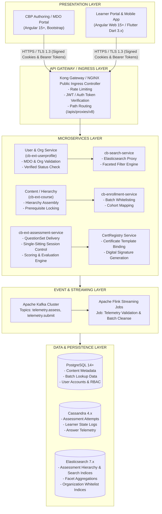
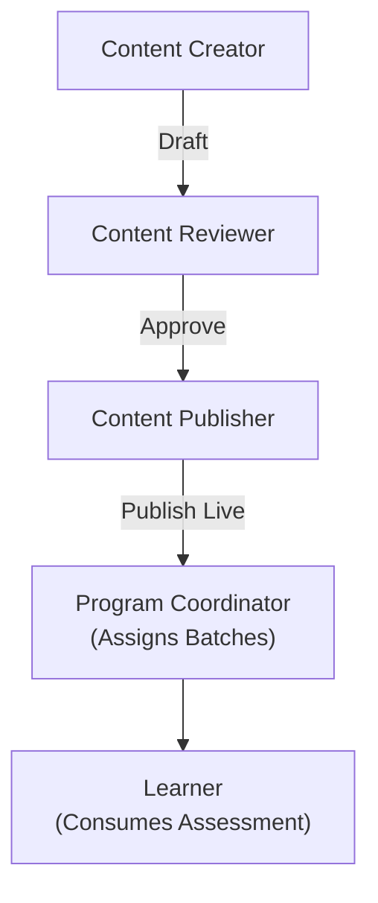

# Moderated Assessment — Software Requirements Specification (SRS)

## 2. Introduction & Product Overview

### 2.1 Purpose & Scope

This Software Requirements Specification (SRS) establishes the authoritative functional, behavioral, and technical requirements governing the **Moderated Assessment** capability within the iGOT Karmayogi digital workplace. It spans the complete lifecycle across both authoring/management (Content Portal / CBP Portal) and learner execution (Learner Web Portal & Mobile Apps), tracing its architectural evolution from Q2 through Q13.

### 2.2 Business Context & Problem Statement

Prior to the introduction of Moderated Assessments, the platform supported general course quizzes and public standalone assessments. This model exhibited critical limitations:

1. **Unrestricted Assessment Exposure:** Specialized or departmental evaluation instruments were searchable platform-wide, preventing secure, ministry-specific evaluations.
2. **Absence of Prerequisite Enforcement:** Learners could attempt final assessments without consuming prerequisite learning modules.
3. **Unregulated Certification:** Certificates could be issued on course progress rather than verified, proctored competency validation.
4. **Limited Question Complexity:** Authoring was restricted to simple single/multiple-choice text prompts without multimedia or higher-order evaluation formats.

**Moderated Assessment** resolves these challenges by introducing:

- Cohort-restricted access (MDO-specific, User Group, and Verified Karmayogi gating).
- Prerequisite assessment locking (L2 assessment integration in Curated Programs).
- Advanced question hierarchies with rich media (video up to 400 MB, audio, images, PDF).
- Single-sitting delivery rules with state-synchronized autosave telemetry.
- Gated certification pipelines tied directly to passing cut-offs.

### 2.3 Definitions, Acronyms & Abbreviations

| Term | Definition |
|---|---|
| **MDO** | Ministry, Department, and Organization |
| **SPV** | Special Purpose Vehicle (Karmayogi Bharat administrative entity) |
| **CBP** | Capacity Building Plan / Content Builder Portal |
| **TOC** | Table of Contents |
| **L2 Assessment** | Level 2 / Final Program Assessment tied to a Curated Learning Pathway |
| **HOTS** | Higher Order Thinking Skills |
| **Neo4j** | Graph database managing competencies, organizational hierarchies, and taxonomies |
| **Cassandra** | Distributed NoSQL database storing assessment state, telemetry events, and learner attempts |
| **Elasticsearch (ES)** | Distributed search engine indexing metadata for catalog discovery and faceted filtering |
| **Kafka / Flink** | Event streaming and stateful stream processing pipeline managing telemetry and auto-batch execution |

## 3. Architectural Evolution & Roadmap (Q2 to Q13)

**Q2 - Q13 ROADMAP MILESTONES**

|  |  |
|---|---|
| Q2: Baseline Assessment Creation | Basic quiz & standalone assessment; auto-batch enabled |
| Q3: Content Portal Redesign | Moderated category; MDO/Verified Karmayogi access rules |
| Q4: Advanced Question Authoring | Question taxonomy (HOTS, Easy-Difficult); 3x option randomization |
| Q5: Provider Digitization | ATI/CTI onboarding; Offerings pills; Provider Dashboards |
| Q7: Search & Faceted Discovery | Elasticsearch indexing of courseCategory; NLP query integration |
| Q8: Gated Progress & Locking | Curated Program L2 assessment locking; User Group conditions |
| Q9 - Q10: Search & Audit Hardening | Sorting enhancements; natural alphanumeric ordering |
| Q11 - Q13: Microservice Scale | Actuator health APIs; batch deduping; APAR assessment pipelines |

### Chronological Feature Progression

| Release / Epoch | Jira Key | Feature & Requirement Change | Functional & Architectural Impact |
|---|---|---|---|
| **Q2 Baseline** | [KB-764: Q2 \| Ad-Hoc Requests \| Learning Content basic information listing to public.](https://karmayogibharat.atlassian.net/browse/KB-764) (Prod Deployed), [KB-753: Q2 \| CBP \| Create New CBP Plan](https://karmayogibharat.atlassian.net/browse/KB-753) (Prod Deployed) | Public listing of assessment cards; creation of basic standalone assessments. | Tests were open to all users; platform automatically triggered public batch creation upon publishing. |
| **Q3 Redesign** | [KB-1936: Q3 \| Content Portal Redesign \| Content access settings, batch management and user consumption](https://karmayogibharat.atlassian.net/browse/KB-1936) (Prod Deployed), [KB-2044: Q3 \| Content Portal Redesign \| Create assessment](https://karmayogibharat.atlassian.net/browse/KB-2044) (Prod Deployed), [KB-1950: Q3 \| Content Portal Redesign \| Learner consumption for all types of content](https://karmayogibharat.atlassian.net/browse/KB-1950) (Prod Deployed) | Introduction of `Moderated Assessment` as distinct `courseCategory`. MDO-specific and Verified Karmayogi restrictions. | Suppressed automatic public batch creation in Flink (`BatchCreation.scala`). Access restricted to authorized organization IDs. |
| **Q4 Authoring** | [KB-3958: Q4 \| Assessments Creation and Consumption](https://karmayogibharat.atlassian.net/browse/KB-3958) (Prod Deployed), [KB-3965: Q4 \| Assessments \| Adding question to question set or question section](https://karmayogibharat.atlassian.net/browse/KB-3965) (Prod Deployed), [KB-3971: Q4 \| Assessments \| Adding Questions \| Fill in the blanks](https://karmayogibharat.atlassian.net/browse/KB-3971) (Prod Deployed) | Rich question authoring, section grouping, and difficulty grading (`questionLevelDefinition`: Easy, Medium, Difficult, HOTS). | Assessment player enhanced on Angular Web and Flutter Mobile. Emitted granular telemetry on answer changes. |
| **Q5 Digitization** | [KB-5761: Q5 \| Enhancement \| ATIs, CTIs and Content Provider Digitization](https://karmayogibharat.atlassian.net/browse/KB-5761) (KB Approved), [KB-5762: Q5 \| Enhancement \| [Web] ATIs, CTIs and Content Provider Digitization](https://karmayogibharat.atlassian.net/browse/KB-5762) (Prod Deployed), [KB-6378: Q5 \| Content Portal \| Dashboard for content provider Need Information](https://karmayogibharat.atlassian.net/browse/KB-6378) | Onboarding of ATIs/CTIs; provider-level assessment management; offering breakdown pills. | Introduced Provider Dashboards tracking participation, score distribution, and live vs. draft status. |
| **Q7 Discovery** | [KB-7869: Q7 \| Search & listing \| NLP & Elastic search \| Learner Portal](https://karmayogibharat.atlassian.net/browse/KB-7869) (Prod Deployed), [KB-7871: Q7 \| Search & listing \| Filters \| Learner Portal](https://karmayogibharat.atlassian.net/browse/KB-7871) (Prod Deployed) | Elasticsearch integration for `courseCategory` = `Moderated Assessment`; faceted search filters. | Search queries filter assessments by `secureSettings.organisation` matching the learner's profile org. |
| **Q8 Locking & Groups** | [KB-8065: Q8 \| L2 Assessments/CAP \| Creation of L2 Assessments/CAP](https://karmayogibharat.atlassian.net/browse/KB-8065) (KB Approved), [KB-8819: Q8 \| Learning Path \| Access Control](https://karmayogibharat.atlassian.net/browse/KB-8819) (KB Approved), [KB-9603: Q8 \| Access Control \| User Group based Access Control](https://karmayogibharat.atlassian.net/browse/KB-9603) (Prod Deployed), [KB-8841: Q8 \| Learning Path \| Curated Program \| Add Final Assessment](https://karmayogibharat.atlassian.net/browse/KB-8841) (Prod Deployed) | **Assessment Locking (L2):** Final assessment locked until 100% course prerequisite completion. Advanced User Group filters (Designation, Cadre, Service). | Content hierarchy service validates leaf node completion before issuing unlock tokens. Certificate generation strictly gated on passing score. |
| **Q11–Q13 Scaling** | [KB-13016: Q11 \| Peer Validation \| MDO Peer validation survey creation and listing](https://karmayogibharat.atlassian.net/browse/KB-13016) (Prod Deployed), [KB-13076: Q11 \| Ad-Hoc \| Comprehensive Assessments and APAR Enhancements](https://karmayogibharat.atlassian.net/browse/KB-13076) (Open), [KB-13097: Q11 \|Tech Debt \| Frontend and Backend Service enhancement](https://karmayogibharat.atlassian.net/browse/KB-13097) (Open), [KB-15322: Q13 \| MDO Portal \| APAR Creation Enhancements - Phase 2](https://karmayogibharat.atlassian.net/browse/KB-15322) (Prod Deployed) | Microservice actuator health APIs; duplicate batch cleanup (`user_enrolments_v2`); APAR assessment integration. | Added readiness/liveness probes for Kubernetes pod autoscaling; fixed CSV bulk upload whitespace parsing. |

## 4. Overall System Architecture & Tech Stack



## 5. User Roles, Personas & Permissions Matrix



| Role | Authoring & Creation | Review & Moderation | Publishing & Live Access | Batch Assignment & Cohorts | Consumption & Attempt |
|---|---|---|---|---|---|
| **Content Creator** | Full (Create, Edit Draft, Add Questions, Upload CSV) | View Only (In-Review) | None | None | Test Mode Only (Draft) |
| **Content Reviewer** | None | Full (Audit, Edit Marks, Accept/Reject with Remarks) | Send to Publish | None | Preview Mode Only |
| **Content Publisher (SPV)** | None | Audit Access | Full (Make Live, Set Visibility) | Configure Global Access | Preview Mode Only |
| **Program Coordinator / MDO Admin** | None | None | None | Full (Upload CSV Cohorts, Assign MDO Batches) | Audit / Proctor View |
| **Learner (Target Cohort)** | None | None | None | None | Full (Attempt, Submit, View Results, Certify) |
| **Learner (Non-Target)** | None | None | None | None | None (Access Denied / Not Found) |

## 6. Functional Requirements – Assessment Creation, Authoring & Publishing

### 6.1 Assessment Configuration & Metadata (Content Portal)

- **FR-CRT-001 (Category Identification):** The system shall assign `primaryCategory` = `"Course"` and `courseCategory` = `"Moderated Assessment"` when a creator selects "Moderated Assessment" from the creation panel.
- **FR-CRT-002 (Assessment Metadata):** The system shall mandate the following attributes prior to draft submission:
  - Title (`name`): String (min 5, max 120 characters).
  - Description (`description`): String (min 20, max 2000 characters).
  - Thumbnail (`appIcon`, `posterImage`): Minimum 320x180 px image asset.
  - Duration (`duration`): Integer (total minutes, minimum 5 min, maximum 360 min).
  - Pass Percentage (`overallPassMarks`): Integer (minimum 50%, maximum 100% per [KB-11683: Content Creator - Passing criteria for courses should not be below 50%](https://karmayogibharat.atlassian.net/browse/KB-11683) (Prod Deployed)).
  - Show Marks (`showMarks`): Boolean (controls whether per-question marks are displayed during consumption).
  - Question Randomization (`shuffleQuestions`): Boolean (shuffles order at runtime).
  - Option Randomization (`shuffleOptions`): Boolean (randomizes MCQ option sequence).
  - Max Retakes (`maxAttempts`): Integer (0 for infinite, or positive integer 1–10).

### 6.2 Question Bank & Hierarchical Structuring

- **FR-CRT-003 (Sectional Organization):** Creators shall be able to divide an assessment into one or more named sections (e.g., "Section A: Quantitative", "Section B: Analytical").
- **FR-CRT-004 (Question Types):** The authoring canvas shall support:
  - `Single Choice Question (SCQ)`: Radio button selection (1 correct answer).
  - `Multiple Choice Question (MCQ)`: Checkbox selection (multiple correct answers with partial or full credit).
  - `Fill in the Blanks (FTB)`: Dropdown selectors embedded inline within sentence stems with randomized distractor pools ([KB-3971: Q4 | Assessments | Adding Questions | Fill in the blanks](https://karmayogibharat.atlassian.net/browse/KB-3971) (Prod Deployed)).
  - `Match the Following (MTF)`: Dual-column pair mapping.
  - `Media Prompt Questions`: Text questions accompanied by Video (MP4, WebM up to 400 MB), Audio (MP3 up to 100 MB), or Image assets (PNG, JPEG up to 10 MB).

- **FR-CRT-005 (Difficulty & HOTS Taxonomy):** Every question shall be tagged with:
  - Difficulty Level: `easy`, `medium`, `difficult`, or `hot` (Higher Order Thinking Skills).
  - Competency Theme and Sub-Theme aligned to the Karmayogi National Competency Dictionary.

### 6.3 Bulk Question Ingestion

- **FR-CRT-006 (CSV / Excel Import):** The system shall accept tabular question banks. The parser must execute automatic whitespace trimming (`auto-trim`) across all question cells, options, and boolean keys to prevent evaluation crashes ([KB-13076: Q11 | Ad-Hoc | Comprehensive Assessments and APAR Enhancements](https://karmayogibharat.atlassian.net/browse/KB-13076) (Open)).
- **FR-CRT-007 (Import Validation):** Bulk uploads must trigger pre-flight checks:
  - Validate that SCQs specify exactly one correct answer.
  - Validate that total marks across questions match the section definition.
  - Highlight the exact row and column containing malformed schemas.

### 6.4 Moderation & Publishing Pipeline

- **FR-CRT-008 (Lifecycle States):** The assessment lifecycle must transition through explicit states:
- **FR-CRT-009 (Reviewer Feedback Loop):** If rejected by the Content Reviewer, the system shall require rejection comments and revert the state to `Draft`.
- **FR-CRT-010 (Suppression of Auto-Batch):** Upon transition to `Live`, the Flink pipeline must detect `courseCategory == "Moderated Assessment"` and suppress the creation of open public batches in Cassandra (`user_enrolments_v2`).

## 7. Functional Requirements – Access Control, Moderation & Batch Gating

### 7.1 Access Control Engine

- **FR-ACC-001 (MDO-Specific Access):** When `accessSetting` is set to `"MDO Specific"`, the creator must select one or more parent Ministries or child Organizations. The system shall store this mapping under `secureSettings.organisation`.
- **FR-ACC-002 (Hierarchical Organization Mapping):** Selecting a parent Ministry shall provide an option to inherit all subordinate departments, zones, and field formations ([KB-11206: In Person Meeting with Railway Board on AI Content Generation, Integration](https://karmayogibharat.atlassian.net/browse/KB-11206) (To Do)).
- **FR-ACC-003 (Verified Karmayogi Gating):** Assessments marked with `"Verified Karmayogi Only"` shall require the user profile to possess an active verified badge (`isVerified: true`) issued via Government SSO or Aadhaar-based authentication ([KB-9603: Q8 | Access Control | User Group based Access Control](https://karmayogibharat.atlassian.net/browse/KB-9603) (Prod Deployed)).

### 7.2 User Group Segmentation & Cascading Rules

- **FR-ACC-004 (Attribute-Based Grouping):** Support conditional rule blocks:
- **FR-ACC-005 (Cascading Condition Reset):** If an administrator alters a higher-level filter (e.g., changes Organization), all dependent child rules (Designation, Service, Cadre) shall automatically reset to prevent stale security configurations ([KB-9603: Q8 | Access Control | User Group based Access Control](https://karmayogibharat.atlassian.net/browse/KB-9603) (Prod Deployed)).

### 7.3 Batch Whitelisting & Deduping

- **FR-ACC-006 (Cohort Upload):** Program Coordinators shall assign participants via CSV containing unique identifiers (`userId`, `primaryEmail`, or `maskedAadhaar`).
- **FR-ACC-007 (Batch Deduplication):** The enrollment service must enforce a strict one-active-batch constraint per user-assessment pair in `enrollment_batch_lookup` to eliminate duplicate state records ([Data Reconciliation – Duplicate Batch Enrolment Cleanup](https://karmayogibharat.atlassian.net/wiki/spaces/TES/pages/1148747777/Data+Reconciliation+Duplicate+Batch+Enrolment+Cleanup)).

## 8. Functional Requirements – Catalog, Discovery & Search Faceting

### 8.1 Catalog Presentation

- **FR-CAT-001 (Section Placement):** Eligible Moderated Assessments shall display in the Learner Portal under the **"My Assigned Content"** horizontal strip or the **"Assessments"** tab ([KB-9789: Q8 | Access Control | My Assigned Content Need Information](https://karmayogibharat.atlassian.net/browse/KB-9789)).
- **FR-CAT-002 (Ineligibility Masking):** If a user does not belong to the target MDO cohort or lacks Verified Karmayogi status, the assessment card shall be filtered out of catalog browse APIs (`HTTP 200` with empty array).

### 8.2 Faceted Search & NLP Indexing

- **FR-CAT-003 (Elasticsearch Facet Indexing):** The search service shall index Moderated Assessments with nested attributes:
  ```json
  {
    "courseCategory": "Moderated Assessment",
    "primaryCategory": "Course",
    "status": "Live",
    "secureSettings": {
      "organisation": [
        "org-dopt-001",
        "org-railways-002"
      ]
    }
  }
  ```
- **FR-CAT-004 (Search Payload Optimization):** The client shall query `/apis/proxies/v8/sunbirdigot/v4/search` using an explicit projection list (`name`, `posterImage`, `duration`, `courseCategory`, `status`, `difficultyLevel`) to minimize payload bandwidth ([KB-13971: Q12 | Improvement | Optimize the search API request body with required fields](https://karmayogibharat.atlassian.net/browse/KB-13971) (Done)).
- **FR-CAT-005 (Catalog Filter Taxonomy):** The filter panel shall provide faceted checkboxes:
  - Category: `Assessments` `Moderated Assessment`
  - Duration: `< 30 mins`, `30-60 mins`, `60-90 mins`, `> 90 mins`
  - Competency Themes (Taxonomy Graph from Neo4j)

## 9. Functional Requirements – Table of Contents (TOC) & Assessment Locking

**CURATED PROGRAM TOC VIEW**

```text
[x] Module 1: Foundational Governance (100% Completed)      [Completed]
[x] Module 2: Public Financial Systems (100% Completed)     [Completed]
[ ] Module 3: Final Moderated Assessment (L2)               [LOCKED]
    └── Condition: "Complete all previous modules with 100% progress to unlock"
    └── CTA: [Locked Button]

        │
        ▼  (Learner completes Module 2)

[x] Module 3: Final Moderated Assessment (L2)               [UNLOCKED]
    └── Duration: 60 mins | Passing Marks: 60% | Questions: 50
    └── CTA: [Start Assessment]
```

- **FR-TOC-001 (Metadata Visualization):** The TOC page shall display the assessment banner, total questions, overall duration, pass marks, and accreditation badges.
- **FR-TOC-002 (Prerequisite Locking - L2 Assessments):** In Curated Programs, the Moderated Assessment leaf-node shall remain in a disabled, locked state until the enrollment service confirms 100% completion across all preceding courses/modules ([KB-8065: Q8 | L2 Assessments/CAP | Creation of L2 Assessments/CAP](https://karmayogibharat.atlassian.net/browse/KB-8065) (KB Approved), [KB-8841: Q8 | Learning Path | Curated Program | Add Final Assessment](https://karmayogibharat.atlassian.net/browse/KB-8841) (Prod Deployed)).
- **FR-TOC-003 (Locking UX Indication):** Locked assessments must display a lock icon alongside explanatory microcopy: *"Complete all preceding modules to unlock this final evaluation."*
- **FR-TOC-004 (CTA State Transitions):**
  - Not Enrolled / Eligible: Display `Enroll` or `Request to Take`.
  - Enrolled & Locked: Display disabled `Locked` CTA.
  - Enrolled & Unlocked: Display `Start Assessment`.
  - In Progress (Single Sitting Violated): Display `Assessment Submitted / Expired`.
  - Passed: Display `View Certificate` / `View Summary`.
  - Failed (Retakes Permitted): Display `Retake Assessment (Attempts left: N)`.

## 10. Functional Requirements – Assessment Player & Learner Consumption

### 10.1 Pre-Flight & Instruction Screen

- **FR-PLY-001 (Instruction Verification):** Prior to launching the question stream, the player must present the examination rules (time limit, passing criteria, negative marking warnings).
- **FR-PLY-002 (Declaration Checkbox):** The "Begin Test" CTA shall remain disabled until the learner checks the mandatory declaration: *"I agree to take this assessment in a single continuous session without unauthorized assistance."*

### 10.2 Assessment Execution & Session Control

- **FR-PLY-003 (Enforced Single-Sitting Delivery):** The player shall enforce a strict single-sitting rule. If the user navigates away, closes the tab, or terminates the mobile application, the active session is terminated and the current state is automatically submitted ([SRS - Assessments](https://karmayogibharat.atlassian.net/wiki/spaces/TES/pages/87392295/SRS+-+Assessments)).
- **FR-PLY-004 (Real-Time Synchronized Timer):** The countdown timer must synchronize against the backend server timestamp returned at session initialization to prevent client-side clock tampering.
- **FR-PLY-005 (Autosave Telemetry):** Every option selection or navigation action must trigger an asynchronous telemetry payload (`INTERACT` / `ASSESS`) to Cassandra via the telemetry pipeline.

**ASSESSMENT PLAYER INTERACTION**

```text
[Section A: Quantitative]  [Section B: Domain Analysis]          Time Remaining: [ 44:12 ]
---------------------------------------------------------------------------------------------
Question 14 of 40 (Difficulty: HOTS | Marks: 2.0 | Negative: -0.5)               [Flag Review]

"Given the following quarterly fiscal deficit report, identify the structural shortfall:"
[ Media Player: Fiscal_Report_Excerpt.mp4 (1080p, 42 MB) ]

( ) Option A: Unfunded capital expenditure in infrastructure
(•) Option B: Non-tax revenue stagnation across public utilities
( ) Option C: Exogenous inflation spikes in petroleum imports
( ) Option D: Deviations in disinvestments targets
---------------------------------------------------------------------------------------------
Navigation Drawer:
[01: G] [02: G] [03: G] [04: Y] [05: G] [06: Y] [07: G] [08: G] [09: G] [10: G]
[11: G] [12: G] [13: G] [14: B] [15: W] [16: W] [17: W] [18: W] [19: W] [20: W]
Legend: [G: Answered (Green)] [Y: Flagged (Yellow)] [B: Current (Blue)] [W: Unanswered (White)]
---------------------------------------------------------------------------------------------
                                             [< Previous]  [Next >]  [Submit Assessment]
```

### 10.3 Question Navigation & Drawer

- **FR-PLY-006 (Navigation Drawer):** The player interface shall provide a collapsible question palette displaying real-time status:
  - Green: Answered.
  - Grey / White: Unanswered.
  - Yellow / Purple: Flagged for Review.
  - Blue: Active Question.

- **FR-PLY-007 (Section Switching):** Learners may freely switch between sections unless sequential section progression is explicitly enforced by the creator.

### 10.4 Submission Confirmation Modal

- **FR-PLY-008 (Summary Modal):** Clicking "Submit Assessment" shall open a modal detailing:
  - Total Questions in Assessment.
  - Number of Answered Questions.
  - Number of Flagged / Unanswered Questions.
  - Remaining Time.
  - Confirmation CTAs: *"Review Questions"* (returns to player) and *"Confirm Submission"* (finalizes grading).

- **FR-PLY-009 (Time-Out Auto-Submission):** Upon countdown expiration (`00:00`), the player must lock all inputs, display a *"Time Expired"* notice, and automatically submit the recorded state.

## 11. Functional Requirements – Evaluation, Scoring, Telemetry & Certification

### 11.1 Real-Time Evaluation Engine

- **FR-EVL-001 (Server-Side Grading):** All scoring must execute strictly on backend services (`cb-ext-assessment-service`). The client application shall never receive answer keys.
- **FR-EVL-002 (Negative Marking Calculation):** When enabled, incorrect selections shall deduct the configured proportion (e.g., 25% or 50% of the question's point value):
- **FR-EVL-003 (Pass/Fail Determination):**

### 11.2 Telemetry Event Generation

- **FR-EVL-004 (Event Standard):** The player must emit standard CASS-compliant telemetry envelopes:
  - `START`: Fired upon entering the player.
  - `ASSESS`: Fired on answer selection (includes question ID, duration spent, and option ID).
  - `INTERACT`: Fired on drawer open, section toggle, or flag review.
  - `END`: Fired on submission confirmation.

### 11.3 Certification Integration

- **FR-EVL-005 (Certificate Trigger):** For Curated Programs with an L2 Moderated Assessment, certificate issuance via `CertRegistry` is blocked until a `Passed` status is published to the `assessment-eval-topic` Kafka stream.
- **FR-EVL-006 (Certificate Generation):** Upon receiving a passing event, `CertRegistry` renders a digitally signed PDF certificate containing the learner's name, MDO, score percentage, and verifiable QR code.

## 12. Functional Requirements – Provider Digitization, Dashboards & Reporting

### 12.1 Provider Workspace & Management

- **FR-REP-001 (Offering Breakdown Pills):** The Provider Portal shall display summary status pills: All, Live, Draft, In-Review, and Retired Moderated Assessments ([KB-5762: Q5 | Enhancement | [Web] ATIs, CTIs and Content Provider Digitization](https://karmayogibharat.atlassian.net/browse/KB-5762) (Prod Deployed)).
- **FR-REP-002 (Batch Participation Tracking):** Providers can monitor cohort metrics in real time: Total Invited, Total Started, Completed, and Absenteeism.

### 12.2 Analytics & Audit Reporting

- **FR-REP-003 (Score Distribution Histogram):** Dashboards shall generate aggregate score distributions (e.g., 0–50%, 50–70%, 70–90%, 90–100%).
- **FR-REP-004 (Departmental Audit Export):** MDO administrators can export CSV reports containing learner names, IDs, designations, attempt dates, scores, and pass/fail states.

## 13. External Interface Requirements & API Contracts

### 13.1 Assessment Hierarchy Read API

- **Endpoint:** `POST /apis/proxies/v8/action/assessment/v3/read/{assessmentId}`
- **Headers:** `Authorization: Bearer {token}`, `Content-Type: application/json`
- **Response Contract (Client Obfuscated - No Answer Keys):**

```json
{
  "id": "api.assessment.read",
  "ver": "3.0",
  "ts": "2026-10-31T11:45:00Z",
  "responseCode": "OK",
  "result": {
    "assessment": {
      "identifier": "do_113894726482",
      "name": "Fiscal Governance Moderated Assessment 2026",
      "duration": 60,
      "overallPassMarks": 60,
      "showMarks": true,
      "shuffleQuestions": true,
      "shuffleOptions": true,
      "maxAttempts": 1,
      "children": [
        {
          "identifier": "do_sec_01",
          "name": "Section A: Quantitative Analysis",
          "children": [
            {
              "identifier": "q_101",
              "qType": "SCQ",
              "question": "What is the targeted fiscal deficit ratio?",
              "marks": 2.0,
              "difficultyLevel": "medium",
              "options": [
                {
                  "id": "opt_1",
                  "text": "3.5%"
                },
                {
                  "id": "opt_2",
                  "text": "4.2%"
                },
                {
                  "id": "opt_3",
                  "text": "5.1%"
                }
              ]
            }
          ]
        }
      ]
    }
  }
}
```

### 13.2 Assessment Submission & Evaluation API

- **Endpoint:** `POST /apis/proxies/v8/action/assessment/v3/submit`
- **Request Payload:**

```json
{
  "request": {
    "assessmentId": "do_113894726482",
    "batchId": "batch_987654",
    "timeSpent": 2840,
    "answers": [
      {
        "questionId": "q_101",
        "selectedOptions": [
          "opt_1"
        ],
        "timeSpent": 45
      }
    ]
  }
}
```

- **Response Contract:**

```json
{
  "id": "api.assessment.submit",
  "responseCode": "OK",
  "result": {
    "totalQuestions": 40,
    "attemptedQuestions": 38,
    "correctAnswers": 32,
    "incorrectAnswers": 6,
    "scoreObtained": 61.0,
    "maxScore": 80.0,
    "percentage": 76.25,
    "passPercentage": 60.0,
    "status": "PASSED",
    "certificateEligible": true
  }
}
```

## 14. Data Model, Database Schema & State Management

### 14.1 PostgreSQL Schema (Metadata & Lookups)

```sql
-- Core Assessment Definition Table
CREATE TABLE cbp_moderated_assessments (
    identifier VARCHAR(64) PRIMARY KEY,
    name VARCHAR(255) NOT NULL,
    description TEXT,
    course_category VARCHAR(64) DEFAULT 'Moderated Assessment',
    status VARCHAR(32) NOT NULL,  -- Draft, InReview, Live, Retired
    duration_minutes INT NOT NULL,
    pass_marks_percent INT NOT NULL CHECK (pass_marks_percent >= 50),
    negative_mark_rate DECIMAL(3,2) DEFAULT 0.00,
    access_type VARCHAR(32) NOT NULL,  -- Public, MDOSpecific, InviteOnly
    created_by VARCHAR(64) NOT NULL,
    created_on TIMESTAMP WITH TIME ZONE DEFAULT CURRENT_TIMESTAMP,
    last_updated_on TIMESTAMP WITH TIME ZONE DEFAULT CURRENT_TIMESTAMP
);

-- MDO Restriction Junction Table
CREATE TABLE assessment_mdo_access (
    id SERIAL PRIMARY KEY,
    assessment_id VARCHAR(64) REFERENCES cbp_moderated_assessments(identifier),
    org_id VARCHAR(64) NOT NULL,
    include_sub_orgs BOOLEAN DEFAULT FALSE,
    verified_only BOOLEAN DEFAULT FALSE,
    UNIQUE(assessment_id, org_id)
);
```

### 14.2 Cassandra Data Model (Attempts & Progress)

```sql
-- User Enrolment & Batch State Table
CREATE TABLE sunbird.user_enrolments_v2 (
    userid text,
    courseid text,
    batchid text,
    active boolean,
    completionpercentage int,
    status int,  -- 0: Not Started, 1: In Progress, 2: Completed
    enrolled_date timestamp,
    completed_on timestamp,
    PRIMARY KEY ((userid), courseid, batchid)
);

-- Assessment Session Attempt Telemetry
CREATE TABLE sunbird.assessment_attempt_records (
    user_id text,
    assessment_id text,
    attempt_id uuid,
    start_time timestamp,
    submit_time timestamp,
    score_obtained double,
    max_score double,
    result_status text,  -- PASSED, FAILED
    attempt_metadata text,
    -- JSON representation of answers and timings
    PRIMARY KEY ((user_id, assessment_id), attempt_id)
) WITH CLUSTERING ORDER BY (attempt_id DESC);
```

## 15. Non-Functional Requirements (NFRs)

### 15.1 Performance & Scalability

- **NFR-PRF-001 (API Response Latency):** The `read` and `submit` assessment APIs must process requests with a 95th-percentile () latency below 800 ms under a concurrent load of 25,000 active test takers.
- **NFR-PRF-002 (Autoscaling):** Assessment delivery microservices must autoscale horizontally via Kubernetes Horizontal Pod Autoscaler (HPA) when pod CPU utilization exceeds 70% or memory exceeds 80% ([KB-13097: Q11 |Tech Debt | Frontend and Backend Service enhancement](https://karmayogibharat.atlassian.net/browse/KB-13097) (Open)).

### 15.2 Security & Integrity

- **NFR-SEC-001 (Zero Answer Leakage):** Question evaluation schemas and correct answer markers must be completely omitted from all client-facing read payloads.
- **NFR-SEC-002 (Session Cryptography):** Learner session tokens must be cryptographically signed (HMAC-SHA256) and verified at the Kong API Gateway layer.

### 15.3 Reliability, Availability & Telemetry

- **NFR-REL-001 (High Availability):** The assessment engine must maintain a 99.95% uptime during operational civil service examination windows.
- **NFR-REL-002 (Telemetry Loss Prevention):** The Kafka ingestion pipeline must enforce an `acks=all` acknowledgement configuration to guarantee zero loss of assessment attempt telemetry.

## 16. Requirements Traceability Matrix (RTM)

| Requirement Code | Functional Requirement Description | Jira Epic / Story | Confluence Spec Reference | Target Component | Status |
|---|---|---|---|---|---|
| **FR-CRT-001** | Categorization of `courseCategory` as Moderated Assessment | [KB-1936: Q3 \| Content Portal Redesign \| Content access settings, batch management and user consumption](https://karmayogibharat.atlassian.net/browse/KB-1936) (Prod Deployed), [KB-2044: Q3 \| Content Portal Redesign \| Create assessment](https://karmayogibharat.atlassian.net/browse/KB-2044) (Prod Deployed) | [SRS - Assessments](https://karmayogibharat.atlassian.net/wiki/spaces/TES/pages/87392295/SRS+-+Assessments) | CBP Content Builder UI | **Implemented** |
| **FR-CRT-002** | Metadata & Pass Mark Minimum 50% Rule | [KB-11683: Content Creator - Passing criteria for courses should not be below 50%](https://karmayogibharat.atlassian.net/browse/KB-11683) (Prod Deployed), [KB-3958: Q4 \| Assessments Creation and Consumption](https://karmayogibharat.atlassian.net/browse/KB-3958) (Prod Deployed) | [SRS - Assessments](https://karmayogibharat.atlassian.net/wiki/spaces/TES/pages/87392295/SRS+-+Assessments) | Content Service | **Implemented** |
| **FR-CRT-004** | Multimedia prompts (Audio/Video up to 400 MB) & HOTS | [KB-3965: Q4 \| Assessments \| Adding question to question set or question section](https://karmayogibharat.atlassian.net/browse/KB-3965) (Prod Deployed), [KB-3971: Q4 \| Assessments \| Adding Questions \| Fill in the blanks](https://karmayogibharat.atlassian.net/browse/KB-3971) (Prod Deployed) | [SRS - Assessments](https://karmayogibharat.atlassian.net/wiki/spaces/TES/pages/87392295/SRS+-+Assessments) | Player & Authoring Engine | **Implemented** |
| **FR-ACC-001** | MDO-Specific Access Control & Org Filtering | [KB-1950: Q3 \| Content Portal Redesign \| Learner consumption for all types of content](https://karmayogibharat.atlassian.net/browse/KB-1950) (Prod Deployed), [KB-9603: Q8 \| Access Control \| User Group based Access Control](https://karmayogibharat.atlassian.net/browse/KB-9603) (Prod Deployed) | [Standalone Assessments -Invite Only Enhancements doc.](https://karmayogibharat.atlassian.net/wiki/spaces/TES/pages/89751668/Standalone+Assessments+-Invite+Only+Enhancements+doc.) | `cb-ext-assessment-service` | **Implemented** |
| **FR-ACC-007** | One-Active-Batch Constraint & Cleanup | [Data Reconciliation – Duplicate Batch Enrolment Cleanup](https://karmayogibharat.atlassian.net/wiki/spaces/TES/pages/1148747777/Data+Reconciliation+Duplicate+Batch+Enrolment+Cleanup) | Confluence Data Reconciliation | Enrollment Engine / Cassandra | **Implemented** |
| **FR-CAT-001** | "My Assigned Content" Strip Discovery | [KB-9789: Q8 \| Access Control \| My Assigned Content Need Information](https://karmayogibharat.atlassian.net/browse/KB-9789), [KB-9333: Q8 \| Implement Course Catalog Filters \| Course Catelog \| Learner Portal & Mobile App & M-Site](https://karmayogibharat.atlassian.net/browse/KB-9333) (Prod Deployed) | [Standalone Assessments UI](https://karmayogibharat.atlassian.net/wiki/spaces/TES/pages/802717699/Standalone+Assessments+UI) | Learner Web / Mobile UI | **Implemented** |
| **FR-TOC-002** | Curated Program L2 Assessment Prerequisite Locking | [KB-8065: Q8 \| L2 Assessments/CAP \| Creation of L2 Assessments/CAP](https://karmayogibharat.atlassian.net/browse/KB-8065) (KB Approved), [KB-8841: Q8 \| Learning Path \| Curated Program \| Add Final Assessment](https://karmayogibharat.atlassian.net/browse/KB-8841) (Prod Deployed) | [KB-8065 \| Q8\| SRS \| Content Portal \| Learner Portal \| L2 Assessment](https://karmayogibharat.atlassian.net/wiki/spaces/TES/pages/387252225/KB-8065+Q8+SRS+Content+Portal+Learner+Portal+L2+Assessment) | Hierarchy & Enrollment Engine | **Implemented** |
| **FR-PLY-003** | Single-Sitting Test Delivery (No Pause/Resume) | [SRS - Assessments](https://karmayogibharat.atlassian.net/wiki/spaces/TES/pages/87392295/SRS+-+Assessments) | Confluence Assessment Specs | Web & Flutter Player Core | **Implemented** |
| **FR-PLY-004** | Server-Synchronized Exam Countdown Timer | [KB-2178: Q3 \| User Experience \|](https://karmayogibharat.atlassian.net/browse/KB-2178)[Viewer- Navigation, About, Content, Discussions [ Desktop] Prod Deployed](https://karmayogibharat.atlassian.net/browse/KB-2178), [KB-1582: Q3 \| User Experience \| Learner Journey \| ToC [Desktop ]](https://karmayogibharat.atlassian.net/browse/KB-1582) (Prod Deployed) | [SRS -](https://karmayogibharat.atlassian.net/wiki/spaces/TES/pages/87392295/SRS+-+Assessments)[Assessments](https://karmayogibharat.atlassian.net/wiki/spaces/TES/pages/87392295/SRS+-+Assessments) | Player State Engine | **Implemented** |
| **FR-EVL-005** | Certificate Generation Gated on Passing Score | [KB-8841: Q8 \| Learning Path \| Curated Program \| Add Final Assessment](https://karmayogibharat.atlassian.net/browse/KB-8841) (Prod Deployed), [KBN-8807: GCPQA \| Deployment /config changes of cb-ext-assessment service Closed](https://karmayogibharat.atlassian.net/browse/KBN-8807) | [SRS - Assessments](https://karmayogibharat.atlassian.net/wiki/spaces/TES/pages/87392295/SRS+-+Assessments) | `CertRegistry` / Kafka Worker | **Implemented** |
| **FR-REP-001** | Provider Digitization Offerings Breakdown Pills | [KB-5761: Q5 \| Enhancement \| ATIs, CTIs and Content Provider Digitization](https://karmayogibharat.atlassian.net/browse/KB-5761) (KB Approved), [KB-5762: Q5 \| Enhancement \| [Web] ATIs, CTIs and Content Provider Digitization](https://karmayogibharat.atlassian.net/browse/KB-5762) (Prod Deployed), [KB-6378: Q5 \| Content Portal \| Dashboard for content provider Need Information](https://karmayogibharat.atlassian.net/browse/KB-6378) | *Content Provider Digitization FRS* | MDO / Provider Dashboard | **Implemented** |
