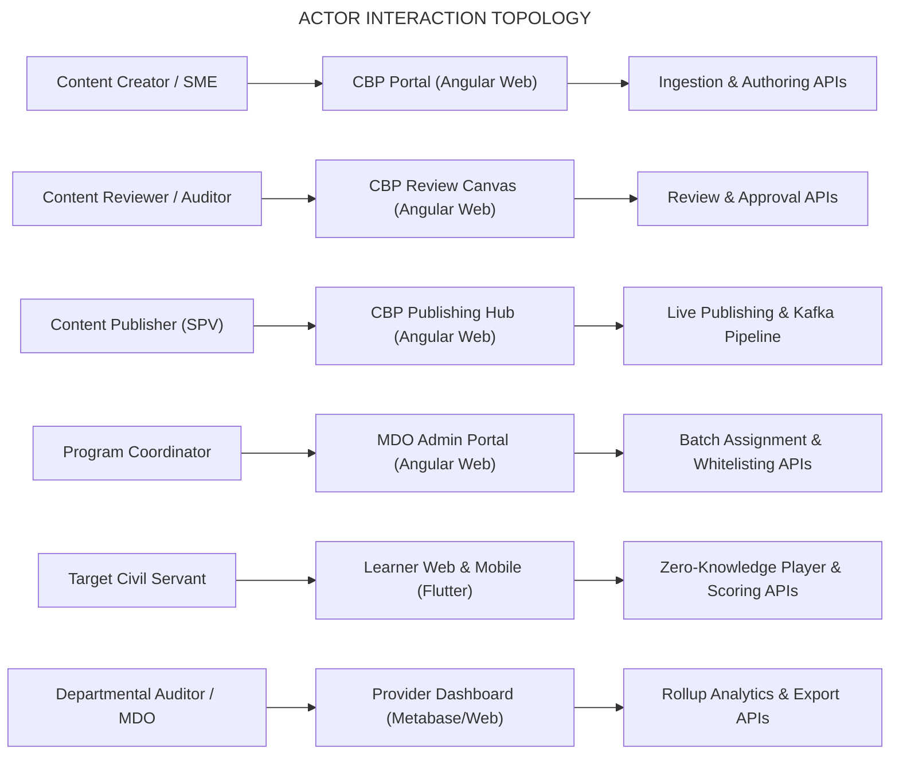

# Moderated Assessment — Generic Use Cases Document

## 2. Executive Overview & Scope of Use Cases

This document establishes the end-to-end **Generic Use Cases** governing the **Moderated Assessment Subsystem** within the iGOT Karmayogi platform. It captures both functional operational flows and technical interaction boundaries across front-end portals and back-end distributed microservices, tracing how requirements and workflows evolved from **Q2 through Q13**.

### Use Case Taxonomy Structure

The use cases are structured across seven distinct operational and architectural pillars:

1. **UC-AUTH: Assessment Authoring, Ingestion & Metadata Configuration**
2. **UC-ACC: Access Control, Cohort Whitelisting & User Segmentation**
3. **UC-REV: Multi-Tier Moderation, Quality Audit & Publishing Governance**
4. **UC-DISC: Catalog Indexing, Faceted Search & Discovery**
5. **UC-GATE: Program TOC, Prerequisite Evaluation & Assessment Locking (L2)**
6. **UC-PLAY: Zero-Knowledge Assessment Execution, Single Sitting & Real-Time Telemetry**
7. **UC-EVAL: Server-Side Evaluation, Negative Marking, Certification & Provider Analytics**

## 3. Actor & Persona Profiles



| Actor ID | Role / Persona | Operational Scope & Responsibilities | Interacting Surfaces |
|---|---|---|---|
| **ACT-01** | **Content Creator / SME** | Authors assessment metadata, configures passing cut-offs ($\ge 50%$), uploads bulk questions via CSV, defines negative marking rates, uploads media assets. | CBP Content Builder (Angular 15+) |
| **ACT-02** | **Content Reviewer** | Audits question accuracy, verifies question taxonomy (Easy, Medium, Difficult, HOTS), inspects answer keys, approves or rejects with remarks. | CBP Review Portal (Angular 15+) |
| **ACT-03** | **Content Publisher (SPV)** | Validates global accessibility, reviews legal/compliance declarations, transitions content to Live, triggers Kafka publishing events. | CBP SPV Workspace (Angular 15+) |
| **ACT-04** | **Program Coordinator** | Creates cohort batches, whitelists target MDOs or CSV user lists, schedules assessment availability windows. | MDO Admin Portal (Angular 15+) |
| **ACT-05** | **Target Civil Servant (Learner)** | Discovers eligible assessments, completes prerequisite courses, executes tests in single sitting, submits answers, views certificates. | Learner Web Portal (Angular) & Mobile App (Flutter) |
| **ACT-06** | **Departmental Auditor / MDO Admin** | Tracks cohort attendance, completion ratios, average scores, exports compliance reports for civil service records (APAR). | Provider Dashboard & MDO Analytics |

## 4. Pillar 1: Assessment Authoring, Ingestion & Configuration (UC-AUTH)

### UC-AUTH-01: Manual Question Bank Authoring with Media & HOTS Categorization

- **Primary Actor:** Content Creator (ACT-01)
- **Goal:** Create an assessment with sectional divisions, multiple question types (SCQ, MCQ, FTB inline dropdowns), difficulty levels (Easy, Medium, Difficult, HOTS), and multimedia attachments (video up to 400 MB).
- **Evolution Reference:** Q2 Baseline $\rightarrow$ Q4 Enhanced Schemas ([KB-3958](https://karmayogibharat.atlassian.net/browse/KB-3958), [KB-3965](https://karmayogibharat.atlassian.net/browse/KB-3965), [KB-3971](https://karmayogibharat.atlassian.net/browse/KB-3971)).
- **Preconditions:**
  - Creator is authenticated with `CONTENT_CREATOR` role.
  - Organization is an accredited Content Provider, ATI, or CTI.

- **Main Success Scenario (Frontend to Backend):**
  - Creator clicks "Create New" $\rightarrow$ selects card category **"Moderated Assessment"** (`courseCategory = "Moderated Assessment"`).
  - Angular UI presents the Metadata Form: Creator inputs Title, Description, Duration (e.g., 60 mins), Overall Passing Criteria ($60%$, system enforces $\ge 50%$ minimum per [KB-11683](https://karmayogibharat.atlassian.net/browse/KB-11683)), and Negative Marking Rate ($0.25$).
  - Creator adds Section 1 ("Quantitative Reasoning") and Section 2 ("Policy Evaluation").
  - In Section 2, Creator creates an inline Fill-in-the-Blanks (FTB) question with dropdown slots (`[BLANK_1]`, `[BLANK_2]`) and attaches a 42 MB MP4 video prompt.
  - Angular client streams the video to Google Cloud Storage (GCS) via pre-signed URL; GCS returns the asset CDN URL.
  - Creator tags questions with `difficultyLevel = "hot"` and associates national competency tags from Neo4j.
  - Client dispatches `POST /apis/proxies/v8/action/assessment/v3/create` and `POST /action/assessment/v3/questions/add`.
  - `cb-ext-assessment-service` validates payload schemas, inserts records into PostgreSQL (`cbp_assessment_nodes`, `cbp_assessment_questions`), and sets state to `DRAFT`.

- **Postconditions:** Assessment exists in PostgreSQL in `DRAFT` state with ground-truth keys stored server-side.
- **Alternative / Exception Flows:**
  - *4a. Passing percentage set below 50%:* Form validation aspect blocks submission and displays error *"Passing criteria cannot be below 50%"* ([KB-11683](https://karmayogibharat.atlassian.net/browse/KB-11683)).
  - *5a. Video file exceeds 400 MB:* Client file uploader terminates transfer and displays *"Asset size exceeds maximum limit of 400 MB"*.

### UC-AUTH-02: Bulk Question Ingestion via Tabular CSV with Automated Sanitization

- **Primary Actor:** Content Creator (ACT-01)
- **Goal:** Rapidly ingest 100+ questions using a structured CSV file, with automated whitespace auto-trimming and schema error isolation.
- **Evolution Reference:** Q4 Schema Introduction $\rightarrow$ Q11 Bulk Ingestion Auto-Trim Hardening ([KB-13076](https://karmayogibharat.atlassian.net/browse/KB-13076)).
- **Preconditions:** Creator has a prepared CSV template matching the QuestionSet v3 schema.
- **Main Success Scenario (Frontend to Backend):**
  - Creator navigates to Question Bank Manager $\rightarrow$ clicks **"Bulk Upload CSV"**.
  - Creator attaches `Union_Budget_Questions.csv` and clicks "Validate & Ingest".
  - Angular client streams the multipart CSV to `POST /apis/proxies/v8/action/assessment/v3/questions/bulk`.
  - Backend `BulkUploadParser` intercepts the stream:
    - Executes regular expression whitespace trimming (`string.trim().replaceAll("\\s+", " ")`) across all cell values to eliminate leading/trailing spaces and newline carriage returns (`\r\n`).
    - Verifies that each SCQ row has exactly one `TRUE` marker in option columns.
    - Verifies marks and negative deduction mathematical validity.

  - The parser transforms tabular rows into JSON structures and executes a batch `INSERT` into PostgreSQL `cbp_assessment_questions`.
  - Backend returns `HTTP 201 Created` with summary: `{ "ingestedCount": 105, "failedCount": 0 }`.
  - UI updates question palette with the newly ingested question rows.

- **Postconditions:** All questions are sanitized, formatted, and bound to the draft assessment in PostgreSQL.
- **Alternative / Exception Flows:**
  - *4a. CSV contains ambiguous SCQ answers (multiple TRUE flags or missing TRUE):* Parser aborts batch transaction and returns `HTTP 400 Bad Request` with exact row numbers and cell identifiers (e.g., *"Row 42: SCQ contains more than one correct option"* per [KB-13076](https://karmayogibharat.atlassian.net/browse/KB-13076)).

## 5. Pillar 2: Access Control & Cohort Whitelisting (UC-ACC)

### UC-ACC-01: Configuring MDO & Verified Karmayogi Gating Policies

- **Primary Actor:** Content Creator (ACT-01) or SPV Publisher (ACT-03)
- **Goal:** Restrict assessment consumption to verified civil servants of specific ministries (e.g., Department of Personnel & Training, Ministry of Finance) and block general public access.
- **Evolution Reference:** Q3 Access Settings Redesign $\rightarrow$ Q8 Dynamic User Groups & Cascading Resets ([KB-1936](https://karmayogibharat.atlassian.net/browse/KB-1936), [KB-2044](https://karmayogibharat.atlassian.net/browse/KB-2044), [KB-9603](https://karmayogibharat.atlassian.net/browse/KB-9603)).
- **Preconditions:** Assessment is in `DRAFT` or `FOR_PUBLISH` status.
- **Main Success Scenario (Frontend to Backend):**
  - Creator navigates to **"Access Control"** tab in the Content Builder.
  - Creator selects **"Custom / MDO Specific"** from the access radio group.
  - UI displays the Organizational Hierarchy picker: Creator selects "Ministry of Personnel, Public Grievances and Pensions" $\rightarrow$ "Department of Personnel and Training (DoPT)".
  - Creator toggles the checkbox: **"Verified Karmayogi Only"** (`requiresVerifiedKarmayogi = true`).
  - Creator adds User Group condition: Designation Group = `DS & Director` and `JS, AS & Secretary`.
  - Creator clicks "Apply Access Rules": Angular client dispatches `POST /apis/proxies/v8/action/assessment/v3/access/set`.
  - Backend writes access records to PostgreSQL `cbp_assessment_access_rules`.

- **Postconditions:** Assessment access policy is locked to whitelisted MDO IDs, verified profile credentials, and target designation tiers.
- **Alternative / Exception Flows:**
  - *3a. Creator modifies parent Ministry after selecting child designations:* The UI triggers a **Cascading Reset** ([KB-9603](https://karmayogibharat.atlassian.net/browse/KB-9603)), clearing dependent designations and cadres to prevent stale or conflicting access criteria.

### UC-ACC-02: Suppressing Public Auto-Batch & Assigning Manual Cohorts

- **Primary Actor:** Program Coordinator (ACT-04)
- **Goal:** Assign a designated participant cohort to a published Moderated Assessment without opening public self-enrollment.
- **Evolution Reference:** Q3 Redesign $\rightarrow$ Q4 Batch Management ([KB-3958](https://karmayogibharat.atlassian.net/browse/KB-3958), [KB-3959](https://karmayogibharat.atlassian.net/browse/KB-3959)).
- **Preconditions:** Assessment is published (`status = "Live"`) with `courseCategory = "Moderated Assessment"`.
- **Main Success Scenario (Frontend to Backend):**
  - Program Coordinator logs into MDO Admin Portal $\rightarrow$ navigates to "Cohort Management".
  - Coordinator selects the live Moderated Assessment.
  - Coordinator clicks "Create Cohort Batch" $\rightarrow$ inputs Batch Name: *"DoPT Director Cohort 2026"*, Start Date, End Date.
  - Coordinator uploads a CSV containing participant identifiers (`userId`, `primaryEmail`).
  - Client calls `POST /apis/proxies/v8/action/cohort/v1/assign`.
  - `cb-enrollment-service` validates that all uploaded user IDs belong to DoPT in `cb-ext-userprofile`.
  - Service writes entries into Cassandra `sunbird.user_enrolments_v2` with `status = 0` (Not Started) and populates `enrollment_batch_lookup`.
  - Service deduplicates batch records to guarantee only one active batch enrollment per user ([KB-1148747777](https://karmayogibharat.atlassian.net/wiki/spaces/TES/pages/1148747777)).

- **Postconditions:** Participants are assigned to the cohort; the assessment appears on their personal dashboards.
- **Alternative / Exception Flows:**
  - *6a. CSV contains user IDs belonging to a non-whitelisted MDO:* The system flags those rows, rejects their enrollment, and outputs an error report: *"User belongs to non-whitelisted organization"*.

## 6. Pillar 3: Moderation, Audit & Publishing Governance (UC-REV)

### UC-REV-01: Multi-Tier Content Review, Audit & Approval

- **Primary Actor:** Content Reviewer (ACT-02) and Content Publisher (ACT-03)
- **Goal:** Audit draft assessment questions, review scoring rules, and publish live while suppressing automatic open batch generation.
- **Evolution Reference:** Q3 Redesign Workflow ([KB-1936](https://karmayogibharat.atlassian.net/browse/KB-1936), [KB-2854](https://karmayogibharat.atlassian.net/browse/KB-2854)).
- **Preconditions:** Assessment is in `Under Review` status.
- **Main Success Scenario (Frontend to Backend):**
  - Reviewer navigates to **"For Review"** workspace $\rightarrow$ selects assessment.
  - Reviewer inspects questions, answer keys, media streams, and access rules in read-only audit mode.
  - Reviewer approves content: clicks "Send for Publish" $\rightarrow$ state updates to `For Publish`.
  - SPV Publisher logs in $\rightarrow$ reviews national compliance $\rightarrow$ clicks **"Publish Live"**.
  - Client dispatches `POST /apis/proxies/v8/action/content/v3/publish`.
  - Backend updates status in PostgreSQL to `Live` and emits an event to Kafka topic `content.publish.pipeline`:

```json
{
  "identifier": "do_113894726482",
  "courseCategory": "Moderated Assessment",
  "status": "Live"
}
```

1. Apache Flink stream worker (`BatchCreationSuppressorJob`) consumes the event:
  - Inspects `courseCategory`: detects `"Moderated Assessment"`.
  - **Action:** Suppresses automatic public batch creation in Cassandra.

2. Search indexing worker updates Elasticsearch cluster with live metadata and MDO access restrictions.

- **Postconditions:** Assessment is live in the database and catalog index, but inaccessible to the general public until cohort batches are assigned.
- **Alternative / Exception Flows:**
  - *2a. Reviewer identifies incorrect answer key or low-quality media:* Reviewer clicks "Reject with Remarks" $\rightarrow$ provides mandatory feedback. State transitions back to `Draft` and the Content Creator is notified.

## 7. Pillar 4: Catalog Indexing, Faceted Search & Discovery (UC-DISC)

### UC-DISC-01: Cohort-Restricted Catalog Discovery via Faceted Search

- **Primary Actor:** Target Civil Servant (ACT-05)
- **Goal:** Discover eligible Moderated Assessments via personalized search and explore filters without seeing restricted tests from other departments.
- **Evolution Reference:** Q7 Search & Facets $\rightarrow$ Q8 Catalog Filters ([KB-7869](https://karmayogibharat.atlassian.net/browse/KB-7869), [KB-7871](https://karmayogibharat.atlassian.net/browse/KB-7871), [KB-9333](https://karmayogibharat.atlassian.net/browse/KB-9333), [KB-9789](https://karmayogibharat.atlassian.net/browse/KB-9789)).
- **Preconditions:** Learner is authenticated via Parichay SSO; profile attributes indicate `orgId = "org_dopt_01"` and `isVerified = true`.
- **Main Success Scenario (Frontend to Backend):**
  - Learner opens Learner Portal $\rightarrow$ navigates to "Explore Content" or views **"My Assigned Content"** horizontal strip ([KB-9789](https://karmayogibharat.atlassian.net/browse/KB-9789)).
  - Learner types *"Fiscal Policy"* in search bar and checks filter: `Category -> Moderated Assessment`.
  - Angular client dispatches search query to `POST /apis/proxies/v8/sunbirdigot/v4/search` with projected fields (`name`, `posterImage`, `duration`, `courseCategory`, `difficultyLevel`) ([KB-13971](https://karmayogibharat.atlassian.net/browse/KB-13971)).
  - Backend `cb-search-service` applies security filters:
    - Appends Elasticsearch query clause:

```json
{
  "bool": {
    "must": [
      {
        "term": {
          "courseCategory.keyword": "Moderated Assessment"
        }
      }
    ],
    "filter": [
      {
        "terms": {
          "secureSettings.organisation.keyword": [
            "org_dopt_01"
          ]
        }
      }
    ]
  }
}
```

1. Elasticsearch returns matching assessment cards whitelisted for DoPT.
2. Learner sees the assessment card displaying Title, Provider (ATI), Duration, and Badge: *"Moderated"*.

- **Postconditions:** Learner views only authorized assessments matching their MDO profile.
- **Alternative / Exception Flows:**
  - *4a. Non-target learner (e.g., Ministry of Railways) searches for the same keyword:* Elasticsearch query filters out the assessment card based on organization mismatch. Result returns empty array (`HTTP 200 []`).

## 8. Pillar 5: Program TOC, Prerequisite Evaluation & Assessment Locking (UC-GATE)

### UC-GATE-01: Enforcing Prerequisite Gating for L2 Assessments in Curated Programs

- **Primary Actor:** Target Civil Servant (ACT-05)
- **Goal:** Enforce sequential completion of foundational learning modules before unlocking the final Moderated Assessment within a Curated Learning Pathway.
- **Evolution Reference:** Q8 Curated Program L2 Final Assessments & Assessment Locking ([KB-8065](https://karmayogibharat.atlassian.net/browse/KB-8065), [KB-8841](https://karmayogibharat.atlassian.net/browse/KB-8841), [KB-8842](https://karmayogibharat.atlassian.net/browse/KB-8842)).
- **Preconditions:**
  - Learner is enrolled in Curated Program *"Public Governance & Ethics 2026"*.
  - Program structure: Module 1 (Course), Module 2 (Course), Module 3 (Final Moderated Assessment - L2).

- **Main Success Scenario (Frontend to Backend):**
  - Learner opens the Curated Program Table of Contents (TOC) page.
  - Angular client calls `GET /apis/proxies/v8/action/content/v3/hierarchy/{programId}`.
  - `cb-ext-course-service` evaluates learner leaf-node progress in Cassandra `sunbird.user_enrolments_v2`:
    - Module 1: `status = 2` (100% Completed)
    - Module 2: `status = 2` (100% Completed)

  - Service verifies that all prerequisite conditions for Module 3 are satisfied.
  - Service generates an ephemeral signed launch token (`unlockToken`, HMAC-SHA256, 120-second TTL).
  - Backend returns TOC response with Module 3 state: `isLocked = false` and attaches `unlockToken`.
  - Client TOC renders the final assessment with an active blue CTA: **"Start Assessment"**.
  - Learner clicks "Start Assessment", transitioning into the exam player container.

- **Postconditions:** Learner successfully unlocks and launches the final evaluation.
- **Alternative / Exception Flows:**
  - *3a. Module 2 progress is 80% (Incomplete):* Service detects unsatisfied prerequisites. Module 3 returns `isLocked = true` with empty token. Client renders a lock icon and microcopy: *"Complete Module 2 to unlock this assessment"* ([KB-8065](https://karmayogibharat.atlassian.net/browse/KB-8065)). Start CTA remains disabled.

## 9. Pillar 6: Zero-Knowledge Player Execution & Proctoring (UC-PLAY)

### UC-PLAY-01: Zero-Knowledge Payload Delivery & Anti-Tampering Initialization

- **Primary Actor:** Target Civil Servant (ACT-05)
- **Goal:** Launch and consume an assessment in a secure, zero-knowledge runtime where ground-truth answer keys are completely withheld from the browser.
- **Evolution Reference:** Q3 Redesign $\rightarrow$ Q4 QuestionSet v3 Engine ([KB-2178](https://karmayogibharat.atlassian.net/browse/KB-2178), [KB-1582](https://karmayogibharat.atlassian.net/browse/KB-1582), [SRS - Assessments](https://karmayogibharat.atlassian.net/wiki/spaces/TES/pages/87392295/SRS+-+Assessments)).
- **Preconditions:** Learner has obtained an ephemeral `unlockToken` from the TOC engine.
- **Main Success Scenario (Frontend to Backend):**
  - Learner clicks "Start Assessment": Player presents the Pre-Flight Instructions Screen detailing Duration, Pass Criteria, and Rules.
  - Learner checks mandatory box: *"I agree to complete this assessment in a single continuous session without unauthorized aids"*.
  - Learner clicks "Begin Test": Client dispatches `POST /apis/proxies/v8/action/assessment/v3/start` with `unlockToken` and `batchId`.
  - Backend `cb-ext-assessment-service`:
    - Validates token signature and TTL.
    - Acquires Redis distributed lock: `SET assessment:session:{userId}:{attemptId} ACTIVE EX 3600`.
    - Calculates authoritative timestamps: `serverTimestamp = NOW()`, `expiresAt = NOW() + 3600000`.
    - Queries PostgreSQL for master questions; executes Jackson serialization using `@JsonView(Views.LearnerPayload.class)`, which omits all `answer_key` fields.
    - Shuffles question and option arrays if configured.

  - Backend returns obfuscated JSON payload and server timestamps.
  - Player viewport initializes countdown timer synchronized to the server clock; question 1 renders.

- **Postconditions:** Active exam session is established in Redis; student client contains zero answer keys.
- **Alternative / Exception Flows:**
  - *4a. Learner attempts to open assessment concurrently in a second browser window:* Redis lock detection identifies an active session for the user. Backend rejects the request with `HTTP 409 Conflict` (`ERR_CONCURRENT_SESSION_ACTIVE`).

### UC-PLAY-02: Single-Sitting Runtime Navigation, Autosave Telemetry & Auto-Submission

- **Primary Actor:** Target Civil Servant (ACT-05)
- **Goal:** Navigate questions, select answers, synchronize state via background telemetry, and automatically submit when the exam timer expires.
- **Evolution Reference:** Q3 UX Redesign $\rightarrow$ Q4 Telemetry Hardening ([KB-2178](https://karmayogibharat.atlassian.net/browse/KB-2178), [SRS - Assessments](https://karmayogibharat.atlassian.net/wiki/spaces/TES/pages/87392295/SRS+-+Assessments)).
- **Preconditions:** Active assessment sitting in progress.
- **Main Success Scenario (Frontend to Backend):**
  - Learner views Question 1 (SCQ): Selects Option B.
  - Player updates Navigation Drawer: Question 1 palette marker changes from White (Unanswered) to Green (Answered).
  - Player asynchronously emits a CASS `ASSESS` telemetry event via background worker to Cassandra `sunbird.telemetry_assess_state`.
  - Learner navigates to Question 2 (Media Prompt): Watches the embedded MP4 video and marks question as "Flag for Review" (palette turns Yellow).
  - Client emits heartbeat ping every 60 seconds to `/action/assessment/v3/heartbeat`:
    - Backend compares client heartbeat time against server authoritative clock.
    - Clock drift is $< 2$ seconds; backend returns `HTTP 200 OK`.

  - Exam countdown reaches `00:00` (Timer Expiry):
    - Player locks all UI inputs.
    - Displays modal: *"Time has expired. Submitting your assessment automatically..."*

  - Client automatically dispatches `POST /apis/proxies/v8/action/assessment/v3/submit` with all selected answers.

- **Postconditions:** Final state is transmitted to server; active session lock in Redis is marked for cleanup.
- **Alternative / Exception Flows:**
  - *5a. Client device system clock is altered locally to gain extra time:* Heartbeat detector identifies clock drift $> 10$ seconds. Server overrides local client clock, force-resets the countdown timer, and logs a security audit event.
  - *7a. Learner manually finishes before time expires:* Learner clicks "Submit Assessment" $\rightarrow$ Summary Modal displays Attempted (38), Flagged (2), Unanswered (0) $\rightarrow$ Learner clicks "Confirm Submission".

## 10. Pillar 7: Evaluation, Certification & Analytics (UC-EVAL)

### UC-EVAL-01: Server-Side Grading with Negative Marking & Gated Certification

- **Primary Actor:** Target Civil Servant (ACT-05) and CertRegistry Service
- **Goal:** Grade the submitted assessment entirely on backend services, deduct negative marks, determine pass/fail status, and trigger automated certificate issuance.
- **Evolution Reference:** Q4 Scoring Core $\rightarrow$ Q8 Certificate Binding ([KB-3958](https://karmayogibharat.atlassian.net/browse/KB-3958), [KB-8841](https://karmayogibharat.atlassian.net/browse/KB-8841), [KBN-8807](https://karmayogibharat.atlassian.net/browse/KBN-8807)).
- **Preconditions:** Submission payload received at `POST /apis/proxies/v8/action/assessment/v3/submit`.
- **Main Success Scenario (Frontend to Backend):**
  - `cb-ext-assessment-service` receives submitted answer array (`questionId`, `selectedOptionId`).
  - `ServerSideScoringEngine` loads ground-truth answer keys from PostgreSQL:
    - Iterates through questions: compares user selections against correct options.
    - Correct selection: adds full marks (e.g., $+2.0$).
    - Incorrect selection: subtracts configured negative marking rate (e.g., $-0.5$).
    - Unattempted: $0.0$ points.

  - Engine computes final score:<br>$$\text{Final Score} = \max\left(0, \sum \text{Correct} - \sum \text{Negative Deductions}\right) = 48.0 / 60.0 \quad (80%)$$
  - Engine compares percentage ($80%$) against `overallPassMarks` ($60%$): Status = `PASSED`.
  - Service writes attempt record to Cassandra `sunbird.assessment_attempt_records` and releases Redis session lock.
  - Service publishes event to Kafka topic `cert.generation.trigger`:

```json
{
  "userId": "usr_987654",
  "assessmentId": "do_113894726482",
  "score": 48.0,
  "percentage": 80.0,
  "status": "PASSED"
}
```

1. `CertRegistry` worker consumes the event, generates a digitally signed PDF certificate containing the learner's name, MDO, score, and QR code, and registers it in DigiLocker.
2. Backend returns submission response (`HTTP 200 OK`) to learner: `{ "status": "PASSED", "score": 48.0, "certificateIssued": true }`.
3. Learner UI renders Results Screen with green banner and button: **"Download Certificate"**.

- **Postconditions:** Evaluation is finalized, Cassandra contains immutable attempt records, and certificate is available on learner profile.
- **Alternative / Exception Flows:**
  - *4a. Learner score is below passing cut-off (e.g., 45% vs 60% required):* Status = `FAILED`. System checks `maxAttempts`: if attempts remain, TOC shows *"Retake Assessment (Attempts left: 1)"*; if attempts exhausted, status is recorded as permanently incomplete. No certificate event is emitted.

### UC-EVAL-02: Provider Dashboards, Offering Pills & Compliance Reporting

- **Primary Actor:** Departmental Auditor / MDO Admin (ACT-06)
- **Goal:** Monitor assessment rollouts, track real-time pass/fail distributions across cohorts, and export departmental compliance reports for APAR.
- **Evolution Reference:** Q5 Provider Digitization & Dashboards $\rightarrow$ Q13 APAR Enhancements ([KB-5761](https://karmayogibharat.atlassian.net/browse/KB-5761), [KB-5762](https://karmayogibharat.atlassian.net/browse/KB-5762), [KB-6378](https://karmayogibharat.atlassian.net/browse/KB-6378), [KB-15322](https://karmayogibharat.atlassian.net/browse/KB-15322)).
- **Preconditions:** Auditor is authenticated with `MDO_ADMIN` or `CONTENT_PROVIDER` role.
- **Main Success Scenario (Frontend to Backend):**
  - MDO Admin logs into the Provider Dashboard.
  - UI displays summary Offering Breakdown Pills ([KB-5762](https://karmayogibharat.atlassian.net/browse/KB-5762)): All (24), Live (18), Draft (4), Retired (2).
  - Admin selects a live Moderated Assessment: Dashboard queries `/apis/proxies/v8/action/assessment/v3/report/{assessmentId}`.
  - Backend aggregates metrics from Cassandra rollup tables:
    - Total Enrolled: $1,250$
    - Attempted: $1,180$ ($94.4%$)
    - Passed: $1,050$ ($88.9%$)
    - Failed: $130$ ($11.1%$)
    - Score Distribution: $0\text{--}50%$ (130), $50\text{--}70%$ (420), $70\text{--}90%$ (510), $90\text{--}100%$ (120).

  - Admin clicks **"Export Audit CSV"**:
    - Backend generates an encrypted CSV export containing Learner Name, Masked Aadhaar/ID, Department, Designation, Attempt Timestamp, Score, and Pass/Fail Status.

  - File streams to Admin browser for departmental auditing and civil service appraisal integration (APAR).

- **Postconditions:** Complete audit records are retrieved and exported for administrative evaluation.

## 11. End-to-End System Integration Flow Matrix

**USE CASE SYSTEM INTEGRATION TRACEABILITY**

| Use Case ID | Triggering Surface | Interacting Microservices | Persistence Target | Verification & Test Protocol |
|---|---|---|---|---|
| UC-AUTH-01 | CBP Content Builder | cb-ext-assessment-service | PostgreSQL 14 Cluster | Verify JSON schema and pass% floor |
| UC-AUTH-02 | Bulk CSV Uploader | BulkUploadParser Subsystem | PostgreSQL 14 Cluster | Test whitespace auto-trim & SCQ flags |
| UC-ACC-01 | Access Control Canvas | cb-ext-assessment-service | PostgreSQL Access DB | Verify cascading condition reset |
| UC-ACC-02 | MDO Admin Portal | cb-enrollment-service | Cassandra Ring | Assert batch whitelisting & deduping |
| UC-REV-01 | CBP Review Canvas | Flink Batch Suppressor Job | Kafka / Cassandra | Confirm suppression of public batch |
| UC-DISC-01 | Learner Catalog / App | cb-search-service | Elasticsearch 7.x | Test faceted MDO query isolation |
| UC-GATE-01 | Program TOC Page | cb-ext-course-service | Cassandra / Neo4j | Test leaf progress lock & JWT token |
| UC-PLAY-01 | Pre-Flight Screen | cb-ext-assessment-service | Redis Sentinel Ring | Verify zero-knowledge payload & locks |
| UC-PLAY-02 | Exam Player Viewport | Telemetry Async Engine | Cassandra Ring | Test countdown sync & auto-submit |
| UC-EVAL-01 | Player Submission | Server Scoring / CertEngine | Cassandra / Kafka | Validate negative marks & cert event |
| UC-EVAL-02 | Provider Dashboard | Provider Reporting Service | Cassandra / ES Rollup | Validate aggregate score metrics |
