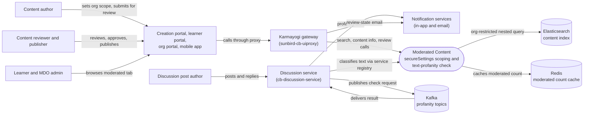

# Moderated Content — Context Diagram

## System boundary

Inside the feature are two independent mechanisms that share the word "moderation": the
MDO-scoped content-visibility scheme (a `courseCategory` value plus `secureSettings`,
enforced in the platform search layer and riding the generic Draft/Review/Live workflow) and
the asynchronous text-profanity check on discussion posts. Outside it are the people who
author, review, publish and learn, the creation, learner and org portals and mobile app, the
gateway, the discussion service, the notification services, and Kafka, Elasticsearch and
Redis.

## Diagram

## Elements

| Element | Role | Detailed in |
|---|---|---|
| Moderated Content | Central scope: `courseCategory` plus `secureSettings` search enforcement, and the separate ML profanity check (`content-moderation-service`) | [hld.md](hld.md) |
| Content author | Creates Moderated Course/Program/Assessment, sets org scope and verified-Karmayogi toggle, submits for review | [use-cases.md](use-cases.md) |
| Content reviewer and publisher | Works the generic review queue, approves, publishes or rejects to draft | [use-cases.md](use-cases.md) |
| Learner and MDO admin | See the org-scoped "Moderated contents" tab, search filter and training-plan browsing | [use-cases.md](use-cases.md) |
| Discussion post author | Posts and replies; subject of the profanity check and recipient of the alert | [use-cases.md](use-cases.md) |
| Creation portal, learner portal, org portal, mobile app | Clients that author, review and consume moderated content | [hld.md](hld.md) |
| Karmayogi gateway (`sunbird-cb-uiproxy`) | Proxy path for review/publish calls and the review-state email route | [apis.md](apis.md) |
| Discussion service (`cb-discussion-service`) | Saves posts, requests the profanity check, consumes the result, soft-hides flagged posts | [apis.md](apis.md) |
| Notification services | In-app alert for flagged posts; separate email path for review states | [apis.md](apis.md) |
| Elasticsearch | Holds content with `secureSettings`; restricts results by org at query time | [hld.md](hld.md) |
| Redis | Caches the per-user moderated content count | [apis.md](apis.md) |
| Kafka | Carries the language-detect and profanity-result events | [apis.md](apis.md) |

> **Verification boundary:** elements and interactions come from the feature's own pages,
> read in full: index, use cases, APIs and HLD. The LLD, operations manual and as-built
> requirements pages were not read for this diagram. Source spot-check was limited: only the
> review-state email route in `sunbird-cb-uiproxy` was confirmed; searches for the search
> actor, discussion topics and moderation route in the other cloned repos returned nothing
> at the checked-out refs, so those links rest on the docs alone. Documented gaps stay
> out of the diagram: no producer was found for course review or publish in-app
> notifications, and the service-registry hop is inferred, not read.
