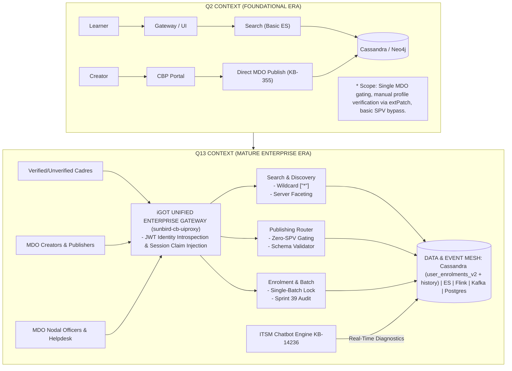
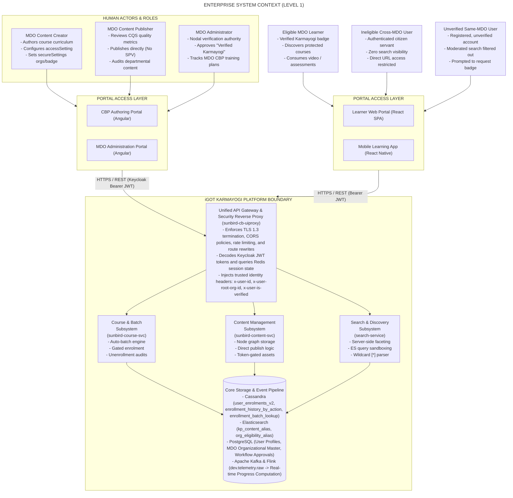
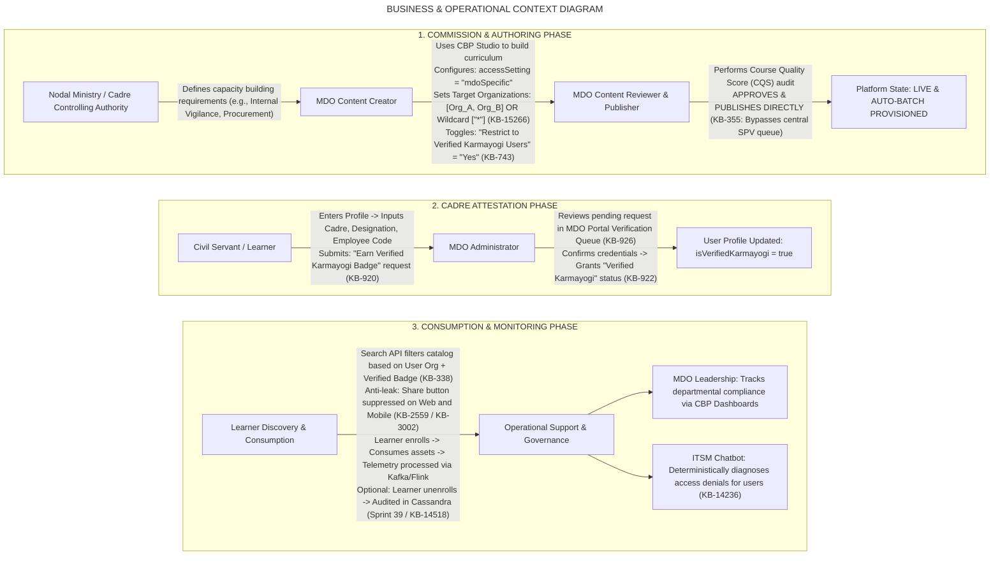
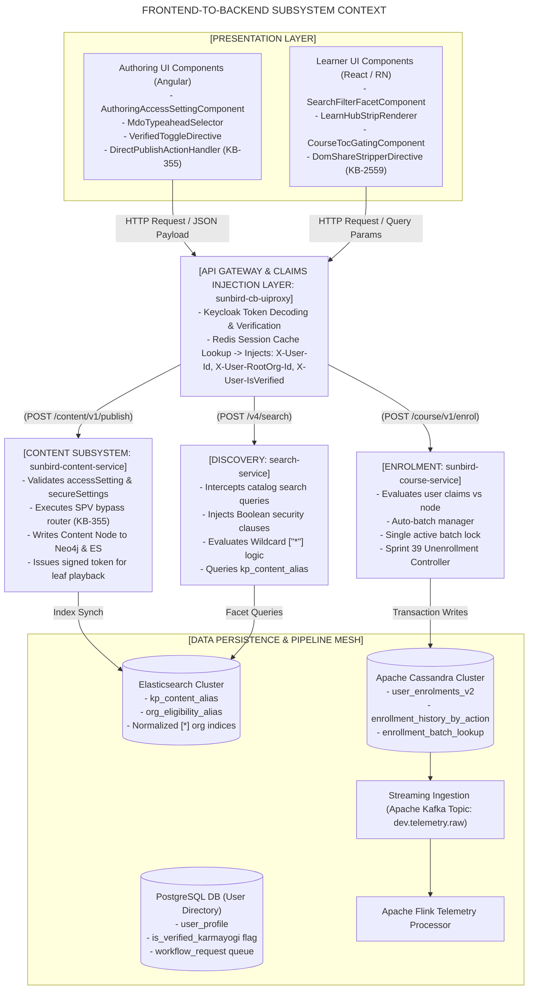
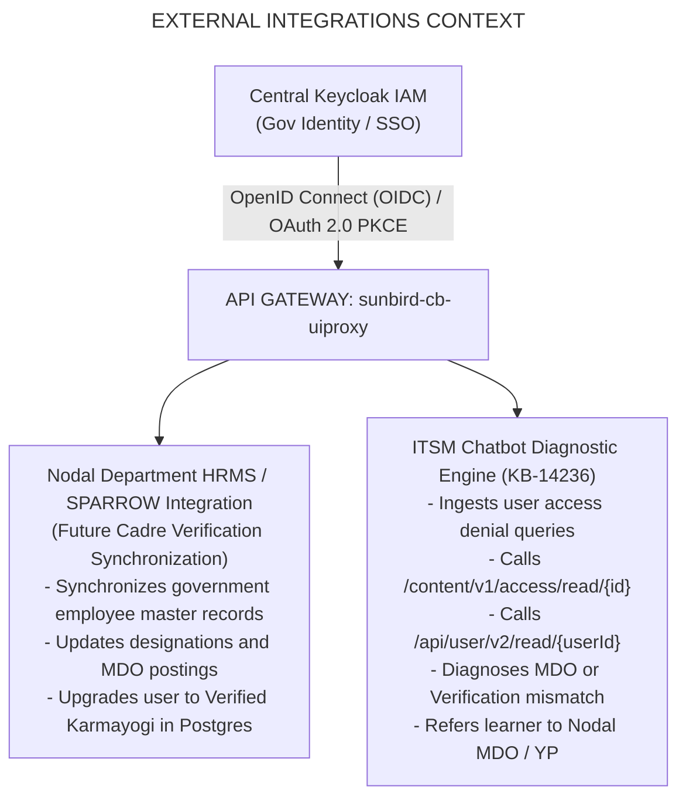

# Moderated Course — System Context Diagram

## 1. Document Purpose & Architectural Scope

This document establishes the **System Context**, enterprise boundaries, external integrations, user persona touchpoints, and internal subsystem interactions governing the **Moderated Course** capability on the **iGOT Karmayogi Platform**.

Unlike standard public courses—which are globally discoverable, openly enrollable, and gated centrally by the Special Purpose Vehicle (SPV) Publisher queue—Moderated Courses introduce **sovereign departmental boundaries** and **cadre attestation controls**. This document details the architectural context across the complete platform lifecycle from **Creation & Publishing** through **Discovery, Enrolment, Consumption, Telemetry, and Unenrollment**, tracing its chronological evolution from **Q2 to Q13**.

## 2. Evolution of System Context (Q2 vs. Q13)

Between Q2 and Q13, the Moderated Course boundary transitioned from a basic departmental filtering mechanism to a multi-tiered, zero-trust access ecosystem.

## 3. Diagram 1: Enterprise System Context Diagram (C4 Level 1)

This diagram details the top-level boundary of the iGOT Karmayogi Platform with respect to internal and external actors, governing bodies, administrative portals, and support services.

## 4. Diagram 2: Business & Operational Context Diagram

This diagram maps the business lifecycle stages—from administrative course commissioning to consumption and operational support triage—against the organizational entities involved.

## 5. Diagram 3: Frontend-to-Backend Subsystem Context Diagram

This diagram details the presentation components, gateway translation filters, backend services, and database tables that execute creation and consumption.

## 6. Diagram 4: Boundary & Data Flow Context (Creation vs. Consumption)

This diagram contrasts the data boundaries and information movement across the two primary workflows of the Moderated Course ecosystem.

```mermaid
---
title: BOUNDARY & LIFECYCLE DATA FLOWS
---
flowchart TD
    subgraph CRE["CREATION & PUBLISHING BOUNDARY (INBOUND CONTENT)"]
        AU["Author: CBP Studio"] -->|"1. POST /content/v1/create (accessSetting: #quot;mdoSpecific#quot;, secureSettings: #123;orgs, isVerified#125;)"| GW1["Gateway: sunbird-cb-uiproxy"]
        GW1 -->|"2. Routes to Content Service with Author Role Tokens"| CS1["Content Service: sunbird-content-service"]
        CS1 --> S3A["3A. Writes Node Graph to Neo4j / Transaction DB (Status: Draft)"]
        CS1 --> PUBA["MDO Content Publisher Action"]
        PUBA -->|"3B. POST /content/v1/publish (KB-355: Direct Go-Live)"| PE["Content Service Publishing Engine"]
        PE --> S4A["4A. Updates Status: #quot;Live#quot; in Graph Store"]
        PE --> S4B["4B. Indexes Node in Elasticsearch (kp_content_alias)"]
        PE --> S4C["4C. Emits ContentPublishEvent to Kafka Topic"]
        PE --> CRS1["Course Service: sunbird-course-service"]
        CRS1 --> S5["5. Auto-Batch Engine provisions single open batch (enrollment_batch_lookup)"]
    end
    subgraph CON["CONSUMPTION & LIFECYCLE BOUNDARY (OUTBOUND LEARNING)"]
        LW["Learner: Web / Mobile App"] -->|"1. POST /apis/proxies/v8/sunbirdigot/v4/search"| GW2["Gateway: sunbird-cb-uiproxy"]
        GW2 -->|"2. Injects Claims: X-User-RootOrg-Id: #quot;0138...#quot;, X-User-IsVerified: #quot;true#quot;"| SS["Search Service: search-service"]
        SS -->|"3. Appends Bool Clauses to ES Query (Matches secureSettings.org & badge)"| ESK[("Elasticsearch: kp_content_alias")]
        ESK -->|"4. Returns ONLY eligible course cards (Zero metadata leakage)"| CE["Learner: Clicks #quot;Enroll#quot;"]
        CE -->|"5. POST /apis/proxies/v8/course/v1/enrol"| CRS2["Course Service: sunbird-course-service"]
        CRS2 -->|"6. Re-evaluates claims vs content node<br/>7. Writes active row to Cassandra (sunbird_courses.user_enrolments_v2)"| PA["Learner: Plays Course Asset"]
        PA -->|"8. Streaming Telemetry (INTERACT / ASSESS) ---> Kafka ---> Flink<br/>9. Real-time progress updates written to Cassandra"| OU["Learner: Optional Unenrollment"]
        OU -->|"10. POST /course/v1/unenrol (Sprint 39 / KB-14518)"| U1[("Cassandra: user_enrolments_v2 (active = false)")]
        OU -->|"10. POST /course/v1/unenrol (Sprint 39 / KB-14518)"| U2[("Cassandra: enrollment_history_by_action (Append immutable audit row)")]
    end
    CRE ~~~ CON
```

## 7. Diagram 5: Security Context & Boundary Gating

This diagram details the defensive boundaries deployed across the ecosystem to prevent unauthorized discovery, deep-link traversal, and API manipulation.

**SECURITY ENVELOPE BOUNDARIES**

| ATTACK / LEAKAGE VECTORS | DEFENSIVE GATING CONTROLS ENFORCED |
|---|---|
| **Vector 1: Unverified Discovery** Unverified user browses search catalog attempting to view protected courses. | **BOUNDARY 1: SEARCH QUERY SANDBOXING** - Gateway injects x-user-is-verified header from session. - Search service appends mandatory bool query clause. - Protected nodes completely omitted from Elasticsearch hits. |
| **Vector 2: Deep-Link URL Sharing** Eligible learner copies course URL and sends to colleague via messaging/email. | **BOUNDARY 2: PRESENTATION LAYER SHARING STRIP** - DOM Share button removed for Moderated Courses (KB-2559). - Direct TOC URL hit validates profile vs secureSettings. - Ineligible user sees locked screen; leaf nodes blocked. |
| **Vector 3: Direct Enrolment API Injection** Malicious user issues manual POST call to /course/v1/enrol with known courseId. | **BOUNDARY 3: COURSE SERVICE ACCESS RE-EVALUATION** - Course Service ignores client-supplied eligibility claims. - Fetches authoritative course node from internal cache. - Validates user MDO and Verified badge. - Rejects unauthorized calls with HTTP 403 Forbidden. |
| **Vector 4: Direct Asset Streaming Access** User attempts direct GET call on video chunk or assessment hierarchy node. | **BOUNDARY 4: TOKEN-GATED ASSET PLAYBACK** - Hierarchy API confirms active enrolment in Cassandra. - Issues short-lived, signed token for video/document stream. - Unenrolled or unauthorized requests denied at asset edge. |

## 8. Diagram 6: External System Integrations & Triage Context

This diagram illustrates how external identity systems, departmental platforms, and support bots interface with the Moderated Course boundary.

