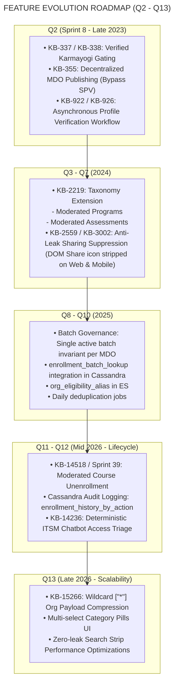
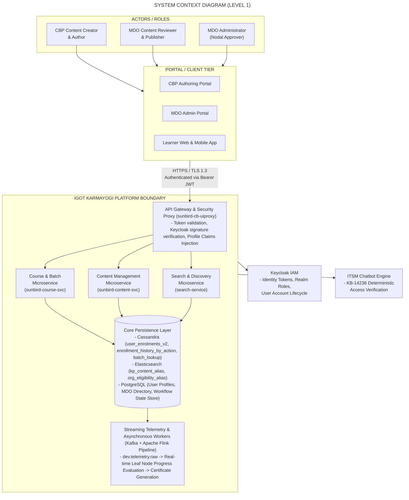
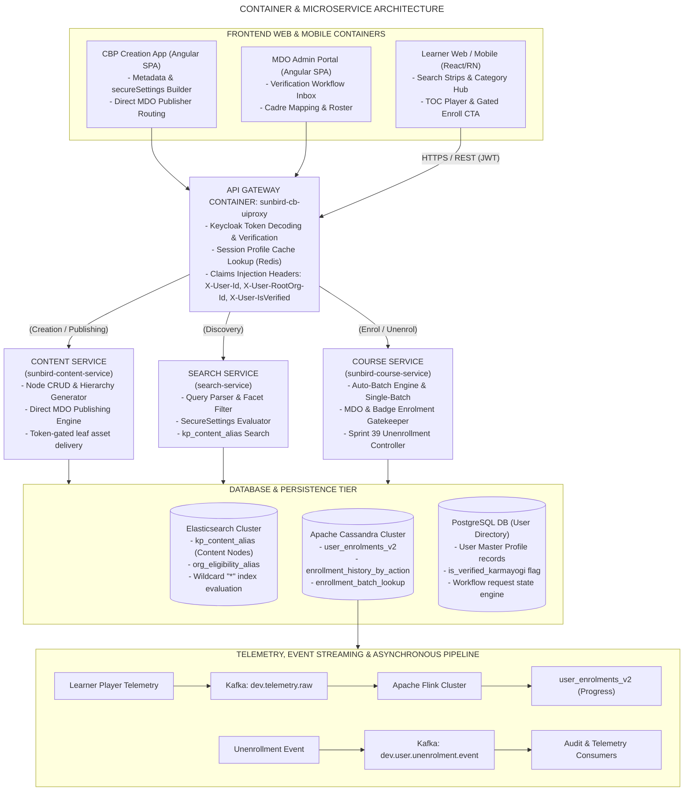
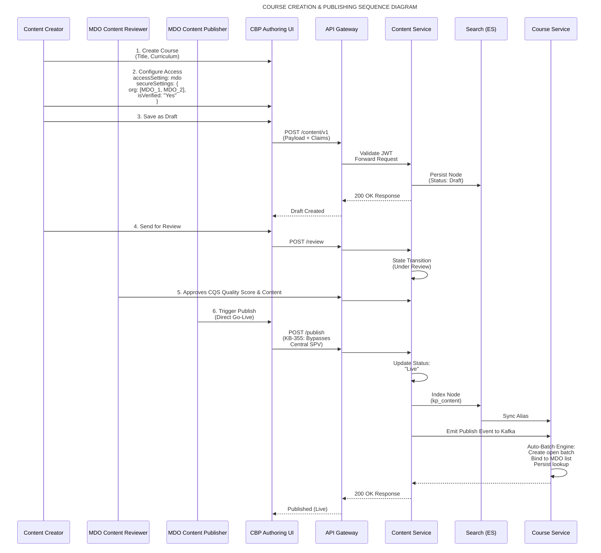
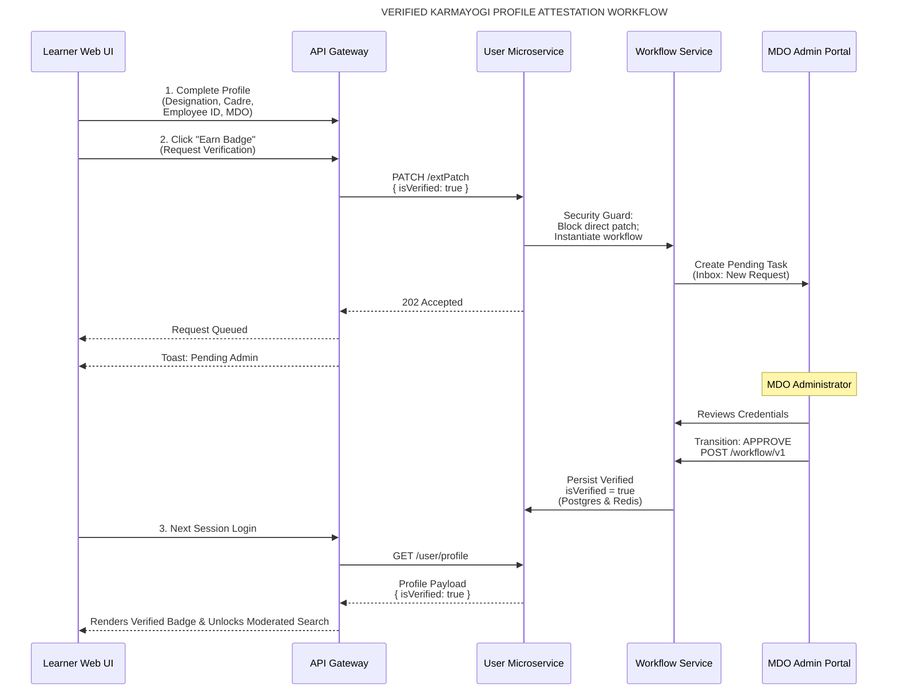
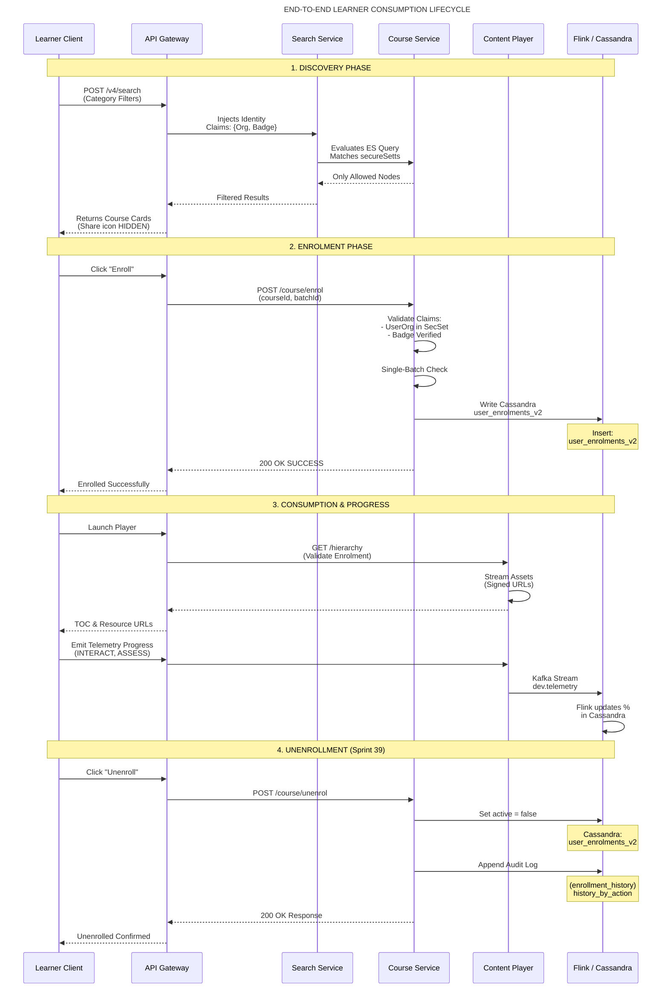
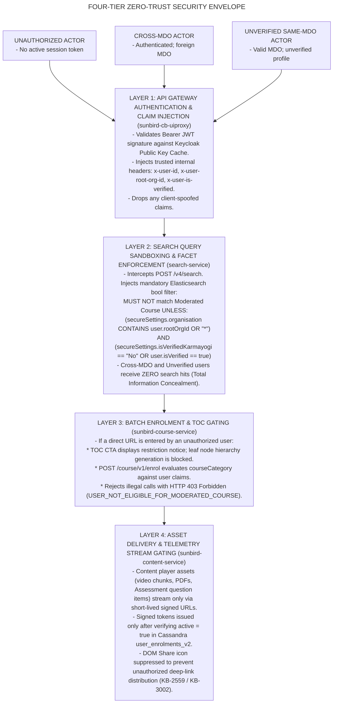
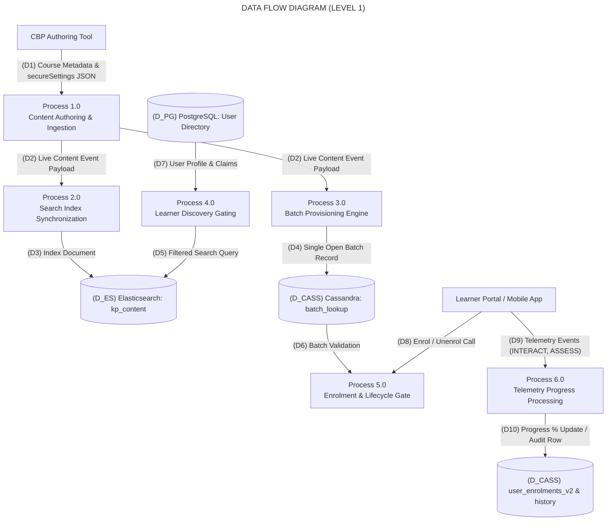
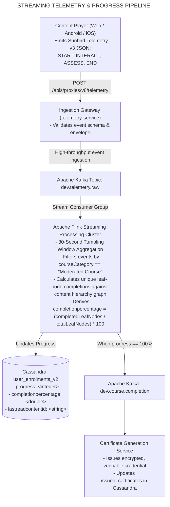
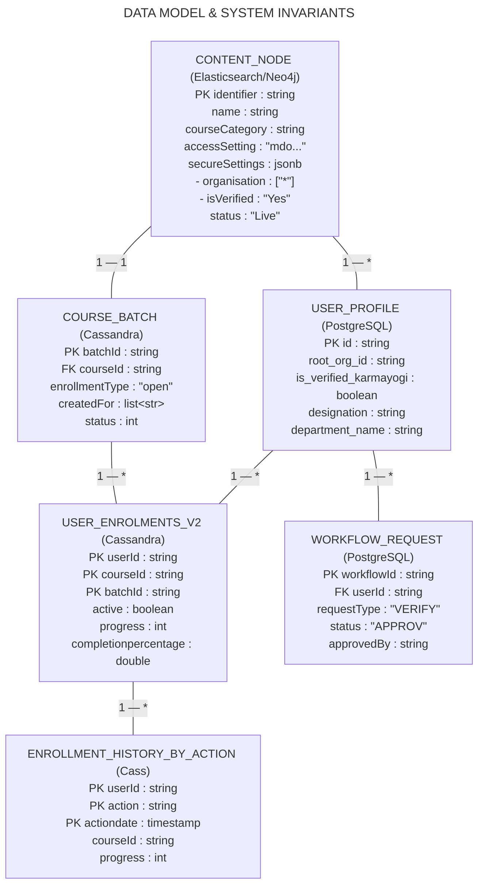

# Moderated Course — High-Level Design (HLD)

## 1. Executive & Architectural Summary

The **Moderated Course** capability is an enterprise-grade access-control, content governance, and publishing framework on the **iGOT Karmayogi Platform**. It solves two core architectural and administrative challenges:

1. **Content Sovereignty & Access Gating:** Enforcing strict boundaries so that specialized or sensitive departmental learning is restricted to authorized cadres based on **Ministry/Department/Organization (MDO)** association and an authoritative, MDO-vetted **"Verified Karmayogi"** badge.
2. **Decentralized Operational Velocity:** Bypassing central SPV publishing gating to allow individual MDO Content Publishers to approve and push departmental learning live immediately.

This HLD document details the comprehensive evolution from **Q2 through Q13**, presenting end-to-end architecture, context diagrams, microservice interconnections, sequence workflows, data flows, and security boundaries spanning both **Creation (Authoring/Publishing)** and **Consumption (Discovery/Enrollment/Playback/Telemetry/Unenrollment)** from frontend to backend.

## 2. Evolution Roadmap & Architectural Timeline (Q2 to Q13)

## 3. Diagram 1: High-Level System Context Diagram (C4 Level 1)

This diagram establishes the external actors, client surfaces, core platform boundaries, and enterprise integration touchpoints.

## 4. Diagram 2: Multi-Tier Microservice Architecture (C4 Level 2)

This diagram details the concrete microservices, internal communication pathways, protocols, and data stores across both creation and consumption paths.

## 5. Diagram 3: End-to-End Course Creation & Publishing Flow

This sequence diagram illustrates the complete workflow when an MDO Content Creator authors a course, configures access parameters, and passes it through the decentralized publishing pipeline (bypassing central SPV).

## 6. Diagram 4: Learner Profile Verification Flow (Verified Karmayogi)

This diagram details the asynchronous attestation flow that upgrades a learner from an unverified self-registered account to an authoritative **"Verified Karmayogi"** eligible for moderated courses ([KB-920](https://karmayogibharat.atlassian.net/browse/KB-920), [KB-922](https://karmayogibharat.atlassian.net/browse/KB-922), [KB-926](https://karmayogibharat.atlassian.net/browse/KB-926)).

## 7. Diagram 5: End-to-End Learner Consumption Lifecycle

This comprehensive sequence diagram illustrates the learner's journey through **Discovery, Enrolment, Playback, Telemetry Ingestion, Completion, and Unenrollment**.

## 8. Diagram 6: Security & Access Control Boundaries

This diagram illustrates how four defensive layers isolate unauthorized users from viewing or consuming restricted content.

## 9. Diagram 7: Data Flow Diagram (DFD Level 1)

This diagram details the movement and transformation of data across creation, publication, indexing, enrollment, telemetry, and unenrollment audit pipelines.

## 10. Diagram 8: Telemetry, Streaming & Progress Calculation Architecture

This diagram illustrates how learner interactions are converted into progress tracking, certificate generation, and compliance reporting.

## 11. Diagram 9: Component Interaction & Data Invariant Model

This entity-relationship and state invariant diagram illustrates the structural integrity guarantees enforced across the Moderated Course ecosystem.

**SYSTEM INVARIANTS & INTEGRITY CONSTRAINTS:**

1. Single Batch Rule: Exactly one active batch per Moderated Course (verified via enrollment_batch_lookup).
2. Publishing Authority: Moderated Courses bypass SPV queue; status transition to Live requires MDO Publisher role.
3. Wildcard Normalization: secureSettings.organisation containing "*" satisfies all authenticated user org queries.
4. Unenrollment Audit: Every unenrollment must append an immutable action row to enrollment_history_by_action.
