**iGOT Karmayogi Platform | Architecture, Evolution & Consumption Lifecycle (Q2–Q14)**

## 1. Executive Summary

The **Moderated Course** feature on the **iGOT Karmayogi Platform** is a core enterprise capability designed to enforce controlled, sovereign, and role-segregated learning content distribution across Indian civil services. Unlike standard public courses that are globally discoverable and enrollable by any registered civil servant, Moderated Courses enforce fine-grained access boundaries based on two primary identity dimensions:

1. **Organizational Affiliation (MDO Mapping):** The learner’s Ministry, Department, or Organization identifier (`organisationId`).
2. **Profile Verification Status:** Whether the learner holds an authoritative, MDO-vetted **"Verified Karmayogi"** badge (`isVerifiedKarmayogi`).

From its inception in **Quarter 2 (Q2 / Sprint 8, late 2023)** through **Quarter 14 (Q14 / mid-2026)**, the feature evolved from simple MDO-restricted listings to a multi-tiered access-control framework spanning course creation, decentralized departmental publishing (bypassing centralized SPV review), dynamic search indexing via `secureSettings`, automated batch orchestration, strict sharing gating (suppression of share actions on Web and Mobile), unenrollment lifecycle tracking in Cassandra, and automated chatbot eligibility resolution.

**MODERATED COURSE AT-A-GLANCE**

| | |
|---|---|
| Primary Category | Course / Program / Standalone Assessment |
| Metadata Classification | courseCategory: "Moderated Course" |
| Access Configuration Attribute | accessSetting: "mdoSpecific" |
| Access Control Envelope | secureSettings: { organisation, isVerifiedKarmayogi } |
| Publishing Authority | MDO Content Publisher (SPV Gating Bypassed) |
| Discovery Filtering | Server-Side Search Filtering via ES Facets |
| Batch Orchestration | Auto-batch / Single Open Batch per MDO |
| Lifecycle & Audit | Cassandra user_enrolments_v2 & enrollment_history_by_action |

## 2. Feature Overview

Moderated Courses address administrative and operational security needs where learning materials contain ministry-specific procedures, sensitive administrative workflows, confidential domain protocols, or curated on-demand capacity development meant exclusively for authorized departmental cadres.

### Core Distinctions

- **Public Course:** Global discovery, open batch enrollment, unrestricted peer sharing, centralized SPV publishing gating.
- **Moderated Course:** Discoverable only by learners matching target MDOs (and optional Verified Karmayogi badge status), restricted batch enrollment, sharing strictly disabled (no deep-link leakages), decentralized MDO-level publishing authority.
- **Moderated Program / Assessment:** Extended composite entities consisting of curated tracks or assessments inheriting identical MDO and verification constraints.

## 3. Business Objectives

The business objectives established across product epics ([KB-337: Q2 | Moderated Courses | Verified Karmayogi vs All Users access to Moderated Courses.](https://karmayogibharat.atlassian.net/browse/KB-337) (Prod Deployed), [KB-946: Q2 | Moderated Courses](https://karmayogibharat.atlassian.net/browse/KB-946) (KB Approved), [KB-255: CBP Publishing | Gating | SPV shall have the final authority of CBP Publishing.](https://karmayogibharat.atlassian.net/browse/KB-255) (Added to Initiative)) comprise:

- **Controlled Content Sovereignty:** Allow individual ministries (e.g., Department of Expenditure, Ministry of Defence, Ministry of Home Affairs, BPR&D) to distribute specialized material strictly to their personnel.
- **Integrity of Cadre Identity:** Prevent self-registered or unverified accounts from discovering or consuming restricted material until the home MDO Admin validates the employee’s official designation and posting.
- **Decentralized Operational Velocity:** Eliminate SPV bottlenecking by empowering MDO Content Publishers to approve and publish departmental moderated content directly.
- **Information Leak Prevention:** Eliminate link forwarding, social sharing, and unauthorized catalog browsing.
- **Automated Support Triage:** Provide deterministic resolution paths in the ITSM Chatbot to explain access denials and direct ineligible learners to their nodal MDO / Young Professional (YP) / Account Manager (AM).

## 4. Problem Statement

Prior to Q2, the platform faced two critical operational challenges:

1. **Over-Permissive Self-Registration:** Any user could register on the Learner Portal and claim membership in any prestigious Ministry or Department without verification. Courses restricted solely by MDO name/ID were vulnerable to unauthorized consumption by unverified self-registered users.
2. **Publishing Deadlocks:** Every piece of platform content was gated through the central SPV Publisher queue. Nodal ministries producing rapid compliance, internal audits, or tactical training experienced operational delays waiting for SPV review of material intended solely for their own personnel.

## 5. Scope and Out of Scope

### In Scope

- Content Creator metadata definition: `accessSetting: "mdoSpecific"`, `secureSettings.organisation`, `secureSettings.isVerifiedKarmayogi`.
- Publishing workflow allowing MDO Content Publisher direct go-live authority.
- Learner Profile verification workflow (`extPatch` -> Workflow Service -> MDO Admin approval).
- Discovery filtering on `POST /apis/proxies/v8/sunbirdigot/v4/search` based on user JWT claims and session profile.
- Gating of UI action buttons (TOC player launch, Enroll button, share button removal).
- Batch creation, unenrollment auditing (`sunbird-course-service` Sprint 39+), and ITSM Chatbot verification logic ([KB-14236: Unable to find Moderated Courses / Unable to enroll in the course / Unable to find the course/ Unable to search external course/event](https://karmayogibharat.atlassian.net/browse/KB-14236) (Prod Deployed)).

### Out of Scope

- DRM encryption of video/PDF binaries at the CDN edge (access is gated at manifest/token issuance level, not cryptographic content scrambling).
- Dynamic mid-consumption session termination if an MDO status changes while a video player buffer is active (re-validation occurs upon subsequent API / progress calls).

## 6. Source Reference Catalogue

### Primary Jira Ticket References

| Jira ID | Issue Type | Summary | Target Phase | Implementation Status |
|---|---|---|---|---|
| [KB-337: Q2 \| Moderated Courses \| Verified Karmayogi vs All Users access to Moderated Courses.](https://karmayogibharat.atlassian.net/browse/KB-337) (Prod Deployed) | Epic | Q2 \| Moderated Courses \| Verified Karmayogi vs All Users access to Moderated Courses | Q2 (Sprint 8) | Prod Deployed |
| [KB-946: Q2 \| Moderated Courses](https://karmayogibharat.atlassian.net/browse/KB-946) (KB Approved) | Initiative | Q2 \| Moderated Courses (Verified Karmayogi Gating) | Q2 | KB Approved |
| [KBE-582: Q2 \| Verified Karmayogi for Moderated courses](https://karmayogibharat.atlassian.net/browse/KBE-582) (To Do) | Epic | Q2 \| Verified Karmayogi for Moderated courses | Q2 | To Do (Tracked via KB-337) |
| [KB-743: Q2 \| Moderated Courses \| Content creator to choose to show the moderated course to only Verified Karmayogi users.](https://karmayogibharat.atlassian.net/browse/KB-743) (Internal Review) | Story | Q2 \| Moderated Courses \| Content creator to choose to show the moderated course to only Verified Karmayogi users | Q2 | Internal Review / Merged |
| [KB-338: Q2 \| Moderated Courses \| Moderated courses should be visible to learners who have verified karmayogi of the respective MDOs](https://karmayogibharat.atlassian.net/browse/KB-338) (Prod Deployed) | Story | Q2 \| Moderated Courses \| Moderated courses should be visible to learners who have verified karmayogi of the respective MDOs | Q2 (Sprint 8) | Prod Deployed |
| [KB-261: User Profile \| Verified Karmayogi \| Moderated Courses \| shall be shown the Moderated Courses published by their MDOs.](https://karmayogibharat.atlassian.net/browse/KB-261) (Added to Initiative) | New Feature | User Profile \| Verified Karmayogi \| Moderated Courses \| shall be shown the Moderated Courses published by their MDOs | Q2 | Added to Initiative |
| [KB-355: Q2 \| CBP Publishing \| SPV shall have the sole authority to publish the CBP on iGOT except in the case when the CBP is a Moderated Course.](https://karmayogibharat.atlassian.net/browse/KB-355) (Prod Deployed) | Story | Q2 \| CBP Publishing \| SPV shall have the sole authority to publish CBP except when CBP is a Moderated Course | Q2 | Prod Deployed |
| [KB-14236: Unable to find Moderated Courses / Unable to enroll in the course / Unable to find the course/ Unable to search external course/event](https://karmayogibharat.atlassian.net/browse/KB-14236) (Prod Deployed) | Story | Unable to find Moderated Courses / Unable to enroll in course / Search validation flow | Q12 | Prod Deployed |
| [KB-15266: Moderated Content - Enhancements in SecureSettings.organisation when selecting all organisation](https://karmayogibharat.atlassian.net/browse/KB-15266) (Open) | Improvement | Moderated Content - Enhancements in SecureSettings.organisation when selecting all organisation | Q13/Q14 | Open / Backend In-Progress |

### Key Supporting Technical References

- **Subtasks:** [KB-920: FE - Learner portal: Allow use to request for Karmayogi badge from the profile page and test the approval flow](https://karmayogibharat.atlassian.net/browse/KB-920) (Done) (Profile request FE), [KB-922: BE - CB-Ext changes w.r.t. extPatch API](https://karmayogibharat.atlassian.net/browse/KB-922) (Done) (`extPatch` & Workflow Service BE), [KB-925: FE - Learner portal: Non-Karmayogi user should not see the Moderated cources.](https://karmayogibharat.atlassian.net/browse/KB-925) (Done) (Learner portal gating FE), [KB-926: FE - MDO portal add necessary changes to list the verify karmayogi badge and test the flow](https://karmayogibharat.atlassian.net/browse/KB-926) (Done) (MDO Portal verification UI), [KB-2134: DEV | BE | Knowledge Platform Search API changes For Moderated and Normal Courses.](https://karmayogibharat.atlassian.net/browse/KB-2134) (Done) (Knowledge Platform Search API), [KB-2219: DEV | BE | Update the course MetaData for CourseCategory](https://karmayogibharat.atlassian.net/browse/KB-2219) (Done) (`courseCategory` metadata enum extension).
- **Defect & Security Tickets:** [KB-927: The Verified karmayogi Badge checkbox should be disabled post User gets the badge.](https://karmayogibharat.atlassian.net/browse/KB-927) (Done), [KB-928: Multiple approval request are created for the 'Earn your Karmayogi badge checkbox' in MDO Portal](https://karmayogibharat.atlassian.net/browse/KB-928) (Done), [KB-978: Moderated course enrollment api is giving 400 error message](https://karmayogibharat.atlassian.net/browse/KB-978) (Done), [KB-1255: Learner Portal > Profile update > ‘Earn your verified karmayogi’ field update not sent to MDO for approval.](https://karmayogibharat.atlassian.net/browse/KB-1255) (Done), [KB-2559: KB-1394 | Learner is able to view share icon for Moderated course](https://karmayogibharat.atlassian.net/browse/KB-2559) (Done) / [KB-3002: Mobile > Content sharing> Share icon should not be shown for Moderated content and Invite only program.](https://karmayogibharat.atlassian.net/browse/KB-3002) (Done) (Removal of Share icon).
- **Confluence Technical Specifications:**
  - *Content Search API:* `https://karmayogibharat.atlassian.net/wiki/spaces/TES/pages/68878337/Content+Search+api`
  - *Unenrollment from Course (Sprint 39 Deployment Guide):* `https://karmayogibharat.atlassian.net/wiki/spaces/TES/pages/1113882645/Unenrollment+from+Course`
  - *Data Reconciliation – Duplicate Batch Enrolment Cleanup:* `https://karmayogibharat.atlassian.net/wiki/spaces/TES/pages/1148747777/Data+Reconciliation+Duplicate+Batch+Enrolment+Cleanup`

## 7. Jira Relationship and Dependency Mapping

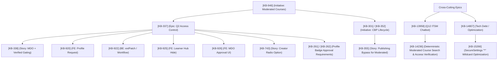

## 8. Q2–Q14 Feature Evolution

| Release / Quarter | Jira Reference | Feature / Capability | Business Requirement | Functional & Technical Change | Journey Impact | Status |
|---|---|---|---|---|---|---|
| **Q2 (Sprint 8 / Nov 2023)** | [KB-337: Q2 \| Moderated Courses \| Verified Karmayogi vs All Users access to Moderated Courses.](https://karmayogibharat.atlassian.net/browse/KB-337) (Prod Deployed), [KB-338: Q2 \| Moderated Courses \| Moderated courses should be visible to learners who have verified karmayogi of the respective MDOs](https://karmayogibharat.atlassian.net/browse/KB-338) (Prod Deployed), [KB-743: Q2 \| Moderated Courses \| Content creator to choose to show the moderated course to only Verified Karmayogi users.](https://karmayogibharat.atlassian.net/browse/KB-743) (Internal Review) | Verified Karmayogi Gating | Stop self-registered users from viewing MDO-specific moderated courses. | Creator toggles "Only Verified Karmayogi" (default true). Metadata stores `secureSettings.isVerifiedKarmayogi`. | Unverified users blocked from discovery & enrollment. | Prod Deployed |
| **Q2 (Dec 2023)** | [KB-355: Q2 \| CBP Publishing \| SPV shall have the sole authority to publish the CBP on iGOT except in the case when the CBP is a Moderated Course.](https://karmayogibharat.atlassian.net/browse/KB-355) (Prod Deployed), [KB-255: CBP Publishing \| Gating \| SPV shall have the final authority of CBP Publishing.](https://karmayogibharat.atlassian.net/browse/KB-255) (Added to Initiative) | Decentralized Publishing Authority | Eliminate SPV review delay for departmental training. | Moderated courses bypass SPV Publisher; published directly by MDO Content Publisher. | Direct MDO publish-to-live workflow. | Prod Deployed |
| **Q2 (Dec 2023)** | [KB-920: FE - Learner portal: Allow use to request for Karmayogi badge from the profile page and test the approval flow](https://karmayogibharat.atlassian.net/browse/KB-920) (Done), [KB-922: BE - CB-Ext changes w.r.t. extPatch API](https://karmayogibharat.atlassian.net/browse/KB-922) (Done), [KB-926: FE - MDO portal add necessary changes to list the verify karmayogi badge and test the flow](https://karmayogibharat.atlassian.net/browse/KB-926) (Done) | Profile Verification Workflow | Legitimate civil servants must request MDO verification. | Learner requests badge via profile; `extPatch` triggers Workflow Service request to MDO Portal. | User gains badge post-MDO Admin sign-off. | Prod Deployed |
| **Q3 (Jan–Feb 2024)** | [KB-2219: DEV \| BE \| Update the course MetaData for CourseCategory](https://karmayogibharat.atlassian.net/browse/KB-2219) (Done), [KB-1950: Q3 \| Content Portal Redesign \| Learner consumption for all types of content](https://karmayogibharat.atlassian.net/browse/KB-1950) (Prod Deployed) | Content Taxonomy Extension | Support programs and assessments under identical moderation models. | Added `Moderated Program`, `Moderated Assessment` to `cb-ext-schema` and search filters. | Departmental curated journeys restricted end-to-end. | Prod Deployed |
| **Q3 (Feb 2024)** | [KB-2559: KB-1394 \| Learner is able to view share icon for Moderated course](https://karmayogibharat.atlassian.net/browse/KB-2559) (Done), [KB-3002: Mobile > Content sharing> Share icon should not be shown for Moderated content and Invite only program.](https://karmayogibharat.atlassian.net/browse/KB-3002) (Done) | Anti-Leak Sharing Suppression | Prevent link forwarding of moderated courses to unauthorized personnel. | Share action icon conditionally hidden across Web Portal, M-Web, Android, and iOS TOC views. | Learners cannot generate or copy deep-links. | Prod Deployed |
| **Q12 (June 2026)** | [KB-14236: Unable to find Moderated Courses / Unable to enroll in the course / Unable to find the course/ Unable to search external course/event](https://karmayogibharat.atlassian.net/browse/KB-14236) (Prod Deployed), [KB-13958: Q12 \| Deterministic ITSM Chatbot](https://karmayogibharat.atlassian.net/browse/KB-13958) (Prod Deployed) | Deterministic ITSM Resolution | Prevent support ticket surges when learners cannot find restricted courses. | Chatbot invokes Composite Search + Access Settings Read API + User Read API to evaluate eligibility. | Ineligible users receive immediate referral to nodal MDO/YP. | Prod Deployed |
| **Q12 (Sprint 39)** | [KB-14518: Q12 \| Unenrollment from Courses \| Web Portal](https://karmayogibharat.atlassian.net/browse/KB-14518) (Prod Deployed), Confluence Spec | Moderated Course Unenrollment | Allow learners to unenroll from accidental or obsolete moderated enrollments. | Enabled `course_unenroll_allowed_primary_category=Course,Moderated Course`. Recorded in `enrollment_history_by_action`. | Clean unenrollment with audit trails. | Prod Deployed |
| **Q13/Q14 (Aug 2026)** | [KB-15266: Moderated Content - Enhancements in SecureSettings.organisation when selecting all organisation](https://karmayogibharat.atlassian.net/browse/KB-15266) (Open), [KB-14807: Tech Debt](https://karmayogibharat.atlassian.net/browse/KB-14807) (Open) | Wildcard Org Payload Optimization | Prevent metadata payload bloat when creator selects all organizations. | `secureSettings.organisation` supports `["*"]`; backend ES search matches all valid orgs. | Substantially reduces metadata size in Elasticsearch/Cassandra. | Open / In Dev |

## 9. Feature Capability Matrix

| Capability Dimension | Standard Course | Moderated Course (All) | Moderated (Verified) |
|---|---|---|---|
| Global Search Visibility | YES (All users) | MDO Learners Only | MDO Verified Only |
| Direct URL Access & TOC | YES | Gated by MDO ID | Gated by MDO + Badge |
| Enrollment Permitted | Open to Platform | Open to MDO Cadre | Verified MDO Only |
| Peer Share Icon Display | Displayed | HIDDEN (Web & App) | HIDDEN (Web & App) |
| Publishing Approval Authority | SPV Publisher | MDO Content Publisher | MDO Content Publisher |
| MDO CBP Training Plan Assignment | Optional | MDO Cadre Only | Verified Cadre Only |
| Unenrollment & Re-enrollment | Supported (Q12) | Supported (Q12) | Supported (Q12) |
| Chatbot Assistance Resolution | Direct Link | Eligibility Evaluated | Dual-gated Check |

## 10. Business Lifecycle – Creation to Consumption

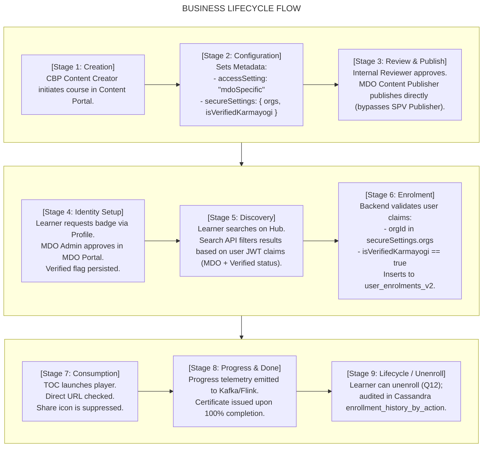

## 11. User Roles and Portal Responsibilities

### RACI Matrix

- **R (Responsible):** Executes the action.
- **A (Accountable):** Sole approving authority.
- **C (Consulted):** Provides input/receives validation.
- **I (Informed):** Notified of state changes.

| Platform Activity | Content Creator | MDO Publisher | SPV Publisher | MDO Admin | Learner | Backend / API |
|---|---|---|---|---|---|---|
| Create Course Draft & Metadata | **R / A** | I | I | I | I | C |
| Configure `secureSettings` (MDO / Verified) | **R / A** | C | I | I | I | C |
| Approve & Publish Moderated Course | I | **R / A** | **Excluded** | I | I | C |
| Request "Verified Karmayogi" Status | I | I | I | C | **R** | A |
| Approve "Verified Karmayogi" Status | I | I | I | **R / A** | I | C |
| Discover Moderated Course in Search | I | I | I | I | **R** | **A (Filters)** |
| Enroll in Moderated Course Batch | I | I | I | I | **R** | **A (Validates)** |
| Consume Course Content in Player | I | I | I | I | **R** | **A (Evaluates)** |
| Unenroll from Moderated Course (Q12) | I | I | I | I | **R** | **A (Audits)** |

## 12. Course Configuration and Restriction Management

When a creator creates or updates a Moderated Course in the Content Portal, the system generates and persists specific metadata attributes in the content definition node (Elasticsearch & Neo4j / Cassandra graph store):

```json
{
  "identifier": "do_1139946938317127681396_rc",
  "name": "Procurement & Contract Vigilance Protocols",
  "contentType": "Course",
  "primaryCategory": "Course",
  "courseCategory": "Moderated Course",
  "status": "Live",
  "accessSetting": "mdoSpecific",
  "visibility": "Default",
  "secureSettings": {
    "isVerifiedKarmayogi": "Yes",
    "organisation": [
      "01381906916850892825",
      "01392275379456409617"
    ],
    "version": 1
  },
  "trackable": {
    "enabled": "Yes",
    "autoBatch": "Yes"
  },
  "createdFor": [
    "01381906916850892825"
  ]
}
```

### Key Field Semantics

- `courseCategory`: Set to `"Moderated Course"` (or `"Moderated Program"`, `"Moderated Assessment"` per [KB-2219: DEV | BE | Update the course MetaData for CourseCategory](https://karmayogibharat.atlassian.net/browse/KB-2219) (Done)).
- `accessSetting`: `"mdoSpecific"` signals the gateway and search microservices to enforce scoped evaluation.
- `secureSettings.organisation`: Array of target MDO org IDs. Post-[KB-15266: Moderated Content - Enhancements in SecureSettings.organisation when selecting all organisation](https://karmayogibharat.atlassian.net/browse/KB-15266) (Open), when "Select All" is checked, this contains `["*"]` to compress document index size.
- `secureSettings.isVerifiedKarmayogi`: String (`"Yes"` or `"No"`). `"Yes"` enforces that the user must possess an approved verified profile badge.

## 13. User Identity and Eligibility Management

### The Verified Karmayogi Workflow ([KB-338: Q2 | Moderated Courses | Moderated courses should be visible to learners who have verified karmayogi of the respective MDOs](https://karmayogibharat.atlassian.net/browse/KB-338) (Prod Deployed), [KB-920: FE - Learner portal: Allow use to request for Karmayogi badge from the profile page and test the approval flow](https://karmayogibharat.atlassian.net/browse/KB-920) (Done), [KB-922: BE - CB-Ext changes w.r.t. extPatch API](https://karmayogibharat.atlassian.net/browse/KB-922) (Done), [KB-926: FE - MDO portal add necessary changes to list the verify karmayogi badge and test the flow](https://karmayogibharat.atlassian.net/browse/KB-926) (Done))

1. **Learner Trigger:** The learner fills all mandatory profile fields (Designation, Cadre, Employee Code, Organization) on the Learner Portal Profile screen.
2. **Opt-in Action:** The learner checks *"Earn your Verified Karmayogi badge"*.
3. **Backend Safeguard** ([KB-922: BE - CB-Ext changes w.r.t. extPatch API](https://karmayogibharat.atlassian.net/browse/KB-922) (Done)): The frontend dispatches an `extPatch` API call. The backend explicitly blocks automated toggling of the `isVerifiedKarmayogi` flag; instead, it generates a workflow approval request routed to the MDO Admin queue.
4. **MDO Portal Review** ([KB-1637: Q2 | Ad-Hoc Requests | User Profile | User Profile page, once mandatory fields are filled, Verified Karmayogi checkbox shall be selected automatically.](https://karmayogibharat.atlassian.net/browse/KB-1637) (Done)): The MDO Admin reviews the applicant details with prompt: *"Do you want to recognize this user as a Verified Karmayogi?"*.
5. **Approval State:** Upon admin approval, the user's profile is updated, `isVerifiedKarmayogi: true` is persisted in the PostgreSQL / Cassandra user record ([KB-1873: Q3 | Ad-Hoc Requests | Data Warehouse, Operational Reports & Exhausts | Addition of Verified Karmayogi field in User Table.](https://karmayogibharat.atlassian.net/browse/KB-1873) (Prod Deployed)), and the profile checkbox is disabled to prevent re-triggering ([KB- 927: The Verified karmayogi Badge checkbox should be disabled post User gets the badge. Done](https://karmayogibharat.atlassian.net/browse/KB-927)).

## 14. Restricted Course Discovery

Course discovery is handled by the Search Service proxying Elasticsearch (`POST /apis/proxies/v8/sunbirdigot/v4/search`).

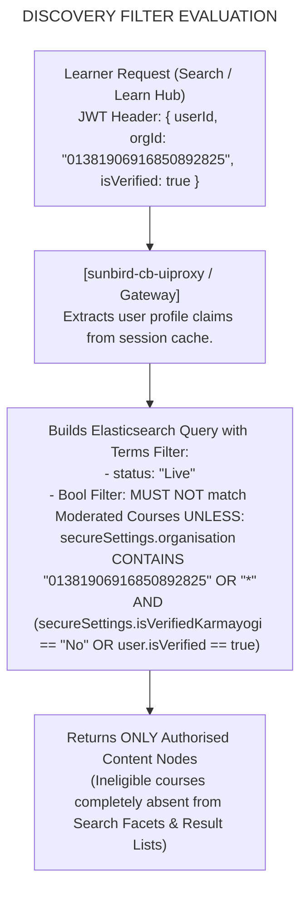

### Course Discovery vs. Accessibility vs. Enrolment Eligibility

- **Visibility:** Whether the course card appears in Search, Trending in Department strip ([KB-360: Q2 | User Experience | Learn Hub > Trending in your department](https://karmayogibharat.atlassian.net/browse/KB-360) (Prod Deployed)), or Explore Hub ([KAR-413: Learner Portal | Moderate courses button is not visible in learn page in learner portal. (intermittent) Closed](https://karmayogibharat.atlassian.net/browse/KAR-413)).
- **Accessibility:** Whether an un-enrolled learner who pastes a direct URL can view the Table of Contents (TOC) metadata and curriculum outline.
- **Enrolment Eligibility:** Whether the backend `sunbird-course-service` permits batch association when clicking the **"Enroll"** button.

## 15. Course Enrolment

### Enrolment Sequence & Validation Flow

When a learner clicks **"Enroll"** on a Moderated Course TOC:

1. Client issues: `POST /apis/proxies/v8/course/v1/enrol` with `courseId`, `batchId`, `userId`.
2. `sunbird-course-service` intercepts the request:
  - Inspects `courseCategory` of the target `courseId`.
  - If `Moderated Course`, queries the `org_eligibility_alias` Elasticsearch index / Access Settings cache.
  - Compares the learner’s authenticated `organisationId` against `secureSettings.organisation` (or `*`).
  - If `isVerifiedKarmayogi == "Yes"`, queries the learner profile service to verify the badge is active.

3. If criteria pass:
  - Inserts record into Cassandra table `sunbird_courses.user_enrolments_v2`.
  - Returns `HTTP 200 OK` with enrollment ID.

4. If criteria fail:
  - Rejects with `HTTP 400 Bad Request` or `HTTP 403 Forbidden` (`USER_NOT_ELIGIBLE_FOR_MODERATED_COURSE`).

## 16. Course Consumption and Completion

### Consumption Flow

1. **Player Launch:** Learner navigates to `/app/toc/{courseId}/overview` and clicks **"Start"** / **"Resume"**.
2. **Hierarchy Read:** Client calls `GET /apis/proxies/v8/action/content/v3/hierarchy/{courseId}` to fetch modules, leaf nodes, and resource tokens.
3. **Session Enforcement:** UI validates enrollment status against `user_enrolments_v2`. If not enrolled or authorization revoked, the player is not launched.
4. **Content Node Retrieval:** Media items (PDF, MP4, HTML5 ZIP, Assessment questionsets) are streamed from secure storage URLs using short-lived signed tokens.
5. **Telemetry & Progress:**
  - Content player emits Sunbird telemetry events (`START`, `INTERACT`, `ASSESS`, `END`).
  - Telemetry pipeline ingests events via Kafka topic `dev.telemetry.raw` -> Apache Flink streaming jobs.
  - Flink calculates progress percentages and writes updates to `user_enrolments_v2.progress`.

6. **Completion & Credentialing:**
  - When all leaf nodes achieve completion (`progress == 100`), Flink triggers completion events.
  - If `credentials.enabled == "Yes"`, `cb-notification-service` and certificate-generation service issue an encrypted verifiable digital certificate.

## 17. Business Rules and Eligibility Logic

### Business Rules Catalogue

| Rule ID | Trigger Event | Evaluation Criteria | Expected Result / System Behavior | Source Reference |
|---|---|---|---|---|
| **BR-MC-01** | Course Creation | Creator chooses `accessSetting = "mdoSpecific"`. | System exposes MDO multi-select dropdown and Verified Karmayogi toggle (default checked). | [KB-743: Q2 \| Moderated Courses \| Content creator to choose to show the moderated course to only Verified Karmayogi users.](https://karmayogibharat.atlassian.net/browse/KB-743) (Internal Review) |
| **BR-MC-02** | Publishing Request | Course sent to publish with `courseCategory = "Moderated Course"`. | Bypasses SPV Publisher queue; appears directly in MDO Content Publisher queue. | [KB-355: Q2 \| CBP Publishing \| SPV shall have the sole authority to publish the CBP on iGOT except in the case when the CBP is a Moderated Course.](https://karmayogibharat.atlassian.net/browse/KB-355) (Prod Deployed), [KB-255: CBP Publishing \| Gating \| SPV shall have the final authority of CBP Publishing.](https://karmayogibharat.atlassian.net/browse/KB-255) (Added to Initiative) |
| **BR-MC-03** | Course Search | Learner performs search / opens Learn Hub. | Moderated courses filtered server-side unless user’s MDO and verification match `secureSettings`. | [KB-338: Q2 \| Moderated Courses \| Moderated courses should be visible to learners who have verified karmayogi of the respective MDOs](https://karmayogibharat.atlassian.net/browse/KB-338) (Prod Deployed), Search API Spec |
| **BR-MC-04** | Direct URL Hit | Ineligible user enters direct link to Moderated Course TOC. | Content player blocked; CTA disabled; user notified of profile/MDO mismatch. | [KB-14236: Unable to find Moderated Courses / Unable to enroll in the course / Unable to find the course/ Unable to search external course/event](https://karmayogibharat.atlassian.net/browse/KB-14236) (Prod Deployed) |
| **BR-MC-05** | Batch Enrollment | Learner clicks "Enroll" on Moderated Course. | Backend confirms `user.orgId IN secureSettings.orgs` AND `(secureSettings.isVerified == "No" OR user.isVerified == true)`. | [KB-978: Moderated course enrollment api is giving 400 error message](https://karmayogibharat.atlassian.net/browse/KB-978) (Done), [KB-1227: Enroll is giving 500 for courses/moderated courses and assessment](https://karmayogibharat.atlassian.net/browse/KB-1227) (Done) |
| **BR-MC-06** | Share Action | User views TOC on Web Portal, M-Web, or Mobile App. | The Share icon is hidden/suppressed to prevent deep-link distribution. | [KB-2559: KB-1394 \| Learner is able to view share icon for Moderated course](https://karmayogibharat.atlassian.net/browse/KB-2559) (Done), [KB-3002: Mobile > Content sharing> Share icon should not be shown for Moderated content and Invite only program.](https://karmayogibharat.atlassian.net/browse/KB-3002) (Done) |
| **BR-MC-07** | CBP Plan Add | MDO Admin creates CBP Plan with Moderated Courses. | Admin warned that only Verified learners will receive the course if verification is enforced. | [KB-753: Q2 \| CBP \| Create New CBP Plan](https://karmayogibharat.atlassian.net/browse/KB-753) (Prod Deployed), [KB-1931: KB-753 \| User without verified Karmayogi badge should not be able to view Moderated course CBP plan](https://karmayogibharat.atlassian.net/browse/KB-1931) (Done) |
| **BR-MC-08** | Unenrollment | Learner unenrolls from Moderated Course. | Allowed per `course_unenroll_allowed_primary_category`. Action logged in `enrollment_history_by_action`. | Sprint 39 Spec, [KB-14518: Q12 \| Unenrollment from Courses \| Web Portal](https://karmayogibharat.atlassian.net/browse/KB-14518) (Prod Deployed) |
| **BR-MC-09** | All-Org Wildcard | Creator selects "All Organizations" during Moderated setup. | Stored as `secureSettings.organisation = ["*"]` to prevent payload bloat. | [KB-15266: Moderated Content - Enhancements in SecureSettings.organisation when selecting all organisation](https://karmayogibharat.atlassian.net/browse/KB-15266) (Open) |

### Eligibility Decision Table

| Case | Learner MDO Match | Learner Verified Badge | Course Verified Requirement | Discovery Visible? | Enrolment Allowed? | Player Launch? |
|---|---|---|---|---|---|---|
| **1** | YES | YES | YES | **YES** | **YES** | **YES** |
| **2** | YES | NO | YES | **NO** | **NO** | **NO** |
| **3** | YES | NO | NO | **YES** | **YES** | **YES** |
| **4** | YES | YES | NO | **YES** | **YES** | **YES** |
| **5** | NO | YES | YES | **NO** | **NO** | **NO** |
| **6** | NO | NO | YES | **NO** | **NO** | **NO** |
| **7** | NO | NO | NO | **NO** | **NO** | **NO** |
| **8** | WILDCARD (`*`) | YES | YES | **YES** | **YES** | **YES** |
| **9** | WILDCARD (`*`) | NO | YES | **NO** | **NO** | **NO** |

## 18. System Architecture and Microservice Interconnections

The Moderated Course ecosystem spans the Content Creation Portal, Learner Web/Mobile Portals, MDO Admin Portal, and core backend microservices:

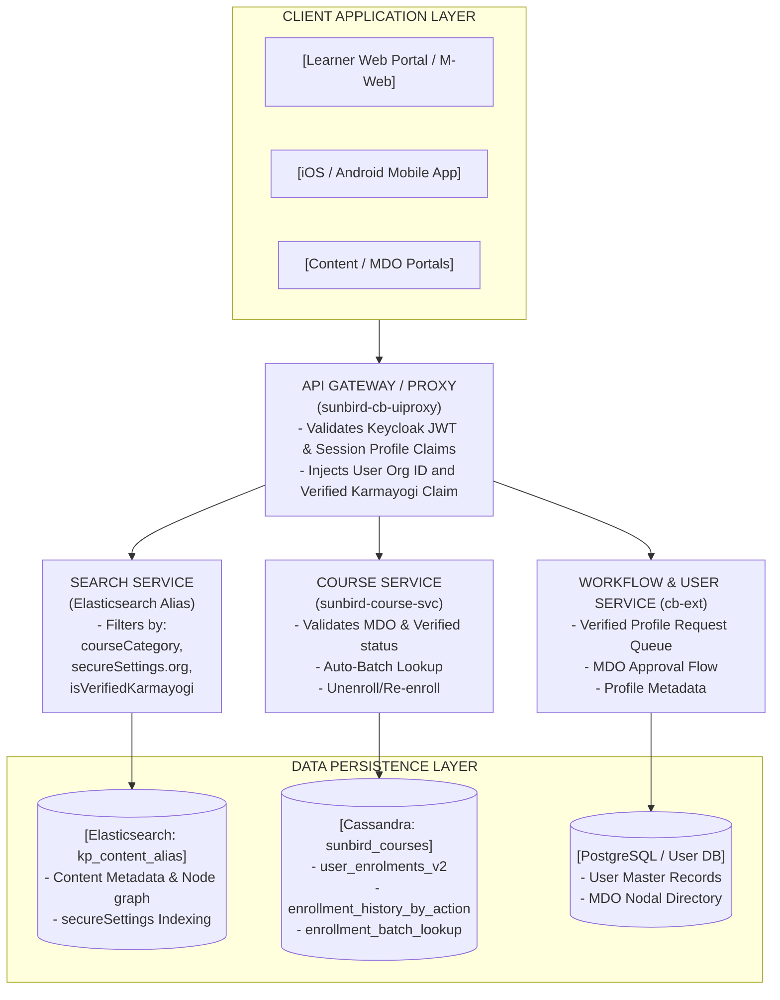

## 19. API Catalogue

| API Name | Method | Endpoint | Caller | Provider | Request Key Payload | Response Key Fields | Auth / Access Control | Jira Ref |
|---|---|---|---|---|---|---|---|---|
| **Content Search API** | `POST` | `/apis/proxies/v8/sunbirdigot/v4/search` | Learner Portal | Search Service | `request.filters: { courseCategory, status: ["Live"], secureSettings.isVerifiedKarmayogi }` | `result.content[]: { identifier, secureSettings, batches }` | Bearer JWT (Session claims injected) | Search Spec, [KB-2134: DEV \| BE \| Knowledge Platform Search API changes For Moderated and Normal Courses.](https://karmayogibharat.atlassian.net/browse/KB-2134) (Done) |
| **Access Settings Read API** | `GET` | `/apis/proxies/v8/content/v1/access/read/{courseId}` | Chatbot / Web UI | Content Service | None (Path param `courseId`) | `result.accessSettings: { accessSetting, secureSettings }` | Authenticated civil servant | [KB-14236: Unable to find Moderated Courses / Unable to enroll in the course / Unable to find the course/ Unable to search external course/event](https://karmayogibharat.atlassian.net/browse/KB-14236) (Prod Deployed) |
| **User Profile Read API** | `GET` | `/api/user/v2/read/{userId}` | Chatbot / Gateway | User Service | None (Path param `userId`) | `result.response: { rootOrgId, profileDetails: { isVerifiedKarmayogi } }` | Authenticated user / Admin token | [KB-14236: Unable to find Moderated Courses / Unable to enroll in the course / Unable to find the course/ Unable to search external course/event](https://karmayogibharat.atlassian.net/browse/KB-14236) (Prod Deployed) |
| **Profile Patch API** | `PATCH` | `/apis/proxies/v8/``user/v1/extPatch` | Learner Portal | `cb-ext` / Workflow | `request: { isVerifiedKarmayogi: true, profileDetails }` | `responseCode: "OK", result: { workflowId,` `status: "SUBMITTED" }` | Authenticated civil servant | [KB-922: BE - CB-Ext changes w.r.t. extPatch API](https://karmayogibharat.atlassian.net/browse/KB-922) (Done) |
| **Workflow Approval API** | `POST` | `/apis/proxies/v8/workflow/v1/transition` | MDO Portal | Workflow Service | `request: { workflowId, action: "APPROVE", comment }` | `responseCode: "OK", result: { status: "APPROVED" }` | Role: `MDO_ADMIN` / `MDO_LEADER` | [KB-926: FE - MDO portal add necessary changes to list the verify karmayogi badge and test the flow](https://karmayogibharat.atlassian.net/browse/KB-926) (Done), [KB-1637: Q2 \| Ad-Hoc Requests \| User Profile \| User Profile page, once mandatory fields are filled, Verified Karmayogi checkbox shall be selected automatically.](https://karmayogibharat.atlassian.net/browse/KB-1637) (Done) |
| **Course Enrol API** | `POST` | `/apis/proxies/v8/course/v1/enrol` | Learner Portal | `sunbird-course-svc` | `request: { courseId, batchId, userId }` | `responseCode: "OK", result: { enrolmentId, status: 1 }` | Evaluates MDO & Verified status | [KB-338: Q2 \| Moderated Courses \| Moderated courses should be visible to learners who have verified karmayogi of the respective MDOs](https://karmayogibharat.atlassian.net/browse/KB-338) (Prod Deployed), [KB-978: Moderated course enrollment api is giving 400 error message](https://karmayogibharat.atlassian.net/browse/KB-978) (Done) |
| **Course Unenrol API** | `POST` | `/apis/proxies/v8/course/v1/unenrol` | Learner Portal | `sunbird-course-svc` | `request: { courseId, batchId, userId }` | `responseCode: "OK", result: { status: "UNENROLLED" }` | Enrolled learner only | [KB-14518: Q12 \| Unenrollment from Courses \| Web Portal](https://karmayogibharat.atlassian.net/browse/KB-14518) (Prod Deployed) |
| **Content Hierarchy Read** | `GET` | `/apis/proxies/v8/action/content/v3/hierarchy/{id}` | Content Player | Content Service | None (Path param `id`) | `result.content: { children, leafNodes, mimeType }` | Enrolled learner / Verified token | [KB-1582: Q3 \| User Experience \| Learner Journey \| ToC [Desktop ]](https://karmayogibharat.atlassian.net/browse/KB-1582) (Prod Deployed) |

## 20. Data Model and ER Diagram

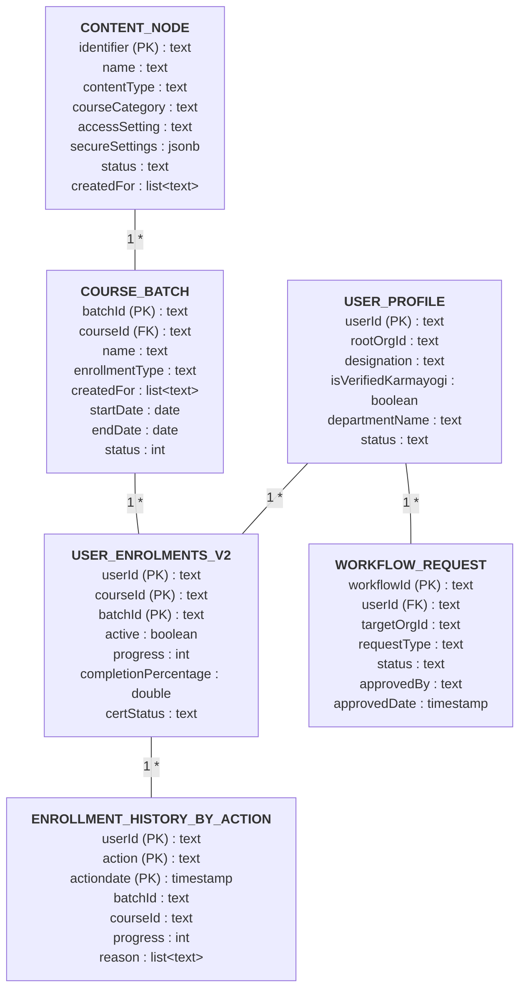

## 21. Access Control and Security Analysis

### Comprehensive Security Evaluation

1. **Frontend Filtering Bypass Prevention:**
  - *Threat:* Learner crafts direct REST API calls (`/course/v1/enrol` or `/content/v3/hierarchy/{id}`) using known `do_id`.
  - *Mitigation:* `sunbird-course-service` and `sunbird-cb-uiproxy` execute deep backend validation on every call. If session claims do not reconcile with `secureSettings`, the request is rejected with `403 Forbidden`.

2. **Deep-Link Forwarding & Peer Sharing:**
  - *Threat:* Eligible learner copies course URL and shares it with unverified or cross-ministry peers.
  - *Mitigation:* Share buttons are stripped from the DOM ([KB-2559: KB-1394 | Learner is able to view share icon for Moderated course](https://karmayogibharat.atlassian.net/browse/KB-2559) (Done)). Ineligible recipients navigating directly to the URL encounter a gated state; no trackable leaf nodes or player streams are returned.

3. **MDO Reassignment / Transfer Safeguard:**
  - *Threat:* An employee transfers from Ministry A to Ministry B and retains access to Ministry A’s confidential moderated courses.
  - *Mitigation:* When MDO transfer occurs, the user’s `rootOrgId` changes in the identity database. On the next session refresh, search filters exclude Ministry A’s courses. In-progress courses where `createdFor` does not match the new MDO fail batch access checks.

4. **Self-Service Verification Exploitation Prevention:**
  - *Threat:* User modifies DOM or sends manual `PATCH` payload with `isVerifiedKarmayogi: true`.
  - *Mitigation:* Explicitly secured under [KB-922: BE - CB-Ext changes w.r.t. extPatch API](https://karmayogibharat.atlassian.net/browse/KB-922) (Done). The backend strips unauthorized fields during `extPatch` and forces an asynchronous state transition requiring MDO Admin cryptographic session sign-off.

## 22. End-to-End User Journeys

### Journey A: Eligible MDO Verified Learner

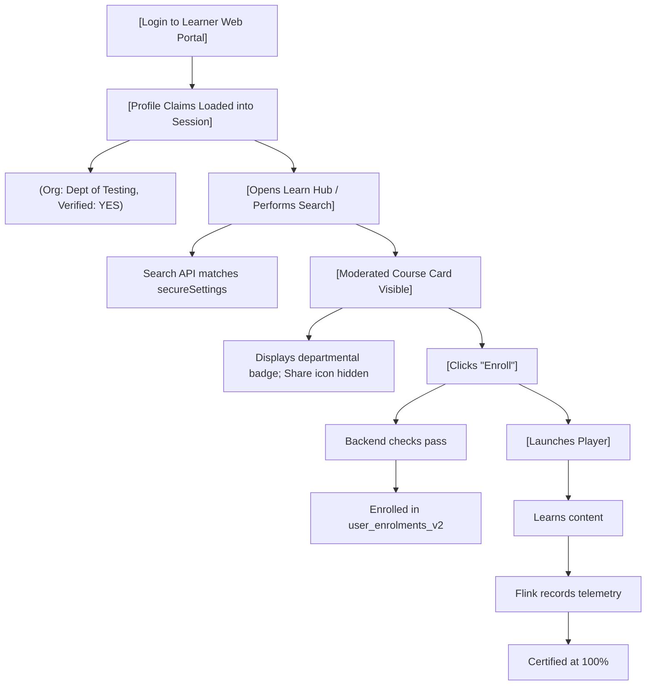

### Journey B: Ineligible Cross-MDO Learner

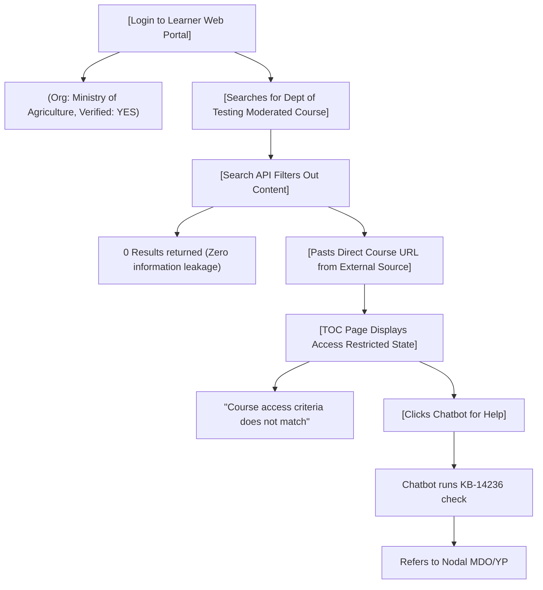

### Journey C: Unverified Same-MDO Learner

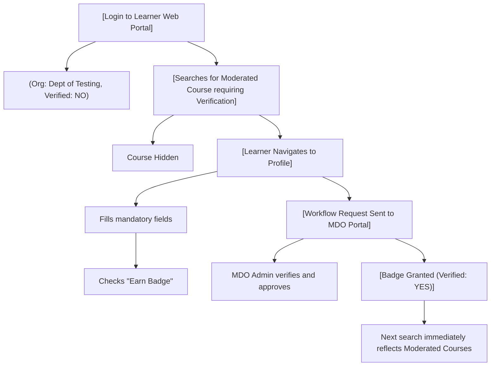

## 23. Error Handling and Exception Scenarios

| Error Scenario | HTTP Status Code | User Experience / Fallback Action |
|---|---|---|
| Unverified enrollment attempt | 403 Forbidden | Toast: "Restricted to Verified Karmayogis" |
| Cross-MDO enrollment attempt | 403 Forbidden | Toast: "Course restricted to specific MDOs" |
| Direct hit on retired course | 404 / 410 Gone | Chatbot/UI: "Course has been retired" |
| Course under review/draft hit | 403 Forbidden | Chatbot/UI: "Course is temporarily unavailable" |
| Search API timeout / ES failure | 504 Gateway Timeout | UI falls back to cached public catalog |
| Flink telemetry pipeline backlog | 200 OK (Queued) | Progress updates lazily upon queue drain |
| Unenrollment on completed course | 400 Bad Request | Toast: "Completed courses cannot be unenrolled" |

## 24. QA and Testing Coverage

| Test ID | Scenario | Preconditions | Expected Result | Evidence / QA |
|---|---|---|---|---|
| TC-MC-01 | Verified Learner MDO Match | User Verified; Org matches | Course discoverable & enrollable | KB-338 QA Pass |
| TC-MC-02 | Unverified Learner Same Org | User Unverified; Org matches | Course completely hidden in search | KB-925 QA Pass |
| TC-MC-03 | Cross-Org Verified Learner | User Verified; Org differs | Course hidden; direct URL blocked | KB-338 QA Pass |
| TC-MC-04 | Direct URL Share Suppression | Enrolled User viewing TOC | Share icon stripped on Web & Mobile | KB-2559 / KB-3002 |
| TC-MC-05 | Automated Badge Exploit Attempt | Direct extPatch invocation | verifiedKarmayogi flag NOT updated | KB-922 / KB-1255 |
| TC-MC-06 | MDO Admin Approval Execution | Workflow Request Pending | Approving grants verified badge | KB-926 / KB-1637 |
| TC-MC-07 | Unenrollment from Moderated Crs | User actively enrolled | Unenrolled; Cassandra action logged | Sprint 39 Deploy |
| TC-MC-08 | Wildcard Org Selection Search | Course secureSettings = "\*" | Discoverable by all valid orgs | KB-15266 Test |

## 25. Analytics and Reporting

1. **Departmental Consumption Reports:**
  - Tracked via Cassandra and mirrored to Postgres reporting schemas ([KB-1873: Q3 | Ad-Hoc Requests | Data Warehouse, Operational Reports & Exhausts | Addition of Verified Karmayogi field in User Table.](https://karmayogibharat.atlassian.net/browse/KB-1873) (Prod Deployed)).
  - Nodal MDO Admins receive aggregated dashboards: Total Moderated Courses published, Total Eligible Cadre, Active Enrolments, Completion Rate, Average Assessment Score.

2. **Access Denial Monitoring (Telemetry / Chatbot):**
  - ITSM Chatbot records inquiries where users request access to restricted courses ([KB-14236: Unable to find Moderated Courses / Unable to enroll in the course / Unable to find the course/ Unable to search external course/event](https://karmayogibharat.atlassian.net/browse/KB-14236) (Prod Deployed)).
  - Summarized by Ministry/State to identify cadres requiring profile verification campaigns or bulk MDO onboarding.

## 26. Requirements vs. Implementation Gap Analysis

| S.N | Documented Requirement | Jira Reference | Observed Implementation | Identified Gap / Debt | Severity / Impact |
|---|---|---|---|---|---|
| 1 | Multi-MDO Selective Access | KB-743, KB-2785 | Stored as array of IDs | UI lag when 50+ orgs pickd | Medium / Fixed |
| 2 | Prevent Metadata Size Explosion when "All Orgs" Selected | KB-15266 | Wildcard \* in dev | Legacy courses have large explicit org arrays | Medium (Tech Debt) |
| 3 | Instant Revocation on Transfer | Architecture Spec | User transfer updates org but active session persists | Active video buffer runs until next API refresh | Low (Secured on next API call) |
| 4 | Dynamic Multi-Batch Selection for Moderated Programs | KB-1950 | Auto-batch creates 1 batch per MDO | Multi-batch moderated not fully exposed in CBP UI | Low (Single open batch adequate) |

## 27. Dependencies and Integrations

- **Keycloak / IAM Identity Layer:** Generates secure JWT containing user GUID, `rootOrgId`, and user roles.
- **Sunbird Knowledge Platform / Content Service:** Stores content metadata in Neo4j and Elasticsearch (`kp_content_alias`).
- **Sunbird Course Service** (`sunbird-course-service`): Enforces batch creation, enrollment restrictions, and unenrollment rules.
- **Cassandra** (`sunbird_courses` keyspace): Stores real-time enrollment and action tracking tables (`user_enrolments_v2`, `enrollment_history_by_action`, `enrollment_batch_lookup`).
- **Apache Kafka & Flink Streaming Engine:** Ingests raw telemetry events and maintains cumulative tracking.
- **ITSM Chatbot / Zoho Support Integration:** Deterministic resolution bot verifying real-time access settings for customer assistance.

## 28. Known Limitations and Technical Debt

- **Legacy Metadata Bloat** ([KB-15266: Moderated Content - Enhancements in SecureSettings.organisation when selecting all organisation](https://karmayogibharat.atlassian.net/browse/KB-15266) (Open)): Moderated courses created prior to Q13 that chose "All Organizations" stored every organization ID explicitly in the document array, expanding document size in Elasticsearch. Migration scripts are required to backport wildcard `*`.
- **Single Batch Paradigm:** Moderated courses rely on a single auto-generated open batch per MDO. Advanced batch scheduling (e.g., recurring seasonal departmental cohorts) requires manual batch orchestration.

## 29. Risks and Recommendations

### Risks

- **Profile Verification Backlogs:** If MDO Admins fail to approve pending "Verified Karmayogi" requests in a timely manner, departmental learners are blocked from mandatory compliance courses.
- **Shared Link Confusion:** Civil servants sharing direct links outside their department create confusion when colleagues hit access barriers.

### Recommendations

- **Automated MDO Reminders:** Implement weekly email digests to MDO Admins summarizing pending profile verification queues.
- **Enhanced Ineligible Explanations:** When an authenticated learner navigates to a direct Moderated Course URL, replace generic error messages with an explicit message: *"This course is restricted to verified officials of [Ministry Name]. Click here to request profile verification or contact your Nodal Officer."*

## 30. Future Enhancement Opportunities

- **Hierarchy-Aware Inherited Moderation:** Automatically extend access down administrative tiers (e.g., granting access to Ministry of Finance automatically cascades access to subordinate departments like CBDT and CBIC unless explicitly restricted).
- **Automated Verification via HRMS / Single Sign-On:** Integrate with departmental HRMS / NIC email verification to automatically grant "Verified Karmayogi" status during self-registration, bypassing manual MDO Admin review.
- **Time-Bound Moderation Expiry:** Allow content creators to set a moderation window (e.g., restricted to Ministry for 30 days, then automatically published to the entire platform).

## 31. Conclusion

The **Moderated Course** capability represents a cornerstone of enterprise governance on the iGOT Karmayogi Platform. By uniting MDO organizational boundaries with verified profile vetting, the platform successfully balances open lifelong learning with departmental sovereignty, data privacy, and operational velocity. The evolution from Q2 through Q14 demonstrates a mature, production-hardened microservice architecture that strictly enforces access control across discovery, enrollment, and consumption while eliminating publishing bottlenecks.

## 32. Open Questions and Pending Validations

1. **Wildcard Migration Timeline** ([KB-15266: Moderated Content - Enhancements in SecureSettings.organisation when selecting all organisation](https://karmayogibharat.atlassian.net/browse/KB-15266) (Open)): Confirmation from DevOps/Database teams on when existing pre-Q13 moderated courses will have their `secureSettings.organisation` arrays migrated to wildcard `*`.
2. **HRMS Automated Attestation:** Alignment with the User Profile POD regarding whether direct integration with Government HRMS / SPARROW will supersede the manual MDO Admin approval flow for Verified Karmayogi badges in future quarters.

## 33. Complete Traceability Matrix

| Req ID | Requirement Description | Jira Reference | User Story/Task | API Endpoint | Code / Repo / Configuration | Implementation State |
|---|---|---|---|---|---|---|
| REQ-MC-001 | Creator Verified Toggle | KB-337, KB-743 | KB-743 | Content Create API | cb-ext-schema / Content UI | Confirmed - Prod |
| REQ-MC-002 | Verified MDO Gating | KB-338 | KB-338, KB-925 | /sunbirdigot/search | search-service / ES queries | Confirmed - Prod |
| REQ-MC-003 | Bypass SPV Publishing Queue | KB-355, KB-255 | KB-355 | /content/v1/publish | cbp-portal / publishing-svc | Confirmed - Prod |
| REQ-MC-004 | Verified Badge Workflow | KB-922, KB-926 | KB-920, KB-922 | /user/v1/extPatch | cb-ext / workflow-service | Confirmed - Prod |
| REQ-MC-005 | Gating of Direct Share Action | KB-2559, KB-3002 | KB-2559 | N/A (Frontend DOM) | learner-portal / mobile-app | Confirmed - Prod |
| REQ-MC-006 | MDO CBP Plan Inclusion | KB-753, KB-1931 | KB-753 | /cbpplan/v1/create | mdo-portal / training-plan | Confirmed - Prod |
| REQ-MC-007 | Moderated Course Unenrollment | KB-14518 | Sprint 39 Spec | /course/v1/unenrol | sunbird-course-service | Confirmed - Prod |
| REQ-MC-008 | Chatbot Eligibility Resolution | KB-14236 | KB-14236 | /access/read/{id} | deterministic-chatbot-engine | Confirmed - Prod |
| REQ-MC-009 | Wildcard Org Optimization | KB-15266 | KB-15266 | /content/v1/update | secureSettings.organisation=* | Open / In Dev |

## 34. Visual Architecture and Process Diagrams (D1–D14)

### D1: Moderated Course Business Context

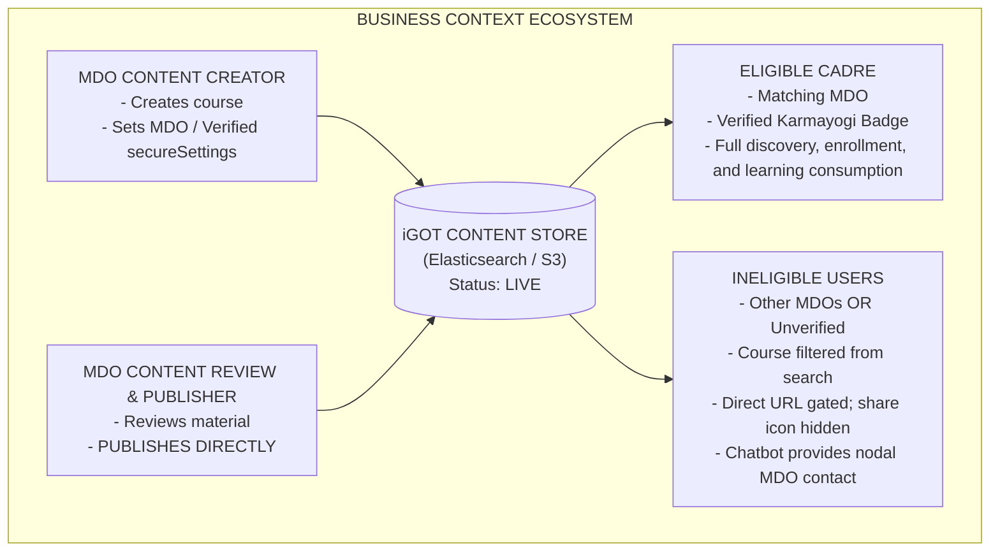

### D2: Feature Evolution Timeline (Q2 to Q14)

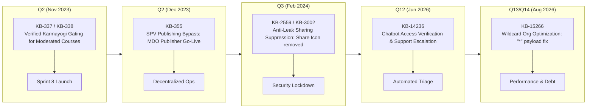

### D3: Course Creation and Configuration Flow

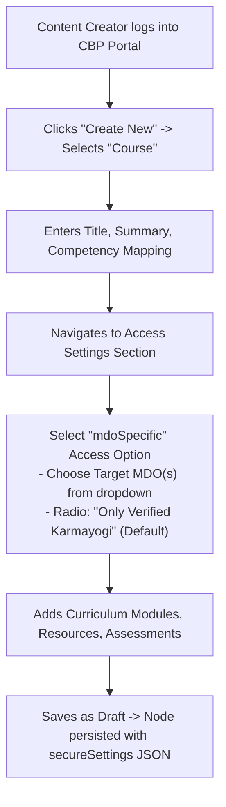

### D4: Moderation and Publishing Lifecycle

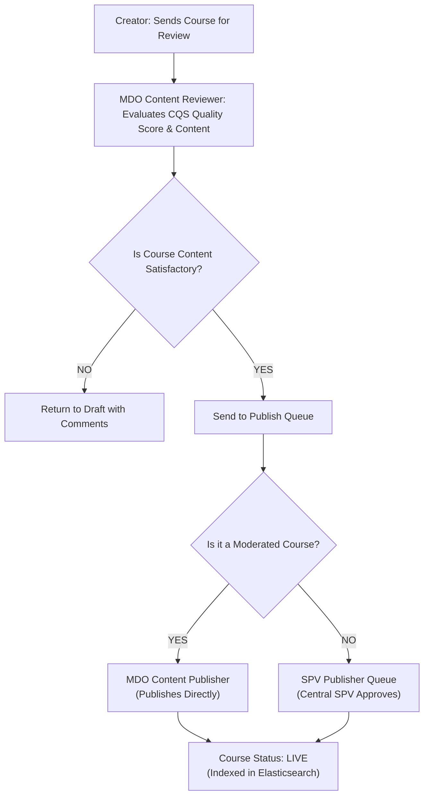

### D5: User Eligibility Validation Flow

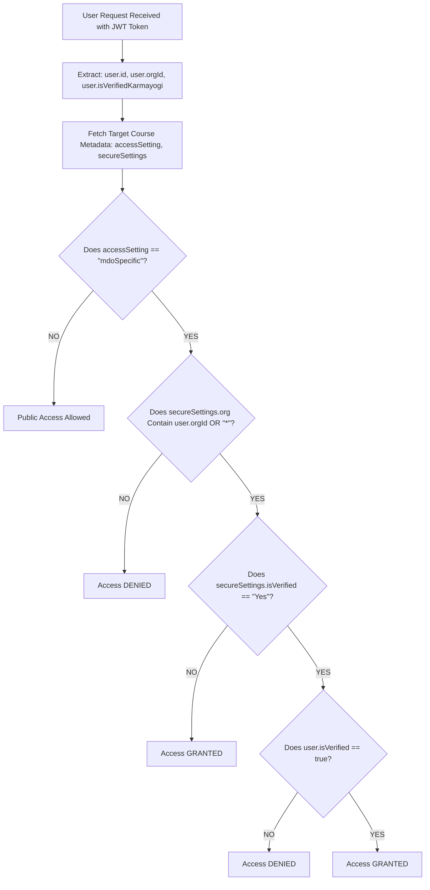

### D6: Restricted Course Discovery Architecture

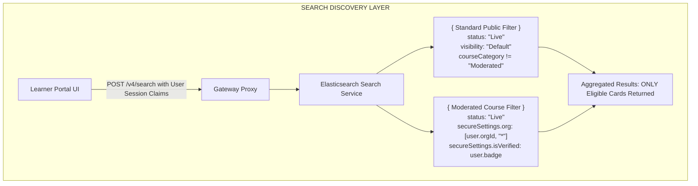

### D7: Course Enrolment Flow

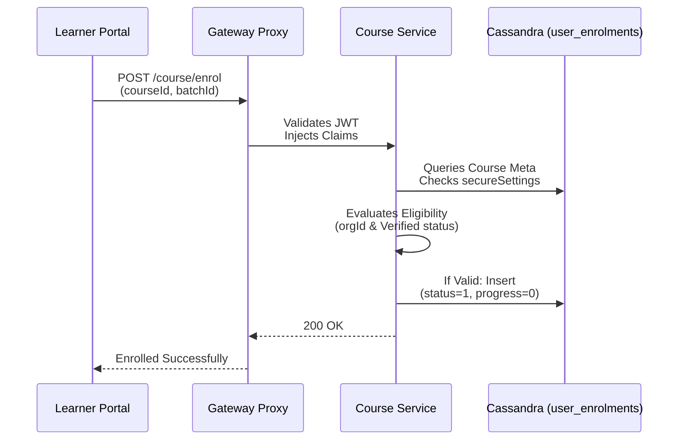

### D8: Course Consumption Flow

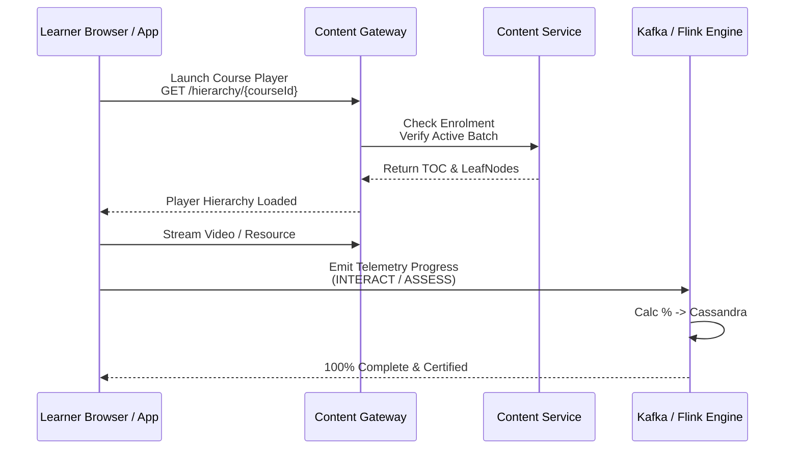

### D9: Microservice Architecture

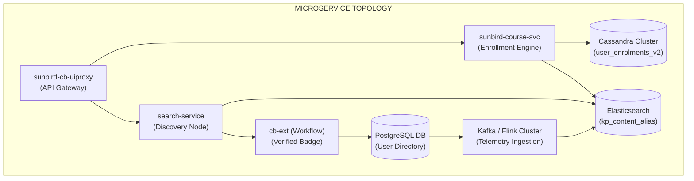

### D10: Access-Control Sequence Diagram

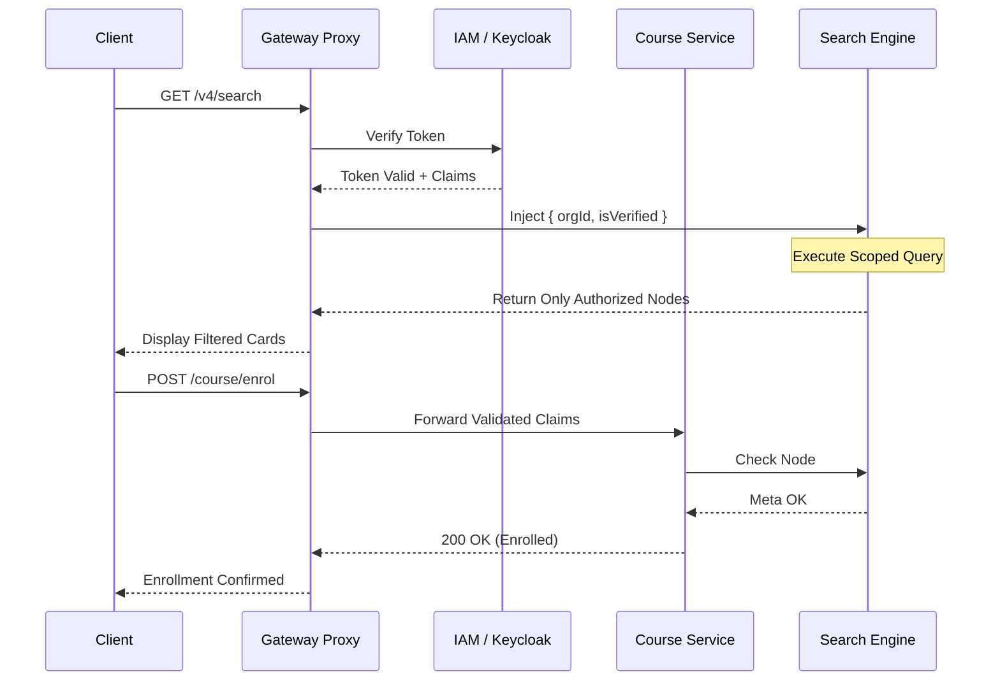

### D11: Entity Relationship Diagram

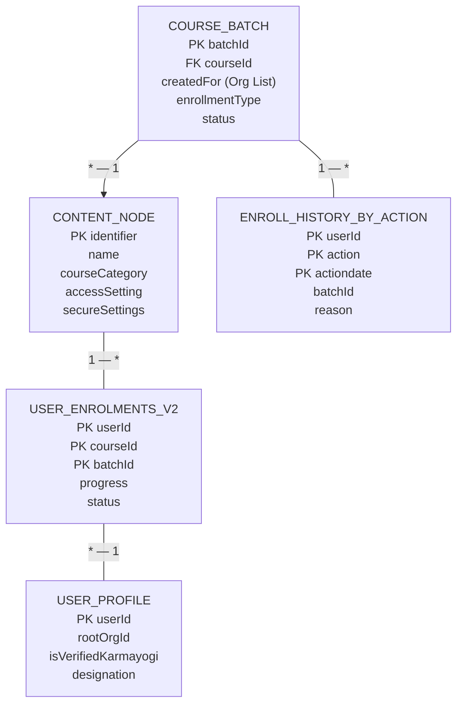

### D12: End-to-End Lifecycle State Transition Diagram

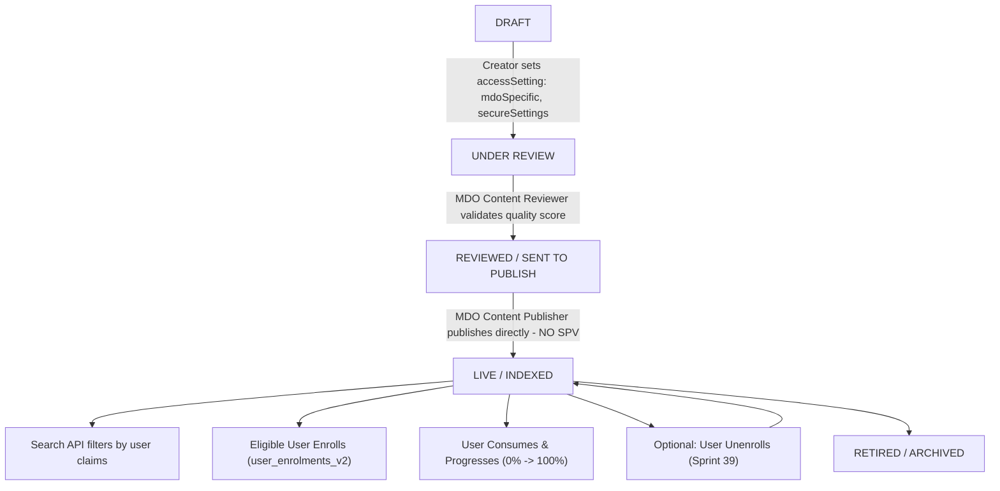

### D13: Eligibility Decision Tree

```mermaid
flowchart TD
    A["Learner Targets Course"] --> B{"Is accessSetting configured?"}
    B -->|"NO"| C["Public Course<br/>(Open to All)"]
    B -->|"YES"| D{"Is user.orgId in secureSettings.orgs OR #quot;*#quot;?"}
    D -->|"NO"| E["Access DENIED<br/>(Contact MDO/YP)"]
    D -->|"YES"| F{"Is isVerifiedKarmayogi set to #quot;Yes#quot;?"}
    F -->|"NO"| G["Access GRANTED<br/>(All MDO Users)"]
    F -->|"YES"| H{"Does user hold Verified Badge?"}
    H -->|"NO"| I["Access DENIED<br/>(Request Badge)"]
    H -->|"YES"| J["Access GRANTED<br/>(Verified MDO)"]
```
