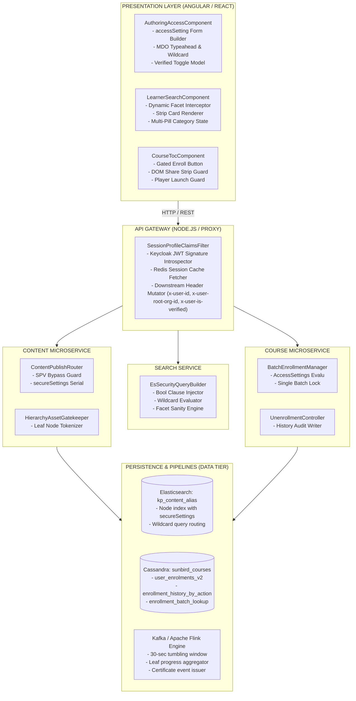
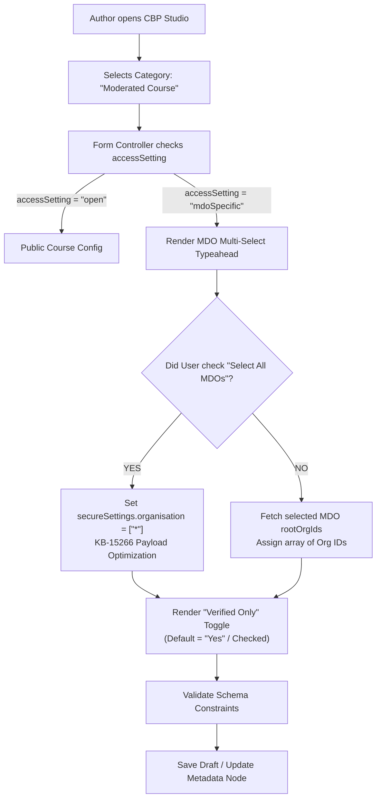
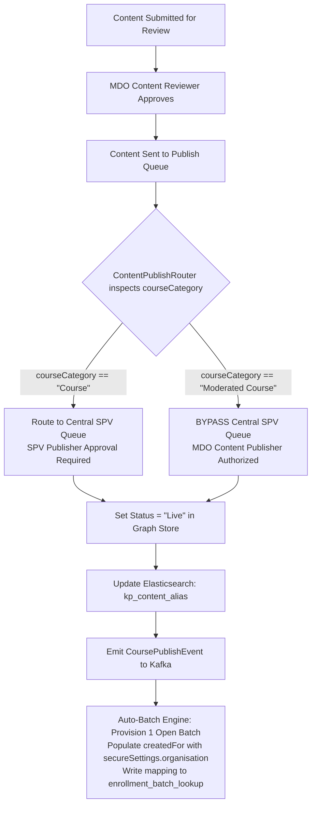
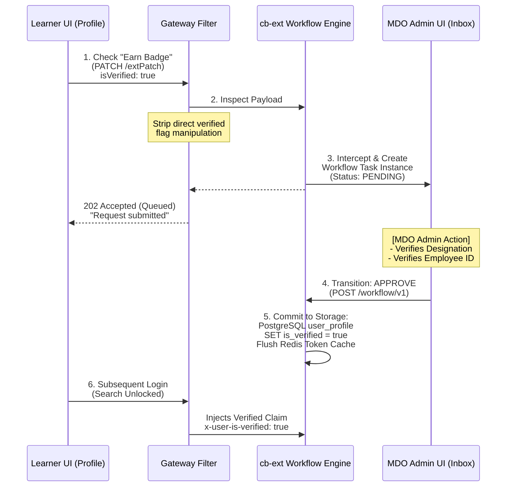
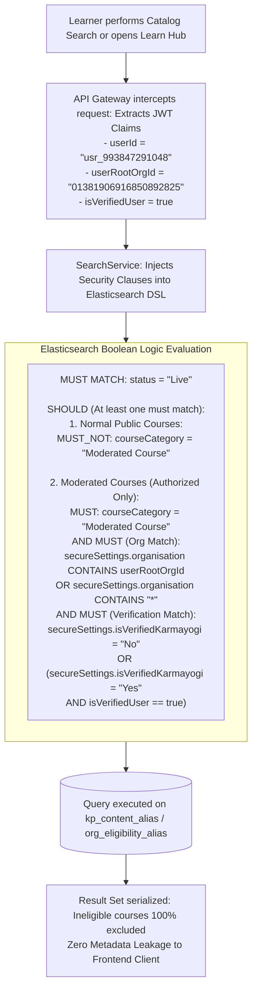
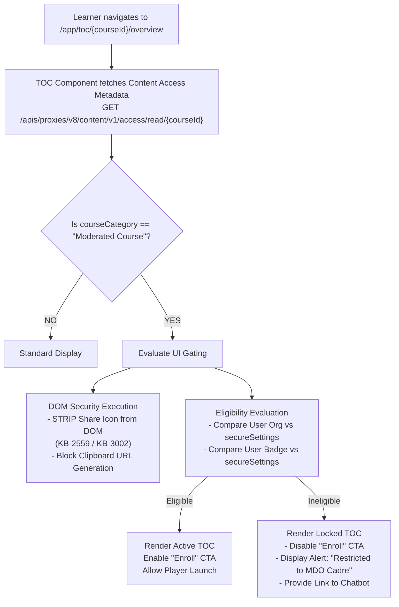
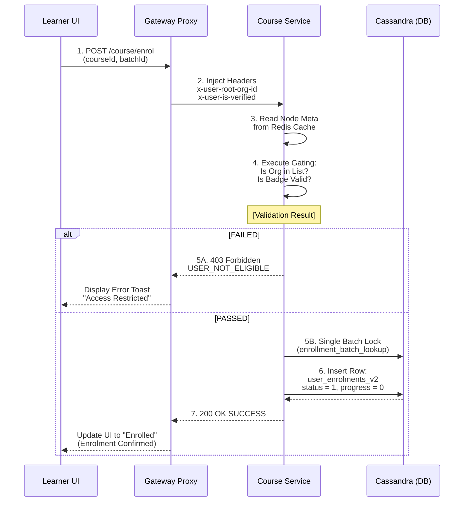
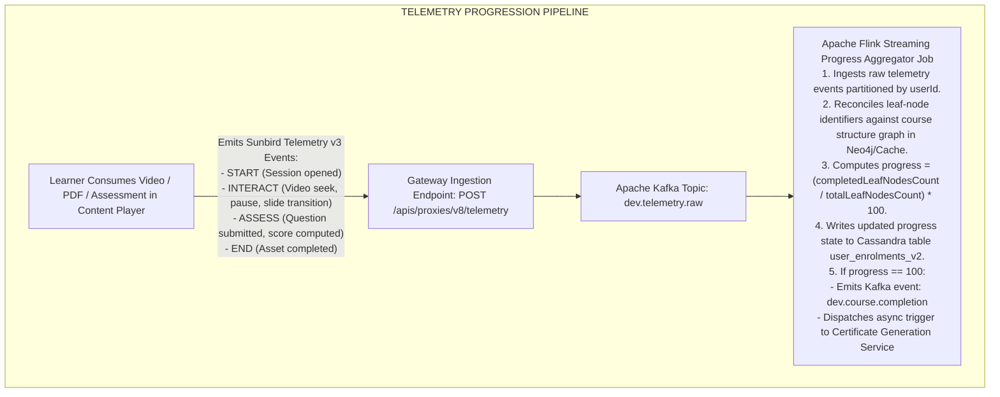
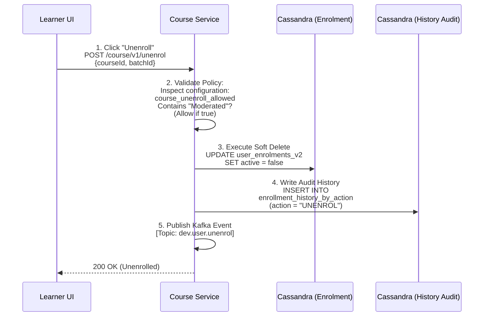
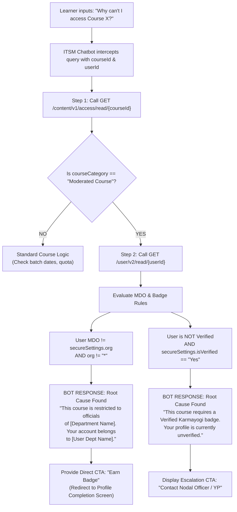

# Moderated Course — Low-Level Design (LLD)

## 1. Document Overview & Scope

This Low-Level Design (LLD) document provides detailed architectural flow specifications, algorithmic logic, internal class/module designs, request/response contracts, and database execution flows for the **Moderated Course** subsystem on the **iGOT Karmayogi Platform**.

It translates the High-Level Design into concrete engineering artifacts across the entire lifecycle:

1. **Creation & Configuration Flow:** Frontend state models, form validation routines, access setting configuration (`secureSettings`), and direct decentralized publishing logic (bypassing the SPV queue).
2. **Identity & Attestation Flow:** Learner verification request interceptors, workflow queue generation, and MDO Admin approval state transitions.
3. **Consumption & Discovery Flow:** Gateway claim injection, server-side Elasticsearch query clauses, batch validation, Cassandra transaction pipelines, telemetry stream progress calculation, and Sprint 39 unenrollment audit persistence.

## 2. Low-Level Component Hierarchy



## 3. Subsystem 1: Course Creation, Configuration & Publishing

### 3.1 Flow Diagram: Authoring Form & Access Configuration



### 3.2 Form Model & Validation State Controller

```typescript
/**
 * Authoring Access Configuration Model
 * Location: src/app/routes/authoring/models/access-settings.model.ts
 */
export interface ISecureSettings {
  isVerifiedKarmayogi: 'Yes' | 'No';
  organisation: string[]; // Holds MDO rootOrgIds or ["*"] for wildcard
  version: number;
}

export interface IContentMetadataNode {
  identifier: string;
  name: string;
  contentType: 'Course' | 'Program';
  courseCategory: 'Moderated Course' | 'Moderated Program' | 'Moderated Assessment';
  accessSetting: 'open' | 'mdoSpecific';
  secureSettings: ISecureSettings;
  status: 'Draft' | 'Review' | 'Live' | 'Retired';
  createdFor: string[];
}

/**
 * Validator rule executed prior to form submission
 */
export function validateModeratedCourseAccess(node: IContentMetadataNode): { isValid: boolean; error?: string } {
  if (node.courseCategory === 'Moderated Course' || node.courseCategory === 'Moderated Program') {
    if (node.accessSetting !== 'mdoSpecific') {
      return { isValid: false, error: 'Moderated courses must have accessSetting set to mdoSpecific' };
    }
    if (!node.secureSettings || !node.secureSettings.organisation || node.secureSettings.organisation.length === 0) {
      return { isValid: false, error: 'Target MDO selection is required. Choose at least one MDO or select All' };
    }
    if (!node.secureSettings.isVerifiedKarmayogi) {
      return { isValid: false, error: 'Verified Karmayogi requirement flag must be specified' };
    }
  }
  return { isValid: true };
}
```

### 3.3 Flow Diagram: Decentralized Publishing Engine ([KB-355: Q2 | CBP Publishing | SPV shall have the sole authority to publish the CBP on iGOT except in the case when the CBP is a Moderated Course.](https://karmayogibharat.atlassian.net/browse/KB-355) (Prod Deployed))



## 4. Subsystem 2: Identity & Verified Karmayogi Attestation

### 4.1 Flow Diagram: Two-Phase Profile Verification Workflow



### 4.2 API Contract & Schema: Profile Patch Interceptor

```http
// Inbound Request to Gateway:
PATCH /apis/proxies/v8/user/v1/extPatch

{
  "id": "api.user.extPatch",
  "ver": "1.0",
  "ts": "2026-10-30T13:37:00Z",
  "request": {
    "userId": "usr_993847291048",
    "profileDetails": {
      "mandatoryFieldsCompleted": true,
      "employeeCode": "NIC-992811",
      "designation": "Under Secretary",
      "cadre": "CSS",
      "departmentName": "Department of Personnel and Training"
    },
    "verificationRequest": {
      "optedIn": true,
      "requestedAt": "2026-10-30T13:37:00Z"
    }
  }
}

// Outbound Response from Workflow Engine:
{
  "id": "api.user.extPatch",
  "ver": "1.0",
  "ts": "2026-10-30T13:37:01Z",
  "responseCode": "ACCEPTED",
  "result": {
    "workflowId": "wf_inst_883719203847",
    "status": "INITIATED",
    "targetApproverRole": "MDO_ADMIN",
    "targetOrgId": "01381906916850892825",
    "message": "Verification request successfully routed to your departmental administrator."
  }
}
```

## 5. Subsystem 3: Discovery & Elasticsearch Security Query Engine

### 5.1 Flow Diagram: Server-Side Query Generation



### 5.2 Elasticsearch Query Builder Implementation

```java
/**
 * Elasticsearch Access Security Filter Builder
 * Component: search-service / QueryBuilder
 */
public class ModeratedCourseSecurityFilterBuilder {

    public static BoolQueryBuilder buildSecurityClause(String userRootOrgId, boolean isVerifiedKarmayogi) {
        BoolQueryBuilder rootBool = QueryBuilders.boolQuery();

        // Branch 1: Public Non-Moderated Content
        BoolQueryBuilder publicContentBranch = QueryBuilders.boolQuery()
                .mustNot(QueryBuilders.termQuery("courseCategory.raw", "Moderated Course"))
                .mustNot(QueryBuilders.termQuery("courseCategory.raw", "Moderated Program"));

        // Branch 2: Moderated Content Scoped Access
        BoolQueryBuilder moderatedContentBranch = QueryBuilders.boolQuery()
                .must(QueryBuilders.boolQuery()
                        .should(QueryBuilders.termQuery("courseCategory.raw", "Moderated Course"))
                        .should(QueryBuilders.termQuery("courseCategory.raw", "Moderated Program"))
                        .minimumShouldMatch(1)
                );

        // Sub-Branch 2A: Organization Check (Target Org OR Wildcard "*")
        BoolQueryBuilder orgMatchClause = QueryBuilders.boolQuery()
                .should(QueryBuilders.termQuery("secureSettings.organisation.raw", "*")) // KB-15266 Wildcard
                .should(QueryBuilders.termQuery("secureSettings.organisation.raw", userRootOrgId))
                .minimumShouldMatch(1);
        moderatedContentBranch.must(orgMatchClause);

        // Sub-Branch 2B: Verification Check
        if (!isVerifiedKarmayogi) {
            // Unverified users can ONLY see moderated courses that explicitly do NOT require verification
            moderatedContentBranch.must(QueryBuilders.termQuery("secureSettings.isVerifiedKarmayogi.raw", "No"));
        } else {
            // Verified users can view both verified-only and non-verified moderated courses
            moderatedContentBranch.must(QueryBuilders.boolQuery()
                    .should(QueryBuilders.termQuery("secureSettings.isVerifiedKarmayogi.raw", "Yes"))
                    .should(QueryBuilders.termQuery("secureSettings.isVerifiedKarmayogi.raw", "No"))
                    .minimumShouldMatch(1)
            );
        }

        // Combine using SHOULD: Content is returned if it is public OR if it matches user's moderated scope
        rootBool.should(publicContentBranch);
        rootBool.should(moderatedContentBranch);
        rootBool.minimumShouldMatch(1);

        return rootBool;
    }
}
```

## 6. Subsystem 4: Consumption, Enrolment & Direct Access Gating

### 6.1 Flow Diagram: Direct URL Navigation & TOC Action Control



### 6.2 Flow Diagram: Batch Enrolment Validation Pipeline (`/course/v1/enrol`)



## 7. Subsystem 5: Telemetry Pipeline, Progress & Unenrollment Lifecycle

### 7.1 Telemetry Processing & Progress Calculation



### 7.2 Flow Diagram: Unenrollment & Cassandra Audit Pipeline ([KB-14518: Q12 | Unenrollment from Courses | Web Portal](https://karmayogibharat.atlassian.net/browse/KB-14518) (Prod Deployed))



### 7.3 Database Execution Schema & Concrete Statements

#### Soft-Delete Update in `sunbird_courses.user_enrolments_v2`:

```sql
UPDATE sunbird_courses.user_enrolments_v2
SET active = false
WHERE userid = 'usr_993847291048'
  AND courseid = 'do_1139946938317127681396'
  AND batchid = '013994701293847291';
```

#### Immutable Audit Insert in `sunbird_courses.enrollment_history_by_action`:

```sql
INSERT INTO sunbird_courses.enrollment_history_by_action (
    userid, action, actiondate, batchid, courseid, progress, reason
) VALUES (
    'usr_993847291048', 'UNENROL', toTimestamp(now()), '013994701293847291',
    'do_1139946938317127681396', 45, ['Accidental enrollment by user']
);
```

## 8. Subsystem 6: Automated ITSM Chatbot Verification Engine ([KB-14236: Unable to find Moderated Courses / Unable to enroll in the course / Unable to find the course/ Unable to search external course/event](https://karmayogibharat.atlassian.net/browse/KB-14236) (Prod Deployed))

### 8.1 Algorithmic Decision Flow for Support Inquiries



## 9. Failure Modes, Edge Cases & Circuit Breaker Logic

| Failure Mode | Triggering Condition | Subsystem Impact | Concrete Mitigation & System Recovery |
|---|---|---|---|
| **Circuit Breaker: Elasticsearch Timeout** | Search cluster p95 latency under heavy load. | Discovery / Learn Hub | Gateway triggers resilience fallback: Disables moderated query facets and returns cached standard public catalog with toast: *"Specialized courses temporarily unavailable."* |
| **Wildcard Index Collision** | Course created with both explicit MDO IDs AND wildcard `["*"]` in array. | Search & Enrolment | Pre-save interceptor normalizes payload: If `organisation` contains `*`, it truncates the array to `["*"]` to ensure deterministic query execution ([KB-15266: Moderated Content - Enhancements in SecureSettings.organisation when selecting all organisation](https://karmayogibharat.atlassian.net/browse/KB-15266) (Open)). |
| **Inter-Departmental User Transfer** | Official moves from Ministry A to Ministry B; `rootOrgId` changes. | Consumption / Active Player | On next login, session cache refreshes. Gateway immediately blocks search and batch operations for Ministry A courses. Active player sessions terminate upon next token refresh. |
| **Duplicate Batch Creation Attempt** | Admin attempts to create second batch for a Moderated Course. | Course Service | `enrollment_batch_lookup` enforces a database-level uniqueness constraint. Rejects call with `HTTP 409 Conflict` (`BATCH_ALREADY_EXISTS_FOR_MODERATED_COURSE`). |
| **Unenrollment on Completed Course** | User attempts to unenroll after reaching 100% progress and receiving certificate. | Unenrollment Controller | Controller verifies `progress < 100` and `issued_certificates` is empty. If certificate exists, rejects request with `HTTP 400 Bad Request` (`CANNOT_UNENROL_COMPLETED_COURSE`). |
