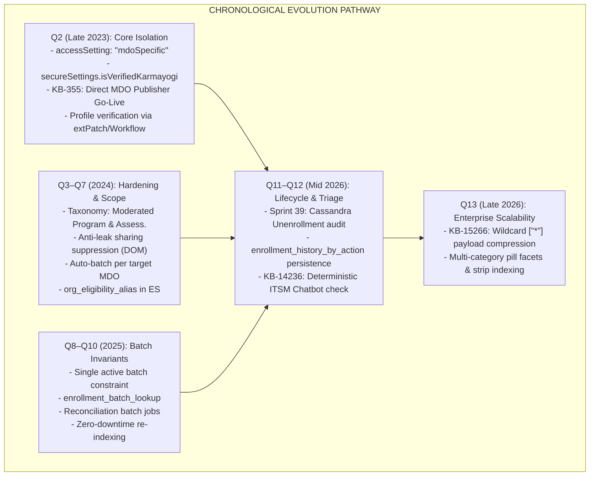
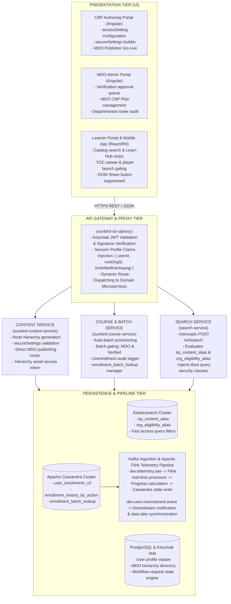
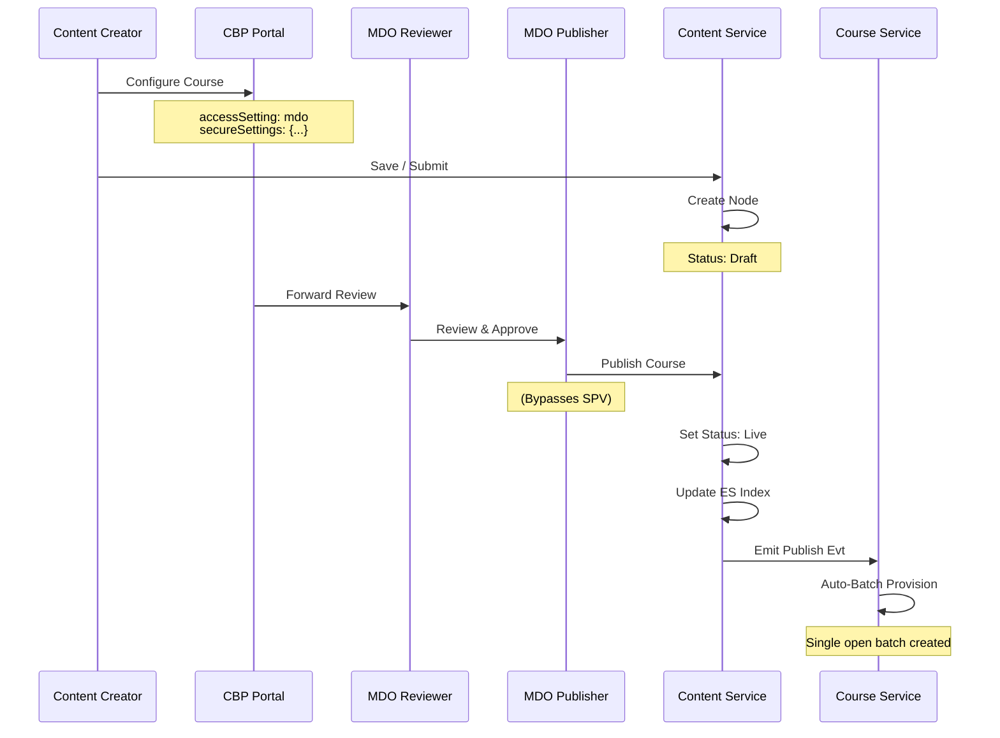
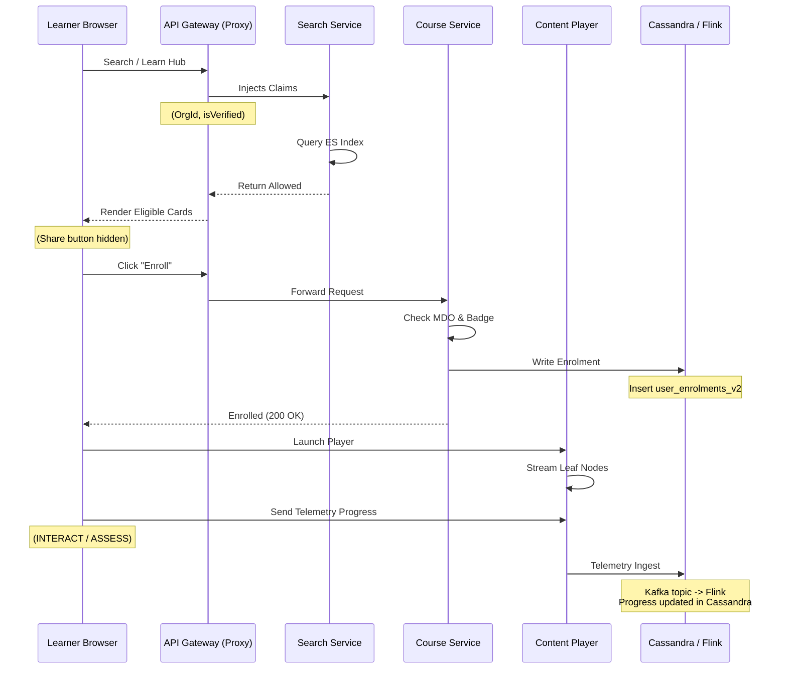
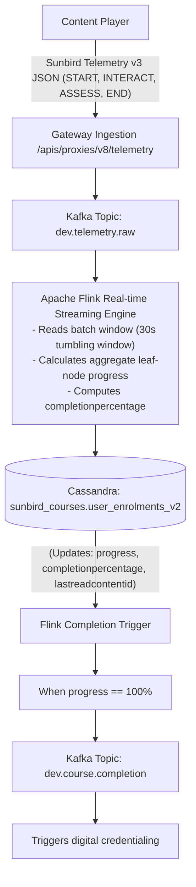

# Moderated Course — Software Design Document (SDD)

## 1. Document Overview & System Objectives

### 1.1 Purpose

This Software Design Document (SDD) specifies the architectural, component-level, interface, and data design for the **Moderated Course** capability across the **iGOT Karmayogi Platform**. It covers the complete evolution from **Quarter 2 (Q2 / Sprint 8)** through **Quarter 13 (Q13)**, detailing how the system transitioned from centralized administrative publishing to a decentralized, multi-tier access-control framework.

### 1.2 System Goals

- **Cadre & Sovereign Content Isolation:** Enforce server-side access boundaries preventing non-targeted Ministry, Department, or Organization (MDO) personnel from discovering, accessing, or enrolling in protected learning assets.
- **Attestation-Gated Consumption:** Enforce that courses requiring verified status are consumable only by civil servants holding an active **"Verified Karmayogi"** badge validated by their nodal MDO Administrator.
- **Decentralized Publishing Velocity:** Bypass central SPV review queues for departmental moderated courses, delegating publication approval directly to authorized MDO Content Publishers.
- **Information Leak Prevention:** Eliminate deep-link leakage by suppressing UI share controls, gating TOC hierarchy generation, and restricting batch binding at the API gateway and microservice tiers.
- **Full Lifecycle Governance:** Support automated batch provisioning, Cassandra-backed unenrollment auditing, Apache Flink telemetry tracking, and automated ITSM triage.

## 2. Architectural Evolution & Design Rationale (Q2 to Q13)

### 2.1 Chronological Evolution Architecture



### 2.2 Design Trade-Offs & Decisions

| Architectural Area | Traditional Approach | Implemented Design Decision | Rationale & Trade-Off |
|---|---|---|---|
| **Content Publishing** | Centralized SPV Publisher queue gates all content go-live. | Decentralized publishing: `courseCategory: "Moderated Course"` routes strictly to MDO Content Publisher ([KB-355: Q2 \| CBP Publishing \| SPV shall have the sole authority to publish the CBP on iGOT except in the case when the CBP is a Moderated Course.](https://karmayogibharat.atlassian.net/browse/KB-355) (Prod Deployed)). | Eliminates central operational bottlenecks. *Trade-off:* Requires MDO publishers to ensure content compliance. |
| **Search Filtering** | Client-side filtering based on fetched content catalogs. | Server-side query injection on Elasticsearch index using user session claims ([KB-338: Q2 \| Moderated Courses \| Moderated courses should be visible to learners who have verified karmayogi of the respective MDOs](https://karmayogibharat.atlassian.net/browse/KB-338) (Prod Deployed)). | Guarantees zero metadata leakage in API responses. *Trade-off:* Slightly higher gateway/search query generation complexity. |
| **Verification Verification** | Self-attestation checkbox on user profile. | Two-phase asynchronous workflow: User request -> `extPatch` -> Workflow Service -> MDO Admin approval ([KB-922: BE - CB-Ext changes w.r.t. extPatch API](https://karmayogibharat.atlassian.net/browse/KB-922) (Done)). | Prevents unauthorized self-promotion to verified status. *Trade-off:* Introduces dependency on administrative approval latency. |
| **All-MDO Target Payload** | Explicitly serializing hundreds of MDO GUIDs into content metadata. | Wildcard identifier `secureSettings.organisation = ["*"]` ([KB-15266: Moderated Content - Enhancements in SecureSettings.organisation when selecting all organisation](https://karmayogibharat.atlassian.net/browse/KB-15266) (Open)). | Prevents document index bloat in Elasticsearch and Cassandra. *Trade-off:* Search service query builder must evaluate array containment OR wildcard presence. |
| **Unenrollment Lifecycle** | Deleting the row from `user_enrolments`. | Soft toggle (`active = false`) in `user_enrolments_v2` and append-only audit in `enrollment_history_by_action`. | Retains historical learning progress and satisfies administrative compliance reporting. |

## 3. High-Level System Architecture & Component Decomposition



## 4. Detailed Component Design: Frontend Subsystems

### 4.1 CBP Authoring Portal Component (Course Setup & Publishing)

- **Component Path:** `src/app/routes/authoring/content-creation/`
- **Responsibilities:**
  - Render access configuration drop-down (`open` vs. `mdoSpecific`).
  - If `mdoSpecific`, render MDO multi-select typeahead fetching organizations via `/apis/proxies/v8/org/v1/search`.
  - Render "Select All Organizations" checkbox. When enabled, set `secureSettings.organisation = ["*"]` per [KB-15266: Moderated Content - Enhancements in SecureSettings.organisation when selecting all organisation](https://karmayogibharat.atlassian.net/browse/KB-15266) (Open).
  - Render "Only Verified Karmayogi Users" radio button (default: `Yes`).
  - Route course publishing directly to the MDO Content Publisher, omitting the central SPV review step ([KB-355: Q2 | CBP Publishing | SPV shall have the sole authority to publish the CBP on iGOT except in the case when the CBP is a Moderated Course.](https://karmayogibharat.atlassian.net/browse/KB-355) (Prod Deployed)).

```typescript
// Data model for authoring form state
export interface IMousedCourseAccessSettings {
  accessSetting: 'open' | 'mdoSpecific';
  secureSettings: {
    isVerifiedKarmayogi: 'Yes' | 'No';
    organisation: string[]; // List of MDO rootOrgIds or ["*"]
    version: number;
  };
}
```

### 4.2 Learner Portal & Mobile App Component (Discovery & Gating)

- **Component Path:** `src/app/routes/learn/`, `src/app/modules/toc/`
- **Responsibilities:**
  - Invoke `POST /apis/proxies/v8/sunbirdigot/v4/search` on load. The payload sends category filters; the gateway transparently injects session identity claims.
  - **Anti-Leak Sharing Suppression:** Inspect content metadata on TOC view. If `courseCategory === 'Moderated Course'`, conditionally hide the share icon (`isShareVisible = false`) across Angular templates and React Native views ([KB-2559: KB-1394 | Learner is able to view share icon for Moderated course](https://karmayogibharat.atlassian.net/browse/KB-2559) (Done), [KB-3002: Mobile > Content sharing> Share icon should not be shown for Moderated content and Invite only program.](https://karmayogibharat.atlassian.net/browse/KB-3002) (Done)).
  - **Direct URL Gating:** If a user navigates to `/app/toc/{courseId}/overview` directly:
    - Fetch course access metadata via `/apis/proxies/v8/content/v1/access/read/{courseId}`.
    - Compare logged-in user `rootOrgId` and `isVerifiedKarmayogi` against `secureSettings`.
    - If mismatch: Hide "Enroll" button, suppress hierarchy leaf nodes, and display informational restriction message with a link to the Nodal MDO/ITSM Chatbot.

### 4.3 MDO Admin Portal Component (Verification Workflow)

- **Component Path:** `src/app/routes/mdo/approvals/verification/`
- **Responsibilities:**
  - Fetch pending verification requests via `/apis/proxies/v8/workflow/v1/search`.
  - Display employee designation, cadre, employee code, and submitted verification documents.
  - Execute approval/rejection via `/apis/proxies/v8/workflow/v1/transition`, triggering the backend update of `isVerifiedKarmayogi: true` in the User Directory.

## 5. Detailed Component Design: Backend Microservices

### 5.1 API Gateway & Session Filter (`sunbird-cb-uiproxy`)

- **Role:** Intercept all inbound requests from Web and Mobile clients.
- **Filter Logic:**
  - Validate incoming Bearer JWT against Keycloak Public Key Cache.
  - Read session profile attributes from Redis/User Service.
  - Inject headers into downstream proxy requests:
    - `x-user-id`: Learner unique identifier.
    - `x-user-root-org-id`: Authenticated user MDO identifier.
    - `x-user-is-verified`: Boolean string (`"true"` | `"false"`).

### 5.2 Search Microservice (`search-service`)

- **Role:** Intercept `POST /apis/proxies/v8/sunbirdigot/v4/search` and execute access-gated queries against Elasticsearch.
- **Elasticsearch Query Builder Logic:**

```json
{
  "query": {
    "bool": {
      "must": [
        {
          "term": {
            "status.raw": "Live"
          }
        }
      ],
      "should": [
        {
          "bool": {
            "must_not": [
              {
                "term": {
                  "courseCategory.raw": "Moderated Course"
                }
              }
            ]
          }
        },
        {
          "bool": {
            "must": [
              {
                "term": {
                  "courseCategory.raw": "Moderated Course"
                }
              },
              {
                "bool": {
                  "should": [
                    {
                      "term": {
                        "secureSettings.organisation.raw": "*"
                      }
                    },
                    {
                      "term": {
                        "secureSettings.organisation.raw": "${x-user-root-org-id}"
                      }
                    }
                  ]
                }
              },
              {
                "bool": {
                  "should": [
                    {
                      "term": {
                        "secureSettings.isVerifiedKarmayogi.raw": "No"
                      }
                    },
                    {
                      "bool": {
                        "must": [
                          {
                            "term": {
                              "secureSettings.isVerifiedKarmayogi.raw": "Yes"
                            }
                          },
                          {
                            "term": {
                              "user_verified_status": "${x-user-is-verified}"
                            }
                          }
                        ]
                      }
                    }
                  ]
                }
              }
            ]
          }
        }
      ],
      "minimum_should_match": 1
    }
  }
}
```

### 5.3 Course & Batch Microservice (`sunbird-course-service`)

- **Role:** Manage course lifecycle, batch binding, enrollment, and unenrollment.
- **Auto-Batch Engine:**
  - When content publishes with `courseCategory: "Moderated Course"`, automatically provision a batch with `enrollmentType: "open"` and populate `createdFor` with `secureSettings.organisation`.
  - Store the batch ID mapping in Cassandra table `enrollment_batch_lookup`.

- **Enrollment Gatekeeper** (`/course/v1/enrol`):
  - Retrieve course node metadata from Content Service cache.
  - If `courseCategory === "Moderated Course"`:
    - Check if `user.rootOrgId` is present in `secureSettings.organisation` OR `secureSettings.organisation` contains `*`. If not, throw `HTTP 403 Forbidden` (`ERR_USER_MDO_MISMATCH`).
    - Check if `secureSettings.isVerifiedKarmayogi === "Yes"`. If `Yes` and `user.isVerifiedKarmayogi !== true`, throw `HTTP 403 Forbidden` (`ERR_USER_NOT_VERIFIED`).

  - Validate against `enrollment_batch_lookup` to ensure single active batch integrity.
  - Write enrollment row to `sunbird_courses.user_enrolments_v2`.

## 6. Data Architecture & Storage Design

**DATA STORAGE SCHEMAS**

**[Elasticsearch: kp_content_alias]**

- identifier: string (Primary Key)
- name: string
- courseCategory: "Moderated Course" | "Moderated Program" | "Moderated Assessment"
- accessSetting: "mdoSpecific"
- secureSettings: { organisation: ["013819...", "\*"], isVerifiedKarmayogi: "Yes", version: 1 }
- status: "Live"

**[Cassandra: sunbird_courses.user_enrolments_v2]**

- userid: text (Partition Key)
- courseid: text (Partition Key)
- batchid: text (Clustering Key)
- active: boolean
- progress: int
- completionpercentage: double
- enrolled_date: timestamp
- issued_certificates: list\<frozen\<map\<text, text>>>

**[Cassandra: sunbird_courses.enrollment_history_by_action]**

- userid: text (Partition Key)
- action: text (Clustering Key, e.g., "ENROL", "UNENROL")
- actiondate: timestamp (Clustering Key, DESC)
- batchid: text
- courseid: text
- progress: int
- reason: list\<text>

**[PostgreSQL / User Directory: user_profile]**

- id: varchar(64) (PK)
- root_org_id: varchar(64)
- is_verified_karmayogi: boolean (Default: FALSE)
- designation: varchar(128)
- employee_code: varchar(64)
- department_name: varchar(256)

## 7. End-to-End Sequence & State Machine Flows

### 7.1 Course Creation, Review, and Publishing Sequence



### 7.2 End-to-End Learner Discovery, Verification, and Consumption Sequence



## 8. Security, Authentication & Access Control Architecture

### 8.1 Zero-Trust Multi-Layer Security Gating

1. **Layer 1: Gateway Claim Enforcement** (`sunbird-cb-uiproxy`):
  - Decodes JWT cryptographic signature via Keycloak realm certs.
  - Pulls verified profile claims directly from the internal cache, mitigating client-side token spoofing.

2. **Layer 2: Search Query Sandboxing:**
  - User input queries cannot override boolean access clauses. Search service merges user keywords with programmatic boolean security filters.

3. **Layer 3: Batch Enrollment Authorisation** (`sunbird-course-service`):
  - Even if a malicious user bypasses the search UI and acquires a course `do_id`, direct calls to `/course/v1/enrol` evaluate `secureSettings.organisation` and `secureSettings.isVerifiedKarmayogi` against the token profile before writing to Cassandra.

4. **Layer 4: DRM / Streaming Gating:**
  - Content player assets (video chunks, encrypted PDF streams) require signed content tokens generated only after confirming active status in `user_enrolments_v2`.

## 9. Observability, Telemetry Pipeline & Analytics Design

### 9.1 Streaming Progress Ingestion Architecture



### 9.2 ITSM Chatbot Telemetry & Verification Integration ([KB-14236: Unable to find Moderated Courses / Unable to enroll in the course / Unable to find the course/ Unable to search external course/event](https://karmayogibharat.atlassian.net/browse/KB-14236) (Prod Deployed))

- If a learner reports an issue finding or enrolling in a course, the Chatbot executes an automated deterministic diagnostic:
  - Calls `GET /apis/proxies/v8/content/v1/access/read/{courseId}` to fetch required MDOs and verification flags.
  - Calls `GET /api/user/v2/read/{userId}` to fetch user profile claims.
  - Evaluates eligibility rules:
    - If user MDO course MDO: Outputs *"This course is restricted to officials of [Department Name]."*
    - If course requires verification and user is unverified: Outputs *"Your profile is unverified. Please submit your profile for MDO verification."*

## 10. Error Handling, Exception Resilience & Edge Cases

| Failure Scenario | Component Handling | User Experience & Recovery Path |
|---|---|---|
| **User transfers between MDOs mid-course** | Next login updates `rootOrgId`. Subsequent search filters exclude old MDO courses. Existing in-progress course player checks fail. | Display modal: *"Course access revoked due to inter-departmental transfer. Contact your prior Nodal Officer."* |
| **Creator selects all MDOs on** **legacy system** | System maps legacy array to wildcard `*` via background migration job ([KB-15266: Moderated Content - Enhancements in SecureSettings.organisation when selecting all organisation](https://karmayogibharat.atlassian.net/browse/KB-15266) (Open)). | Prevents HTTP 413 Payload Too Large during publishing and optimizes index size. |
| **Kafka telemetry pipeline lag** | Flink checkpointing saves state in HDFS/S3. Client caches local player progress in indexedDB. | Local player shows progress; server progress reconciles once Kafka consumer lag drains. |
| **Accidental enrollment in Moderated Course** | User clicks "Unenroll". Backend calls `/course/v1/unenrol`, soft-deletes in Cassandra, and logs in history table. | User removed from cohort roster; progress preserved if re-enrolled later. |

## 11. Design Traceability Matrix (Requirements to Design Components)

| Requirement Description | Source Jira | Architecture / Design Component | Verification Point |
|---|---|---|---|
| **Verified Karmayogi Access Gating** | [KB-337: Q2 \| Moderated Courses \| Verified Karmayogi vs All Users access to Moderated Courses.](https://karmayogibharat.atlassian.net/browse/KB-337) (Prod Deployed), [KB-338: Q2 \| Moderated Courses \| Moderated courses should be visible to learners who have verified karmayogi of the respective MDOs](https://karmayogibharat.atlassian.net/browse/KB-338) (Prod Deployed) | Search Service Query Builder & Course Service Gatekeeper | Verified users see course; unverified users receive 0 search results. |
| **Decentralized MDO Publishing** | [KB-355: Q2 \| CBP Publishing \| SPV shall have the sole authority to publish the CBP on iGOT except in the case when the CBP is a Moderated Course.](https://karmayogibharat.atlassian.net/browse/KB-355) (Prod Deployed) | Content Service Publishing Router | Publishing workflow transitions to Live without routing to SPV queue. |
| **Profile Verification Workflow** | [KB-922: BE - CB-Ext changes w.r.t. extPatch API](https://karmayogibharat.atlassian.net/browse/KB-922) (Done), [KB-926: FE - MDO portal add necessary changes to list the verify karmayogi badge and test the flow](https://karmayogibharat.atlassian.net/browse/KB-926) (Done) | `cb-ext` User & Workflow Microservice | Direct `extPatch` of verification flag blocked; MDO Admin approval required. |
| **Anti-Leak Sharing Suppression** | [KB-2559: KB-1394 \| Learner is able to view share icon for Moderated course](https://karmayogibharat.atlassian.net/browse/KB-2559) (Done), [KB-3002: Mobile > Content sharing> Share icon should not be shown for Moderated content and Invite only program.](https://karmayogibharat.atlassian.net/browse/KB-3002) (Done) | Learner Web Portal & Mobile UI TOC Views | Share icon completely omitted from DOM when `courseCategory ===` `'Moderated Course'`. |
| **Unenrollment Audit Tracking** | [KB-14518: Q12 \| Unenrollment from Courses \| Web Portal](https://karmayogibharat.atlassian.net/browse/KB-14518) (Prod Deployed), Sprint 39 | Cassandra `enrollment_history_by_action` | Audit row written with action `UNENROL` upon unenrollment API call. |
| **Wildcard Payload Optimization** | [KB-15266: Moderated Content - Enhancements in SecureSettings.organisation when selecting all organisation](https://karmayogibharat.atlassian.net/browse/KB-15266) (Open) | Content Schema & Search ES Query Builder | `secureSettings.organisation = ["*"]` matches all authenticated user org queries. |
| **ITSM Chatbot Eligibility Triage** | [KB-14236: Unable to find Moderated Courses / Unable to enroll in the course / Unable to find the course/ Unable to search external course/event](https://karmayogibharat.atlassian.net/browse/KB-14236) (Prod Deployed) | Deterministic Chatbot Engine | Ineligible users receive immediate root-cause feedback and MDO escalation links. |

## 12. Open Assumptions & Future Architectural Considerations

1. **HRMS / SPARROW Direct Attestation:** Future phases will explore automated identity verification via integration with Government HRMS / SPARROW systems, automatically assigning `isVerifiedKarmayogi: true` during SSO and reducing reliance on manual MDO Admin review queues.
2. **Sub-Departmental & Cadre Gating:** Currently, restrictions operate at the MDO root organization level (`rootOrgId`). Future architectural increments plan to support fine-grained scoping down to specific wings, divisions, or hierarchical child organizations within an MDO.

<br><br>
