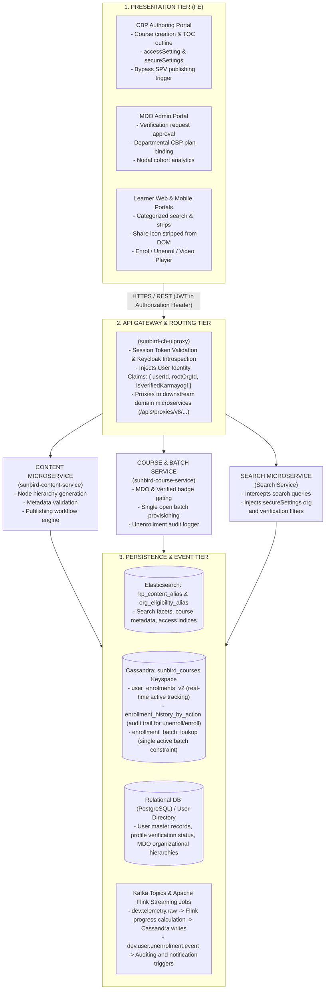
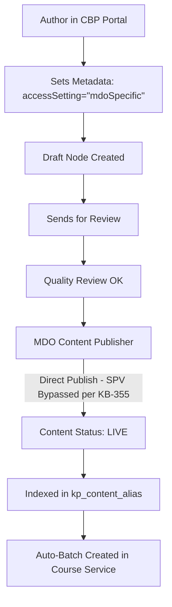
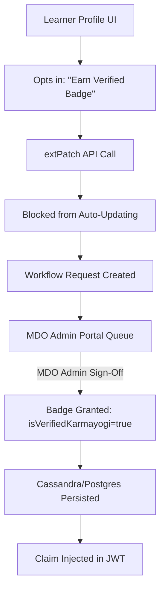
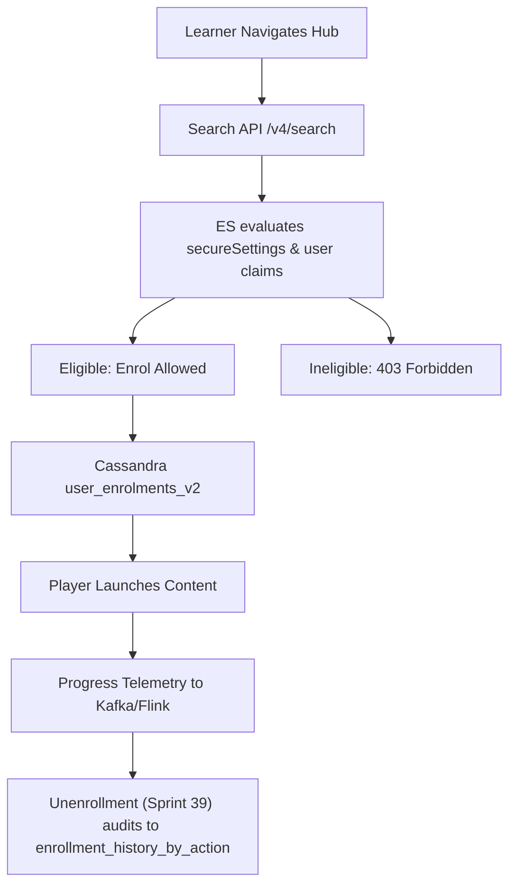

# Moderated Course — Software Requirements Specification (SRS)

## 1. Introduction

### 1.1 Purpose

This Software Requirements Specification (SRS) defines the functional, technical, non-functional, and interface requirements for **Moderated Courses** (including composite extensions: **Moderated Programs** and **Moderated Assessments**) on the iGOT Karmayogi digital learning infrastructure. It documents the platform's multi-tier access-control framework, decentralized publishing model, search indexing engine, batch orchestration, unenrollment lifecycle, and user profile verification mechanisms across their evolution from **Q2 through Q13**.

### 1.2 Scope

This specification governs two primary product workflows:

1. **Creation & Configuration Lifecycle (Content Authoring, Curation, MDO Governance, and Publishing):** Bypassing centralized SPV review for departmental training, setting access restrictions, configuring `secureSettings`, and provisioning single-batch architectures.
2. **Consumption & Learner Lifecycle (Discovery, Access Validation, Enrolment, Playback, Telemetry, and Unenrollment):** Identity claim extraction, server-side Elasticsearch facet filtering, badge-driven access gating, Kafka/Flink telemetry progress pipelines, Cassandra persistence, and unenrollment auditing.

### 1.3 Definitions, Acronyms, and Abbreviations

- **CBP:** Capacity Building Plan / Course Building Portal.
- **MDO:** Ministry, Department, or Organization.
- **SPV:** Special Purpose Vehicle (Karmayogi Bharat central governing entity).
- **Verified Karmayogi:** A user profile verification badge issued following MDO Administrator approval, confirming official cadre and designation.
- `secureSettings`: The JSON metadata structure stored on content nodes holding access-control parameters (`organisation`, `isVerifiedKarmayogi`).
- **TOC:** Table of Contents / Course outline page.

## 2. Platform Evolution Roadmap (Q2 to Q13)

| Q2–Q4: Scaffolding | Q5–Q7: Taxonomy & Hardening | Q8–Q10: Batch Governance | Q11–Q12: Unenroll & Triage | Q13: Optimization & Polish |
|---|---|---|---|---|
| KB-337 / KB-338: Verified Karmayogi Gating | KB-2219: Added Moderated Programs & Assessments | Single-batch enforcement via enrollment_batch_lookup | KB-14518 / Sprint 39: Unenrollment enablement | KB-15266: Wildcard org ["\*"] payload compression |
| KB-355: Decentralized Publishing (Bypass SPV) | KB-2559 / KB-3002: Anti-leak sharing suppression | org_eligibility_alias Elasticsearch integration | Cassandra audit tracking in enrollment_history_by_action | KB-15689: Multi-select category pills UI |
| KB-922 / KB-926: Profile verification workflow | Automated batch creation per MDO identifier | Compatibility Level 4 content versioning | KB-14236: Deterministic ITSM Chatbot validation | KAR-1351: Learner Portal strip discovery fixes |

| Phase / Era | Key Milestones & Features | Jira References | Architectural & Functional Changes |
|---|---|---|---|
| **Q2 (Sprint 8 – late 2023)** | **Foundational Moderation & Verified Karmayogi Gating** | [KB-337: Q2 \| Moderated Courses \| Verified Karmayogi vs All Users access to Moderated Courses.](https://karmayogibharat.atlassian.net/browse/KB-337) (Prod Deployed), [KB-338: Q2 \| Moderated Courses \| Moderated courses should be visible to learners who have verified karmayogi of the respective MDOs](https://karmayogibharat.atlassian.net/browse/KB-338) (Prod Deployed), [KB-743: Q2 \| Moderated Courses \| Content creator to choose to show the moderated course to only Verified Karmayogi users.](https://karmayogibharat.atlassian.net/browse/KB-743) (Internal Review), [KB-946: Q2 \| Moderated Courses](https://karmayogibharat.atlassian.net/browse/KB-946) (KB Approved) | Introduced `accessSetting: "mdoSpecific"` and `secureSettings.isVerifiedKarmayogi`. Blocked self-registered unverified users from discovering or consuming MDO-restricted courses. |
| **Q2 (Dec 2023)** | **Decentralized Publishing Authority** | [KB-355: Q2 \| CBP Publishing \| SPV shall have the sole authority to publish the CBP on iGOT except in the case when the CBP is a Moderated Course.](https://karmayogibharat.atlassian.net/browse/KB-355) (Prod Deployed), [KB-255: CBP Publishing \| Gating \| SPV shall have the final authority of CBP Publishing.](https://karmayogibharat.atlassian.net/browse/KB-255) (Added to Initiative) | Eliminated central SPV bottleneck. Moderated Courses bypass the SPV Publisher queue and publish directly via the MDO Content Publisher. |
| **Q2 (Dec 2023)** | **User Profile Verification Workflow** | [KB-920: FE - Learner portal: Allow use to request for Karmayogi badge from the profile page and test the approval flow](https://karmayogibharat.atlassian.net/browse/KB-920) (Done), [KB-922: BE - CB-Ext changes w.r.t. extPatch API](https://karmayogibharat.atlassian.net/browse/KB-922) (Done), [KB-926: FE - MDO portal add necessary changes to list the verify karmayogi badge and test the flow](https://karmayogibharat.atlassian.net/browse/KB-926) (Done) | Gated self-service badge claims via `extPatch` API; created asynchronous workflow queue in MDO Portal for MDO Admin attestation. |
| **Q3–Q7 (2024)** | **Taxonomy Expansion & Sharing** **Suppression** | [KB-2219: DEV \| BE \| Update the course MetaData for CourseCategory](https://karmayogibharat.atlassian.net/browse/KB-2219) (Done), [KB-2559: KB-1394 \| Learner is able to view share icon for Moderated course](https://karmayogibharat.atlassian.net/browse/KB-2559) (Done), [KB-3002: Mobile > Content sharing> Share icon should not be shown for Moderated content and Invite only program.](https://karmayogibharat.atlassian.net/browse/KB-3002) (Done) | Expanded schema to include `Moderated Program` and `Moderated Assessment`. Suppressed and stripped the **Share** button from DOM (Web, M-Web, iOS, Android) to eliminate deep-link leakage. |
| **Q8–Q10 (2025)** | **Batch Governance & Index Optimization** | [KB-11487: Regression: Learner portal > Resume content > Video player does not resume from previously left timestamp.](https://karmayogibharat.atlassian.net/browse/KB-11487) (In-Progress), Confluence Cleanup Spec | Enforced single active open batch model (`enrollment_batch_lookup`). Implemented automated reconciliation jobs for duplicate batch deduplication. Introduced `org_eligibility_alias`. |
| **Q11–Q12 (Mid 2026)** | **Unenrollment Lifecycle & Chatbot Triage** | [KB-14518: Q12 \| Unenrollment from Courses \| Web Portal](https://karmayogibharat.atlassian.net/browse/KB-14518) (Prod Deployed), [KB-14236: Unable to find Moderated Courses / Unable to enroll in the course / Unable to find the course/ Unable to search external course/event](https://karmayogibharat.atlassian.net/browse/KB-14236) (Prod Deployed), Sprint 39 Spec | Enabled unenrollment for `Moderated Course` (`course_unenroll_allowed_primary_category`). Audited unenrollment in Cassandra `enrollment_history_by_action`. Integrated deterministic ITSM Chatbot access checks. |
| **Q13 (Late 2026)** | **Search Payload Compression & Portal Discovery** | [KB-15266: Moderated Content - Enhancements in SecureSettings.organisation when selecting all organisation](https://karmayogibharat.atlassian.net/browse/KB-15266) (Open), [KB-15689: Q13 \| Learner Portal \| Search optimisation \| Multi-select category pills UI and state management](https://karmayogibharat.atlassian.net/browse/KB-15689) (Done), KAR-1351 | Optimized `secureSettings.organisation` by supporting wildcard `["*"]` when selecting all MDOs, mitigating metadata bloat. Enhanced Learner Portal strip rendering and multi-select category pills. |

## 3. System Architecture & Component Interactions



## 4. Functional Requirements: Course Creation & Publishing (Frontend to Backend)



### 4.1 Course Metadata & Access Configuration

- **FR-CR-01 (Category Classification):** The authoring portal shall allow content creators to classify a course as `courseCategory: "Moderated Course"`, `"Moderated Program"`, or `"Moderated Assessment"`.
- **FR-CR-02 (Access Setting Selection):** The portal shall provide an access setting selector:
  - `open`: Globally discoverable across the platform.
  - `mdoSpecific`: Restricted to specified organizations.

- **FR-CR-03 (Organization Mapping):** When `accessSetting` is set to `mdoSpecific`, the frontend shall render an MDO selection interface:
  - Selection of one or more explicit MDO entities by Organization ID (`rootOrgId`).
  - A "Select All" toggle that writes `secureSettings.organisation = ["*"]` per [KB-15266: Moderated Content - Enhancements in SecureSettings.organisation when selecting all organisation](https://karmayogibharat.atlassian.net/browse/KB-15266) (Open) to prevent Elasticsearch index bloat.

- **FR-CR-04 (Verified Karmayogi Gating Toggle):** The creation form shall render a mandatory radio toggle: *"Restrict to Verified Karmayogi Users Only"* (Default: `"Yes"`).
  - Persisted as `secureSettings.isVerifiedKarmayogi = "Yes" | "No"`.

- **FR-CR-05 (Backend Validation):** Content Service shall reject (`HTTP 400`) any publish or update request where `courseCategory == "Moderated Course"` but `secureSettings.organisation` is null or empty.

### 4.2 Review, Publishing & Batch Provisioning

- **FR-PB-01 (Decentralized Publishing Authority):** In accordance with [KB-355: Q2 | CBP Publishing | SPV shall have the sole authority to publish the CBP on iGOT except in the case when the CBP is a Moderated Course.](https://karmayogibharat.atlassian.net/browse/KB-355) (Prod Deployed), if a course has `courseCategory: "Moderated Course"`, the system shall bypass the central SPV Publisher queue.
  - The MDO Content Publisher shall have the sole authority to approve and transition the course to `status: "Live"`.

- **FR-PB-02 (Automated Batch Orchestration):** Upon transitioning to `Live`, `sunbird-course-service` shall automatically provision a single open enrollment batch (`enrollmentType: "open"`) associated with the course and bind it to the target MDO list.
- **FR-PB-03 (Single Active Batch Invariant):** The system shall strictly enforce a single active batch per Moderated Course. Additional manual batch creations shall be blocked and validated via `enrollment_batch_lookup`.

## 5. Functional Requirements: Identity & Profile Verification



- **FR-ID-01 (Verification Request):** Civil servants shall be eligible to request verification from their Learner Profile after completing mandatory profile attributes (Name, Designation, Cadre, Employee ID, Nodal Department).
- **FR-ID-02 (Anti-Tamper API Enforcement):** The `PATCH /apis/proxies/v8/user/v1/extPatch` endpoint shall explicitly forbid direct user manipulation of `isVerifiedKarmayogi`. The service shall intercept verification requests and instantiate a pending workflow request ([KB-922: BE - CB-Ext changes w.r.t. extPatch API](https://karmayogibharat.atlassian.net/browse/KB-922) (Done)).
- **FR-ID-03 (MDO Admin Attestation):** MDO Administrators shall review and approve or reject verification requests within the MDO Portal (`/apis/proxies/v8/workflow/v1/transition`).
- **FR-ID-04 (Profile State Persistence):** Upon approval, the User Directory shall persist `isVerifiedKarmayogi: true`. The profile UI shall permanently lock the verification checkbox to prevent redundant submission ([KB-927: The Verified karmayogi Badge checkbox should be disabled post User gets the badge.](https://karmayogibharat.atlassian.net/browse/KB-927) (Done)).

## 6. Functional Requirements: Consumption & Learner Lifecycle



### 6.1 Discovery & Server-Side Filtering

- **FR-DS-01 (Discovery Eligibility Evaluation):** The Search API (`POST /apis/proxies/v8/sunbirdigot/v4/search`) shall enforce server-side filtering:
- **FR-DS-02 (Zero-Leak Search Results):** Content cards that do not satisfy the criteria shall be entirely excluded from search hits, category facets, and home page recommendation strips.
- **FR-DS-03 (Sharing Suppression):** The Web Portal and Mobile App shall conditionally suppress and remove the **Share** icon from the DOM for all Moderated Courses ([KB-2559: KB-1394 | Learner is able to view share icon for Moderated course](https://karmayogibharat.atlassian.net/browse/KB-2559) (Done), [KB-3002: Mobile > Content sharing> Share icon should not be shown for Moderated content and Invite only program.](https://karmayogibharat.atlassian.net/browse/KB-3002) (Done)).

### 6.2 Access Validation & Enrolment

- **FR-EN-01 (Direct Link Access Control):** When a user navigates to a Moderated Course TOC via direct URL:
  - If eligible, the TOC and "Enroll" CTA shall render normally.
  - If ineligible, the TOC CTA shall display: *"Course access is restricted to verified personnel of the designated department"*, and content hierarchy nodes shall not be fetched.

- **FR-EN-02 (Backend Enrolment Validation):** `POST /apis/proxies/v8/course/v1/enrol` shall independently validate user claims against `secureSettings`. Ineligible attempts shall return `HTTP 403 Forbidden` (`USER_NOT_ELIGIBLE_FOR_MODERATED_COURSE`).
- **FR-EN-03 (State Persistence):** Successful enrollment shall insert an active record into Cassandra table `sunbird_courses.user_enrolments_v2` with `status: 1` and `progress: 0`.

### 6.3 Consumption, Progress & Completion

- **FR-CS-01 (Playback Authorisation):** When launching a leaf-node asset, the Content Player shall verify active enrollment in `user_enrolments_v2`.
- **FR-CS-02 (Telemetry Streaming):** Content player telemetry (`START`, `INTERACT`, `ASSESS`, `END`) shall stream to Kafka topic `dev.telemetry.raw`.
- **FR-CS-03 (Progress Processing):** Apache Flink jobs shall calculate consumed percentages and update `user_enrolments_v2.progress`. When `progress == 100`, completion events shall trigger certificate evaluation.

### 6.4 Unenrollment & Re-enrollment Lifecycle (Q11–Q13)

- **FR-UN-01 (Unenrollment Permission):** In accordance with Sprint 39 specifications, `sunbird-course-service` configuration property `course_unenroll_allowed_primary_category` shall include `Moderated Course`.
- **FR-UN-02 (Unenrollment Execution):** Upon `POST /apis/proxies/v8/course/v1/unenrol`:
  - Active flag in `user_enrolments_v2` is set to `false`.
  - Audit row is appended to Cassandra table `sunbird_courses.enrollment_history_by_action` storing `userId`, `courseId`, `batchId`, `action: "UNENROL"`, `progress`, and `actiondate`.
  - Kafka event `dev.user.unenrolment.event` is published for telemetry downstream consumers.

- **FR-UN-03 (Re-enrollment State Recovery):** If an unenrolled user re-enrolls, `user_enrolments_v2` shall reactivate the record and preserve prior progress unless course structure version changes dictate a reset.

## 7. Non-Functional Requirements (NFRs)

### 7.1 Security & Access Control

- **NFR-SEC-01 (Defense in Depth):** Gating shall never rely solely on frontend client suppression; every API endpoint (`/search`, `/enrol`, `/hierarchy`, `/read`) must evaluate JWT claims independently.
- **NFR-SEC-02 (Zero Information Leakage):** Unauthorized users querying course identifiers shall receive generic 403 / 404 responses without leaking titles or organizational identifiers.

### 7.2 Performance & Scalability

- **NFR-PERF-01 (Search Latency):** Search queries across indexed moderated content facets via `org_eligibility_alias` shall maintain a p95 latency under 5,000 concurrent requests.
- **NFR-PERF-02 (Payload Compression):** The wildcard optimization `secureSettings.organisation = ["*"]` ([KB-15266: Moderated Content - Enhancements in SecureSettings.organisation when selecting all organisation](https://karmayogibharat.atlassian.net/browse/KB-15266) (Open)) shall ensure content metadata JSON sizes do not exceed .

### 7.3 Data Consistency & Auditability

- **NFR-AUD-01 (Immutable Action History):** Unenrollment and batch reassignment events must be immutably recorded in `enrollment_history_by_action` with zero write-loss tolerance.
- **NFR-AUD-02 (Batch Reconciliation):** Background reconciliation jobs shall execute daily to prune orphaned batch mappings and deduplicate active batches.

## 8. Data Models & API Specifications

### 8.1 Core Content Schema (JSON Metadata)

```json
{
  "identifier": "do_1139946938317127681396",
  "name": "Audit Procedures for Internal Vigilance Officers",
  "contentType": "Course",
  "primaryCategory": "Course",
  "courseCategory": "Moderated Course",
  "status": "Live",
  "accessSetting": "mdoSpecific",
  "secureSettings": {
    "isVerifiedKarmayogi": "Yes",
    "organisation": [
      "01381906916850892825",
      "01392275379456409617"
    ],
    "version": 1
  },
  "trackable": {
    "enabled": "Yes",
    "autoBatch": "Yes"
  },
  "createdFor": [
    "01381906916850892825"
  ]
}
```

### 8.2 Database Schemata (Cassandra CQL)

#### `sunbird_courses.user_enrolments_v2`

```sql
CREATE TABLE sunbird_courses.user_enrolments_v2 (
    userid text,
    courseid text,
    batchid text,
    active boolean,
    completionpercentage double,
    enrolled_date timestamp,
    issued_certificates list<frozen<map<text,
    text>>>,
    lastreadcontentid text,
    progress int,
    status int,
    PRIMARY KEY (userid, courseid, batchid)
);
```

#### `sunbird_courses.enrollment_history_by_action`

```sql
CREATE TABLE sunbird_courses.enrollment_history_by_action (
    userid text,
    action text,
    actiondate timestamp,
    batchid text,
    courseid text,
    progress int,
    reason list<text>,
    PRIMARY KEY (userid, action, actiondate)
) WITH CLUSTERING ORDER BY (action ASC, actiondate DESC);
```

### 8.3 Interface Specifications

#### 1. Content Search (`POST /apis/proxies/v8/sunbirdigot/v4/search`)

- **Headers:** `Authorization: Bearer {token}`, `x-authenticated-user-token: {jwt}`
- **Payload:**

```json
{
  "request": {
    "filters": {
      "status": [
        "Live"
      ],
      "courseCategory": [
        "Moderated Course"
      ]
    },
    "fields": [
      "name",
      "identifier",
      "courseCategory",
      "secureSettings",
      "batches"
    ],
    "limit": 20
  }
}
```

- **Response Status:** `200 OK` (Evaluated results containing only eligible nodes).

#### 2. Course Enrolment (`POST /apis/proxies/v8/course/v1/enrol`)

- **Payload:**

```json
{
  "request": {
    "courseId": "do_1139946938317127681396",
    "batchId": "013994701293847291",
    "userId": "d7a9b0c2-3e4f-4a1b-9c8d-2e5f7a1b3c5d"
  }
}
```

- **Responses:**
  - `200 OK`: `{"id": "api.course.enrol", "result": {"response": "SUCCESS"}}`
  - `403 Forbidden`: `{"id": "api.course.enrol", "params": {"err": "USER_NOT_ELIGIBLE_FOR_MODERATED_COURSE"}}`

#### 3. Course Unenrollment (`POST /apis/proxies/v8/course/v1/unenrol`)

- **Payload:** Identical to enrollment payload.
- **Response Status:** `200 OK` (Sets `active: false` in `user_enrolments_v2`, appends audit row in `enrollment_history_by_action`).

## 9. Verification & Traceability Matrix

| Requirement ID | Jira Reference | Component | Verification Method | Pass Criteria |
|---|---|---|---|---|
| **REQ-SRS-01** | [KB-337: Q2 \| Moderated Courses \| Verified Karmayogi vs All Users access to Moderated Courses.](https://karmayogibharat.atlassian.net/browse/KB-337) (Prod Deployed), [KB-743: Q2 \| Moderated Courses \| Content creator to choose to show the moderated course to only Verified Karmayogi users.](https://karmayogibharat.atlassian.net/browse/KB-743) (Internal Review) | CBP Portal / Schema | Functional Test | Creator toggles "Only Verified Karmayogi"; persists in `secureSettings`. |
| **REQ-SRS-02** | [KB-355: Q2 \| CBP Publishing \| SPV shall have the sole authority to publish the CBP on iGOT except in the case when the CBP is a Moderated Course.](https://karmayogibharat.atlassian.net/browse/KB-355) (Prod Deployed) | Content Service | Integration Test | Moderated Course bypasses SPV; published directly by MDO Publisher. |
| **REQ-SRS-03** | [KB-338: Q2 \| Moderated Courses \| Moderated courses should be visible to learners who have verified karmayogi of the respective MDOs](https://karmayogibharat.atlassian.net/browse/KB-338) (Prod Deployed), [KB-925: FE - Learner portal: Non-Karmayogi user should not see the Moderated cources.](https://karmayogibharat.atlassian.net/browse/KB-925) (Done) | Search Engine | Security / E2E | Ineligible users cannot view or search moderated courses. |
| **REQ-SRS-04** | [KB-922: BE - CB-Ext changes w.r.t. extPatch API](https://karmayogibharat.atlassian.net/browse/KB-922) (Done), [KB-926: FE - MDO portal add necessary changes to list the verify karmayogi badge and test the flow](https://karmayogibharat.atlassian.net/browse/KB-926) (Done) | Workflow Service | API Security Test | Direct `extPatch` of `isVerifiedKarmayogi` blocked; requires MDO Admin sign-off. |
| **REQ-SRS-05** | [KB-2559: KB-1394 \| Learner is able to view share icon for Moderated course](https://karmayogibharat.atlassian.net/browse/KB-2559) (Done), [KB-3002: Mobile > Content sharing> Share icon should not be shown for Moderated content and Invite only program.](https://karmayogibharat.atlassian.net/browse/KB-3002) (Done) | Web/Mobile Clients | UI Automated Test | Share icon is stripped from DOM for all Moderated Courses. |
| **REQ-SRS-06** | [KB-14518: Q12 \| Unenrollment from Courses \| Web Portal](https://karmayogibharat.atlassian.net/browse/KB-14518) (Prod Deployed) | Course Service | Database Audit | Unenrolling writes an audit record to `enrollment_history_by_action`. |
| **REQ-SRS-07** | [KB-14236: Unable to find Moderated Courses / Unable to enroll in the course / Unable to find the course/ Unable to search external course/event](https://karmayogibharat.atlassian.net/browse/KB-14236) (Prod Deployed) | ITSM Chatbot | Integration Test | Chatbot checks user profile vs `secureSettings` and refers ineligible users to nodal MDO. |
| **REQ-SRS-08** | [KB-15266: Moderated Content - Enhancements in SecureSettings.organisation when selecting all organisation](https://karmayogibharat.atlassian.net/browse/KB-15266) (Open) | Content / Search | Schema Test | Selecting all orgs writes wildcard `["*"]` and matches valid MDO searchers. |
