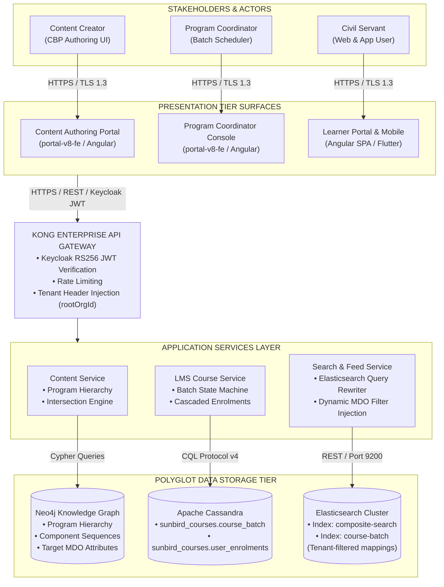
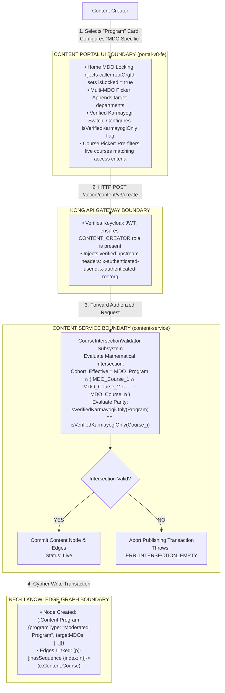
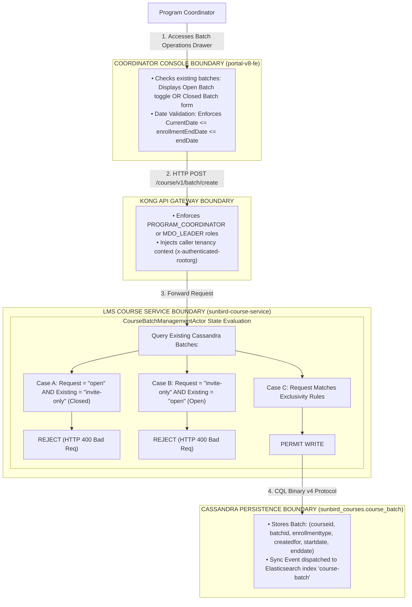
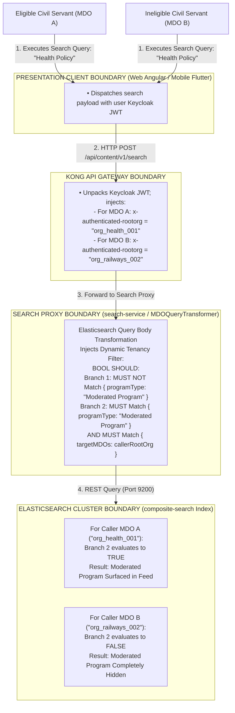
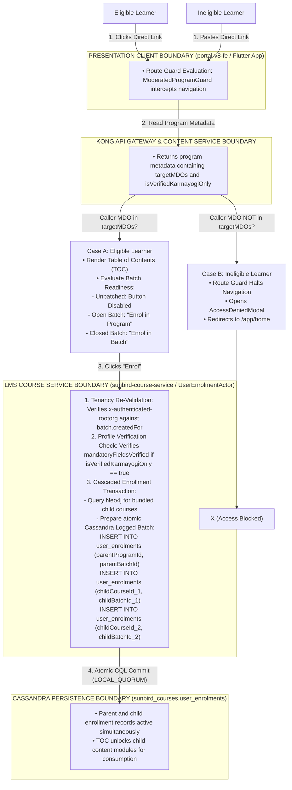
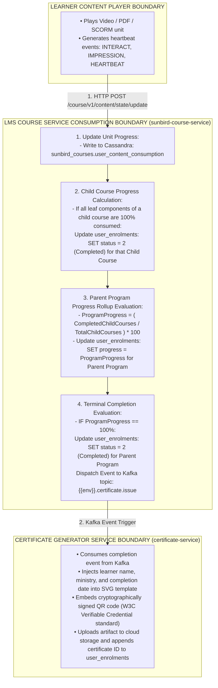
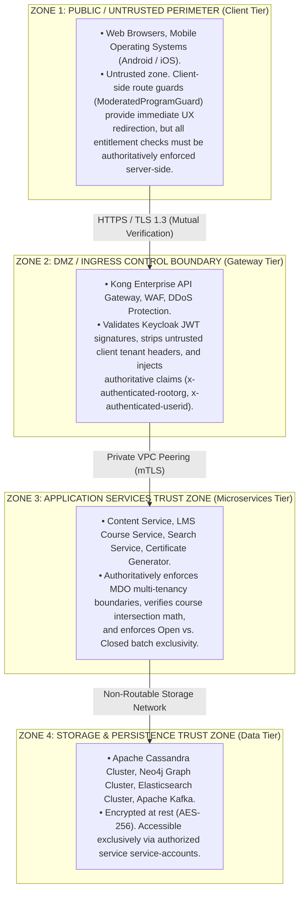

# Moderated Program — System Context Architecture Document (SCD)

## 2. Executive Summary & Context Definition

### 2.1 Executive Summary

A **Moderated Program** on the iGOT Karmayogi platform establishes an institutionally restricted, access-governed curricular container. Unlike open platform courses and curated programs—where content is publicly discoverable and automatically provisioned with open batches—a Moderated Program enforces multi-tenant access control tied directly to designated Ministries, Departments, and Organizations (MDOs) and the **Verified Karmayogi** profile badge.

This System Context Document defines the operational perimeter, external actors, enterprise integration points, security trust zones, and data flow boundaries governing Moderated Programs across their evolution from **Quarter 2 (Q2)** through **Quarter 13 (Q13)**.

### 2.2 System Boundary & Scope

The Moderated Program system boundary encompasses the functional and technical capabilities responsible for:

1. **Creation & Ingestion Perimeter:** Content Creator authoring under the unified 3-card modal, locking the author's home MDO, multi-MDO cohort selection, Verified Karmayogi gating, and mathematical intersection evaluation during course bundling.
2. **Administrative Batch Perimeter:** Program Coordinator cohort definitions under `Manage > Batch Management`, enforcing the mutual exclusivity state machine between Open Batches (date-unbounded, auto-provisioned) and Closed Batches (calendar-bounded, time-limited).
3. **Multi-Tenant Search & Catalog Perimeter:** Elasticsearch query rewriting via gateway and proxy adapters, dynamically suppressing moderated programs from unauthorized civil servants while exposing native facet filters on web and mobile clients.
4. **Learner Onboarding & Consumption Perimeter:** Client-side route guarding (`ModeratedProgramGuard`), Table of Contents (TOC) unbatched preview handling, server-side tenancy verification, cascaded multi-course enrollment, telemetry progress aggregation, and automated cryptographic certification.

## 3. Evolution of System Context & Boundaries (Q2 to Q13)

**SYSTEM CONTEXT EVOLUTION (Q2 - Q13)**

| RELEASE WINDOW | BOUNDARY EXPANSION | BOUNDARY DELTAS & EXTERNAL INTERFACES |
|---|---|---|
| **Q2**<br>[KB-452] | Core Publishing Separation Boundary | • Scope: Separated atomic Course from parent Program publishing flows.<br>• New Boundary: Dedicated Program schema definitions in Neo4j Knowledge Graph. |
| **Q3**<br>[KB-1936] Parent<br>[KB-1945/46/50] | MDO Multi-Tenancy & Batch Exclusivity Boundary | • Scope: End-to-end Content Portal Redesign<br>• Boundary 1: MDO Specific access enum.<br>• Boundary 2: Home MDO lock enforcement.<br>• Boundary 3: Mathematical intersection validator for child course bundling.<br>• Boundary 4: Open vs. Closed batch state machine mutual exclusivity in Cassandra. |
| **Q4**<br>[KB-3756],<br>[KB-4493/4288] | Dynamic Homepage Discovery Boundary | • Scope: Marquee civil service discovery.<br>• Interface: Integrated Karma Programs playlist APIs for home feed carousels.<br>• Boundary: Multi-MDO edge tagging on learner homepage banner feeds. |
| **Q6 – Q7**<br>[KB-7067],<br>[KB-7854],<br>[KB-7869]–[7872] | Coordinator UX & Search Facet Suppression Boundary | • Scope: Search proxy query transformation.<br>• Boundary: Coordinator batch grid with $\text{enrollEnd} \le \text{endDate}$ temporal validation.<br>• Boundary: Elasticsearch bool filter injection suppressing private programs. |
| **Q8**<br>[KB-8819],<br>[KB-9603],<br>[KB-9333/9337] | User-Group Access Control & Native Mobile Filter Boundary | • Scope: Standardized RBAC & Mobile Client.<br>• Boundary: Gateway-level user-group access rules for organizational validation.<br>• Boundary: Native Flutter filter drawer supporting Moderated Program facet. |
| **Q11 – Q13**<br>[KB-13016/17] | Analytics Optimization & Peer Governance Boundary | • Scope: Telemetry stream & reporting.<br>• Boundary: Cassandra reporting query optimizations and MDO survey governance. |

## 4. High-Level Enterprise System Context Diagram (C4 Level 1)

The Level 1 Context Diagram illustrates the enterprise perimeter, human actors, client presentation surfaces, enterprise gateway, application microservices, and polyglot persistence stores.



## 5. Specialized Subsystem & Boundary Context Diagrams (C4 Level 2)

### 5.1 Authoring, Bundling & Ingestion Boundary Context (Creation Flow)

This diagram illustrates the operational boundary when a Content Creator authors a program container, locks the home department, defines target MDO cohorts, and bundles live child courses.



### 5.2 Program Coordinator Batch Scheduling & Tenancy Boundary Context (Administration Flow)

This diagram captures boundary interactions during runtime cohort provisioning, enforcing the mutual exclusivity state machine.



### 5.3 Multi-Tenant Catalog Search & Facet Gating Boundary Context (Discovery Flow)

This diagram illustrates the query transformation and multi-tenant security boundary preventing unauthorized program discovery.



### 5.4 Learner Table of Contents & Cascaded Enrollment Boundary Context (Gating & Onboarding Flow)

This diagram captures boundary enforcement when a learner accesses the Table of Contents (TOC) and initiates enrollment.



### 5.5 Player Telemetry, Progress Rollup & Certification Boundary Context (Consumption Flow)

This diagram illustrates the consumption boundary, telemetry pipeline, hierarchical progress calculation, and cryptographic certificate issuance.



## 6. Actor-to-Boundary Interaction Matrix

| Actor / Entity | Classification | Interaction Boundary | Protocols & Formats | Security Context & Role |
|---|---|---|---|---|
| **Content Creator** | Human Enterprise Actor | Authoring Portal Gateway `content-service` | HTTPS / REST / JSON | Authenticated via Keycloak (`CONTENT_CREATOR` role); scoped to home MDO. |
| **Content Publisher** | Human Enterprise Actor | Review Worklist Gateway `content-service` | HTTPS / REST / JSON | Role: `CONTENT_PUBLISHER`; validates intersection parity before publishing. |
| **Program Coordinator** | Human Administrative Actor | Coordinator Console Gateway LMS Course Service | HTTPS / REST / JSON | Scoped to target MDO via `x-authenticated-rootorg`; manages Open/Closed batches. |
| **Eligible Civil Servant** | Human End User | Web / Mobile Client Gateway LMS & Player | HTTPS / REST / JSON | Bearer JWT; `rootOrgId` present in program's `targetMDOs`; verified badge. |
| **Ineligible Civil Servant** | Human End User | Direct URL Gateway Client Route Guard | HTTPS / REST / JSON | Authenticated; blocked by route guard with HTTP 403 modal. |
| **Kong API Gateway** | Enterprise Edge Service | Ingress Internal Application Microservices | HTTPS / mTLS | Injects trusted headers (`x-authenticated-userid`, `x-authenticated-rootorg`). |
| **Search Proxy Adapter** | Internal Subsystem | Search Controller Elasticsearch Cluster | REST / Port 9200 | Intercepts search queries and injects MDO tenant security filters. |
| **Certificate Engine** | Asynchronous System Actor | Kafka Consumer Cloud Storage & Cassandra | Kafka Protocol / CQL | Asynchronously generates verifiable credentials upon 100% program completion. |

## 7. External System & Inter-Service Interface Specifications

### 7.1 Interface 1: Keycloak Identity Service (Authentication & Claims)

- **Direction:** Inbound to Kong API Gateway / Outbound from Presentation Clients.
- **Protocol:** HTTPS / OpenID Connect (OIDC) / OAuth2.
- **Payload Format:** Cryptographically signed RS256 JWT tokens.
- **Data Transferred:** User UUID (`sub`), email, tenant organizational ID (`rootOrgId`), roles array (`roles`), verified profile flag.
- **Boundary Rules:** Tokens expire after 15 minutes of inactivity; Kong verifies the token signature against the Keycloak JWKS endpoint before routing downstream.

### 7.2 Interface 2: Neo4j Knowledge Graph Store (`content-service`)

- **Direction:** Internal Microservice Graph Database.
- **Protocol:** Bolt binary protocol / Cypher.
- **Nodes & Edges Accessed:** `:Content:Program`, `:Content:Course`, `[:hasSequence]`.
- **Boundary Rules:** Read operations resolve curriculum hierarchies; write operations commit metadata (`targetMDOs`, `isVerifiedKarmayogiOnly`) with full transactional rollback on intersection failure.

### 7.3 Interface 3: Cassandra Persistence Store (`sunbird-course-service`)

- **Direction:** Internal Microservice Storage Layer.
- **Protocol:** CQL binary protocol v4.
- **Keyspace:** `sunbird_courses`.
- **Tables Accessed:** `course_batch`, `user_enrolments`, `user_content_consumption`.
- **Boundary Rules:** Writes execute with `ConsistencyLevel.LOCAL_QUORUM`. Cascaded enrollments execute inside a single Cassandra `LOGGED BATCH` statement.

### 7.4 Interface 4: Elasticsearch Faceted Search (`search-service`)

- **Direction:** Search Proxy Elasticsearch Cluster.
- **Protocol:** HTTP REST over port 9200.
- **Indices Accessed:** `composite-search`, `course-batch`.
- **Boundary Rules:** All queries intercepting catalog requests inject mandatory boolean filter clauses, suppressing moderated programs unless the caller's `rootOrgId` is present in `targetMDOs`.

### 7.5 Interface 5: Asynchronous Messaging Pipeline (Apache Kafka)

- **Direction:** `sunbird-course-service` Kafka Broker `certificate-service`.
- **Protocol:** Kafka Binary Protocol over TCP.
- **Topics:** `{{env}}.telemetry.enrolment`, `{{env}}.certificate.issue`.
- **Payload Structure:**

```json
{
  "eid": "BE_JOB_REQUEST",
  "ets": 1793400000000,
  "mid": "LP.1793400000000.78a1b2c3",
  "actor": {
    "id": "LMS Course Service",
    "type": "System"
  },
  "edata": {
    "action": "issue-certificate",
    "iteration": 1,
    "courseId": "do_113892749102841856112",
    "batchId": "013948600192837465",
    "userId": "712020:2b1926b8-ba53-4277-9b45-3508667c6b3d",
    "certificateTemplate": "template_mohfw_default_v1"
  }
}
```

## 8. Security Trust Zones & Perimeter Defense Architecture



## 9. Engineering Tasks & Workstream Traceability Matrix (Q2 – Q13)

**ENGINEERING WORKSTREAM INVENTORY**

| TASK ID | REPOSITORY / WORKSTREAM | TARGET ESTIMATE | DELIVERABLE ARTIFACT / OUTCOME |
|---|---|---|---|
| TSK-01 | portal-v8-fe<br/>UI Authoring Module | Sprint 12 (Q3) | Develop MDO Specific authoring form, home MDO lock, and verified toggle. |
| TSK-02 | content-service<br/>Knowledge Graph Engine | Sprint 13 (Q3) | Implement CourseIntersectionHelper enforcing MDO intersection math. |
| TSK-03 | sunbird-course-service<br/>LMS Actor & Cassandra DAO | Sprint 14 (Q3) | Update CourseBatchManagementActor enforcing Open/Closed exclusivity. |
| TSK-04 | sunbird-course-service<br/>Enrollment Actor | Sprint 15 (Q3) | Build cascaded enrollment pipeline auto-joining bundled child courses. |
| TSK-05 | portal-v8-fe<br/>TOC Player Component | Sprint 18 (Q4) | Implement dynamic TOC states handling unbatched & expired cohorts. |
| TSK-06 | search-service<br/>Search Proxy Adapter | Sprint 22 (Q7) | Deploy Elasticsearch query rewriter injecting dynamic MDO filter clauses. |
| TSK-07 | mobile-app (Flutter)<br/>Mobile Cross-Platform App | Sprint 26 (Q8) | Native mobile catalog filter drawer supporting "Moderated Program" facet. |

## 10. Architectural Invariants, Constraints, and Boundary Safeguards

| Invariant Code | Boundary Safeguard | Enforcing Component | Failure Mode & Remediation |
|---|---|---|---|
| `SAF-01` | **Home MDO Tamper Resistance** | `ProgramEditorComponent` | Attempting to bypass client UI controls and strip the home MDO is rejected by the backend with HTTP 400 `ERR_HOME_MDO_LOCKED`. |
| `SAF-02` | **Component Disjoint Isolation** | `CourseIntersectionValidator` | If two child moderated courses have no overlapping MDOs, publishing is blocked with HTTP 400 `ERR_EMPTY_MDO_INTERSECTION`. |
| `SAF-03` | **Batch Type Pollution Guard** | `CourseBatchManagementActor` | Instantiating a closed batch when an open batch exists is blocked with HTTP 400 `ERR_BATCH_EXCLUSIVE`. |
| `SAF-04` | **Direct Link Interception** | `ModeratedProgramGuard` | Pasting a direct TOC link by an ineligible user triggers client route interception and an HTTP 403 modal before page rendering. |
| `SAF-05` | **Cascaded Write Atomicity** | `UserEnrolmentActor` | Cassandra logged batch ensures that if child course enrollments fail, the parent program enrollment is rolled back. |
| `SAF-06` | **Search Leakage Prevention** | `MDOQueryTransformer` | Unauthenticated requests receive a default query clause that strictly filters out all items where `programType == "Moderated Program"`. |
