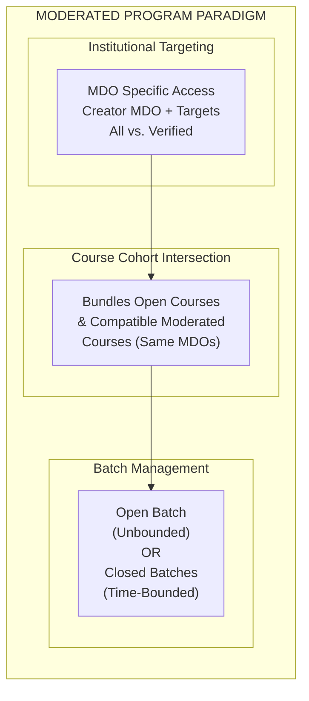
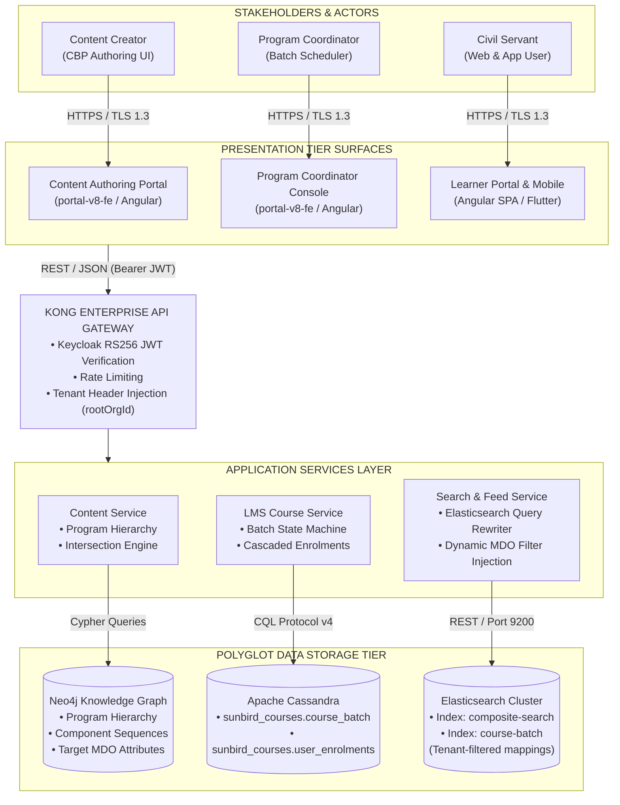
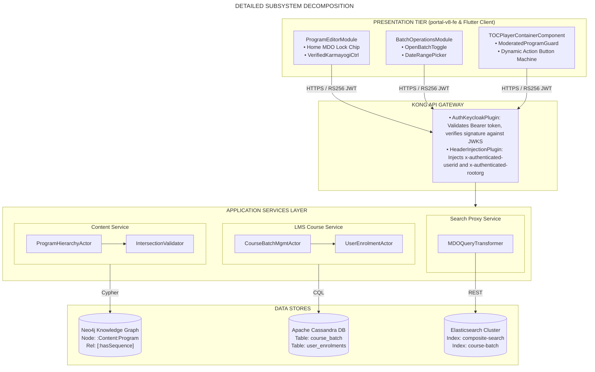
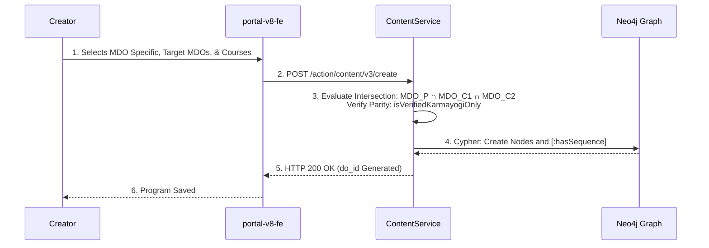
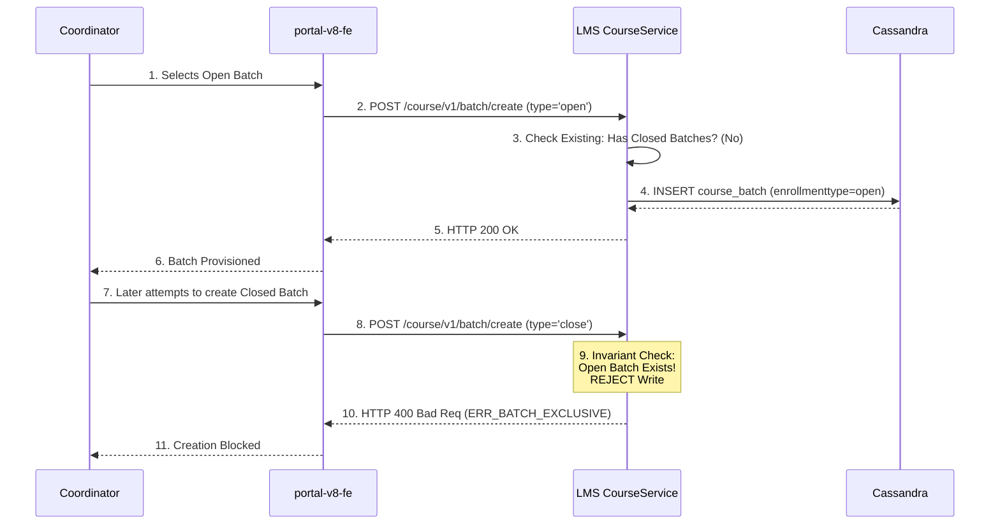
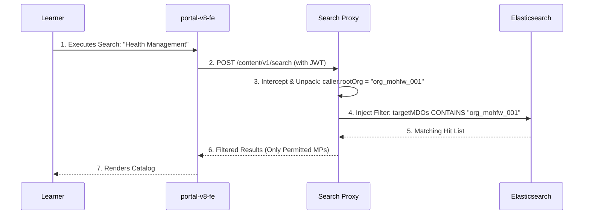
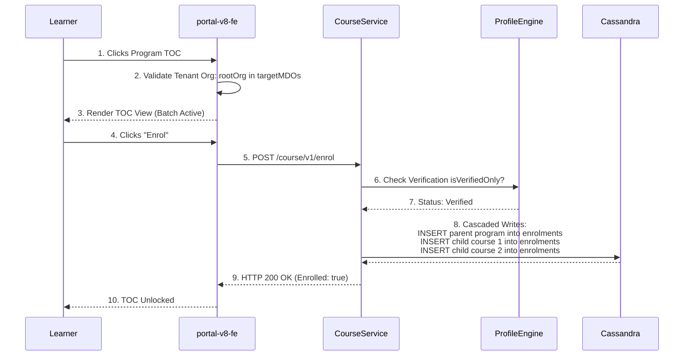
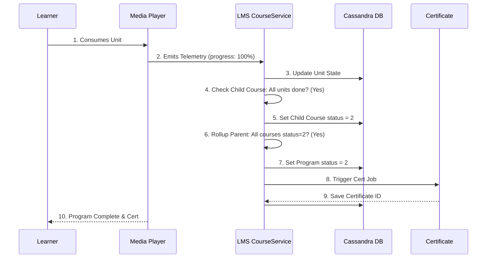
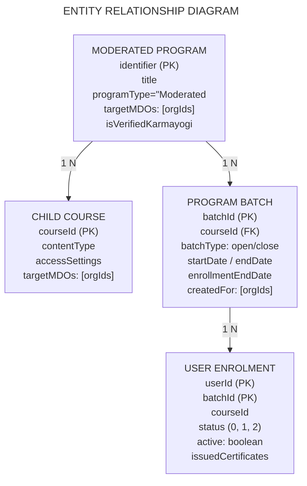
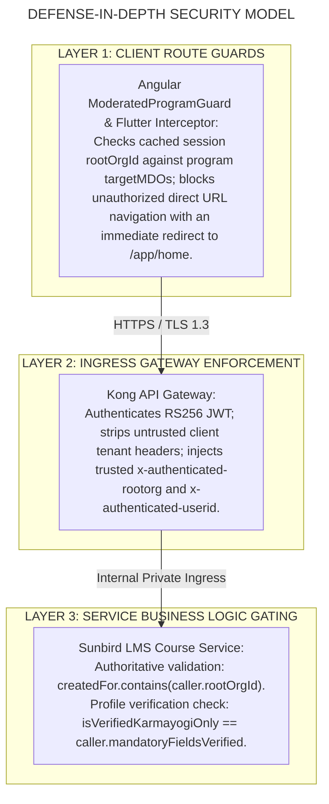

# Moderated Program — High-Level Design (HLD) Document

## 2. Executive Summary and Architecture Drivers

A **Moderated Program** on the iGOT Karmayogi platform is a governed, parent curricular container whose visibility, eligibility, batch enrollment, and consumption are strictly bounded by institutional tenancy—specifically targeted Ministries, Departments, and Organizations (MDOs) and the **Verified Karmayogi** profile badge.



### Key Architectural Drivers

1. **Multi-Tenant Data & Access Isolation:** Ensure that training content designed exclusively for specific ministries (e.g., MoHFW, NDMA, Ministry of Finance) cannot be discovered or enrolled in by non-targeted civil servants.
2. **Component Integrity (Intersection Math):** Prevent broken learner journeys by enforcing mathematical cohort parity across parent programs and child course modules:

1. **Operational Runtime Flexibility:** Provide Program Coordinators with the choice between continuous rolling cohorts (**Open Batch**) and calendar-bounded training windows (**Closed Batch**), enforcing mutual exclusivity at the state-machine level.
2. **Defense-in-Depth Security:** Intercept unauthorized access at all layers: Presentation route guards, Kong API Gateway header enforcement, and LMS Cassandra persistence gating.
3. **High-Concurrency Search & Discovery:** Optimize Elasticsearch query structures to execute dynamic MDO filtering with sub-350ms response times across 1M+ catalog entries.

## 3. System Context (C4 Level 1)

The System Context diagram establishes the boundaries of the Moderated Program subsystem, external user classes, client presentation surfaces, enterprise gateways, core services, and external integrations.



## 4. Chronological Evolution of Architecture (Q2 to Q13)

**FEATURE EVOLUTION TIMELINE (Q2 - Q13)**

| QUARTER | JIRA ANCHOR | SUBSYSTEMS IMPACTED | ARCHITECTURAL MILESTONE |
|---|---|---|---|
| **Q2** | [KB-452] | Neo4j Knowledge Graph, Content Publishing Pipelines | Decoupled Course and Program publishing state machines. |
| **Q3** | [KB-1936] Parent<br/>[KB-1945],<br/>[KB-1946],<br/>[KB-1950] | portal-v8-fe, Content Service, sunbird-course-service, Cassandra Database | **Core Moderated Program Hub:**<br/>• 3-card creation modal.<br/>• MDO Specific access tag.<br/>• Home MDO locking.<br/>• Intersection validator engine.<br/>• Open vs. Closed batch model. |
| **Q4** | [KB-3756],<br/>[KB-4493],<br/>[KB-4288] | Learner Portal Feed, Dynamic Homepage Playlists | **Karma Programs Integration:** Surfaced programs on homepage strips with multi-MDO edge tags. |
| **Q6** | [KB-7067] | Coordinator Management UI portal-v8-fe | Grid refactoring; date picker validation ($\text{enroll}\le\text{end}$). |
| **Q7** | [KB-7854],<br/>[KB-7869]–[7872] | Elasticsearch Cluster, Search Proxy Service | • Query rewriting with NLP.<br/>• Dynamic targetMDOs filter injection into ES payloads. |
| **Q8** | [KB-8819],<br/>[KB-9603],<br/>[KB-9333], [9337] | Ingress Gateway (Kong), Mobile App Client (Flutter) | • Formalized User-Group gating.<br/>• Added Moderated Program facet checkbox in mobile app. |
| **Q11-13** | [KB-13016/17] | Cassandra Reporting, Analytics Pipelines, Peer Validation | Telemetry optimizations and MDO peer validation survey workflows |

## 5. Subsystem Decomposition & Component Design (C4 Level 2 & 3)



### 5.1 Presentation Tier (`portal-v8-fe` & Flutter `mobile-app`)

- `ProgramEditorComponent`: Governs the creation flow. When `MDO Specific` is chosen, the component locks the creator's home `rootOrgId` as an undeletable chip, exposes the multi-MDO selector, and manages the binary `isVerifiedKarmayogiOnly` toggle.
- `BatchConfigComponent`: Interfaces with `sunbird-course-service` to enforce the mutual exclusivity invariant. If an open batch exists, closed batch creation controls are disabled.
- `ModeratedProgramGuard`: Angular route guard intercepting deep-link navigation. Evaluates caller claims and intercepts unauthorized direct URLs with HTTP 403, redirecting to the homepage.
- `TOCContainerComponent`: Dynamically evaluates program state:
  - *Unbatched:* Renders curriculum tree; disables enrollment (`"No Active Batch"`).
  - *Open Batch:* Enables continuous enrollment (`"Enrol in Program"`).
  - *Closed Batch:* Displays cohort countdown and start/end dates (`"Enrol in Batch"`).
  - *Expired:* Displays `"Enrollment Closed"`.

### 5.2 API Gateway & Ingress Layer (Kong)

- **Authentication Validation:** Kong validates Keycloak RS256 JWT tokens via public key endpoints.
- **Header Enrichment:** Kong injects validated claims downstream:
  - `x-authenticated-userid`: Caller UUID.
  - `x-authenticated-rootorg`: Tenant Org identifier.
  - `x-authenticated-user-roles`: Role list (`CONTENT_CREATOR`, `PROGRAM_COORDINATOR`).

- **Threat Mitigation:** Enforces IP rate limiting and rejects forged client tenancy headers.

### 5.3 Microservices Tier

1. **Content Service** (`content-service`):
  - Built on Play Framework 2.8 and Java 11.
  - `ProgramHierarchyActor.java`: Manages CRUD lifecycles in the Neo4j Knowledge Graph.
  - `CourseIntersectionValidator.java`: Implements mathematical intersection logic, ensuring that bundled moderated courses share common MDO sets and identical `isVerifiedKarmayogiOnly` settings.

2. **LMS Course Service** (`sunbird-course-service`):
  - Built with Akka Actors and Cassandra Java Driver.
  - `CourseBatchManagementActor.java`: Enforces batch state machine transitions, validating that and rejecting conflicting batch types.
  - `UserEnrolmentActor.java`: Executes atomic, cascaded enrollments in Cassandra table `sunbird_courses.user_enrolments` across the parent program and all child courses.

3. **Search Proxy Service** (`search-service`):
  - Node.js/Express service transforming search requests.
  - Injects tenant filter clauses into Elasticsearch payloads, suppressing department-specific content from unauthorized users.

## 6. End-to-End Architectural Workflows

### 6.1 Workflow 1: Program Authoring & Course Bundling with Intersection Validation



### 6.2 Workflow 2: Program Coordinator Batch Provisioning (Mutual Exclusivity)



### 6.3 Workflow 3: Multi-Tenant Catalog Search & Elasticsearch Query Transformation



### 6.4 Workflow 4: Learner TOC Gating, Verification Check & Cascaded Enrollment



### 6.5 Workflow 5: Consumption Telemetry, Progress Rollup & Certification



## 7. Data Architecture & Entity Relationship Model



### 7.1 Neo4j Graph Model (`Content` Node)

- **Labels:** `:Content:Program`
- **Properties:**
  - `identifier`: String (e.g., `"do_113892749102841856112"`, Primary Key)
  - `programType`: `"Moderated Program"`
  - `accessSetting`: `"MDO Specific"`
  - `targetMDOs`: List of Strings (`["org_mohfw_001", "org_dop_002"]`)
  - `isVerifiedKarmayogiOnly`: Boolean (`true` / `false`)
  - `status`: `"Draft"` | `"Review"` | `"Live"`

### 7.2 Cassandra Batch Store (`sunbird_courses.course_batch`)

```sql
CREATE TABLE sunbird_courses.course_batch (
    courseid text,
    batchid text,
    name text,
    description text,
    enrollmenttype text,  -- 'open' or 'invite-only' (Closed Batch)
    startdate text,  -- YYYY-MM-DD
    enddate text,  -- YYYY-MM-DD
    enrollmentenddate text,  -- YYYY-MM-DD createdfor set<text>,
    -- Target MDO tenant IDs mentors list<text>,
    -- Designated Program Coordinator UUIDs
    status int,  -- 0: Upcoming, 1: Ongoing, 2: Completed
    createddate timestamp,
    updateddate timestamp,
    PRIMARY KEY (courseid, batchid)
) WITH CLUSTERING ORDER BY (batchid ASC);
```

### 7.3 Cassandra Enrollment Ledger (`sunbird_courses.user_enrolments`)

```sql
CREATE TABLE sunbird_courses.user_enrolments (
    userid text,
    courseid text,  -- Program ID or Child Course ID
    batchid text,
    active boolean,
    completionpercentage int,  -- 0 to 100 issued_certificates list<frozen<map<text, text>>>,
    progress int,
    status int,  -- 0: Enrolled, 1: In-Progress, 2: Completed
    PRIMARY KEY (userid, courseid, batchid)
);
```

## 8. Interface Specifications & REST API Contracts

### 8.1 API Contract Summary

| Domain | Method | Endpoint | Consuming Client | Producer Service | Purpose |
|---|---|---|---|---|---|
| **Authoring** | `POST` | `/action/content/v3/create` | Content Portal | `content-service` | Creates draft Program container with `MDO Specific` access. |
| **Authoring** | `PATCH` | `/action/content/v3/update/{id}` | Content Portal | `content-service` | Updates MDO target lists and toggles Verified Karmayogi. |
| **Authoring** | `POST` | `/action/content/v3/publish` | Content Portal | `content-service` | Validates intersection math and sets status to `Live`. |
| **Batch** | `POST` | `/course/v1/batch/create` | Coordinator Console | `sunbird-course-service` | Creates Open or Closed batch under the Moderated Program. |
| **Enrollment** | `POST` | `/course/v1/``enrol` | Learner Web / App | `sunbird-course-service` | Validates eligibility and executes cascaded enrollment. |
| **Telemetry** | `POST` | `/course/v1/content/state/update` | Media Player | `sunbird-course-service` | Emits consumption telemetry for child course units. |
| **Search** | `POST` | `/api/content/v1/search` | Learner Web / App | `search-service` | Executes MDO-filtered faceted query on Elasticsearch. |

### 8.2 Sample Payload: Batch Creation (`POST /course/v1/batch/create`)

```json
{
  "request": {
    "courseId": "do_113892749102841856112",
    "name": "Health Policy Cohort 2026",
    "description": "Restricted cohort for MoHFW verified officers",
    "enrollmentType": "open",
    "createdFor": [
      "org_mohfw_001",
      "org_dop_002"
    ],
    "mentors": [
      "712020:2b1926b8-ba53-4277-9b45-3508667c6b3d"
    ]
  }
}
```

## 9. Security, Multi-Tenancy, and Governance Architecture



1. **Defense-in-Depth:** Presentation-layer route guards enhance user experience, but all authoritative entitlement checks execute server-side within `sunbird-course-service`.
2. **Profile Verification Integrity:** Server-side verification checks query the user registry directly using caller UUIDs, preventing header tampering.
3. **Multi-Tenant Data Isolation:** Cassandra writes partition records strictly by verified tenant context, preventing cross-ministry data leakage.

## 10. Operational, Scalability, and Non-Functional Architecture

1. **Elasticsearch High-Throughput Search:** Faceted search queries execute against Elasticsearch 7.x clusters utilizing boolean filter clauses. The injection of `targetMDOs` occurs in the search proxy before execution, ensuring sub-350ms response times at 2,500 requests/sec.
2. **Eventual Consistency & Indexing:** Cassandra writes trigger asynchronous Akka actor events syncing metadata to Elasticsearch (`course-batch`). System operations accommodate an eventual consistency SLA of 1–3 seconds.
3. **Deep Pagination Clamping:** Query pagination offsets are clamped at to protect cluster heap allocations.
4. **Idempotency Guarantees:** Batch creation and enrollment calls use UUIDv4 request keys, ensuring that client retries do not produce duplicate batches or fragmented enrollment records.

## 11. Engineering Workstream Breakdown & Deliverables

**ENGINEERING WORKSTREAM BREAKDOWN**

| TASK ID | REPOSITORY / WORKSTREAM | TARGET ESTIMATE | DELIVERABLE ARTIFACT / OUTCOME |
|---|---|---|---|
| TSK-01 | portal-v8-fe<br/>UI Authoring Module | Sprint 12 (Q3) | Develop MDO Specific authoring form, home MDO lock, and verified toggle. |
| TSK-02 | content-service<br/>Knowledge Graph Engine | Sprint 13 (Q3) | Implement CourseIntersectionHelper enforcing MDO intersection math. |
| TSK-03 | sunbird-course-service<br/>LMS Actor & Cassandra DAO | Sprint 14 (Q3) | Update CourseBatchManagementActor enforcing Open/Closed exclusivity. |
| TSK-04 | sunbird-course-service<br/>Enrollment Actor | Sprint 15 (Q3) | Build cascaded enrollment pipeline auto-joining bundled child courses. |
| TSK-05 | portal-v8-fe<br/>TOC Player Component | Sprint 18 (Q4) | Implement dynamic TOC states handling unbatched & expired cohorts. |
| TSK-06 | search-service<br/>Search Proxy Adapter | Sprint 22 (Q7) | Deploy Elasticsearch query rewriter injecting dynamic MDO filter clauses. |
| TSK-07 | mobile-app (Flutter)<br/>Mobile Cross-Platform App | Sprint 26 (Q8) | Native mobile catalog filter drawer supporting "Moderated Program" facet. |
