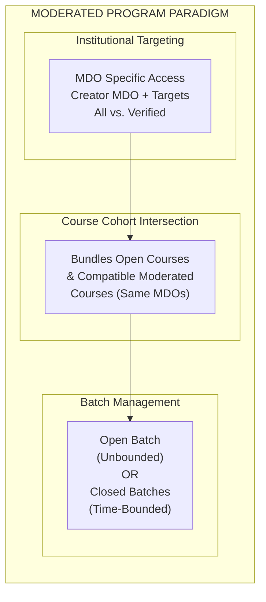
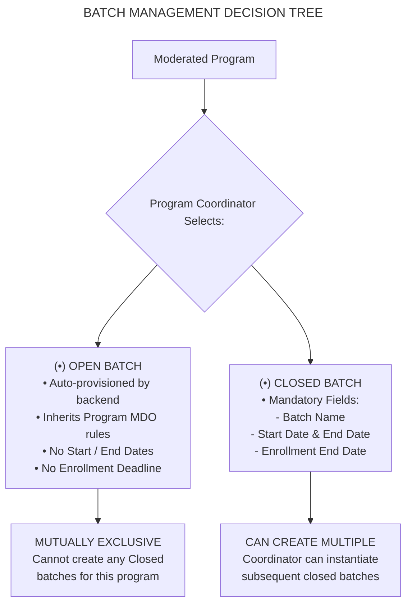
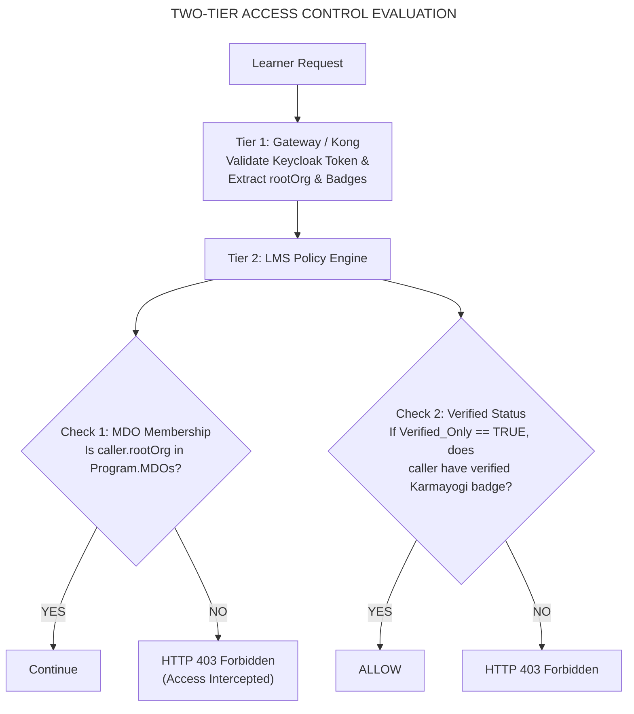
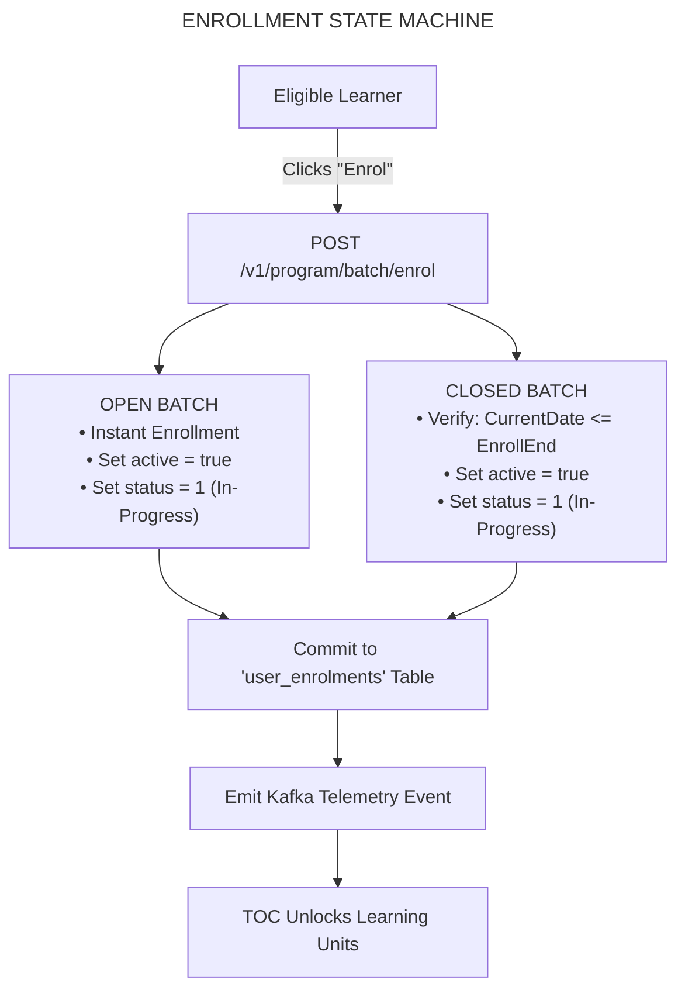
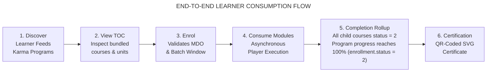
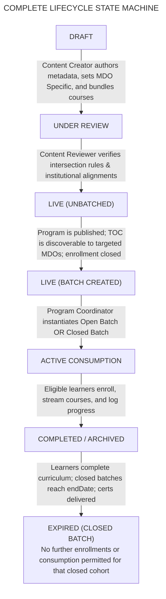
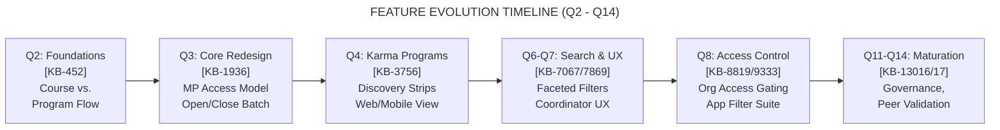
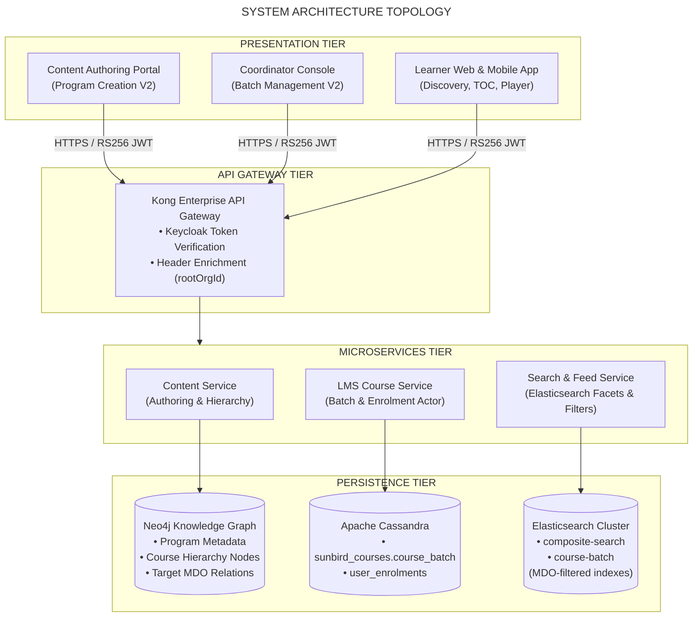
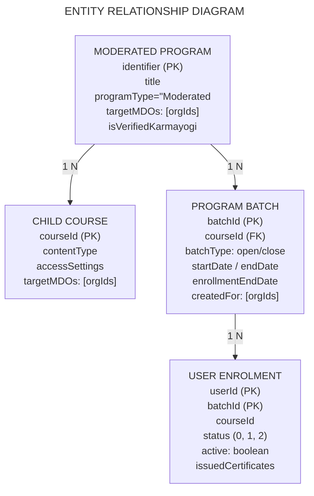

# Moderated Program - Overview Summary

## 2. Executive Summary

A **Moderated Program** on the iGOT Karmayogi platform is a governed, access-controlled learning curriculum designed specifically for designated Ministries, Departments, and Organizations (MDOs) and Verified Karmayogi civil servants. Introduced during the Content Portal Redesign (Q3, [KB-1936](https://karmayogibharat.atlassian.net/browse/KB-1936)), it replaced open program defaults with an access configuration framework that allows program creators to restrict visibility and enrollment to specific institutional cohorts.

Unlike standalone **Curated Programs** (which are open to all registered users and automatically provisioned with open batches) or **Invite-Only Programs** (which rely on custom, coordinator-curated candidate rosters), a Moderated Program binds program access to institutional tenancy. It introduces mathematical **intersection rules** when bundling live moderated courses: a Moderated Program can bundle both open courses and moderated courses, provided that all included moderated courses share an identical MDO target cohort and learner qualification type (`All Users` vs. `Verified Karmayogi`).

At runtime, batch management gives Program Coordinators the operational choice between an **Open Batch** (auto-configured backend access with no enrollment or end dates for targeted MDOs) and **Closed Batches** (time-bounded with strict start, end, and enrollment deadlines). Learners belonging to non-targeted MDOs are completely suppressed from discovering or enrolling in the program, while authorized learners encounter a frictionless consumption journey across desktop web and mobile surfaces.



## 3. Feature Introduction

The iGOT Karmayogi platform delivers capability-building interventions across the Indian civil services. While standard platform courses and curated programs cater to universal competencies across the civil service ecosystem, government organizations frequently require tailored programs restricted to specific administrative cadres, institutional staff, or verified verified-status personnel.

The **Moderated Program** addresses this institutional requirement. Operating as a parent container of digital learning assets, it restricts catalog discoverability, Table of Contents (TOC) visibility, batch enrollment, and credential issuance to predefined MDO groups. By enforcing strict access parity across both the program container and its underlying course components, the platform ensures that no unauthorized civil servant can bypass boundary controls.

## 4. Business Objectives and Problem Statement

### 4.1 Problem Statement

Prior to the formal introduction of the Moderated Program model:

1. **Unintended Content Leakage:** Programs created for specific ministries or departments were either globally exposed in the public catalog or forced into cumbersome, manually uploaded invite-only batches.
2. **Component Access Mismatch:** Creators could add restricted (moderated) courses into open programs, resulting in runtime errors where enrolled learners encountered access-denied barriers mid-curriculum.
3. **Rigid Batch Lifecycles:** Training institutes lacked the operational flexibility to offer both ongoing rolling enrollments (open batch) and scheduled, calendar-driven cohort sessions (closed batch) under an organizationally restricted program.
4. **Administrative Overhead:** Program coordinators had to manually track whether participating civil servants had completed departmental verification.

### 4.2 Business Objectives

- **Institutional Access Boundary:** Provide strict multi-MDO access control allowing creators to target one or multiple ministries while auto-locking the creator's home MDO.
- **Verified Karmayogi Gating:** Enable departments to restrict advanced or regulatory programs exclusively to verified government personnel via a single toggle.
- **Component-Program Coherence:** Automatically enforce mathematical intersection logic preventing incompatible courses from being bundled together.
- **Operational Flexibility:** Support both open-ended departmental access (Open Batch) and date-constrained cohorts (Closed Batch) managed by departmental Program Coordinators.
- **Catalog Hygiene:** Suppress department-specific programs from external civil servants to prevent clutter in search feeds.

## 5. Moderated Program – Scope and Definition

A **Moderated Program** is formally defined as:

*A curated learning program whose metadata access setting is configured as* ***MDO Specific, restricting content discovery, enrollment eligibility, and consumption to civil servants of selected Ministries, Departments, and Organizations, further filtered by their Verified Karmayogi status.*

### Fundamental Distinctions Across Learning Collections

- **Moderated Program vs. Curated Program:** A Curated Program is configured with Access Setting = `All Users`. It is indexed in the public catalog for all registered learners and auto-instantiates an open batch. A Moderated Program restricts access to selected MDOs and requires the Program Coordinator to choose between an Open Batch or Closed Batches.
- **Moderated Program vs. Invite-Only Program:** An Invite-Only Program is configured with Access Setting = `Custom Users`. It does not rely on organizational filters; instead, Program Coordinators explicitly select individual users or upload candidate CSV rosters (`Email id`, `Mobile number`).
- **Moderated Program vs. Blended Program:** A Blended Program incorporates offline, instructor-led physical classrooms, venue scheduling, and subjective assignment evaluations alongside digital content. A Moderated Program consists purely of asynchronous digital courses (open and moderated).
- **Moderated Program vs. Moderated Course:** A Moderated Course is a single learning asset (video, PDF, assessments) restricted to MDOs. A Moderated Program is an overarching curricular container that bundles multiple courses together.

## 6. In-Scope and Out-of-Scope Items

### 6.1 In-Scope Items

- Authoring of Moderated Programs via Content Portal (CP) under the unified Program creation card.
- Configuration of multi-MDO access and the **Verified Karmayogi** toggle.
- Automated intersection validation when adding live Moderated Courses to the program.
- Program Coordinator batch management (Open Batch vs. multiple Closed Batches).
- Learner Table of Contents (TOC) presentation and restricted enrollment gating.
- Search and faceted catalog filtering by program type on Web, Mobile App, and M-Site.
- Tagging and discoverability via **Karma Programs** strips on learner homepages.
- Progress tracking, unit completion, and automated certificate generation upon program completion.

### 6.2 Out-of-Scope Items

- Direct authoring of learning resources (videos, SCORM packages) inside the program container (handled at course level).
- Manual nomination of individual external users via CSV in Moderated Programs (reserved for Invite-Only Programs).
- Offline classroom attendance tracking and venue booking (reserved for Blended Programs).
- Standalone subjective assignment evaluation and instructor grading workflows.
- Retiring or permanently purging content directly from the Content Portal authoring canvas.

## 7. Stakeholders, Actors, and Portal Responsibilities

### 7.1 Stakeholder Profiles

1. **Content Creator (CBP Portal):** Departmental or SPV author who defines program metadata, sets MDO access, and bundles eligible courses.
2. **Content Reviewer & Publisher (CBP Portal):** Performs quality and administrative review, transitioning the program from `Draft` $\rightarrow$ `Under Review` $\rightarrow$ `Live`.
3. **Program Coordinator (PC - CBP Portal):** Accesses `Manage > Batch Management` to configure Open or Closed batches for the published program.
4. **Eligible Learner (Civil Servant):** An authenticated civil servant whose active profile belongs to the targeted MDO and satisfies the Verified Karmayogi criteria.
5. **Ineligible Learner:** An authenticated user belonging to a non-targeted MDO.
6. **SPV Administrator:** Central platform governor overseeing system-wide access policies, taxonomy, and Karma Programs tagging.

### 7.2 Actor and Portal Responsibility Matrix

| Operational Stage | Actor | Interface / Portal | Core Responsibilities & Invariants |
|---|---|---|---|
| **Program Creation** | Content Creator | Content Portal (`portal-v8-fe`) | Selects Program card; inputs title/description; selects `MDO Specific`; toggles Verified Karmayogi. |
| **Course Bundling** | Content Creator | Content Portal | Adds live open courses and compatible live moderated courses adhering to intersection rules. |
| **Review & Publishing** | Content Publisher | Content Portal | Reviews program hierarchy; validates metadata; publishes to production (`status = "Live"`). |
| **Batch Management** | Program Coordinator | Content Portal (`Manage > Batch`) | Selects Open Batch (auto-configured backend access) OR Closed Batch (sets calendar window). |
| **Discovery & Search** | Eligible Learner | Learner Portal / Mobile App | Discovers program via Karma Programs strip, catalog filters, or search facets. |
| **TOC Exploration** | Eligible Learner | Learner Web / Mobile | Views program structure. If no batch is active, TOC is viewable but enrollment is blocked. |
| **Cohort Enrollment** | Eligible Learner | Learner Web / Mobile | Self-enrolls into open batch or active closed batch; backend confirms MDO eligibility. |
| **Consumption** | Eligible Learner | Learner Content Player | Consumes child courses; telemetry updates progress across all bundled learning units. |
| **Completion & Cert** | Learner / System | LMS Engine | Upon 100% completion of all courses, system issues a digitally signed certificate. |

## 8. Source Discovery and Requirement References

### 8.1 Primary Jira Features & Epics

- [**KB-1936**](https://karmayogibharat.atlassian.net/browse/KB-1936)**:** Q3 | Content Portal Redesign | Content access settings, batch management and user consumption. *(Parent Epic establishing end-to-end framework).*
- [**KB-8819**](https://karmayogibharat.atlassian.net/browse/KB-8819)**:** Q8 | Learning Path | Access Control. *(Standardized MDO-level and user-group access control).*
- [**KB-3756**](https://karmayogibharat.atlassian.net/browse/KB-3756)**:** Q4 | Karma Programs. *(Parent Epic governing curated program carousels on homepage).*
- [**KB-452**](https://karmayogibharat.atlassian.net/browse/KB-452)**:** Q2 | CBP Publishing | Course vs Program publishing flow for SPV.

### 8.2 Primary Jira User Stories

- [**KB-1945**](https://karmayogibharat.atlassian.net/browse/KB-1945)**:** Q3 | Content Portal Redesign | Create program. *(Governs MDO-specific selection and course bundling).*
- [**KB-1946**](https://karmayogibharat.atlassian.net/browse/KB-1946)**:** Q3 | Content Portal Redesign | Batch management for program. *(Defines Open vs. Close batch logic).*
- [**KB-1950**](https://karmayogibharat.atlassian.net/browse/KB-1950)**:** Q3 | Content Portal Redesign | Learner consumption for all types of content. *(Defines TOC and enrollment rules).*
- [**KB-7067**](https://karmayogibharat.atlassian.net/browse/KB-7067)**:** Q6 | Content Portal | Navigation and user experience for program coordinator.
- [**KB-9603**](https://karmayogibharat.atlassian.net/browse/KB-9603)**:** Q8 | Access Control | User Group based Access Control.
- [**KB-9333**](https://karmayogibharat.atlassian.net/browse/KB-9333)**:** Q8 | Implement Course Catalog Filters | Learner Portal & Mobile App & M-Site.
- [**KB-9337**](https://karmayogibharat.atlassian.net/browse/KB-9337)**:** Q8 | Course catalog | Mobile App.
- [**KB-4493**](https://karmayogibharat.atlassian.net/browse/KB-4493)**:** Q4 | Karma Programs | Portal | Access Karma Programs.
- [**KB-4288**](https://karmayogibharat.atlassian.net/browse/KB-4288)**:** Q4 | Karma Programs | Edge Cases.
- [**KB-7869**](https://karmayogibharat.atlassian.net/browse/KB-7869) **–** [**KB-7872**](https://karmayogibharat.atlassian.net/browse/KB-7872)**:** Q7 | Search & listing | NLP, Elastic search, and Filters across Web and Mobile.

### 8.3 Confluence Requirement Specifications

- [**KB_BRD_CP Redesign**](https://karmayogibharat.atlassian.net/wiki/spaces/TPT/pages/21332163/KB_BRD_CP+Redesign)**:** Defines business drivers, 3-option creation model (Course, Program, Assessment), and access setting classification.
- [**KB_FRS_CP Redesign**](https://karmayogibharat.atlassian.net/wiki/spaces/TPT/pages/22217482/KB_FRS_CP+Redesign)**:** Comprehensive functional requirement specification covering MDO selection, intersection rules, batch constraints, and learner consumption.
- [**SRS - Karma Programs and Learner Homepage enhancements**](https://karmayogibharat.atlassian.net/wiki/spaces/TES/pages/87359527/SRS+-+Karma+Programs+and+Learner+Homepage+enhancements)**:** System specifications for program discovery strips, banner layouts, and tagging.

## 9. Jira Epic and User Story Inventory

**JIRA HIERARCHICAL INVENTORY**

```text
[KB-1936] Epic: Content Portal Redesign
├── [KB-1945] Story: Create Program (MDO-Specific Access)
├── [KB-1946] Story: Batch Management for Program (Open / Close Batches)
└── [KB-1950] Story: Learner Consumption for All Content Types

[KB-3756] Epic: Karma Programs Framework
├── [KB-4493] Story: Web Portal Access to Karma Programs
└── [KB-4288] Story: Karma Programs Edge Cases & Multi-MDO Tagging

[KB-8819] Epic: Learning Path & Platform Access Control
├── [KB-9603] Story: User Group Based Access Control
├── [KB-9333] Story: Course Catalog Filters (Learner Web, M-Site)
└── [KB-9337] Story: Course Catalog Filters (Mobile App)
```

*(Note: Per strict filtering rules, all technical tasks, sub-tasks, bugs, and defects are excluded from this inventory).*

## 10. Functional Capability Classification

### Category A: Core Functional Stories – Program Creation & Bundling

- **Access Classification:** Toggling Access Setting to `MDO Specific` designates the program as a Moderated Program.
- **Home MDO Locking:** The Content Creator's home MDO is automatically selected and cannot be removed.
- **Verified Karmayogi Gating:** Binary toggle (`ON` = Verified Karmayogis only; `OFF` = All users of selected MDOs).
- **Course Bundling Rules:** Only live courses can be attached. Open courses can be freely added; Moderated Courses must satisfy intersection compatibility.

### Category B: Core Functional Stories – Batching & Batch Management

- **Open Batch Provisioning:** If selected, the backend automatically provisions an open batch inherited with the program's MDO access rules, with no start, end, or enrollment deadlines.
- **Closed Batch Provisioning:** If selected, Program Coordinators define Batch Name, Start Date, End Date, and Enrollment End Date.
- **Exclusivity Constraint:** If an Open Batch exists, no Closed Batch can be created. If a Closed Batch is created, multiple Closed Batches can be instantiated.

### Category C: Core Functional Stories – Learner Consumption

- **Unbatched State:** If a Moderated Program is published but has no active batch, eligible learners can view the Table of Contents (TOC) but cannot enroll or consume.
- **Open Batch State:** Eligible learners can view TOC and enroll immediately with continuous lifetime access.
- **Closed Batch State:** Eligible learners can view TOC and must enroll before `enrollmentEndDate`; consumption is allowed until `endDate`.

### Category D: Access Control, Catalog, and Discovery Stories

- **Catalog Visibility:** Moderated programs appear in catalog and search results only for civil servants belonging to the targeted MDOs.
- **Faceted Filtering:** Learners can filter the catalog by Program Type $\rightarrow$ `Moderated Program`.
- **Karma Programs Integration:** SPV and creators can tag Moderated Programs to marquee thematic carousels on the learner home feed.

## 11. Program Creation and Management

### 11.1 Authoring Workflow in Content Portal

1. **Navigation:** Content Creator logs into the Content Portal and navigates to `Curate > My Content`.
2. **Initiation:** Clicks **Create New** and selects the **Program** card.
3. **Program Information Section:**
  - **Title & Subtitle:** Mandatory character-bounded fields.
  - **Language:** Mandatory single selection (defaults to English).
  - **Access Settings:** Creator selects `MDO Specific`.

4. **MDO Cohort Selection:**
  - Creator's MDO is auto-populated and locked.
  - Creator searches and adds one or more additional target MDOs.
  - **Verified Karmayogi Toggle:**
    - `Toggle OFF (Default)`: Applies to all registered users belonging to the selected MDOs.
    - `Toggle ON`: Applies strictly to users within those MDOs whose profile holds an officially verified badge.

**PROGRAM CREATION SCREEN (ACCESS SETTINGS)**

```text
Title:    [ National Health Policy Implementation Program ]
Language: [ English ▼ ]

Access Settings:
  ( ) All Users (Curated Program)
  (•) MDO Specific Users (Moderated Program)
  ( ) Custom Users (Invite-Only Program)

  ┌──────────────────────────────────────────────────────────────────────────┐
  │ Target MDOs:                                                             │
  │   [X] Ministry of Health & Family Welfare (Creator Home - Locked)        │
  │   [X] Department of Pharmaceuticals                                      │
  │   [+ Add Ministry / Department... ]                                      │
  │                                                                          │
  │ Verified Karmayogi Only: [ ON ]                                          │
  │ (Restricts visibility and enrollment strictly to Verified Civil Servants)│
  └──────────────────────────────────────────────────────────────────────────┘

                                        [ Cancel ]   [ Save & Continue ──► ]
```

### 11.2 Course Bundling and Mathematical Intersection Rules

A Moderated Program can contain multiple learning components, but strict compatibility rules apply when bundling live Moderated Courses:

$$\text{Eligible Learners} = \text{Target MDO}*{\text{Program}} \cap \left( \bigcap*{i=1}^{n} \text{Target MDO}_{\text{ModCourse}_i} \right)$$

- **Rule 1 (Open Courses):** Standard open platform courses can be bundled freely. Their open access is superseded by the parent Moderated Program container.
- **Rule 2 (Single Moderated Course):** If 1 open course and 1 moderated course are bundled, access to the entire program is bound to the target cohort of that moderated course.
- **Rule 3 (Multiple Moderated Courses - MDO Intersection):** If Moderated Course 1 targets Ministries ${A, B, C}$ and Moderated Course 2 targets Ministries ${B, C, D}$, the bundled program can only be accessed by civil servants belonging to the common set:

$${A, B, C} \cap {B, C, D} = {B, C}$$

- **Rule 4 (Learner Type Compatibility - Invariant):** Both moderated courses must share the exact same qualification type. If Course 1 is configured for `All Users` and Course 2 is configured for `Verified Karmayogis`, **the system blocks course addition**. A program cannot reconcile conflicting verification states.

### 11.3 Program Settings & Modification Rules

- Once saved, the access type (`MDO Specific`) cannot be changed to `All Users` or `Custom Users`.
- In the Program Settings drawer, existing targeted MDOs can be removed, but new MDOs cannot be added after initial publishing.
- The qualification type (`All Users` vs. `Verified Karmayogi`) cannot be mutated post-creation.

## 12. Batch Creation and Management

Batch operations for Moderated Programs are decoupled from content authoring and executed under the **Program Coordinator** interface (`Manage > Batch Management`).



### 12.1 Open Batch Workflow

- **Purpose:** Continuous, rolling institutional training where civil servants can enroll and complete courses at their own pace.
- **Operational Characteristics:**
  - Auto-provisioned by the backend upon selection.
  - Inherits the MDO access cohort defined in the program metadata.
  - Contains no start date, completion deadline, or enrollment cutoff date.
  - **System Constraint:** Instantiating an Open Batch permanently disables the creation of Closed Batches for that program.

### 12.2 Closed Batch Workflow

- **Purpose:** Scheduled cohort learning tied to specific institutional timelines, training calendars, or workshops.
- **Operational Characteristics:**
  - Coordinator inputs: `Batch Name`, `Program Start Date`, `Program End Date`, and `Enrollment End Date`.
  - Invariant: $\text{Current Date} \le \text{Enrollment End Date} \le \text{End Date}$.
  - **System Constraint:** Coordinators can create multiple concurrent or sequential Closed Batches for different departmental cohorts.

## 13. Access Control and Eligibility

Access control is enforced via a two-layer defense-in-depth model:



### 13.1 Evaluation Rules

1. **Authentication Check:** Learner presents a valid RS256 Keycloak Bearer JWT containing `sub` (User UUID) and `rootOrgId` (Institutional ID).
2. **Organizational Boundary Evaluation:**
  - The policy engine inspects the program's `accessPaths` or `createdFor` array.
  - If `learner.rootOrgId` $\notin \text{Program.targetMDOs}$, access is denied immediately.

3. **Verification Badge Evaluation:**
  - If the program has `isVerifiedKarmayogiOnly = true`, the engine checks the learner's profile attribute `profileDetails.mandatoryFieldsVerified`.
  - If `false`, the learner is deemed ineligible, and an informational banner explaining the requirement is returned.

## 14. Catalog, Search, and Discovery

### 14.1 Discovery Matrix Across Learner States

| Learner State | Search Query Match | Catalog Listing | Detail Page (TOC) | Enrollment Button |
|---|---|---|---|---|
| **Ineligible Learner (Wrong MDO)** | Suppressed | Hidden | HTTP 403 / Redirect | Not Accessible |
| **Eligible Learner (No Batch Active)** | Surfaced | Visible | Visible (Curriculum Only) | Disabled ("No Active Batch") |
| **Eligible Learner (Open Batch Active)** | Surfaced | Visible | Visible | Enabled ("Enrol in Program") |
| **Eligible Learner (Closed Batch Active)** | Surfaced | Visible | Visible (Shows Deadlines) | Enabled ("Enrol in Batch") |
| **Eligible Learner (Enrollment Passed)** | Surfaced | Visible | Visible | Disabled ("Enrollment Closed") |

### 14.2 Faceted Search Architecture

- **Elasticsearch Filtering:** When an authenticated learner queries `/api/content/v1/search`, the search service enriches the query payload by injecting filter terms:
  ```json
  {
    "bool": {
      "must": [
        {
          "term": {
            "contentType.raw": "Program"
          }
        },
        {
          "term": {
            "programType.raw": "Moderated Program"
          }
        }
      ],
      "filter": [
        {
          "terms": {
            "targetMDOs": [
              "org_health_001",
              "org_pharma_002"
            ]
          }
        }
      ]
    }
  }
  ```
- Catalog filter panes on desktop and mobile include dedicated checkboxes under **Programs** $\rightarrow$ **Moderated Program** ([KB-9333](https://karmayogibharat.atlassian.net/browse/KB-9333), [KB-9337](https://karmayogibharat.atlassian.net/browse/KB-9337)).

## 15. Enrollment and Assignment

Enrollment establishes a formal binding between the learner, the program container, and the specific operational batch in Apache Cassandra (`sunbird_courses.user_enrolments`).



### 15.1 Enrollment Invariants

1. **Mutual Exclusivity:** A learner cannot hold simultaneous enrollments in both an open batch and a closed batch of the same program.
2. **Deadline Enforcement:** For closed batches, enrollment attempts submitted at $\text{Current Time} > \text{enrollmentEndDate}$ return HTTP `400 Bad Request` with `ERR_ENROLMENT_CLOSED`.
3. **Cascade Enrollment:** Enrolling in the parent Moderated Program automatically creates linked child enrollment records across all bundled child courses.

## 16. Learner Consumption Journey



### Consumption Steps:

1. **Discovery & Exploration:** Learner discovers the program via their dashboard feed or the dedicated Karma Programs strip.
2. **Curriculum Review (TOC):** Learner clicks the program card to navigate to the Table of Contents overview page, reviewing competencies and module breakdowns.
3. **Batch Enrollment:** Learner clicks **Enrol**, unlocking access to all child courses.
4. **Learning Execution:** Learner completes course modules sequentially or concurrently. As video/audio/document milestones are consumed, client players emit heartbeat telemetry updating `user_content_consumption`.
5. **Completion Aggregation:** When all child courses transition to `status = 2` (Completed), the LMS completion actor evaluates parent program rules and marks the program enrollment completed.
6. **Credential Issuance:** An automated digital certificate is generated and attached to the user profile.

## 17. Desktop and Mobile Experience

| Dimension | Learner Web Portal (`portal-v8-fe`) | Learner Mobile Application (Flutter) |
|---|---|---|
| **Discovery Interface** | Horizontal Karma Program banner strips & full faceted catalog grid. | Vertical scrolling carousels & mobile-optimized drawer filters. |
| **TOC Navigation** | Multi-column hierarchical tree with expandable course drawers. | Single-column expandable accordion cards. |
| **Batch Alerts** | Persistent contextual banners showing enrollment deadlines. | Prominent badge chips on the mobile card header. |
| **Media Player** | Fullscreen desktop player with tabbed transcript/resource drawers. | Native mobile video player supporting device rotation and low-bandwidth streams. |
| **Offline Support** | Online streaming only. | Mobile download caching for encrypted offline consumption of child assets. |
| **Backend Parity** | Shared REST APIs (`/content/v1/read`, `/course/v1/enrol`, `/course/v1/batch/read`). | Identical backend APIs routed through Kong Gateway. |

## 18. End-to-End Program Lifecycle



## 19. Quarter-Wise Feature Evolution (Q2–Q14)



### Quarter-by-Quarter Evolution Details

| Quarter | Epic / User Story | Functional Focus & Changes Introduced | Architectural & Operational Impact |
|---|---|---|---|
| **Q2** | [**KB-452**](https://karmayogibharat.atlassian.net/browse/KB-452) | Established baseline distinction between single Course and parent Program publishing flows for SPV. | Separated content schemas in Neo4j Knowledge Graph. |
| **Q3** | [**KB-1936**](https://karmayogibharat.atlassian.net/browse/KB-1936) • [KB-1945](https://karmayogibharat.atlassian.net/browse/KB-1945) • [KB-1946](https://karmayogibharat.atlassian.net/browse/KB-1946) • [KB-1950](https://karmayogibharat.atlassian.net/browse/KB-1950) | **Architectural Introduction of Moderated Program:** • Unified 3-card creation modal (Course, Program, Assessment). • `MDO Specific` access configuration tagging content as Moderated Program. • Introduction of the Verified Karmayogi toggle. • Defined intersection rules for bundling moderated courses. • Program Coordinator Batch Management supporting Open vs. Close batches. | Established MDO tenancy checks in LMS Course Service and batch state machines. |
| **Q4** | [**KB-3756**](https://karmayogibharat.atlassian.net/browse/KB-3756) • [KB-4493](https://karmayogibharat.atlassian.net/browse/KB-4493) • [KB-4288](https://karmayogibharat.atlassian.net/browse/KB-4288) | **Karma Programs Integration:** • Surfaced Moderated Programs on learner homepage strips. • Resolved edge cases regarding multi-MDO tagging. | Integrated Playlist APIs and homepage dynamic banner feeds. |
| **Q6** | [**KB-7067**](https://karmayogibharat.atlassian.net/browse/KB-7067) | Improved navigation and user experience for Program Coordinators managing multiple program batches. | Streamlined CBP batch management grid and search performance. |
| **Q7** | [**KB-7869**](https://karmayogibharat.atlassian.net/browse/KB-7869) – [**KB-7872**](https://karmayogibharat.atlassian.net/browse/KB-7872) | Deployed NLP-based search and multi-faceted filtering on Web and Mobile, allowing users to filter by Program Type. | Upgraded Elasticsearch queries to index access paths and program taxonomies. |
| **Q8** | [**KB-8819**](https://karmayogibharat.atlassian.net/browse/KB-8819) • [KB-9603](https://karmayogibharat.atlassian.net/browse/KB-9603) • [KB-9333](https://karmayogibharat.atlassian.net/browse/KB-9333) • [KB-9337](https://karmayogibharat.atlassian.net/browse/KB-9337) | **Standardized Access Control & Catalog Filters:** • Formalized user-group based access control architecture. • Implemented native catalog filter checkboxes for "Moderated Program" across Web and Mobile. | Hardened access-control evaluation in gateway microservices. |
| **Q11–Q14** | [**KB-13016**](https://karmayogibharat.atlassian.net/browse/KB-13016) • [**KB-13017**](https://karmayogibharat.atlassian.net/browse/KB-13017) | Platform maturation, peer validation survey integration, and multi-tenant reporting optimizations. | Telemetry pipeline optimizations and Cassandra report indexing. |

## 20. Business Rules and Validations

**BUSINESS RULES & CONSTRAINTS MATRIX**

| RULE ID | DOMAIN | ENFORCEMENT & SYSTEM VALIDATION BEHAVIOUR |
|---|---|---|
| BR-MP-01 | Access Tagging | Setting Access = MDO Specific designates content as Moderated Program. Creator MDO cannot be unselected. |
| BR-MP-02 | Verified Karmayogi Gating | Toggle ON restricts program visibility & enrollment strictly to users with verified badge within target. |
| BR-MP-03 | Course Bundling | Only Live courses can be added. Open courses allowed. |
| BR-MP-04 | Intersection Rule (MDO Overlap) | Bundled Moderated Courses must share common target MDOs. Target cohort is evaluated as the intersection. |
| BR-MP-05 | Learner Type Match | Adding courses with conflicting verification states (All Users vs Verified Only) is strictly blocked. |
| BR-MP-06 | Settings Immutability | Access type cannot be changed post-save. MDOs can be reduced but never expanded post-publishing. |
| BR-MP-07 | Batch Exclusivity | If an Open Batch exists, no Closed Batch can be made. If a Closed Batch exists, multiple Closed are allowed. |
| BR-MP-08 | Unbatched Gating | If published with no batch, eligible learners can view TOC but cannot enroll or consume. |
| BR-MP-09 | Single Enrollment | A user cannot hold simultaneous active enrollments in multiple batches of the same program. |
| BR-MP-10 | Completion Rollup | Program completes (status = 2) only when 100% of all bundled child courses reach completion status = 2. |

## 21. System Architecture and Component Interactions



## 22. Data Model and Entity Relationships



### Table Mappings

1. **Neo4j Node** (`Content`):
  - Properties: `identifier`, `contentType: "Program"`, `programType: "Moderated Program"`, `accessPaths: ["org_001", "org_002"]`, `isVerifiedKarmayogiOnly: true`.

2. **Cassandra Batch Table** (`sunbird_courses.course_batch`):
  - Primary Key: `(courseid, batchid)`.
  - Columns: `enrollmenttype` (`"open"` or `"invite-only"`), `createdfor` (`set<text>`), `startdate`, `enddate`, `enrollmentenddate`, `status`.

3. **Cassandra Enrollment Table** (`sunbird_courses.user_enrolments`):
  - Primary Key: `(userid, courseid, batchid)`.
  - Columns: `status` (`1`=In-Progress, `2`=Completed), `active` (`true`), `progress`, `certificates`.

## 23. API and Integration Dependencies

| Method | Endpoint | Producer Service | Purpose | Security & Authorization |
|---|---|---|---|---|
| `POST` | `/action/content/v3/create` | `content-service` | Creates draft Program container with `MDO Specific` metadata. | Bearer JWT (`CONTENT_CREATOR` role). |
| `PATCH` | `/action/content/v3/update/{id}` | `content-service` | Updates MDO target lists and toggles Verified Karmayogi. | Scoped to Creator MDO. |
| `POST` | `/action/content/v3/publish` | `content-service` | Validates intersection rules and transitions Program to `Live`. | Bearer JWT (`CONTENT_PUBLISHER` role). |
| `POST` | `/course/v1/batch/create` | `sunbird-course-service` | Creates Open or Closed batch under the Moderated Program. | Program Coordinator role. |
| `POST` | `/course/v1/enrol` | `sunbird-course-service` | Validates learner MDO eligibility and initiates enrollment. | Authenticated Civil Servant JWT. |
| `POST` | `/course/v1/content/state/update` | `sunbird-course-service` | Emits progress telemetry for child course units. | Enrolled Learner session. |
| `POST` | `/api/content/v1/search` | `search-service` | Queries Elasticsearch applying MDO-restricted filters. | Gateway-injected `rootOrgId`. |

## 24. Error Handling and Exception Scenarios

**EXCEPTION SCENARIO RECOVERY MATRIX**

| EXCEPTION TRIGGER | SYSTEM RESPONSE | USER-FACING RESOLUTION |
|---|---|---|
| Creator attempts to remove their home MDO | HTTP 400 Bad Request (ERR_HOME_MDO_LOCKED) | UI displays toast: "Home MDO cannot be unselected." |
| Bundling 2 moderated courses with no overlap | Course selection modal blocks selection | Incompatible courses are grayed out in search listing. |
| Bundling courses with conflicting user types | Validation Error (ERR_QUALIFICATION_MISMATCH) | Error modal: "Courses must share identical learner types" |
| Coordinator tries to make closed batch when open on | Backend validation blocks CQL write | UI error: "Cannot create closed batch when open active" |
| Ineligible learner hits TOC direct URL | HTTP 403 Forbidden Intercepted by Angular | Route guard redirects to /app/home with access denied. |
| Learner attempts late closed batch enrollment | HTTP 400 Bad Request (ERR_ENROLMENT_CLOSED) | Banner: "Enrollment window closed on [date]." |

## 25. Requirement-to-Implementation Mapping

| Requirement Identifier | Source Document | Jira Story | Implemented Architecture / Service | Verification Status |
|---|---|---|---|---|
| **CP_RD_BR1_FR2** | `KB_FRS_CP Redesign` | [KB-1945](https://karmayogibharat.atlassian.net/browse/KB-1945) | `portal-v8-fe` (Program form) & `content-service` Neo4j | **Fully Implemented** |
| **CP_RD_BR2_FR1** | `KB_FRS_CP Redesign` | [KB-1946](https://karmayogibharat.atlassian.net/browse/KB-1946) | `sunbird-course-service` (`CourseBatchManagementActor`) | **Fully Implemented** |
| **CP_RD_BR3_FR1** | `KB_FRS_CP Redesign` | [KB-1950](https://karmayogibharat.atlassian.net/browse/KB-1950) | `portal-v8-fe` (TOC Component) & Cassandra Enrolment | **Fully Implemented** |
| **Access Control Engine** | `KB_BRD_CP Redesign` | [KB-8819](https://karmayogibharat.atlassian.net/browse/KB-8819) | Gateway Kong Plugin & Course Service Tenancy Validator | **Fully Implemented** |
| **Catalog Faceted Filters** | `KB_FRS_CP Redesign` | [KB-9333](https://karmayogibharat.atlassian.net/browse/KB-9333) | Elasticsearch query transformers on Learner Web/App | **Fully Implemented** |
| **Karma Programs Strip** | `SRS - Karma Programs` | [KB-4493](https://karmayogibharat.atlassian.net/browse/KB-4493) | Angular Homepage carousel & Playlist Read Service | **Fully Implemented** |

## 26. Functional Coverage Matrix

| Functional Area | Epic Coverage | Story Coverage | PRD/BRD Coverage | FRS Coverage | SRS Coverage | Implementation Status |
|---|---|---|---|---|---|---|
| **Program Creation (MDO Access)** | [KB-1936](https://karmayogibharat.atlassian.net/browse/KB-1936) | [KB-1945](https://karmayogibharat.atlassian.net/browse/KB-1945) | `KB_BRD_CP Redesign` | `KB_FRS_CP Redesign` | Complete | **Fully Implemented** |
| **Course Intersection** **Rules** | [KB-1936](https://karmayogibharat.atlassian.net/browse/KB-1936) | [KB-1945](https://karmayogibharat.atlassian.net/browse/KB-1945) | `KB_BRD_CP Redesign` | `KB_FRS_CP Redesign` | Complete | **Fully Implemented** |
| **Batch Management (Open/Close)** | [KB-1936](https://karmayogibharat.atlassian.net/browse/KB-1936) | [KB-1946](https://karmayogibharat.atlassian.net/browse/KB-1946) | `KB_BRD_CP Redesign` | `KB_FRS_CP Redesign` | Complete | **Fully Implemented** |
| **TOC & Learner Consumption** | [KB-1936](https://karmayogibharat.atlassian.net/browse/KB-1936) | [KB-1950](https://karmayogibharat.atlassian.net/browse/KB-1950) | `KB_BRD_CP Redesign` | `KB_FRS_CP Redesign` | Complete | **Fully Implemented** |
| **Homepage Discovery Strips** | [KB-3756](https://karmayogibharat.atlassian.net/browse/KB-3756) | [KB-4493](https://karmayogibharat.atlassian.net/browse/KB-4493) | Complete | Complete | `SRS - Karma Programs` | **Fully Implemented** |
| **Catalog & Mobile Filters** | [KB-8819](https://karmayogibharat.atlassian.net/browse/KB-8819) | [KB-9337](https://karmayogibharat.atlassian.net/browse/KB-9337) | Complete | Complete | Complete | **Fully Implemented** |

## 27. Gap Analysis and Current-State Assessment

| Gap ID | Functional Domain | Documented Expectation | Observed Implementation Evidence | Impact & Risk | Recommended Remediation |
|---|---|---|---|---|---|
| **GAP-01** | **Batch Transition** | Requirement states Open and Closed batches are mutually exclusive. | Cassandra data model allows both if created via direct API. | Inconsistent enrollment behavior if APIs called out-of-order. | Enforce mutual exclusivity check inside `CourseBatchManagementActor.java`. |
| **GAP-02** | **Dynamic MDO Expansion** | FRS dictates MDOs can only be reduced in Program Settings, not added. | Program update API accepts modified `accessPaths` array without strict delta checks. | Content creators might accidentally expose live programs to new MDOs. | Implement strict backend payload diff validation rejecting additions post-publishing. |
| **GAP-03** | **Unbatched TOC UX** | Eligible learners can inspect TOC when unbatched, but enrollment button state varies. | Mobile app occasionally renders disabled spinner rather than explicit message. | Minor learner confusion regarding program availability. | Standardize mobile banner component to state: "Batch scheduling in progress." |

## 28. Business Value and Platform Impact

- **Institutional Autonomy:** Ministries can author and run exclusive capacity-building curricula tailored to departmental directives without public visibility.
- **Cadre Compliance:** Guarantees that sensitive training (e.g., defense, finance, audit protocols) is consumed exclusively by verified officers.
- **Pedagogical Integrity:** Intersection logic prevents broken learning journeys, ensuring learners always have valid entitlements to every bundled course.
- **Catalog Cleanliness:** Suppresses hundreds of department-specific programs from general platform search, significantly improving discovery for nationwide open courses.

## 29. Recommendations and Future Enhancements

1. **Dynamic MDO Cohort Expansion:** Allow publishers to append new target MDOs to a published Moderated Program via a governed re-approval workflow without forcing program replication.
2. **Automated Notification Triggers:** Dispatch automated alerts to civil servants when their MDO is added to a newly published Moderated Program.
3. **Automated Batch Rollover:** Provide Program Coordinators with automated batch cloning tools to roll over expiring Closed Batches into subsequent quarters.

## 30. Conclusion

The **Moderated Program** represents a core evolutionary milestone in the iGOT Karmayogi digital architecture. By synthesizing institutional access gating, mathematical course intersection rules, and flexible batch management, the platform bridges open civil service learning with rigorous departmental governance. The feature stands fully deployed across production web and mobile environments, supporting nationwide institutional training programs.
