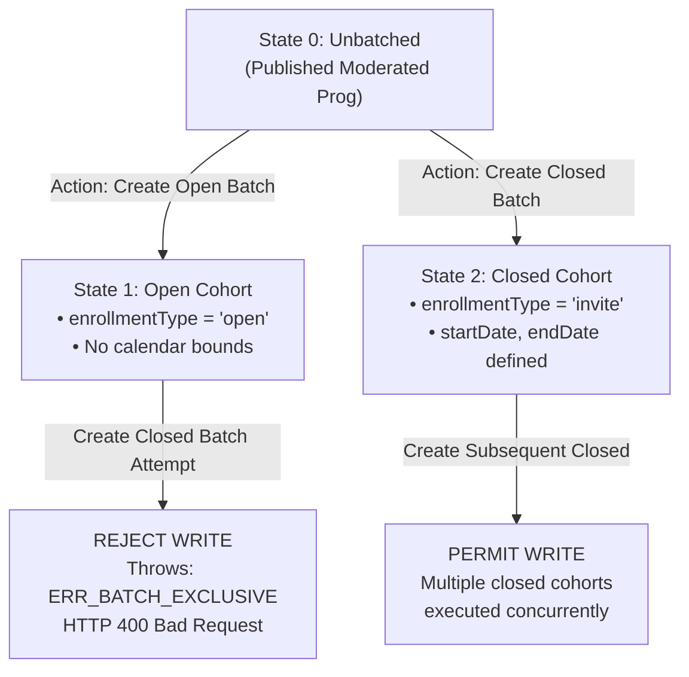
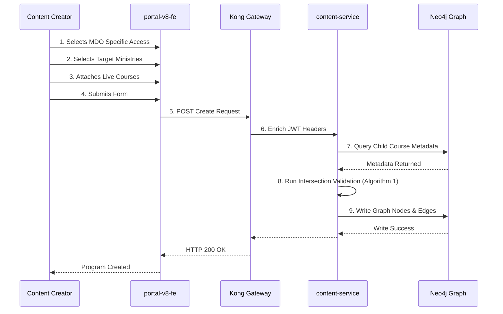
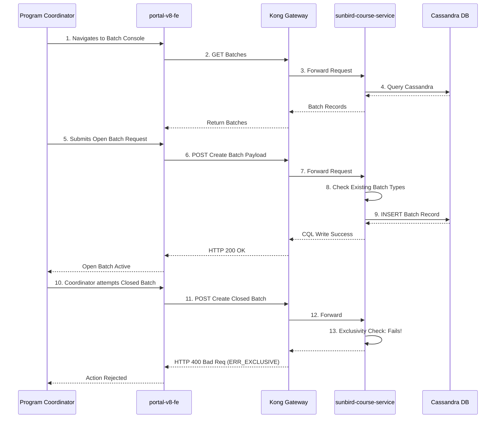
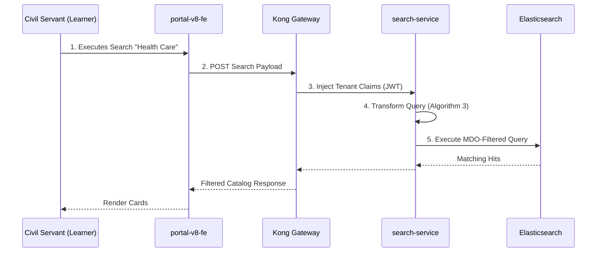
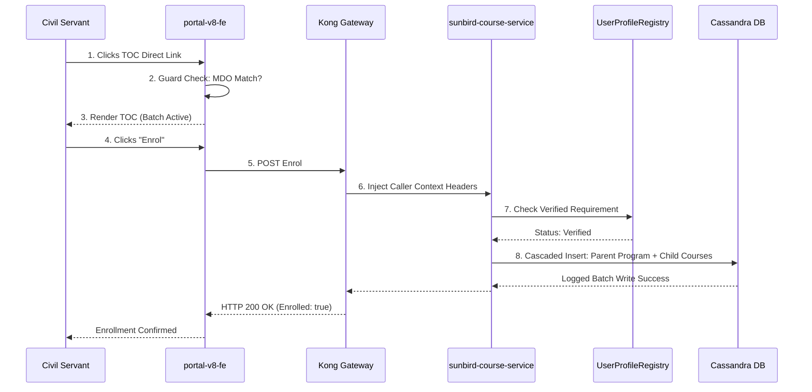

# Moderated Program — Low-Level Design (LLD) Document

## 2. Component and Class Specifications (Frontend to Backend)

**SUBSYSTEM CLASS TAXONOMY**

| PRESENTATION SUBSYSTEMS | APPLICATION SERVICE ACTORS | PERSISTENCE ACCESS MANAGERS |
|---|---|---|
| ProgramEditorComponent | ProgramHierarchyActor | Neo4jGraphDao |
| BatchConfigComponent | CourseIntersectionValidator | CourseBatchDao |
| TOCContainerComponent | CourseBatchManagementActor | UserEnrolmentDao |
| ModeratedProgramGuard | UserEnrolmentActor | ContentConsumptionDao |
| CatalogFilterDrawer (Mobile) | MDOQueryTransformer | SearchProxyClient |

### 2.1 Presentation Tier Components (`portal-v8-fe` & Flutter Client)

#### 1. `ProgramEditorComponent`

- **Module Responsibility:** Orchestrates the multi-step authoring drawer for Program creation, access tagging, and dynamic course attachment.
- **Component Attributes:**
  - `programForm` (Form Group): Validates title (1–120 chars), description, language, and primary category.
  - `accessSetting` (Enum): Set to `MDO Specific` for Moderated Programs.
  - `homeMdoId` (String): Unmodifiable UUID extracted from the creator's Keycloak session.
  - `selectedMdoList` (Array of Objects): Collection of targeted organizations, marked with a lock status flag for the home department.
  - `isVerifiedKarmayogiOnly` (Boolean): Switch controlling whether access is restricted to verified civil servants.
  - `bundledCourses` (Array of Node References): In-memory roster of attached course identifiers.

- **Public Member Operations:**
  - `initializeForm()`: Sets up validation rules and injects the locked home MDO.
  - `addMdo(targetOrg)`: Appends a selected department to the cohort and triggers client-side intersection validation.
  - `removeMdo(index)`: Removes an optional department; halts and alerts if index maps to the locked home MDO.
  - `validateBundledCourses()`: Verifies that selected courses meet `status = Live` and share overlapping MDO configurations.

#### 2. `BatchConfigComponent`

- **Module Responsibility:** Manages batch operational controls under the Program Coordinator dashboard.
- **Component Attributes:**
  - `existingBatchList` (Array of Batch Records): Roster of active, upcoming, or completed batches.
  - `isClosedBatchDisabled` (Boolean): Flag derived from the presence of an active Open Batch.
  - `isOpenBatchDisabled` (Boolean): Flag derived from the existence of one or more Closed Batches.

- **Public Member Operations:**
  - `checkExclusivityConstraints()`: Inspects current batch records to toggle UI input controls.
  - `submitBatchPayload()`: Compiles scheduling metadata, checks that enrollment deadline precedes the end date, and dispatches creation requests.

#### 3. `ModeratedProgramGuard`

- **Module Responsibility:** Client-side Angular route interceptor evaluating access entitlements before rendering Table of Contents (TOC) and Player surfaces.
- **Public Member Operations:**
  - `canActivate(routeSnapshot)`: Reads program metadata. If access is `MDO Specific`, checks if the user's `rootOrgId` is present in `targetMDOs`. If missing, aborts navigation, displays an access-restricted modal, and redirects to the home route.
  - `verifyBadgingState()`: Evaluates user verification claims when `isVerifiedKarmayogiOnly` is enabled.

### 2.2 Application Services Tier (`content-service` & `sunbird-course-service`)

#### 1. `ProgramHierarchyActor`

- **Service Context:** Java 11 / Play Framework Akka Actor handling program CRUD and graph relationships.
- **Internal Responsibilities:**
  - Deserializes inbound content payloads.
  - Maps metadata properties to Neo4j node properties (`:Content:Program`).
  - Establishes directional sequence relationships (`-[:hasSequence]->`) pointing from the parent program to attached child courses.
  - Coordinates with `CourseIntersectionValidator` prior to state transitions into `Live`.

#### 2. `CourseIntersectionValidator`

- **Service Context:** Stateless validation engine enforcing cohort overlap and qualification parity.
- **Public Member Operations:**
  - `validateProgramBundling(programId, childCourseIds)`: Loads parent and child metadata from the graph database. Executes set intersection over target MDO lists. Throws an intersection exception if the resulting set is empty or if verification flags conflict.

#### 3. `CourseBatchManagementActor`

- **Service Context:** Akka actor governing batch state transitions in Apache Cassandra.
- **Internal Responsibilities:**
  - Validates that new batch requests do not violate mutual exclusivity rules against existing records in `sunbird_courses.course_batch`.
  - Verifies schedule constraints: ensures start date enrollment end date completion end date.
  - Generates unique batch identifiers and synchronizes operational data to Elasticsearch index `course-batch`.

#### 4. `UserEnrolmentActor`

- **Service Context:** Akka actor processing user enrollment transactions.
- **Internal Responsibilities:**
  - Authenticates caller tenancy against the batch's `createdFor` list.
  - Verifies Verified Karmayogi status via the User Profile registry if required.
  - Executes atomic batch insertions into Cassandra table `sunbird_courses.user_enrolments` for both the parent program and all attached child courses.

### 2.3 Search and Discovery Subsystem (`search-service`)

#### 1. `MDOQueryTransformer`

- **Service Context:** Ingress query adapter for the Elasticsearch cluster.
- **Internal Responsibilities:**
  - Intercepts incoming search payloads from web and mobile clients.
  - Extracts the authenticated caller's tenant identifier (`rootOrgId`) from the request context.
  - Transforms the raw Elasticsearch JSON payload by injecting boolean filter clauses that suppress moderated programs unless the caller's organization is present in the `targetMDOs` attribute.

## 3. Algorithmic Specifications and State Machines

### 3.1 Algorithm 1: Mathematical Cohort Intersection Evaluation

- **Context:** Executed during Program publishing or course bundling validation.
- **Input Parameters:** Parent Program Target MDOs (), Parent Verified Flag (), Child Course Metadata Roster ().
- **Output:** Effective Target MDO Cohort () or Client Validation Exception.

```text
Step 1: Initialize Effective MDO Set:
    M_Effective = Copy(M_P)
Step 2: FOR EACH Course C_i IN [C_1, C_2, ..., C_n] DO:
    a. Verify Course Lifecycle:
        IF C_i.status != "Live" THEN:
            HALT with Error "ERR_COURSE_NOT_LIVE"
    b. Check Access Setting:
        IF C_i.accessSettings == "MDO Specific" THEN:
            i. Verify Qualification Parity:
                IF C_i.isVerifiedKarmayogiOnly != V_P THEN:
                    HALT with Error "ERR_QUALIFICATION_PARITY_MISMATCH"
            ii. Compute Intersection:
                M_Effective = M_Effective ∩ C_i.targetMDOs
            iii. Verify Non-Empty Overlap:
                IF M_Effective is EMPTY THEN:
                    HALT with Error "ERR_EMPTY_MDO_INTERSECTION"
Step 3: Persist Computed Effective Set to Program Graph Metadata.
Step 4: Return Validation Success.
```

### 3.2 Algorithm 2: Mutual Exclusivity Batch Allocation State Machine

- **Context:** Executed during `POST /course/v1/batch/create`.
- **Database Target:** `sunbird_courses.course_batch`



#### State Transition Logic Table

| Initial State | Event / API Action | Guard Condition | Target State | System Action |
|---|---|---|---|---|
| **Unbatched** | `Create Batch (Open)` | No active batches exist | **Open Cohort** | Auto-provisions open batch with `createdFor = targetMDOs`. |
| **Unbatched** | `Create Batch (Closed)` | No active batches exist | **Closed Cohort** | Validates schedule (); writes batch record. |
| **Open Cohort** | `Create Batch (Closed)` | Existing batch has `enrollmentType = open` | **Open Cohort** | **REJECT:** Returns HTTP 400 `ERR_BATCH_EXCLUSIVE`. |
| **Closed Cohort** | `Create Batch (Open)` | Existing batches have `enrollmentType = invite` | **Closed Cohort** | **REJECT:** Returns HTTP 400 `ERR_BATCH_EXCLUSIVE`. |
| **Closed Cohort** | `Create Batch (Closed)` | Existing batches are Closed | **Closed Cohort** | **ACCEPT:** Instantiates an additional concurrent closed batch. |

### 3.3 Algorithm 3: Multi-Tenant Query Transformation & Search Gating

- **Context:** Ingress transformation inside `search-service` before dispatching queries to Elasticsearch index `composite-search`.

```text
Step 1: Receive Client Search Request:
    Extract Search Payload: Filters, Facets, Query Text.
    Extract Header: callerRootOrg = Request.Headers['x-authenticated-rootorg'].
Step 2: Build Base Query:
    BaseMust = Match queries on status ("Live") and requested taxonomies.
Step 3: Construct Multi-Tenant Security Clause:
    TenantClause = Bool Query:
        SHOULD:
            Branch A: Must Not Match { programType: "Moderated Program" }
            Branch B: Must Match { programType: "Moderated Program" }
                      AND Must Match { targetMDOs: callerRootOrg }
        MinimumShouldMatch: 1
Step 4: Merge BaseMust with TenantClause into Elasticsearch Query Body.
Step 5: Dispatch to Elasticsearch Cluster and Return Filtered Response.
```

### 3.4 Algorithm 4: Cascaded Enrollment & Component Binding

- **Context:** Atomic join execution inside `UserEnrolmentActor`.

```text
Step 1: Validate Inbound Enrollment Payload:
    Verify User ID, Target Program ID, Target Batch ID.
Step 2: Read Batch Entitlement:
    Fetch Batch from Cassandra: SELECT createdfor, enrollmenttype FROM course_batch.
    IF callerRootOrg NOT IN batch.createdfor THEN:
        HALT with HTTP 403 "ERR_MDO_ACCESS_DENIED"
Step 3: Read Child Course Hierarchy:
    Query Neo4j Graph for direct child course sequences:
        MATCH (:Content {identifier: programId})-[:hasSequence]->(c:Content:Course)
        RETURN c.identifier, c.accessSettings
Step 4: Prepare Logged Cassandra Batch Statement:
    a. Statement 1: INSERT into user_enrolments for Parent Program ID and Batch ID.
    b. FOR EACH Child Course ID DO:
        i. Resolve Child Batch ID (Child default open batch).
        ii. Statement (i+1): INSERT into user_enrolments for Child Course ID and Child Batch ID.
Step 5: Commit Logged Cassandra Batch (Consistency Level: LOCAL_QUORUM).
Step 6: Emit Enrolment Telemetry to Kafka Topic "telemetry.enrolment".
Step 7: Return HTTP 200 OK.
```

### 3.5 Algorithm 5: Hierarchical Progress Rollup & Certification

- **Context:** Incremental evaluation following content playback state updates.

```text
Step 1: Receive Unit Progress Event:
    Update sunbird_courses.user_content_consumption.
    Calculate Child Course Progress Percentage based on leaf nodes.
Step 2: Evaluate Child Course Completion:
    IF Child Course Progress == 100% THEN:
        Update user_enrolments: SET status = 2 (Completed) for Child Course.
Step 3: Evaluate Parent Program Completion:
    Query user_enrolments for all child courses associated with this program.
    TotalCourses = Count(Associated Child Courses)
    CompletedCourses = Count(Associated Child Courses with status == 2)
    ProgramProgressPercentage = (CompletedCourses / TotalCourses) * 100
Step 4: Update Parent Program Record:
    Update user_enrolments: SET progress = ProgramProgressPercentage
        WHERE userId = callerUserId AND courseId = parentProgramId
Step 5: Trigger Certification Evaluation:
    IF ProgramProgressPercentage == 100% THEN:
        Update user_enrolments: SET status = 2 for Parent Program.
        Dispatch Event to Certificate Generator Queue with User ID, Program ID, Batch ID.
```

## 4. End-to-End Sequence & Interaction Designs

### 4.1 Sequence 1: Program Creation & Course Bundling



### 4.2 Sequence 2: Batch Management & Mutual Exclusivity Enforcement



### 4.3 Sequence 3: Learner Catalog Discovery & Search Interception



### 4.4 Sequence 4: TOC Access Gating, Verification Check & Cascaded Enrollment



## 5. Detailed Persistence Models and Storage Architecture

### 5.1 Neo4j Graph Model Definition

- **Node Labels:** `:Content:Program`
- **Node Property Specifications:**

| Property Field | Type | Required | Description |
|---|---|---|---|
| `identifier` | String | Yes | System-wide unique identifier (e.g., `do_113892749102841856112`). |
| `name` | String | Yes | Display title of the program. |
| `contentType` | String | Yes | Constant value: `"Program"`. |
| `programType` | String | Yes | Constant value: `"Moderated Program"`. |
| `accessSettings` | String | Yes | Constant value: `"MDO Specific"`. |
| `targetMDOs` | List of Strings | Yes | Department tenant identifiers (e.g., `["org_mohfw_001", "org_dop_002"]`). |
| `isVerifiedKarmayogiOnly` | Boolean | Yes | Flag controlling profile verification gating. |
| `status` | String | Yes | State in publishing lifecycle (`"Draft"`, `"Review"`, `"Live"`). |

- **Hierarchical Edges:**
  - Relationship: `(:Content:Program)-[:hasSequence {index: Integer}]->(:Content:Course)`
  - Traversal Rule: Preserves curriculum display order in Table of Contents.

### 5.2 Apache Cassandra Schemas (`sunbird_courses` Keyspace)

#### 1. Batch Table: `course_batch`

Maintains operational schedule and cohort access records.

| Column Name | Data Type | Key Classification | Functional Description |
|---|---|---|---|
| `courseid` | `text` | Partition Key | Program or Course digital object identifier. |
| `batchid` | `text` | Clustering Key (ASC) | Unique batch execution UUID. |
| `name` | `text` | Data Column | Batch cohort title. |
| `description` | `text` | Data Column | Contextual batch description. |
| `enrollmenttype` | `text` | Data Column | `"open"` for Open Batch; `"invite-only"` for Closed Batch. |
| `startdate` | `text` | Data Column | Cohort start date (ISO YYYY-MM-DD); null for Open Batch. |
| `enddate` | `text` | Data Column | Cohort conclusion date (ISO YYYY-MM-DD); null for Open Batch. |
| `enrollmentenddate` | `text` | Data Column | Cutoff date for enrollment; null for Open Batch. |
| `createdfor` | `set<text>` | Data Column | Targeted MDO tenant identifiers matching program metadata. |
| `mentors` | `list<text>` | Data Column | User UUIDs of authorized Program Coordinators. |
| `status` | `int` | Data Column | Operational state: `0` (Upcoming), `1` (Active), `2` (Completed). |
| `createddate` | `timestamp` | Data Column | Batch instantiation timestamp. |
| `updateddate` | `timestamp` | Data Column | Last modification timestamp. |

#### 2. User Enrollment Ledger: `user_enrolments`

Tracks participation and certification states.

| Column Name | Data Type | Key Classification | Functional Description |
|---|---|---|---|
| `userid` | `text` | Partition Key | Authenticated civil servant UUID. |
| `courseid` | `text` | Clustering Key 1 | Target parent program or child course identifier. |
| `batchid` | `text` | Clustering Key 2 | Bound execution batch identifier. |
| `active` | `boolean` | Data Column | `true` if active, `false` if un-enrolled. |
| `completionpercentage` | `int` | Data Column | Progress completion (0 to 100). |
| `enrolleddate` | `timestamp` | Data Column | Timestamp of initial enrollment. |
| `issued_certificates` | `list<frozen<map<te``xt, text>>>` | Data Column | Metadata of cryptographically issued certificates. |
| `progress` | `int` | Data Column | Count of completed curriculum leaf components. |
| `status` | `int` | Data Column | Status indicator: `0` (Enrolled), `1` (In-Progress), `2` (Completed). |

#### 3. Content Consumption Store: `user_content_consumption`

Records unit-level playback and assessment interactions.

| Column Name | Data Type | Key Classification | Functional Description |
|---|---|---|---|
| `userid` | `text` | Partition Key | Learner UUID. |
| `courseid` | `text` | Clustering Key 1 | Child course identifier. |
| `batchid` | `text` | Clustering Key 2 | Operational batch ID. |
| `contentid` | `text` | Clustering Key 3 | Primitive media asset identifier (Video, PDF, SCORM). |
| `progress` | `int` | Data Column | Dwell time or playback progress count. |
| `status` | `int` | Data Column | Unit state: `1` (In-Progress), `2` (Completed). |

### 5.3 Elasticsearch Index Mapping Specifications (`composite-search` Index)

| Field Name | Type | Search Analyzer / Index Configuration | Functional Purpose |
|---|---|---|---|
| `identifier` | `keyword` | Exact match indexing | Document unique identifier. |
| `name` | `text` | Standard analyzer with multi-field `name.raw` (`keyword`) | Title full-text search and sorting. |
| `contentType` | `keyword` | Direct filter mapping | Constant filter: `"Program"`. |
| `programType` | `keyword` | Direct filter mapping | Constant filter: `"Moderated Program"`. |
| `accessSettings` | `keyword` | Direct filter mapping | Constant filter: `"MDO Specific"`. |
| `targetMDOs` | `keyword` | Array keyword indexing | Multi-tenant search security filter matching. |
| `status` | `keyword` | Direct filter mapping | Publication filter: `"Live"`. |

## 6. Interface & API Data Contracts (Tabular Specifications)

### 6.1 Program Creation Contract (`POST /action/content/v3/create`)

- **Producer:** `content-service`
- **Consuming Client:** `portal-v8-fe` (Content Authoring Drawer)

#### Request Field Specifications

| Attribute Path | Type | Mandatory | Description & Constraints |
|---|---|---|---|
| `request.content.name` | String | Yes | Program title (1–120 characters). |
| `request.content.description` | String | Yes | Program summary description. |
| `request.content.contentType` | String | Yes | Value must be `"Program"`. |
| `request.content.programType` | String | Yes | Value must be `"Moderated Program"`. |
| `request.content.accessSettings` | String | Yes | Value must be `"MDO Specific"`. |
| `request.content.targetMDOs` | Array of Strings | Yes | List of target MDO identifiers; must include creator's home MDO. |
| `request.content.isVerifiedKarmayogiOnly` | Boolean | Yes | `true` if restricted to verified civil servants. |

#### Response Field Specifications (HTTP 200 OK)

| Attribute Path | Type | Description |
|---|---|---|
| `responseCode` | String | Standard status response: `"OK"`. |
| `result.identifier` | String | Generated digital object identifier (e.g., `do_113892749102841856112`). |
| `result.versionKey` | String | Concurrency control token timestamp. |

### 6.2 Program Coordinator Batch Creation Contract (`POST /course/v1/batch/create`)

- **Producer:** `sunbird-course-service`
- **Consuming Client:** `portal-v8-fe` (Batch Management Console)

#### Request Field Specifications

| Attribute Path | Type | Mandatory | Description & Constraints |
|---|---|---|---|
| `request.courseId` | String | Yes | Target parent program identifier. |
| `request.name` | String | Yes | Cohort batch title. |
| `request.enrollmentType` | String | Yes | `"open"` for Open Batch; `"invite-only"` for Closed Batch. |
| `request.createdFor` | Array of Strings | Yes | Departmental tenant identifiers (must match program target MDOs). |
| `request.startDate` | String | Conditional | Format: `YYYY-MM-DD`. Required for Closed Batch; omitted for Open Batch. |
| `request.endDate` | String | Conditional | Format: `YYYY-MM-DD`. Required for Closed Batch; omitted for Open Batch. |
| `request.enrollmentEndDate` | String | Conditional | Format: `YYYY-MM-DD`. Must satisfy . |

#### Response Field Specifications (HTTP 200 OK)

| Attribute Path | Type | Description |
|---|---|---|
| `responseCode` | String | Standard status response: `"OK"`. |
| `result.batchId` | String | System-generated unique batch UUID. |
| `result.response` | String | Execution message: `"SUCCESS"`. |

### 6.3 Learner Program Enrollment Contract (`POST /course/v1/enrol`)

- **Producer:** `sunbird-course-service`
- **Consuming Client:** Learner Web Portal / Flutter Mobile App

#### Request Field Specifications

| Attribute Path | Type | Mandatory | Description & Constraints |
|---|---|---|---|
| `request.courseId` | String | Yes | Parent Moderated Program identifier. |
| `request.batchId` | String | Yes | Active batch identifier. |
| `request.userId` | String | Yes | Authenticated civil servant UUID. |

#### Error Response Mappings

| Error Condition | HTTP Status | Response Error Code | User-Facing Resolution Message |
|---|---|---|---|
| Ineligible Organization | HTTP 403 Forbidden | `ERR_MDO_ACCESS_DENIED` | "Your organization does not have access to this Moderated Program." |
| Verification Required | HTTP 403 Forbidden | `ERR_VERIFICATION_REQUIRED` | "This program is restricted to Verified Karmayogi civil servants." |
| Enrollment Closed | HTTP 400 Bad Request | `ERR_ENROLMENT_CLOSED` | "Enrollment for this scheduled cohort closed on [Date]." |
| Batch Mutual Exclusivity | HTTP 400 Bad Request | `ERR_BATCH_EXCLUSIVE` | "Cannot create requested batch type due to existing operational cohort." |

## 7. Security Architecture & Multi-Tenant Access Gating

**DEFENSE-IN-DEPTH LAYER TAXONOMY**

| LAYER 1: CLIENT ROUTE GUARDS | LAYER 2: API GATEWAY INGRESS | LAYER 3: SERVICE LOGIC GATING |
|---|---|---|
| Angular ModeratedProgramGuard | Keycloak RS256 JWT Signature | LMS Course Service Tenancy |
| Flutter Route Interceptor | Header Stripping & Enrichment | Profile Verification Checks |
| Immediate UX Redirection | x-authenticated-rootorg | Cassandra Logged Partitions |

1. **Client-Tier Interception:** The Angular `ModeratedProgramGuard` evaluates session claims before route activation. While this prevents unauthorized page loads, client-side guards are considered untrusted.
2. **Gateway-Tier Sanitization:** Kong API Gateway strips any client-supplied tenant headers and authoritatively populates `x-authenticated-rootorg` and `x-authenticated-userid` from the verified JWT claims.
3. **Application-Tier Enforcement:** `sunbird-course-service` performs the final entitlement check by verifying that `x-authenticated-rootorg` exists in the batch's `createdFor` set and querying the profile registry for verification badging.

## 8. Detailed Engineering Task Breakdown & Workstream Mapping

**ENGINEERING WORKSTREAM INVENTORY**

| TASK ID | REPOSITORY / WORKSTREAM | SPRINT ANCHOR | DELIVERABLE ARTIFACT / OUTCOME |
|---|---|---|---|
| TSK-01 | portal-v8-fe<br>UI Authoring Module | Sprint 12 (Q3) | Develop MDO-specific authoring form, home MDO lock, and verified toggle. |
| TSK-02 | content-service<br>Knowledge Graph Subsystem | Sprint 13 (Q3) | Implement intersection math engine evaluating cohort compatibility. |
| TSK-03 | sunbird-course-service<br>LMS Actor & Cassandra DAO | Sprint 14 (Q3) | Update CourseBatchManagementActor enforcing Open/Closed exclusivity. |
| TSK-04 | sunbird-course-service<br>Enrollment Actor | Sprint 15 (Q3) | Build cascaded enrollment pipeline auto-joining bundled child courses. |
| TSK-05 | portal-v8-fe<br>TOC Player Component | Sprint 18 (Q4) | Implement dynamic TOC states handling unbatched & expired cohorts. |
| TSK-06 | search-service<br>Search Proxy Adapter | Sprint 22 (Q7) | Deploy Elasticsearch query rewriter injecting dynamic MDO filter clauses. |
| TSK-07 | mobile-app (Flutter)<br>Mobile Client Subsystem | Sprint 26 (Q8) | Native mobile catalog filter drawer supporting "Moderated Program" facet. |
