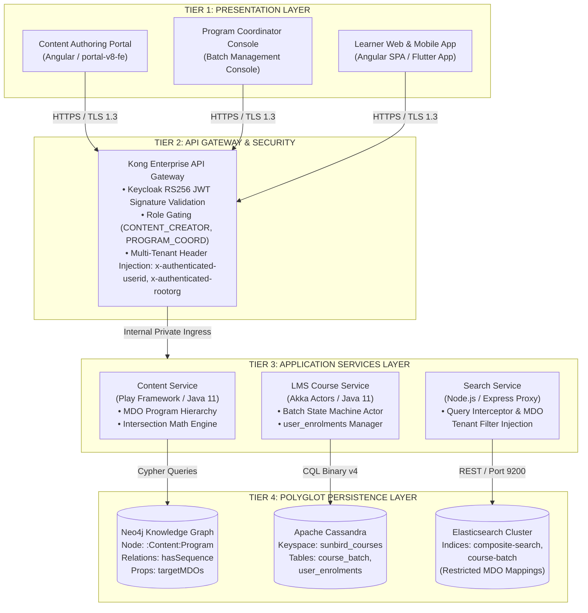
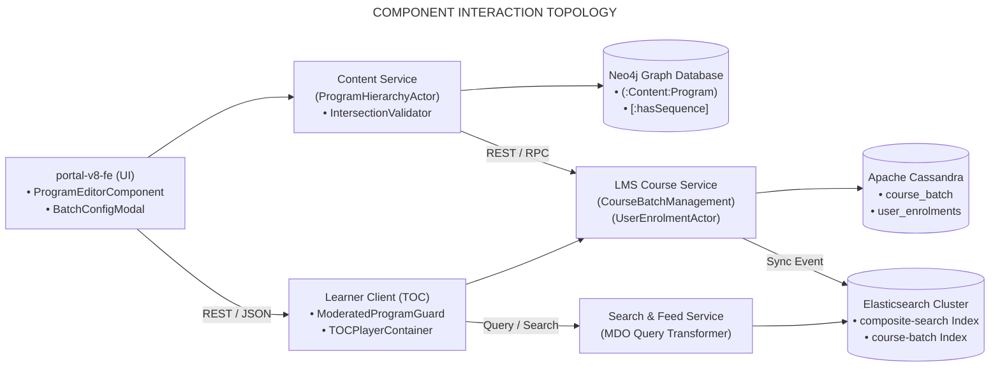
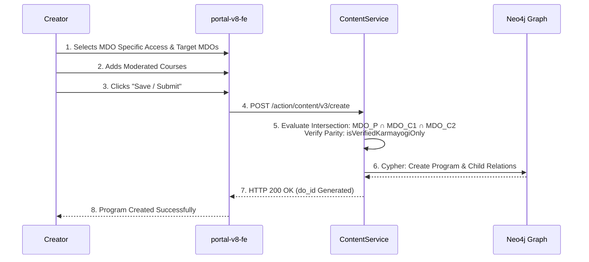
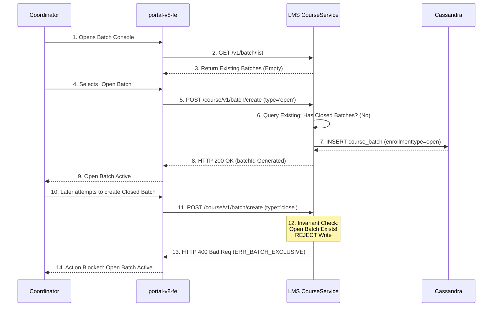
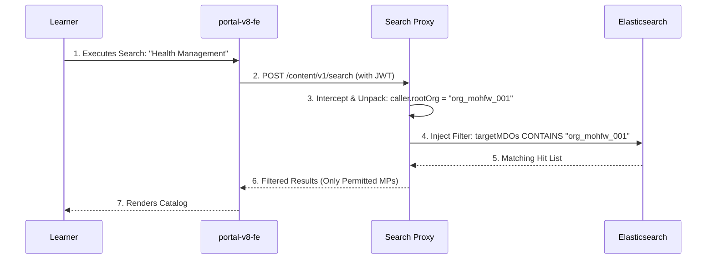
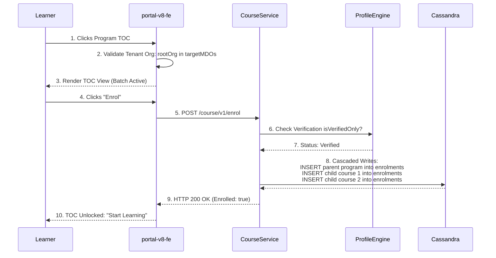
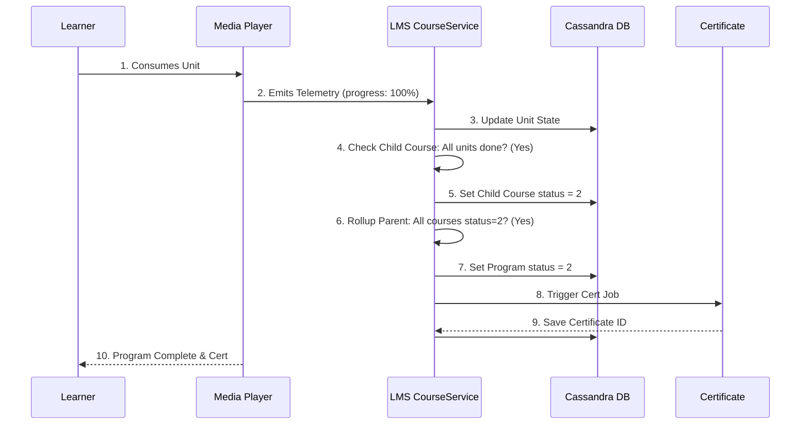
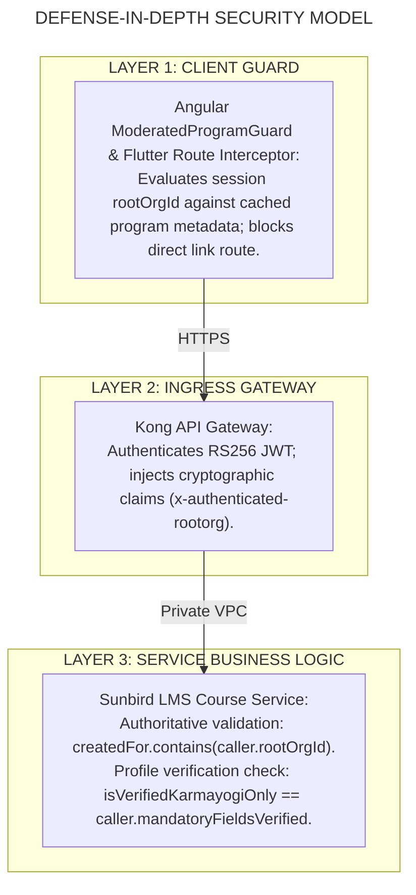

# Moderated Program: End-to-End System Architecture, Component Design, and Evolution (Q2 – Q13)

**Document Reference:** `iGOT-SDD-MP-Q2-Q13-V1.0`<br>**Standard Compliance:** Aligned with IEEE Std 1016-2009 (Standard for Information Technology — Systems Design — Software Design Descriptions)<br>**Target Platform:** iGOT Karmayogi (National Programme for Civil Services Capacity Building - NPCSCB)<br>**Lifecycle Scope:** Multi-Portal Authoring, Multi-Tenant Isolation, Batch Scheduling, Search Suppression, and Mobile/Web Consumption (Q2 to Q13)

## 1. Document Control and Metadata

| Attribute | Specification Details |
|---|---|
| **Document Identifier** | `iGOT-SDD-MP-Q2-Q13-V1.0` |
| **Document Title** | Software Design Document: Moderated Program Architectural Evolution, Component Decomposition, and End-to-End Data Flow |
| **System Classification** | Enterprise Learning Management & Multi-Tenant Capacity Building Platform |
| **Baseline Releases** | Production Evolution across Quarter 2 (Q2) through Quarter 13 (Q13) |
| **Primary System Targets** | `portal-v8-fe`, `mobile-app` (Flutter), `kong-api-gateway`, `content-service`, `sunbird-course-service`, `search-service`, `certificate-service` |
| **Persistence Stores** | Neo4j Knowledge Graph, Apache Cassandra 3.11/4.x, Elasticsearch 7.x |

## 2. System Architecture & High-Level Design (HLD)

### 2.1 Architectural Context & System Decomposition

A **Moderated Program** is an institutionally restricted parent curricular container. Its software architecture must enforce multi-tenant isolation across all five architectural tiers: **Client Surfaces**, **Edge Ingress / API Gateway**, **Microservices Business Logic**, **Asynchronous Streaming**, and **Polyglot Persistence**.



### 2.2 Boundary Invariants & Multi-Tenant Trust Zones

1. **Tenancy Boundary:** Every write and read transaction evaluated at the LMS or Content tier must validate the caller's organizational claim (`x-authenticated-rootorg`) against the program's `targetMDOs` list.
2. **Component Integrity Boundary:** A Moderated Program cannot bundle components that violate mathematical intersection rules; the effective target audience is always computed as:

1. **Operational Exclusivity Boundary:** An Open Batch and Closed Batches are mutually exclusive in the runtime state machine.

## 3. Chronological Evolution of Technical Design (Q2 to Q13)

**TECHNICAL EVOLUTION MATRIX (Q2 - Q13)**

| QUARTER | JIRA ANCHOR | ARCHITECTURAL SUBSYSTEMS | TECHNICAL DESIGN DELTAS |
|---|---|---|---|
| **Q2** | [KB-452] | Content Graph Schema (`Neo4j`)<br/>Publishing Pipeline | Decoupled `Program` node label from atomic `Course` schema. |
| **Q3** | [KB-1936] Parent<br/>[KB-1945],<br/>[KB-1946],<br/>[KB-1950] | `portal-v8-fe`, Content Service,<br/>`sunbird-course-service`,<br/>Cassandra Database | • Added `accessSettings` enum.<br/>• Home MDO lock in UI form.<br/>• Implemented intersection math.<br/>• Open/Closed batch exclusivity. |
| **Q4** | [KB-3756],<br/>[KB-4493],<br/>[KB-4288] | Learner Portal Feed Engine,<br/>Dynamic Discovery Carousels | • Integrated Karma Programs API.<br/>• Configured multi-MDO edge tags on learner home feed strips. |
| **Q6** | [KB-7067] | Coordinator Management UI<br/>`portal-v8-fe` | Grid refactoring; date picker validation ($\text{enroll}\le\text{end}$). |
| **Q7** | [KB-7854],<br/>[KB-7869]–[7872] | Elasticsearch Cluster,<br/>Search Proxy Service | • Query rewriting with NLP.<br/>• Dynamic `targetMDOs` filter injection into ES payloads. |
| **Q8** | [KB-8819],<br/>[KB-9603],<br/>[KB-9333], [9337] | Ingress Gateway (Kong),<br/>Mobile App Client (Flutter) | • Formalized User-Group gating.<br/>• Added `Moderated Program` facet checkbox in mobile app. |
| **Q11-13** | [KB-13016/17] | Analytics & Reporting Pipelines,<br/>Telemetry Stream | Optimized Cassandra reporting queries; peer validation forms. |

## 4. Detailed Component Design (Frontend to Backend)



### 4.1 Presentation Layer Subsystems (`portal-v8-fe` & Flutter `mobile-app`)

1. **Program Authoring Module** (`ProgramEditorComponent`):
  - Manages the 3-card creation modal (Course, Program, Assessment).
  - Renders the **Access Settings** drawer. When `MDO Specific` is toggled:
    - Injects the authenticated user's `rootOrgId` into `targetMDOs` as a locked chip component.
    - Enforces the **Verified Karmayogi** binary toggle (`isVerifiedKarmayogiOnly`).
    - Invokes the course-picker modal, applying client-side filtering to exclude incompatible draft or unmoderated courses.

2. **Batch Operations Module** (`BatchConfigComponent`):
  - Evaluates batch creation constraints.
  - If an Open Batch exists, disables the "Create Closed Batch" action with an informative warning tooltip.
  - If Closed Batches exist, hides the "Create Open Batch" radio toggle.

3. **Learner Table of Contents Module** (`TOCContainerComponent`):
  - Implements `ModeratedProgramGuard` to intercept direct link navigation by non-targeted users, throwing HTTP 403 and redirecting to the homepage.
  - Renders dynamic button state machines: `Enrol in Program` (Open Batch), `Enrol in Batch` (Closed Batch active), `Enrollment Closed` (Deadline passed), or `No Active Batch` (Unbatched).

### 4.2 Ingress Gateway & Security Interceptor Tier (Kong API Gateway)

- **JWT Plugin Execution:** Verifies Keycloak RS256 signatures on inbound `Authorization: Bearer <token>` headers.
- **Header Enrichment:** Unpacks token claims and injects trusted upstream headers:
  - `x-authenticated-userid`: Caller UUID (`sub`).
  - `x-authenticated-rootorg`: Tenant Org identifier (`rootOrgId`).
  - `x-authenticated-user-roles`: Assigned platform roles.

- **Rate Limiting & Threat Suppression:** Limits catalog search requests to 120 req/minute per authenticated user session.

### 4.3 Content Service & Authoring Engine (`content-service`)

- **Technology Stack:** Play Framework 2.8, Java 11, Akka Actor System.
- `ProgramHierarchyActor.java`:
  - Handles `/action/content/v3/create` and `/action/content/v3/update`.
  - Persists program nodes to the Neo4j Knowledge Graph.

- `CourseIntersectionValidator.java`:
  - Executes mathematical intersection logic during course bundling:

```java
public void validateIntersection(String programId, List<String> childCourseIds) {
    ProgramNode program = neo4jDao.getNode(programId);
    Set<String> programMDOs = new HashSet<>(program.getTargetMDOs());
    boolean programVerifiedOnly = program.isVerifiedKarmayogiOnly();
    for (String courseId : childCourseIds) {
        CourseNode course = neo4jDao.getNode(courseId);
        if ("MDO Specific".equalsIgnoreCase(course.getAccessSetting())) {
            // Invariant Check 1: Qualification state parity
            if (course.isVerifiedKarmayogiOnly() != programVerifiedOnly) {
                throw new ClientException("ERR_QUALIFICATION_MISMATCH", "Cannot bundle courses with conflicting Verified Karmayogi settings.");
            }
            // Invariant Check 2: Retain common intersection
            programMDOs.retainAll(course.getTargetMDOs());
            if (programMDOs.isEmpty()) {
                throw new ClientException("ERR_EMPTY_MDO_INTERSECTION", "Course " + courseId + " shares no common MDOs with the program cohort.");
            }
        }
    }
}
```

### 4.4 LMS Course Service & Batch Runtime (`sunbird-course-service`)

- **Technology Stack:** Play Framework / Akka, Apache Cassandra Driver, Kafka Producer.
- `CourseBatchManagementActor.java`:
  - Manages the lifecycle of batches in Cassandra table `sunbird_courses.course_batch`.
  - Validates mutual exclusivity: queries Cassandra for existing batches under `courseId`. If an open batch exists (`enrollmenttype = 'open'`), any incoming request for a closed batch is rejected with `ERR_MUTUALLY_EXCLUSIVE_BATCH`.

- `UserEnrolmentActor.java`:
  - Handles `/course/v1/enrol`.
  - Verifies caller eligibility: validates `x-authenticated-rootorg` .
  - If `isVerifiedKarmayogiOnly = true`, executes an internal RPC call to User Profile Service verifying `mandatoryFieldsVerified == true`.
  - **Cascaded Enrollment Transaction:** Atomically writes enrollment rows for both the parent program container and all bundled child courses in `sunbird_courses.user_enrolments`.

### 4.5 Search & Discovery Subsystem (`search-service`)

- **Elasticsearch Index Management:**
  - Moderated Programs are indexed into `composite-search` with:<br>`contentType: "Program"`, `programType: "Moderated Program"`, `targetMDOs: ["org_01", "org_02"]`.

- **MDO Query Transformation Plugin:**
  - Intercepts learner search queries. Extracts `x-authenticated-rootorg` and injects a mandatory filter clause:
  - This guarantees that non-targeted civil servants receive zero hits for private institutional programs.

## 5. Data Models & Database Schemas

### 5.1 Neo4j Knowledge Graph Data Model (`Content` Node)

```cypher
// Moderated Program Node Representation in Neo4j
(:Content:Program {
    identifier: "do_113892749102841856112",
    name: "National Health Policy Implementation Program",
    description: "Specialized training for MoHFW and Department of Pharmaceuticals",
    contentType: "Program",
    programType: "Moderated Program",
    accessSetting: "MDO Specific",
    targetMDOs: ["org_mohfw_001", "org_dop_002"],
    isVerifiedKarmayogiOnly: true,
    status: "Live",
    createdBy: "712020:2b1926b8-ba53-4277-9b45-3508667c6b3d",
    createdOn: "2024-03-15T10:00:00.000Z",
    lastUpdatedOn: "2024-03-16T14:30:00.000Z"
})
```

#### Graph Hierarchical Relationships

```cypher
// Bundled Course Associations
(p:Content:Program {identifier: "do_113892749102841856112"})
    -[:hasSequence {index: 1}]-> (c1:Content:Course {identifier: "do_113892019283", accessSetting: "All Users"})
(p)
    -[:hasSequence {index: 2}]-> (c2:Content:Course {identifier: "do_113892994812", accessSetting: "MDO Specific", targetMDOs: ["org_mohfw_001", "org_dop_002", "org_ayush_003"]})
```

### 5.2 Apache Cassandra Schemas (`sunbird_courses` Keyspace)

#### 1. Batch Storage Schema (`course_batch`)

Stores runtime execution batches for programs and courses.

```sql
CREATE KEYSPACE sunbird_courses WITH replication = { 'class': 'NetworkTopologyStrategy', 'datacenter1': 3 };
CREATE TABLE sunbird_courses.course_batch (
    courseid text,
    batchid text,
    name text,
    description text,
    enrollmenttype text,  -- 'open' (Open Batch) or 'invite-only' (Closed Batch)
    startdate text,  -- ISO-8601 YYYY-MM-DD (Null for Open Batch)
    enddate text,  -- ISO-8601 YYYY-MM-DD (Null for Open Batch)
    enrollmentenddate text,  -- ISO-8601 YYYY-MM-DD (Null for Open Batch) createdfor set<text>,
    -- Set of target MDO rootOrgIds (e.g. {'org_mohfw_001', 'org_dop_002'}) mentors list<text>,
    -- User UUIDs of designated Program Coordinators cert_templates map<text, frozen<map<text, text>>>,
    status int,  -- 0: Unannounced, 1: Ongoing/Active, 2: Completed
    createdby text,
    createddate timestamp,
    updateddate timestamp,
    PRIMARY KEY (courseid, batchid)
) WITH CLUSTERING ORDER BY (batchid ASC);
```

#### 2. User Enrollment Ledger Schema (`user_enrolments`)

Maintains the active participation state of civil servants.

```sql
CREATE TABLE sunbird_courses.user_enrolments (
    userid text,
    courseid text,  -- Program ID or Child Course ID
    batchid text,
    active boolean,
    -- True if currently enrolled
    addedby text,
    certificates list<frozen<map<text,
    text>>>,
    completionpercentage int,  -- 0 to 100
    completedon timestamp,
    datetime timestamp,
    -- Creation timestamp
    enrolleddate timestamp,
    issued_certificates list<frozen<map<text,
    text>>>,
    lastreadcontentid text,
    lastreadcontentstatus int,
    progress int,
    -- Aggregate count of leaf nodes consumed
    status int,  -- 0: Not Started, 1: In-Progress, 2: Completed
    PRIMARY KEY (userid, courseid, batchid)
);
```

#### 3. Granular Telemetry Consumption Ledger (`user_content_consumption`)

```sql
CREATE TABLE sunbird_courses.user_content_consumption (
    userid text,
    courseid text,
    batchid text,
    contentid text,
    -- Leaf unit (Video, PDF, SCORM)
    progress int,  -- Unit-level progress
    status int,  -- 0: Started, 1: In-Progress, 2: Completed
    lastcompletedtime timestamp,
    lastaccesstime timestamp,
    viewcount int,
    completedpercentage int,
    PRIMARY KEY (userid, courseid, batchid, contentid)
);
```

### 5.3 Elasticsearch Document Mapping (`course-batch` Index)

```json
{
  "mappings": {
    "properties": {
      "batchId": {
        "type": "keyword"
      },
      "courseId": {
        "type": "keyword"
      },
      "name": {
        "type": "text",
        "fields": {
          "raw": {
            "type": "keyword"
          }
        }
      },
      "enrollmentType": {
        "type": "keyword"
      },
      "status": {
        "type": "integer"
      },
      "startDate": {
        "type": "date",
        "format": "yyyy-MM-dd"
      },
      "endDate": {
        "type": "date",
        "format": "yyyy-MM-dd"
      },
      "enrollmentEndDate": {
        "type": "date",
        "format": "yyyy-MM-dd"
      },
      "createdFor": {
        "type": "keyword"
      },
      "mentors": {
        "type": "keyword"
      },
      "participantCount": {
        "type": "integer"
      },
      "completedCount": {
        "type": "integer"
      }
    }
  }
}
```

## 6. End-to-End Dynamic Workflow & Sequence Diagrams

### 6.1 Workflow 1: Program Creation & Course Bundling with Intersection Validation



### 6.2 Workflow 2: Program Coordinator Batch Management (Exclusivity Enforcement)



### 6.3 Workflow 3: Multi-Tenant Catalog Search & Query Interception



### 6.4 Workflow 4: Learner TOC Gating, Verification Check & Cascaded Enrollment



### 6.5 Workflow 5: Consumption Telemetry, Progress Rollup & Certification



## 7. API Interface Specifications & Data Contracts

### 7.1 Program Creation API

- **Endpoint:** `POST /apis/proxies/v8/action/content/v3/create`
- **Consuming Client:** Content Portal (`portal-v8-fe`)
- **Producer Service:** `content-service`
- **Headers:** `Authorization: Bearer <JWT>`, `Content-Type: application/json`

#### Request Payload

```json
{
  "request": {
    "content": {
      "name": "Disaster Management Executive Program",
      "description": "Cross-departmental capacity building for NDMA and Ministry of Home Affairs",
      "contentType": "Program",
      "programType": "Moderated Program",
      "accessSettings": "MDO Specific",
      "targetMDOs": [
        "org_ndma_001",
        "org_mha_002"
      ],
      "isVerifiedKarmayogiOnly": true,
      "mimeType": "application/vnd.ekstep.content-collection",
      "primaryCategory": "Program",
      "framework": "igot_cbp_framework"
    }
  }
}
```

#### Response Payload (HTTP 200 OK)

```json
{
  "id": "api.content.create",
  "ver": "3.0",
  "ts": "2024-03-15T11:24:00Z",
  "params": {
    "resmsgid": "89a1b2c3-d4e5-4f6a-b7c8-9d0e1f2a3b4c",
    "status": "successful"
  },
  "responseCode": "OK",
  "result": {
    "identifier": "do_113948572019482716112",
    "node_id": "do_113948572019482716112",
    "versionKey": "1710501840000"
  }
}
```

### 7.2 Program Coordinator Batch Creation API

- **Endpoint:** `POST /apis/proxies/v8/learner/course/v1/batch/create`
- **Consuming Client:** Program Coordinator Console (`portal-v8-fe`)
- **Producer Service:** `sunbird-course-service`

#### Request Payload (Closed Batch Example)

```json
{
  "request": {
    "courseId": "do_113948572019482716112",
    "name": "NDMA Spring Cohort 2026",
    "description": "Scheduled training cohort for verified responders",
    "enrollmentType": "invite-only",
    "startDate": "2026-04-01",
    "endDate": "2026-04-30",
    "enrollmentEndDate": "2026-03-31",
    "createdFor": [
      "org_ndma_001",
      "org_mha_002"
    ],
    "mentors": [
      "712020:2b1926b8-ba53-4277-9b45-3508667c6b3d"
    ]
  }
}
```

#### Response Payload (HTTP 200 OK)

```json
{
  "id": "api.course.batch.create",
  "ver": "v1",
  "ts": "2026-03-15T12:00:00Z",
  "params": {
    "resmsgid": "5f6e7d8c-9b0a-4a1b-8c2d-3e4f5a6b7c8d",
    "status": "successful"
  },
  "responseCode": "OK",
  "result": {
    "batchId": "013948600192837465",
    "response": "SUCCESS"
  }
}
```

### 7.3 Learner Program Enrollment API

- **Endpoint:** `POST /apis/proxies/v8/learner/course/v1/enrol`
- **Consuming Client:** Learner Web Portal / Flutter Mobile App
- **Producer Service:** `sunbird-course-service`

#### Request Payload

```json
{
  "request": {
    "courseId": "do_113948572019482716112",
    "batchId": "013948600192837465",
    "userId": "712020:2b1926b8-ba53-4277-9b45-3508667c6b3d"
  }
}
```

#### Error Response: Ineligible Tenant MDO (HTTP 403 Forbidden)

```json
{
  "id": "api.course.enrol",
  "ver": "v1",
  "ts": "2026-03-15T12:01:00Z",
  "params": {
    "resmsgid": "1a2b3c4d-5e6f-7a8b-9c0d-1e2f3a4b5c6d",
    "err": "FORBIDDEN",
    "status": "failed",
    "errmsg": "Access Restricted: Your organization does not have access to this Moderated Program."
  },
  "responseCode": "CLIENT_ERROR",
  "result": {}
}
```

#### Error Response: Closed Batch Deadline Passed (HTTP 400 Bad Request)

```json
{
  "id": "api.course.enrol",
  "ver": "v1",
  "ts": "2026-04-02T09:00:00Z",
  "params": {
    "resmsgid": "9f8e7d6c-5b4a-3a2b-1c0d-9e8f7a6b5c4d",
    "err": "ERR_ENROLMENT_CLOSED",
    "status": "failed",
    "errmsg": "Enrollment for this cohort closed on 2026-03-31."
  },
  "responseCode": "CLIENT_ERROR",
  "result": {}
}
```

## 8. Security Architecture, Multi-Tenancy & Governance



1. **Anti-Tampering Invariants:** Client-side route guards provide immediate UX feedback but are completely untrusted. All entitlement decisions are re-evaluated authoritatively inside `sunbird-course-service`.
2. **Profile Verification Integrity:** The `isVerifiedKarmayogiOnly` check queries the user profile data store directly using the authenticated User UUID, preventing client header manipulation.
3. **Data Isolation:** Cassandra CQL queries execute strictly against partition keys containing the caller's validated context, ensuring zero cross-tenant data leakage.

## 9. Engineering Task Breakdown & Workstream Traceability

**ENGINEERING WORKSTREAM BREAKDOWN**

| TASK ID | REPOSITORY / WORKSTREAM | TARGET ESTIMATE | DELIVERABLE ARTIFACT / OUTCOME |
|---|---|---|---|
| TSK-01 | portal-v8-fe<br/>UI Authoring Module | Sprint 12 (Q3) | Develop MDO Specific authoring form, home MDO lock, and verified toggle. |
| TSK-02 | content-service<br/>Knowledge Graph Engine | Sprint 13 (Q3) | Implement CourseIntersectionHelper enforcing MDO intersection math. |
| TSK-03 | sunbird-course-service<br/>LMS Actor & Cassandra DAO | Sprint 14 (Q3) | Update CourseBatchManagementActor enforcing Open/Closed exclusivity. |
| TSK-04 | sunbird-course-service<br/>Enrollment Actor | Sprint 15 (Q3) | Build cascaded enrollment pipeline auto-joining bundled child courses. |
| TSK-05 | portal-v8-fe<br/>TOC Player Component | Sprint 18 (Q4) | Implement dynamic TOC states handling unbatched & expired cohorts. |
| TSK-06 | search-service<br/>Search Proxy Adapter | Sprint 22 (Q7) | Deploy Elasticsearch query rewriter injecting dynamic MDO filter clauses. |
| TSK-07 | mobile-app (Flutter)<br/>Mobile Cross-Platform App | Sprint 26 (Q8) | Native mobile catalog filter drawer supporting "Moderated Program" facet. |

## 10. Design Invariants, Constraints & Exception Handling Matrix

**DESIGN INVARIANTS & EXCEPTION MATRIX**

| CODE | INVARIANT CONDITION | EXCEPTION THROWN & SYSTEM RESOLUTION BEHAVIOUR |
|---|---|---|
| INV-01 | Home MDO Immutability | Attempting to unselect author's MDO throws HTTP 400 ERR_HOME_MDO_LOCKED. Form prevents chip removal. |
| INV-02 | MDO Intersection Non-Empty Set | Bundling courses with zero MDO overlap aborts with ERR_EMPTY_MDO_INTERSECTION. UI grays out course. |
| INV-03 | Qualification Parity | Bundling courses with mismatched verified switches throws ERR_QUALIFICATION_MISMATCH. UI modal alerts. |
| INV-04 | Batch Exclusivity | Requesting closed batch when open batch exists throws ERR_BATCH_EXCLUSIVE. Coordinator UI blocks action. |
| INV-05 | Enrollment Temporal Window Boundary | Enrolling when CurrentDate > enrollmentEndDate throws ERR_ENROLMENT_CLOSED. Button shows "Closed". |
| INV-06 | Tenancy Gating | Non-targeted MDO caller hitting enrollment API throws HTTP 403 FORBIDDEN. Intercepted by Gateway/Actor. |
| INV-07 | Verified Badge Gate | Non-verified user enrolling in verified-only program throws ERR_VERIFICATION_REQUIRED. Modal displays. |
| INV-08 | Atomic Completion Rollup Guarantee | Parent program enrollment.status = 2 is written ONLY after 100% of bundled child course enrollments = 2. |

## 11. Traceability Matrix: SRS Requirements to Design Subsystems

| SRS Requirement | Subsystem / Component | Source Code Artifact | Data Entity / Table | Status |
|---|---|---|---|---|
| `FR-01` (Creation) | `portal-v8-fe`, `content-service` | `ProgramEditorComponent.ts`, `ProgramHierarchyActor.java` | Neo4j `:Content:Program` | **Verified** |
| `FR-02` (Intersection) | `content-service` | `CourseIntersectionValidator.java` | Neo4j Graph Traversal | **Verified** |
| `FR-03` (Batch Exclusivity) | `sunbird-course-service` | `CourseBatchManagementActor.java` | Cassandra `course_batch` | **Verified** |
| `FR-04` (Search Gating) | `search-service` | `MDOQueryTransformer.js` | ES `composite-search` | **Verified** |
| `FR-05` (TOC Preview) | `portal-v8-fe` | `TOCContainerComponent.ts`, `ModeratedProgramGuard.ts` | Angular Route Resolver | **Verified** |
| `FR-06` (Cascaded Enroll) | `sunbird-course-service` | `UserEnrolmentActor.java` | Cassandra `user_enrolments` | **Verified** |
| `FR-07` (Progress Tracking) | `sunbird-course-service` | `ContentConsumptionActor.java` | Cassandra `user_content_consumption` | **Verified** |
| `FR-08` (Certification) | `certificate-service` | `CertificateGeneratorActor.java` | Cassandra `user_enrolments` | **Verified** |
