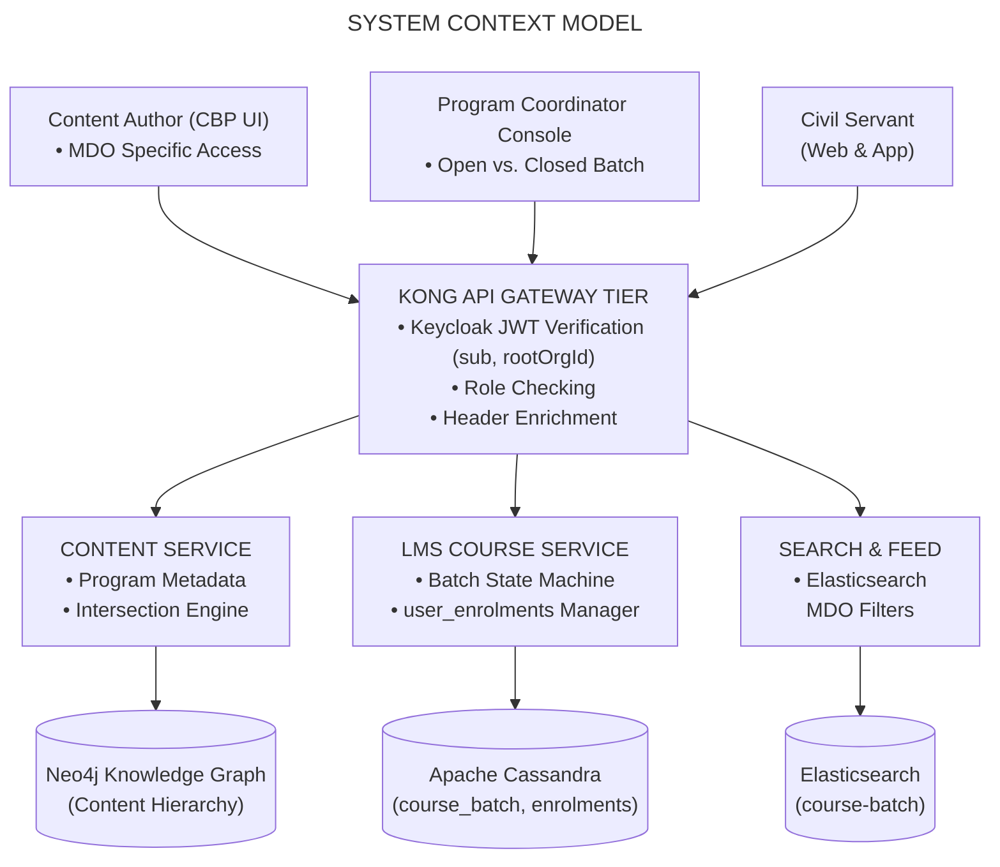
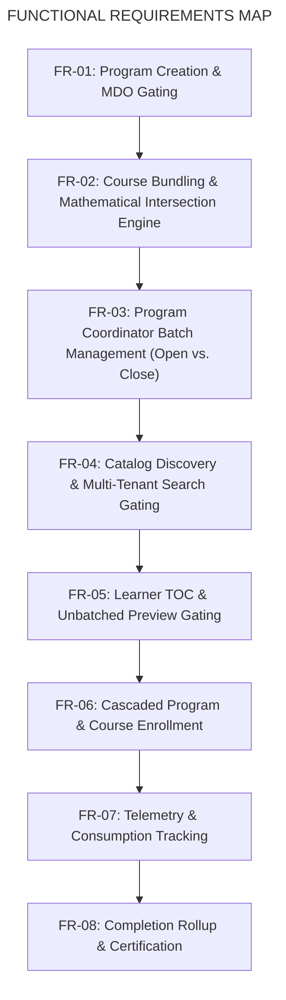

# Moderated Program — Software Requirements Specification (SRS)

## 1. Introduction

### 1.1 Purpose

This Software Requirements Specification (SRS) defines the end-to-end functional, technical, interface, data, and non-functional requirements for the **Moderated Program** (MDO-Specific Program) capability on the iGOT Karmayogi platform. It captures the architectural and functional evolution of the capability from **Quarter 2 (Q2) through Quarter 13 (Q13)**, detailing how the platform transitioned from open, unmoderated curricular groupings to an institutionally gated, multi-tenant learning framework governing creation, batching, discovery, and consumption.

### 1.2 Scope

- **In Scope:**
  - **Program Authoring & Access Control:** Configuration of `MDO Specific` access, automatic locking of the author's home Ministry/Department/Organization (MDO), multi-MDO targeting, and the **Verified Karmayogi** profile badge constraint.
  - **Curricular Bundling & Intersection Rules:** Component validation engine ensuring that bundled live Moderated Courses share common target MDO cohorts and qualification states.
  - **Batch Management Lifecycle:** Program Coordinator workflows supporting the provisioning of an **Open Batch** (continuous, date-unbounded access) or **Closed Batches** (calendar-bounded cohorts with start, end, and enrollment deadlines), including strict mutual exclusivity enforcement.
  - **Catalog Discovery & Search Filtering:** Elasticsearch-driven catalog filtering by program type (`Moderated Program`) on Web, Mobile, and M-Site, with search suppression for unauthorized civil servants.
  - **Learner Consumption Journey:** Web and Mobile Table of Contents (TOC) exploration, enrollment eligibility validation, cascaded course enrollments, playback telemetry aggregation, and automated digital certification upon 100% completion.

- **Out of Scope:**
  - Standalone physical venue scheduling and offline classroom attendance (governed by Blended Programs).
  - Direct authoring of primitive media assets (video, SCORM, PDF) within the program container itself (authored at course level).
  - Standalone proctored examination runners and negative-marking evaluation engines (governed by Standalone Assessments).

### 1.3 Definitions, Acronyms, and Abbreviations

- **CBP / CP:** Capacity Building Program / Content Portal (the unified authoring interface for creators and publishers).
- **MDO:** Ministry, Department, or Organization (the primary multi-tenant administrative unit in iGOT).
- **Moderated Program:** A curated learning program whose metadata access setting is configured as `MDO Specific`, restricting visibility and enrollment to selected MDOs and verified civil servants.
- **Moderated Course:** A standalone course asset configured with `MDO Specific` access rules.
- **Curated Program:** An open learning program configured with access setting `All Users`, automatically provisioned with an open batch.
- **Invite-Only Program:** A gated program configured with access setting `Custom Users`, populated via explicit individual user nominations or CSV candidate lists.
- **Verified Karmayogi:** An authenticated civil servant whose departmental identity, designation, and cadre have been verified by an authorized MDO Administrator.
- **TOC:** Table of Contents (the interactive syllabus and navigation view).
- **SPV:** Special Purpose Vehicle (Karmayogi Bharat).

## 2. Overall Description

### 2.1 Product Perspective & Context

The Moderated Program functions as a higher-order curricular container within the Sunbird-LMS and Knowledge Platform core of iGOT Karmayogi. Unlike open courses that allow universal enrollment upon publishing, a Moderated Program enforces strict organizational boundaries at both the container level and the child component level.



### 2.2 User Classes and Roles

1. **Content Creator** (`CONTENT_CREATOR`): Authors the program container, sets metadata, selects target MDOs, toggles Verified Karmayogi gating, and bundles eligible courses.
2. **Content Publisher** (`CONTENT_PUBLISHER`): Reviews and transitions the program to `Live` state following intersection validation.
3. **Program Coordinator** (`PROGRAM_COORDINATOR`): Manages operational runtime batches (`Manage > Batch Management`), choosing between Open or Closed cohorts.
4. **Eligible Learner (Civil Servant):** An authenticated platform user whose active `rootOrgId` matches the targeted MDOs and who meets verification requirements.
5. **Ineligible Learner:** An authenticated user outside the targeted MDO scope, blocked by route guards and search filters.
6. **MDO Administrator** (`ORG_ADMIN`): Manages user verification badges within the ministry, indirectly controlling access to verified-only programs.

### 2.3 Operating Environment

- **Web Client:** Responsive HTML5/Angular SPA (`portal-v8-fe`) running on modern evergreen browsers.
- **Mobile Client:** Flutter-based native cross-platform application (Android / iOS).
- **API Gateway:** Kong Gateway running JWT authentication and header enrichment plugins.
- **Microservices:** Play Framework (Java 11/Scala), Akka Actors, Node.js backend proxies.
- **Persistence Stores:** Neo4j (graph relations), Apache Cassandra (batch and enrollment records), Elasticsearch (faceted search).

### 2.4 Design and Implementation Constraints

1. **Home MDO Locking:** The creator's home MDO (`rootOrgId`) is immutable and cannot be deselected during creation.
2. **Batch Exclusivity Invariant:** A program cannot simultaneously support an active Open Batch and Closed Batches. Selecting an Open Batch blocks Closed Batch creation; creating a Closed Batch disables Open Batch instantiation.
3. **Primary Key Immutability in Cassandra:** Batch identification `(courseid, batchid)` is immutable. Batch deletion operates via soft-delete flags.
4. **Deep Pagination Clamping:** Catalog search offsets are clamped at .

## 3. Chronological Feature Evolution (Q2 to Q13)

**EVOLUTION ROADMAP (Q2 - Q13)**

| PHASE | JIRA ANCHOR | MAJOR FUNCTIONAL & ARCHITECTURAL MILESTONE |
|---|---|---|
| **Q2** | [KB-452] | Content Type Separation: Decoupled single Course from parent Program publishing flow in SPV authoring. |
| **Q3** | [KB-1936] (Parent) [KB-1945], [KB-1946], [KB-1950] | Content Portal Redesign: Introduced 3-card creation, "MDO Specific" access tag, Verified Karmayogi toggle, course intersection math, and Open vs Close batches. |
| **Q4** | [KB-3756], [KB-4493], [KB-4288] | Karma Programs Framework: Integrated homepage banner carousels, multi-MDO edge tagging, and dynamic strips. |
| **Q6** | [KB-7067] | Program Coordinator UX: Dedicated batch management UI, calendar pickers, and improved batch status tracking. |
| **Q7** | [KB-7854], [KB-7869]–[KB-7872] | Search & Facets Overhaul: NLP search and faceted filters indexing programType across Web and Mobile. |
| **Q8** | [KB-8819], [KB-9603], [KB-9333], [KB-9337] | Standardized Access Control: User-group access rules; native "Moderated Program" catalog checkboxes on apps. |
| **Q11-13** | [KB-13016/17] | Maturation & Peer Governance: Multi-tenant reporting optimizations and MDO peer validation workflows. |

## 4. Specific Functional Requirements



### 4.1 Program Creation and Access Control

#### Requirement FR-01: MDO-Specific Program Creation

- **Description:** The Content Portal shall allow Content Creators to instantiate a Program container with restricted access parameters.
- **Inputs:** Program Title, Description, Subtitle, Language, Primary Category (`Program`), Access Setting (`MDO Specific`).
- **Processing Rules:**
  - The system shall auto-populate the Creator's home MDO (`rootOrgId`) in the `targetMDOs` list and mark it as non-removable.
  - The Creator may add one or more additional target MDOs via an autocomplete search interface.
  - The Creator may toggle the **Verified Karmayogi** switch (`isVerifiedKarmayogiOnly` = `true` / `false`).
  - Once saved, the access setting type cannot be switched to `All Users` or `Custom Users`.

- **Outputs:** Draft content entity created in Neo4j with `contentType: "Program"` and `programType: "Moderated Program"`.
- **Jira Traceability:** [KB-1945: Q3 | Content Portal Redesign | Create program](https://karmayogibharat.atlassian.net/browse/KB-1945) (Prod Deployed).

#### Requirement FR-02: Course Bundling and Mathematical Intersection Engine

- **Description:** The system shall validate that all bundled child courses are compatible with the parent Moderated Program.
- **Processing Rules:**
  - **Course Status Invariant:** Only courses with `status = "Live"` can be bundled.
  - **Open Course Bundling:** Standard open platform courses (`accessSetting = "All Users"`) can be bundled freely. Their access is constrained by the parent program container.
  - **Moderated Course Intersection:** When bundling Moderated Courses, the effective eligible cohort must be the mathematical intersection of all target MDO sets:

1. If the evaluated intersection yields an empty set (), the system shall abort course addition with error `ERR_EMPTY_MDO_INTERSECTION`.
2. **Learner Type Parity:** All bundled moderated courses must share an identical `isVerifiedKarmayogiOnly` boolean state. Attempting to bundle a course for "All Users" with a course for "Verified Karmayogis" shall be rejected with `ERR_QUALIFICATION_MISMATCH`.

- **Jira Traceability:** [KB-1945: Q3 | Content Portal Redesign | Create program](https://karmayogibharat.atlassian.net/browse/KB-1945) (Prod Deployed), `KB_FRS_CP Redesign`.

### 4.2 Batch Management

#### Requirement FR-03: Program Coordinator Batch Management

- **Description:** The platform shall permit authorized Program Coordinators to configure execution batches for published Moderated Programs.
- **Execution Modes:**
  - **Mode A: Open Batch**
    - System auto-provisions a batch record in Cassandra table `sunbird_courses.course_batch` with `enrollmenttype = "open"`.
    - Inherits `createdfor = [targetMDOs]` from the parent program container.
    - Omits `startdate`, `enddate`, and `enrollmentenddate`.
    - **Mutual Exclusivity:** Creating an Open Batch permanently disables Closed Batch creation for this program.

  - **Mode B: Closed Batch**
    - Coordinator manually inputs: `name`, `startDate`, `endDate`, and `enrollmentEndDate`.
    - Temporal Invariant: .
    - Coordinator may create multiple sequential or concurrent Closed Batches.

- **Jira Traceability:** [KB-1946: Q3 | Content Portal Redesign | Batch management for program](https://karmayogibharat.atlassian.net/browse/KB-1946) (Prod Deployed), [KB-7067: Q6 | Content Portal | Navigation and user experience for program coordinator](https://karmayogibharat.atlassian.net/browse/KB-7067) (Prod Deployed).

### 4.3 Discovery, Catalog, and Search

#### Requirement FR-04: Multi-Tenant Catalog Filtering & Search Suppression

- **Description:** The platform search and catalog engine shall govern program visibility based on caller organizational claims.
- **Processing Rules:**
  - **Public Catalog Search:** For unauthenticated users or civil servants whose `rootOrgId` , Moderated Programs are omitted from search results.
  - **Authenticated Eligible Search:** When an authorized learner queries `/api/content/v1/search`, the search service appends an Elasticsearch filter clause:

```json
{
  "bool": {
    "filter": [
      {
        "terms": {
          "targetMDOs": [
            "caller_rootOrgId"
          ]
        }
      }
    ]
  }
}
```

1. **Faceted Filtering:** The UI filter pane shall provide a dedicated checkbox under **Programs** **Moderated Program**, allowing users to isolate MDO-gated programs.

- **Jira Traceability:** [KB-7869: Q7 | Search & listing | NLP & Elastic search | Learner Portal](https://karmayogibharat.atlassian.net/browse/KB-7869) (Prod Deployed)–[KB-7872: Q7 | Search & listing | Filters | Mobile App](https://karmayogibharat.atlassian.net/browse/KB-7872) (Prod Deployed), [KB-9333: Q8 | Implement Course Catalog Filters | Course Catelog | Learner Portal & Mobile App & M-Site](https://karmayogibharat.atlassian.net/browse/KB-9333) (Prod Deployed), [KB-9337: Q8 | Course catalog | Mobile App](https://karmayogibharat.atlassian.net/browse/KB-9337) (Open).

### 4.4 Learner Enrollment and Consumption

#### Requirement FR-05: Table of Contents (TOC) & Access Gating

- **Description:** The Table of Contents view shall adapt based on batch readiness and learner authorization.
- **Behavior Matrix:**
  - **State 1 (Unbatched Program):** If the program is `Live` but no batch has been created, eligible learners can view the curriculum hierarchy, competency mappings, and course descriptions. The enrollment button shall be disabled displaying: `"No Active Batch Available"`.
  - **State 2 (Active Open Batch):** The enrollment button is enabled displaying `"Enrol in Program"`.
  - **State 3 (Active Closed Batch):** Displays cohort calendar dates and active enrollment countdown. Button displays `"Enrol in Batch"`.
  - **State 4 (Expired Closed Batch):** If , button is disabled displaying `"Enrollment Closed"`.
  - **State 5 (Ineligible Caller Direct URL):** Angular route guard `ModeratedProgramGuard` intercepts direct link navigation with HTTP 403, redirecting to `/app/home`.

- **Jira Traceability:** [KB-1950: Q3 | Content Portal Redesign | Learner consumption for all types of content](https://karmayogibharat.atlassian.net/browse/KB-1950) (Prod Deployed).

#### Requirement FR-06: Cascaded Program and Course Enrollment

- **Description:** When an eligible civil servant enrolls in a Moderated Program batch, the backend shall atomically establish enrollments across the entire curricular tree.
- **Processing Rules:**
  - Client calls `POST /v1/program/batch/enrol` with `programId` and `batchId`.
  - LMS Course Service validates that caller's `rootOrgId` .
  - If `isVerifiedKarmayogiOnly = true`, LMS validates that caller holds verified status in profile.
  - System inserts a parent enrollment row into Cassandra `sunbird_courses.user_enrolments` (`status = 1`, `active = true`).
  - System retrieves child course IDs from Neo4j and automatically inserts corresponding child enrollment rows linked to the parent program context.

- **Jira Traceability:** [KB-1950: Q3 | Content Portal Redesign | Learner consumption for all types of content](https://karmayogibharat.atlassian.net/browse/KB-1950) (Prod Deployed), [KB-8819: Q8 | Learning Path | Access Control](https://karmayogibharat.atlassian.net/browse/KB-8819) (KB Approved).

#### Requirement FR-07: Learning Consumption & Progress Tracking

- **Description:** Learners consume child course modules, emitting standard telemetry events that roll up into parent program progress.
- **Processing Rules:**
  - As videos, documents, and assessments are consumed, the player emits heartbeat telemetry to `POST /v1/content/state/update`.
  - The LMS actor updates `sunbird_courses.user_content_consumption` and calculates individual course completion percentages.
  - When all child components of a course reach 100%, the child course transitions to `status = 2` (Completed).

- **Jira Traceability:** [KB-1950: Q3 | Content Portal Redesign | Learner consumption for all types of content](https://karmayogibharat.atlassian.net/browse/KB-1950) (Prod Deployed).

#### Requirement FR-08: Completion Rollup and Digital Certification

- **Description:** Parent program completion is evaluated based on child course completion states.
- **Calculation Logic:**

- When , the LMS Course Service sets the parent enrollment record `status = 2`.
- The system invokes the Certificate Generator service to issue an RC (Registry Certificate) SVG/PDF containing verifiable QR credentials.
- **Jira Traceability:** [KB-1950: Q3 | Content Portal Redesign | Learner consumption for all types of content](https://karmayogibharat.atlassian.net/browse/KB-1950) (Prod Deployed), [KB-4493: Q4 l Karma Programs l Portal | Access Karma Programs](https://karmayogibharat.atlassian.net/browse/KB-4493) (Prod Deployed).

## 5. External Interface Requirements

### 5.1 User Interfaces

1. **Program Creation Form** (`portal-v8-fe`):
  - Multi-select dropdown for target MDOs with type-ahead search.
  - Lock icon indicating immutability of the author's home MDO.
  - Distinct toggle switch for **Verified Karmayogi Only** with inline tooltip explanation.
  - Dynamic Course Selector showing real-time intersection validation errors.

2. **Batch Management Dashboard:**
  - Radio group toggling between **Open Batch** and **Closed Batch**.
  - Date-time pickers enforcing .

3. **Learner Table of Contents (TOC):**
  - Dynamic enrollment header reflecting batch states (Unbatched, Open, Closed, Expired).
  - Visual badge denoting "MDO Exclusive Program".

### 5.2 API Interfaces

**API INTERFACE CONTRACTS**

| METHOD | ENDPOINT | PURPOSE & PAYLOAD HIGHLIGHTS |
|---|---|---|
| POST | /action/content/v3/create | Instantiates Program container; accessSettings: "MDO Specific", targetMDOs: [...] |
| PATCH | /action/content/v3/update/{id} | Updates metadata, MDO arrays, and verification switch |
| POST | /action/content/v3/publish | Triggers intersection validation and Neo4j live sync |
| POST | /course/v1/batch/create | Creates batch; enrollmentType: "open" \| "close", createdFor: ["org_001", "org_002"] |
| POST | /course/v1/enrol | Validates caller tenancy; executes cascaded enroll |
| POST | /course/v1/content/state/update | Emits consumption progress telemetry |
| POST | /api/content/v1/search | Executes MDO-filtered faceted query on Elasticsearch |

#### Sample API Contract: Batch Creation (`POST /course/v1/batch/create`)

```json
{
  "request": {
    "courseId": "do_113892749102841856112",
    "name": "Health Policy Cohort 2026",
    "description": "Restricted cohort for MoHFW verified officers",
    "enrollmentType": "open",
    "createdFor": [
      "org_mohfw_001",
      "org_dop_002"
    ],
    "mentors": [
      "712020:2b1926b8-ba53-4277-9b45-3508667c6b3d"
    ]
  }
}
```

## 6. Data Requirements and Schema Models

### 6.1 Neo4j Graph Model (`Content` Node)

- **Labels:** `:Content:Program`
- **Properties:**
  - `identifier`: String (e.g., `"do_113892749102841856112"`, Primary Key)
  - `programType`: `"Moderated Program"`
  - `accessSetting`: `"MDO Specific"`
  - `targetMDOs`: List of Strings (`["org_mohfw_001", "org_dop_002"]`)
  - `isVerifiedKarmayogiOnly`: Boolean (`true` / `false`)
  - `status`: `"Draft"` | `"Review"` | `"Live"`

### 6.2 Cassandra Batch Store (`sunbird_courses.course_batch`)

```sql
CREATE TABLE sunbird_courses.course_batch (
    courseid text,
    batchid text,
    name text,
    description text,
    enrollmenttype text,  -- 'open' or 'invite-only' (used for closed batches)
    startdate text,
    enddate text,
    enrollmentenddate text,
    createdfor set<text>,  -- Target MDO tenant IDs mentors list<text>,
    status int,  -- 0=Upcoming, 1=Ongoing, 2=Completed
    createddate timestamp,
    updateddate timestamp,
    PRIMARY KEY (courseid, batchid)
) WITH CLUSTERING ORDER BY (batchid ASC);
```

### 6.3 Cassandra Enrollment Store (`sunbird_courses.user_enrolments`)

```sql
CREATE TABLE sunbird_courses.user_enrolments (
    userid text,
    courseid text,
    batchid text,
    active boolean,
    completionpercentage int,
    enrolleddate timestamp,
    issued_certificates list<frozen<map<text, text>>>,
    progress int,
    status int,  -- 0=Enrolled, 1=In-Progress, 2=Completed
    PRIMARY KEY (userid, courseid, batchid)
);
```

## 7. Non-Functional Requirements (NFRs)

### 7.1 Security & Multi-Tenant Isolation

- **NFR-SEC-01 (Defense in Depth):** Gating shall be enforced at both the presentation tier (Angular/Flutter route guards) and the microservices tier. Direct API calls using forged client headers shall be rejected at the API Gateway by validating caller claims in Keycloak RS256 tokens.
- **NFR-SEC-02 (Verified Profile Audit):** Access to verified-only programs requires server-side validation against `profileDetails.mandatoryFieldsVerified`. Profile spoofing shall be prevented via cryptographic signature validation.

### 7.2 Performance & Scalability

- **NFR-PRF-01 (Search Latency):** MDO-filtered faceted search queries executed across 1,000,000+ catalog objects shall return in at 95th percentile under concurrent loads of 2,500 requests/sec.
- **NFR-PRF-02 (Enrollment Propagation):** Cascaded enrollment across a parent Moderated Program containing up to 10 child courses shall complete in .

### 7.3 Availability & Reliability

- **NFR-REL-01 (Batch Immutability):** Accidental network retries on batch creation shall be idempotent, utilizing UUIDv4 tokens to prevent duplicate batch creation.

## 8. Engineering Tasks & Workstream Breakdown

**ENGINEERING TASK BREAKDOWN**

| TASK ID | REPOSITORY / WORKSTREAM | QUARTER ANCHOR | DELIVERABLE ARTIFACT / OUTCOME |
|---|---|---|---|
| TSK-01 | `portal-v8-fe`<br/>Content Authoring UI | Sprint 12 (Q3) | Develop MDO Specific authoring form, home MDO lock, and verified toggle. |
| TSK-02 | `content-service`<br/>Knowledge Graph / Neo4j | Sprint 13 (Q3) | Implement course bundling validator enforcing MDO intersection formula. |
| TSK-03 | `sunbird-course-service`<br/>LMS Actor & Cassandra DAO | Sprint 14 (Q3) | Update `CourseBatchManagementActor` for Open/Closed batch exclusivity. |
| TSK-04 | `portal-v8-fe`<br/>Learner TOC Component | Sprint 16 (Q4) | Build dynamic TOC states handling unbatched, open, and closed cohorts. |
| TSK-05 | `search-service`<br/>Elasticsearch Indexing | Sprint 22 (Q7) | Integrate Elasticsearch MDO filters and NLP query facet generation. |
| TSK-06 | `mobile-app` (Flutter)<br/>Cross-Platform App Client | Sprint 26 (Q8) | Implement mobile catalog checkboxes for Moderated Program classification. |

## 9. Requirements Traceability Matrix (RTM)

| Requirement ID | Requirement Summary | Jira Story | Parent Epic | Target Component | Architecture Store | Verification Status |
|---|---|---|---|---|---|---|
| `FR-01` | MDO-Specific Program Creation | [KB-1945: Q3 \| Content Portal Redesign \| Create program](https://karmayogibharat.atlassian.net/browse/KB-1945) (Prod Deployed) | [KB-1936: Q3 \| Content Portal Redesign \| Content access settings, batch management and user consumption](https://karmayogibharat.atlassian.net/browse/KB-1936) (Prod Deployed) | `portal-v8-fe` / `content-service` | Neo4j Knowledge Graph | **Verified / Deployed** |
| `FR-02` | Course Bundling Intersection Math | [KB-1945: Q3 \| Content Portal Redesign \| Create program](https://karmayogibharat.atlassian.net/browse/KB-1945) (Prod Deployed) | [KB-1936: Q3 \| Content Portal Redesign \| Content access settings, batch management and user consumption](https://karmayogibharat.atlassian.net/browse/KB-1936) (Prod Deployed) | `content-service` (Validator) | Neo4j Graph Engine | **Verified /** **Deployed** |
| `FR-03` | Open vs. Closed Batch Exclusivity | [KB-1946: Q3 \| Content Portal Redesign \| Batch management for program](https://karmayogibharat.atlassian.net/browse/KB-1946) (Prod Deployed) | [KB-1936: Q3 \| Content Portal Redesign \| Content access settings, batch management and user consumption](https://karmayogibharat.atlassian.net/browse/KB-1936) (Prod Deployed) | `sunbird-course-service` | Cassandra `course_batch` | **Verified / Deployed** |
| `FR-04` | Catalog Faceted Search Filtering | [KB-9333: Q8 \| Implement Course Catalog Filters \| Course Catelog \| Learner Portal & Mobile App & M-Site](https://karmayogibharat.atlassian.net/browse/KB-9333) (Prod Deployed), [KB-9337: Q8 \| Course catalog \| Mobile App](https://karmayogibharat.atlassian.net/browse/KB-9337) (Open) | [KB-8819: Q8 \| Learning Path \| Access Control](https://karmayogibharat.atlassian.net/browse/KB-8819) (KB Approved) | `search-service` / Web & App UI | Elasticsearch `composite-search` | **Verified / Deployed** |
| `FR-05` | TOC Dynamic Gating & Preview | [KB-1950: Q3 \| Content Portal Redesign \| Learner consumption for all types of content](https://karmayogibharat.atlassian.net/browse/KB-1950) (Prod Deployed) | [KB-1936: Q3 \| Content Portal Redesign \| Content access settings, batch management and user consumption](https://karmayogibharat.atlassian.net/browse/KB-1936) (Prod Deployed) | `portal-v8-fe` (TOC Module) | Client Router / Gateway | **Verified / Deployed** |
| `FR-06` | Cascaded Cohort Enrollment | [KB-1950: Q3 \| Content Portal Redesign \| Learner consumption for all types of content](https://karmayogibharat.atlassian.net/browse/KB-1950) (Prod Deployed) | [KB-1936: Q3 \| Content Portal Redesign \| Content access settings, batch management and user consumption](https://karmayogibharat.atlassian.net/browse/KB-1936) (Prod Deployed) | `sunbird-course-service` | Cassandra `user_enrolments` | **Verified / Deployed** |
| `FR-07` | Telemetry Progress Updates | [KB-1950: Q3 \| Content Portal Redesign \| Learner consumption for all types of content](https://karmayogibharat.atlassian.net/browse/KB-1950) (Prod Deployed) | [KB-1936: Q3 \| Content Portal Redesign \| Content access settings, batch management and user consumption](https://karmayogibharat.atlassian.net/browse/KB-1936) (Prod Deployed) | `sunbird-course-service` | Cassandra `user_content_consumption` | **Verified / Deployed** |
| `FR-08` | Completion Rollup & Certification | [KB-4493: Q4 l Karma Programs l Portal \| Access Karma Programs](https://karmayogibharat.atlassian.net/browse/KB-4493) (Prod Deployed) | [KB-3756: Q4 \| Karma Programs](https://karmayogibharat.atlassian.net/browse/KB-3756) (Prod Deployed) | Certificate Generator Service | Cassandra `user_enrolments` | **Verified / Deployed** |
