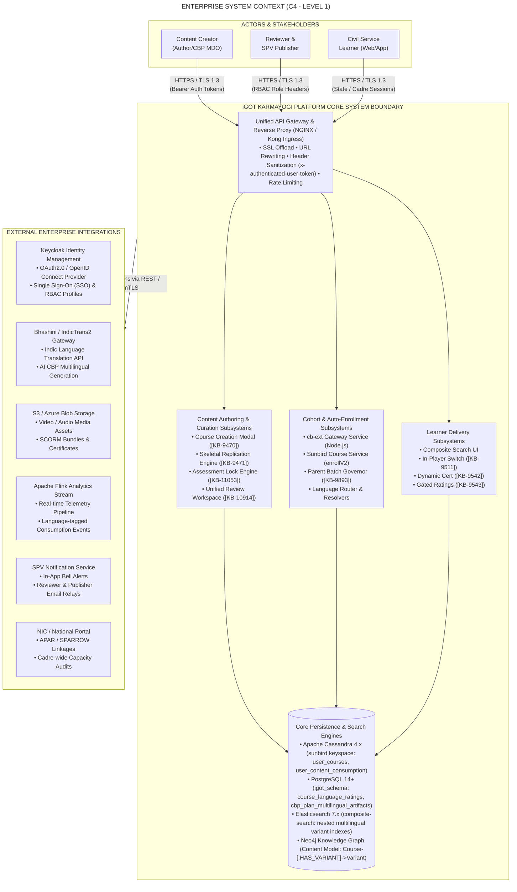
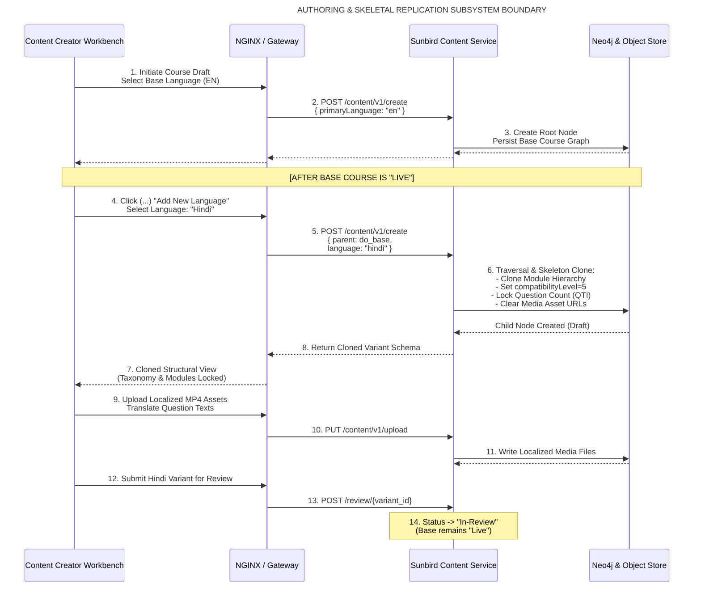
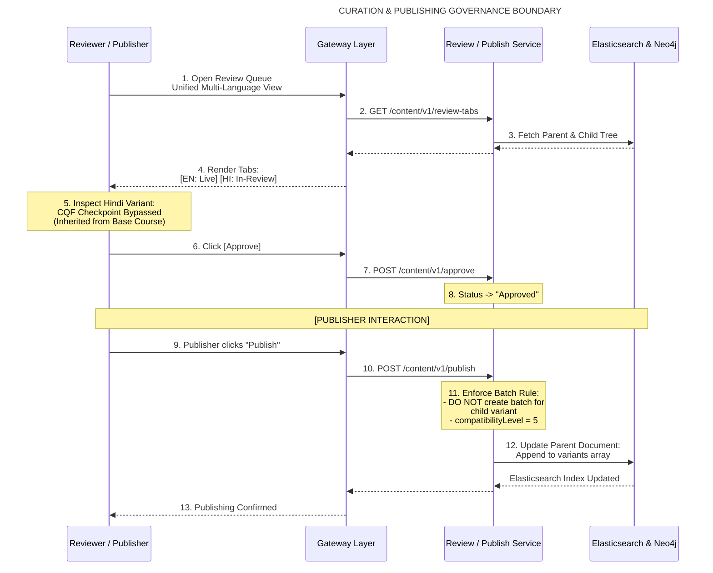
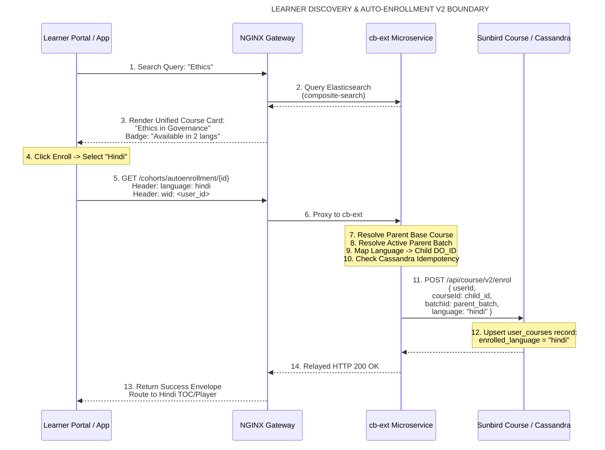
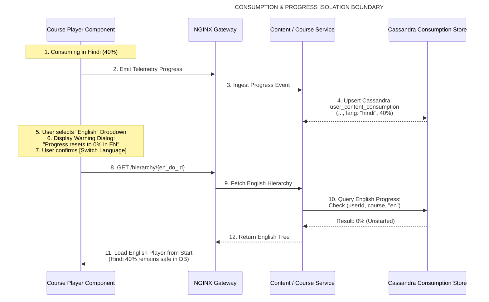
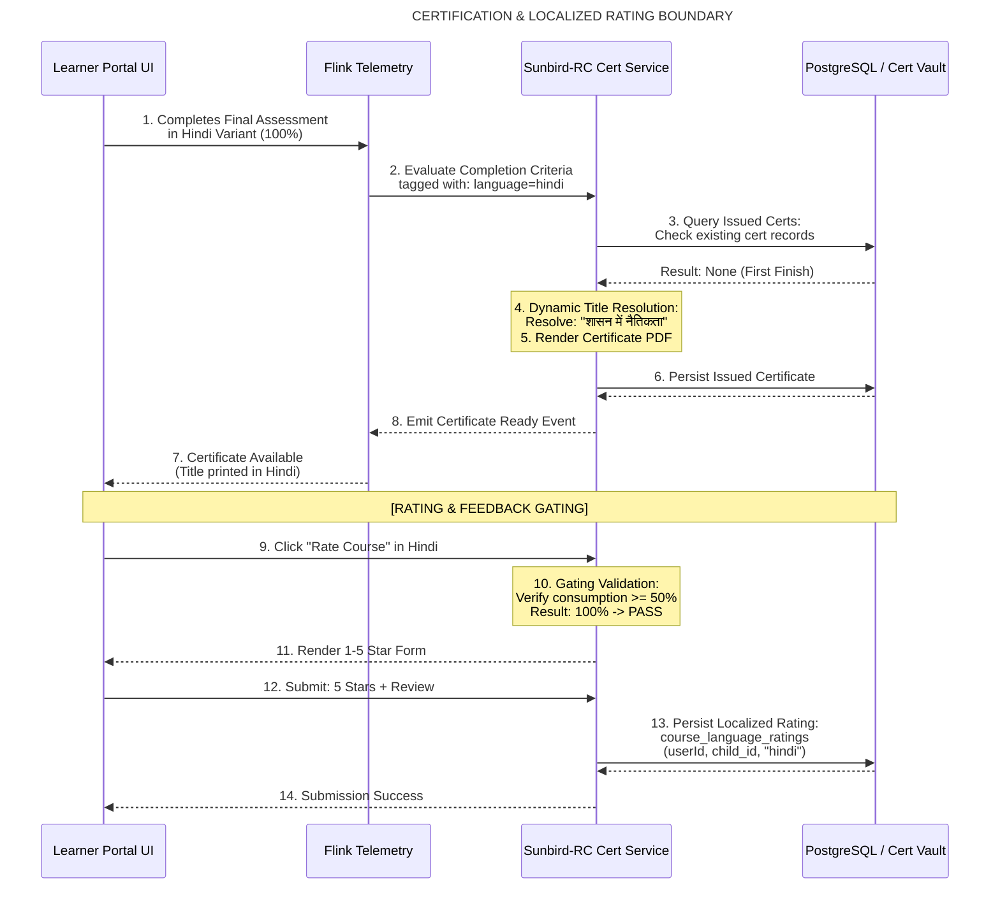

# Multilingual — System Context & Architecture Boundary

## 2. Enterprise System Context Diagram (C4 Level 1)

The following diagram maps the global system boundary of the **iGOT Karmayogi Multilingual Ecosystem**, delineating the human user personas, internal platform capabilities, external government infrastructure integrations, and persistence tiers.

## 3. Detailed Subsystem Boundaries & Interaction Flows

### 3.1 Course Authoring & Structural Replication Boundary

The boundary separates the Content Creator's workstation from the core Content Service, graph engine, and object store.

### 3.2 Curation, CQF Verification & Publishing Boundary

Defines the boundary between Content Reviewers, SPV Publishers, the Review Workflow Engine, and the Search indexing engine.

### 3.3 Learner Discovery & Auto-Enrollment V2 Boundary

Maps the interaction between the Learner Client (Web/Mobile), the `cb-ext` orchestrator, Sunbird Course Service, and Cassandra.

### 3.4 Consumption, Language Switching & State Isolation Boundary

Controls the boundary between the media player, telemetry pipeline, and progress persistence.

### 3.5 Dynamic Certification & Rating Gating Boundary

Governs the final evaluation, dynamic certificate generation, and localized review submission.

## 4. External Interfaces & Protocol Specifications

**EXTERNAL PROTOCOL & INTERFACE SPECIFICATIONS**

| Target Interface | Protocol / Port | Data Format | Security & Boundary Controls |
| --- | --- | --- | --- |
| **Keycloak IdP** | HTTPS / 443 | JSON / JWT | OAuth2 OpenID Connect; Bearer token validation at API Gateway; Token exchange injecting wid, rootorg, locale headers. |
| **Bhashini Gateway** (AI CBP [KB-12918]) | HTTPS / 443 | JSON / REST | IndicTrans2 API; Encrypted API-key authentication; used for Indic Capacity Building Plan translation (11 Indic languages). |
| **Object Store** (Media & Bundles) | HTTPS / 443 | S3 API / Binary | MinIO / Azure Blob; Pre-signed PUT/GET URLs; binary isolation of localized MP4, MP3, and SCORM ZIP packages. |
| **Kafka Event Bus** | TCP / 9092 | Apache Avro | Telemetry pipeline; SASL/SCRAM authenticated; topics: telemetry.raw, learning.events, certificate.issue. |
| **Cassandra Pool** | TCP / 9042 | CQL Binary v4 | Encrypted client-to-node communication; partitioned by userid and clustered by courseid, batchid, and language. |

## 5. Security Architecture, Trust Boundaries & Threat Analysis

**SECURITY BOUNDARIES & THREAT MITIGATIONS**

| Security Boundary | Identified Threat Vector | Architecture Guard & Mitigation Design |
| --- | --- | --- |
| **Ingress Layer** | Parameter tampering & header spoofing (wid, rootorg, locale) | NGINX strips inbound x-authenticated-* headers from public internet; Node-BFF securely injects validated session attributes. |
| **Skeletal Cloner** | Unauthorized structural deviations & assessment tampering in translations | Hierarchy engine strictly blocks structural additions or deletions in child variants (disableAddQuestion = true - [KB-11053]). |
| **AutoEnroll V2** | Cross-cadre batch injection & cohort exhaustion | Gateway checks learner enrollment eligibility against active parent open batch before dispatching payload to Sunbird enrollV2. |
| **State Store** | Cross-language progress contamination (e.g., Hindi progress leaking to EN) | Cassandra clustering keys partitioned strictly on composite (batchid, contentid, language) preventing state overwrites. |
| **Cert Engine** | Title injection spoofing or malicious override of issued certificates | Sunbird-RC dynamically fetches validated course name directly from trusted Neo4j content metadata; certificates locked after issue. |

## 6. Requirement-to-Context Verification Matrix

| Jira Enabler / Doc Reference | Architectural Capability Implemented | Primary Context Boundary Diagram | Verification & Test Evidence |
|---|---|---|---|
| [KB-9470: Q8 \| Multilingual content creation \| Course Language Selection](https://karmayogibharat.atlassian.net/browse/KB-9470) (Prod Deployed) | Mandatory Base Language Modal | Section 3.1 Authoring Boundary | QA Suite Test 1.1–1.3 (Page `470777876`) |
| [KB-9471: Q8 \| Multilingual content creation \| Module Template Consistency and Teacher's Notes](https://karmayogibharat.atlassian.net/browse/KB-9471) (Prod Deployed) | Structural Module Replication | Section 3.1 Authoring Boundary | QA Suite Test 2.1–2.18 (Page `470777876`) |
| [KB-11053: Q8 \| Multilingual Content Creation \| Assessment Settings and Behavior During Edit](https://karmayogibharat.atlassian.net/browse/KB-11053) (Prod Deployed) | Assessment Parity & Question Count Lock | Section 3.1 Authoring Boundary | Jira [KB-11053: Q8 \| Multilingual Content Creation \| Assessment Settings and Behavior During Edit](https://karmayogibharat.atlassian.net/browse/KB-11053) (Prod Deployed) Acceptance Criteria |
| [KB-10914: Q8 \| Multilingual Content Creation \| Reviewer/Publisher View – Unified Review Experience](https://karmayogibharat.atlassian.net/browse/KB-10914) (Open) | Unified Multi-Language Review Workspace | Section 3.2 Curation Boundary | QA Suite Test 5.1–5.17 (Page `470777876`) |
| [KB-11055: Q8 \| Multilingual Content Creation \| CQF Behavior for New Languages](https://karmayogibharat.atlassian.net/browse/KB-11055) (Open) | CQF Single Enforcement on Base Course | Section 3.2 Curation Boundary | QA Suite Test 15.1–15.2 (Page `470777876`) |
| [KB-9893: Q8 \| Multilingual Content Creation \| Publisher Flow](https://karmayogibharat.atlassian.net/browse/KB-9893) (Prod Deployed) | Single-Batch Publisher Rule (`level = 5`) | Section 3.2 Curation Boundary | QA Suite Test 11.1–11.25 (Page `470777876`) |
| [KB-9510: Q8 \| Multilingual Content Creation \| Learner Portal \| Multiple language visibility on course cards and TOC page](https://karmayogibharat.atlassian.net/browse/KB-9510) (Prod Deployed) | Single Card Footprint & Language Badge | Section 3.3 Discovery Boundary | QA Suite Test 7.1–7.9 (Page `470777876`) |
| **Page 445349895** | AutoEnroll V2 API Gateway Orchestration | Section 3.3 Discovery Boundary | Confluence Page `445349895` Contract |
| [KB-9511: Q8 \| Multilingual Content Creation \| Course Consumption](https://karmayogibharat.atlassian.net/browse/KB-9511) (Prod Deployed) | In-Player Switching Warning & State Isolation | Section 3.4 Consumption Boundary | QA Suite Test 8.1–8.12 (Page `470777876`) |
| [KB-9542: Q8 \| Multilingual Content Creation \| Certificate Generation](https://karmayogibharat.atlassian.net/browse/KB-9542) (Prod Deployed) | First-Completion Localized Certificate Title | Section 3.5 Certification Boundary | QA Suite Test 9.1–9.13 (Page `470777876`) |
| [KB-9543: Q8 \| Multilingual Content Creation \| Separate rating for separate languages](https://karmayogibharat.atlassian.net/browse/KB-9543) (Open) | 50% Consumption Gating for Ratings | Section 3.5 Certification Boundary | QA Suite Test 10.1–10.12 (Page `470777876`) |
| [KB-12918: Q11 \| Multilingual ACBP/CBP in AI CBP tool](https://karmayogibharat.atlassian.net/browse/KB-12918) (In-Progress) | AI CBP Multilingual Indic Plan Generation | Section 2 Enterprise Context | Jira [KB-12918: Q11 \| Multilingual ACBP/CBP in AI CBP tool](https://karmayogibharat.atlassian.net/browse/KB-12918) (In-Progress) Deployment Logs |
