# Multilingual — High-Level Design (HLD)

## 2. Architectural Drivers & Core Design Principles

**HIGH-LEVEL ARCHITECTURAL PILLARS**

| | |
|---|---|
| 1. Unified Identity Footprint | Single parent course DO_ID in catalog search; child variants mapped to parent without catalog duplication. |
| 2. Skeletal Immutability & Parity | Cloned structural hierarchy (modules, sequences, QTI question counts) guarantees equal educational rigor across languages. |
| 3. Single-Batch Cohort Governance | Course batches configured strictly on the base course; child variants operate at compatibilityLevel = 5 under parent batch. |
| 4. Asynchronous Lifecycle Isolation | Review, reject, and publish workflows operate per language variant without stalling the parent or other sibling variants. |
| 5. Dynamic Title & State Isolation | Independent progress tracking in Cassandra per language; first-completed language locks the dynamic certificate title string. |

## 3. System Context (C4 Level 1)

The following diagram illustrates how external user personas interact with the iGOT Karmayogi Multilingual Ecosystem, the boundary of the core platform, and external integrations (Bhashini, Keycloak, Object Storage, and Analytics).

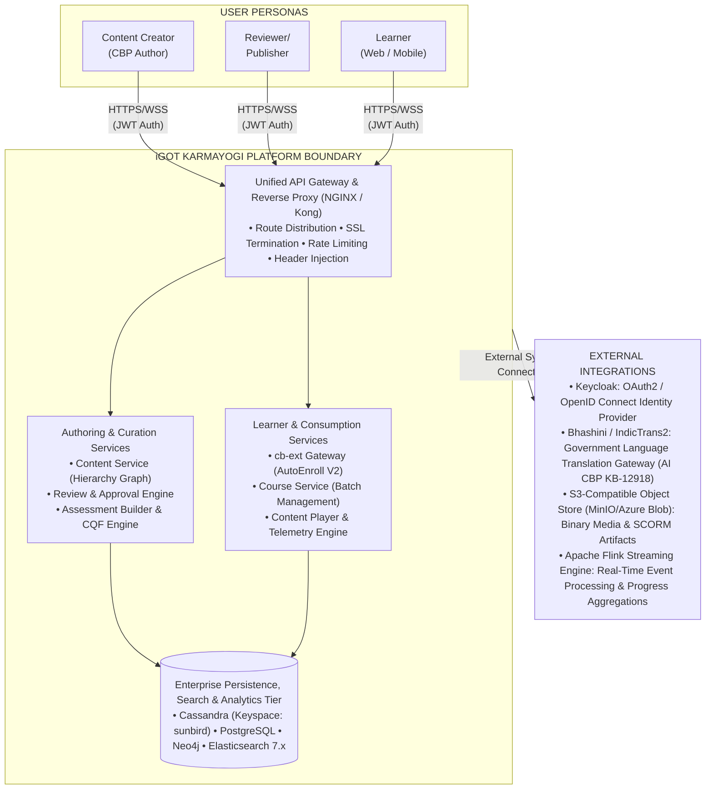

## 4. Container & Component Architecture (C4 Level 2 & 3)

The architecture is partitioned into four primary layers: **Presentation Tier**, **API Gateway & Routing Tier**, **Application Microservices Tier**, and **Persistence Tier**.

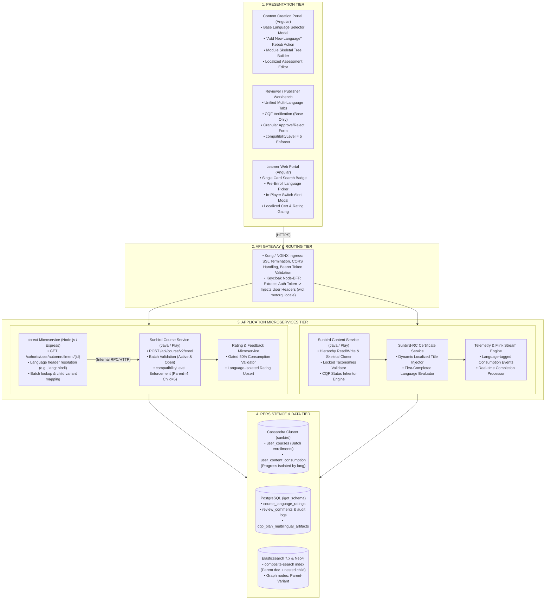

## 5. End-to-End Interaction & Execution Flows

### 5.1 Stage 1: Multilingual Course Authoring & Skeletal Cloning Flow

When a Content Creator extends an approved, Live base course into another official language ([KB-9470: Q8 | Multilingual content creation | Course Language Selection](https://karmayogibharat.atlassian.net/browse/KB-9470) (Prod Deployed), [KB-9471: Q8 | Multilingual content creation | Module Template Consistency and Teacher's Notes](https://karmayogibharat.atlassian.net/browse/KB-9471) (Prod Deployed)):

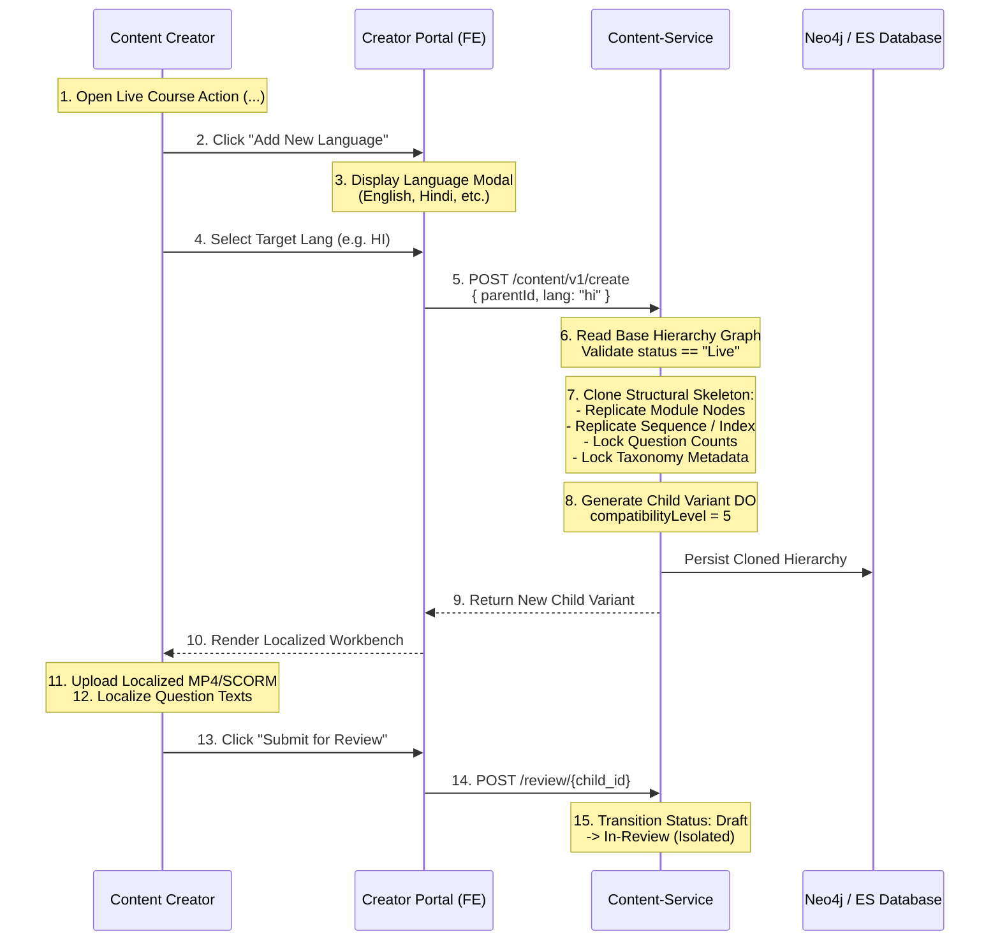

### 5.2 Stage 2: Independent Curation & Approval Pipeline

Content Reviewers verify translated variants independently without impacting the published base course ([KB-9473: Q8 | Multilingual content creation | Review Process Management](https://karmayogibharat.atlassian.net/browse/KB-9473) (Prod Deployed), [KB-9494: Q8 | Multilingual content creation | Content Review](https://karmayogibharat.atlassian.net/browse/KB-9494) (Prod Deployed), [KB-10914: Q8 | Multilingual Content Creation | Reviewer/Publisher View – Unified Review Experience](https://karmayogibharat.atlassian.net/browse/KB-10914) (Open), [KB-11055: Q8 | Multilingual Content Creation | CQF Behavior for New Languages](https://karmayogibharat.atlassian.net/browse/KB-11055) (Open)):

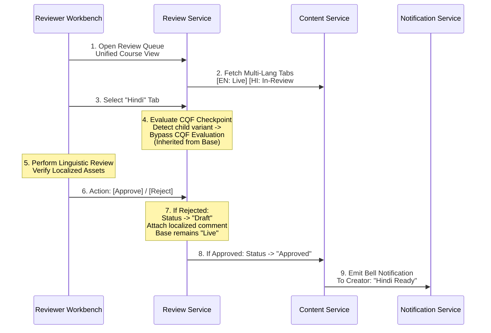

### 5.3 Stage 3: Publishing & Batch Isolation Architecture

Publishing adheres to the single-batch governance rule ([KB-9893: Q8 | Multilingual Content Creation | Publisher Flow](https://karmayogibharat.atlassian.net/browse/KB-9893) (Prod Deployed)):

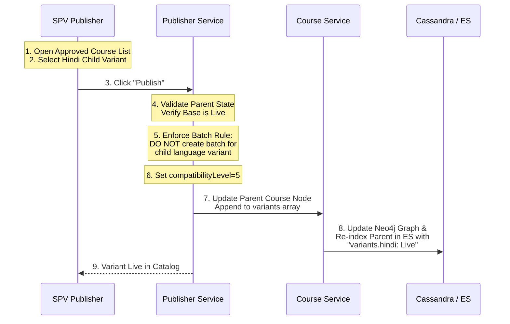

### 5.4 Stage 4: Single-Card Catalog Discovery & User Language Selection

In the Learner Portal, search queries resolve to the unified course entity ([KB-9510: Q8 | Multilingual Content Creation | Learner Portal | Multiple language visibility on course cards and TOC page](https://karmayogibharat.atlassian.net/browse/KB-9510) (Prod Deployed)):

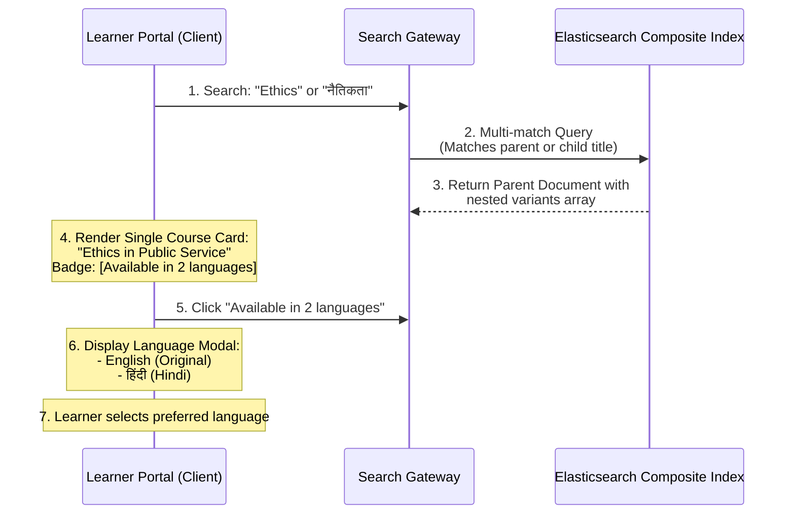

### 5.5 Stage 5: Language Auto-Enrollment V2 Execution

The unified auto-enrollment execution maps the learner into the parent batch with a language preference tag (Confluence Page `445349895`):

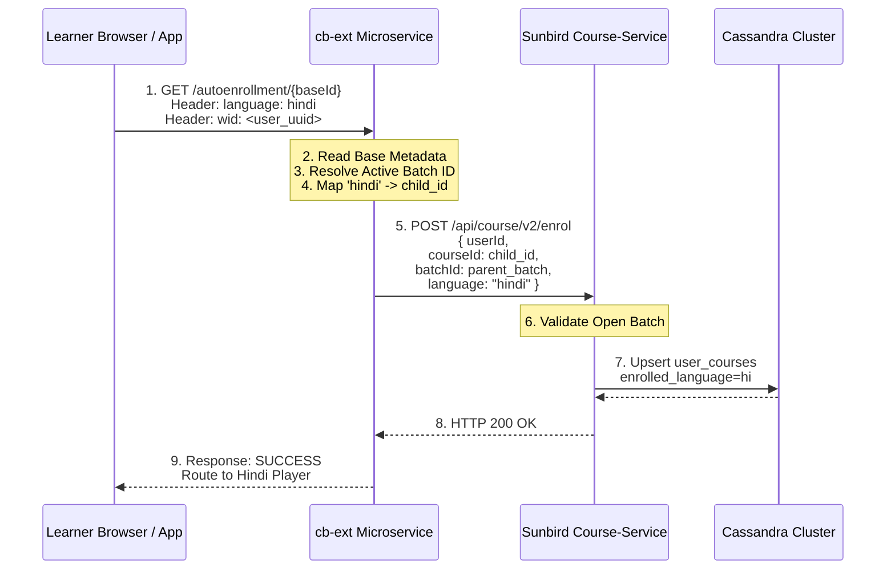

### 5.6 Stage 6: Learner Consumption & In-Player Language Switching

The learner consumes content and can switch languages with progress isolation guards ([KB-9511: Q8 | Multilingual Content Creation | Course Consumption](https://karmayogibharat.atlassian.net/browse/KB-9511) (Prod Deployed)):

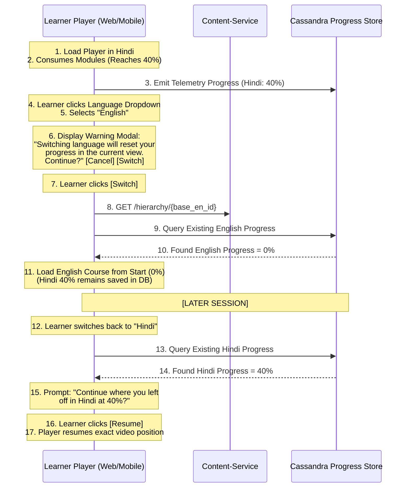

### 5.7 Stage 7: Certification & First-Completion Locking

The certification engine binds the dynamic title to the first completed language ([KB-9542: Q8 | Multilingual Content Creation | Certificate Generation](https://karmayogibharat.atlassian.net/browse/KB-9542) (Prod Deployed)):

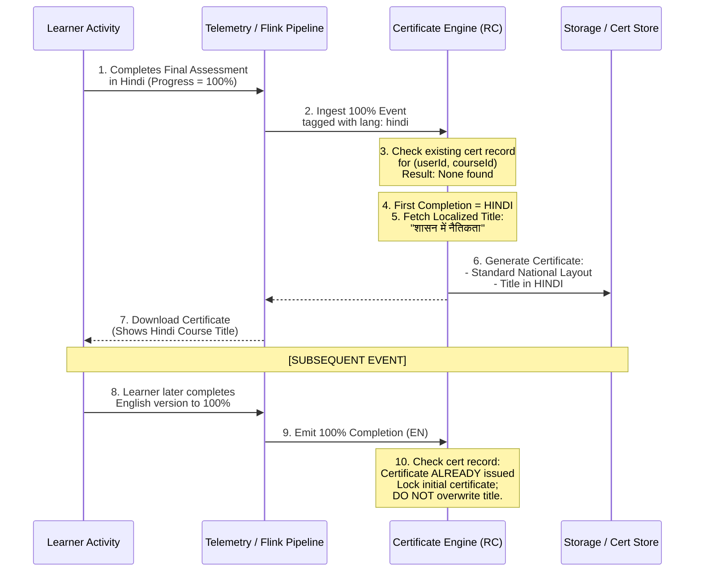

### 5.8 Stage 8: Post-Completion Isolated Language Rating

Ratings remain strictly isolated per language variant with a 50% consumption gating rule ([KB-9543: Q8 | Multilingual Content Creation | Separate rating for separate languages](https://karmayogibharat.atlassian.net/browse/KB-9543) (Open)):

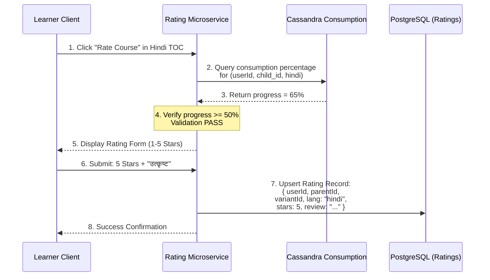

## 6. Detailed Component Responsibilities & Interface Specifications

### 6.1 Component Matrix

| Component Name | Subsystem / Layer | Primary Architectural Responsibility | Upstream Invocations | Downstream Invocations | Persistence Stores |
|---|---|---|---|---|---|
| `cb-ext` Gateway | API Orchestration | AutoEnroll V2 execution, language header resolution, and parent cohort mapping | Learner Web / Mobile Portals | Sunbird Course Service | Redis (Cache) |
| **Content Service** | Core Engine | Hierarchy tree management, skeletal cloning, taxonomy field locking | Creator Workbench, Reviewer UI | Neo4j Knowledge Graph | PostgreSQL, Neo4j |
| **Course Service** | Core Engine | Batch lifecycle enforcement, enrollment persistence, and compatibility control | `cb-ext` Microservice | Sunbird Cassandra Cluster | Cassandra (`sunbird`) |
| **Review Engine** | Curation | Multi-language review tab management, CQF bypass rule for translations | Reviewer Workbench | Content Service | PostgreSQL |
| **Assessment Service** | Evaluation | QTI schema evaluation, question count locking, time limit localization | Learner Player, Creator UI | Content Service | Cassandra / Object Store |
| **Certificate Service** | Certification | Sunbird-RC dynamic localized title injection based on first-completion | Flink Streaming Consumer | Certificate Vault / S3 | Cassandra, PostgreSQL |
| **Rating Service** | Feedback | 50% consumption gating rule enforcement and language-isolated rating persistence | Learner Portal | Course Service, Cassandra | PostgreSQL |
| **AI CBP Translator** | AI Services | Multilingual translation of Annual Capacity Building Plans into 11 Indic scripts | AI CBP Workbench | Bhashini Gateway, Vertex AI | PostgreSQL |

## 7. Data Architecture & Relational Graph Mapping

### 7.1 Cross-Store Data Distribution

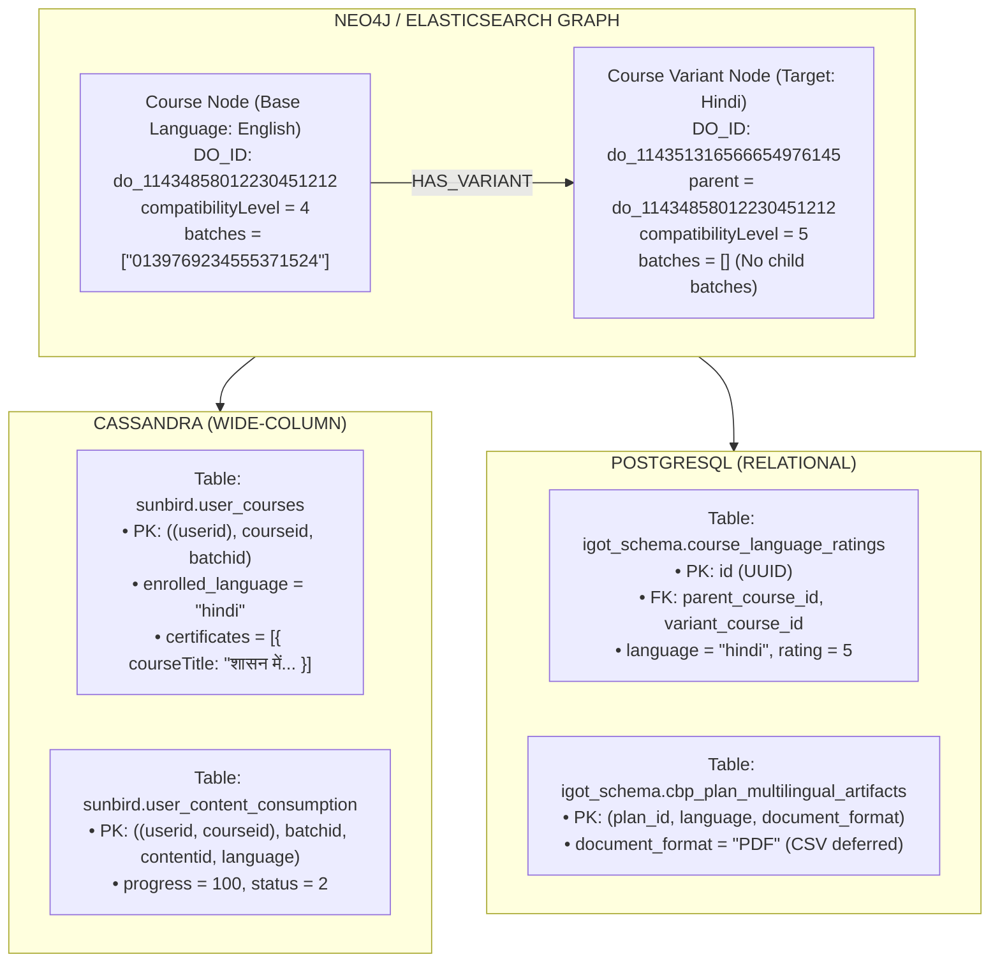

## 8. Deployment Topology & High Availability Architecture

The deployment architecture uses a **Multi-Availability Zone (AZ) Kubernetes Cluster** managed via Helm charts and Ansible playbooks, ensuring fault tolerance and zero-downtime rolling upgrades.

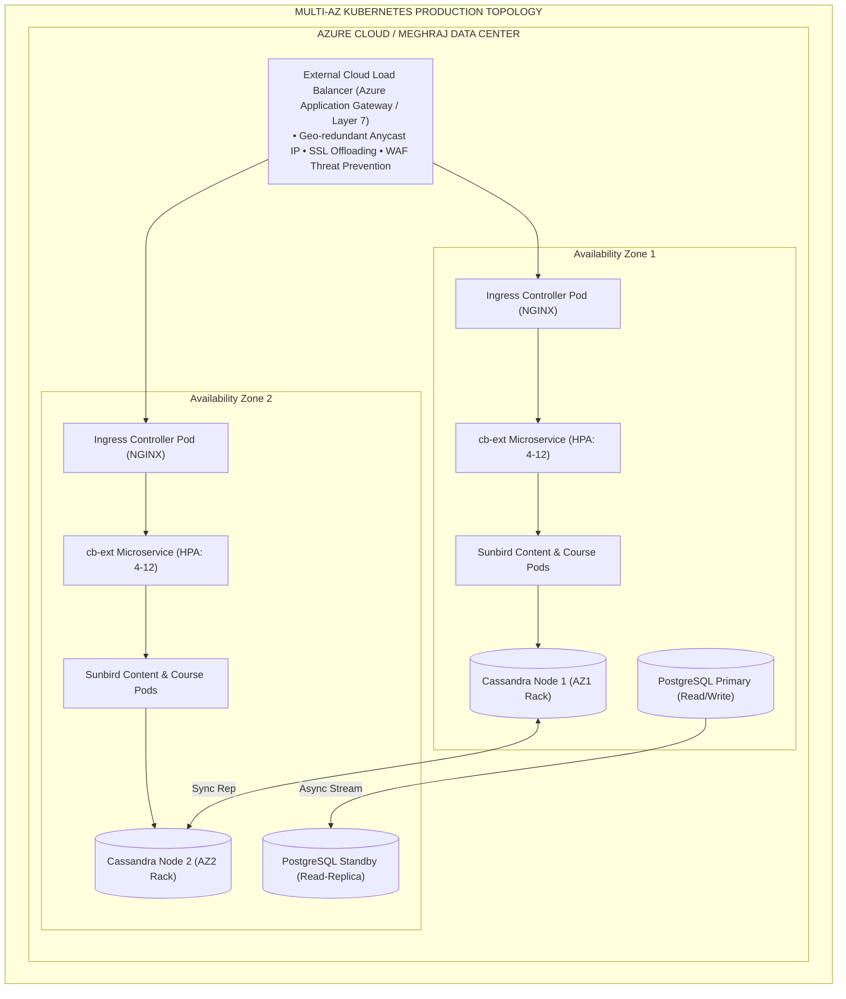

## 9. Security, Identity & Non-Functional Specifications

**NON-FUNCTIONAL SPECIFICATIONS & GUARDS**

| Architectural Vector | System Metric / Benchmark | Engineering Implementation Guard |
|---|---|---|
| **Scalability** | 25,000 peak concurrent learners switching languages simultaneously | Horizontally auto-scaled cb-ext pods; Redis 7 cluster caching for course metadata. |
| **Latency Targets** | p95 < 200ms (AutoEnroll V2 API) p95 < 120ms (Hierarchy Resolution) | Read-aside caching on Elasticsearch docs; Asynchronous batch status checks. |
| **Data Partitioning** | Zero cross-lingual progress bleed across switches | Composite clustering keys in Cassandra partitioned strictly by language. |
| **Identity Security** | Zero-trust header propagation | Keycloak JWT verification at Ingress; Header sanitization of x-authenticated-*. |
| **Availability** | 99.9% uptime SLA | Multi-AZ deployment topology; PgBouncer connection pooling; circuit breaker retry. |

## 10. Requirement-to-Architecture Traceability Matrix

| Business Requirement | FRS / SRS Reference | System Design Component | Jira Enabler | Status |
|---|---|---|---|---|
| **Mandatory Base Language** | FRS `MUL_CON_CRE_BR1_FR1` | Course Creation Modal (Angular) | [KB-9470: Q8 \| Multilingual content creation \| Course Language Selection](https://karmayogibharat.atlassian.net/browse/KB-9470) (Prod Deployed) | **Prod Deployed** |
| **Module Skeletal Cloning** | BRD `MUL_CON_CRE_BR2` | Content Service Hierarchy Engine | [KB-9471: Q8 \| Multilingual content creation \| Module Template Consistency and Teacher's Notes](https://karmayogibharat.atlassian.net/browse/KB-9471) (Prod Deployed) | **Prod Deployed** |
| **CQF Single Enforcement** | FRS `MUL_CON_CRE_BR3_FR2` | Review Workflow & CQF Engine | [KB-11055: Q8 \| Multilingual Content Creation \| CQF Behavior for New Languages](https://karmayogibharat.atlassian.net/browse/KB-11055) (Open) | **Prod Deployed** |
| **Assessment Question Lock** | Story [KB-11053: Q8 \| Multilingual Content Creation \| Assessment Settings and Behavior During Edit](https://karmayogibharat.atlassian.net/browse/KB-11053) (Prod Deployed) | QTI Assessment Builder Component | [KB-11053: Q8 \| Multilingual Content Creation \| Assessment Settings and Behavior During Edit](https://karmayogibharat.atlassian.net/browse/KB-11053) (Prod Deployed) | **Prod Deployed** |
| **Single-Batch Governance** | Story [KB-9893: Q8 \| Multilingual Content Creation \| Publisher Flow](https://karmayogibharat.atlassian.net/browse/KB-9893) (Prod Deployed) | Sunbird Course Service Publisher | [KB-9893: Q8 \| Multilingual Content Creation \| Publisher Flow](https://karmayogibharat.atlassian.net/browse/KB-9893) (Prod Deployed) | **Prod Deployed** |
| **Single-Card Discovery** | FRS `MUL_CON_CRE_BR6_FR1` | Search Gateway & Elasticsearch | [KB-9510: Q8 \| Multilingual Content Creation \| Learner Portal \| Multiple language visibility on course cards and TOC page](https://karmayogibharat.atlassian.net/browse/KB-9510) (Prod Deployed) | **Prod Deployed** |
| **AutoEnroll V2 Gateway** | Confluence Page `445349895` | `cb-ext` Microservice Gateway | Page `445349895` | **Prod Deployed** |
| **In-Player Progress Warning** | FRS `MUL_CON_CRE_BR7_FR2` | Content Player Controller | [KB-9511: Q8 \| Multilingual Content Creation \| Course Consumption](https://karmayogibharat.atlassian.net/browse/KB-9511) (Prod Deployed) | **Prod Deployed** |
| **Dynamic Title Certificate** | BRD `MUL_CON_CRE_BR8` | Sunbird-RC Certificate Service | [KB-9542: Q8 \| Multilingual Content Creation \| Certificate Generation](https://karmayogibharat.atlassian.net/browse/KB-9542) (Prod Deployed) | **Prod Deployed** |
| **Gated 50% Rating Engine** | Story [KB-9543: Q8 \| Multilingual Content Creation \| Separate rating for separate languages](https://karmayogibharat.atlassian.net/browse/KB-9543) (Open) | Rating Microservice & PostgreSQL | [KB-9543: Q8 \| Multilingual Content Creation \| Separate rating for separate languages](https://karmayogibharat.atlassian.net/browse/KB-9543) (Open) | **Open** |
| **Indic ACBP AI Tool** | Story [KB-12918: Q11 \| Multilingual ACBP/CBP in AI CBP tool](https://karmayogibharat.atlassian.net/browse/KB-12918) (In-Progress) | AI CBP Service + Bhashini Gateway | [KB-12918: Q11 \| Multilingual ACBP/CBP in AI CBP tool](https://karmayogibharat.atlassian.net/browse/KB-12918) (In-Progress) | **In-Progress** |
