# Multilingual — Low-Level Design (LLD) – Workflow & Interaction Diagrams

## 1.  End-to-End Multilingual Lifecycle Diagram

The master flow below details every operational and technical transition across the 8 stages of the multilingual course capability.

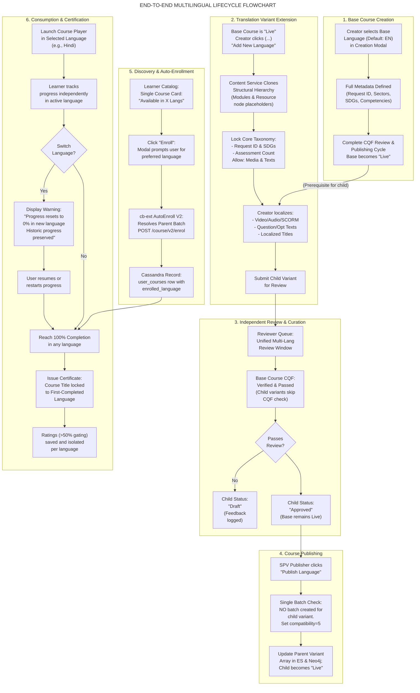

## 2. Stage 1: Multilingual Course Creation & Authoring

### 2.1 Detailed Workflow Flowchart

This flow shows the decision gates enforced by the frontend forms and backend validation services during initial course authoring.

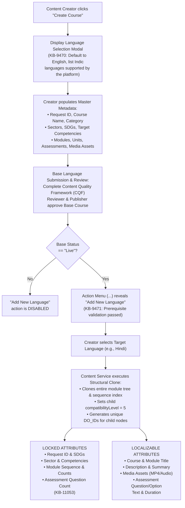

### 2.2 Sequence Diagram: Structural Cloning Process

This diagram maps the exact API communication between the Creator Workbench, `content-service`, and the underlying graph database.

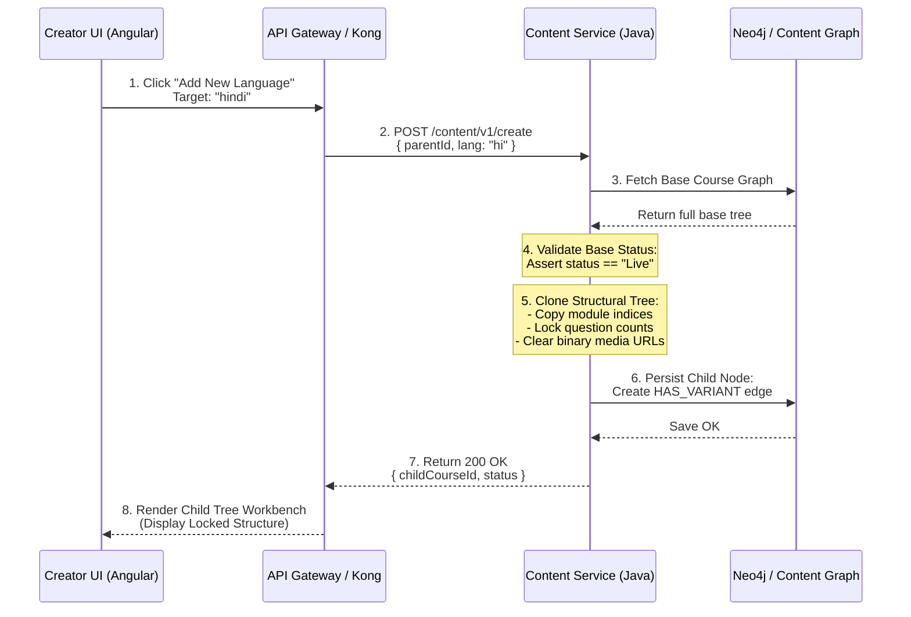

## 3. Stage 2: Curation, CQF Verification & Independent Review

### 3.1 State Transition Diagram (Language Variant FSM)

Each language variant follows its own lifecycle without impacting the base course or sibling translations.

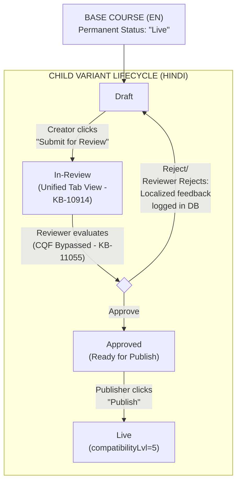

### 3.2 Sequence Diagram: Unified Review & CQF Inheritance

Reviewers inspect translations in a single interface while CQF validation is bypassed for non-base variants ([KB-10914: Q8 | Multilingual Content Creation | Reviewer/Publisher View – Unified Review Experience](https://karmayogibharat.atlassian.net/browse/KB-10914) (Open), [KB-11055: Q8 | Multilingual Content Creation | CQF Behavior for New Languages](https://karmayogibharat.atlassian.net/browse/KB-11055) (Open)).

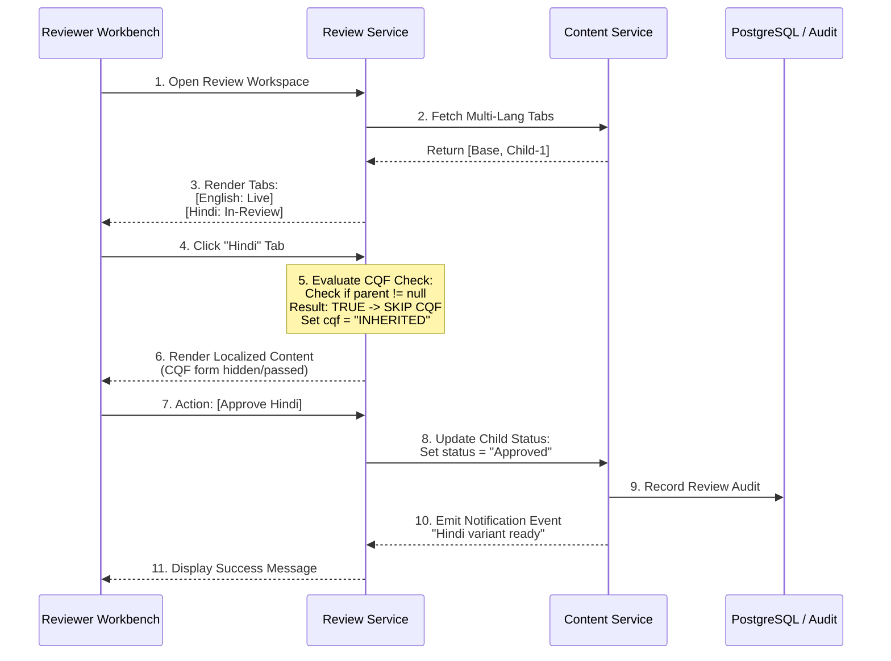

## 4. Stage 3: Publishing & Batch Isolation Architecture

### 4.1 Batch Isolation Decision Tree

This decision tree illustrates how the platform handles batch configuration between base courses and child language variants ([KB-9893: Q8 | Multilingual Content Creation | Publisher Flow](https://karmayogibharat.atlassian.net/browse/KB-9893) (Prod Deployed)).

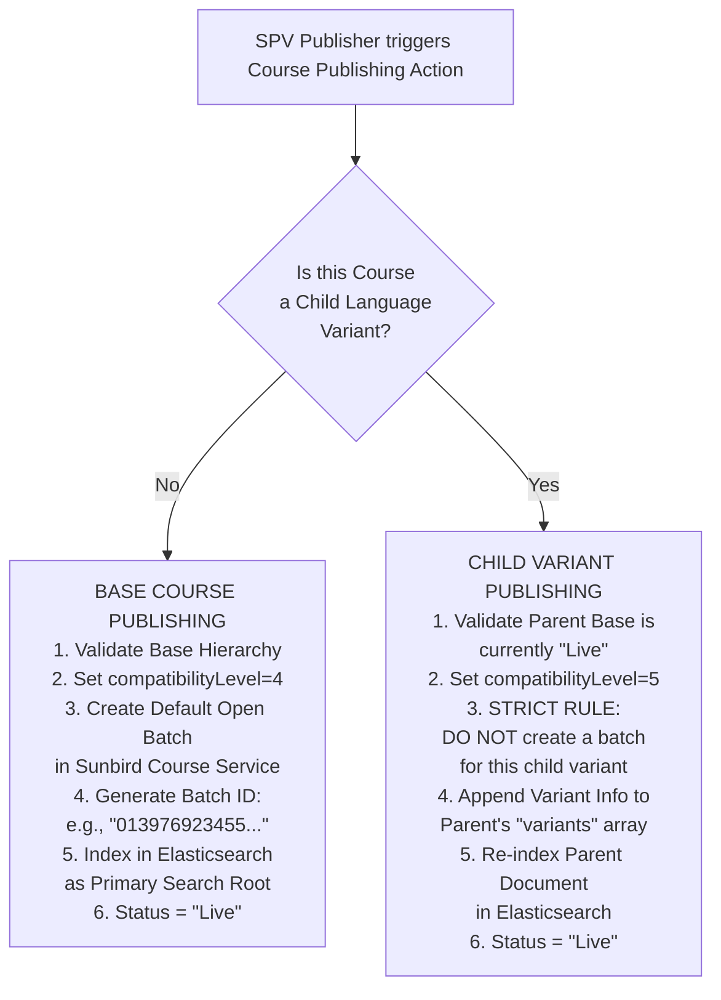

## 5. Stage 4: Learner Discovery & Language Selection

### 5.1 Search Aggregation & Single Card Flow

Shows how Elasticsearch composite search rolls multilingual variants into a single UI card ([KB-9510: Q8 | Multilingual Content Creation | Learner Portal | Multiple language visibility on course cards and TOC page](https://karmayogibharat.atlassian.net/browse/KB-9510) (Prod Deployed)).

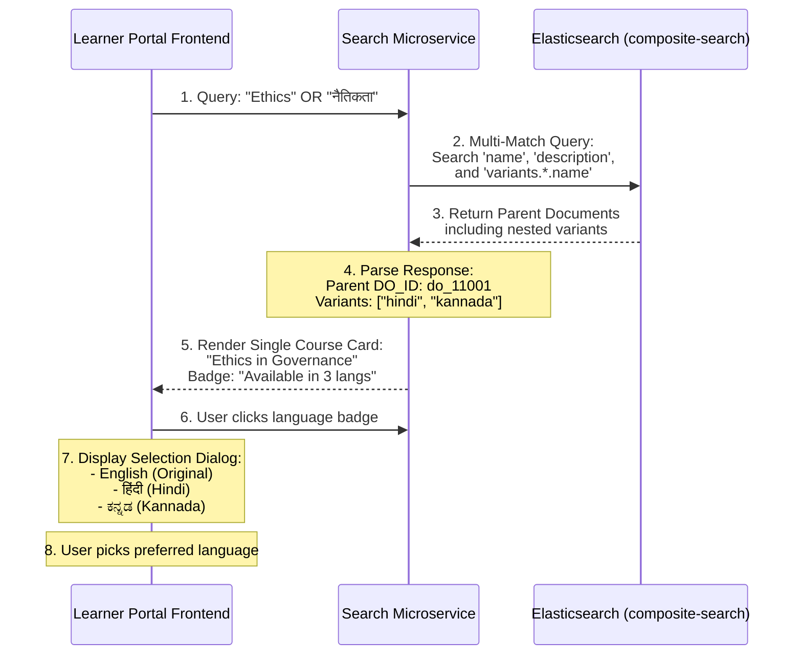

## 6. Stage 5: Language Auto-Enrollment V2 (`cb-ext` to Sunbird)

### 6.1 Complete Sequence Diagram: AutoEnroll V2

Maps the two-tier microservice execution from client interaction through Cassandra write operations (Confluence Page `445349895`).

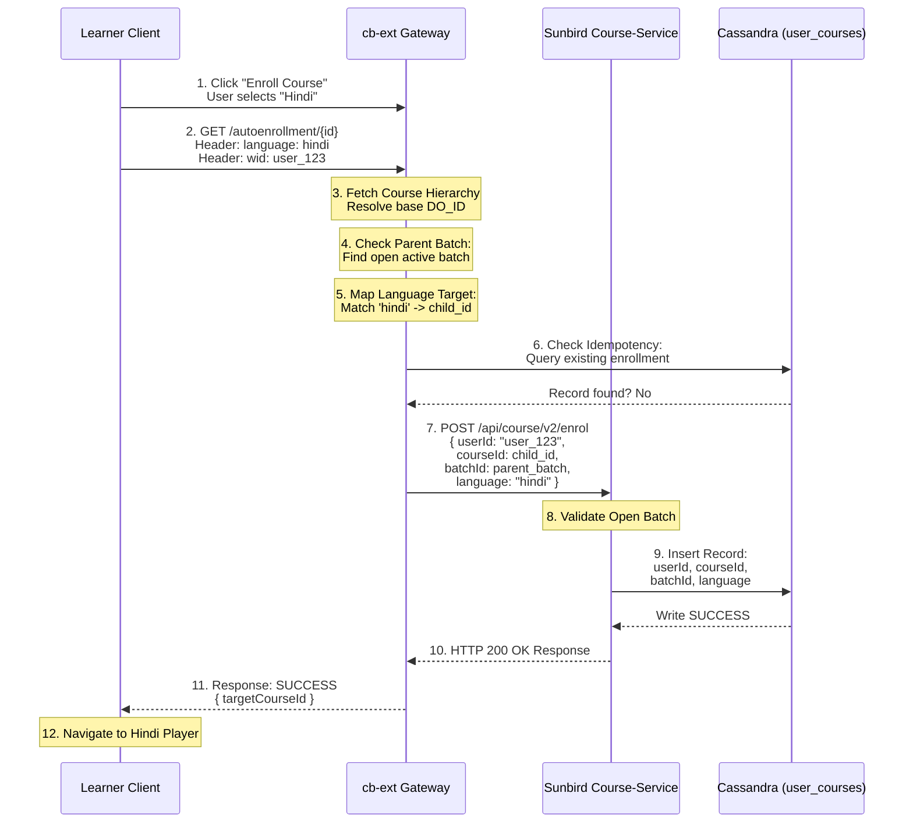

## 7. Stage 6: Learner Consumption & In-Player Language Switching

### 7.1 Language Switching Logic Flowchart

This flowchart defines the behavioral contract and warning prompts when a user changes language mid-course ([KB-9511: Q8 | Multilingual Content Creation | Course Consumption](https://karmayogibharat.atlassian.net/browse/KB-9511) (Prod Deployed)).

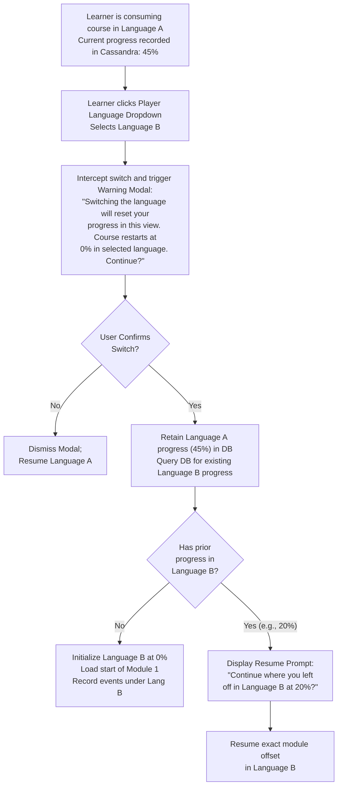

## 8. Stage 7: Assessment Execution & Question Locking

### 8.1 Assessment Validation Sequence

Ensures assessment parity across all language adaptations ([KB-11053: Q8 | Multilingual Content Creation | Assessment Settings and Behavior During Edit](https://karmayogibharat.atlassian.net/browse/KB-11053) (Prod Deployed)).

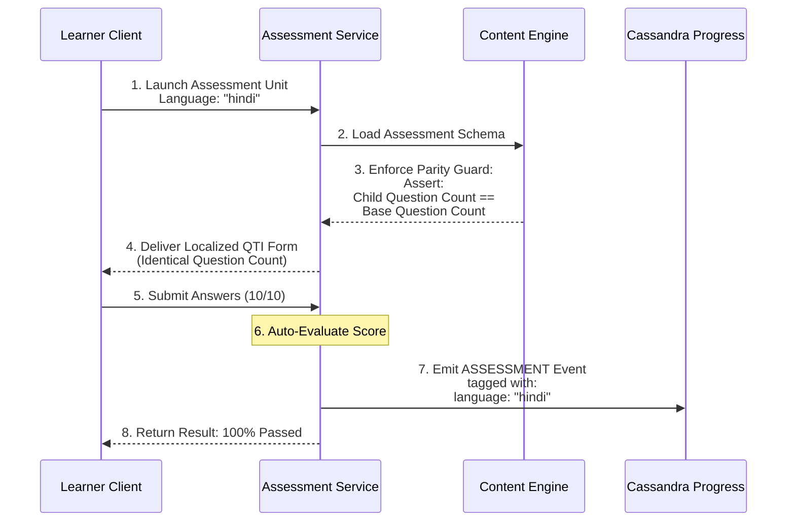

## 9. Stage 8: Course Completion, Dynamic Certificate & Isolated Ratings

### 9.1 Sequence Diagram: First-Completion Certificate Locking

Illustrates how the localized title is injected and locked to the first language completed ([KB-9542: Q8 | Multilingual Content Creation | Certificate Generation](https://karmayogibharat.atlassian.net/browse/KB-9542) (Prod Deployed)).

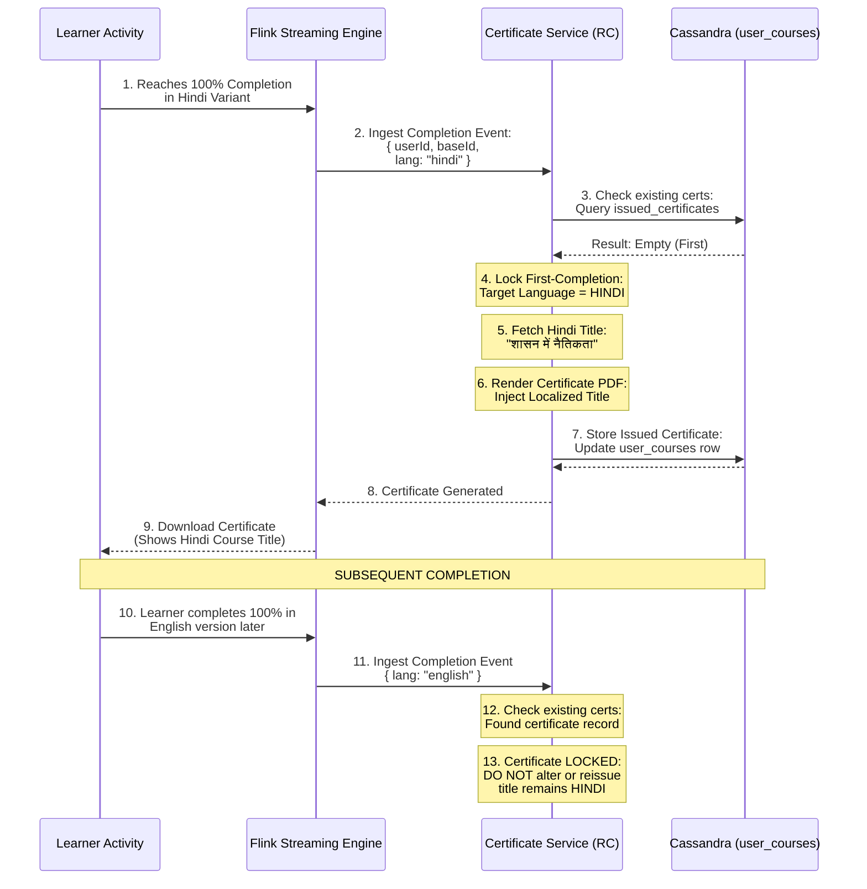

### 9.2 Rating Gating Decision Flowchart

The rating interface unlocks only after achieving 50% consumption in that language variant ([KB-9543: Q8 | Multilingual Content Creation | Separate rating for separate languages](https://karmayogibharat.atlassian.net/browse/KB-9543) (Open)).

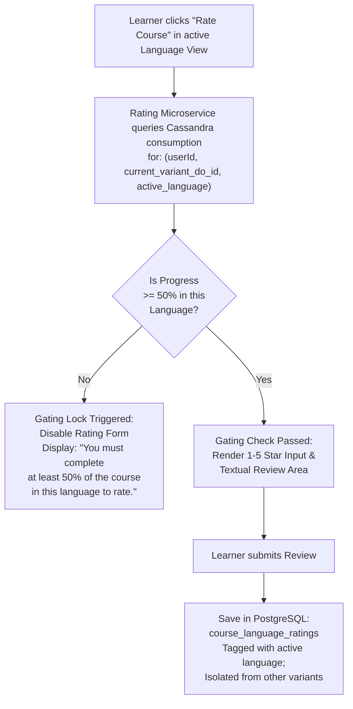

## 10. Technical Architecture & Cross-Component Data Mapping

### 10.1 Component Data Flow Diagram

This architectural diagram outlines data transformation across storage engines throughout the lifecycle.

```mermaid
flowchart TD
    subgraph ARCH["MULTILINGUAL STORAGE & PIPELINE ARCHITECTURE"]
        direction TB
        subgraph P1["CREATION & SKELETAL CLONING"]
            A1["Base Course (English)"]
            A2["Child Variant (Hindi)"]
            A3["Neo4j Knowledge Graph & PostgreSQL<br/>• (Course: do_11001)-[:HAS_VARIANT {compatibilityLevel: 5}]->(Variant: do_11002)<br/>• Locked attributes: requestId, competencies_v3, sectors, questionCounts"]
            A1 -->|"(Clone Hierarchy)"| A2
            A1 --> A3
            A2 --> A3
        end
        subgraph P2["PUBLISHING & SEARCH INDEXING"]
            B1["Elasticsearch Cluster (composite-search index)<br/>Document Root: Parent Course DO_ID<br/>Nested Object: #quot;variants#quot;: { #quot;hindi#quot;: { #quot;identifier#quot;: #quot;do_11002#quot;, #quot;status#quot;: #quot;Live#quot;} }<br/>Presentation: Single Card with #quot;Available in 2 languages#quot; badge"]
        end
        subgraph P3["AUTO-ENROLLMENT V2"]
            C1["Learner requests #quot;hindi#quot;"]
            C2["cb-ext Gateway"]
            C3["Sunbird Course Service"]
            C4["Cassandra Storage: sunbird.user_courses<br/>Partition Key: ((userid), courseid, batchid)<br/>Record: { enrolled_language: #quot;hindi#quot;, batchid: #quot;013976...#quot; (Parent Batch) }"]
            C1 --> C2 --> C3 --> C4
        end
        subgraph P4["CONSUMPTION & STATE ISOLATION"]
            D1["Learner switches between English and Hindi"]
            D2["Cassandra Storage: sunbird.user_content_consumption<br/>Clustering Key: (batchid, contentid, language)<br/>• Row 1: (..., content_01, #quot;english#quot;) -> progress: 50%<br/>• Row 2: (..., content_01, #quot;hindi#quot;) -> progress: 100%"]
            D1 --> D2
        end
        subgraph P5["COMPLETION & FEEDBACK"]
            E1["100% Milestone Reached"]
            E2["Sunbird-RC & PostgreSQL<br/>• issued_certificates: Course title locked to #quot;शासन में नैतिकता#quot; (Hindi First)<br/>• course_language_ratings: Hindi rating stored independently with 50% check guard"]
            E1 --> E2
        end
        A3 --> B1
        B1 --> C1
        C4 --> D1
        D2 --> E1
    end
```

## 11. Requirement-to-Diagram Traceability Matrix

| Requirement / Jira ID | Technical Capability Enforced | Primary Section Diagram Reference | Traceability & Enforced Behavior |
|---|---|---|---|
| [KB-9470: Q8 \| Multilingual content creation \| Course Language Selection](https://karmayogibharat.atlassian.net/browse/KB-9470) (Prod Deployed) | Mandatory Base Language Selection | Section 2.1 Creation Flowchart | Enforces initial base language modal before drafting can proceed. |
| [KB-9471: Q8 \| Multilingual content creation \| Module Template Consistency and Teacher's Notes](https://karmayogibharat.atlassian.net/browse/KB-9471) (Prod Deployed) | Module Skeletal Replication | Section 2.2 Sequence Diagram | Clones structural graph; disables structural additions in child. |
| [KB-9473: Q8 \| Multilingual content creation \| Review Process Management](https://karmayogibharat.atlassian.net/browse/KB-9473) (Prod Deployed) / [KB-9494: Q8 \| Multilingual content creation \| Content Review](https://karmayogibharat.atlassian.net/browse/KB-9494) (Prod Deployed) | Independent Review Workflow | Section 3.1 Variant Lifecycle FSM | Isolates approve/reject transitions per language variant. |
| [KB-10914: Q8 \| Multilingual Content Creation \| Reviewer/Publisher View – Unified Review Experience](https://karmayogibharat.atlassian.net/browse/KB-10914) (Open) | Unified Reviewer Workspace | Section 3.2 Sequence Diagram | Renders single window with language tabs for content inspection. |
| [KB-11053: Q8 \| Multilingual Content Creation \| Assessment Settings and Behavior During Edit](https://karmayogibharat.atlassian.net/browse/KB-11053) (Prod Deployed) | Assessment Structural Parity | Section 8.1 Assessment Flowchart | Question count locked to base; question and option texts localizable. |
| [KB-11055: Q8 \| Multilingual Content Creation \| CQF Behavior for New Languages](https://karmayogibharat.atlassian.net/browse/KB-11055) (Open) | CQF Inheritance Bypass | Section 3.2 Sequence Diagram | CQF enforced exclusively on base; automatically bypassed on children. |
| [KB-9893: Q8 \| Multilingual Content Creation \| Publisher Flow](https://karmayogibharat.atlassian.net/browse/KB-9893) (Prod Deployed) | Single-Batch Publisher Rule | Section 4.1 Decision Tree | Disallows batch generation on child variants (`compatibilityLevel = 5`). |
| [KB-9510: Q8 \| Multilingual Content Creation \| Learner Portal \| Multiple language visibility on course cards and TOC page](https://karmayogibharat.atlassian.net/browse/KB-9510) (Prod Deployed) | Single Card Catalog Footprint | Section 5.1 Search Sequence | Consolidates search results with an `"Available in X languages"` badge. |
| **Page 445349895** | AutoEnroll V2 Microservice API | Section 6.1 AutoEnroll Sequence | Orchestrates `cb-ext` language resolution into parent batch. |
| [KB-9511: Q8 \| Multilingual Content Creation \| Course Consumption](https://karmayogibharat.atlassian.net/browse/KB-9511) (Prod Deployed) | In-Player Switching Warning | Section 7.1 Consumption Flowchart | Triggers progress reset warning modal; isolates historic progress in DB. |
| [KB-9542: Q8 \| Multilingual Content Creation \| Certificate Generation](https://karmayogibharat.atlassian.net/browse/KB-9542) (Prod Deployed) | First-Completion Certificate Title | Section 9.1 Certificate Sequence | Injects dynamic localized title corresponding to first 100% completion. |
| [KB-9543: Q8 \| Multilingual Content Creation \| Separate rating for separate languages](https://karmayogibharat.atlassian.net/browse/KB-9543) (Open) | 50% Consumption Rating Gating | Section 9.2 Rating Flowchart | Unlocks rating form only after consumption in that language. |
| [KB-12918: Q11 \| Multilingual ACBP/CBP in AI CBP tool](https://karmayogibharat.atlassian.net/browse/KB-12918) (In-Progress) | AI CBP Multilingual Indic Plan | Section 1 Master Flowchart | Integrates Bhashini pipeline for Indic ACBP plan export (PDF delivered). |
