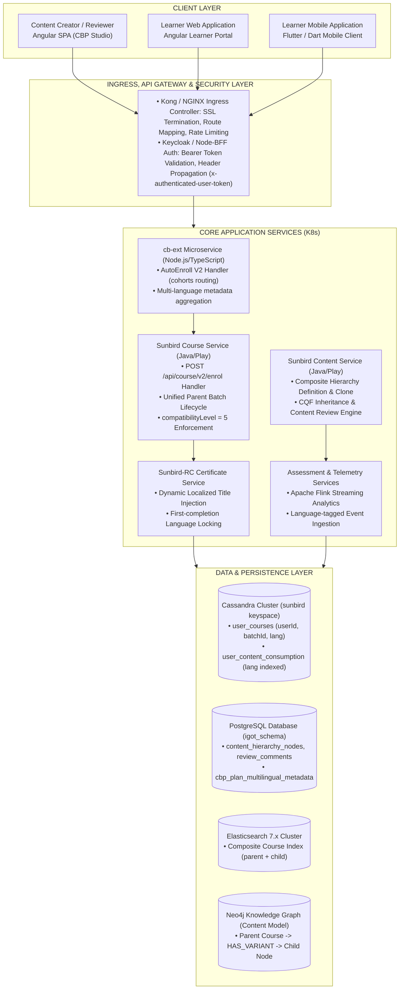
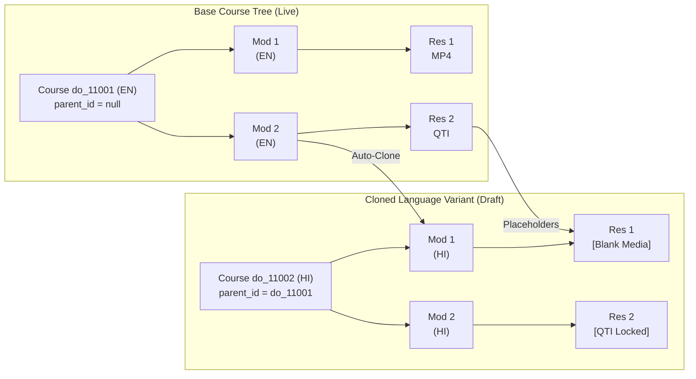
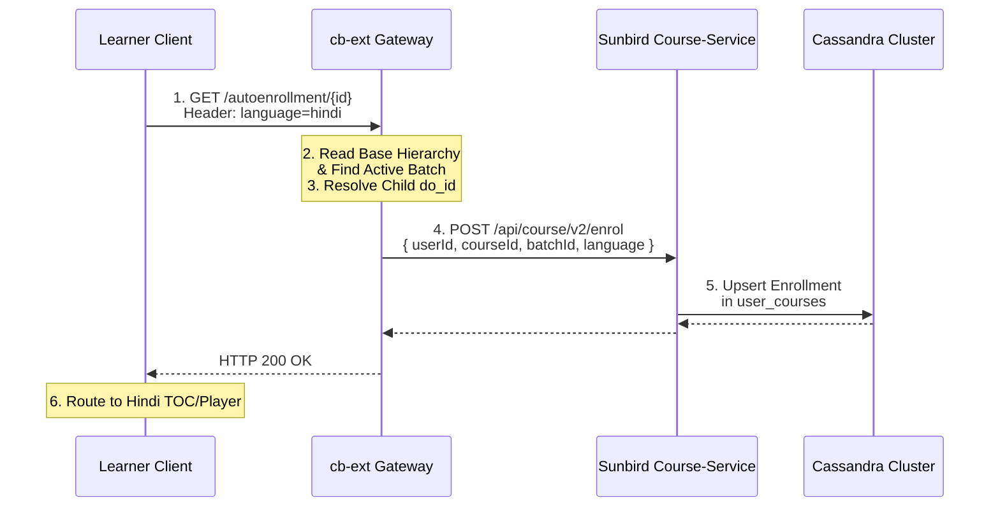

# Multilingual — Software Design Description (SDD)

**Multilingual Course Ecosystem: Authoring, Curation, Publishing, Auto-Enrollment, and Learner Consumption**

## 2. Introduction, Purpose & Design Principles

### 2.1 Purpose & Scope

This Software Design Description (SDD) provides the complete technical architecture and low-level design for the **Multilingual Course Capability** on the iGOT Karmayogi platform. It spans the entire software engineering lifecycle across:

1. **Frontend**: Content Creation Web Portal (Angular), Curation/Reviewer Workbenches, Learner Web Portal, and Learner Mobile App (Flutter).
2. **Backend**: `cb-ext` (iGOT extension microservice), Sunbird Content Service, Sunbird Course Service, Assessment Services, and Sunbird-RC Certificate Service.
3. **Data & Analytics**: Cassandra, PostgreSQL, Elasticsearch, and Apache Flink telemetry stream processors.

### 2.2 Core Architectural Principles

- **Single Logical Footprint (Decoupled Hierarchy)**: The platform maintains a single parent course card in catalog search, encapsulating multiple localized child course nodes.
- **Skeletal Consistency & Evaluation Parity**: Cloned child variants inherit the structural graph (modules, resource order, assessment question count) to ensure uniform learning outcomes regardless of medium.
- **Single-Batch Governance**: Cohorts and batches exist strictly on the parent base course. Translated children execute at `compatibilityLevel = 5` without separate batch generation.
- **Asynchronous Curation Lifecycle**: Each language variant moves independently through Draft, Review, and Live states, decoupling localization schedules from base release dates.
- **State Isolation in Consumption**: Learner progress is isolated per language in Cassandra, preserving historic progress across switches while ensuring fresh completion per language.

## 3. High-Level System Architecture & Component Decomposition



## 4. Detailed Subsystem Design (Creation to Consumption)

### 4.1 Content Creation & Authoring Subsystem

#### 4.1.1 Architectural Flow

1. **Base Language Selection (**[KB-9470: Q8 | Multilingual content creation | Course Language Selection](https://karmayogibharat.atlassian.net/browse/KB-9470) (Prod Deployed)**)**: When a creator initiates course creation, the system triggers the Language Selection Dialog. English is pre-selected by default.
2. **Skeletal Cloning Pipeline (**[KB-9471: Q8 | Multilingual content creation | Module Template Consistency and Teacher's Notes](https://karmayogibharat.atlassian.net/browse/KB-9471) (Prod Deployed)**)**:
  - Pre-condition: The base language course must reach `status = "Live"`.
  - The creator selects `Add New Language` from the kebab action menu `(...)`.
  - `content-service` executes a recursive traversal of the base course tree, duplicating the structural graph (modules and resource nodes).
  - Node attributes: `identifier` is newly generated (e.g., `do_1143513165...`), `primaryCategory = "CourseUnit"`, while structural indices (`index`, `depth`) mirror the base course exactly.



#### 4.1.2 Field Immutability & Modification Rules

- **Locked Attributes (Strict Read-Only)**: `requestId`, `competencies_v3`, `targetTaxonomy`, `sector`, `category`, `subCategory`, `framework`, `totalQuestions` (in assessments).
- **Editable Localized Attributes**: `name` (localized title), `description`, `instructions`, `artifactUrl` / `downloadUrl` (language-specific MP4/MP3/PDF/SCORM), `duration` (audio/video duration and assessment time limit).

### 4.2 Content Curation & Review Subsystem

#### 4.2.1 Unified Review Window ([KB-10914: Q8 | Multilingual Content Creation | Reviewer/Publisher View – Unified Review Experience](https://karmayogibharat.atlassian.net/browse/KB-10914) (Open))

Reviewers access a single unified content inspection page containing language tabs (e.g., `[English (Live)]`, `[Hindi (In-Review)]`, `[Kannada (Draft)]`).

- **CQF Enforcement (**[KB-11055: Q8 | Multilingual Content Creation | CQF Behavior for New Languages](https://karmayogibharat.atlassian.net/browse/KB-11055) (Open)**)**: The Content Quality Framework form is rendered and verified exclusively during the base course review. For child translations, CQF evaluation is automatically bypassed (`cqfStatus = "INHERITED"`).
- **Independent Status FSM**:<br><br><br>Rejection of a child variant does not alter the parent course's `Live` status.

### 4.3 Course Publishing Subsystem

#### 4.3.1 Single Batch Architecture ([KB-9893: Q8 | Multilingual Content Creation | Publisher Flow](https://karmayogibharat.atlassian.net/browse/KB-9893) (Prod Deployed))

In Sunbird learning architecture, courses require a "Batch" for learner enrollment.

- **Design Rule**: Batches are strictly created on the **parent base course** (`compatibilityLevel = 4`).
- When child language variants are published, the publisher service sets `compatibilityLevel = 5`, adds the variant `do_id` to the parent course's `variants` array in Neo4j/Elasticsearch, and **suppresses batch creation**.

```json
{
  "identifier": "do_11434858012230451212",
  "name": "Ethics in Governance",
  "primaryCategory": "Course",
  "language": [
    "English"
  ],
  "compatibilityLevel": 4,
  "batches": [
    "0139769234555371524"
  ],
  "variants": {
    "hindi": {
      "identifier": "do_114351316566654976145",
      "name": "शासन में नैतिकता",
      "compatibilityLevel": 5,
      "status": "Live"
    }
  }
}
```

### 4.4 Course Discovery & Presentation Subsystem

#### 4.4.1 Elasticsearch Schema & Query Strategy

The search index (`composite-search`) rolls child variants into the parent document.

- Single Card Presentation ([KB-9510: Q8 | Multilingual Content Creation | Learner Portal | Multiple language visibility on course cards and TOC page](https://karmayogibharat.atlassian.net/browse/KB-9510) (Prod Deployed)): The search engine returns one card per parent `do_id`.
- The frontend reads the `variants` object. If `length(variants) > 0`, the card displays `"Available in X languages"`.
- Clicking the badge opens the Language Selector Modal rendering native script names alongside English labels (e.g., `ಕನ್ನಡ` `(Kannada)`).

### 4.5 Auto-Enrollment V2 Subsystem (`cb-ext`)

#### 4.5.1 Sequence Execution

When a user clicks "Enroll" and selects their preferred language, the frontend issues a single request to the `cb-ext` microservice.



### 4.6 Learner Consumption Subsystem

#### 4.6.1 Table of Contents & Language Toggle

- The Table of Contents (TOC) page renders a language switcher dropdown.
- Selecting a different language invokes `GET /api/course/v1/hierarchy/{variant_do_id}` and seamlessly re-renders module titles and resource metadata without destroying outer layout context.

#### 4.6.2 In-Player Language Switching & Progress Isolation

- **Warning Modal Trigger (**[KB-9511: Q8 | Multilingual Content Creation | Course Consumption](https://karmayogibharat.atlassian.net/browse/KB-9511) (Prod Deployed)**)**:<br>When a learner changes language inside the content player, a mandatory confirmation modal appears:
  *"Switching the language will reset your progress. The course will restart from the beginning in the selected language. You can revert the language to current one to continue from where you left."*
- **Progress Handling**:
  - Switching to a new language sets current playback progress to 0% for that variant.
  - Historic progress in the previous language remains intact in Cassandra table `sunbird.user_content_consumption`.
  - If the learner switches back to the previous language, the player detects existing progress and displays: *"Continue where you left off in [Language]?"*, restoring exact module resume state.

### 4.7 Assessment & Evaluation Subsystem

#### 4.7.1 Structural Integrity & Question Locking ([KB-11053: Q8 | Multilingual Content Creation | Assessment Settings and Behavior During Edit](https://karmayogibharat.atlassian.net/browse/KB-11053) (Prod Deployed))

To guarantee uniform evaluation standards across Cadres:

- Assessment question items are cloned into the child language variant with their base QTI structure.
- **Disabled Control**: Content creators **cannot** add new questions or delete existing questions (`disableAddQuestion = true`).
- **Editable Controls**: Question text, answer options, explanation text, and maximum time allowed can be localized.

### 4.8 Certification Subsystem

#### 4.8.1 Sunbird-RC Certificate Generation Pipeline ([KB-9542: Q8 | Multilingual Content Creation | Certificate Generation](https://karmayogibharat.atlassian.net/browse/KB-9542) (Prod Deployed))

- Criteria: 100% completion in any single language variant.
- Title Injection Logic: The certificate generation pipeline reads the completion event. The dynamic attribute `courseName` is injected with the localized name of the course variant completed first.
- Subsequent completions of alternative language variants do not overwrite the initial certificate.

### 4.9 Ratings, Feedback & Discussion Subsystem

#### 4.9.1 Language-Isolated Rating Engine ([KB-9543: Q8 | Multilingual Content Creation | Separate rating for separate languages](https://karmayogibharat.atlassian.net/browse/KB-9543) (Open))

- **Consumption Threshold**: Learners must complete of the course in a given language before the rating submission interface unlocks.
- **Storage Tagging**: Ratings (1 to 5 stars, review tags, and comments) are persisted in PostgreSQL with a mandatory `language` column.
- **Aggregated Display**: The course detail page queries the rating average filtered by the currently active language view.

## 5. API & Interface Design

### 5.1 AutoEnroll API (`cb-ext`)

```http
GET /apis/protected/v8/cohorts/user/autoenrollment/{courseId} HTTP/1.1
Host: karmayogi.gov.in
Authorization: Bearer {{user_jwt_token}}
wid: 8e8c894f-4d32-4217-91a0-d4615ecae32a
rootorg: igot
org: dopt
locale: en
language: hindi
Accept: application/json
```

#### Response (HTTP 200 OK)

```json
{
  "id": "api.cohorts.user.autoenrollment",
  "ver": "v2",
  "ts": "2026-10-30T07:15:22.124Z",
  "params": {
    "resmsgid": "b34e5670-87a1-11eb-8922-3f1981249b23",
    "status": "SUCCESS"
  },
  "responseCode": "OK",
  "result": {
    "response": "SUCCESS",
    "courseId": "do_11434858012230451212",
    "enrolledCourseId": "do_114351316566654976145",
    "batchId": "0139769234555371524",
    "userId": "8e8c894f-4d32-4217-91a0-d4615ecae32a",
    "language": "hindi",
    "status": 1
  }
}
```

### 5.2 Course Enrol V2 API (`course-service`)

```http
POST /api/course/v2/enrol HTTP/1.1
Host: course-service.karmayogi.svc.cluster.local:9000
Content-Type: application/json
Authorization: Bearer {{sunbird_admin_token}}
x-authenticated-user-token: {{user_jwt_token}}
```

#### Request Payload

```json
{
  "request": {
    "userId": "8e8c894f-4d32-4217-91a0-d4615ecae32a",
    "courseId": "do_114351316566654976145",
    "batchId": "0139769234555371524",
    "language": "hindi"
  }
}
```

#### Error Contract Matrix

| HTTP Status | Error Code | Description / Root Cause | Mitigation / Fallback |
|---|---|---|---|
| `400` | `INVALID_BATCH_STATUS` | Course batch has expired or is retired | Redirect to admin alert / display enrollment closed |
| `400` | `LANGUAGE_NOT_SUPPORTED` | Requested language variant not in Live state | Fallback to base English course enrollment |
| `409` | `USER_ALREADY_ENROLLED` | User already enrolled in parent batch | Return existing enrollment; redirect to TOC |
| `500` | `INTERNAL_SERVER_ERROR` | Cassandra partition write timeout | Circuit-breaker retry with exponential backoff |

## 6. Data Model & Storage Design

### 6.1 Cassandra Schema (`sunbird` keyspace)

#### Table: `sunbird.user_courses`

Stores batch-level enrollment records.

```sql
CREATE TABLE IF NOT EXISTS sunbird.user_courses (
    userid text,
    courseid text,
    batchid text,
    active boolean,
    completionpercentage int,
    enrolled_date timestamp,
    enrolled_language text,
    datetime timestamp,
    lastreadcontentid text,
    lastreadcontentstatus int,
    status int,
    certificates list<frozen<map<text, text>>>,
    issued_certificates list<frozen<map<text, text>>>,
    PRIMARY KEY ((userid), courseid, batchid)
) WITH CLUSTERING ORDER BY (courseid ASC, batchid ASC);
CREATE INDEX IF NOT EXISTS idx_user_courses_lang ON sunbird.user_courses (enrolled_language);
```

#### Table: `sunbird.user_content_consumption`

Stores resource-level progress isolated by course and language.

```sql
CREATE TABLE IF NOT EXISTS sunbird.user_content_consumption (
    userid text,
    courseid text,
    batchid text,
    contentid text,
    language text,
    completedcount int,
    datetime timestamp,
    lastaccesstime timestamp,
    lastcompletedtime timestamp,
    lastupdatedtime timestamp,
    progress int,
    status int,
    viewcount int,
    PRIMARY KEY ((userid, courseid), batchid, contentid, language)
) WITH CLUSTERING ORDER BY (batchid ASC, contentid ASC, language ASC);
```

### 6.2 PostgreSQL Schema (`igot_schema`)

```sql
-- Localized Ratings Table
CREATE TABLE IF NOT EXISTS igot_schema.course_language_ratings (
    id UUID PRIMARY KEY DEFAULT gen_random_uuid(),
    user_id VARCHAR(64) NOT NULL,
    parent_course_id VARCHAR(64) NOT NULL,
    variant_course_id VARCHAR(64) NOT NULL,
    language VARCHAR(32) NOT NULL,
    rating SMALLINT CHECK (rating BETWEEN 1 AND 5),
    review_text TEXT,
    created_on TIMESTAMP WITH TIME ZONE DEFAULT CURRENT_TIMESTAMP,
    updated_on TIMESTAMP WITH TIME ZONE DEFAULT CURRENT_TIMESTAMP,
    CONSTRAINT uq_user_course_lang_rating UNIQUE (user_id, parent_course_id, language)
);
CREATE INDEX idx_clr_course_lang ON igot_schema.course_language_ratings (parent_course_id, language);

-- Multilingual AI CBP Export Store (KB-12918)
CREATE TABLE IF NOT EXISTS igot_schema.cbp_plan_multilingual_artifacts (
    plan_id VARCHAR(64) NOT NULL,
    language VARCHAR(32) NOT NULL,
    document_format VARCHAR(10) NOT NULL,  -- 'PDF' (delivered), 'CSV' (deferred)
    artifact_url TEXT NOT NULL,
    generated_at TIMESTAMP WITH TIME ZONE DEFAULT CURRENT_TIMESTAMP,
    PRIMARY KEY (plan_id, language, document_format)
);
```

## 7. Core Algorithms & Logic Specifications

### 7.1 Skeletal Replication Algorithm (Content Service)

```python
def clone_skeletal_structure(base_course_id: str, target_language: str, creator_id: str) -> str:
    """
    Recursively clones base course skeletal hierarchy into a child language variant.
    Locks module sequence and assessment question counts.
    """
    base_hierarchy = content_repo.get_hierarchy(base_course_id)
    if base_hierarchy.status != "Live":
        raise InvalidStateError("Base course must be Live to add language variants")

    variant_course_id = id_generator.generate_do_id()

    # 1. Instantiate Root Child Variant
    variant_root = {
        "identifier": variant_course_id,
        "parent": base_course_id,
        "name": f"{base_hierarchy.name} - {target_language.capitalize()}",
        "primaryCategory": "Course",
        "language": [target_language],
        "compatibilityLevel": 5,
        "status": "Draft",
        "createdBy": creator_id,
        # Lock master taxonomy metadata
        "requestId": base_hierarchy.requestId,
        "competencies_v3": base_hierarchy.competencies_v3,
        "sector": base_hierarchy.sector,
        "children": []
    }

    # 2. Recursive Child Cloning
    def clone_children(base_nodes):
        cloned_list = []
        for index, node in enumerate(base_nodes):
            cloned_node_id = id_generator.generate_do_id()
            new_node = {
                "identifier": cloned_node_id,
                "primaryCategory": node.primaryCategory,
                "index": index + 1,
                "name": f"{node.name} ({target_language})",
                "depth": node.depth,
                "parent": variant_course_id
            }
            if node.primaryCategory == "CourseUnit":
                new_node["children"] = clone_children(node.get("children", []))
            elif node.primaryCategory == "Assessment":
                new_node["totalQuestions"] = node.totalQuestions  # Strictly locked (KB-11053)
                new_node["disableAddQuestion"] = True
                new_node["children"] = clone_assessment_items(node.get("children", []))
            else:
                new_node["artifactUrl"] = None  # Blank placeholder for localized media upload
            cloned_list.append(new_node)
        return cloned_list

    variant_root["children"] = clone_children(base_hierarchy.get("children", []))
    content_repo.save_hierarchy(variant_root)
    return variant_course_id
```

### 7.2 AutoEnroll Language Resolution Algorithm (`cb-ext`)

```python
def handle_auto_enrollment(base_course_id: str, requested_lang: str, user_id: str, auth_token: str):
    # 1. Fetch course metadata and live batches
    course_meta = content_service.read_course(base_course_id)
    active_batch = course_service.get_active_parent_batch(base_course_id)
    if not active_batch:
        raise NotFoundError("No active open batch found for this course")

    # 2. Resolve matching language variant
    target_course_id = base_course_id
    if requested_lang and requested_lang.lower() != course_meta.base_language.lower():
        variant_info = course_meta.variants.get(requested_lang.lower())
        if variant_info and variant_info.get("status") == "Live":
            target_course_id = variant_info.get("identifier")
        else:
            # Fallback policy: Default to base language if variant is unreleased
            target_course_id = base_course_id
            requested_lang = course_meta.base_language.lower()

    # 3. Check existing enrollment in Cassandra
    enrollment = cassandra_client.get_user_course(user_id, base_course_id, active_batch.id)
    if enrollment and enrollment.active:
        return {
            "status": "ALREADY_ENROLLED",
            "courseId": base_course_id,
            "targetCourseId": target_course_id,
            "batchId": active_batch.id,
            "language": enrollment.enrolled_language
        }

    # 4. Invoke Sunbird enrollV2 POST API
    payload = {
        "request": {
            "userId": user_id,
            "courseId": target_course_id,
            "batchId": active_batch.id,
            "language": requested_lang
        }
    }
    response = sunbird_course_client.post("/api/course/v2/enrol", payload, auth_token)
    return response
```

## 8. Non-Functional Requirements & System Constraints

**NON-FUNCTIONAL SPECIFICATIONS & GUARDS**

| Dimension | Architectural Requirement | Design Guard / Implementation Mechanism |
|---|---|---|
| Concurrency & Scale | 25,000 peak concurrent learners consuming multilingual streams | Redis 7 cluster caching for course metadata; Stateless cb-ext horizontally scaled (HPA). |
| API Latency (p95) | < 250 ms for AutoEnroll V2<br/>< 150 ms for Hierarchy Read | Asynchronous batch status checks; read-aside caching on Elasticsearch composite docs. |
| Data Integrity | Zero cross-language progress leak | Cassandra composite primary keys indexed on (userid, courseid, contentid, language). |
| Observability | Real-time tracking of language enrollments and drop-off rates | Telemetry START & END events tagged with edata.language ingested via Apache Flink. |
| High Availability | 99.9% uptime for core learning and auto-enrollment gateways | Multi-AZ Kubernetes pod replica scheduling; Database connection pooling via PgBouncer. |

## 9. Requirements-to-Design Traceability Matrix

| Requirement Source | Requirement Description | Design Module / Component | API / Schema Linkage | Jira Reference |
|---|---|---|---|---|
| **BRD** `MUL_CON_CRE_BR1` | Select base language at creation | Angular Creation Form | `POST /api/content/v1/create` | [KB-9470: Q8 \| Multilingual content creation \| Course Language Selection](https://karmayogibharat.atlassian.net/browse/KB-9470) (Prod Deployed) |
| **BRD** `MUL_CON_CRE_BR2` | Auto-clone structure into new lang | Content Service Hierarchy Engine | Section 7.1 Clone Algorithm | [KB-9471: Q8 \| Multilingual content creation \| Module Template Consistency and Teacher's Notes](https://karmayogibharat.atlassian.net/browse/KB-9471) (Prod Deployed) |
| **BRD** `MUL_CON_CRE_BR3` | Independent review per language | Review Workflow Engine | State FSM (Section 4.2.1) | [KB-9473: Q8 \| Multilingual content creation \| Review Process Management](https://karmayogibharat.atlassian.net/browse/KB-9473) (Prod Deployed) / [KB-9494: Q8 \| Multilingual content creation \| Content Review](https://karmayogibharat.atlassian.net/browse/KB-9494) (Prod Deployed) |
| **FRS** `MUL_CON_CRE_FR4` | Lock assessment question counts | Assessment Builder Component | `disableAddQuestion = true` | [KB-11053: Q8 \| Multilingual Content Creation \| Assessment Settings and Behavior During Edit](https://karmayogibharat.atlassian.net/browse/KB-11053) (Prod Deployed) |
| **SRS** Section 3.2.1 | Single card in search with badge | Search Service & Elasticsearch | Nested `variants` schema | [KB-9510: Q8 \| Multilingual Content Creation \| Learner Portal \| Multiple language visibility on course cards and TOC page](https://karmayogibharat.atlassian.net/browse/KB-9510) (Prod Deployed) |
| **SRS** Section 6.1.1 | AutoEnroll V2 language routing | `cb-ext` Gateway Service | `GET /autoenrollment/{id}` | Page `445349895` |
| **FRS** `MUL_CON_CRE_FR7` | Progress reset warning on switch | Angular / Flutter Video Player | Dialog Modal (Section 4.6.2) | [KB-9511: Q8 \| Multilingual Content Creation \| Course Consumption](https://karmayogibharat.atlassian.net/browse/KB-9511) (Prod Deployed) |
| **BRD** `MUL_CON_CRE_BR8` | Certificate in first completed lang | Sunbird-RC Certificate Service | `sunbird.user_courses.certs` | [KB-9542: Q8 \| Multilingual Content Creation \| Certificate Generation](https://karmayogibharat.atlassian.net/browse/KB-9542) (Prod Deployed) |
| **FRS** `MUL_CON_CRE_FR9` | Single batch on parent course only | Sunbird Course Service | `compatibilityLevel = 5` | [KB-9893: Q8 \| Multilingual Content Creation \| Publisher Flow](https://karmayogibharat.atlassian.net/browse/KB-9893) (Prod Deployed) |
| **QA** Test Suite 8/9 | 50% consumption rating lock | Rating Microservice & PostgreSQL | `course_language_ratings` | [KB-9543: Q8 \| Multilingual Content Creation \| Separate rating for separate languages](https://karmayogibharat.atlassian.net/browse/KB-9543) (Open) |
| **Q11 Scope** | Indic ACBP PDF export in AI CBP | AI CBP Service + Bhashini | `cbp_plan_multilingual_artifacts` | [KB-12918: Q11 \| Multilingual ACBP/CBP in AI CBP tool](https://karmayogibharat.atlassian.net/browse/KB-12918) (In-Progress) |
