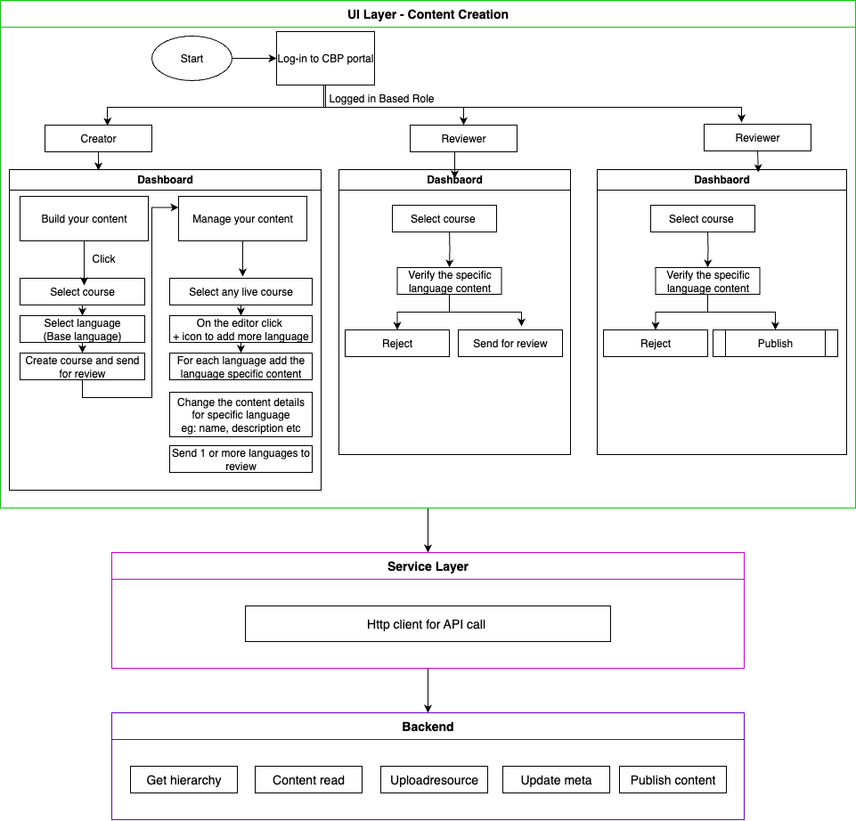
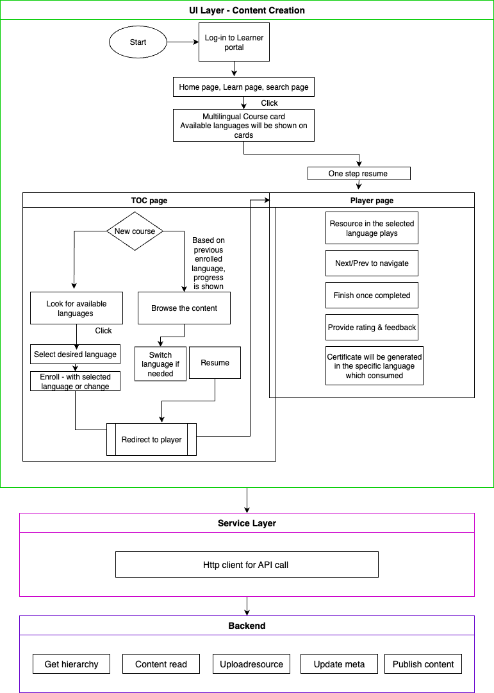
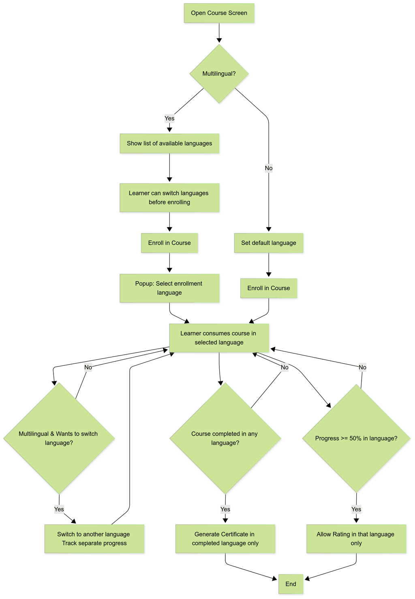

# Multilingual — Software Requirements Specification (SRS)

**SRS - Multilingual Content Creation and curation**

# 3. INTRODUCTION

## 3.1 PURPOSE

**Software Requirements Specification (SRS) for the New Discussion Hub with Communities**

This Software Requirements Specification (SRS) document provides detailed information on the functionalities and features required for the development and enhancement of the "Discussion Hub" with communities on the current learning platform. Its primary purpose is to provide a comprehensive and detailed description of the software enhancements needed to create an interactive space for users to engage in discussions, create communities, and facilitate learning through community-driven content and discussions.

1. **Communication:**
  - **Stakeholder Understanding:** The document helps in conveying the requirements of the software enhancements for the "Discussion Hub with Communities" to various stakeholders, including clients, developers, testers, and project managers.
    **Common Ground:** It serves as a common reference point for all parties involved in the project, ensuring that everyone has a shared understanding of the improvements expected for the new "Discussion Hub with Communities" feature.

2. **Basis for Agreement:**
  - **Contractual Agreement:** The document often forms the basis for the contractual agreement between the client and the development team regarding the scope of the project and the agreed-upon features and functionalities for the "Discussion Hub with Communities."

3. **Guidance for Development:**
  - **Development Team:** The document provides guidance for the development team by specifying the functional and non-functional requirements, architecture, user interfaces, and other essential aspects of the software enhancements for the "Discussion Hub with Communities."

4. **Basis for Testing:**
  - **Testing Criteria:** Testers use this document to derive test cases, ensuring that the developed enhancements for the "Discussion Hub with Communities" meet the specified requirements and function as intended.

5. **Change Control:**
  - **Change Management:** This document serves as a reference point for change control. If there are modifications or additions to the requirements for the "Discussion Hub with Communities" enhancements, they need to be documented and communicated through a formal change process.

6. **Documentation Standard:**
  - **Consistency:** It establishes a standard for documenting requirements for the enhancement of the "Discussion Hub with Communities," ensuring that all relevant information is captured and organized in a structured manner.

7. **Risk Management:**
  - **Identifying Risks:** This SRS document helps in identifying potential risks and challenges early in the development process for the "Discussion Hub with Communities," allowing for proactive risk management.

8. **Regulatory Compliance:**
  - **Legal and Regulatory Requirements:** In some cases, the SRS document may include details about legal and regulatory requirements that the software enhancements for the "Discussion Hub with Communities" must adhere to.

In summary, the Software Requirements Specification document plays a critical role in ensuring that the enhancements to the "Discussion Hub with Communities" page are well-defined, understood by all stakeholders, and follow a structured approach from conception to delivery.

## 3.2 SCOPE

This Software Requirements Specification (SRS) document provides detailed information on the functionalities and features required for the implementation of the NPS on the iGOT Karmayogi platform. Its primary purpose is to provide a comprehensive and detailed description of the software system that needs to be developed.

1. **Functional Requirements:**
  - The Functional Requirements section in the following FRS encompasses all necessary cases for functional requirements.

Defining the scope in the SRS document is crucial to ensure a common understanding among all stakeholders, prevent scope creep, and provide a baseline for project planning and management. The scope also helps in managing expectations and delivering a product that aligns with the agreed-upon requirements.

## 3.3 OVERVIEW

## 3.3.1 SYSTEM PERSPECTIVE

**Front-end (Web application):**

The **Multilingual Content Creation & Consumption** feature enables a seamless multilingual experience for both content creators and learners. Learners can switch between different languages within a course at any time. While switching resets the resource-level progress in the newly selected language, the overall course progress remains intact for resources already completed in any language. The system captures the language in which a user enrolls and logs the language used for consuming each resource to maintain detailed learning analytics.

Enrollment remains unified at the course level, regardless of the language, ensuring learners do not need to enroll separately for each language variant. Users to be allowed to download the certificate in any other language in which the content is available. The course structure—number and order of resources—must remain identical across all languages to ensure progress continuity and consistency.

Each language version of a course follows its own review and publishing lifecycle, allowing new translations to be added even after the course is live. Comments across all language versions are combined into a single unified thread, ensuring inclusive and holistic discussions. For discoverability, courses are shown as a single card with a language toggle rather than separate listings, and multilingual search is supported to allow users to search using keywords in different languages. The course TOC page should have the languages in which the course is available in and the user should be able to select the language before enrolling. The course card should also show in what all languages the content is available in.

**The following diagrams show the flow for creating the multilingual courses**

**The following diagrams show the flow for creating the multilingual courses**

**Mobile :**

The **Multilingual Content Consumption** feature enables learners to experience courses seamlessly in multiple languages. Learners can switch between available languages within a course at any time. When switching, resource-level progress in the new language resets, but overall course progress remains intact for resources already completed in any language. To support detailed learning analytics, the system records both the language of enrollment and the language used to consume each resource.

Enrollment remains unified at the course level, so learners do not need to enroll separately for different language versions. Certificates can be downloaded in any language in which the course is offered. To ensure progress continuity, the course structure—including the number and order of resources—must remain identical across all languages.

Each language version follows its own review and publishing process, allowing new translations to be added even after the course is live. Comments are unified into a single thread across all languages, encouraging inclusive and holistic discussions.

For discoverability, courses are presented as a single card with a language toggle rather than separate listings. Multilingual search allows learners to find courses using keywords in any supported language. On the course details page, learners can see the list of available languages and choose their preferred one before enrolling. The course card also highlights the languages in which the course is offered.

## 3.3.2 LIMITATIONS

# 4. ASSUMPTION & DEPENDENCIES

# 5. USER TYPES & CHARACTERISTICS

Learners

# 6. System Behaviour

## 6.1 USER CONSUMPTION [WEB & MOBILE]

### 6.1.1 Enrol in a multilingual course

| **User story Link** | [#KB-9511](https://karmayogibharat.atlassian.net/browse/KB-9511) |
|---|---|
| **Epic name** | Q8\| Multilingual Content Creation and curation |
| **Use story Title** | Q8 \| Multilingual Content Creation \| Course Consumption |
| **Primary Usage** | Users should be able to enrol into course with preferred language |
| **Actors** | PUBLIC |
| **Pre-Conditions** | User should have valid roles & credentials. |
| **Dependencies** | N/A |
| **Trigger** | 1. User logs in to the website. 2. On the home page or the learn page, the user clicks on the "course card" |
| **Basic behaviour** | If course has multiple languages published, then user can select any preferred language while enrolling |
| **Alternate behaviour** | NA |
| **Business Rule / Validations** | • All published languages for the course should be available in the dropdown while enrolling • User once successfully enrolled will be redirected to. player page with specific language resource of the course • User can still change the language anytime • Progress will be tracked based on the language eg: if “English” course has 50 % progress then user switching to “Hindi” language will start from 0 percent in Hindi • however if user switched back to previously progressed language then user should retain previous progress |
| **Exceptions / Alerts** | NA |
| **Post Conditions** |  |
| **Frequency of Use** |  |
| **External linkages** | NA |
| **Field Descriptions (** Add all fields that are filled by user on UI in this story) | NA |
| **API Reference** | [Sprint 27.2 - APIs Added or Updated](https://karmayogibharat.atlassian.net/wiki/spaces/TES/pages/452460617) |
| **Issues** | N/A |

### 6.1.2 Resume from already enrolled course in preferred language

| **User story Link** | [#KB-9511](https://karmayogibharat.atlassian.net/browse/KB-9511) |
|---|---|
| **Epic name** | Q7 \| Discuss Hub \| Discuss Hub Consumption on Learner portal |
| **Use story Title** | Q8 \| Multilingual Content Creation \| Course Consumption |
| **Primary Usage** | Users will be able to join communities |
| **Actors** | PUBLIC |
| **Pre-Conditions** | User should have valid roles & credentials. |
| **Dependencies** | N/A |
| **Trigger** | 1. User logs in to the website. 2. On the home page or the learn page (continue learning), the user clicks on the "course card" |
| **Basic behaviour** | • If user has made the progress in preferred language • Then user will be redirected to that language specific content where user left off previously • If user has not made progress then user will be taken to first resource of that course in enrolled language • User can still change the language anytime |
| **Alternate behavior** | NA |
| **Business Rule / Validations** | • Progress will be tracked based on the language eg: if “English” course has 50 % progress then user switching to “Hindi” language will start from 0 percent in Hindi • however if user switched back to previously progressed language then user should retain previous progress |
| **Exceptions / Alerts** | NA |
| **Post Conditions** |  |
| **Frequency of Use** |  |
| **External linkages** | NA |
| **Field Descriptions (** Add all fields that are filled by user on UI in this story) | NA |
| **API Reference** | [Sprint 27.2 - APIs Added or Updated](https://karmayogibharat.atlassian.net/wiki/spaces/TES/pages/452460617) |
| **Issues** | N/A |

### 6.1.3 Providing feedback to multilingual course

| **User story Link** | [#KB-9509](https://karmayogibharat.atlassian.net/browse/KB-9509) |
|---|---|
| **Epic name** | Q7 \| Discuss Hub \| Discuss Hub Consumption on Learner portal |
| **Use story Title** | Q8 \| Multilingual Content Creation \| Course-Level Feedback |
| **Primary Usage** | As a learner, I should be able to provide rating and feedback to specific language content, that user has consumed |
| **Actors** | PUBLIC |
| **Pre-Conditions** | User should have valid roles & credentials. |
| **Dependencies** | N/A |
| **Trigger** | 1. User logs in to the website. 2. On the home page or the learn page, the user clicks on the "course card" |
| **Basic behaviour** | User should be able to provide rating and feedback to specific language content, that user has consumed |
| **Alternate behaviour** | NA |
| **Business Rule / Validations** | • User can provide rating to any course or multilingual if he has minimum of 50% progress in the enrolled language or any preferred language • When user submits the rating, rating is stored against the multilingual course • User can edit the rating anytime • If user switches language then user has to complete 50% consumption of that language to provide rating for that language |
| **Exceptions / Alerts** | NA |
| **Post Conditions** |  |
| **Frequency of Use** |  |
| **External linkages** | NA |
| **Field Descriptions (** Add all fields that are filled by user on UI in this story) | NA |
| **API Reference** | [Sprint 27.2 - APIs Added or Updated](https://karmayogibharat.atlassian.net/wiki/spaces/TES/pages/452460617) |
| **Issues** | N/A |

### 6.1.4 Certificate generation

| **User story Link** | [#KB-9542](https://karmayogibharat.atlassian.net/browse/KB-9542) |
|---|---|
| **Epic name** | Q7 \| Discuss Hub \| Discuss Hub Consumption on Learner portal |
| **Use story Title** | Q8 \| Multilingual Content Creation \| Certificate Generation |
| **Primary Usage** | As a learner, I should be able to get the certificate once course is completed or consumed 100% |
| **Actors** | PUBLIC |
| **Pre-Conditions** | User should have valid roles & credentials. |
| **Dependencies** | N/A |
| **Trigger** | 1. User logs in to the app. 2. On the home page, the user clicks on the "Discuss" option from the hub list. 3. Consumes the course 100% |
| **Basic behaviour** | Once user completes the course in preferred language, the certificate will be generated with that course name in that language. |
| **Alternate behaviour** | NA |
| **Business Rule / Validations** | • User comsumes the course 100% i.e, all the resources and assements in the course have been completed • Then the certificate is issued in the language which he completed. • The certificate will not mention any language specific details on the certificate • Once certificate is generated it’ll not change, even if user has switched language and completes 100% in other language • The certificate can be downloaded as pdf or svg format •  |
| **Exceptions / Alerts** | NA |
| **Post Conditions** |  |
| **Frequency of Use** |  |
| **External linkages** | NA |
| **Field Descriptions (** Add all fields that are filled by user on UI in this story) | NA |
| **API Reference** | [Sprint 27.2 - APIs Added or Updated](https://karmayogibharat.atlassian.net/wiki/spaces/TES/pages/452460617) |
| **Issues** | N/A |

# 7. References

| **Document Name** | **Document link** | **Release date** |
|---|---|---|
| RFP Document | N/A |  |
| BRD Document | [KB-7060 \| Q8 \| BRD\| Multilingual Content Creation \|](https://karmayogibharat.atlassian.net/wiki/x/EADnFQ) |  |
| FRS Document | [KB-7060 \| Q8 \| FRS\| Multilingual Content creation](https://karmayogibharat.atlassian.net/wiki/x/WgAJFg) |  |

# 8. Specific Requirements

## 8.1 EXTERNAL INTERFACES

There are no external interfaces.

## 8.2 SYSTEM INTERFACE

Nginx will be used as a web server. The user inputs data via the web server using HTML forms. The actual program that will perform the operations is written in Java/J2EE 1.8

## 8.2.1 USER INTERFACE

### MOBILE:

The user interface for mobile is implemented using dart programing language

| **Language** | **Description** |
|---|---|
| Dart | Dart is the language used to write Flutter apps, including defining UI components, handling user interactions, and implementing business logic. |

### WEB:

The user interface shall be implemented using software packages like Java applets, MS Frontpage, Enterprise Java beans, etc, on the following languages

| **Language** | **Description** |
|---|---|
| JavaScript | JavaScript is a lightweight, object-oriented, cross-platform scripting language, which will mainly be used within webpages |
| HTML5 | HTML5 is the fifth revision of the HTML standard. |
| CSS | Cascading style sheets define style rules in a separate CSS file |

## 8.2.2 SOFTWARE INTERFACE

Server-side: An Apache web server will accept all requests from the client and forward it accordingly. A database will be hosted centrally using PostgreS and Teradata.

Client-side: A Windows/Linux OS which is capable of running a modern web browser that supports JavaScript and HTML5 will be used

## 8.2.3 COMMUNICATION INTERFACES

The system shall use the HTTPS protocol(s) and TCP/IP protocol suite for communication over the intranet. The user must have an SSL certificate licensing registered web browser.

## 8.2.4 OPERATIONS

Recommended browsers for the system are Chrome, Firefox, and Internet Explorer 8 or higher.

| **Mozilla Version** | **Chrome Version** | **IE** **Version** |
|---|---|---|
| Version 55 | Version 64 | Version 11 |

The system shall have operations to protect the database from being corrupted or accidentally altered during a system failure.

# 9. Non-Functional Requirements

## 9.1 USABILITY REQUIREMENTS

The user interface of Karmayogi Bharat shall provide a very intuitive and simple interface to the user so that the user can easily navigate through pages.

## 9.2 PERFORMANCE REQUIREMENTS

Response Time: Average response time shall be less than 3-5 seconds (Note: No SLA is defined in the RFP. However as per industry standard every page’s average response time should be between of 3 to 5 seconds)

Capacity: The system will be able to accommodate 25000 concurrent users in Production env.

| **Applications** | **Business Transaction** | **User Distribution**  **(%age of peak load)** | **Total Users Expected in Production env.** |
|---|---|---|---|
| Portal | Login, Registration, User Profile Views, Course consumption | 80% | 25000 |
| Help, Resources, Feedback | 20% |  |  |

## 9.3 SECURITY

The application will store data that are critical concerning security. Adequate safety measures are to be incorporated during the development stage to prevent vulnerabilities and build a secure code for these services.

The following security considerations are to be made:

**User Level Security: -**

Restricted areas of the application shall be accessible through pre-defined user access rights.

**Database Level Security:**

Database security should provide different layers of database users with overall control of the database security administrator, only authorized database administration users with assigned privileges shall be allowed to access the database. A separate audit trail should be maintained for any direct modification, deletion, and addition in Postgres and Teradata database in database structure or records. Users, even the database administrator should not be allowed to tamper with the audit log.

**Network Level Security:**

Network traffic shall be encrypted using SSL & secured connectivity between the ITD office and the data center where the application will be hosted.

**Infrastructure Level Security:**

Application infrastructure shall be hosted in a DMZ & firewall and IPS shall be installed to detect malicious activities.

The portal should also be tested against the[OWASP 2017 top 10 list](https://www.owasp.org/index.php/Category:OWASP_Top_Ten_Project)of security vulnerabilities.

<Refer to the security guidelines document >

## 9.4 MAINTAINABILITY

Maintainability is defined as the ease with which the software system and components can be modified to correct faults and improve performance or other attributes. It is envisaged that KB shall have a high degree of maintainability. RTO shall be 8 hours for business-critical systems and 48 hours for other systems

Teradata and Postgres will be used for maintaining the database and the Apache server takes care of the site. In case of a failure, a re-initialization of the program is recommended. Also, the software design is being done with modularity in mind so that maintainability can be done efficiently.

## 9.5 SCALABILITY

Scalability is the capability of the system and the underlying components to handle a growing amount of work, or its potential to be enlarged to accommodate that growth. It will be able to accommodate 25000 concurrent users in the Production environment.

| **Applications** | **Business Transaction** | **User Distribution**  **(%age of peak load)** | **Total Users Expected in Production env.** |
|---|---|---|---|
| Portal | Login, Registration, User Profile Views, Course consumption | 80% | 25000 |
| Help, Resources, Feedback | 20% |  |  |

## 9.6 PORTABILITY

### MOBILE:

Upon the introduction of the discussion hub changes, the system portability remains constant.

| **Android Version** | **iOS Version** |
|---|---|
| Android version 13 and above | iOS version 17 and above |

### WEB:

The application is Windows/Linux-based and should be compatible with other systems. Apache, Java/J2EE and PostgreS and Teradata programs are practically independent of the OS-system which they communicate with. The end-user part is fully portable and any system using any web browser should be able to use the features of the application.

Recommended browsers for the system are: Chrome, Firefox and Internet Explorer 8 or higher.
