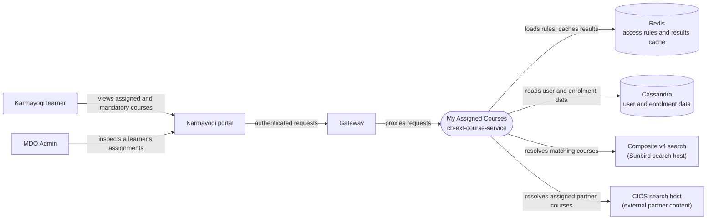

# My Assigned Courses — Context Diagram

## System boundary

Inside the feature is `cb-ext-course-service`: the course-access endpoints that validate the
caller's token, load the organisation's cached access-setting rules, build a composite search
and merge the results with the learner's enrolment state. Outside it are the learner and the
MDO Admin, the portal and gateway in front of it, and its Redis, Cassandra, composite search
and CIOS partner search dependencies.

## Diagram

## Elements

| Element | Role | Detailed in |
|---|---|---|
| My Assigned Courses (`cb-ext-course-service`) | Central system: assigned-course resolution via the access-settings rules engine, external-course resolution, admin view | [hld.md](hld.md) |
| Karmayogi learner | Sees assigned courses, external partner courses and mandatory-course prompts | [use-cases.md](use-cases.md) |
| MDO Admin | Reads another user's assignments for support and compliance | [use-cases.md](use-cases.md) |
| Karmayogi portal | Learner-facing "My Assigned Courses" view and mandatory-course shelf | [use-cases.md](use-cases.md) |
| Gateway | Route between the portal and the service | [hld.md](hld.md) |
| Redis | Cached access-setting rules and course results | [lld.md](lld.md) |
| Cassandra | User and enrolment data merged into results | [hld.md](hld.md) |
| Composite v4 search | Finds the courses matching the rules, with bounded page size | [lld.md](lld.md) |
| CIOS search host | Source of assigned external partner (CIOS) content | [apis.md](apis.md) |

> **Verification boundary:** elements and interactions come from the feature's own pages
> (index, use cases, APIs, HLD, LLD), read in full. The operations manual is a stub and was
> not used. Spot-checked read-only in `cb-ext-course-service` (the course-access controller
> and the search-limit settings). Not re-verified: gateway routing, Cassandra table
> details and the portal's calling code.
