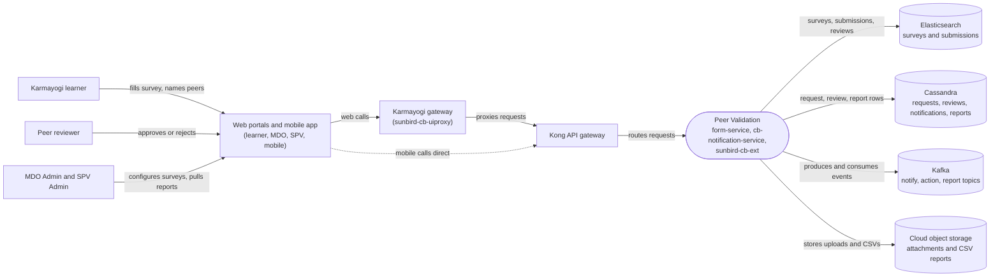

# Peer Validation — Context Diagram

## System boundary

Inside the feature are the three backends that each own a slice of it: `form-service`
(survey lifecycle, submission, review), `cb-notification-service` (notification fan-out and
request/review status) and `sunbird-cb-ext` (attachments and CSV reports). Outside it are
the learners, peers and admins who use it, the web portals, mobile app and gateway in front
of it, Kong, and the shared Elasticsearch, Cassandra, Kafka and cloud storage it relies on.

## Diagram

## Elements

| Element | Role | Detailed in |
|---|---|---|
| Peer Validation (`form-service`, `cb-notification-service`, `sunbird-cb-ext`) | Central system: no single owning service; three backends correlated by shared `formId` / `notificationId` strings | [hld.md](hld.md) |
| Karmayogi learner | Fills the survey after the configured delay, optionally attaches proof, names peers | [use-cases.md](use-cases.md) |
| Peer reviewer | Opens a named submission and approves or rejects; the decision is final | [use-cases.md](use-cases.md) |
| MDO Admin and SPV Admin | Configure, publish, end and archive surveys and pull completion reports (department-scoped or system-wide) | [use-cases.md](use-cases.md) |
| Web portals and mobile app | Learner portal module, MDO and SPV admin portals, and an independent mobile implementation of the same contracts | [hld.md](hld.md) |
| Karmayogi gateway (`sunbird-cb-uiproxy`) | Web entry path into the backends | [hld.md](hld.md) |
| Kong API gateway | Routes web and mobile calls to the three backends; its own rules are outside the traced repos | [apis.md](apis.md) |
| Elasticsearch | Survey definitions and submissions, with peer reviews embedded in the submission | [lld.md](lld.md) |
| Cassandra | Request and review status rows, the notification feed and report tracking rows | [lld.md](lld.md) |
| Kafka | Carries notify, review-action, status-update and report-request events between the backends | [hld.md](hld.md) |
| Cloud object storage | Holds uploaded PDF/MP4 attachments and generated CSV reports | [hld.md](hld.md) |

> **Verification boundary:** elements and interactions come from the feature's own pages,
> read in full: index, use cases, APIs, HLD and LLD. The operations manual was not read.
> Spot-checked read-only in the source repos: the peer-validation Kafka topic names in
> `form-service`, `cb-notification-service` and `sunbird-cb-ext`, and the peer survey
> routes in `sunbird-cb-uiproxy`. Dashed arrows mark hops that could not be confirmed:
> Kong's own routing rules, including how mobile direct calls reach the backends, are not
> in the traced repos. Not analysed: the MDO/SPV admin screens, which ship in an external
> library.
