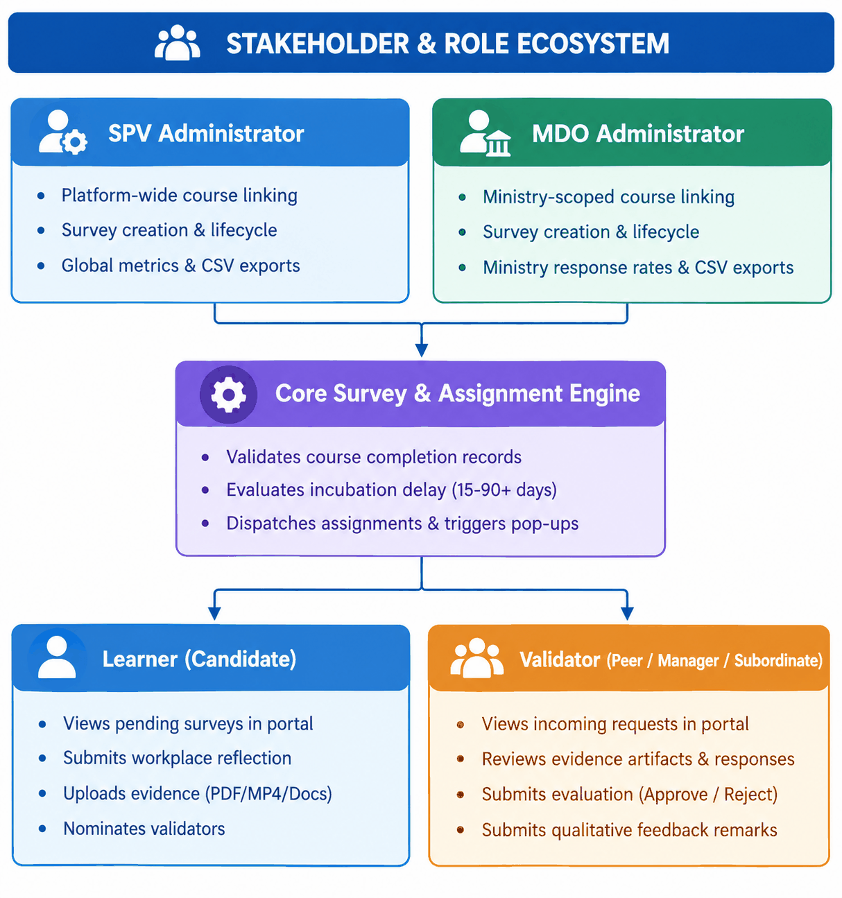
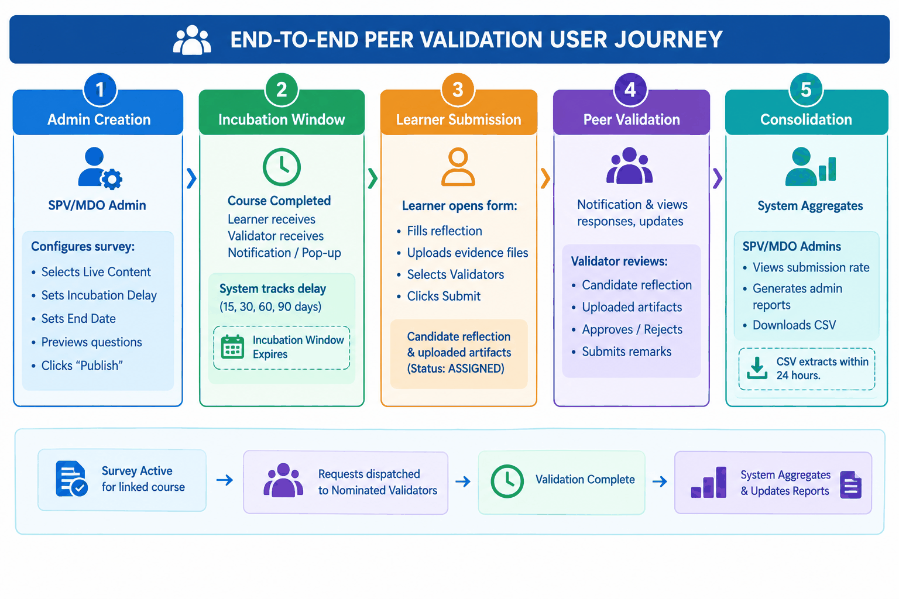
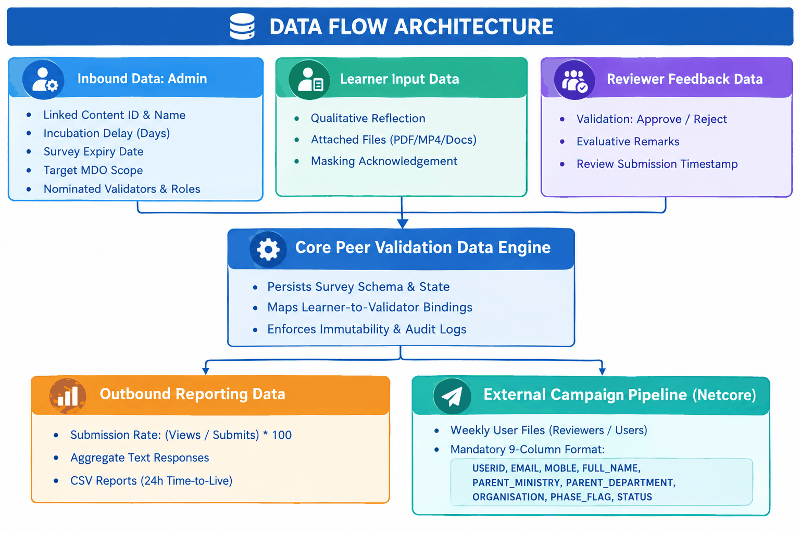
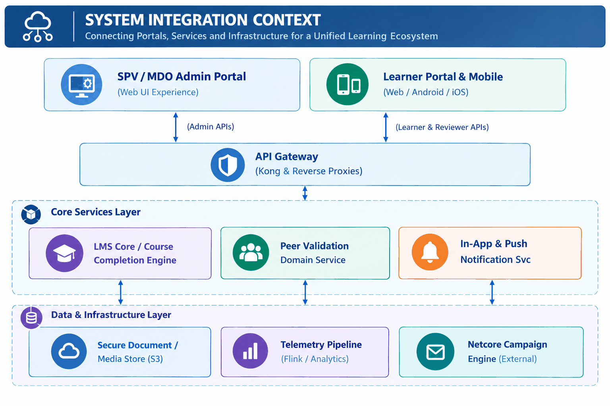

## 2. Executive Summary

On the **iGOT Karmayogi** platform, competency attainment and learning effectiveness historically relied on formal assessments and course resource completion. While formal evaluations confirm knowledge acquisition, they cannot independently evaluate workplace application, behavioral change, or competency demonstration on the job.

The **Peer Validation** capability introduces a multi-stakeholder assessment mechanism. Special Purpose Vehicle (SPV) and Ministry/Department/Organization (MDO) administrators can link structured peer validation surveys to live, published courses or programs. Once an eligible civil servant completes a linked course/program, the platform observes a configurable incubation window (e.g., 15, 30, 60, 90 days, or custom days) allowing the learner to apply new knowledge in their day-to-day duties. Following this delay, the learner is prompted via notifications, in-app pop-ups, and targeted push/deep-link campaigns (via Netcore integration) to complete a workplace application reflection form, upload supporting artifacts (e.g., presentations, workflows, AI-assisted outputs, data analyses), and nominate validators from their professional network across three relationship categories: **Reporting Managers**, **Peers**, and **Subordinates**.

Nominated validators receive real-time alerts and access the validation interface directly in the Learner Portal (across Web and Mobile). They review the learner's submitted responses and uploaded evidence, provide structured feedback, and approve or reject the validation request. The system aggregates these responses, protects submission integrity through server-side idempotency, provides real-time monitoring and reporting dashboards for SPV/MDO administrators, and emits granular telemetry to track platform-wide adoption and competency verification.

## 3. Business Context and Problem Statement

### 3.1 The "As-Is" Business Challenge

1. **Unilateral Evaluation:** Learning validation was confined to self-assessments or multiple-choice summative evaluations upon course completion.
2. **Absence of On-the-Job Verification:** Administrators lacked visibility into whether acquired competencies were being actively applied in government departments.
3. **Informal & Untracked Feedback:** Any professional peer feedback taking place in departments was offline, ad-hoc, untracked, and inaccessible to platform administrators or competency frameworks.
4. **Lack of Standardized Endorsement:** Civil servants had no platform mechanism to request formal workplace endorsement from supervisors, peers, or team members to validate their skill growth.

### 3.2 The "To-Be" Solution

The Peer Validation framework operationalizes post-training impact assessment:

- **Structured Post-Completion Assessment:** Surveys are systematically decoupled from immediate course completion, providing learners sufficient runway (configured delay) to apply their learnings in operational scenarios.
- **360-Degree Feedback Dimensions:** Enables endorsement across hierarchical categories (Reporting Manager, Peer, Subordinate) without enforcing rigid organizational charts, accommodating public sector structural realities.
- **Evidence-Based Validation:** Learners can provide written workplace narratives and upload concrete artifacts, transforming feedback from subjective opinions into evidence-grounded validation.
- **Administrative Oversight & Analytics:** Provides SPV and MDO administrators with clear metrics on survey distribution, engagement, submission rates, and downloadable CSV audit extracts.

## 4. Objectives and Expected Outcomes

| Objective | Intended Outcome | Target Stakeholder | Traceable Source | Documented Success Indicator |
|---|---|---|---|---|
| **Multi-Dimensional Skill Validation** | Validate workplace skill application beyond standard exams via professional network endorsements. | Learners, MDO Administrators | BRD (Business Drivers), FRS (`PEER_FDBK_BR4`) | End-to-end completion rate ≥ 80% (learner submissions having ≥1 validator response). |
| **Configurable Incubation Delay** | Allow learners sufficient time (15–90+ days) to apply course competencies before evaluation triggers. | SPV/MDO Administrators | FRS (`PEER_FDBK_BR1_FR3`, `PEER_FDBK_BR2_FR2`) | 100% of survey triggers adhere to the configured post-completion day threshold. |
| **Cross-Platform Accessibility** | Ensure full parity across desktop web and mobile apps (Android/iOS/M-Web) for prompts, forms, and reviews. | Civil Servant Learners, Mobile Users | Jira ([KB-13497](https://karmayogibharat.atlassian.net/browse/KB-13497), [KB-13498](https://karmayogibharat.atlassian.net/browse/KB-13498), [KB-13499](https://karmayogibharat.atlassian.net/browse/KB-13499)), FRS (Scope) | ≥ 90% task completion in usability validation across web and mobile. |
| **Automated Administrative Monitoring** | Provide centralized visibility into survey view counts, submission rates, and learner response datasets. | SPV Administrators, MDO Administrators | BRD (`PEER_FDBK_BR6`), FRS (`PEER_FDBK_BR6`) | Dashboard refresh freshness ≤ 15 min; report generation success ≥ 99%. |
| **High Assignment Accuracy** | Automatically assign eligible completed learners exactly once without manual intervention. | System / All Users | FRS (`PEER_FDBK_BR2_FR1`, Success Metrics) | Eligible learner assignment accuracy ≥ 99% via daily automated reconciliation. |

## 5. Feature Scope

### 5.1 In Scope

- **SPV & MDO Survey Administration:**
  - Creation of validation surveys linked to supported live course/program types ([KB-13016](https://karmayogibharat.atlassian.net/browse/KB-13016), [KB-13017](https://karmayogibharat.atlassian.net/browse/KB-13017)).
  - Configuration of time-delay distribution (15, 30, 60, 90 days, or custom days) and survey deadlines via date picker.
  - Previewing locked, pre-decided validation question sets.
  - Duplicate survey prevention per content item across all states (`PEER_FDBK_BR8`).
  - Administrative dashboards tracking survey name, content, status, assigned count, and response rate.
  - Asynchronous export of survey response data to CSV (with 24-hour expiry and newest-first ordering).

- **Learner Participation Journey (Web & Mobile):**
  - Automated eligibility evaluation based on course completion.
  - In-app notifications and pop-up alerts upon reaching configured post-completion dates ([KB-13018](https://karmayogibharat.atlassian.net/browse/KB-13018), [KB-13499](https://karmayogibharat.atlassian.net/browse/KB-13499)).
  - Dedicated Learner Portal dashboard featuring "Pending Surveys" with pagination (15, 30, 50), search, and end-date sorting ([KB-13020](https://karmayogibharat.atlassian.net/browse/KB-13020), [KB-13498](https://karmayogibharat.atlassian.net/browse/KB-13498)).
  - Reflection form submission, including narrative questions and evidence attachment uploads (documents, presentations, AI-assisted outputs, workflows, PDFs, MP4s) ([KB-13497](https://karmayogibharat.atlassian.net/browse/KB-13497), [KB-14420](https://karmayogibharat.atlassian.net/browse/KB-14420)).
  - Validator nomination across Reporting Manager, Peer, and Subordinate categories via user search or manual entry (name and email).

- **Validator Review Journey (Web & Mobile):**
  - Incoming validation request alerts and listing under "Incoming Validation Requests" tab ([KB-13020](https://karmayogibharat.atlassian.net/browse/KB-13020), [KB-13498](https://karmayogibharat.atlassian.net/browse/KB-13498)).
  - Display of learner responses, course context, relationship category, and attached evidence.
  - Actionable review submission (Approve / Reject) with qualitative remarks.
  - Explicit ignore / dismiss capabilities for incoming requests (`PEER_FDBK_BR11`).

- **Campaign & Operational Reporting:**
  - Deep-linking capabilities for external push notifications (Netcore integration) ([KB-14437](https://karmayogibharat.atlassian.net/browse/KB-14437)).
  - Automated weekly user and reviewer CSV data generation for external engagement engines ([KB-15978](https://karmayogibharat.atlassian.net/browse/KB-15978), [KB-15964](https://karmayogibharat.atlassian.net/browse/KB-15964)).
  - Telemetry event instrumentation for audit and behavior tracking ([KB-14552](https://karmayogibharat.atlassian.net/browse/KB-14552)).

### 5.2 Out of Scope

- Real-time chat, instant messaging, or interactive discussion threads between learners and nominated validators during the review process (BRD Scope).
- Retraction or post-submission editing of completed feedback by validators; once submitted, transactions are immutable (BRD Scope, `PEER_FDBK_BR12`).
- Advanced predictive analytics or AI-driven cross-departmental sentiment trending patterns (BRD Scope).
- Integration with third-party external commercial survey software (e.g., SurveyMonkey, Google Forms) (BRD Scope).
- Strict organizational hierarchy enforcement; because formal organizational reporting structures are not universally modeled across all government entities on iGOT, learners may nominate any platform user ([KB-13497](https://karmayogibharat.atlassian.net/browse/KB-13497)).

## 6. Stakeholders and User Roles

| Role | Responsibilities | Permissions & Access | Primary Actions Available | Interacting Roles / Components |
|---|---|---|---|---|
| **SPV Administrator** | Central governance and platform-wide monitoring of skill validation. | Full administrative access across all published courses, programs, and surveys. | Create surveys; link live content; set deadlines & incubation delays; view platform-wide dashboards; export reports. | MDO Admins, Course Completion Service, Report Service. |
| **MDO Administrator** | Departmental monitoring of competency validation within their specific Ministry/Department. | Scoped administrative access restricted to courses/programs assigned to or relevant to their MDO. | Create surveys for MDO programs; view departmental response rates; export MDO-specific CSV reports. | SPV Admin, Learners, Report Service. |
| **Learner (Candidate)** | Civil servant who completed a course/program and validates skill application. | Learner Portal & Mobile App access. | Dismiss/open survey pop-ups; access "Pending Surveys" dashboard; complete reflection; upload evidence; search/nominate validators. | Automated Assignment Engine, Nominated Validators. |
| **Validator (Reviewer)** | Peer, supervisor, or team member nominated to evaluate candidate's performance. | Learner Portal & Mobile App access ("Incoming Validation Requests"). | View request details; inspect candidate workplace narrative and evidence attachments; Approve/Reject validation; enter remarks; ignore requests. | Learner, Core Survey Engine. |
| **Automated System Engines** | Scheduled workers, notification pipelines, telemetry buses, and Netcore connectors. | Service-level execution privileges. | Track course completion dates; execute delay calculations; trigger in-app pop-ups; generate weekly CSV files; log telemetry. | LMS Datastore, Notification Service, Netcore, Telemetry Pipeline. |

## 7. Key Features and Functional Capabilities

| Capability | Description | Primary Actor | Business Value | Source Reference |
|---|---|---|---|---|
| **Course/Program Survey Linking** | Enables linking of surveys exclusively to supported live content types (`Course`, `Moderated Course`, `Multilingual Course`, `Curated Program`, `Moderated Program`, `Invite Only Program`, `Blended Program`, `Comprehensive Assessment Program`). Blocks drafts or archived content. | SPV / MDO Admin | Prevents stale or invalid content validation; ensures surveys align with authorized curriculums. | FRS (`PEER_FDBK_BR1_FR2`, `PEER_FDBK_BR7`), [KB-13016](https://karmayogibharat.atlassian.net/browse/KB-13016), [KB-13017](https://karmayogibharat.atlassian.net/browse/KB-13017) |
| **Incubation Delay Configuration** | Configures an intentional delay (15, 30, 60, 90 days, or custom days) between course completion and survey triggering. | SPV / MDO Admin | Ensures civil servants have adequate runway to apply new knowledge in actual administrative tasks before being evaluated. | FRS (`PEER_FDBK_BR1_FR3`, `PEER_FDBK_BR2_FR2`), [KB-13008](https://karmayogibharat.atlassian.net/browse/KB-13008) |
| **Duplicate Survey Prevention** | Enforces a strict one-to-one constraint between a content item and a peer validation survey across active, draft, and ended states. | System | Eliminates administrative duplication and ambiguous survey assignments. | FRS (`PEER_FDBK_BR8`, `PEER_FDBK_NFR4`) |
| **Automated Assignment & Pop-up Trigger** | Automatically detects completion (assessment pass or 100% resource consumption) and presents an in-app pop-up and notification upon delay expiry. | System | Drives proactive learner engagement without requiring manual administrative assignments. | FRS (`PEER_FDBK_BR2_FR1`-`FR4`, `PEER_FDBK_BR9`), [KB-13018](https://karmayogibharat.atlassian.net/browse/KB-13018), [KB-13499](https://karmayogibharat.atlassian.net/browse/KB-13499) |
| **Pending Surveys Dashboard** | Dedicated tab displaying assigned surveys with pagination (15, 30, 50), global search, and ascending end-date sorting. | Learner | Provides a centralized cockpit for learners to manage, resume, and track their required submissions. | FRS (`PEER_FDBK_BR2_FR5`, `PEER_FDBK_NFR2`), [KB-13020](https://karmayogibharat.atlassian.net/browse/KB-13020), [KB-13498](https://karmayogibharat.atlassian.net/browse/KB-13498) |
| **Workplace Reflection & Evidence Upload** | Standardized questionnaire capturing workplace application scenarios and enabling file uploads (documents, presentations, AI outputs, workflows, PDFs, MP4s) with sensitive data masking warnings. | Learner | Transforms subjective claims into verifiable, evidence-backed competency assessments. | FRS (`PEER_FDBK_BR4`), [KB-13497](https://karmayogibharat.atlassian.net/browse/KB-13497), [KB-14420](https://karmayogibharat.atlassian.net/browse/KB-14420) |
| **Multi-Category Validator Selection** | Allows candidate learners to nominate evaluators across Reporting Manager, Peer, and Subordinate tabs via platform user search or manual name/email entry. | Learner | Accommodates lack of a formal hierarchy tree on iGOT while structuring multi-perspective evaluation. | FRS (`PEER_FDBK_BR2_FR6`-`FR10`), [KB-13497](https://karmayogibharat.atlassian.net/browse/KB-13497) |
| **Incoming Requests & Review Interface** | Validator view displaying pending requests, candidate responses, course context, and attached artifacts, enabling Approve/Reject decisions with remarks. | Validator (Reviewer) | Delivers a frictionless evaluation workflow for managers and peers directly in their daily portal. | FRS (`PEER_FDBK_BR3`, `PEER_FDBK_BR4`), [KB-13020](https://karmayogibharat.atlassian.net/browse/KB-13020), [KB-13498](https://karmayogibharat.atlassian.net/browse/KB-13498) |
| **Administrative Monitoring & Exports** | Dashboards reporting total assigned, view counts, and submission rates `(Total Views / Total Submissions * 100)`, with asynchronous CSV report exports valid for 24 hours. | SPV / MDO Admin | Equips leadership with measurable insights into capability building and training ROI across departments. | FRS (`PEER_FDBK_BR5`, `PEER_FDBK_BR6`, `PEER_FDBK_BR13`, `PEER_FDBK_NFR9`), [KB-13039](https://karmayogibharat.atlassian.net/browse/KB-13039) |
| **Campaign Push & Deep Linking** | Native URL deep linking supporting Netcore push/pop-up campaigns targeting cohorts who completed specific training batches. | Marketing / Ops / Learner | Boosts participation and survey completion through targeted external communication. | Jira ([KB-14437](https://karmayogibharat.atlassian.net/browse/KB-14437), [KB-14179](https://karmayogibharat.atlassian.net/browse/KB-14179)) |
| **Automated Weekly User Reports** | Recurring Monday batch data generation sharing raw and summary CSV rosters (categorized by User ID, Ministry, Department, MDO, and Phase completion flags) for Netcore pipelines. | Ops / System | Automates recurring campaign operations without requiring manual engineering database queries. | Jira ([KB-15964](https://karmayogibharat.atlassian.net/browse/KB-15964), [KB-15978](https://karmayogibharat.atlassian.net/browse/KB-15978)) |

## 8. End-to-End User Journey

### Detailed Journey Stages

#### Journey 1: Survey Setup & Publication (SPV / MDO Administrator)

1. **Initiation:** Administrator logs into Admin Portal and navigates to the Peer Validation configuration interface; clicks **"Create"**. *(Source: FRS* `PEER_FDBK_BR1_FR1`)
2. **Content Association:** Administrator searches and selects a content item from the supported live content dropdown (e.g., Course, Blended Program). *(Source: FRS* `PEER_FDBK_BR1_FR2`, `PEER_FDBK_BR7`)
3. **Delay & Deadline Setup:** Administrator selects the trigger time delay (15, 30, 60, 90 days, or custom days) and chooses a survey end date via the calendar date picker. *(Source: FRS* `PEER_FDBK_BR1_FR3`, `PEER_FDBK_BR1_FR6`)
4. **Question Preview:** Administrator previews the pre-decided, locked question templates (questions cannot be modified). *(Source: FRS* `PEER_FDBK_BR1_FR4`, `PEER_FDBK_BR1_FR5`)
5. **Publish Action:** Administrator clicks **"Publish"**. The system validates that no existing survey is linked to this content (`PEER_FDBK_BR8`). Upon success, the survey status changes to `ACTIVE`. *(Source:* [*KB-13016*](https://karmayogibharat.atlassian.net/browse/KB-13016)*,* [*KB-13017*](https://karmayogibharat.atlassian.net/browse/KB-13017)*)*

#### Journey 2: Learner Trigger & Submission (Civil Servant Learner)

1. **Trigger Condition:** Learner completes the linked course/program (passes assessment or consumes all resources). *(Source: FRS* `PEER_FDBK_BR9`)
2. **Incubation Period:** System delays assignment until the configured number of days has elapsed since the completion date. *(Source: FRS* `PEER_FDBK_BR2_FR2`)
3. **Prompt Delivery:** System triggers an in-app pop-up and dispatches an in-app notification to the learner upon their next login or portal session. *(Source: FRS* `PEER_FDBK_BR2_FR3`, `PEER_FDBK_BR2_FR4`, [KB-13018](https://karmayogibharat.atlassian.net/browse/KB-13018), [KB-13499](https://karmayogibharat.atlassian.net/browse/KB-13499))
4. **Alternate Path (Dismissal):** Learner clicks **"Dismiss"** on the pop-up. The pop-up closes, but the survey remains accessible under the **"Pending Surveys"** tab on their Peer Validation Dashboard. *(Source: FRS* `PEER_FDBK_BR2_FR5`, `PEER_FDBK_BR11`)
5. **Campaign Access:** Alternatively, the learner clicks an external Netcore campaign pop-up or push notification containing a verified deep link, navigating directly to the survey page. *(Source:* [*KB-14437*](https://karmayogibharat.atlassian.net/browse/KB-14437)*)*
6. **Completing Form:** Learner enters qualitative descriptions answering how course learnings were applied in the workplace, noting operational improvements. *(Source: FRS* `PEER_FDBK_BR4`, [KB-14420](https://karmayogibharat.atlassian.net/browse/KB-14420))
7. **Uploading Evidence:** Learner inspects the Info icon (warning against uploading confidential/classified/citizen data) and uploads evidence files (documents, presentations, AI-assisted outputs, workflows, PDFs, MP4s). *(Source:* [*KB-14420*](https://karmayogibharat.atlassian.net/browse/KB-14420)*,* [*KB-13537*](https://karmayogibharat.atlassian.net/browse/KB-13537)*)*
8. **Nominating Validators:** Learner navigates validator selection tabs (**Reporting Manager**, **Peers**, **Subordinates**). Learner searches for registered users or manually adds unregistered contacts by specifying Name and Email. *(Source: FRS* `PEER_FDBK_BR2_FR6`-`FR10`, [KB-13497](https://karmayogibharat.atlassian.net/browse/KB-13497))
9. **Final Submission:** Learner clicks **"Submit"**. The system executes an idempotent submission transaction, transitions the learner's record to `SUBMITTED`, removes the item from "Pending Surveys", and sends validation invites to the nominees. *(Source: FRS* `PEER_FDBK_BR3_FR1`, `PEER_FDBK_NFR4`)

#### Journey 3: Peer / Validator Review (Reviewer)

1. **Notification:** Nominated user receives an in-app notification in the Learner Portal notification center. *(Source: FRS* `PEER_FDBK_BR3_FR2`)
2. **Dashboard Access:** Validator navigates to the **"Incoming Validation Requests"** tab on their dashboard, viewing requester name, thumbnail, course title, end date, and status. *(Source: FRS* `PEER_FDBK_BR3_FR3`, [KB-13020](https://karmayogibharat.atlassian.net/browse/KB-13020))
3. **Reviewing Dossier:** Validator opens the request to view the candidate’s responses, relationship category, and attached evidence files. *(Source: FRS* `PEER_FDBK_BR4_FR1`, `PEER_FDBK_BR4_FR2`)
4. **Submitting Evaluation:** Validator selects **"Approve"** or **"Reject"**, inputs evaluative remarks, and clicks **"Submit"**. *(Source: FRS* `PEER_FDBK_BR4_FR3`)
5. **Alternate Path (Ignore):** Validator explicitly ignores the request. The request transitions to `IGNORED` and is cleared from the active queue. *(Source: FRS* `PEER_FDBK_BR11`)
6. **Confirmation:** System confirms submission: *"Thank you for validating [Learner Name]'s skills. Your feedback has been submitted successfully."* The transaction is locked as immutable (`PEER_FDBK_BR12`). *(Source: FRS* `PEER_FDBK_BR4_FR4`)

#### Journey 4: Administrative Oversight & Data Extract (SPV / MDO Admin)

1. **Dashboard Review:** Admin accesses the Peer Validation Monitoring Dashboard. *(Source: FRS* `PEER_FDBK_BR6_FR1`)
2. **Tracking Metrics:** System displays survey status, total assigned learners, view counts, and response rates `(Total Views / Total Submissions * 100)`. *(Source: FRS* `PEER_FDBK_BR6_FR4`)
3. **Exporting Data:** Admin requests a CSV export. The system processes the report asynchronously. Once ready, the file is available for 24 hours, ordered newest first. Duplicate generation requests within the active window are prevented. *(Source: FRS* `PEER_FDBK_BR5_FR2`, `PEER_FDBK_BR13`, `PEER_FDBK_NFR9`)

## 9. Business Workflow and Lifecycle

| Current State | Trigger / Action | Conditions & Validations | Next State | Responsible Actor | Source Reference |
|---|---|---|---|---|---|
| **DRAFT / UNCONFIGURED** | Admin clicks "Create", links content, sets delay & deadline, clicks "Publish". | Content must be a live supported type (`PEER_FDBK_BR7`); no duplicate survey exists (`PEER_FDBK_BR8`). | **ACTIVE** | SPV / MDO Admin | FRS (`PEER_FDBK_BR1`), [KB-13016](https://karmayogibharat.atlassian.net/browse/KB-13016), [KB-13017](https://karmayogibharat.atlassian.net/browse/KB-13017) |
| **ACTIVE (Course)** | Learner completes linked course. | Assessment passed or 100% resources consumed (`PEER_FDBK_BR9`). | **QUALIFIED /** **INCUBATION** | Course Completion Service | FRS (`PEER_FDBK_BR9`) |
| **QUALIFIED / INCUBATION** | Configured time delay expires (e.g., 15/30/60/90 days). | Survey status must remain `ACTIVE`; learner not previously assigned. | **ASSIGNED (Pending Learner)** | Automated Trigger Engine | FRS (`PEER_FDBK_BR2_FR2`) |
| **ASSIGNED (Pending Learner)** | Learner receives and views pop-up / notification. | Pop-up displayed in Learner Portal; deep-link redirection supported. | **VIEWED** | Learner / System | FRS (`PEER_FDBK_BR2_FR4`), [KB-14437](https://karmayogibharat.atlassian.net/browse/KB-14437) |
| **ASSIGNED / VIEWED** | Learner clicks "Dismiss". | User explicitly defers action; survey remains active. | **DISMISSED (Retained in Pending)** | Learner | FRS (`PEER_FDBK_BR2_FR5`, `PEER_FDBK_BR11`) |
| **ASSIGNED / VIEWED** | Learner completes form, uploads evidence, nominates peers, and submits. | Mandatory fields complete; sensitive data acknowledged; valid validators selected. | **SUBMITTED (Pending Review)** | Learner | FRS (`PEER_FDBK_BR3_FR1`, `PEER_FDBK_BR4`), [KB-13497](https://karmayogibharat.atlassian.net/browse/KB-13497) |
| **SUBMITTED (Pending Review)** | Validator receives invitation, opens review, and selects "Approve" or "Reject" with remarks. | Request not expired; validator authorized; request not previously completed. | **VALIDATED / COMPLETED** | Nominated Validator | FRS (`PEER_FDBK_BR4_FR3`, `PEER_FDBK_BR12`) |
| **SUBMITTED (Pending Review)** | Validator clicks "Ignore". | Validator explicitly declines to review. | **IGNORED** | Nominated Validator | FRS (`PEER_FDBK_BR11`) |
| **ACTIVE (Any Survey / Request)** | Calendar reaches configured deadline OR Admin triggers manual closure. | Current timestamp > configured End Date. | **ENDED / EXPIRED** | System / Admin | FRS (`PEER_FDBK_BR1_FR6`, `PEER_FDBK_BR10`, `PEER_FDBK_NFR8`) |

## 10. Business Rules and Validations

| Rule ID | Business Rule Name | Validation Point | Expected System Behavior & Outcome | Traceable Source |
|---|---|---|---|---|
| **PEER_FDBK_BR7** | Supported Content Restriction | Survey Creation (Admin Portal) | Allows linking ONLY to: `Course`, `Moderated Course`, `Multilingual Course`, `Curated Program`, `Moderated Program`, `Invite Only Program`, `Blended Program`, or `Comprehensive Assessment Program`. Draft, archived, or deleted courses are blocked. | FRS (`PEER_FDBK_BR7`), [KB-13016](https://karmayogibharat.atlassian.net/browse/KB-13016), [KB-13017](https://karmayogibharat.atlassian.net/browse/KB-13017) |
| **PEER_FDBK_BR8** | Duplicate Survey Prevention | Survey Creation / Save | Enforces 1:1 mapping between content and survey across all states (Draft, Active, Ended). Repeated creation attempts return a descriptive conflict error. | FRS (`PEER_FDBK_BR8`, `PEER_FDBK_NFR4`) |
| **PEER_FDBK_BR9** | Course Completion Eligibility | Post-Completion Event Bus | Completion requires passing the final assessment or consuming 100% of resources when no assessment is configured. Incomplete learners are excluded. | FRS (`PEER_FDBK_BR9`), [KB-13018](https://karmayogibharat.atlassian.net/browse/KB-13018), [KB-13499](https://karmayogibharat.atlassian.net/browse/KB-13499) |
| **PEER_FDBK_BR10** | Deadline & End Date Enforcement | Survey Access & API Submission | Once survey end date passes or survey is manually ended, CTAs are disabled ("CTA disabled") and backend APIs reject submissions with a clear "Survey has ended" message. | FRS (`PEER_FDBK_BR10`, `PEER_FDBK_BR6_FR3`), [KB-13020](https://karmayogibharat.atlassian.net/browse/KB-13020), [KB-13498](https://karmayogibharat.atlassian.net/browse/KB-13498) |
| **PEER_FDBK_BR11** | Explicit Dismissal & Ignore Semantics | Pop-up Dismissal / Request Queue | Dismissing a pop-up retains the survey in the Pending dashboard. Ignoring an incoming review request transitions it to `IGNORED` and removes it from the reviewer's active queue. | FRS (`PEER_FDBK_BR11`, `PEER_FDBK_BR2_FR5`) |
| **PEER_FDBK_BR12** | Immutable Transaction Integrity | Post-Submission Actions | Submitted surveys and validator reviews are immutable. Subsequent clicks on notifications display a read-only completion status and block duplicate submissions. | FRS (`PEER_FDBK_BR12`, `PEER_FDBK_NFR4`) |
| **PEER_FDBK_BR13** | Report Generation Governance | CSV Report Download | Reports are generated asynchronously, listed newest first, and remain accessible for exactly 24 hours. Re-requesting the same report within that window is blocked. | FRS (`PEER_FDBK_BR13`, `PEER_FDBK_NFR9`) |
| **PEER_FDBK_BR14** | Complete Dataset Querying | Search, Filter, Pagination | Search and pagination must query the entire authorized dataset across all pages (not restricted to the current view or first 250 records). | FRS (`PEER_FDBK_BR14`, `PEER_FDBK_NFR2`), [KB-13020](https://karmayogibharat.atlassian.net/browse/KB-13020), [KB-13498](https://karmayogibharat.atlassian.net/browse/KB-13498) |
| **PEER_FDBK_BR15** | Universal Platform Nomination | Validator Selection | Because iGOT lacks a strict organizational hierarchy tree, learners may nominate any user across iGOT or manually provide external email addresses. | FRS (`PEER_FDBK_BR2_FR8`), [KB-13497](https://karmayogibharat.atlassian.net/browse/KB-13497) |
| **PEER_FDBK_BR16** | Sensitive Data Protection & Masking | Evidence Upload | When attaching workplace artifacts (PDF/MP4/Docs), users must be warned to mask/remove confidential, classified, personal, or citizen data. | Jira ([KB-14420](https://karmayogibharat.atlassian.net/browse/KB-14420)) |

## 11. Data and Information Handled

### Detailed Data Breakdown

- **Survey Configuration Entities:** Content Identifier (`content_id`), Content Type, Survey Title, Post-Completion Delay (Days), Expiry Timestamp, Creator Identifier, Survey Lifecycle Status (`DRAFT`, `ACTIVE`, `ENDED`).
- **Learner Submission Records:** Learner User ID, Content ID, Completion Timestamp, Survey Trigger Timestamp, Qualitative Application Answers (e.g., workplace scenario, tasks affected, improvements achieved), Uploaded Evidence URLs/Object References, Submission Timestamp.
- **Validator Nomination & Response Records:** Unique Validation Request ID, Associated Learner ID, Validator Identity (User ID or External Name/Email), Relationship Category (`REPORTING_MANAGER`, `PEER`, `SUBORDINATE`), Review Status (`PENDING`, `APPROVED`, `REJECTED`, `IGNORED`, `EXPIRED`), Reviewer Remarks, Completion Timestamp.
- **External Netcore Reporting Schema:** Structured 9-column CSV format defined in [KB-15978](https://karmayogibharat.atlassian.net/browse/KB-15978):
  - `USERID` (Unique User Identifier)
  - `EMAIL` (User Email Address)
  - `MOBLE` (Mobile Phone Number)
  - `FULL_NAME` (User Full Name)
  - `PARENT_MINISTRY` (L1 Administrative Hierarchy)
  - `PARENT_DEPARTMENT` (L2 Administrative Hierarchy)
  - `ORGANISATION` (L3 MDO Classification)
  - `PHASE_FLAG` (`Phase 1`, `Phase 2`, or `Both`)
  - `COMPLETION_STATUS` (`Completed` or `Not Completed` based on Pending/Incoming review completion)

## 12. System Interactions and Dependencies

### Detailed Component Interaction Breakdown

1. **LMS Course Completion Service:** Authoritative provider of learner completion records. Evaluates assessments and learning resource consumption to emit completion events.
2. **Peer Validation Domain Service:** Orchestrates business logic, evaluates incubation delay timers, enforces survey immutability and duplicate creation constraints, and maintains validation states.
3. **API Gateway (Kong & UI Proxies):** Manages routing, rate-limiting, authentication header propagation, and endpoint exposure for admin and learner validation workflows.
4. **Notification Service:** Dispatches real-time in-app alerts and notifications to candidate learners and nominated evaluators.
5. **Secure Object Storage:** Stores uploaded workplace evidence (PDFs, MP4s, documents) with signed URL access and strict role-based authorization.
6. **Telemetry & Analytics Pipeline (Flink/Kafka):** Ingests structured usage and interaction events across survey views, submissions, and reviews.
7. **Netcore Campaign Engine:** External communication platform receiving weekly batch extracts to drive deep-linked pop-up campaigns and mobile push notifications.

## 13. Notifications and Communication

| Notification Event | Target Recipient | Channel | Trigger Condition | Message Content & Action | Source Reference |
|---|---|---|---|---|---|
| **Survey Assignment Prompt** | Completed Learner | In-App Pop-up & Notification | Configured days elapsed post-course completion. | Prompts learner to complete workplace application survey and nominate validators; actionable CTA to start or dismiss. | FRS (`PEER_FDBK_BR2_FR3`, `PEER_FDBK_BR2_FR4`), [KB-13018](https://karmayogibharat.atlassian.net/browse/KB-13018), [KB-13499](https://karmayogibharat.atlassian.net/browse/KB-13499) |
| **Validation Request Invitation** | Nominated Validator | In-App Notification Center | Learner submits reflection and nominates peer/manager. | Notifies validator that a colleague has requested skill validation for a specific course; links to "Incoming Validation Requests". | FRS (`PEER_FDBK_BR3_FR2`, `PEER_FDBK_BR3_FR4`) |
| **Submission Confirmation** | Reviewing Validator | Portal Toast / Modal | Successful submission of validation review. | Displays confirmation: *"Thank you for validating [Learner Name]'s skills. Your feedback has been submitted successfully."* | FRS (`PEER_FDBK_BR4_FR4`) |
| **Campaign Retargeting Push** | Uncompleted Learners / Reviewers | Netcore Push Notification & Pop-up | Scheduled engagement run targeting specific cohorts. | External push/pop-up with embedded deep link redirecting directly to the Peer Validation dashboard/form. | Jira ([KB-14437](https://karmayogibharat.atlassian.net/browse/KB-14437), [KB-15978](https://karmayogibharat.atlassian.net/browse/KB-15978)) |

## 14. Exceptions and Alternate Scenarios

| Scenario / Edge Case | Trigger Event | System Behavior & Validation | User-Visible Outcome | Source Reference |
|---|---|---|---|---|
| **Duplicate Survey Creation Attempt** | Admin attempts to create a survey for a course already linked to another survey. | System queries survey datastore across Active, Draft, and Ended states; detects conflict. | Creation is blocked with a clear message: *"A survey already exists for this content item."* | FRS (`PEER_FDBK_BR8`, `PEER_FDBK_NFR4`) |
| **Access Attempt on Ended Survey** | Learner or validator clicks an old notification or link after the survey end date. | Server evaluates survey deadline against current timestamp; denies active operations. | Dashboard displays "CTA disabled"; direct requests display *"Survey has ended"*. | FRS (`PEER_FDBK_BR10`, `PEER_FDBK_NFR8`), [KB-13020](https://karmayogibharat.atlassian.net/browse/KB-13020) |
| **Repeated Submission / Double Click** | User rapidly submits a form or review multiple times. | Backend enforces idempotent transaction handling; checks existing record before write. | Subsequent clicks return confirmation without generating duplicate database records. | FRS (`PEER_FDBK_BR12`, `PEER_FDBK_NFR4`) |
| **Transient Notification Pipeline Failure** | Notification service returns 502/504 gateway errors. | Notification pipeline applies exponential backoff with bounded retries; logs dead letters. | Notification delivery resumes once upstream recovers; user unread state reconciles accurately. | FRS (`PEER_FDBK_NFR5`) |
| **Premature /** **Ineligible Learner Access** | Learner accesses survey before delay expires or without passing final assessment. | Access-control checks reject unauthorized access. | Survey is hidden from "Pending Surveys"; direct URL returns unauthorized access error. | FRS (`PEER_FDBK_BR9`, `PEER_FDBK_NFR6`) |
| **Duplicate Report Generation Request** | Admin re-triggers CSV export for the same survey within 24 hours of an active report. | Server verifies active report instance exists within the 24-hour retention window. | Duplicate job creation is prevented; user is redirected to the existing download link. | FRS (`PEER_FDBK_BR13`, `PEER_FDBK_NFR9`) |

## 15. Integration and API Overview

| Integration / API Flow | Calling Component | Receiving Component | Purpose | Key Data Handled | Source Reference |
|---|---|---|---|---|---|
| **Survey Administration APIs** | Admin Portal (Web) | Peer Validation Service via Kong | Create, preview, configure delays/deadlines, and publish surveys. | Content ID, content type, incubation delay (days), end date, pre-decided question schema. | FRS (`PEER_FDBK_BR1`), [KB-13016](https://karmayogibharat.atlassian.net/browse/KB-13016), [KB-13017](https://karmayogibharat.atlassian.net/browse/KB-13017) |
| **Pending & Incoming Listing APIs** | Learner Portal / Mobile App | Peer Validation Service via Kong | Retrieve pending learner surveys and incoming validator requests. | Pagination limits (15, 30, 50), search query, sorted by end date ascending. | FRS (`PEER_FDBK_BR2`, `PEER_FDBK_BR3`, `PEER_FDBK_NFR2`), [KB-13020](https://karmayogibharat.atlassian.net/browse/KB-13020), [KB-13498](https://karmayogibharat.atlassian.net/browse/KB-13498) |
| **Evidence Media Upload API** | Learner Portal / Mobile App | Media / Asset Store | Upload candidate proof artifacts (PDFs, MP4s, documents). | File stream, content type, virus/security scan status, asset object URL. | Jira ([KB-14420](https://karmayogibharat.atlassian.net/browse/KB-14420)) |
| **Bulk Notification API** | Peer Validation Service | Notification Service | Dispatch in-app alerts to nominated validators following survey submission. | Recipient user IDs, survey reference, course title, candidate requester name. | FRS (`PEER_FDBK_BR3_FR1`), Jira ([KB-13018](https://karmayogibharat.atlassian.net/browse/KB-13018), [KB-13499](https://karmayogibharat.atlassian.net/browse/KB-13499)) |
| **Deep Link Gateway Handler** | External Browser / Netcore Client | Learner Portal Mobile/Web App | Route learners clicking push notifications directly into the survey view. | Target course ID, survey token, user session context. | Jira ([KB-14437](https://karmayogibharat.atlassian.net/browse/KB-14437)) |
| **Netcore Data Feed Generator** | Data Job / Reporting Service | Netcore Campaign Platform | Export weekly Monday rosters for push/pop-up targeting. | 9-column CSV format (User ID, Email, Mobile, Ministry, MDO, Phase Flag, Status). | Jira ([KB-15964](https://karmayogibharat.atlassian.net/browse/KB-15964), [KB-15978](https://karmayogibharat.atlassian.net/browse/KB-15978)) |

## 16. Security, Privacy, and Access Considerations

- **Role-Based Access Control (RBAC):** Privileged actions (creating surveys, defining deadlines, accessing administrative dashboards, downloading raw response CSVs) are strictly restricted to authenticated users holding SPV or MDO Admin roles (`PEER_FDBK_NFR6`).
- **Object-Level Authorization:** Candidates can only edit their own assigned surveys. Validators can only review requests specifically addressed to them. Direct object references are protected server-side against tampering.
- **Sensitive Data Masking in Workplace Evidence:** As captured in [KB-14420](https://karmayogibharat.atlassian.net/browse/KB-14420), learners uploading workplace evidence are shown a mandatory warning:
  *"Do not upload classified, confidential, sensitive, personal, or policy-restricted information. Remove or mask names, contact details, IDs, passwords, credentials, citizen data, and similar information."*
- **Encryption & Transit Security:** All web and mobile communications run over TLS 1.3. Uploaded evidence files and survey response records are encrypted at rest using platform-standard encryption (`PEER_FDBK_NFR7`).
- **Report Expiry Governance:** Administrative data exports containing learner records expire and are permanently purged from download accessibility after 24 hours (`PEER_FDBK_BR13`, `PEER_FDBK_NFR9`).

## 17. Non-Functional Considerations

| Category | Specification & Requirement | Traceable Baseline Criteria | Source Reference |
|---|---|---|---|
| **Performance** | Interactive dashboard, listing, and search response times. | p95 latency ≤ 2.0s for read/list/search APIs; p95 latency ≤ 3.0s for transactional submit APIs under production load. | FRS (`PEER_FDBK_NFR1`) |
| **Scalability** | Handling enterprise-scale learner and review datasets. | Server-side pagination (15, 30, 50); search and filtering execute over datasets exceeding 1,000,000 records without client-side truncation. | FRS (`PEER_FDBK_NFR2`) |
| **Availability** | Core survey runtime, submission, and validation uptime. | Monthly availability ≥ 99.5%, excluding scheduled maintenance. Failed asynchronous jobs retry automatically. | FRS (`PEER_FDBK_NFR3`) |
| **Idempotency** | Preventing duplicate business entities during retries or network drops. | Double-click or retried API calls return the existing record without generating duplicate surveys, reviews, or assignments. | FRS (`PEER_FDBK_NFR4`) |
| **Resilience** | Fault-tolerant notification delivery across gateway disruptions. | Exponential backoff with retry on transient 502/504 errors; unread notification states reconcile accurately. | FRS (`PEER_FDBK_NFR5`) |
| **Accessibility** | Usability across diverse user demographics on government networks. | Adherence to WCAG 2.1 AA standards; keyboard navigable; screen-reader accessible; consistent error states. | FRS (`PEER_FDBK_NFR``10`) |
| **Observability** | End-to-end tracing and telemetry instrumentation. | Structured logs emitting Correlation ID, Survey ID, Content ID, Event Type, and Latency without logging sensitive personal data. | FRS (`PEER_FDBK_NFR12`), [KB-14552](https://karmayogibharat.atlassian.net/browse/KB-14552) |

## 18. Dependencies, Assumptions, and Constraints

### 18.1 Confirmed Dependencies

1. **LMS Course Completion Pipeline:** Authoritative event emitter confirming that a learner passed the final assessment or finished 100% of course resources.
2. **Notification Service & Gateway:** In-app notification center and push gateway to notify learners and evaluators.
3. **Storage Subsystem:** Secure object storage supporting PDF, MP4, and document uploads for workplace evidence.
4. **Netcore Platform:** Marketing communication system managing external push notifications and deep-linked pop-up campaigns.

### 18.2 Documented Constraints

1. **Pre-Decided Question Sets:** Questions cannot be added, edited, or removed dynamically by admins during survey creation (`PEER_FDBK_BR1_FR4`).
2. **One Survey per Content Item:** Multiple active or draft surveys for the same course are blocked (`PEER_FDBK_BR8`).
3. **24-Hour Report Lifetime:** Generated CSV reports expire after 24 hours (`PEER_FDBK_BR13`).
4. **No Direct Organizational Hierarchy:** Because organizational reporting structures are not universally modeled across all government entities on iGOT, learners can nominate any platform user ([KB-13497](https://karmayogibharat.atlassian.net/browse/KB-13497)).

### 18.3 Assumptions

- **Qualified Peer Reviewers:** Nominated peers and supervisors possess sufficient context to assess the candidate's operational capabilities (BRD Assumptions).
- **Network Availability:** Civil servants access the Learner Portal on desktop or mobile devices with adequate network connectivity to view and submit evidence files.

### 18.4 Unresolved Questions

1. **Re-Survey Policy on Course Re-Enrollment:** Does a learner who retakes an updated course version receive a second validation survey?
2. **Minimum Quorum for Final Completion:** While the FRS metrics track whether at least one validator responds, does the product enforce a minimum required number of endorsements across all three categories (Reporting Manager, Peer, Subordinate) before marking the evaluation complete?
3. **Handling of External (Unregistered) Validators:** FRS `PEER_FDBK_BR2_FR8` allows adding validators via email, but the authentication workflow for external validators to access the portal securely requires further architectural clarification.

## 19. Jira Ticket Consolidation and Traceability

| Jira Key | Summary | Issue Type | Requirement / Capability Area | Relationship to Feature | Implementation Status | Related Sources |
|---|---|---|---|---|---|---|
| [**KB-13004**](https://karmayogibharat.atlassian.net/browse/KB-13004) | Q11 \| Peer Validation | Initiative | Core Feature Governance | Strategic parent initiative defining the overall capability. | Open | BRD, FRS |
| [**KB-13008**](https://karmayogibharat.atlassian.net/browse/KB-13008) | Q11 \| Peer Validation | Epic | Core Feature Epic | Primary delivery epic grouping all Q11 stories and sub-tasks. | Prod Deployed | BRD, FRS, Parent: KB-13004 |
| [**KB-13016**](https://karmayogibharat.atlassian.net/browse/KB-13016) | Q11 \| Peer Validation \| MDO Peer validation survey creation and listing | Story | MDO Survey Administration | Core requirement: MDO Admin survey creation, content linking, and dashboard listing. | Prod Deployed | FRS (`PEER_FDBK_BR1`), Parent: KB-13008 |
| [**KB-13017**](https://karmayogibharat.atlassian.net/browse/KB-13017) | Q11 \| Peer Validation \| SPV Peer validation survey creation and listing | Story | SPV Survey Administration | Core requirement: SPV Admin survey creation across supported content types. | Prod Deployed | FRS (`PEER_FDBK_BR1`), Parent: KB-13008 |
| [**KB-13018**](https://karmayogibharat.atlassian.net/browse/KB-13018) | Q11 \| Peer Validation \| Learner portal Peer Validation survey Notification and Pop-up message | Story | Learner In-App Prompt | Core requirement: Automated post-delay notification and pop-up trigger upon course completion. | Prod Deployed | FRS (`PEER_FDBK_BR2`), Parent: KB-13008 |
| [**KB-13020**](https://karmayogibharat.atlassian.net/browse/KB-13020) | Q11 \| Peer Validation \| Learner Portal pending surveys dashboard | Story | Learner Portal Dashboard | Core requirement: Dual-tab dashboard ("Pending Surveys" & "Incoming Requests") with pagination and sorting. | Prod Deployed | FRS (`PEER_FDBK_BR2`, `BR3`), Parent: KB-13008 |
| [**KB-13497**](https://karmayogibharat.atlassian.net/browse/KB-13497) | Q11 \| Peer Validation \| Mobile - Learner Portal \| Survey | Story | Mobile Survey Experience | Core requirement: Mobile parity for survey form, evidence uploads (PDF/video), and validator nomination. | Prod Deployed | FRS (Scope), Parent: KB-13008 |
| [**KB-13498**](https://karmayogibharat.atlassian.net/browse/KB-13498) | Q11 \| Peer Validation \| Mobile - Learner Portal \| Pending surveys dashboard | Story | Mobile Dashboard Parity | Core requirement: Mobile dashboard parity for Pending Surveys and Incoming Requests. | Prod Deployed | FRS (Scope), Parent: KB-13008 |
| [**KB-13499**](https://karmayogibharat.atlassian.net/browse/KB-13499) | Q11 \| Peer Validation \| Mobile - Learner portal \| Peer Validation survey Notification and Pop-up message | Story | Mobile Notification & Pop-up | Core requirement: Mobile pop-up and notification alerts for eligible completed learners. | Prod Deployed | FRS (Scope), Parent: KB-13008 |
| [**KB-14552**](https://karmayogibharat.atlassian.net/browse/KB-14552) | Q12 \| Ad-hoc \| Peer Validation \| Telemetry | Story | Telemetry & Observability | Core requirement: Capturing structured telemetry for views, submissions, and user interactions. | Open | FRS (`PEER_FDBK_NFR12`), Parent: KB-13905 |
| [**KB-15964**](https://karmayogibharat.atlassian.net/browse/KB-15964) | Q14 \| Ad-Hoc \| Weekly peer validation report | Story | Operational Reporting | Supporting capability: Weekly cumulative and incremental CSV reports for triggered surveys. | In-Progress | Parent: KB-15799 |
| [**KB-15978**](https://karmayogibharat.atlassian.net/browse/KB-15978) | Q14 \| Ad-Hoc \| Weekly peer validation UserID report | Story | Campaign Data Feeds | Supporting capability: Recurring Monday CSV files ("Reviewers" & "Survey users") in 9-column Netcore schema. | Open | Parent: KB-15799 |
| [**KB-14420**](https://karmayogibharat.atlassian.net/browse/KB-14420) | Q12 \| Ad-Hoc \| Peer Validation Form Enhancement | Improvement | Evidence & Question Enhancement | Enhancement: Adds Question 4 (workplace application narrative), Info icon for evidence upload, and data masking guidelines. | Prod Deployed | Parent: KB-13905 |
| [**KB-14437**](https://karmayogibharat.atlassian.net/browse/KB-14437) | Create Deep link for Peer Validation feature | Improvement | Deep Linking / Campaign Routing | Enhancement: Deep-link redirection for Netcore pop-up campaigns targeting completed learner cohorts. | Prod Deployed | Parent: KB-13905 |
| [**KB-14179**](https://karmayogibharat.atlassian.net/browse/KB-14179) | Ad-Hoc \| Peer Validation Notification Request | Task | Campaign Operations | Operational task: Executing ad-hoc notification triggers for peer validation cohorts. | To Do | Parent: KB-13905 |
| [**KB-14374**](https://karmayogibharat.atlassian.net/browse/KB-14374) | Ad-Hoc \| Data Request \| Peer Validation responses for forms | Task | Data Extraction | Operational task: Extracting completed peer validation response datasets for business evaluation. | To Do | Parent: KB-13905 |

## 20. Requirement Traceability Matrix

| Business Requirement (BRD) | FRS Functional Requirement | Jira Ticket(s) | System Capability | Coverage Assessment |
|---|---|---|---|---|
| **PEER_FDBK_BR1** (Survey Creation & Config) | `PEER_FDBK_BR1_FR1` to `FR6`, `PEER_FDBK_BR7`, `PEER_FDBK_BR8` | [KB-13016](https://karmayogibharat.atlassian.net/browse/KB-13016), [KB-13017](https://karmayogibharat.atlassian.net/browse/KB-13017) | SPV/MDO survey creation, live content linking, incubation delay (15–90+ days), deadlines, locked pre-decided questions. | **Complete:** Fully covered in FRS and deployed in Jira. |
| **PEER_FDBK_BR2** (Peer Selection) | `PEER_FDBK_BR2_FR1` to `FR10`, `PEER_FDBK_BR9`, `PEER_FDBK_BR11` | [KB-13018](https://karmayogibharat.atlassian.net/browse/KB-13018), [KB-13020](https://karmayogibharat.atlassian.net/browse/KB-13020), [KB-13497](https://karmayogibharat.atlassian.net/browse/KB-13497), [KB-13498](https://karmayogibharat.atlassian.net/browse/KB-13498), [KB-13499](https://karmayogibharat.atlassian.net/browse/KB-13499) | Automated identification, pop-up/notification triggers, pending survey dashboard, validator selection across categories. | **Complete:** Fully covered across web and mobile stories. |
| **PEER_FDBK_BR3** (Automated Distribution) | `PEER_FDBK_BR3_FR1` to `FR4` | [KB-13020](https://karmayogibharat.atlassian.net/browse/KB-13020), [KB-13498](https://karmayogibharat.atlassian.net/browse/KB-13498) | Automatic dispatch of in-app alerts and population of "Incoming Validation Requests" queue. | **Complete:** Core flow deployed; external email flow requires validation. |
| **PEER_FDBK_BR4** (Survey Completion) | `PEER_FDBK_BR4_FR1` to `FR4`, `PEER_FDBK_BR12` | [KB-13497](https://karmayogibharat.atlassian.net/browse/KB-13497), [KB-14420](https://karmayogibharat.atlassian.net/browse/KB-14420) | Validator review interface, evidence inspection, Approve/Reject decisions, qualitative remarks, immutable submission. | **Complete:** Enhanced in Q12 ([KB-14420](https://karmayogibharat.atlassian.net/browse/KB-14420)) with evidence uploads and masking rules. |
| **PEER_FDBK_BR5** (Feedback Aggregation) | `PEER_FDBK_BR5_FR1`, `FR2`, `PEER_FDBK_BR13` | [KB-14374](https://karmayogibharat.atlassian.net/browse/KB-14374), [KB-15964](https://karmayogibharat.atlassian.net/browse/KB-15964) | Text response compilation and asynchronous CSV report downloads with 24h retention. | **Complete:** Covered in FRS and ongoing operational reporting stories. |
| **PEER_FDBK_BR6** (Monitoring Dashboard) | `PEER_FDBK_BR6_FR1` to `FR6`, `PEER_FDBK_BR14` | [KB-13016](https://karmayogibharat.atlassian.net/browse/KB-13016), [KB-13017](https://karmayogibharat.atlassian.net/browse/KB-13017), [KB-14552](https://karmayogibharat.atlassian.net/browse/KB-14552), [KB-15978](https://karmayogibharat.atlassian.net/browse/KB-15978) | Admin dashboard listing surveys, status badges, response rates `(Views/Submissions * 100)`, and filtering. | **Complete:** Dashboard deployed; automated telemetry & user feeds in active delivery. |
