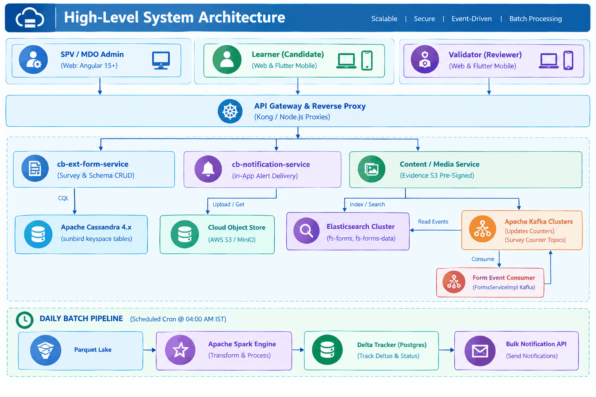
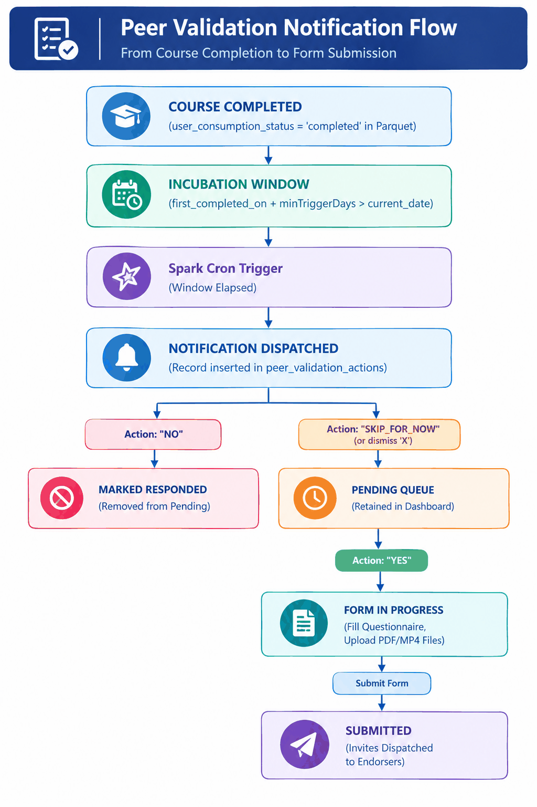
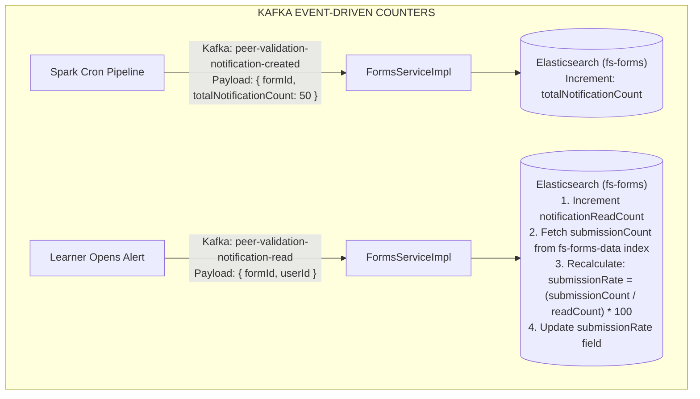

# Peer Validation — Software Design Document (SDD)

## Peer Validation Feature — iGOT Karmayogi Platform

### 2. Introduction, Purpose & Scope

#### 2.1 Purpose

This Software Design Document specifies the complete architectural, infrastructural, data, and procedural design for the **Peer Validation** feature on the iGOT Karmayogi platform. It translates functional requirements (FRS) and system requirements (SRS) into concrete component specifications, database schemas, API interfaces, asynchronous pipeline jobs, state machine definitions, and security controls.

#### 2.2 Scope

The design encompasses:

1. **Administrative Configuration:** Linking peer validation forms to live courses/programs, managing trigger delay windows, and viewing real-time submission rates.
2. **Automated Batch Eligibility Pipeline:** PySpark daily batch job identifying course-completed learners, computing incubation offsets, filtering by organization, and invoking idempotent bulk notification APIs.
3. **Learner Engagement & Submission Subsystem:** In-app notifications, pop-up dialogs, reflection responses, multi-format workplace evidence asset uploads, and universal platform user nomination across three roles (Reporting Officer, Peer, Subordinate).
4. **Validator Review Workflow:** Reviewer queue management, dossier inspection, and immutable evaluation submission.
5. **Event-Driven Counter & Rate Synchronization:** Kafka stream processing updating notification read counts, submission volumes, and recalculated submission rates in Elasticsearch.

### 3. Architectural Context & Design Rationale



#### Key Architecture Trade-Offs & Decisions

1. **Separation of Notification Metadata & Action State:** Rather than altering the high-throughput, legacy `sunbird.individual_notifications` Cassandra table, an auxiliary lookup table `sunbird.peer_validation_actions` is introduced with a composite primary key `(user_id, notification_id)`. This prevents regression in core notification flows while enabling multi-state operations (`YES`, `NO`, `SKIP_FOR_NOW`).
2. **Elasticsearch-Driven View Count & Submission Rate:** To avoid real-time table scans across millions of learner submissions, `fs-forms` maintains pre-calculated counter fields (`notificationReadCount`, `totalNotificationCount`, `submissionRate`). Updates stream asynchronously via Kafka, decoupling read/write paths and enabling sub-second sorting by submission rate on administrative dashboards.
3. **Daily Decoupled Batch Eligibility Engine:** Instead of event-driven instant triggering on course completion, a scheduled daily PySpark job processes completions at 04:00 AM IST. This design absorbs massive burst traffic during mass-certification events and enforces incubation window offsets (`minTriggerDays`, `maxTriggerDays`) uniformly.

### 4. System Component Decomposition

#### 4.1 Frontend Clients (Web Portal & Mobile Application)

- **Technology Stack:** Angular 15+ (Desktop/Mobile Web via Node.js Gateway Proxy), Flutter / Dart (Mobile App across Android 13- and iOS 17-).
- **Responsibilities:**
  - Admin Portal: Form creation, live course linking, deadline configuration, submission rate tracking, CSV report triggers.
  - Learner Portal: Pop-up dialog rendering, dual-tab dashboard (`Pending Surveys` & `Incoming Validation Requests`), reflection form input, multi-tier validator search, evidence file validation and upload.

#### 4.2 API Gateway & Proxy Layer (Kong / Node.js Proxies)

- **Routing Path:** `apis/proxies/v8/v1/notifications/*` and `/api/v1/notifications/*`.
- **Responsibilities:** SSL termination, session cookie authentication (`connect.sid`), bearer token verification, CORS handling, rate limiting, and route mapping to internal microservices.

#### 4.3 Survey & Form Management Service (`cb-ext-form-service`)

- **Technology Stack:** Java 11 / Spring Boot, running on Kubernetes.
- **Responsibilities:**
  - CRUD endpoints for survey definitions, enforcing 1:1 binding between content and survey.
  - Managing survey lifecycle states (`DRAFT`, `ACTIVE`, `ENDED`).
  - Serving the search and listing API (`POST /forms/search`).
  - Consuming Kafka counter topics to update read counts and recalculate submission rates.

#### 4.4 Notification Subsystem (`cb-notification-service` & Wrapper)

- **Technology Stack:** Java 8 / 11, Akka / Play framework, Apache Cassandra drivers.
- **Responsibilities:**
  - Processing the dedicated bulk creation endpoint: `POST /api/v1/notifications/bulk/create/peervalidation`.
  - Inserting standard notifications into `sunbird.notifications` / `sunbird.individual_notifications` and initializing tracking records in `sunbird.peer_validation_actions`.
  - Emitting Kafka events when notifications transition to `READ`.

#### 4.5 Batch Eligibility & Data Pipeline (Apache Spark Engine)

- **Technology Stack:** PySpark running on automated scheduler (Airflow / Kubernetes CronJob).
- **Responsibilities:**
  - Daily execution at 04:00 AM IST.
  - Extracting active survey schemas from Elasticsearch index `fs-forms`.
  - Ingesting user course completions and organization mappings from Parquet lake storage.
  - Computing incubation windows: `eligible_from = first_completed_on + minTriggerDays`.
  - Performing Delta checks against PostgreSQL `notification_tracking` via Left Anti-Join.
  - Invoking `cb-notification-service` bulk API and logging outcomes in PostgreSQL `notification_api_log`.

### 5. Interface & API Contracts

#### 5.1 Bulk Notification API (Internal Batch Engine -> Notification Service)

- **HTTP Method:** `POST`
- **Path (Direct Service):** `/api/v1/notifications/bulk/create/peervalidation`
- **Path (Portal Proxy):** `/apis/proxies/v8/v1/notifications/bulk/create/peervalidation`
- **Headers:**
  - `Authorization: Bearer <service_jwt>`
  - `Content-Type: application/json`

##### Request Payload Specification

```json
{
  "request": [
    {
      "user_id": "usr_9b1a8f23-34e1-4c91-a67b-1204857201ab",
      "type": "IN_APP",
      "category": "PEER_VALIDATION",
      "sub_type": "PEER_VALIDATION",
      "source": "SYSTEM_CREATED",
      "sub_category": "PEER_EVALUATION_ASSIGNED",
      "message": {
        "data": [
          {
            "formId": "1773063178947",
            "courseName": "CRS 0805 - Innovation & Creativity in Public Governance",
            "isSurveySubmitted": false,
            "completionDate": "2026-03-10T16:20:00.000Z",
            "surveyCreatedById": "4dd5i8g1-9hif-8h19-f6ef-jegg8e243169",
            "surveyName": "Workplace Competency Evaluation",
            "surveyEndDate": "2026-05-15T23:59:59.000Z",
            "learnerName": "Rahul Sharma"
          }
        ],
        "body": "You have been assigned to evaluate Rahul Sharma's workplace application in 'CRS 0805 - Innovation & Creativity in Public Governance'. Please complete by 2026-05-15."
      }
    }
  ]
}
```

##### Response Payload (200 OK)

```json
{
  "id": "notification.v1.bulk.create.peervalidation",
  "ver": "1.0",
  "ts": "2026-03-11T09:08:32.829Z",
  "params": {
    "resMsgId": "7e7f8ba5-4ca4-456c-8617-6e389691f1e9",
    "msgId": "7e7f8ba5-4ca4-456c-8617-6e389691f1e9",
    "err": null,
    "status": "success",
    "errMsg": null
  },
  "responseCode": "OK",
  "result": {
    "processed_count": 1,
    "skipped_count": 0,
    "failed_count": 0,
    "skipped": [],
    "failed": [],
    "notifications": [
      {
        "notification_id": "dc2bde8b-a3d2-4a0e-a154-8dba5f7cfc49",
        "user_id": "usr_9b1a8f23-34e1-4c91-a67b-1204857201ab",
        "category": "PEER_VALIDATION",
        "sub_category": "PEER_EVALUATION_ASSIGNED",
        "read": false,
        "created_at": "2026-03-11T09:08:32.829Z"
      }
    ]
  }
}
```

#### 5.2 Survey Action & Pop-up Response API (Learner Client -> Notification Service)

- **HTTP Method:** `PATCH`
- **Path:** `/api/v1/notifications/peervalidation/action`
- **Headers:** `Authorization: Bearer <user_token>`, `Content-Type: application/json`

##### Request Payload

```json
{
  "request": {
    "notification_id": "dc2bde8b-a3d2-4a0e-a154-8dba5f7cfc49",
    "action": "YES" // Enum: YES | NO | SKIP_FOR_NOW
  }
}
```

##### Response Behavior

- `YES`: System verifies `survey_end_date >= now()`. If valid, marks notification read, updates `peer_validation_actions.action = 'YES'`, and returns redirect URI. If expired, returns `410 GONE` (`"Survey has ended"`).
- `NO`: Sets `action = 'NO'`. Removes the survey from the user's pending queue. Subsequent access attempts return `"You have already submitted the response"`.
- `SKIP_FOR_NOW`: Sets `action = 'SKIP_FOR_NOW'`. Dismisses the dialog while retaining the entry in the learner's "Pending Surveys" tab.

#### 5.3 Survey Listing & Submission Rate API (Admin Client -> Form Service)

- **HTTP Method:** `POST`
- **Path:** `/forms/search`
- **Request Payload:**

```json
{
  "request": {
    "filters": {
      "contextType": "peerValidationSurvey",
      "status": [
        "ACTIVE",
        "ENDED"
      ]
    },
    "limit": 15,
    "offset": 0,
    "sort_by": {
      "submissionRate": "desc"
    }
  }
}
```

- **Response Elements:** Returns arrays containing `formId`, `courseName`, `notificationReadCount` (views), `totalSubmissions`, and calculated `submissionRate` formatted for display as `40/200 (20%)`.

### 6. Data Architecture & Storage Design

#### 6.1 Apache Cassandra (Keyspace: `sunbird`)

##### Table: `peer_validation_actions`

Tracks non-binary interactive responses without impacting core notification tables.

```sql
CREATE TABLE sunbird.peer_validation_actions (
    user_id text,
    notification_id text,
    action text,            -- 'YES', 'NO', 'SKIP_FOR_NOW'
    survey_end_date timestamp,
    action_at timestamp,
    metadata text,          -- JSON: surveyId, learnerName, courseName, dateOfCompletion, etc.
    created_at timestamp,
    updated_at timestamp,
    PRIMARY KEY (user_id, notification_id)
) WITH CLUSTERING ORDER BY (notification_id ASC);
```

#### 6.2 Elasticsearch Indices

##### Index: `fs-forms` (Survey Definitions & Aggregates)

```json
{
  "mappings": {
    "properties": {
      "formId": {
        "type": "keyword"
      },
      "courseId": {
        "type": "keyword"
      },
      "orgId": {
        "type": "keyword"
      },
      "createdByRole": {
        "type": "keyword"
      },
      "minTriggerDays": {
        "type": "integer"
      },
      "maxTriggerDays": {
        "type": "integer"
      },
      "formStartDate": {
        "type": "date"
      },
      "formEndDate": {
        "type": "date"
      },
      "status": {
        "type": "keyword"
      },
      "totalNotificationCount": {
        "type": "integer"
      },
      "notificationReadCount": {
        "type": "integer"
      },
      "submissionRate": {
        "type": "float"
      }
    }
  }
}
```

##### Index: `fs-forms-data` (Learner Reflections & Review Submissions)

Stores completed responses, artifact references, and validator evaluations for text analytics and CSV export generation.

#### 6.3 Relational Storage (PostgreSQL — Pipeline Audit & Idempotency)

##### Table: `peer_validation_notification_tracker`

Enforces strictly exactly-once dispatch across recurring Spark cron runs.

```sql
CREATE TABLE peer_validation_notification_tracker (
    id BIGSERIAL PRIMARY KEY,
    user_id VARCHAR(64) NOT NULL,
    form_id VARCHAR(64) NOT NULL,
    course_id VARCHAR(64) NOT NULL,
    first_completed_on TIMESTAMP NOT NULL,
    notification_sent_at TIMESTAMP DEFAULT CURRENT_TIMESTAMP,
    data_generated_on TIMESTAMP DEFAULT CURRENT_TIMESTAMP,
    CONSTRAINT uq_user_form_dispatch UNIQUE (user_id, form_id)
);

CREATE INDEX idx_pv_tracker_lookup ON peer_validation_notification_tracker(user_id, form_id);
```

##### Table: `peer_validation_api_response_log`

```sql
CREATE TABLE peer_validation_api_response_log (
    id BIGSERIAL PRIMARY KEY,
    user_id VARCHAR(64) NOT NULL,
    form_id VARCHAR(64) NOT NULL,
    request_payload JSONB NOT NULL,
    response_body JSONB NOT NULL,
    http_status INT NOT NULL,
    response_time_ms INT NOT NULL,
    data_generated_on TIMESTAMP DEFAULT CURRENT_TIMESTAMP
);
```

#### 6.4 Cloud Object Store (S3 / MinIO) Evidence Structure

Uploaded evidence files are stored with structured keys:

- Path: `s3://igot-evidence-store/peer-validation/{formId}/{learnerUserId}/{evidenceType}_{timestamp}.{ext}`
- Constraints:
  - Document: Exactly 1 file, format `.pdf`, maximum size `2 MB`.
  - Video: Exactly 1 file, format `.mp4`, maximum size `200 MB`.

### 7. Core Business Logic & State Machines

#### 7.1 Learner Lifecycle State Machine



#### 7.2 Validator Selection & Search Ranking Algorithm

1. **Unrestricted Nomination:** Learners can nominate any platform user; no organizational reporting line is enforced.
2. **Search Priority Scoring:**
  - Exact Match & Same Organization (`user.org_id == learner.org_id`): Rank 1.
  - Partial Match & Same Organization: Rank 2.
  - Exact Match & Different Organization: Rank 3.
  - Partial Match & Different Organization: Rank 4.

3. **Hierarchy Escalation:** Nominated Reporting Officers have permission to forward the review request to higher-level superiors for second-level endorsement.

### 8. Asynchronous Processing & Event-Driven Architecture



#### Batch PySpark Extraction Logic

```python
# Pseudo-PySpark Transformation for Daily 4:00 AM Execution
active_forms = es_read("fs-forms").filter(
    (col("status") == "ACTIVE") &
    (current_date().between(col("formStartDate"), col("formEndDate")))
)

enriched_completions = user_enrolments.filter(
    col("user_consumption_status") == "completed"
).join(user_org_mapping, "user_id")

eligible_candidates = enriched_completions.join(
    active_forms, enriched_completions.content_id == active_forms.courseId
).filter(
    # Dynamic trigger window
    current_date().between(
        date_add(col("first_completed_on"), col("minTriggerDays")),
        date_add(col("first_completed_on"), col("maxTriggerDays"))
    ) &
    # Role-based org scoping
    (
        (col("createdByRole") == "SPV") |
        ((col("createdByRole") == "MDO") & (col("user.org_id") == col("form.orgId")))
    )
)

# Delta Filtering against PostgreSQL Tracker
new_notifications = eligible_candidates.join(
    postgres_tracker, on=["user_id", "formId"], how="left_anti"
)
```

### 9. Security, Privacy & Access Control

- **Identity Verification:** All user interactions authenticate via platform session tokens or OAuth 2.0 Bearer JWTs validated by Kong Gateway.
- **Sensitive Workplace Data Safeguards:**
  - Mandatory UI disclaimer before uploading evidence:
    *"Do not upload classified, confidential, sensitive, personal, or policy-restricted information. Remove or mask names, contact details, IDs, passwords, credentials, citizen data, and similar information."*
  - Server-side MIME-type verification on binary file uploads: strictly `application/pdf` and `video/mp4`.
  - Uploaded objects are stored in private S3 buckets accessible only via short-lived pre-signed URLs (15-minute TTL).

- **Multi-Tenant Scoping:** MDO administrators are restricted to surveys matching their assigned `orgId`. SPV administrators maintain platform-wide visibility.

### 10. Observability, Logging & Telemetry

- **Correlation Tracing:** All API calls propagate `x-request-id` across Kong, microservices, and Cassandra drivers.
- **Telemetry Events:** Structured JSON logs emitted to Kafka for audit and usage analytics:
  - `INTERACT`: Pop-up viewed, pop-up dismissed, pop-up accepted.
  - `SUBMIT`: Survey response submitted, validation review submitted.
  - `EXPORT`: Administrative CSV report downloaded.

- **Service Metrics:** Prometheus metrics track `peer_validation_bulk_notify_duration_seconds`, `peer_validation_action_total`, and `peer_validation_spark_job_records_processed`.

### 11. Deployment, Infrastructure & Performance Constraints

- **Target Load:** Production infrastructure accommodates up to 25,000 concurrent platform users.
- **Response Times:**
  - Interactive Listing & Read APIs: p95 latency ≤ 2.0 seconds.
  - Form & Review Submit APIs: p95 latency ≤ 3.0 seconds.

- **Report Expiry:** Asynchronously generated administrative CSV extracts are automatically purged after 24 hours (`PEER_FDBK_BR13`).
- **High Availability:** Services deploy in multi-zone Kubernetes clusters with Horizontal Pod Autoscalers (HPA) configured for CPU/Memory utilization thresholds of 70%.

### 12. Requirements Traceability Matrix

| Requirement ID / Source | Architectural Component | Implementation Details | Verification Method |
|---|---|---|---|
| **FRS** `PEER_FDBK_BR1` / KB-13016, KB-13017 | `cb-ext-form-service` & Admin UI | Survey creation, live course validation, 1:1 uniqueness check (`PEER_FDBK_BR8`). | Automated API contract tests & UI unit tests. |
| **FRS** `PEER_FDBK_BR2` / KB-13018, KB-13499 | Apache Spark Job & Notification Service | Incubation window calculation (`minTriggerDays`), Cassandra `peer_validation_actions` persistence. | End-to-end integration test with mocked Parquet datasets. |
| **FRS** `PEER_FDBK_BR3` / KB-13020, KB-13498 | Notification Service & Web/Mobile UI | Dual-tab dashboard (`Pending Surveys` & `Incoming Requests`), pagination (15/30/50), end-date sort. | Performance test under 100,000 pending items; Cypress UI test. |
| **FRS** `PEER_FDBK_BR4` / KB-13497, KB-14420 | Media Upload & Review Subsystem | Evidence uploads (PDF ≤ 2MB, MP4 ≤ 200MB), sensitive data masking prompt, immutable review submissions. | Security audit, file validation tests, idempotency tests. |
| **FRS** `PEER_FDBK_BR5`, `BR6` / KB-14552 | Kafka Stream & Elasticsearch Engine | Asynchronous calculation of `submissionRate = (Submissions / Views) * 100`, Elasticsearch sorting. | Kafka consumer integration test & ES search query benchmark. |

### 13. Design Decisions, Trade-Offs, Assumptions & Open Items

#### 13.1 Confirmed Design Decisions

- **Non-Destructive Notification Extension:** Created `sunbird.peer_validation_actions` to avoid modifying core Cassandra schemas.
- **Denormalized Counters in Elasticsearch:** Stored precomputed counts in `fs-forms` to ensure real-time dashboard performance.
- **Spark Left-Anti Join for Idempotency:** Guaranteed exactly-once notification delivery across batch runs.

#### 13.2 Open Items & Technical Clarifications

1. **External Reviewer Authentication Flow:** For external reviewers nominated via manual email entry (`PEER_FDBK_BR2_FR8`), the specific authentication mechanism (secure one-time magic link token vs. forced registration on iGOT) requires final product sign-off before implementation.
2. **Inverted FRS Formula Reconciliation:** While FRS `PEER_FDBK_BR6_FR4` listed `(Total Views / Total Submissions) * 100`, the technical engineering design document ([Peer Validation Survey – View Count & Submission Rate Design](https://karmayogibharat.atlassian.net/wiki/spaces/TES/pages/818511874/Peer+Validation+Survey+View+Count+Submission+Rate+Design)) confirmed and implemented the standard industry formula:<br>$$\text{Submission Rate} = \left(\frac{\text{Number of Submissions}}{\text{Number of Views}}\right) \times 100$$<br>This SDD standardizes on the implemented engineering architecture.
