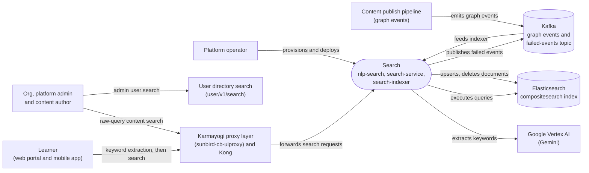

# Search — Context Diagram

## System boundary

Inside the feature are the two independent backends: `nlp-search` (LLM keyword extraction)
and the `search-service` in `knowledge-platform` (Elasticsearch query execution), plus the
`search-indexer` job that keeps the search index current. Outside it are the learner and
admin-facing clients, the `sunbird-cb-uiproxy` gateway layer and Kong in front of the
backends, Google Vertex AI (Gemini), the Elasticsearch index, the Kafka graph-event feed,
and the separate user-directory search service.

## Diagram

## Elements

| Element | Role | Detailed in |
|---|---|---|
| Search (`nlp-search`, `search-service`, `search-indexer`) | Central system: LLM keyword extraction, Elasticsearch query execution, and Kafka-driven index updates | [hld.md](hld.md) |
| Learner (web portal and mobile app) | Types a query; the client extracts a keyword first, then searches courses, people, communities and events | [use-cases.md](use-cases.md) |
| Org, platform admin and content author | Search content in their portals using the raw typed text, with no keyword-extraction step; also search users | [use-cases.md](use-cases.md) |
| Platform operator | Provisions Elasticsearch and deploys the search services | [operations-manual.md](operations-manual.md) |
| Karmayogi proxy layer (`sunbird-cb-uiproxy`) and Kong | Session gate, header injection and routing in front of the backends; some search endpoints are handled in the proxy itself | [apis.md](apis.md) |
| Google Vertex AI (Gemini) | LLM that returns a ranked keyword list for a query | [apis.md](apis.md) |
| User directory search | Separate service behind admin user search; not part of the traced repos | [hld.md](hld.md) |
| Content publish pipeline | Source of graph-transaction events and publish-time bulk indexing | [hld.md](hld.md) |
| Elasticsearch (`compositesearch` index) | Index read by `search-service` and written by the indexer | [apis.md](apis.md) |
| Kafka | Carries graph events in and failed-index events out | [apis.md](apis.md) |

> **Verification boundary:** read in full: `index.md`, `use-cases.md`, `apis.md` and
> `hld.md` of this feature; `lld.md` and the other pages were not read. Spot-checked
> read-only in source: the `nlp-search` route layout, the `sunbird-cb-uiproxy`
> `searchV6` and autocomplete handlers, and the `compositesearch` index name in the
> indexer config. Kong's live routing and the user-directory implementation are not in the
> traced repos, so the proxy-to-backend hop is shown as documented, not confirmed.
> Not re-verified: the Kafka topic wiring, Elasticsearch provisioning, and per-client
> call sites.
