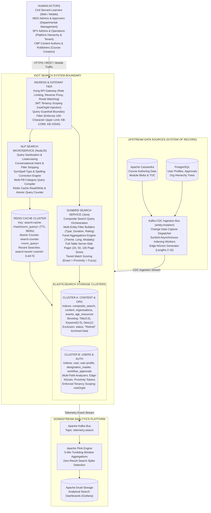
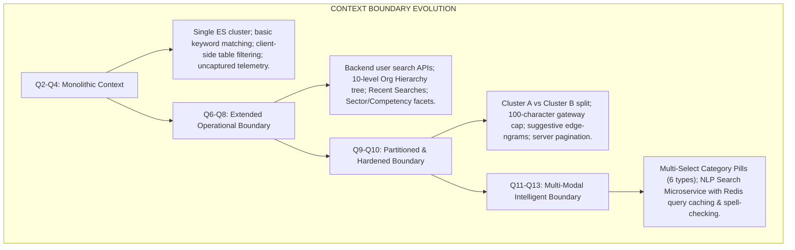
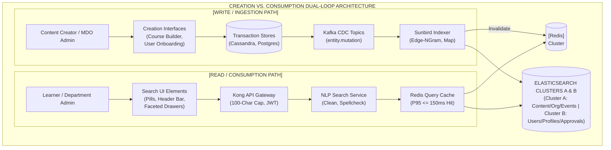

# Search — System Context Diagram

## 2. System Boundary & Executive Context Definition

### 2.1 Context Definition

The **Conventional Search Ecosystem** on the **iGOT Karmayogi Platform** is the digital discovery and routing core connecting human actors, administrative workflows, and external data platforms across India's civil service capacity-building infrastructure.

The System Context defines:

1. **The System Boundary**: What lies inside the core Conventional Search engine (ingestion pipelines, query sanitization, normalization, spelling correction, caching, tiered scoring, index management) versus what lies outside (transactional course builders, HR databases, mobile OS runtimes, external analytics platforms).
2. **External Entities & Human Actors**: Learners, Department Administrators, SPV Operators, and Content Publishers who interact with the system.
3. **External Systems & Platforms**: Upstream transactional databases (Cassandra, PostgreSQL), Change Data Capture (CDC) event buses (Kafka), streaming engines (Flink), analytical stores (Druid), and Keycloak IAM.
4. **Creation vs. Consumption Boundary Intersections**: How write-path entity mutations translate into read-path search responses without cross-contaminating resources.

### 2.2 Operational Environment Assumptions

- **Authentication Boundary**: All administrative queries pass through Keycloak JWT validation; the search system trusts the gateway-validated `rootOrgId` and user roles.
- **Data Segregation**: Write operations originate in transactional databases and flow asynchronously into the search index via Kafka event streams.
- **Zero-AI Boundary**: The system operates strictly deterministically using syntactic query normalization, n-gram analyzers, BM25 scoring, and Redis caching.

## 3. High-Level Enterprise System Context Diagram (C4 Level 1)

## 4. Historical System Context Evolution (Q2 – Q13)

The system context evolved substantially across release cycles to meet scaling demands and operational requirements.

### Phase Breakdown

#### Phase 1: Foundational Catalog Search Context (Q2 – Q4)

- **External Interfaces**: Web UI only; Sunbird Content API.
- **Context Boundaries**: Single shared Elasticsearch 6.7 cluster housing content and early pilot user records.
- **Data Flow Characteristics**: Basic keyword queries; no caching tier. Search keywords logged into Druid via Kafka (`KB-2131`, `KB-2152`). Introduction of dedicated `/app/search` page and basic facets (`KB-3494`, `KB-3504`).

#### Phase 2: Administrative Expansion & Hierarchy Context (Q6 – Q8)

- **External Interfaces**: SPV Admin Directory, MDO Approvals Grid, Learner Native Mobile App.
- **Context Boundaries**: Transition from client-side array filtering to server-side backend queries (`KB-7919`, `KB-7920`).
- **Data Flow Characteristics**: Introduction of recursive node traversal queries for 10-level Organizational Hierarchy exploration (`KB-9738`, `KB-9790`, `KB-9794`). Introduction of **Recent Searches** (Last 5 terms) stored locally and in user profile stores (`KB-8701`, `KB-10624`).

#### Phase 3: Segregated Infrastructure & High-Density Boundary (Q9 – Q10)

- **External Interfaces**: Universal MDO Header Bar, CBP Authoring Header, SPV Full-Table Grids.
- **Context Boundaries**: **Physical Cluster Split** (`KB-11907`, `KB-11908`, `KB-11794`):
  - **Cluster A**: Dedicated to Content, Programs, Events, and Organizations.
  - **Cluster B**: Dedicated to Users, Profiles, Designations, and Workflow Approvals.

- **Data Flow Characteristics**: Enforced an ingress boundary cap of **100 characters** per query string to prevent JVM heap exhaustion (`KB-12369`). Standardized full-table server pagination (20, 50, 100 rows) eliminating client DOM truncation (`KB-10564`, `KB-10579`).

#### Phase 4: Multi-Modal Category Pills & NLP Caching Boundary (Q11 – Q13)

- **External Interfaces**: Learner Multi-Pill Selection Bar, Marketplace Course Listing, Provider Branding Grids.
- **Context Boundaries**: Addition of the standalone **NLP Search Service** (`KB-15717`) and Redis distributed caching tier.
- **Data Flow Characteristics**:
  - Support for **Multi-Select Category Pills** (`KB-15545`) allowing simultaneous multi-modal discovery across Content, Events, People, Marketplace, Communities, and AGK.
  - Query cleaning pipeline stripping filler words (`"I want to learn"`), correcting spelling (`"grievence"` `"grievance"`), incrementing atomic Redis counters, and resolving cached responses in .
  - Strict catalog isolation: Retired/Archived courses (`status: "Retired"`) excluded from active catalog aliases (`KB-12730`).

## 5. Entity Creation vs. Consumption Context Models

The Conventional Search Ecosystem operates via two decoupled data paths: the **Asynchronous Creation/Ingestion Loop** (write path) and the **Synchronous Consumption Loop** (read path).

### 5.1 Ingestion / Creation Context Specifications

1. **Source Systems**:
  - Course, Program, and Resource authoring metadata originates in **Apache Cassandra**.
  - Civil servant profiles, designation masters, and organizational hierarchy trees originate in **PostgreSQL**.

2. **CDC Ingestion Worker**:
  - Captures transactional mutation events from Kafka topic `karmayogi.entity.mutation`.
  - Strips internal system control parameters and audit fields.
  - Evaluates target Elasticsearch cluster:
    - Course metadata **Cluster A** (`composite_search`).
    - User accounts & profiles **Cluster B** (`user`, `user-profile`).

  - Generates edge-ngram character tokens (min-gram: 2, max-gram: 15) on entity names, titles, and designations.
  - Invalidate matching query response keys in the Redis Cache Cluster.

### 5.2 Discovery / Consumption Context Specifications

1. **Ingress Filtering**:
  - Client requests pass through Kong API Gateway.
  - Ingress boundary check enforces a strict 100-character upper bound (`KB-12369`).
  - Gateway verifies JWT claims and injects tenant scope (`rootOrgId`).

2. **NLP Query Normalization**:
  - Strips filler/intent phrases (`"I want to learn"`, `"courses on"`).
  - Normalizes characters to lowercase and cleans interior whitespace.
  - Increments atomic query usage counters in Redis (`KB-15717`).

3. **Cache Resolution & Query Execution**:
  - Checks Redis cache: On hit, returns stored JSON response in .
  - On miss, constructs Elasticsearch DSL query targeting Cluster A or Cluster B.
  - Executes weighted scoring (Title > Keywords > Description).
  - Writes response payload to Redis with an environment-driven TTL (default 3600s).

4. **Downstream Action**:
  - Learner consumes results Opens Table of Contents Enrols Launches Course Player.
  - Admin consumes results Opens Profile Approves Transfer / Verifies User.

## 6. Portal-Wise Context Interfaces

**PORTAL CONTEXT BOUNDARIES**

| | External Actors | Boundaries | Ingress Endpoints | Target Storage |
|---|---|---|---|---|
| 1. SPV PORTAL (Platform-Wide Tenant & Partner Administration) | SPV Administrator, Partner Operations Lead | Org Hierarchy Tree (10 Levels), Partner Directory, Designation Master | POST /api/org/v1/search, POST /api/user/v1/search | ES Cluster A (organisations), ES Cluster B (user) |
| 2. MDO PORTAL (Departmental Personnel & Capacity Building Administration) | MDO Administrator, MDO Approver, Training Coordinator | Scoped Employee Rosters, Departmental Training Plans / APAR, Events | POST /api/user/v1/search, POST /api/trainingplan/v1/search | ES Cluster B (user, user-profile, workflow_approvals) |
| 3. CBP PORTAL (Content Authoring, Curriculum Deduplication & Access Rules) | Content Author, CTI Publisher, Content Reviewer | Live & Draft Course Catalog, Inbound Content Requests, User Group Rules | POST /api/content/v1/search, POST /api/user/v1/search | ES Cluster A (composite_search), ES Cluster B (user) |
| 4. LEARNER PORTAL & MOBILE APP (Multi-Modal Discovery & Course Consumption) | Civil Servant Learner (Web / Android / iOS) | Multi-Select Category Pills, Suggestive Search, Recent/Trending Popovers | POST /api/nlp/v1/search, POST /api/user/v1/recent-search | Redis Cache Cluster, ES Cluster A (composite_search, events, agk) |

### Detailed Portal Contexts

#### 1. SPV Portal

- **Operational Focus**: National directory administration, state/central jurisdiction segregation, and institutional partner management.
- **Environmental Context**:
  - Interacts with public registration endpoints to supply searchable organization dropdowns (`KB-616497179`).
  - Executes full-table multi-column search (Name, Email, Role, Status) across server-side paginated grids (20, 50, 100 rows per page) (`KB-10562`, `KB-10564`).
  - Navigates hierarchical organizational trees across 10 levels of ministerial nesting (`KB-9738`, `KB-9790`).

#### 2. MDO Portal

- **Operational Focus**: Departmental civil service administration, role-to-competency verification, and APAR mandatory training tracking.
- **Environmental Context**:
  - Enforces hard tenancy boundary: Queries automatically inject the authenticated user's `rootOrgId` claim, preventing cross-ministry data leakage.
  - Universal header search provides suggestive auto-complete categorized by Users, Training Plans, Events, and Communities (`KB-10581`, `KB-11176`).
  - Supports multi-field employee discovery matching simultaneously across Name, Email, Designation, Group, and Cadre (`KB-10579`, `KB-11177`).

#### 3. CBP Portal

- **Operational Focus**: Curriculum authoring, duplicate course detection, and course access policy enforcement.
- **Environmental Context**:
  - Searches draft and live course repositories across DO-IDs, titles, and competencies (`KB-8980`, `KB-11045`).
  - Enforces archival isolation: Content with `status: "Retired"` is strictly filtered out of active authoring views (`KB-12730`).
  - User search integration allows course authors to locate specific civil servants by name/email to grant Invite-Only access (`KB-9602`).

#### 4. Learner Portal & Mobile App

- **Operational Focus**: Fast, typo-tolerant, multi-modal learning discovery for individual civil servants.
- **Environmental Context**:
  - **Multi-Select Category Pills** (`KB-15545`): Simultaneous discovery across Content, Events, People, Marketplace, Communities, and Amrit Gyan Kosh with stacked card layouts and independent counts.
  - Suggestive search popover displays **Last 5 Recent Searches** (`KB-8701`) or platform **Trending Searches** (`KB-10624`).
  - NLP service strips intent phrases, corrects misspelled words, and returns cached results via Redis in (`KB-15717`).
  - Mobile client optimizes category pill scrolling, opens full-screen touch-friendly filter drawers, and clamps People cards to 4 per category (vs 5 on web).

## 7. Data Flow & Boundary Interface Specifications

| Interface ID | Originating Entity | Target System | Protocol | Payload / Data Structure | Security & Tenancy Boundary |
|---|---|---|---|---|---|
| `INT-SRCH-001` | Learner Web / Mobile App | Kong API Gateway | HTTPS / REST | Inbound query string, category pills array, facet filters, sort options. | Public / Optional User Bearer JWT; 100-character upper bound enforced. |
| `INT-SRCH-002` | Kong API Gateway | NLP Search Service | HTTP / JSON | Forwarded request payload with sanitized string and client context. | Internal Kubernetes network; rate-limited at ingress. |
| `INT-SRCH-003` | NLP Search Service | Redis Cache Cluster | Redis Protocol | Key: `search:cache:<hash>`, Command: `INCR search:counter:<norm_query>`. | In-memory cluster; strict TTL expiration; no cross-network exposure. |
| `INT-SRCH-004` | NLP / Sunbird Service | ES Cluster A | REST / HTTP | Boolean DSL query targeting `composite_search`, `organisations`, `events`. | Read-only search client; restricted to public live course aliases. |
| `INT-SRCH-005` | MDO Web Client | Kong API Gateway | HTTPS / REST | Multi-field user search payload, status filter, server pagination (`from`, `size`). | Mandatory Bearer JWT; strictly requires MDO administrative roles. |
| `INT-SRCH-006` | Kong API Gateway | Sunbird User Service | HTTP / JSON | User search criteria with JWT-injected `rootOrgId` filter parameter. | Enforces tenant scoping; client-supplied tenant overrides discarded. |
| `INT-SRCH-007` | Sunbird User Service | ES Cluster B | REST / HTTP | Multi-match query targeting `user`, `user-profile`, `designation_master`. | Read-only client; isolated from Cluster A to prevent thread contention. |
| `INT-SRCH-008` | Upstream Transaction DBs | Kafka CDC Bus | Kafka Wire | Mutation events (`entity.mutation`) emitting modified entity state. | Asynchronous write pipeline; decoupled from read latency budgets. |
| `INT-SRCH-009` | Ingestion Worker | Redis Cache Cluster | Redis Protocol | Cache purge commands invalidating query keys matching mutated entity ID. | Near-real-time index and cache consistency maintenance. |
| `INT-SRCH-010` | Client Applications | Kafka Event Bus | HTTPS Beacon | Telemetry events (`search_initiated`, `search_results_loaded`). | Non-blocking telemetry ingestion stream feeding Flink and Druid. |

## 8. Requirements Traceability to System Context

| Requirement Identifier | Architectural Boundary Realization | Primary Jira Ticket | Confluence Reference ID / Document |
|---|---|---|---|
| **Elasticsearch Cluster Split** | Segregation of Cluster A (Content/Org) and Cluster B (Users/Auth). | [KB-11907: Q10\| Tech Debt \| Elastic Search Index Split for User And Content Index](https://karmayogibharat.atlassian.net/browse/KB-11907) (Internal Review), [KB-11794: Q9\| Tech Debt \| Elastic Search Index Split for User And Content Index](https://karmayogibharat.atlassian.net/browse/KB-11794) (Prod Deployed) | `351862785` (SRS - Search & listing) |
| **100-Character Query Boundary** | Gateway Ingress validation cap truncating excessive query strings. | [KB-12369: Q10 \| Tech Debt \| iGOT ES Search API Enhancements](https://karmayogibharat.atlassian.net/browse/KB-12369) (Open), [KB-15545: Search - Phase 1](https://karmayogibharat.atlassian.net/browse/KB-15545) (Open) | `334725526` (NLP Search Architecture) |
| **Redis Query Caching & Counters** | Distributed cache layer holding query responses with configurable TTL. | [KB-15717: Q13 \| NLP Search Service \| Implement Caching and Retry Mechanism UAT Completed](https://karmayogibharat.atlassian.net/browse/KB-15717) | `338853924` (NLP Search Deployment Guide) |
| **Multi-Select Category Pills** | Unified discovery across Content, Events, People, Marketplace, Communities, AGK. | [KB-15545: Search - Phase 1](https://karmayogibharat.atlassian.net/browse/KB-15545) (Open) | `311296099` (Q7 FRS Search Listing) |
| **Server-Side Administrative Paging** | Full-table database pagination (20, 50, 100) replacing client DOM filtering. | [KB-10564: Q9 \| Enable Multi-page/Full-Table Search \| SPV Portal](https://karmayogibharat.atlassian.net/browse/KB-10564) (Open), [KB-10579: Q9 \| Implement Multi-Field Search Ability \| MDO Portal](https://karmayogibharat.atlassian.net/browse/KB-10579) (In-Progress) | `423264475`, `773586947` |
| **Recent & Trending Searches** | LocalStorage + Redis list storing last 5 terms; trending query fallback. | [KB-8701: Q7 \| Search & Listing \| Recent Searches Need Information](https://karmayogibharat.atlassian.net/browse/KB-8701), [KB-10624: Q7 \| Search & Listing \| Trending & Suggestion in Search functionality](https://karmayogibharat.atlassian.net/browse/KB-10624) (Open) | `336887857`, `527335441` |
| **Org Hierarchy 10-Level Search** | Depth-first node tree traversal filtering by Central vs State jurisdiction. | [KB-9738: Q8 \| Org Search Funcationality \| Organisation Hierarchy Management](https://karmayogibharat.atlassian.net/browse/KB-9738) (Prod Deployed), [KB-9790: Q8 \| Organisation Hierarchy View \| SPV & State Admin \| SPV Portal](https://karmayogibharat.atlassian.net/browse/KB-9790) (To Do) | `616497179` (Org Search Public API) |
| **Archived Content Isolation** | Strict exclusion of `status: "Retired"` courses from public catalog aliases. | [KB-12730: Q11 \| Content Archival \| Search & Visibility of Archived Content](https://karmayogibharat.atlassian.net/browse/KB-12730) (Open) | `468549658` (Q10 FRS Content Portal) |

## 9. Security, Tenancy & Operational Boundary Rules

**OPERATIONAL BOUNDARY ENFORCEMENT**

1. Tenancy Boundary Rule (Zero Cross-Department Leakage):
   - All administrative search requests originating from the MDO Portal MUST have their rootOrgId injected at the API Gateway layer based on the authenticated Keycloak JWT.
   - Any client-supplied tenant override parameter MUST be discarded by the gateway filter.
2. Query Memory Boundary Rule:
   - Ingress query strings are hard-capped at 100 characters.
   - Elasticsearch requests MUST enforce pagination depth bounds (offset + limit <= 10000).
   - Unindexed wildcard queries (\*keyword\*) are blocked to prevent cluster-wide OOM crashes.
3. Archival Isolation Boundary Rule:
   - Courses marked as status: "Retired" MUST NOT be present in active catalog indexes.
   - Archived content is moved to composite_search_archive and remains accessible only via direct DO-ID queries from authorized administrative audit panels.
4. Circuit Breaker Fallback Rule:
   - If the NLP Search microservice latency breaches 2.0s or error rate exceeds 5%, the circuit breaker opens, routing traffic directly to Sunbird Search API using raw tokens to ensure uninterrupted search availability.
