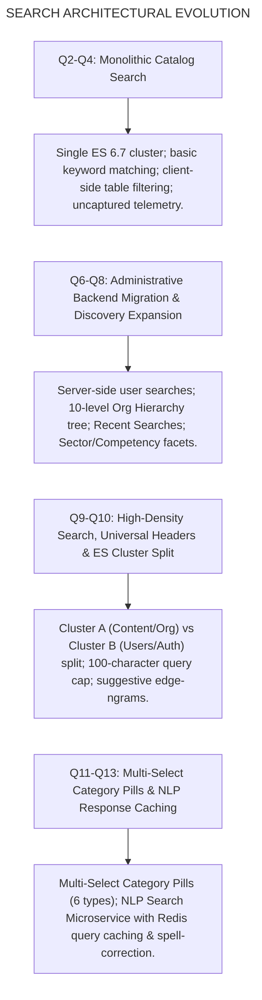
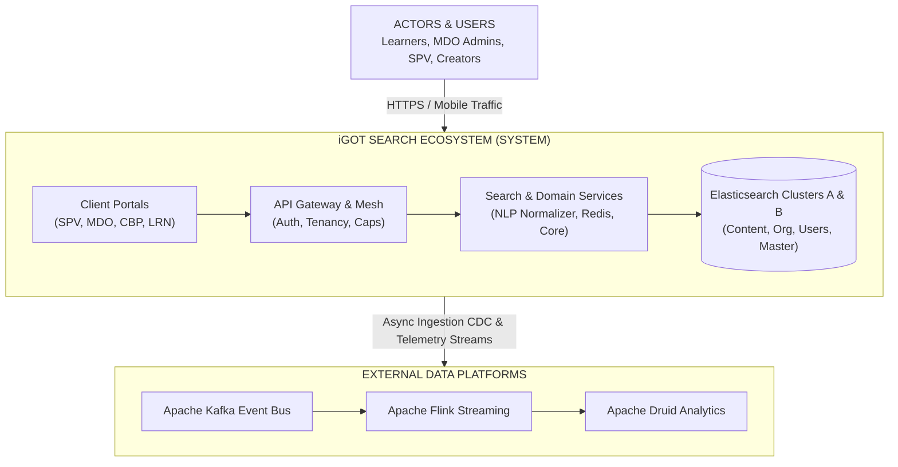
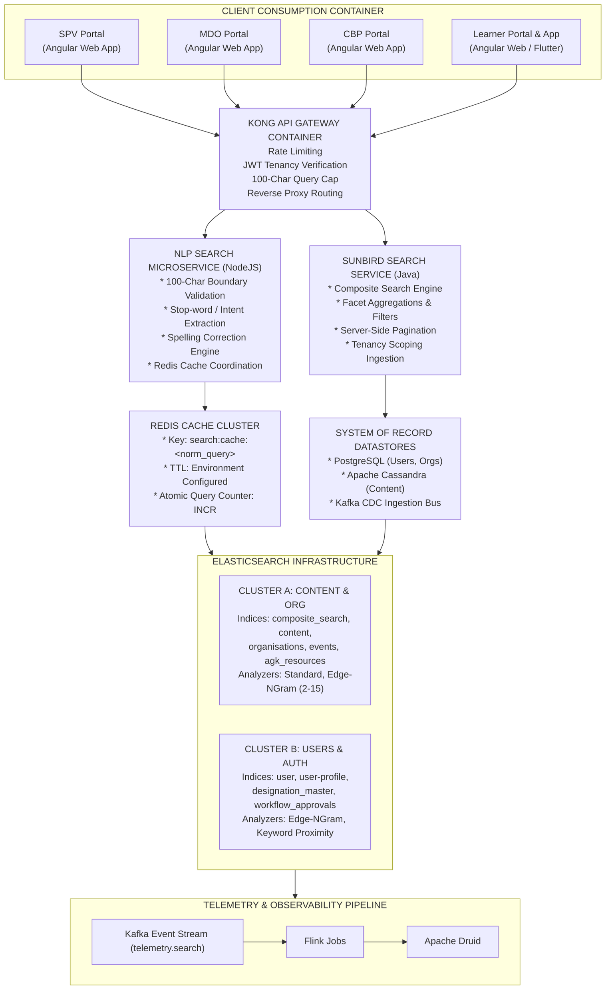
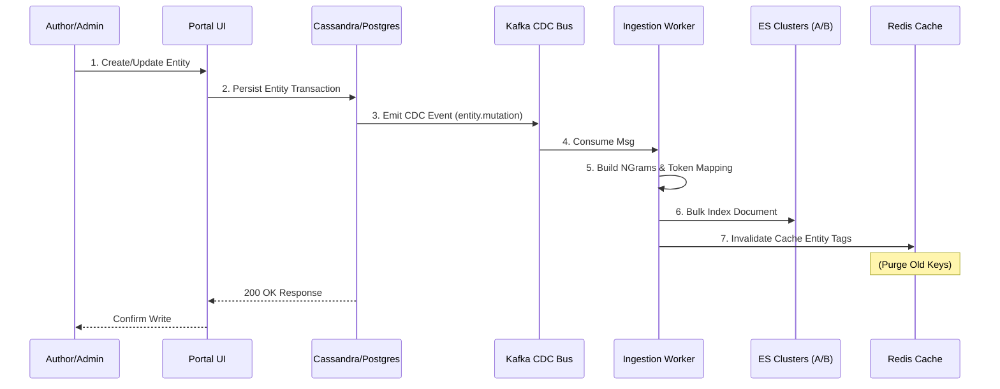
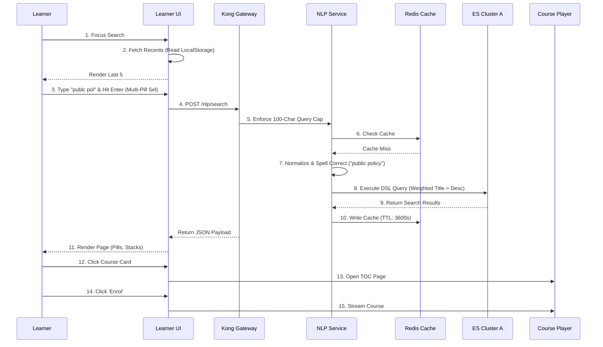
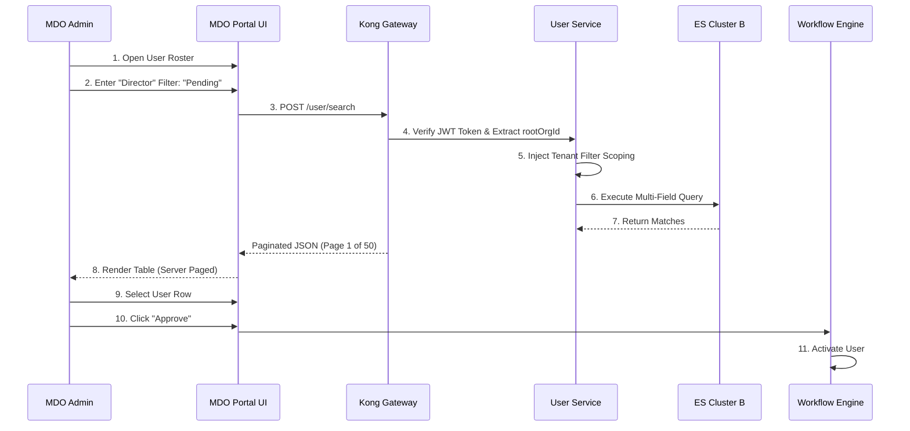
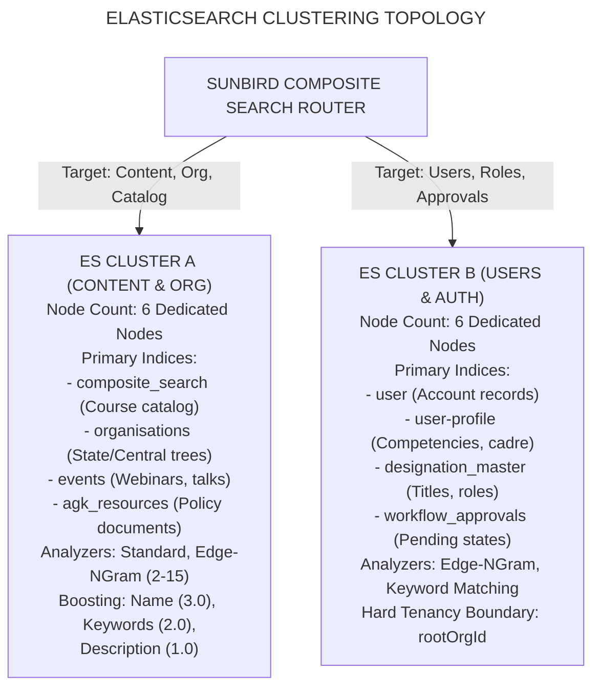

# Search — High-Level Design (HLD) Document

## 2. Executive Architectural Summary & Evolution Drivers

Search across the **iGOT Karmayogi Platform** is the primary routing and discovery backbone connecting over 3 million civil servants, hundreds of Ministries, Departments, and Organizations (MDOs), autonomous training institutes (CTIs / CBP Providers), and the platform governing body (SPV / Karmayogi Bharat).

Between **Q2 and Q13**, Search evolved from a simple monolithic Elasticsearch keyword query on a single content index into an enterprise-grade, distributed discovery platform:

### Core Architecture Drivers

1. **Resource Segregation & Performance Protection**: High-frequency Learner catalog queries are physically separated from high-volume batch user updates by splitting Elasticsearch into two independent clusters (**Cluster A** and **Cluster B**).
2. **Deterministic Ranking & Spell Tolerance**: Rule-based syntactic query normalization, stop-word stripping, spelling correction, and weighted metadata ranking (Title > Keywords > Description) provide accurate discovery without requiring generative AI.
3. **Multi-Category Unification**: A unified discovery layer on the Learner Portal allows simultaneous queries across Courses, Events, People, Marketplace, Communities, and Knowledge Resources (Amrit Gyan Kosh).
4. **Universal Server-Side Administrative Table Search**: Replaced client-side browser filtering in SPV and MDO portals with server-side pagination (20, 50, 100 records per page), multi-column search, and tiered match scoring.

## 3. System Context & Container Architecture (C4 Model)

### 3.1 C4 Level 1: System Context Model

### 3.2 C4 Level 2: Container Architecture Decomposition

## 4. End-to-End Creation-to-Consumption Architecture

The search lifecycle is divided into two continuous loops:

1. **Creation & Indexing Loop (Async Write Path)**: Entities are authored, published, captured via Change-Data-Capture (CDC), and indexed into Elasticsearch.
2. **Query & Consumption Loop (Sync Read Path)**: Users search, filter, and discover resources, triggering downstream consumption.

```mermaid
---
title: "END-TO-END SEARCH CREATION & CONSUMPTION ARCHITECTURE"
---
flowchart TD
    subgraph CP["CREATION PATH - ASYNC WRITE PIPELINE"]
        C0["Content Author / MDO Admin"]
        C1["Portal Mutation: Create/Edit Entity"]
        C2["Transactional DBs: Cassandra / PostgreSQL"]
        C3["Kafka CDC Topics: entity.content.mutation / entity.user.mutation"]
        C4["Sunbird Ingestion Worker"]
        C4A["Resolves Taxonomies, Generates Edge-NGrams"]
        C5["Elasticsearch Cluster A (Content/Org) OR Cluster B (Users)"]
        C6["Evict Stale Redis Query Cache Keys"]
        C0 --> C1
        C1 --> C2
        C2 --> C3
        C3 --> C4
        C4 --> C4A
        C4 --> C5
        C5 --> C6
    end
    subgraph RP["CONSUMPTION PATH - SYNC READ PIPELINE"]
        R0["Learner / MDO Admin / SPV"]
        R1["Client UI: Input Query"]
        R1A["LocalStorage: Show Last 5 Recent Searches"]
        R2["API Gateway: Enforce 100-Char Cap & Validate JWT"]
        R3["NLP Search Service: Normalize, Strip Fillers, Spell-Check"]
        HIT["Redis Cache HIT"]
        HIT1["Return Cached Response Payload (P95 #lt;= 150ms)"]
        MISS["Redis Cache MISS"]
        Q["Query Elasticsearch Cluster A/B"]
        Q1["Execute Weighted BM25 Scoring"]
        W["Write Response to Redis Cache (TTL: 3600s)"]
        U["Client UI: Render Category Stacked Cards & Filters"]
        A["User Action: Enrol in Course / Approve Civil Servant Profile"]
        R0 --> R1
        R1 --> R1A
        R1 --> R2
        R2 --> R3
        R3 --> HIT
        HIT --> HIT1
        R3 --> MISS
        MISS --> Q
        Q --> Q1
        Q --> W
        W --> U
        U --> A
    end
```

## 5. Portal-Wise High-Level Architecture

**PORTAL-SPECIFIC SEARCH ARCHITECTURES**

1. SPV PORTAL (Directory, Org Hierarchy & Partner Discovery)
    - Architecture: Client-Side Angular Grids with Server-Side Full-Table Query Pagination (20/50/100).
    - Search Interfaces: Dedicated Directory Search, Org Hierarchy 10-Level Tree Explorer.
    - Target Indices: ES Cluster A (`organisations`, `partners`, `kcm_competencies`).
    - Processing: Tiered Match Scoring (Exact > Partial > Fuzzy); Hierarchy jurisdiction filtering.
2. MDO PORTAL (Civil Servant Approvals & Capacity Building Management)
    - Architecture: Universal Top-Nav Search Header + Scoped Administrative Listing Grids.
    - Search Interfaces: Suggestive Auto-complete Dropdown, User Management, Training Plans / APAR.
    - Target Indices: ES Cluster B (`user`, `user-profile`, `designation_master`, `workflow_approvals`).
    - Processing: JWT-injected `rootOrgId` multi-tenancy filter; multi-field employee discovery.
3. CBP PORTAL (Content Publisher Authoring Repository & Access Control)
    - Architecture: Content Builder Grid, Content Requests Pipeline, Access Control Finder.
    - Search Interfaces: Universal Content Repository Search, Karmayogi Access Control Search Tool.
    - Target Indices: ES Cluster A (`composite_search`, `content_draft`), Cluster B (`user`).
    - Processing: Automated exclusion of `status: "Retired"` archived courses; DO-ID query matching.
4. LEARNER PORTAL & MOBILE APP (Multi-Modal Discovery & Course Consumption)
    - Architecture: Multi-Select Category Pills UI, Sticky Facet Nav, Native Mobile View.
    - Search Interfaces: Persistent Header Bar, `/app/search` Page, Explore by Theme, Mobile Drawer.
    - Target Indices: ES Cluster A (`composite_search`, `events`, `agk_resources`, `marketplace`).
    - Processing: NLP query normalization, stop-word removal, automatic spelling correction,
      Last 5 Recent Searches popover, trending fallbacks, faceted filter aggregation.

## 6. Detailed High-Level Sequence Flows

### 6.1 Flow 1: Entity Creation, Ingestion & Real-Time Indexation

### 6.2 Flow 2: Learner Multi-Pill Search & Consumption Flow

### 6.3 Flow 3: MDO Administrative Scoped User Search Flow

## 7. Data Storage, Clustering & Ingestion Topology

## 8. Cross-Portal Component & Interface Matrix

| Portal | Search Interface Component | Backing API Endpoint | Data Source Index | Primary Filters | Sorting Capabilities |
|---|---|---|---|---|---|
| **SPV Portal** | Directory Table & Org Hierarchy Explorer | `POST /api/org/v1/search` `POST /api/user/v1/search` | ES Cluster A (`organisations`) ES Cluster B (`user`) | Jurisdiction (State vs Central), Role, Status, Hierarchy Level (1–10) | Exact Match Priority, Alphabetical (A–Z), Created Date |
| **MDO Portal** | Universal Header & Approvals Grid | `POST /api/user/v1/search` `POST /api/trainingplan/v1/search` | ES Cluster B (`user`, `user-profile`, `approvals`) | Tenancy (`rootOrgId`), Status (Pending, Verified), Group (A/B/C), Cadre | Exact Proximity Partial, Alphabetical, Submission Date |
| **CBP Portal** | Content Repository & Access Control Finder | `POST /api/content/v1/search` `POST /api/user/v1/search` | ES Cluster A (`composite_search`) ES Cluster B (`user`) | Primary Category, Lifecycle Status (`status != "Retired"`), Competency Theme | Last Updated Descending, Title (A–Z), Status State |
| **Learner Web** | Multi-Select Category Pills & Facet Drawer | `POST /api/nlp/v1/search` | ES Cluster A (`composite_search`, `events`, `agk`, `marketplace`) | Categories (Content, Events, People, Marketplace, Communities, AGK), Duration, Rating, Language | Relevance (Weighted BM25), Newest Published, Alphabetical |
| **Mobile App** | Native Touch Search Drawer & Pill Bar | `POST /api/nlp/v1/search` | ES Cluster A (`composite_search`, `events`, `agk`, `marketplace`) | Mobile Categories, Touch Facets, Free vs Paid Marketplace | Relevance, Newest, Card Clamping (4 People Cards) |

## 9. Non-Functional & Operational Architecture

**OPERATIONAL ARCHITECTURE OVERVIEW**

1. Latency & Caching SLA:
    - Redis Query Cache Hit: P95 <= 150 ms.
    - Elasticsearch Direct / Filtered Query: P95 <= 1.8 s (under 500 req/sec load).
    - Suggestive Search Auto-Complete: P95 <= 250 ms (under 1,000 req/sec load).
2. System Resilience & Circuit Breaking:
    - Kong Gateway 100-character query cap protects Elasticsearch JVM heap from OOM crashes.
    - 30-second rolling window circuit breaker: If the NLP Search Service degrades (error rate > 5%), the Gateway bypasses NLP and falls back directly to Sunbird Search API.
3. Tenancy Isolation & Security:
    - Administrative searches automatically inject the authenticated user's `rootOrgId` claim.
    - Unauthenticated searches are restricted to public live course aliases, isolating retired or invite-only content.
4. Observability & Telemetry Streaming:
    - Real-time Kafka telemetry topics (`telemetry.search`) emit structured logs for all search events: `search_initiated`, `search_results_loaded`, `suggestive_search_selected`.
    - Apache Flink aggregates zero-result queries over 5-minute windows and dispatches them to Apache Druid for curriculum gap analytics.
