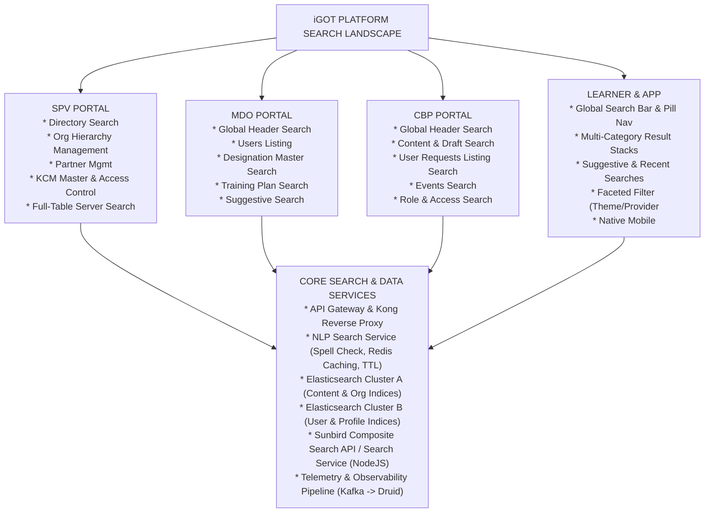
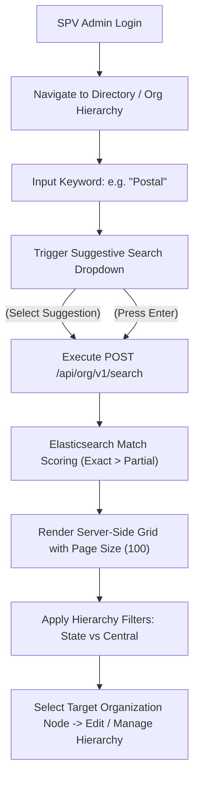
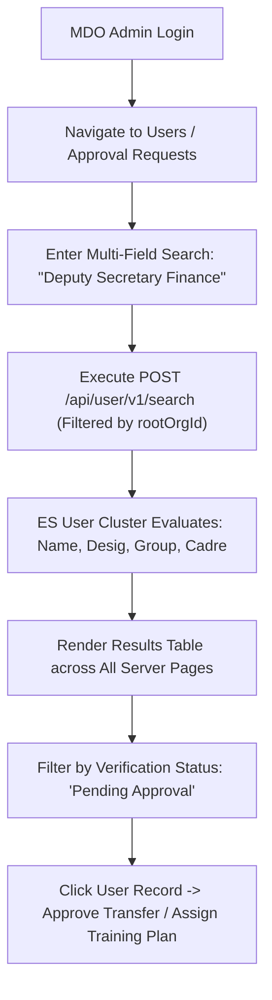
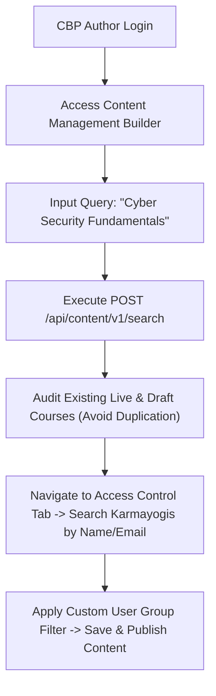
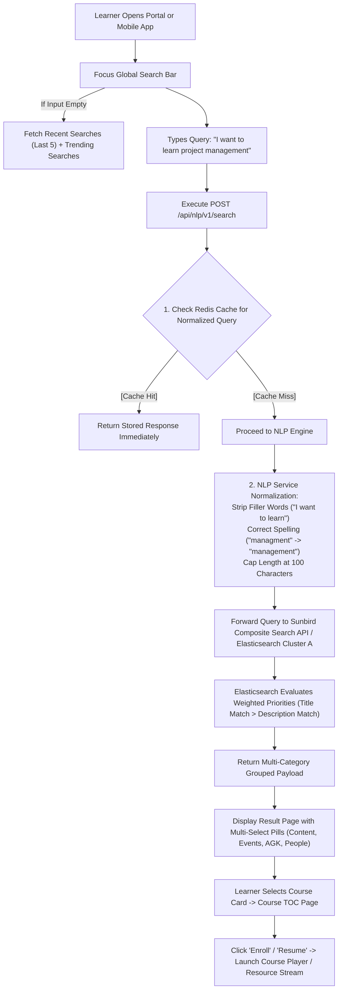
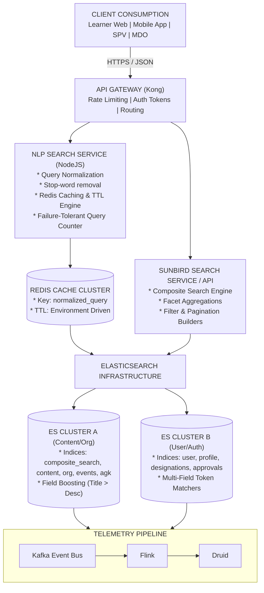
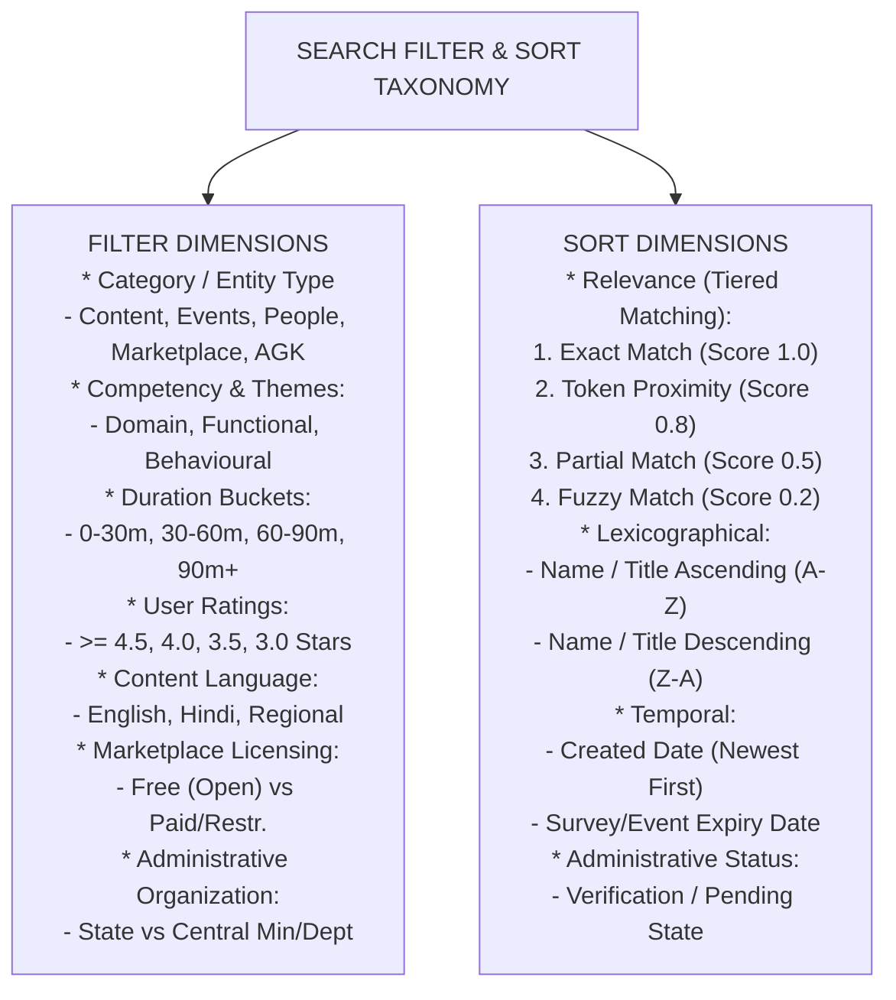

# Search – Evolution and Consumption Overview Summary

**iGOT Karmayogi Platform | SPV Portal | MDO Portal | CBP Portal | Learner Portal & Mobile App**

## 1. Executive Summary

Search on the **iGOT Karmayogi platform** serves as the central discovery backbone across civil service capacity building. The search ecosystem connects hundreds of Ministries, Departments, and Organizations (MDOs), the Special Purpose Vehicle (SPV / Karmayogi Bharat), Central Training Institutes (CTIs / CBP Providers), and millions of government learners across India.

### Core Findings & Architectural Evolution

1. **From Monolithic Catalog Search to Multi-Portal Domain Discovery**: Search began in early releases (Q2–Q4) as an Elasticsearch-driven content query engine on the Learner Portal. It progressively evolved into dedicated operational discovery systems across the **SPV Portal** (partner management, organizational hierarchy, master directories), **MDO Portal** (user management, designation masters, training plans, events, approvals), **CBP Portal** (course authoring, request pipelines, content indexing), and **Learner Portal & Mobile App** (multi-category pill discovery, thematic filters, competency mapping).
2. **Search Infrastructure & Tech Debt Remediation**:
  - Early implementations experienced resource contention due to combined indexes. In Q9–Q10 ([KB-11907: Q10| Tech Debt | Elastic Search Index Split for User And Content Index](https://karmayogibharat.atlassian.net/browse/KB-11907) (Internal Review), [KB-11908: Q10 | Tech Debt | Elastic Search Index Split for User And Content Index](https://karmayogibharat.atlassian.net/browse/KB-11908) (Prod Deployed), [KB-11794: Q9| Tech Debt | Elastic Search Index Split for User And Content Index](https://karmayogibharat.atlassian.net/browse/KB-11794) (Prod Deployed)), engineering executed an **Elasticsearch cluster split**, creating a dedicated ES 6.7 cluster for User/Profile indices while isolating Content and Org indices.
  - Guardrails against large payload crashes were introduced in [KB-12369: Q10 | Tech Debt | iGOT ES Search API Enhancements](https://karmayogibharat.atlassian.net/browse/KB-12369) (Open) by enforcing character caps (100-character ceiling) on query parameters across ES search APIs.

3. **Decoupling NLP Keyword Processing from Generative AI**:
  - The platform distinguishes conventional **NLP Search** (query cleaning, spell correction, token normalization, title/description weighting) from Generative AI / conversational agents.
  - In Q13 ([KB-15545: Search - Phase 1](https://karmayogibharat.atlassian.net/browse/KB-15545) (Open), [KB-15717: Q13 | NLP Search Service | Implement Caching and Retry Mechanism UAT Completed](https://karmayogibharat.atlassian.net/browse/KB-15717)), an independent **NLP Search Service** was deployed with **Redis caching, automated normalization, failure-tolerant query counters, and configurable downstream retries**, ensuring P95 response times under 2 seconds.

4. **Current Implementation Maturity & Gaps**:
  - Learner and MDO global search provide high-accuracy tiered matching (Exact Partial Fuzzy token scoring).
  - Inconsistencies persist in cross-portal table pagination: while SPV and MDO gained server-side multi-page full-table searching ([KB-10564: Q9 | Enable Multi-page/Full-Table Search | SPV Portal](https://karmayogibharat.atlassian.net/browse/KB-10564) (Open), [KB-10579: Q9 | Implement Multi-Field Search Ability | MDO Portal](https://karmayogibharat.atlassian.net/browse/KB-10579) (In-Progress)), legacy listing components in localized sub-modules still exhibit client-side pagination clipping.

## 2. Business Context and Search Objectives

### 2.1 The Problem Space

In the initial rollout of iGOT Karmayogi, discovery was fragmented:

- **Learners** struggled with mismatched spelling, multi-word terminology (e.g., "Artificial Intelligence" splitting into disjointed words), and inability to discover resources across diverse modalities (Events, Amrit Gyan Kosh, Marketplace, Communities).
- **MDO Administrators** could not quickly audit thousands of onboarded civil servants, leading to bottlenecks in competency role mapping, transfer requests, and APAR training plan monitoring.
- **SPV Administrators** faced manual overhead in managing multi-tier state and central organization hierarchies, lacking full-table backend search across directory grids.
- **Content Creators (CBP)** needed to identify existing courses to prevent duplicate content commissioning and map competencies accurately.

### 2.2 Strategic Objectives

- **Zero-Friction Access**: Allow civil servants to discover mandatory (APAR) and self-paced courses within clicks or via direct keyword entry.
- **Search Precision**: Transition from pure substring matching to tiered scoring (Exact match Token proximity Semantic NLP normalization).
- **Administrative Efficiency**: Provide server-side filtered listings across large datasets (10,000+ users/designations per MDO) with zero client-side performance penalties.
- **Auditability & Observability**: Track search telemetries (`search_initiated`, `search_results_loaded`, `suggestive_search_selected`) to feed Druid analytics for curriculum gap analysis.

## 3. Scope and Exclusions

### 3.1 In-Scope Capabilities

- **Platform Conventional Search**: Global and in-page search bars, keyword inputs, search landing pages.
- **Search Listing & Navigation**: Multi-category results, result cards, total result counts, responsive mobile listings.
- **Discovery Frameworks**: Course, Event, Community, Amrit Gyan Kosh (AGK), Designation, and Organization discovery.
- **Search History & Suggestive Search**: Recent searches (last 5 queries), trending searches, auto-complete dropdowns.
- **Filtering & Sorting**: Multi-select pills, facets (Themes, Competencies, Providers, Duration, Ratings, Languages), and dynamic sorting (Relevance, A–Z, Z–A, Latest).
- **NLP Search Engine (Non-GenAI)**: Syntactic normalization, stop-word removal, spelling correction, metadata prioritization weights, and Redis caching ([KB-15545: Search - Phase 1](https://karmayogibharat.atlassian.net/browse/KB-15545) (Open), [KB-15717: Q13 | NLP Search Service | Implement Caching and Retry Mechanism UAT Completed](https://karmayogibharat.atlassian.net/browse/KB-15717)).
- **Backend Search Architecture**: Elasticsearch clusters, Composite Search APIs, Sunbird Search endpoints, Redis caching layers, and database search queries.

### 3.2 Mandatory Strict Exclusions

- **Generative AI Search**: LLM-based answer generation, RAG document Q&A, and conversational synthesis.
- **AI Chatbots & Virtual Assistants**: iGOT AI / AI Sarthi chat overlays, ITSM Chatbots, and conversational helpdesks.
- **AI Tutor**: Course player conversational doubt clarification and interactive video Q&A.
- **AI CBP Tool Content Re-ranking**: Standalone LLM prompt generators and external LLM evaluator pipelines (except where conventional API endpoints are queried).

## 4. Search Feature Landscape



## 5. Search Evolution Timeline

| Quarter / Release | Epic / Jira Stories | Portal | Capability Introduced / Enhanced | Earlier Behaviour | New Behaviour | Technical & Architectural Impact |
|---|---|---|---|---|---|---|
| **Q2–Q3** | [KB-1684: Q2\| Request for new content Flow \| MDO User should be able to view the "Request for New Content" trigger on the search page of capacity building plan.](https://karmayogibharat.atlassian.net/browse/KB-1684) (Prod Deployed), [KB-2131: Q3 \| Ad-Hoc Requests \| Request for Keyword search Data on the platform.](https://karmayogibharat.atlassian.net/browse/KB-2131) (In-Progress), [KB-2152: Q3 \| Ad-Hoc Requests \| Ingesting keyword search in Druid.](https://karmayogibharat.atlassian.net/browse/KB-2152) (In-Progress) | MDO, Learner | Basic Catalog Search & Druid Telemetry Ingestion | Basic string match; no keyword search logging. | Keyword searches ingested into Druid for analytics; MDO CBP search page prompt for content request. | Sunbird Content API integration; telemetry events captured in Kafka Druid. |
| **Q4** | [KB-3494 \| Q4 \| Platform Search \| Search Bar and Search Page enhancements](https://karmayogibharat.atlassian.net/wiki/spaces/TPT/pages/69599499/KB-3494+Q4+Platform+Search+Search+Bar+and+Search+Page+enhancements), [KB-3497: Q4 \| Platform Search \| UI UX Search bar enhancements](https://karmayogibharat.atlassian.net/browse/KB-3497) (Open), [KB-3499: Q4 \| Platform Search \| Search page enhancements](https://karmayogibharat.atlassian.net/browse/KB-3499) (Open), [KB-3504: Q4 \| Platform Search \| Facet Search](https://karmayogibharat.atlassian.net/browse/KB-3504) (Open), [KB-3898: Q4 \| Tech Debt \| Optimization of Elastic Search](https://karmayogibharat.atlassian.net/browse/KB-3898) (Open), [KB-5134: Q4 \| KCM & Designation master \| SPV Portal \| Basic Search \| Search competency theme-competency subtheme](https://karmayogibharat.atlassian.net/browse/KB-5134) (QA In Progress) | Learner, SPV | Platform Search UI/UX & Faceted Search | Static search bar; minimal filtering; slow query times on single index. | Dedicated Search Landing Page, faceted search (Content type, provider, duration), ES index query optimization. | Elasticsearch index mapping refactoring; facet aggregations integrated into search payload. |
| **Q6–Q7** | [KB-7053: Q6 \| SPV Portal \| Real time Search and Sort functionality](https://karmayogibharat.atlassian.net/browse/KB-7053) (Prod Deployed), [KB-7854: Q7 \| Search & listing \| Learner Portal & Mobile App](https://karmayogibharat.atlassian.net/browse/KB-7854) (KB Approved), [KB-7869: Q7 \| Search & listing \| NLP & Elastic search \| Learner Portal](https://karmayogibharat.atlassian.net/browse/KB-7869) (Prod Deployed)–[KB-7874: Q7 \| Search & listing \| Sorting \| Mobile App](https://karmayogibharat.atlassian.net/browse/KB-7874) (Prod Deployed), [KB-7919: Q7 \| Ad-Hoc \| SPV Portal \| User Management \| User Search](https://karmayogibharat.atlassian.net/browse/KB-7919) (In Progress), [KB-7920: Q7 \| Ad-Hoc \| SPV Portal \| User Management \| User Search \| Search to implement via backend calls not from loaded data.](https://karmayogibharat.atlassian.net/browse/KB-7920) (In-Progress), [KB-8701: Q7 \| Search & Listing \| Recent Searches Need Information](https://karmayogibharat.atlassian.net/browse/KB-8701), [KB-8825: Q7 \| Search & Listing \| User enrolments on Learner Portal](https://karmayogibharat.atlassian.net/browse/KB-8825) (Open) | Learner, Mobile, SPV | Search & Listing Overhaul; Recent Searches & Mobile Parity | Search limited to active page; no history; SPV user search executed in client memory. | User search via backend API; Learner Portal & Mobile app receive Recent Searches (last 5), backend pagination. | New user-search API endpoints; local storage + backend sync for recent searches; mobile native search view. |
| **Q8** | [KB-9323: Q8 \| Ad-Hoc \| Sector search in learner portal](https://karmayogibharat.atlassian.net/browse/KB-9323) (Prod Deployed), [KB-9349: Most relevant sorting to be added in People Search page/Common Page](https://karmayogibharat.atlassian.net/browse/KB-9349) (In-Progress), [KB-9545: Q8 \| Network Hub \| Profile Enrichment \| Fields for Global Search](https://karmayogibharat.atlassian.net/browse/KB-9545) (DEV IN PROGRESS), [KB-9680: Q8 \| Search & Listing \| Other Resources \| Content Page \| Learner Portal](https://karmayogibharat.atlassian.net/browse/KB-9680) (Open), [KB-9738: Q8 \| Org Search Funcationality \| Organisation Hierarchy Management](https://karmayogibharat.atlassian.net/browse/KB-9738) (Prod Deployed), [KB-9794: Q8 \| Organisation Search Filters \| Organisations \| SPV Portal Need Information](https://karmayogibharat.atlassian.net/browse/KB-9794) | Learner, SPV | Hierarchy Search, Multi-Filter Extensions & People Discovery | Flat search without sector hierarchy; Org search lacked state/center segregation. | SPV Org Hierarchy multi-level search; Sector & Sub-sector faceted search; People Search sorted by query relevance. | Elasticsearch query rewrite to include nested fields (cadre, designation, service) for user discovery. |
| **Q9** | [Q9 \| KB-8978 \| Search & Sorting & Filters \| MDO Portal](https://karmayogibharat.atlassian.net/wiki/spaces/TPT/pages/423198847/Q9+KB-8978+Search+Sorting+Filters+MDO+Portal), [KB-8979: [Out Of SCOPE] \| Q9 \| Search and Sorting and Filters update \| SPV Portal](https://karmayogibharat.atlassian.net/browse/KB-8979) (In Progress), [KB-10562: Q9 \| Implement Multi-Field Search Ability \| SPV Portal](https://karmayogibharat.atlassian.net/browse/KB-10562) (Open)–[KB-10566: Q9 \| Develop Search Accuracy / Sorting Improve \| SPV Portal](https://karmayogibharat.atlassian.net/browse/KB-10566) (Open), [KB-10579: Q9 \| Implement Multi-Field Search Ability \| MDO Portal](https://karmayogibharat.atlassian.net/browse/KB-10579) (In-Progress)–[KB-10584: Q9 \| Develop Search Accuracy / Sorting Improve \| MDO Portal](https://karmayogibharat.atlassian.net/browse/KB-10584) (In-Progress), [KB-11044: Q9 \| CBP Search & Listing \| Implement Global Search with Filters & Sorting for CBP Portal](https://karmayogibharat.atlassian.net/browse/KB-11044) (Prod Deployed)–[KB-11046: Q9 \| "Events search" with global Search,filtering and sorting \| CBP Portal](https://karmayogibharat.atlassian.net/browse/KB-11046) (Prod Deployed), [KB-11175: Q9 \| Search, Sorting & Filters \| MDO Portal](https://karmayogibharat.atlassian.net/browse/KB-11175) (KB Review)–[KB-11188: Q9 \| MDO Search & Listing \| Implement Global Search with AI-Driven NLP-Based Search](https://karmayogibharat.atlassian.net/browse/KB-11188) (Prod Deployed) | MDO, CBP, SPV | Global Admin Search, Suggestive Dropdowns & Tiered Match Scoring | No global header search in admin portals; search executed only against current page table. | Universal header search across entities (Users, Designations, Events, Content); suggestive search; full-table multi-page search. | Implementation of server-side scoring engine (Exact Partial Fuzzy); standard pagination (20, 50, 100). |
| **Q10** | [KB-8980: Q10 \| Search, Sorting & Filters \| Content Portal](https://karmayogibharat.atlassian.net/browse/KB-8980) (KB Review), [KB-11907: Q10\| Tech Debt \| Elastic Search Index Split for User And Content Index](https://karmayogibharat.atlassian.net/browse/KB-11907) (Internal Review), [KB-11908: Q10 \| Tech Debt \| Elastic Search Index Split for User And Content Index](https://karmayogibharat.atlassian.net/browse/KB-11908) (Prod Deployed), [KB-12300: Q10 \| Updated Domain competencies for existing contents & Removal for Sector and Sub Sector on TOC and Search Filters](https://karmayogibharat.atlassian.net/browse/KB-12300) (Prod Deployed), [KB-12369: Q10 \| Tech Debt \| iGOT ES Search API Enhancements](https://karmayogibharat.atlassian.net/browse/KB-12369) (Open) | CBP, Tech Debt | ES Cluster Split & Query Guardrails | Shared Elasticsearch cluster for User and Content; large queries causing cluster memory spikes. | Split into two distinct ES 6.7 clusters (User Cluster vs Content/Org Cluster); enforced character limit on search strings. | Infrastructure migration; backend routing split based on target entity; ES query parameter validation middleware. |
| **Q11** | [KB-12836: Q11 \| Marketplace \| Marketplace Enhancements and New Integrations \| Adding a banner for the respective Provider on the Providers Course Listing Page](https://karmayogibharat.atlassian.net/browse/KB-12836) (Prod Deployed), [KB-12837: Q11 \| Marketplace \| Marketplace Enhancements and New Integrations \| Enhance the search and filter of the Marketplace Providers Listing Page for logged-in users​](https://karmayogibharat.atlassian.net/browse/KB-12837) (Prod Deployed), [KB-13020: Q11 \| Peer Validation \| Learner Portal pending surveys dashboard](https://karmayogibharat.atlassian.net/browse/KB-13020) (Prod Deployed) | Learner, Marketplace | Marketplace Provider Search & Survey Discovery | Generic content search without provider-specific course grid scoping. | Dedicated Provider course listing page with dedicated search/filters; full-dataset search across pending surveys. | Composite Search API filters extended to include `providerId`, `licenseType` (Free/Paid), and survey metadata. |
| **Q13** | [KB-14937: Q13 \| Search optimisation - Learner Portal](https://karmayogibharat.atlassian.net/browse/KB-14937) (KB Review), [KB-15545: Search - Phase 1](https://karmayogibharat.atlassian.net/browse/KB-15545) (Open), [KB-15717: Q13 \| NLP Search Service \| Implement Caching and Retry Mechanism UAT Completed](https://karmayogibharat.atlassian.net/browse/KB-15717) | Learner, Platform | Multi-Select Category Pills & NLP Search Service Hardening | Single-category tab switching; search engine struggled with filler words ("I want to learn..."). | Multi-select category chips (Content, Events, People, Marketplace, Communities, AGK); NLP keyword extraction & Redis caching. | Independent NLP Search microservice deployed; Redis query caching with TTL; circuit breaker & retry handling. |

## 6. Search Capability Classification

```text
SEARCH CAPABILITY TAXONOMY

[A] FOUNDATION
├── Search Bar (Global Header, In-Page Sub-Header, Entity Dropdowns)
├── Search Page (Dedicated multi-column layout, left-hand navigation facet panel)
├── Input Handling (Case-insensitivity, whitespace trim, 100-character cap, punctuation preservation)
└── Result Retrieval (Server-side paginated response, match scoring, hit counts)

[B] DISCOVERY
├── Content Discovery (Courses, Curated Programs, Blended Programs, Standalone Assessments)
├── Entity Discovery (Organizations, Designations, Users/Karmayogis, Mentors, Communities, Events)
├── Provider Discovery (Marketplace Content Providers, CTIs, In-House Academies)
└── Search Recommendations (Suggestive search auto-complete, matching text highlights)

[C] HISTORY & PERSONALISATION
├── Recent Searches (Last 5 executed queries stored per user)
├── Trending Searches (Aggregated top search terms displayed on empty search click)
└── Filter Memory (Session-persisted facet selections during in-page navigation)

[D] FILTERING & FACETING
├── Type / Modality (Courses, Programs, Assessments, Resources, Events, Marketplace)
├── Thematic & Competency (Competency Area, Theme, Sub-theme, Domain Competency)
├── Organizational & Role (Ministry, State, Department, Cadre, Designation Group)
└── Operational Attributes (Duration, Rating, Language, Free vs Paid, Verification Status)

[E] SORTING & RANKING
├── Relevance / Scoring Tier (Exact Match > Token Proximity > Partial Match > Fuzzy)
├── Lexicographical (Alphabetical A-Z, Z-A)
├── Temporal (Created Date Newest/Oldest, Event End Date Ascending)
└── Metadata Weighting (Title match weight > Description match weight)

[F] INTEGRATIONS & ENGINE
├── Elasticsearch Cluster A (Content, Org, Hierarchy indices)
├── Elasticsearch Cluster B (User, Profile, Designation indices)
├── NLP Search Microservice (Query normalization, keyword extraction, Redis cache layer)
└── Telemetry Emitter (Druid-bound telemetry: search_initiated, results_loaded, pills_clicked)
```

## 7. Portal-Wise Functional Overview

### 7.1 SPV Portal – Search Overview

- **Business Purpose**: Enables SPV Administrators and Operations Leaders to manage nation-wide tenant configurations, verify external content partners, administer the designation master list, and inspect organizational trees.
- **Target Users**: SPV Admin, SPV Publisher, SPV Operations Support.
- **Search Entry Points**:
  - Global Directory Search (`/app/spv/directory`).
  - Organization Hierarchy Management view (`/app/spv/org-hierarchy`).
  - Partner Management Console (`/app/spv/marketplace/providers`).
  - SPV User and Role Master list (`/app/spv/users`).

- **Searchable Entities**: Organizations (State & Central), Content Providers, SPV Internal Users, Roles, Events, Content Requests, Surveys, Designation Masters.
- **Search Functionality & Filters**:
  - *Multi-Field Search*: Indexes Name, Email, ID, Role, Status across table columns ([KB-10562: Q9 | Implement Multi-Field Search Ability | SPV Portal](https://karmayogibharat.atlassian.net/browse/KB-10562) (Open)).
  - *Suggestive Dropdown*: Auto-completes matching substrings as user types ([KB-10563: Q9 | Develop Searchable Dropdown (Suggestive Search) | SPV Portal](https://karmayogibharat.atlassian.net/browse/KB-10563) (Open)).
  - *Hierarchy Filter*: Filters organizations by State vs Central jurisdiction with up to 10 hierarchy levels ([KB-9790: Q8 | Organisation Hierarchy View | SPV & State Admin | SPV Portal](https://karmayogibharat.atlassian.net/browse/KB-9790) (To Do), [KB-9794: Q8 | Organisation Search Filters | Organisations | SPV Portal Need Information](https://karmayogibharat.atlassian.net/browse/KB-9794)).

- **Sorting Options**: Exact Match Partial Match weighting; Column header sorting (Ascending/Descending A–Z, Z–A, Date).
- **APIs & Contracts**:
  - `POST /api/org/v1/search` (Public & authenticated org discovery).
  - `POST /api/user/v1/search` (SPV user directory).

- **Known Gaps**: Historically lacked full-table search across paginated server boundaries; resolved in Q9 ([KB-10564: Q9 | Enable Multi-page/Full-Table Search | SPV Portal](https://karmayogibharat.atlassian.net/browse/KB-10564) (Open)).

### 7.2 MDO Portal – Search Overview

- **Business Purpose**: Equips MDO Leaders, Admins, and Facilitators to manage department users, track annual capacity building plans (CBP/APAR), schedule blended training batches, and verify employee profiles.
- **Target Users**: MDO Leader, MDO Admin, MDO Access Manager, Program Coordinator.
- **Search Entry Points**:
  - Global Header Search Bar (Introduced in Q9, [KB-11176: Q9 | MDO Search & Listing | Implement Global Search with Filters & Sorting for MDO Portal](https://karmayogibharat.atlassian.net/browse/KB-11176) (Prod Deployed)).
  - Users / Karmayogi Listing Tab (`/app/mdo/users`).
  - Designation Master Management (`/app/mdo/designations`).
  - Training Plans & APAR Allocation Dashboard (`/app/mdo/training-plans`).
  - Blended Program Batch Manager (`/app/mdo/blended-programs`).

- **Searchable Entities**: Civil Servants / Users (Verified, Unverified, Transferred), Designations, Training Plans, Events, Communities, Mentor Master.
- **Search Functionality & Filters**:
  - *Global Multi-Entity Search*: Header search triggers unified results partitioned by Users, Training Plans, Events, and Communities.
  - *Multi-Field User Search*: Simultaneously searches Name, Email ID, Designation, Group, and Cadre ([KB-10579: Q9 | Implement Multi-Field Search Ability | MDO Portal](https://karmayogibharat.atlassian.net/browse/KB-10579) (In-Progress)).
  - *Facets*: Approval Status (Pending Profile, Pending Transfer, Verified), User Group (Group A, B, C), Service Type (IAS, IPS, Central/State Deputation).

- **Sorting Options**: Relevance Score (Exact match Token proximity Partial match); Alphabetic (A–Z, Z–A); Submission Date.
- **APIs & Contracts**:
  - `POST /api/user/v1/search` (Scoped to MDO rootOrgId).
  - `POST /api/trainingplan/v1/search`.

- **Known Gaps**: MDO search originally executed against the active page view only (10 records), causing missed approvals; overhauled in Q9 to server-wide multi-page queries ([KB-10579: Q9 | Implement Multi-Field Search Ability | MDO Portal](https://karmayogibharat.atlassian.net/browse/KB-10579) (In-Progress)).

### 7.3 CBP Portal – Search Overview

- **Business Purpose**: Enables Central Training Institutes (CTIs), Administrative Staff Colleges, and internal Course Creators to search existing content libraries, avoid redundant course development, and manage content publishing pipelines.
- **Target Users**: Content Creator, Content Reviewer, Content Publisher, CBP Admin.
- **Search Entry Points**:
  - Header Global Search (`/app/cbp/search`).
  - Content Builder / Draft Repository (`/app/cbp/content`).
  - Content Request Pipeline (`/app/cbp/requests`).
  - User and Assignee Allocation Grid (`/app/cbp/access-control`).

- **Searchable Entities**: Courses, Programs, Standalone Assessments, Events, Registered Authors, Content Requests.
- **Search Functionality & Filters**:
  - *Content Discovery*: Search by Title, Course DO-ID, Keywords, Primary Category, Competency Area.
  - *Access Control Search*: Search Karmayogis by Name, Email, or Department to assign invite-only course access ([KB-9602: Q8 | Access Control | Single/Multi Select User Access Control](https://karmayogibharat.atlassian.net/browse/KB-9602) (Prod Deployed)).
  - *Facets*: Status (Draft, In-Review, Live, Retired), Primary Category, Target Audience, Creation Date.

- **Sorting Options**: Last Updated Date (Descending default), Title (A–Z), Status.
- **APIs & Contracts**:
  - `POST /api/content/v1/search` (Sunbird Composite Search).
  - `POST /api/workflow/v1/search` (Content Request Pipeline).

- **Known Gaps**: Archived courses originally surfaced in active creator catalog searches; corrected in Q11 ([KB-12730: Q11 | Content Archival | Search & Visibility of Archived Content](https://karmayogibharat.atlassian.net/browse/KB-12730) (Open)) to isolate archived records.

### 7.4 Learner Portal and Mobile App – Search Overview

- **Business Purpose**: Serves as the primary learning marketplace and course discovery interface for civil servants on desktop and mobile clients.
- **Target Users**: Individual Learners, Civil Services Officers, Trainees.
- **Search Entry Points**:
  - Top Navigation Global Search Bar (Web & App).
  - Dedicated Search Results Landing Page (`/app/search`).
  - Catalog Page (`/app/catalog`).
  - Explore by Theme Section (`/app/home#explore-themes`).
  - Marketplace Provider Listing (`/app/marketplace`).

- **Searchable Entities**: Courses, Blended Programs, Curated Programs, Events, People (Officers/Mentors), Communities, Marketplace Courses, Amrit Gyan Kosh (AGK) Documents.
- **Search Functionality & UI Layout**:
  - *Multi-Select Category Pills (Q13* [KB-15545: Search - Phase 1](https://karmayogibharat.atlassian.net/browse/KB-15545) (Open)*)*: Learners toggle multiple categories simultaneously (Content, Events, People, Marketplace, Communities, AGK). Results display in stacked cards with category result counts in parentheses.
  - *Free-Text Natural Querying*: Filler words ("I want to learn about") are stripped by NLP normalization, preserving core concepts ("Artificial Intelligence").
  - *Suggestive & Trending Searches*: Dropdown surfaces last 5 user searches ([KB-8701: Q7 | Search & Listing | Recent Searches Need Information](https://karmayogibharat.atlassian.net/browse/KB-8701)) or platform-wide trending queries ([KB-10624: Q7 | Search & Listing | Trending & Suggestion in Search functionality](https://karmayogibharat.atlassian.net/browse/KB-10624) (Open)).
  - *Facets*:
    - Thematic & Competency Area (Domain, Functional, Behavioral).
    - Content Modality (Course, Program, Assessment, Case Study).
    - Duration brackets (0–30m, 30–60m, 60–90m, 90m+).
    - Rating thresholds (, , , ).
    - Language selection with live content count badges.
    - Licensing (Free vs Restricted / Paid Marketplace).

- **Consumption Journeys**:
  - *Search-to-Enrolment*: Keyword Filter selection Course Card click TOC Page Enrol Player.

- **Mobile-Specific Behaviour**:
  - Category pill swipe containers, collapsed touch-friendly filter drawers, native keyboard submit triggers, and responsive result cards displaying 4 people cards (vs 5 on web).

## 8. Cross-Portal Search Capability Comparison

| Capability | SPV Portal | MDO Portal | CBP Portal | Learner Portal | Mobile App | Evidence Reference |
|---|---|---|---|---|---|---|
| **Search Bar (Global Header)** | Implemented | Implemented | Implemented | Implemented | Implemented | [KB-11176: Q9 \| MDO Search & Listing \| Implement Global Search with Filters & Sorting for MDO Portal](https://karmayogibharat.atlassian.net/browse/KB-11176) (Prod Deployed), [KB-11044: Q9 \| CBP Search & Listing \| Implement Global Search with Filters & Sorting for CBP Portal](https://karmayogibharat.atlassian.net/browse/KB-11044) (Prod Deployed), [KB-3497: Q4 \| Platform Search \| UI UX Search bar enhancements](https://karmayogibharat.atlassian.net/browse/KB-3497) (Open) |
| **Dedicated** **Search Page** | Specified (Tabular) | Specified (Tabular) | Specified (Tabular) | Implemented (Card Grid) | Implemented (Mobile View) | [KB-3499: Q4 \| Platform Search \| Search page enhancements](https://karmayogibharat.atlassian.net/browse/KB-3499) (Open), [KB-15545: Search - Phase 1](https://karmayogibharat.atlassian.net/browse/KB-15545) (Open) |
| **Multi-Category Pill Navigation** | Not Applicable | Not Applicable | Not Applicable | Implemented | Implemented | [KB-15545: Search - Phase 1](https://karmayogibharat.atlassian.net/browse/KB-15545) (Open) |
| **Suggestive Auto-complete** | Implemented | Implemented | Partially Implemented | Implemented | Implemented | [KB-10563: Q9 \| Develop Searchable Dropdown (Suggestive Search) \| SPV Portal](https://karmayogibharat.atlassian.net/browse/KB-10563) (Open), [KB-10581: Q9 \| Develop Searchable Dropdown (Suggestive Search) \| MDO Portal](https://karmayogibharat.atlassian.net/browse/KB-10581) (In-Progress), [KB-10624: Q7 \| Search & Listing \| Trending & Suggestion in Search functionality](https://karmayogibharat.atlassian.net/browse/KB-10624) (Open) |
| **Recent Search History** | Not Applicable | Not Applicable | Not Applicable | Implemented (Last 5) | Implemented (Last 5) | [KB-8701: Q7 \| Search & Listing \| Recent Searches Need Information](https://karmayogibharat.atlassian.net/browse/KB-8701), [KB-15545: Search - Phase 1](https://karmayogibharat.atlassian.net/browse/KB-15545) (Open) |
| **Trending Searches** | Not Applicable | Not Applicable | Not Applicable | Implemented | Implemented | [KB-10624: Q7 \| Search & Listing \| Trending & Suggestion in Search functionality](https://karmayogibharat.atlassian.net/browse/KB-10624) (Open) |
| **Multi-Field Column Indexing** | Implemented | Implemented | Implemented | Implemented (Metadata) | Implemented (Metadata) | [KB-10562: Q9 \| Implement Multi-Field Search Ability \| SPV Portal](https://karmayogibharat.atlassian.net/browse/KB-10562) (Open), [KB-10579: Q9 \| Implement Multi-Field Search Ability \| MDO Portal](https://karmayogibharat.atlassian.net/browse/KB-10579) (In-Progress) |
| **Tiered Match** **Scoring** | Implemented | Implemented | Partially Implemented | Implemented | Implemented | [KB-10566: Q9 \| Develop Search Accuracy / Sorting Improve \| SPV Portal](https://karmayogibharat.atlassian.net/browse/KB-10566) (Open), [KB-10584: Q9 \| Develop Search Accuracy / Sorting Improve \| MDO Portal](https://karmayogibharat.atlassian.net/browse/KB-10584) (In-Progress) |
| **NLP Spell Check & Normalization** | Not Documented | Partially Implemented | Partially Implemented | Implemented | Implemented | [KB-15545: Search - Phase 1](https://karmayogibharat.atlassian.net/browse/KB-15545) (Open), [KB-15717: Q13 \| NLP Search Service \| Implement Caching and Retry Mechanism UAT Completed](https://karmayogibharat.atlassian.net/browse/KB-15717) |
| **Redis Response Caching** | Not Documented | Not Documented | Not Documented | Implemented | Implemented | [KB-15717: Q13 \| NLP Search Service \| Implement Caching and Retry Mechanism UAT Completed](https://karmayogibharat.atlassian.net/browse/KB-15717) |
| **Server-Side Full-Table Search** | Implemented | Implemented | Implemented | Implemented | Implemented | [KB-10564: Q9 \| Enable Multi-page/Full-Table Search \| SPV Portal](https://karmayogibharat.atlassian.net/browse/KB-10564) (Open), [KB-10579: Q9 \| Implement Multi-Field Search Ability \| MDO Portal](https://karmayogibharat.atlassian.net/browse/KB-10579) (In-Progress) |
| **Configurable Page Sizing** | Implemented (20/50/100) | Implemented (10/25/50) | Implemented (10/25/50) | Implemented (Cards) | Implemented (Infinite scroll) | [KB-10565: Q9 \| Improve Pagination Support \| SPV Portal](https://karmayogibharat.atlassian.net/browse/KB-10565) (Open), [KB-13020: Q11 \| Peer Validation \| Learner Portal pending surveys dashboard](https://karmayogibharat.atlassian.net/browse/KB-13020) (Prod Deployed) |
| **Faceted Filter Drawers** | Implemented | Implemented | Implemented | Implemented | Implemented | [KB-7871: Q7 \| Search & listing \| Filters \| Learner Portal](https://karmayogibharat.atlassian.net/browse/KB-7871) (Prod Deployed), [KB-7872: Q7 \| Search & listing \| Filters \| Mobile App](https://karmayogibharat.atlassian.net/browse/KB-7872) (Prod Deployed), [KB-9333: Q8 \| Implement Course Catalog Filters \| Course Catelog \| Learner Portal & Mobile App & M-Site](https://karmayogibharat.atlassian.net/browse/KB-9333) (Prod Deployed) |

## 9. Search Consumption Journeys

### 9.1 SPV Operational Administration Journey



### 9.2 MDO Civil Servant & Training Administration Journey



### 9.3 CBP Content Creator Discovery Journey



### 9.4 Learner Discovery-to-Consumption Journey



## 10. Search Technical and Architectural Overview

### 10.1 Platform-Level Search Architecture



### 10.2 Search Sorting and Filtering Execution Matrix

Understanding where search operations take place is critical to maintaining platform performance:

| Operation | Execution Layer | Mechanism / Technology | Evidence Reference |
|---|---|---|---|
| **Spelling Correction** | Microservice | NLP Search Service dictionary lookup & phonetic matching | [KB-15545: Search - Phase 1](https://karmayogibharat.atlassian.net/browse/KB-15545) (Open) |
| **Stop-Word Removal** | Microservice | Regex & token pipeline stripping conversational intents | [KB-15545: Search - Phase 1](https://karmayogibharat.atlassian.net/browse/KB-15545) (Open) |
| **Response Caching** | In-Memory Data Store | Redis hash maps keyed by lowercase normalized query | [KB-15717: Q13 \| NLP Search Service \| Implement Caching and Retry Mechanism UAT Completed](https://karmayogibharat.atlassian.net/browse/KB-15717) |
| **Facet Filtering** | Search Engine | Elasticsearch `bool` `filter` clauses (term/terms query) | [KB-7871: Q7 \| Search & listing \| Filters \| Learner Portal](https://karmayogibharat.atlassian.net/browse/KB-7871) (Prod Deployed), [KB-3504: Q4 \| Platform Search \| Facet Search](https://karmayogibharat.atlassian.net/browse/KB-3504) (Open) |
| **Relevance Ranking** | Search Engine | Elasticsearch BM25 scoring with index-level field weights | [KB-15545: Search - Phase 1](https://karmayogibharat.atlassian.net/browse/KB-15545) (Open) |
| **Tiered Matching** | Backend API | Node/Java API constructing multi-clause scoring blocks | [KB-10566: Q9 \| Develop Search Accuracy / Sorting Improve \| SPV Portal](https://karmayogibharat.atlassian.net/browse/KB-10566) (Open), [KB-10584: Q9 \| Develop Search Accuracy / Sorting Improve \| MDO Portal](https://karmayogibharat.atlassian.net/browse/KB-10584) (In-Progress) |
| **Table Pagination** | Search Engine | Elasticsearch `from` and `size` parameters (server-side) | [KB-10564: Q9 \| Enable Multi-page/Full-Table Search \| SPV Portal](https://karmayogibharat.atlassian.net/browse/KB-10564) (Open), [KB-10565: Q9 \| Improve Pagination Support \| SPV Portal](https://karmayogibharat.atlassian.net/browse/KB-10565) (Open) |
| **Client Pill Stacking** | Frontend UI | Angular / React state handling multi-pill OR/AND views | [KB-15545: Search - Phase 1](https://karmayogibharat.atlassian.net/browse/KB-15545) (Open) |

## 11. Search API and Integration Inventory

### 11.1 Platform Search APIs

| API Name | Endpoint | Method | Portal | Request Payload Highlights | Response Structure | Auth Required | Contract Reference |
|---|---|---|---|---|---|---|---|
| **NLP Search API** | `/api/nlp/v1/search` | POST | Learner, Mobile | `{"request": {"query": "string", "categories": ["content","events"], "filters": {}}}` | `{"id": "api.nlp.search", "result": {"content": [...], "count": 42, "correctedQuery": ""}}` | Optional / User Session | [KB-15545: Search - Phase 1](https://karmayogibharat.atlassian.net/browse/KB-15545) (Open), [KB-15717: Q13 \| NLP Search Service \| Implement Caching and Retry Mechanism UAT Completed](https://karmayogibharat.atlassian.net/browse/KB-15717) |
| **Composite Content Search** | `/api/content/v1/search` | POST | Learner, CBP, Mobile | `{"request": {"query": "string", "filters": {"primaryCategory": ["Course"], "status": ["Live"]}, "limit": 20, "offset": 0}}` | `{"result": {"count": 120, "content": [{"identifier": "do_123", "name": "...", "posterImage": "..."}]}}` | No (Public) / Optional | Confluence ID: [Content Search api](https://karmayogibharat.atlassian.net/wiki/spaces/TES/pages/68878337/Content+Search+api), [Composite Search API](https://karmayogibharat.atlassian.net/wiki/spaces/TES/pages/736395271/Composite+Search+API) |
| **User** **Directory Search** | `/api/user/v1/search` | POST | MDO, SPV, CBP | `{"request": {"filters": {"rootOrgId":` `"org_01", "status": 1}, "query": "string", "limit": 50, "offset": 0}}` | `{"result": {"response":` `{"count": 520, "content": [{"userId": "...", "firstName": "...", "designation": "..."}]}}}` | Yes (Bearer JWT) | Confluence ID: [User Search API](https://karmayogibharat.atlassian.net/wiki/spaces/TES/pages/61538718/User+Search+API) |
| **Organization Search API** | `/api/org/v1/search` | POST | SPV, MDO, Public | `{"request": {"filters": {"isTenant": true}, "query": "string", "limit": 100}}` | `{"result": {"response": {"count": 85, "content": [{"orgName": "...", "identifier": "...", "orgType": "..."}]}}}` | Yes / Whitelisted API | Confluence ID: [Org Search Public API – Registration Page API Contract](https://karmayogibharat.atlassian.net/wiki/spaces/TES/pages/616497179/Org+Search+Public+API+Registration+Page+API+Contract) |
| **Recent Searches API** | `/api/user/v1/recent-search` | GET / POST | Learner, Mobile | `POST {"request": {"query": "blockchain", "timestamp": "ISO-8601"}}` | `{"result": {"queries": ["blockchain", "public policy", "cyber security"]}}` | Yes (User Auth) | [KB-8701: Q7 \| Search & Listing \| Recent Searches Need Information](https://karmayogibharat.atlassian.net/browse/KB-8701), Confluence ID: [Recent Searches Problem Statement and approach](https://karmayogibharat.atlassian.net/wiki/spaces/TES/pages/527335441/Recent+Searches+Problem+Statement+and+approach) |
| **Training Plan Search API** | `/api/trainingplan/v1/search` | POST | MDO | `{"request": {"filters": {"mdoId": "mdo_101", "status": "Live"}, "query": ""}}` | `{"result": {"count": 12, "trainingPlans": [{"id": "tp_1", "planName": "...", "courseCount": 5}]}}` | Yes (MDO Role) | [KB-11185: Q9 \| MDO Search & Listing \| Implement "Training Plan" Search with Filters and Sorting](https://karmayogibharat.atlassian.net/browse/KB-11185) (Prod Deployed) |

## 12. Search Sorting and Filtering Overview



## 13. Search Recommendations and Recent Searches

### 13.1 Suggestive Search (Auto-Complete)

- **Trigger**: Activates upon the user typing characters in global search bars ([KB-10563: Q9 | Develop Searchable Dropdown (Suggestive Search) | SPV Portal](https://karmayogibharat.atlassian.net/browse/KB-10563) (Open), [KB-10581: Q9 | Develop Searchable Dropdown (Suggestive Search) | MDO Portal](https://karmayogibharat.atlassian.net/browse/KB-10581) (In-Progress), [KB-10624: Q7 | Search & Listing | Trending & Suggestion in Search functionality](https://karmayogibharat.atlassian.net/browse/KB-10624) (Open)).
- **Mechanism**: The backend runs prefix and edge-ngram queries against index titles. Substrings matching user input are highlighted in bold within the dropdown cards.
- **Scope**:
  - *Learner*: Suggests Course titles, Programs, and Providers.
  - *MDO*: Suggests User names, Designation titles, and Training Plan identifiers.
  - *SPV*: Suggests Organization names and Partner profiles.

### 13.2 Recent Searches

- **Lifecycle**: Preserves the last 5 keywords executed by the authenticated user ([KB-8701: Q7 | Search & Listing | Recent Searches Need Information](https://karmayogibharat.atlassian.net/browse/KB-8701), [KB-15545: Search - Phase 1](https://karmayogibharat.atlassian.net/browse/KB-15545) (Open)).
- **Storage**: Cached in local client browser storage for immediate UI popover rendering upon input focus, periodically synced to the user profile datastore.
- **Interaction**: Users can click any past term to re-execute the search immediately or click an "X" icon to purge individual terms from their history.

### 13.3 Trending Searches

- **Fallback Rule**: Displayed when a learner focuses on an empty search bar with no recorded personal search history ([KB-10624: Q7 | Search & Listing | Trending & Suggestion in Search functionality](https://karmayogibharat.atlassian.net/browse/KB-10624) (Open)).
- **Aggregation**: Generated from platform-wide search telemetry aggregated periodically via Flink/Druid, reflecting top civil service topics (e.g., "Code of Conduct", "Procurement Rules", "AI Governance").

## 14. Search Evolution vs Current Consumption

| Capability Dimension | Legacy Search Behaviour (Q2–Q6) | Intermediate Evolution (Q7–Q10) | Current Documented Consumption (Q11–Q14) |
|---|---|---|---|
| **Learner Category Scope** | Rigid single-category tabs. Search was executed per category independently. | Added global landing page; content types appeared in disparate result tabs. | **Multi-select category pills** ([KB-15545: Search - Phase 1](https://karmayogibharat.atlassian.net/browse/KB-15545) (Open)); simultaneous multi-modal discovery with merged counts. |
| **Query Interpretation** | Strict literal substring matching. Spelling typos resulted in 0 hits. | Introduction of ES fuzzy queries; performance issues with unindexed strings. | **NLP Search Service** ([KB-15545: Search - Phase 1](https://karmayogibharat.atlassian.net/browse/KB-15545) (Open), [KB-15717: Q13 \| NLP Search Service \| Implement Caching and Retry Mechanism UAT Completed](https://karmayogibharat.atlassian.net/browse/KB-15717)) with Redis caching, stop-word removal, and auto-spelling correction. |
| **MDO Administrative Search** | In-page table filters only; search scanned only 10 visible client records. | Header search added; suggestive search introduced; user directory backend calls. | **Full-table server-side search** ([KB-10579: Q9 \| Implement Multi-Field Search Ability \| MDO Portal](https://karmayogibharat.atlassian.net/browse/KB-10579) (In-Progress), [KB-11176: Q9 \| MDO Search & Listing \| Implement Global Search with Filters & Sorting for MDO Portal](https://karmayogibharat.atlassian.net/browse/KB-11176) (Prod Deployed)) across Users, Designations, and Plans. |
| **SPV Directory Search** | Basic string matching on Organization list; no hierarchy context. | Added real-time sorting; state vs center dropdown filtering. | **10-level Org Hierarchy Search** ([KB-9738: Q8 \| Org Search Funcationality \| Organisation Hierarchy Management](https://karmayogibharat.atlassian.net/browse/KB-9738) (Prod Deployed), [KB-9794: Q8 \| Organisation Search Filters \| Organisations \| SPV Portal Need Information](https://karmayogibharat.atlassian.net/browse/KB-9794)) with full-table multi-field server pagination ([KB-10564: Q9 \| Enable Multi-page/Full-Table Search \| SPV Portal](https://karmayogibharat.atlassian.net/browse/KB-10564) (Open)). |
| **Infrastructure Scalability** | Single Elasticsearch cluster sharing Content, Org, and User indices. | Heavy contention; unconstrained query strings causing cluster-wide latency. | **Cluster Split** ([KB-11907: Q10\| Tech Debt \| Elastic Search Index Split for User And Content Index](https://karmayogibharat.atlassian.net/browse/KB-11907) (Internal Review)): User vs Content isolated; query string capped at 100 characters ([KB-12369: Q10 \| Tech Debt \| iGOT ES Search API Enhancements](https://karmayogibharat.atlassian.net/browse/KB-12369) (Open)). |

## 15. Requirements vs Implementation Gap Analysis

| Requirement Area | Jira Reference | Portal | Documented Expected Behaviour | Actual Implementation Status | Identified Gap / Classification |
|---|---|---|---|---|---|
| **Query Character Cap** | [KB-12369: Q10 \| Tech Debt \| iGOT ES Search API Enhancements](https://karmayogibharat.atlassian.net/browse/KB-12369) (Open) | Platform / ES | Search API rejects or truncates queries exceeding 100 characters to prevent ES crash. | Verified in NLP service and API Gateway input middleware. | **Verified Implementation**. |
| **NLP Redis Query Caching** | [KB-15717: Q13 \| NLP Search Service \| Implement Caching and Retry Mechanism UAT Completed](https://karmayogibharat.atlassian.net/browse/KB-15717) | Platform / NLP | All normalized user queries cached in Redis with configurable TTL; retries do not increment counter. | Verified in NLP Search Service architecture. | **Verified Implementation**. |
| **Full-Table Multi-Page Search** | [KB-10564: Q9 \| Enable Multi-page/Full-Table Search \| SPV Portal](https://karmayogibharat.atlassian.net/browse/KB-10564) (Open), [KB-10579: Q9 \| Implement Multi-Field Search Ability \| MDO Portal](https://karmayogibharat.atlassian.net/browse/KB-10579) (In-Progress) | SPV, MDO | Search query must scan entire backend database across all pages, not just the active 10 rows. | Verified across Users and Organization listings. | **Verified Implementation**. Some legacy sub-tables pending rewrite. |
| **Multi-Select Category Pills** | [KB-15545: Search - Phase 1](https://karmayogibharat.atlassian.net/browse/KB-15545) (Open) | Learner | Selection of multiple pills (Content, Events, People) combines results with OR logic into stacked layout. | Implemented on web; mobile app rollout in progressive release. | **Partially Implemented (Mobile Parity Gap)**. |
| **Archived Content Exclusion** | [KB-12730: Q11 \| Content Archival \| Search & Visibility of Archived Content](https://karmayogibharat.atlassian.net/browse/KB-12730) (Open) | CBP, Learner | Archived courses must be searchable for audit but strictly excluded from catalog and recommendations. | Elasticsearch index filter excludes `status: "Retired"` from default public aliases. | **Verified Implementation**. |
| **Cross-Portal Unified Header** | [KB-11175: Q9 \| Search, Sorting & Filters \| MDO Portal](https://karmayogibharat.atlassian.net/browse/KB-11175) (KB Review), [KB-8980: Q10 \| Search, Sorting & Filters \| Content Portal](https://karmayogibharat.atlassian.net/browse/KB-8980) (KB Review) | MDO, CBP | Single universal search component shared across MDO and CBP headers. | MDO and CBP implement distinct header search modules with varying filter hooks. | **Architecture Inconsistency Gap**. Shared component not yet factored out. |

## 16. Cross-Portal Consistency Analysis

CROSS-PORTAL CONSISTENCY EVALUATION

1. Common Infrastructure, Divergent UI Components:
   - All portals depend on the same underlying Elasticsearch infrastructure and API Gateway routes.
   - However, frontend components are built independently: the Learner Portal utilizes card-based multi-category stacks, whereas SPV, MDO, and CBP employ table grid views with column search inputs.
2. Discrepant Filtering Taxonomies:
   - Learner Portal categorizes by Modality, Thematic Area, Competency, Duration, Rating, and Language.
   - MDO Portal filters by Organizational Hierarchy, Cadre, Designation, and APAR Eligibility.
   - SPV Portal categorizes by State vs Central jurisdiction, Verification Status, and Role Types.
   - Observation: These variations reflect valid domain boundaries between consumption and administration.
3. Inconsistent Auto-Complete Behaviour:
   - Learner suggestive search highlights prefix tokens and offers top recommendations.
   - MDO suggestive search is restricted to exact substring matches on user names and designations.
   - SPV suggestive search in Org Hierarchy searches solely within parent-level nodes.
4. Opportunities for Unification:
   - Create a standardized Atlassian/iGOT UI Search Library across admin portals.
   - Unify pagination models: enforce the 20/50/100 record server-side paging standard across all tables.
   - Extend the Redis-backed NLP Search Service to sanitize admin inputs in MDO/SPV search bars.

## 17. Technical Dependencies and Integration Points

1. **Authentication & Identity Management (Keycloak)**:
  - All administrative searches on MDO, SPV, and CBP portals require bearer JWT tokens issued by Keycloak. User profile searches dynamically enforce tenancy boundaries using the `rootOrgId` claim in the user token.

2. **Elasticsearch Cluster Federation**:
  - `Cluster A (Content & Org)`: Indexes course metadata, hierarchy records, and event catalogs.
  - `Cluster B (User & Profile)`: Indexes civil servant profiles, designations, and role assignments. Eliminates index read/write locks during peak batch onboarding.

3. **Redis Caching Tier**:
  - Maintains query-to-result maps for normalized queries with configurable TTLs, shielding Elasticsearch from repeated bursts during national training events.

4. **Telemetry & Analytics (Kafka, Flink, Druid)**:
  - Search lifecycle events (`search_initiated`, `search_results_loaded`, `suggestive_search_selected`) are dispatched to Kafka topics. Flink jobs aggregate zero-result queries and feed Druid datastores for platform curriculum review.

5. **Content Store (Cassandra) & Relational DB (PostgreSQL)**:
  - Elasticsearch serves as the read-optimized search index. Entity writes in PostgreSQL and Cassandra trigger background indexing pipelines to update ES documents.

## 18. Risks, Limitations and Observations

1. **Elasticsearch Version Stagnation & Tech Debt**:
  - Technical documentation indicates clusters operating on legacy ES 6.7 architectures ([KB-11794: Q9| Tech Debt | Elastic Search Index Split for User And Content Index](https://karmayogibharat.atlassian.net/browse/KB-11794) (Prod Deployed), [KB-10980: Q9 | Tech-Debt | Upgrade ElasticSearch Cluster](https://karmayogibharat.atlassian.net/browse/KB-10980) (Open)). Upgrading to OpenSearch or modern Elasticsearch versions is necessary to unlock native vector search and advanced tokenizers.

2. **Client-Side Search Artifacts in Admin Portals**:
  - In several legacy admin screens, filtering and sorting still occur on the front-end over pre-fetched record sets rather than triggering server-side ES queries, leading to data truncation when record sets exceed pagination thresholds.

3. **Zero-Result Query Friction**:
  - Analysis of search telemetry shows that users frequently input administrative acronyms (e.g., "DoPT", "FRSR", "LTC rules") that yield zero results if course authors have not explicitly tagged them in course metadata. The NLP service requires automated acronym expansion.

4. **Index Sync Latency**:
  - Course publishing or user profile updates reflect in Elasticsearch via asynchronous event consumers. During heavy batch ingestion, search index updates can lag behind transactional databases by several minutes.

## 19. Recommendations and Improvement Opportunities

1. **Implement Unified Admin Search Web-Components**:
  - Refactor the MDO, SPV, and CBP search bars into a reusable micro-frontend web component to eliminate duplicate code across administrative portals.

2. **Implement Acronym Expansion in NLP Search Service**:
  - Incorporate a government-specific acronym dictionary (e.g., mapping "GFR" to "General Financial Rules", "APAR" to "Annual Performance Assessment Report") into the NLP query normalization pipeline ([KB-15545: Search - Phase 1](https://karmayogibharat.atlassian.net/browse/KB-15545) (Open)).

3. **Upgrade Elasticsearch Infrastructure**:
  - Complete the planned ES cluster upgrade ([KB-10980: Q9 | Tech-Debt | Upgrade ElasticSearch Cluster](https://karmayogibharat.atlassian.net/browse/KB-10980) (Open)) to modern OpenSearch / Elasticsearch 8.x, taking advantage of reduced heap overhead and native multi-field proximity scoring.

4. **Automate Zero-Result Alerts**:
  - Establish automated Grafana/Druid monitors that trigger alerts when zero-result search rates exceed 5% of total volume, enabling content curation teams to commission missing learning modules rapidly.

5. **Enforce Universal Server-Side Pagination**:
  - Mandate server-side pagination across all portal listing tables to eliminate legacy client-side truncation and ensure uniform performance.

## 20. Conclusion

The search ecosystem on iGOT Karmayogi has evolved from a simple course keyword matcher into a multi-portal discovery fabric. By splitting Elasticsearch clusters, introducing query safeguards, deploying a dedicated NLP query normalization microservice with Redis caching, and enabling full-table server-side search across administrative portals, the platform provides robust search performance for millions of civil servants and thousands of administrators. Addressing remaining tech debt in Elasticsearch version upgrades, expanding acronym dictionaries, and eliminating lingering client-side pagination in legacy tables will further solidify Search as the foundational enabler of competency-based civil service training.
