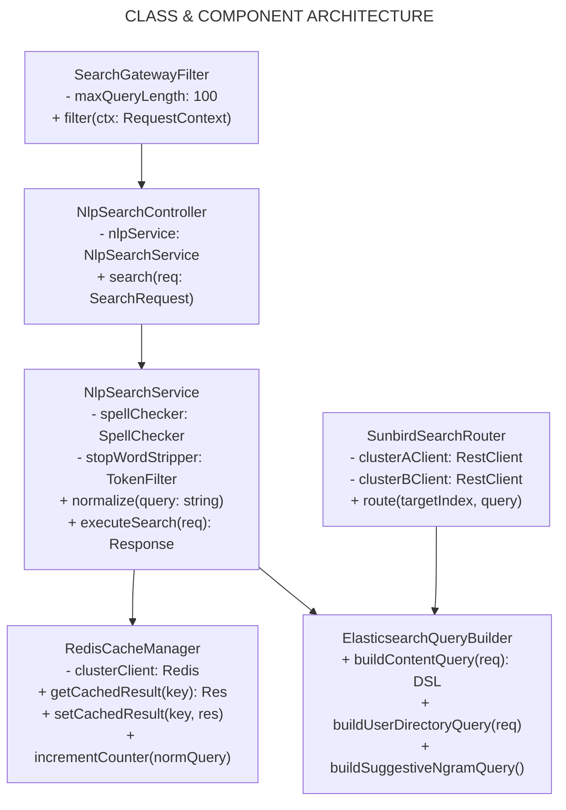
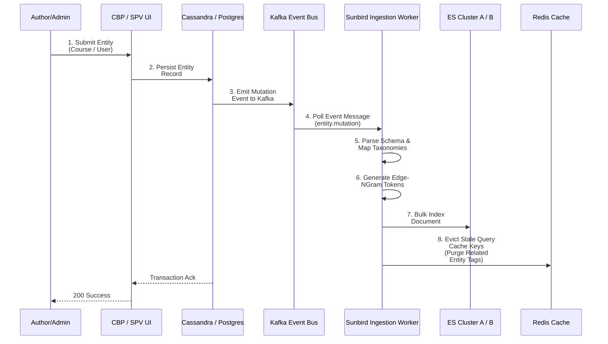
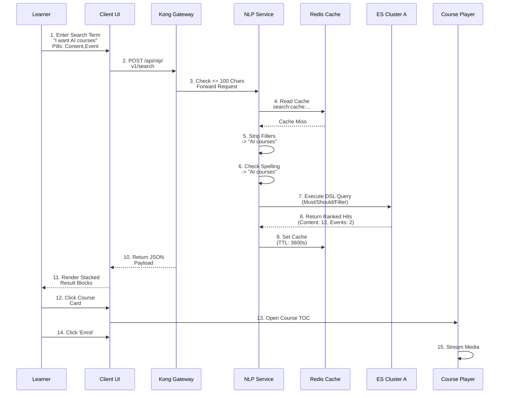
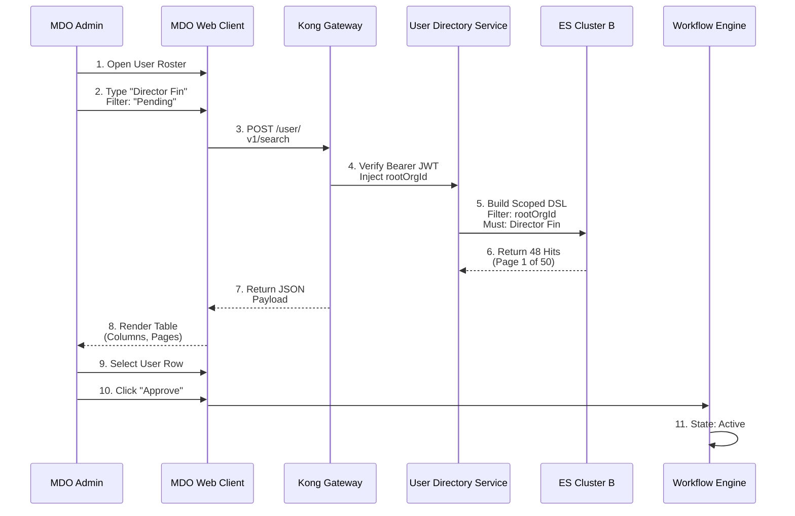
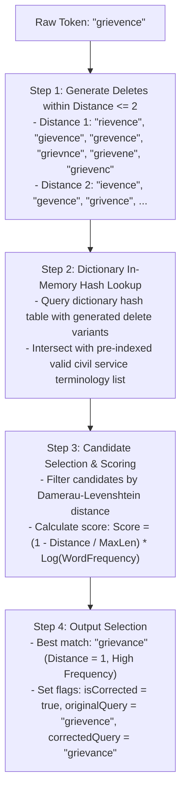
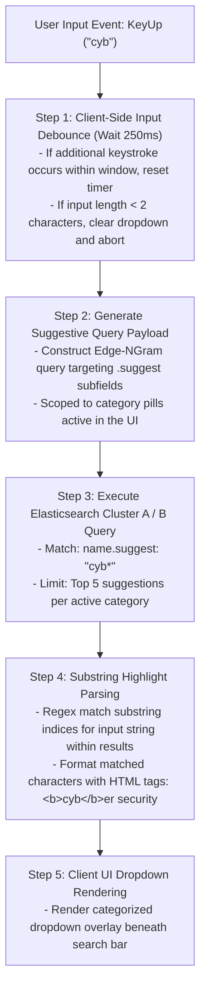
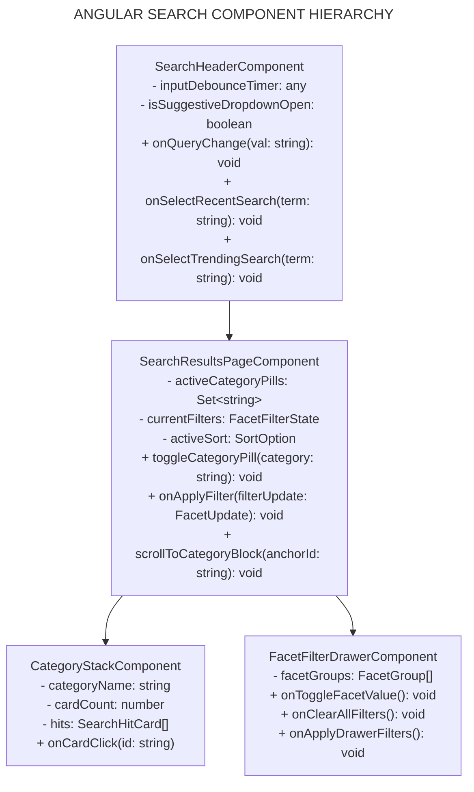
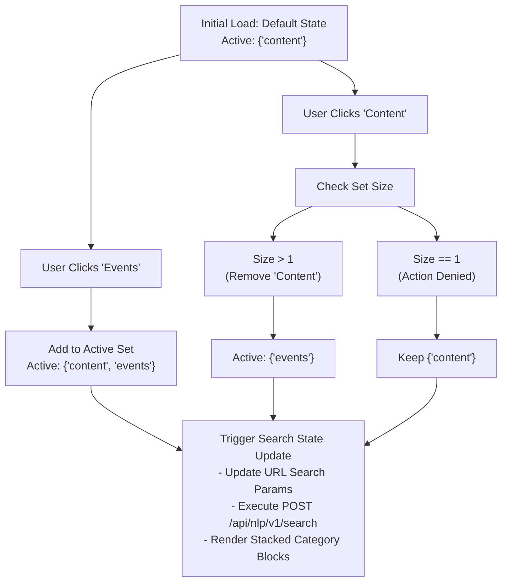
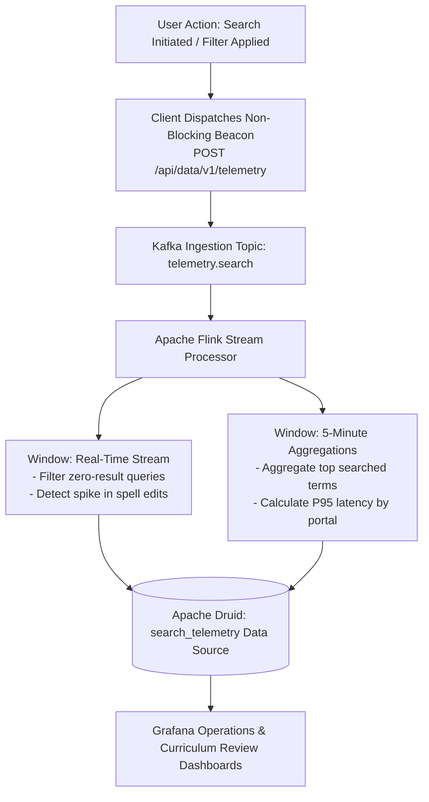

# Search — Low-Level Design (LLD) Document

## 2. Executive Technical Summary & Subsystem Scope

This Low-Level Design (LLD) document specifies the concrete class structures, data contracts, internal algorithms, state machines, and execution logic powering **Conventional Search** across all four iGOT Karmayogi portals.

Between **Q2 and Q13**, the search system was systematically refactored to address high concurrency, index contention, and multi-modal discovery. Key architectural enhancements include:

- **Elasticsearch Cluster Federation (Q10)**: Partitioning into **Cluster A** (Content, Org, Events) and **Cluster B** (Users, Profiles, Designations) to eliminate thread pool exhaustion during batch user updates.
- **NLP Search Hardening (Q13)**: Introducing an independent Node.js/TypeScript microservice that handles stop-word stripping, spelling correction, query normalization, and Redis caching.
- **Universal Multi-Select Category Navigation (Q13)**: Supporting simultaneous searches across Content, Events, People, Marketplace, Communities, and Amrit Gyan Kosh with stacked category counts.
- **Server-Side Administrative Pagination (Q9)**: Replacing client-side DOM array filtering with server-side pagination, multi-field queries, and tiered match scoring.

## 3. Class & Component Architecture (Static View)



### 3.1 Class Specifications & Method Signatures

#### 1. `SearchGatewayFilter` (API Gateway Ingress Filter)

- **Namespace / Package**: `org.karmayogi.gateway.filter.search`
- **Responsibilities**: Validates incoming HTTP payloads, trims whitespace, extracts JWT tenancy claims, and enforces the 100-character boundary (`KB-12369`, `KB-15545`).
- **Fields**:
  - `private static final int MAX_QUERY_LEN = 100;`
  - `private TokenValidator tokenValidator;`

- **Methods**:
  - `public GatewayResponse filter(RequestContext context)`:
    - Extracts `request.query`.
    - Trims leading/trailing whitespace.
    - If `query.length() > MAX_QUERY_LEN`, truncates the string to 100 characters and sets header `X-Query-Truncated: true`.
    - Extracts `rootOrgId` from the Authorization JWT and appends it to context parameters as `tenantScope`.

#### 2. `NlpSearchService` (Core Query Normalization & Pipeline Service)

- **Namespace / Package**: `com.karmayogi.nlp.search.service`
- **Responsibilities**: Cleans query text, strips filler words, executes phonetic/dictionary spelling corrections, coordinates Redis caching, and routes requests to Elasticsearch (`KB-15545`, `KB-15717`).
- **Fields**:
  - `private cacheManager: RedisCacheManager`
  - `private spellChecker: SymSpellChecker`
  - `private sunbirdRouter: SunbirdSearchRouter`
  - `private readonly intentStopWords: Set<string>`: Set containing `["i want to", "learn", "show me", "can you suggest", "courses on", "videos of", "training for"]`.

- **Methods**:
  - `public async processQuery(rawQuery: string): Promise<NormalizedQueryContext>`:
    - Executes lowercase and interior space normalization.
    - Matches and strips patterns found in `intentStopWords`.
    - Executes `spellChecker.correct(cleanedQuery)`; returns `correctedQuery` and sets `isCorrected = true` if edits were made.

  - `public async execute(request: ClientSearchRequest): Promise<SearchResponseEnvelope>`:
    - Normalizes the query via `processQuery()`.
    - Computes cache key: `const cacheKey = "search:cache:" + md5(normalizedQuery + JSON.stringify(request.categories) + JSON.stringify(request.filters));`.
    - Invokes `cacheManager.incrementCounter(normalizedQuery)`.
    - Checks `cacheManager.getCachedResult(cacheKey)`. If present, returns cached payload immediately.
    - If cache miss occurs, delegates execution to `sunbirdRouter.dispatch()`, writes output to Redis with a 3600-second TTL, and returns results.

#### 3. `ElasticsearchQueryBuilder` (DSL Construction Engine)

- **Namespace / Package**: `org.sunbird.search.builder`
- **Responsibilities**: Assembles Elasticsearch JSON queries with multi-field boosting, boolean filters, aggregations, and edge-ngram clauses (`KB-3504`, `KB-10566`, `KB-15545`).
- **Methods**:
  - `public JsonObject buildContentQuery(SearchCriteria criteria)`:
    - Constructs `bool` query with `must` `multi_match` mapping across fields:
      - `name` (boost: 3.0)
      - `keywords` (boost: 2.0)
      - `description` (boost: 1.0)
      - `name.suggest` (boost: 1.5)

    - Adds `filter` array containing:
      - `terms: { primaryCategory: criteria.getCategories() }`
      - `term: { status: "Live" }` (ensures retired courses are excluded, `KB-12730`).

    - Injects aggregation clauses for facets: `duration`, `rating`, `competencyArea`, `lang`.

  - `public JsonObject buildUserDirectoryQuery(UserSearchCriteria criteria)`:
    - Injects hard tenancy filter: `term: { rootOrgId: criteria.getTenantScope() }`.
    - Constructs `should` array across `firstName`, `lastName`, `email`, `designation`, and `cadre` to calculate tiered match scores (`KB-10579`).
    - Configures server-side pagination: `from: criteria.getOffset()`, `size: criteria.getLimit()`.

## 4. Detailed Component & Sequence Flows

### 4.1 Ingestion, Indexing & Cache Invalidation Pipeline (Creation Path)

This flow details what happens when a Content Creator publishes a course or an Administrator updates an organization profile:



#### Detailed Ingestion Execution Steps:

1. **Transaction Commit**: The entity is committed to PostgreSQL (e.g., table `user_entity` or `organisation_hierarchy`) or Apache Cassandra (table `content_data`).
2. **CDC Event Dispatch**: A transaction commit trigger dispatches an asynchronous JSON payload to Kafka topic `karmayogi.entity.mutation` containing the entity identifier, mutation type (`CREATE`/`UPDATE`/`RETIRE`), and modified attributes.
3. **Ingestion Worker Processing**:
  - Strips internal auditing properties.
  - Evaluates target index: Course metadata routes to **Cluster A** (`composite_search`), while civil servant profiles route to **Cluster B** (`user`).
  - If `status == "Retired"`, the worker removes the document from public alias `composite_search_live` and re-indexes it into `composite_search_archive` (`KB-12730`).
  - Generates edge-ngram character tokens (lengths 2 through 15) on searchable names and titles.

4. **Elasticsearch Indexation**: The worker dispatches a bulk indexing request to Elasticsearch via HTTP REST client over an active keep-alive connection pool.
5. **Cache Invalidation**: The worker issues a Redis scan command for keys matching pattern `search:cache:*` containing the mutated entity ID, purging stale search results.

### 4.2 Learner Multi-Pill Search & Consumption Pipeline (Read Path)

This flow details a learner searching across multiple modalities (Content, Events, Marketplace):



#### Detailed Execution Steps:

1. **Input Submission**: The user submits query `"I want to learn AI courses"` on Web or Mobile with category pills `Content` and `Events` active (`KB-15545`).
2. **Ingress Filtering**: The Gateway checks the query string length ( characters). If valid, it forwards the request to the NLP Search Service.
3. **Atomic Metrics Recording**: The NLP Service issues an asynchronous `INCR search:counter:i_want_to_learn_ai_courses` command to Redis for query tracking (`KB-15717`).
4. **Cache Interception**: The service computes the query MD5 hash and checks Redis. If a cache hit occurs, it returns the cached payload in . On a miss, it continues down the pipeline.
5. **Normalization & Cleaning**: The service strips `"I want to learn"`, preserving the core concept `"AI courses"`. It runs spelling correction through the dictionary engine.
6. **Query Construction**: The service builds an Elasticsearch DSL query targeting Cluster A with boolean filters scoping `primaryCategory` to `Course`, `Program`, and `Event`.
7. **Scoring & Aggregations**: Elasticsearch executes BM25 scoring with Title boosting (3.0), computes facet counts (duration, rating, language), and returns matching hits.
8. **Cache Population**: The NLP Service writes the structured response to Redis under key `search:cache:<hash>` with a 3600-second TTL.
9. **UI Rendering**: The client renders the results in stacked category blocks with category hit counts in brackets (e.g., `Content (12)`, `Events (2)`).
10. **Downstream Consumption**: Clicking a course card opens the Course Table of Contents (TOC) page, where clicking "Enrol" transitions the user directly to the Course Player.

### 4.3 MDO Administrative Scoped Directory Search Flow

This flow details an MDO administrator searching across thousands of department employees to process pending profile verifications:



#### Detailed Execution Steps:

1. **User Input**: The MDO Administrator opens the Users tab, enters `"Director Fin"`, and selects filter `Status = "Pending Verification"`.
2. **Tenancy Injection**: The API Gateway verifies the administrator's JWT token, extracts `rootOrgId = "012849581029485716"`, and passes it to the User Directory Service.
3. **Scoped Query Formulation**: The service constructs an Elasticsearch DSL query targeting **Cluster B** with a mandatory `filter` clause:
  ```json
  {
    "bool": {
      "filter": [
        {
          "term": {
            "rootOrgId": "012849581029485716"
          }
        },
        {
          "term": {
            "isVerified": false
          }
        }
      ],
      "must": [
        {
          "multi_match": {
            "query": "Director Fin",
            "fields": [
              "designation^2.0",
              "firstName",
              "lastName",
              "cadre"
            ],
            "type": "best_fields"
          }
        }
      ]
    }
  }
  ```
4. **Server-Side Pagination**: The service applies `from: 0` and `size: 50`, querying across the full dataset rather than the current browser view (`KB-10564`, `KB-10579`).
5. **UI Presentation**: The client renders the first 50 results in a data grid, showing total matched count (`48 records`), pagination controls, and action buttons.
6. **Administrative Action**: Clicking "Approve" dispatches an update to the Workflow Engine, activating the civil servant's account.

## 5. Detailed Algorithm Specifications

### 5.1 Spell Checking & Typo Tolerance Algorithm (SymSpell Implementation)

The NLP Search Service utilizes a symmetric-delete spelling correction algorithm to achieve high throughput under heavy query loads:



### 5.2 Suggestive Auto-Complete Token Search Algorithm

Suggestive auto-complete queries execute prefix and edge-ngram lookups against pre-indexed terms:



## 6. Concrete Data Contracts & API Schemas

### 6.1 NLP Search Microservice API (`POST /api/nlp/v1/search`)

#### Request Schema:

```json
{
  "$schema": "http://json-schema.org/draft-07/schema#",
  "title": "NlpSearchRequest",
  "type": "object",
  "properties": {
    "request": {
      "type": "object",
      "properties": {
        "query": {
          "type": "string",
          "maxLength": 100,
          "description": "User search string, capped at 100 characters."
        },
        "categories": {
          "type": "array",
          "items": {
            "type": "string",
            "enum": [
              "content",
              "events",
              "people",
              "marketplace",
              "communities",
              "resources"
            ]
          },
          "minItems": 1,
          "uniqueItems": true,
          "description": "Active category pills. Defaults to ['content']."
        },
        "filters": {
          "type": "object",
          "properties": {
            "primaryCategory": {
              "type": "array",
              "items": {
                "type": "string"
              }
            },
            "competencyArea": {
              "type": "array",
              "items": {
                "type": "string"
              }
            },
            "duration": {
              "type": "array",
              "items": {
                "type": "string"
              }
            },
            "rating": {
              "type": "array",
              "items": {
                "type": "number"
              }
            },
            "lang": {
              "type": "array",
              "items": {
                "type": "string"
              }
            }
          },
          "additionalProperties": false
        },
        "sort": {
          "type": "object",
          "properties": {
            "by": {
              "type": "string",
              "enum": [
                "relevance",
                "lastUpdatedOn",
                "name"
              ]
            },
            "order": {
              "type": "string",
              "enum": [
                "asc",
                "desc"
              ]
            }
          },
          "required": [
            "by",
            "order"
          ]
        },
        "limit": {
          "type": "integer",
          "minimum": 1,
          "maximum": 100,
          "default": 20
        },
        "offset": {
          "type": "integer",
          "minimum": 0,
          "default": 0
        }
      },
      "required": [
        "query",
        "categories"
      ]
    }
  },
  "required": [
    "request"
  ]
}
```

#### Response Schema:

```json
{
  "$schema": "http://json-schema.org/draft-07/schema#",
  "title": "NlpSearchResponse",
  "type": "object",
  "properties": {
    "id": {
      "type": "string",
      "example": "api.nlp.search"
    },
    "ver": {
      "type": "string",
      "example": "v1"
    },
    "ts": {
      "type": "string",
      "format": "date-time"
    },
    "responseCode": {
      "type": "string",
      "example": "OK"
    },
    "result": {
      "type": "object",
      "properties": {
        "query": {
          "type": "string"
        },
        "originalQuery": {
          "type": "string"
        },
        "isCorrected": {
          "type": "boolean"
        },
        "totalHits": {
          "type": "integer"
        },
        "categories": {
          "type": "object",
          "additionalProperties": {
            "type": "object",
            "properties": {
              "count": {
                "type": "integer"
              },
              "hits": {
                "type": "array",
                "items": {
                  "type": "object",
                  "properties": {
                    "identifier": {
                      "type": "string"
                    },
                    "name": {
                      "type": "string"
                    },
                    "primaryCategory": {
                      "type": "string"
                    },
                    "posterImage": {
                      "type": "string",
                      "format": "uri"
                    },
                    "duration": {
                      "type": "integer"
                    },
                    "rating": {
                      "type": "number"
                    },
                    "provider": {
                      "type": "string"
                    }
                  },
                  "required": [
                    "identifier",
                    "name"
                  ]
                }
              }
            },
            "required": [
              "count",
              "hits"
            ]
          }
        },
        "facets": {
          "type": "array",
          "items": {
            "type": "object",
            "properties": {
              "name": {
                "type": "string"
              },
              "values": {
                "type": "array",
                "items": {
                  "type": "object",
                  "properties": {
                    "name": {
                      "type": "string"
                    },
                    "count": {
                      "type": "integer"
                    }
                  }
                }
              }
            }
          }
        }
      },
      "required": [
        "query",
        "isCorrected",
        "totalHits",
        "categories"
      ]
    }
  },
  "required": [
    "responseCode",
    "result"
  ]
}
```

## 7. Client UI Component State & Interaction Specifications

### 7.1 Angular Component Architecture (Learner & Administrative Portals)



### 7.2 UI State Machine: Multi-Select Category Pills (`KB-15545`)

The client state machine governs category pill toggling to prevent an unscoped search state:



## 8. Failure Modes, Edge Cases & Circuit Breaking

| Subsystem Component | Failure Scenario | Detection Mechanism | System Mitigation / Recovery Behavior |
|---|---|---|---|
| **Kong API Gateway** | User submits query characters (`KB-12369`). | Ingress regex boundary check. | Truncates query to 100 characters, sets header `X-Query-Truncated: true`, and processes truncated query. |
| **NLP Search Service** | Microservice crash, OOM, or internal dependency failure. | Gateway HTTP 502/503 status or 2.0s timeout. | Circuit breaker opens: Gateway fails over directly to Sunbird Search API using raw query tokens (`KB-15717`). |
| **Redis Cache Cluster** | Redis nodes unreachable or read timeout exceeds . | Redis client error handler / connection timeout. | Service logs warning, bypasses cache, and queries Elasticsearch directly without returning 500 to user. |
| **Elasticsearch Cluster A** | Index shard unavailable or cluster experiencing high memory pressure. | HTTP 503 from ES client or REST connection timeout. | Client retries across alternate cluster node. If down, returns graceful empty results page with support contact info. |
| **MDO User Search** | Request contains mismatched or tampered `rootOrgId` in payload. | JWT claim validation inside User Directory Service. | System overrides payload with authenticated JWT `rootOrgId`, preventing cross-tenancy data exposure. |
| **Learner UI Pills** | User attempts to deselect the only active category pill. | Angular pill selection state machine check. | Deselection is disabled; UI displays tooltip: *"At least one category must remain selected"*. |

## 9. Telemetry & Observability Pipeline

All search interactions emit structured telemetry to Kafka, feeding downstream Flink streaming processors and Apache Druid analytics datastores without impacting search latency:



### Telemetry Event Schema (`search_initiated`):

```json
{
  "eid": "SEARCH",
  "ets": 1793529600000,
  "ver": "3.0",
  "mid": "SEARCH:84b72910-c482-411a-9428-19e917d59011",
  "actor": {
    "id": "usr_9182847192",
    "type": "User"
  },
  "context": {
    "channel": "012849581029485716",
    "pdata": {
      "id": "karmayogi.portal.learner",
      "ver": "13.0.0"
    },
    "env": "search"
  },
  "edata": {
    "type": "browse",
    "query": "cyber security",
    "filters": {
      "primaryCategory": [
        "Course"
      ]
    },
    "sort": {
      "by": "relevance",
      "order": "desc"
    },
    "size": 20,
    "topPill": "content",
    "activePills": [
      "content",
      "events"
    ]
  }
}
```
