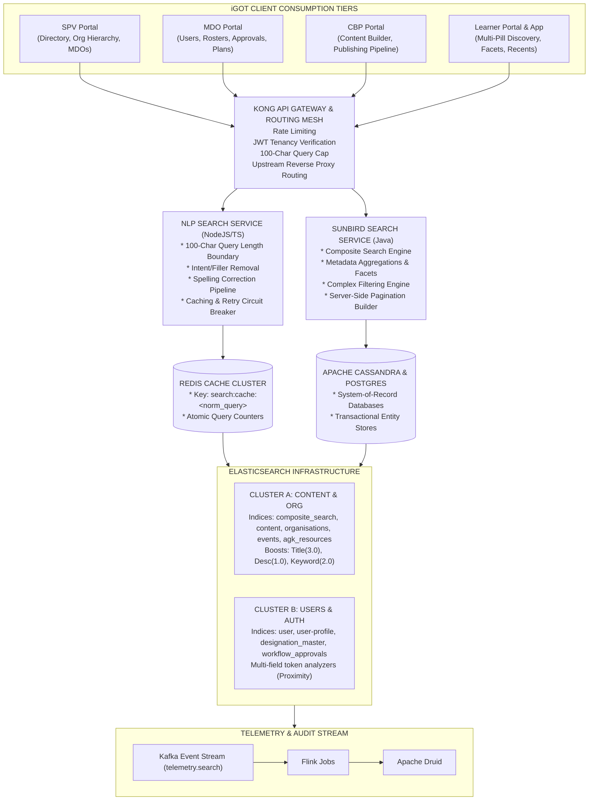
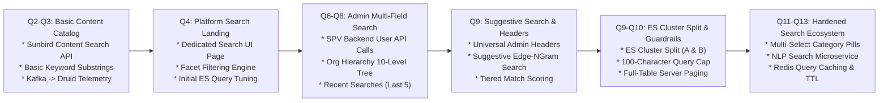
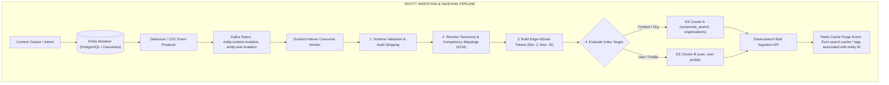
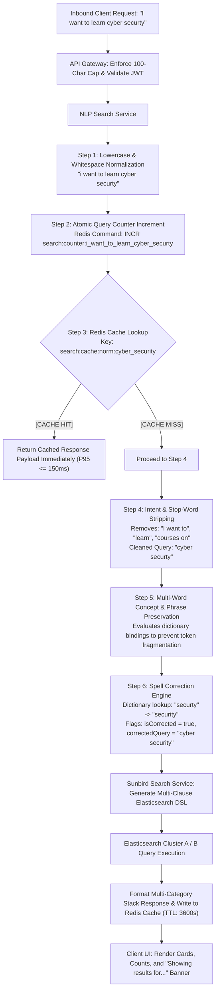
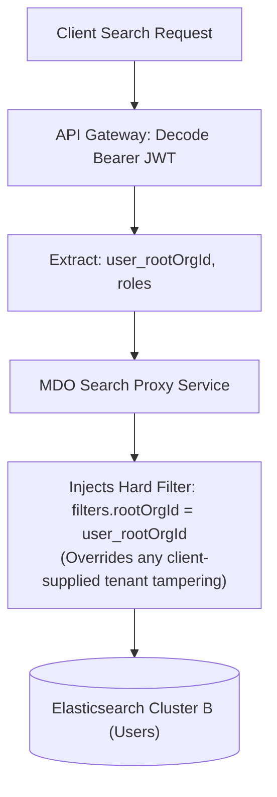
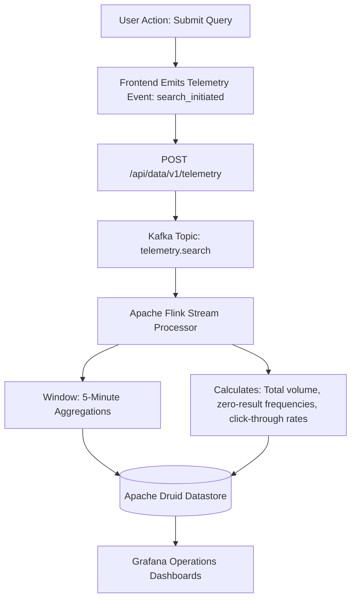

# Search — Software Design Document (SDD)

## 2. Design Overview, Goals & Constraints

### 2.1 System Purpose

This Software Design Document (SDD) specifies the architectural decomposition, interface specifications, internal algorithms, datastore schemas, and runtime interaction workflows for the **Conventional Search Ecosystem** of the iGOT Karmayogi platform. It covers the technical realization of entity creation, ingestion indexing, syntactic query normalization, caching, ranking, and search consumption across the **SPV**, **MDO**, **CBP**, and **Learner/Mobile** portals.

### 2.2 Design Goals & Rationale

1. **High Concurrency & Low Latency**: Maintain P95 query latency under across direct catalog search and under for cached queries, handling concurrency peaks up to 500 req/sec during national capacity-building drives.
2. **Resource & Index Isolation**: Physically segregate high-throughput learner catalog queries from write-heavy administrative user-profile index updates to eliminate index lock contention and thread starvation.
3. **Resilience & Graceful Degradation**: Protect the core search infrastructure against unbounded query sizes and cascade failures using API Gateway payload boundary checks (100-character cap), Redis query caching, and circuit-breaker fallbacks.
4. **Deterministic Ranking & Precision**: Replace unweighted substring matching with a tiered scoring engine (Exact Match Token Proximity Partial Substring Fuzzy Fallback) coupled with metadata field boosting (Title match weight > Description match weight).
5. **Universal Server-Side Execution**: Guarantee that all administrative listings (Users, Organizations, Designations, Training Plans) execute pagination and filtering at the database/index layer, eliminating client-side DOM truncation.

### 2.3 Architecture & Operating Constraints

- **Multi-Tenancy Boundaries**: MDO and SPV directory searches must enforce multi-tenant isolation via JWT claims (`rootOrgId`), guaranteeing zero cross-department data exposure.
- **Strict Conventional Scope Boundary**: The engine strictly processes structured metadata, tokens, n-grams, and inverted index mappings. Generative vector summarization, LLM inference, and automated dialogue loops are strictly out of scope.
- **Hardware & Memory Boundaries**: Java Virtual Machine (JVM) heap utilization within Elasticsearch must not exceed per query context; unindexed wildcards and deep paging beyond offset 10,000 are forbidden.

## 3. High-Level Architectural Decomposition



### 3.1 Component Catalog

| Component | Technology | Primary Function & Architectural Role |
|---|---|---|
| **API Gateway** | Kong / OpenResty | Ingress reverse proxy, JWT authentication verification, IP rate-limiting, and 100-character query cap enforcement. |
| **NLP Search Service** | Node.js / TypeScript | Microservice responsible for query normalization, stop-word and conversational intent stripping, spelling correction, and Redis cache coordination. |
| **Redis Cache Cluster** | Redis v7.x (Cluster Mode) | Distributed in-memory datastore holding normalized query-to-result payloads (with configurable TTL) and atomic query frequency counters. |
| **Sunbird Search API** | Java 11 / Play Framework | Core domain composite search orchestrator translating client requests into Elasticsearch DSL queries across content, taxonomy, and facets. |
| **ES Cluster A** | Elasticsearch 6.7+ | Dedicated search cluster indexing Content, Curated Programs, Assessments, Events, Organizations, and Knowledge Resources. |
| **ES Cluster B** | Elasticsearch 6.7+ | Isolated search cluster indexing Civil Servant Users, User Profiles, Designations, and Workflow Approvals (Split in Q10). |
| **Kafka Ingestion Bus** | Apache Kafka 2.8+ | Event-driven change-data-capture (CDC) pipeline dispatching asynchronous entity create/update events to indexer workers. |
| **Telemetry Pipeline** | Kafka Flink Druid | Telemetry stream capturing search performance, result counts, click-throughs, and zero-result queries for analytics. |

## 4. Historical Evolution Architecture & Technical Debt Remediation (Q2 – Q13)

### 4.1 Chronological Evolution Matrix



### 4.2 Key Architectural Evolution Stages

#### 1. Platform Search Foundation & Telemetry Capture (Q2 – Q4)

- **Baseline**: Single Elasticsearch cluster housing both content and user data. Searches executed literal wildcard matches (`*query*`) resulting in excessive CPU utilization.
- **Enhancement**: Introduced dedicated `/app/search` landing page with Elasticsearch aggregations computing facet buckets (duration, resource category). Keyword logging was routed via Kafka event streams into Apache Druid (`KB-2131`, `KB-2152`, `KB-3494`, `KB-3504`).

#### 2. Administrative Backend Migration & Hierarchy Navigation (Q6 – Q8)

- **Baseline**: Administrative user directories in the SPV Portal filtered records in client browser memory across pre-fetched arrays. Searches failed beyond the first 10 DOM elements.
- **Enhancement**: Deprecated frontend-only filtering in favor of server-side queries via `POST /api/user/v1/search` (`KB-7919`, `KB-7920`). Implemented recursive node traversal allowing administrators to search through 10 levels of ministerial hierarchy (`KB-9738`, `KB-9790`, `KB-9794`).

#### 3. High-Density Full-Table Search & Suggestive Dropdowns (Q9)

- **Baseline**: Absence of a global header search across administrative portals; users had to navigate to individual entity tabs.
- **Enhancement**: Introduced universal global header search bars in MDO (`KB-11175`, `KB-11176`) and CBP (`KB-8980`, `KB-11044`). Implemented edge-ngram auto-complete suggestive dropdowns (`KB-10563`, `KB-10581`). Standardized full-table server-side search across all pages (`KB-10564`, `KB-10579`).

#### 4. Elasticsearch Cluster Split & Boundary Guardrails (Q10)

- **Baseline**: Unbounded user queries and concurrent batch ingestion of civil servant profiles caused cluster-wide thread pool exhaustion and Out-Of-Memory (OOM) faults.
- **Enhancement**: Split Elasticsearch into two independent clusters (`KB-11907`, `KB-11908`, `KB-11794`):
  - **Cluster A**: Content, Events, Organizations, Resources.
  - **Cluster B**: Users, Profiles, Designations, Approvals.
  - Enforced an API Gateway validation rule rejecting or truncating search strings exceeding 100 characters (`KB-12369`).

#### 5. Multi-Select Category Pills & NLP Response Caching (Q11 – Q13)

- **Baseline**: Siloed category tabs on Learner Portal forced users to execute isolated searches per content type. Natural language queries containing filler phrases returned empty results.
- **Enhancement**: Introduced **Multi-Select Category Pills** (`KB-15545`), allowing simultaneous selection across Content, Events, People, Marketplace, Communities, and Amrit Gyan Kosh with stacked result cards. Deployed the standalone **NLP Search Service** (`KB-15717`) featuring stop-word removal, automatic spelling correction, atomic query counters, and Redis query response caching.

## 5. Subsystem Component Design & Processing Pipelines

### 5.1 Ingestion & Indexing Pipeline (Creation Flow)

The ingestion subsystem synchronizes state between core transactional datastores (Cassandra, PostgreSQL) and read-optimized Elasticsearch clusters.



### 5.2 Query Processing & Normalization Pipeline (Consumption Flow)

When a user executes a search, the NLP Search Service and API Gateway process the input before querying Elasticsearch:



## 6. Portal-Specific Functional & UI Design

### 6.1 SPV Portal (Administrative & Directory Discovery)

- **Target Modules**: Organization Directory (`/app/spv/directory`), Org Hierarchy (`/app/spv/org-hierarchy`), Partner Management (`/app/spv/marketplace/providers`), Designation Master.
- **Search Execution Model**:
  - Global table toolbar search fields executing server-side pagination against `POST /api/org/v1/search` or `POST /api/user/v1/search`.
  - Multi-column matching indexing: `orgName`, `email`, `role`, `status`, `createdDate` (`KB-10562`).
  - Hierarchy tree filtering: Recursive depth-first search allowing filtering by jurisdiction (Central Ministry vs State Government) down to 10 levels (`KB-9738`, `KB-9790`).
  - Table display densities configurable by administrators to 20, 50, or 100 records per page (`KB-10565`).

### 6.2 MDO Portal (Civil Servant & Capacity Plan Management)

- **Target Modules**: Global Header, User Directory (`/app/mdo/users`), Approvals Dashboard, Training Plans (`/app/mdo/training-plans`), Blended Programs.
- **Search Execution Model**:
  - Persistent global header search input. Typing characters triggers an edge-ngram suggestive popup categorizing matches under: Users, Training Plans, Events, and Communities (`KB-10581`, `KB-11176`).
  - Scoped User Search: Backend enforces tenancy security by automatically binding the authenticated user's `rootOrgId` into all query filters.
  - Multi-field employee discovery matching simultaneously across: `firstName`, `lastName`, `email`, `designation`, `group`, and `cadre` (`KB-10579`, `KB-11177`).
  - Workflow status filtering supporting: `Pending Profile Verification`, `Pending Transfer Request`, `Verified/Active`, and `Blocked/Inactive`.

### 6.3 CBP Portal (Content Publisher & Authoring Discovery)

- **Target Modules**: Universal Content Repository (`/app/cbp/content`), Content Requests (`/app/cbp/requests`), Course Access Control (`/app/cbp/access-control`).
- **Search Execution Model**:
  - Content Authoring Search: Deep indexing of draft and live course assets across Title, DO-ID (`do_XXXXXXXXXX`), Description, Competency Domain, and Primary Category (`KB-8980`, `KB-11044`, `KB-11045`).
  - Exclusion of Archived Content: Elasticsearch filter clause hardcodes `status: ["Live", "Draft", "Review"]` on active catalog indexes, ensuring courses approved for retirement (`status: "Retired"`) never surface in active author searches (`KB-12730`).
  - Access Control User Finder: Embedded user search tool allowing course creators to locate civil servants by name/email and bind custom access rules (Public, Departmental, or Custom Invite-Only) (`KB-9602`).

### 6.4 Learner Portal & Mobile App (Consumption & Discovery)

- **Target Modules**: Global Search Bar, Dedicated Search Page (`/app/search`), Course Catalog (`/app/catalog`), Explore by Theme (`/app/home#explore-themes`).
- **Search Execution Model**:
  - **Multi-Select Category Pills** (`KB-15545`): Six distinct categories selectable simultaneously via logical `OR`:
    - *Content* (Courses, Programs, Assessments)
    - *Events* (Webinars, In-person sessions)
    - *People* (Civil Servants, Mentors)
    - *Marketplace* (External partner courses)
    - *Communities* (Discussion groups)
    - *Amrit Gyan Kosh* (Policy documents, reference books)

  - Layout Rules: Sticky desktop left panel provides anchor scrolling to stacked result blocks. Minimum one category pill must be active; default is `Content`.
  - Suggestive & History Popover: Empty input focus displays **Last 5 Recent Searches** (`KB-8701`); if empty, surfaces platform **Trending Searches** (`KB-10624`). Active typing surfaces edge-ngram suggestions with bold substring highlights.
  - Mobile Responsiveness: Touch-friendly horizontal pill scrolling; category stacks clamp to 4 cards on mobile (vs 5 on web) to prevent vertical scroll exhaustion (`KB-15545`).

## 7. Data Models, Index Mappings & Storage Architecture

### 7.1 Elasticsearch Cluster A: Content Index Mapping

**Index Name**: `composite_search` | **Cluster**: Cluster A (Content/Org)

```json
{
  "settings": {
    "index": {
      "number_of_shards": 5,
      "number_of_replicas": 2,
      "analysis": {
        "analyzer": {
          "edge_ngram_analyzer": {
            "type": "custom",
            "tokenizer": "edge_ngram_tokenizer",
            "filter": [
              "lowercase",
              "trim"
            ]
          }
        },
        "tokenizer": {
          "edge_ngram_tokenizer": {
            "type": "edge_ngram",
            "min_gram": 2,
            "max_gram": 15,
            "token_chars": [
              "letter",
              "digit"
            ]
          }
        }
      }
    }
  },
  "mappings": {
    "properties": {
      "identifier": {
        "type": "keyword"
      },
      "name": {
        "type": "text",
        "analyzer": "standard",
        "fields": {
          "suggest": {
            "type": "text",
            "analyzer": "edge_ngram_analyzer"
          },
          "raw": {
            "type": "keyword"
          }
        },
        "boost": 3.0
      },
      "description": {
        "type": "text",
        "analyzer": "standard",
        "boost": 1.0
      },
      "keywords": {
        "type": "text",
        "analyzer": "standard",
        "boost": 2.0
      },
      "primaryCategory": {
        "type": "keyword"
      },
      "status": {
        "type": "keyword"
      },
      "contentType": {
        "type": "keyword"
      },
      "competencyArea": {
        "type": "keyword"
      },
      "competencyTheme": {
        "type": "keyword"
      },
      "duration": {
        "type": "integer"
      },
      "rating": {
        "type": "float"
      },
      "lang": {
        "type": "keyword"
      },
      "channel": {
        "type": "keyword"
      },
      "createdOn": {
        "type": "date"
      },
      "lastUpdatedOn": {
        "type": "date"
      }
    }
  }
}
```

### 7.2 Elasticsearch Cluster B: User Index Mapping

**Index Name**: `user` | **Cluster**: Cluster B (Users/Auth)

```json
{
  "settings": {
    "index": {
      "number_of_shards": 5,
      "number_of_replicas": 2,
      "analysis": {
        "analyzer": {
          "user_ngram_analyzer": {
            "type": "custom",
            "tokenizer": "edge_ngram_tokenizer",
            "filter": [
              "lowercase",
              "trim"
            ]
          }
        }
      }
    }
  },
  "mappings": {
    "properties": {
      "userId": {
        "type": "keyword"
      },
      "firstName": {
        "type": "text",
        "fields": {
          "suggest": {
            "type": "text",
            "analyzer": "user_ngram_analyzer"
          }
        }
      },
      "lastName": {
        "type": "text"
      },
      "email": {
        "type": "keyword"
      },
      "phone": {
        "type": "keyword"
      },
      "rootOrgId": {
        "type": "keyword"
      },
      "orgName": {
        "type": "text",
        "fields": {
          "raw": {
            "type": "keyword"
          }
        }
      },
      "designation": {
        "type": "text",
        "fields": {
          "raw": {
            "type": "keyword"
          }
        }
      },
      "group": {
        "type": "keyword"
      },
      "cadre": {
        "type": "keyword"
      },
      "service": {
        "type": "keyword"
      },
      "status": {
        "type": "integer"
      },
      "isVerified": {
        "type": "boolean"
      },
      "wfStatus": {
        "type": "keyword"
      }
    }
  }
}
```

### 7.3 Redis Schema (Caching & Rate Tracking)

| Key Pattern | Data Structure | TTL | Description |
|---|---|---|---|
| `search:cache:norm:<md5_query>` | String (JSON) | 3600 seconds | Serialized response payload of the processed search query. |
| `search:counter:<normalized_str>` | Integer | Persistent | Atomic integer recording platform-wide query frequency count. |
| `search:recent:<userId>` | List (Strings) | Persistent | FIFO list storing up to 5 of the user's most recent search terms. |
| `search:trending` | ZSet (Sorted Set) | 86400 seconds | Aggregate scores of top platform-wide searches calculated via Flink. |

## 8. API & Interface Specifications

### 8.1 NLP Search Service API (`POST /api/nlp/v1/search`)

- **Protocol**: HTTPS / REST
- **Consuming Clients**: Learner Web Portal, Mobile Application
- **Headers**:
  ```http
  Content-Type: application/json
  Authorization: Bearer <Optional_JWT_Token>
  X-Channel-Id: <Channel_UUID>
  ```
- **Request Payload**:
  ```json
  {
    "request": {
      "query": "I want to learn public procurement",
      "categories": [
        "content",
        "events",
        "marketplace"
      ],
      "filters": {
        "primaryCategory": [
          "Course",
          "Curated Program"
        ],
        "competencyArea": [
          "Functional"
        ],
        "duration": [
          "30-60 mins"
        ],
        "rating": [
          4.0
        ]
      },
      "sort": {
        "by": "relevance",
        "order": "desc"
      },
      "limit": 20,
      "offset": 0
    }
  }
  ```
- **Response Structure (200 OK)**:
  ```json
  {
    "id": "api.nlp.search",
    "ver": "v1",
    "ts": "2026-11-01T09:48:00Z",
    "params": {
      "resmsgid": "84b72910-c482-411a-9428-19e917d59011",
      "status": "successful"
    },
    "responseCode": "OK",
    "result": {
      "query": "public procurement",
      "originalQuery": "I want to learn public procurement",
      "isCorrected": false,
      "totalHits": 14,
      "categories": {
        "content": {
          "count": 10,
          "hits": [
            {
              "identifier": "do_11385920194857",
              "name": "General Financial Rules (GFR) in Procurement",
              "primaryCategory": "Course",
              "posterImage": "https://igot.blob.core.windows.net/posters/do_11385920194857.png",
              "duration": 2700,
              "rating": 4.7,
              "provider": "Department of Expenditure"
            }
          ]
        },
        "events": {
          "count": 1,
          "hits": []
        },
        "marketplace": {
          "count": 3,
          "hits": []
        }
      }
    }
  }
  ```

### 8.2 User Directory Search API (`POST /api/user/v1/search`)

- **Protocol**: HTTPS / REST
- **Consuming Clients**: MDO Portal, SPV Portal, CBP Access Control
- **Headers**:
  ```http
  Content-Type: application/json
  Authorization: Bearer <Mandatory_JWT_Token>
  ```
- **Request Payload**:
  ```json
  {
    "request": {
      "query": "Secretary Finance",
      "filters": {
        "rootOrgId": "012849581029485716",
        "status": 1
      },
      "sort_by": {
        "createdDate": "desc"
      },
      "limit": 50,
      "offset": 0
    }
  }
  ```
- **Response Structure (200 OK)**:
  ```json
  {
    "id": "api.user.search",
    "ver": "v1",
    "responseCode": "OK",
    "result": {
      "response": {
        "count": 8,
        "content": [
          {
            "userId": "usr_9182847192",
            "firstName": "Sanjay",
            "lastName": "Verma",
            "email": "sanjay.verma@nic.in",
            "designation": "Joint Secretary (Finance)",
            "group": "Group A",
            "cadre": "IAS",
            "rootOrgName": "Department of Expenditure",
            "isVerified": true
          }
        ]
      }
    }
  }
  ```

## 9. Search Algorithms: Ranking, Tiered Scoring & Normalization

### 9.1 Multi-Tiered Matching Scoring Algorithm

Administrative searches (SPV, MDO) execute tiered match scoring to ensure exact matches outrank partial and fuzzy substrings:

```typescript
function calculateMatchScore(recordValue: string, queryToken: string): number {
  const normRecord = recordValue.toLowerCase().trim();
  const normQuery = queryToken.toLowerCase().trim();

  // Tier 1: Exact Match (Score = 1.0)
  if (normRecord === normQuery) {
    return 1.0;
  }

  // Tier 2: Token Proximity / Word Boundary Match (Score = 0.8)
  const wordBoundaryRegex = new RegExp(`\\b${normQuery}\\b`, 'i');
  if (wordBoundaryRegex.test(normRecord)) {
    return 0.8;
  }

  // Tier 3: Prefix / Substring Match (Score = 0.5)
  if (normRecord.includes(normQuery)) {
    return 0.5;
  }

  // Tier 4: Levenshtein Distance / Fuzzy Approximation (Score = 0.2)
  if (levenshteinDistance(normRecord, normQuery) <= 2) {
    return 0.2;
  }

  return 0.0;
}
```

### 9.2 Elasticsearch DSL Multi-Field Boosting Formulation

To rank content appropriately on the Learner Portal, the backend constructs an Elasticsearch boolean query where Title matches carry higher weight than Description matches:

```json
{
  "query": {
    "bool": {
      "must": [
        {
          "multi_match": {
            "query": "public procurement",
            "type": "most_fields",
            "fields": [
              "name^3.0",
              "keywords^2.0",
              "description^1.0",
              "name.suggest^1.5"
            ],
            "fuzziness": "AUTO",
            "prefix_length": 2
          }
        }
      ],
      "filter": [
        {
          "term": {
            "status.raw": "Live"
          }
        },
        {
          "terms": {
            "primaryCategory.raw": [
              "Course",
              "Curated Program"
            ]
          }
        }
      ]
    }
  }
}
```

## 10. Cross-Cutting Concerns: Security, Telemetry & Resilience

### 10.1 Tenancy Isolation & Data Leakage Prevention



### 10.2 Telemetry Ingestion Pipeline

To analyze zero-result queries and user discovery behaviors without impacting search response times, the frontend dispatches non-blocking telemetry events to the Kafka bus:



### 10.3 Circuit Breaker & Graceful Degradation

To prevent cascading outages if the NLP Search Service degrades:

- **Threshold**: If P95 latency exceeds or 5xx error rates exceed over a 30-second rolling window, the circuit breaker opens.
- **Failover**: The API Gateway bypasses the NLP Service and routes requests directly to the Sunbird Composite Search API using raw tokens.
- **User Impact**: Spell-check is temporarily bypassed, but core search execution remains operational.
