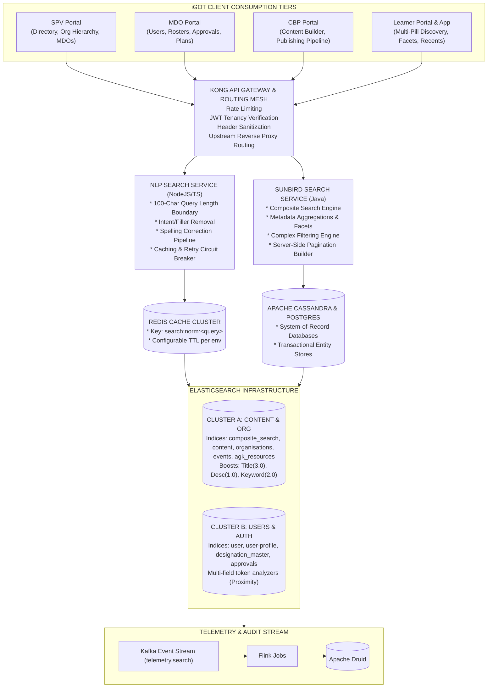
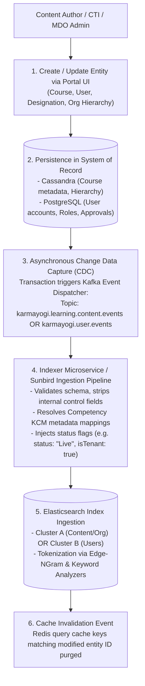
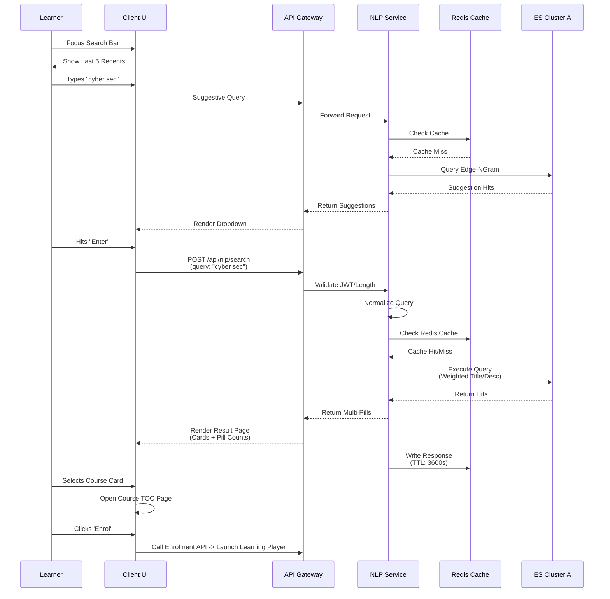
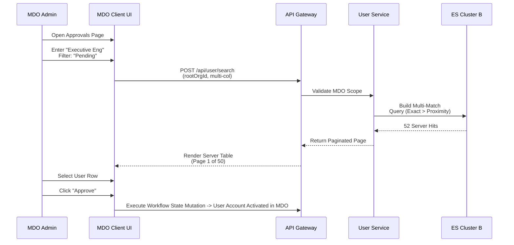

# Search — Software Requirements Specification (SRS)

## 2. Introduction

### 2.1 Purpose

This Software Requirements Specification (SRS) establishes a complete, rigorous, and consolidated statement of functional, behavioral, architectural, interface, and non-functional requirements for the **Conventional Search Ecosystem** across the **iGOT** **Karmayogi Platform**. It tracks the progressive capability evolution, entity indexing pipelines, query processing mechanics, and end-user consumption touchpoints across all four platform portals (SPV, MDO, CBP, Learner/Mobile) from release Quarter 2 (Q2) through Quarter 13 (Q13).

### 2.2 Scope of the Search System

The Search system encompasses:

1. **Search Foundation & Data Ingestion**: Near-real-time indexation of course metadata, civil servant profiles, public entities, training plans, events, and organizational hierarchies into segregated Elasticsearch clusters.
2. **Search Interfaces & Entry Points**: Global header search inputs, multi-tier organizational tree searches, table-level multi-column search tools, faceted filter drawers, and multi-category selection pill bars.
3. **Query Intelligence (Non-Generative)**: Syntactic normalization, whitespace trimming, character-length boundaries, stop-word and conversational intent stripping, spelling correction, and weighted metadata ranking.
4. **Data Delivery & Caching**: Multi-field matching scoring, server-side pagination (20/50/100 page models), edge-ngram auto-complete suggestive search, recent query persistence, and high-throughput Redis response caching.
5. **Consumption Journeys**: Discovery-to-action flows spanning learner self-enrollment, MDO administrative user approvals, SPV hierarchy modifications, and CBP content deduplication.

### 2.3 Strict Scope Exclusions

The following capabilities belong to separate platform initiatives and are **strictly excluded**:

- Generative AI answer synthesis and Retrieval-Augmented Generation (RAG) conversational summaries.
- The iGOT AI / AI Sarthi conversational chatbot overlays.
- The interactive player-level AI Tutor doubt clarification module.
- AI CBP external LLM automated curriculum generation pipelines.

### 2.4 Document Conventions

- `MUST` / `SHALL`: Mandatory, normative requirements indispensable for system compliance.
- `SHOULD`: Highly recommended practices or capabilities implemented across mature release stages.
- `MAY`: Optional or deployment-configurable features.
- Requirement Identifiers follow the pattern: `SRS-SRCH-[PORTAL/LAYER]-[REQ_NUM]`.

## 3. Overall Description

### 3.1 Product Perspective & Context

The iGOT Karmayogi platform operates as a federated civil service competency-building ecosystem. The Search engine functions as the primary routing fabric between supply (CBP Content Publishers), administration/governance (SPV and MDO Administrators), and demand (Learners across Central and State Governments).



### 3.2 Chronological Architecture Evolution (Q2 – Q13)

#### Phase 1: Foundation & Initial Content Retrieval (Q2 – Q4)

- **State**: Single shared Elasticsearch cluster indexing basic Sunbird content JSON payloads.
- **Behaviors**: Keyword-to-field matching only. Client-side pagination and missing keyword telemetries. High contention during peak hours.
- **Key Deliverables**:
  - Ingestion of search keywords into Druid via Kafka ([KB-2131: Q3 | Ad-Hoc Requests | Request for Keyword search Data on the platform.](https://karmayogibharat.atlassian.net/browse/KB-2131) (In-Progress), [KB-2152: Q3 | Ad-Hoc Requests | Ingesting keyword search in Druid.](https://karmayogibharat.atlassian.net/browse/KB-2152) (In-Progress)).
  - Introduction of the dedicated Search Results Page and basic facet counts ([KB-3494 | Q4 | Platform Search | Search Bar and Search Page enhancements](https://karmayogibharat.atlassian.net/wiki/spaces/TPT/pages/69599499/KB-3494+Q4+Platform+Search+Search+Bar+and+Search+Page+enhancements), [KB-3504: Q4 | Platform Search | Facet Search](https://karmayogibharat.atlassian.net/browse/KB-3504) (Open)).
  - Initial ES mapping optimization ([KB-3898: Q4 | Tech Debt | Optimization of Elastic Search](https://karmayogibharat.atlassian.net/browse/KB-3898) (Open)).

#### Phase 2: Administrative Search & Discovery Extensions (Q6 – Q8)

- **State**: Expansion of administrative roles requiring deep searches over large employee and organizational grids.
- **Behaviors**: Administrative tables executed in-memory browser filtering over the first 10–20 fetched records. Search failed across page boundaries.
- **Key Deliverables**:
  - Backend-driven user search APIs replacing client-side filtering ([KB-7919: Q7 | Ad-Hoc | SPV Portal | User Management | User Search](https://karmayogibharat.atlassian.net/browse/KB-7919) (In Progress), [KB-7920: Q7 | Ad-Hoc | SPV Portal | User Management | User Search | Search to implement via backend calls not from loaded data.](https://karmayogibharat.atlassian.net/browse/KB-7920) (In-Progress)).
  - Real-time Org Hierarchy 10-level tree traversal and filtering ([KB-9738: Q8 | Org Search Funcationality | Organisation Hierarchy Management](https://karmayogibharat.atlassian.net/browse/KB-9738) (Prod Deployed), [KB-9790: Q8 | Organisation Hierarchy View | SPV & State Admin | SPV Portal](https://karmayogibharat.atlassian.net/browse/KB-9790) (To Do), [KB-9794: Q8 | Organisation Search Filters | Organisations | SPV Portal Need Information](https://karmayogibharat.atlassian.net/browse/KB-9794)).
  - Introduction of Recent Searches (last 5 terms) and Trending Searches ([KB-8701: Q7 | Search & Listing | Recent Searches Need Information](https://karmayogibharat.atlassian.net/browse/KB-8701), [KB-10624: Q7 | Search & Listing | Trending & Suggestion in Search functionality](https://karmayogibharat.atlassian.net/browse/KB-10624) (Open)).

#### Phase 3: Administrative Overhaul, Suggestive Search & ES Cluster Split (Q9 – Q10)

- **State**: User onboarding reaching millions, causing index thread pool starvation when Learner catalog searches overlapped with heavy MDO batch user updates.
- **Behaviors**: Unbounded user queries caused Elasticsearch Out-Of-Memory (OOM) crashes.
- **Key Deliverables**:
  - **Elasticsearch Cluster Split** ([KB-11907: Q10| Tech Debt | Elastic Search Index Split for User And Content Index](https://karmayogibharat.atlassian.net/browse/KB-11907) (Internal Review), [KB-11908: Q10 | Tech Debt | Elastic Search Index Split for User And Content Index](https://karmayogibharat.atlassian.net/browse/KB-11908) (Prod Deployed), [KB-11794: Q9| Tech Debt | Elastic Search Index Split for User And Content Index](https://karmayogibharat.atlassian.net/browse/KB-11794) (Prod Deployed)): Physical isolation into Cluster A (Content/Org) and Cluster B (User/Auth).
  - Introduction of global administrative header searches in MDO ([KB-11175: Q9 | Search, Sorting & Filters | MDO Portal](https://karmayogibharat.atlassian.net/browse/KB-11175) (KB Review), [KB-11176: Q9 | MDO Search & Listing | Implement Global Search with Filters & Sorting for MDO Portal](https://karmayogibharat.atlassian.net/browse/KB-11176) (Prod Deployed)) and CBP ([KB-8980: Q10 | Search, Sorting & Filters | Content Portal](https://karmayogibharat.atlassian.net/browse/KB-8980) (KB Review), [KB-11044: Q9 | CBP Search & Listing | Implement Global Search with Filters & Sorting for CBP Portal](https://karmayogibharat.atlassian.net/browse/KB-11044) (Prod Deployed)).
  - Standardized multi-field table search across all server pages ([KB-10564: Q9 | Enable Multi-page/Full-Table Search | SPV Portal](https://karmayogibharat.atlassian.net/browse/KB-10564) (Open), [KB-10579: Q9 | Implement Multi-Field Search Ability | MDO Portal](https://karmayogibharat.atlassian.net/browse/KB-10579) (In-Progress)).
  - Query parameter boundary enforcement: 100-character cap ([KB-12369: Q10 | Tech Debt | iGOT ES Search API Enhancements](https://karmayogibharat.atlassian.net/browse/KB-12369) (Open)).
  - Tiered matching engine: Exact match (1.0) Token proximity (0.8) Partial substring (0.5) Fuzzy (0.2) ([KB-10566: Q9 | Develop Search Accuracy / Sorting Improve | SPV Portal](https://karmayogibharat.atlassian.net/browse/KB-10566) (Open), [KB-10584: Q9 | Develop Search Accuracy / Sorting Improve | MDO Portal](https://karmayogibharat.atlassian.net/browse/KB-10584) (In-Progress)).

#### Phase 4: Multi-Category Pill Unification & NLP Caching Hardening (Q11 – Q13)

- **State**: Heterogeneous content types (Courses, Events, People, Marketplace, Communities, Amrit Gyan Kosh) siloed across disconnected UI tabs.
- **Behaviors**: Multi-word natural queries (e.g., "I want to learn cyber law") caused token splits and irrelevant hits.
- **Key Deliverables**:
  - Content Archival isolation: Retired courses excluded from active catalog indices ([KB-12730: Q11 | Content Archival | Search & Visibility of Archived Content](https://karmayogibharat.atlassian.net/browse/KB-12730) (Open)).
  - Dedicated Provider-scoped course listing searches ([KB-12836: Q11 | Marketplace | Marketplace Enhancements and New Integrations | Adding a banner for the respective Provider on the Providers Course Listing Page](https://karmayogibharat.atlassian.net/browse/KB-12836) (Prod Deployed), [KB-12837: Q11 | Marketplace | Marketplace Enhancements and New Integrations | Enhance the search and filter of the Marketplace Providers Listing Page for logged-in users​](https://karmayogibharat.atlassian.net/browse/KB-12837) (Prod Deployed)).
  - **Search Phase 1 Multi-Select Category Pills** ([KB-15545: Search - Phase 1](https://karmayogibharat.atlassian.net/browse/KB-15545) (Open)): Simultaneous multi-modal selection returning unified stacked results.
  - **NLP Search Hardening** ([KB-15717: Q13 | NLP Search Service | Implement Caching and Retry Mechanism UAT Completed](https://karmayogibharat.atlassian.net/browse/KB-15717)): Independent microservice with Redis query response caching, normalized query counters, automatic spelling correction, and retry circuit breaking.

### 3.3 User Classes and Characteristics

1. **Learner (Civil Servant)**: Technical skill varies widely. Demands natural-language query tolerance, automatic spelling correction, clear category counts, and low-latency response on both broadband and constrained mobile 4G networks.
2. **MDO Administrator / Leader**: Manages thousands of personnel. Requires exact-match and multi-field prefix matching across complex official designations, cadres, and approval states across server-side paginated tables.
3. **SPV Administrator**: Platform overseer. Requires deep recursive search across complex ministerial hierarchy structures (State vs Central) and partner provider directories.
4. **CBP Content Creator / Publisher**: Domain expert. Searches comprehensive live and draft content catalogs by competency metadata, DO-IDs, and taxonomies to prevent content duplication.

### 3.4 Operating Environment

- **Containerization & Orchestration**: Kubernetes (EKS) managed microservices.
- **Datastores**: Elasticsearch 6.7 / OpenSearch, Redis 6.x / 7.x, Apache Cassandra 3.11, PostgreSQL 13+.
- **Clients**: Desktop Browsers (Chrome, Firefox, Safari, Edge), Progressive Web Apps (PWA), Native Mobile Apps (Flutter / Android SDK 26+, iOS 13+).

## 4. System Features & Functional Requirements

### 4.1 Platform Search Foundation & Data Ingestion (Shared Engine)

#### 4.1.1 Entity Indexing & Elasticsearch Cluster Federation

- `SRS-SRCH-ENG-001`: The system `SHALL` maintain two physically separate Elasticsearch clusters:
  - **Cluster A (Content & Org)**: Hosts `composite_search`, `content`, `organisations`, `events`, and `agk_resources`.
  - **Cluster B (User & Profile)**: Hosts `user`, `user-profile`, `designation_master`, and `workflow_approvals`.

- `SRS-SRCH-ENG-002`: Transactional updates in Cassandra or PostgreSQL `SHALL` emit asynchronous indexing events to Kafka within , ensuring near-real-time index consistency.
- `SRS-SRCH-ENG-003`: Index mappings `SHALL` define edge-ngram token analyzers on entity names, titles, and designations with min-gram size of 2 and max-gram size of 15 to support suggestive typing.

#### 4.1.2 Input Guardrails & Query Sanitation

- `SRS-SRCH-ENG-004`: The Search Gateway and downstream services `SHALL` enforce a strict upper boundary of **100 characters** on incoming query strings (`KB-12369`, `KB-15545`). Queries exceeding 100 characters `SHALL` be safely truncated to 100 characters with a user-facing informational warning.
- `SRS-SRCH-ENG-005`: The engine `SHALL` treat search inputs as case-insensitive (`"Manager" == "manager" == "MANAGER"`) and trim leading and trailing whitespace while preserving essential interior punctuation, acronyms, and alphanumeric identifiers (`KB-10579`, `KB-15545`).

#### 4.1.3 NLP Pre-Processing & Redis Caching Tier

- `SRS-SRCH-ENG-006`: For Learner queries, the NLP Search Service `SHALL` strip filler and intent phrases (e.g., `"I want to learn"`, `"can you suggest"`, `"show me"`, `"courses on"`) before executing term tokenization (`KB-15545`).
- `SRS-SRCH-ENG-007`: Multi-word conceptual terms (e.g., `"Artificial Intelligence"`, `"Public Procurement"`) `MUST` be preserved as single phrase-matched tokens rather than split into disjointed term queries (`KB-15545`).
- `SRS-SRCH-ENG-008`: The NLP Search Service `SHALL` interface with Redis to cache full search query responses:
  - Key: Normalized lowercase string (`search:cache:<normalized_query>`).
  - Cache lookup `MUST` precede downstream Elasticsearch invocation.
  - TTL `MUST` be environment-variable driven (default 3600 seconds).
  - Failed searches or server errors `MUST NOT` be cached as valid responses (`KB-15717`).

- `SRS-SRCH-ENG-009`: The system `SHALL` maintain an atomic Redis query counter (`search:counter:<normalized_query>`) incremented upon every inbound user request regardless of cache hits or downstream failures. Service-side retries `MUST NOT` increment the counter (`KB-15717`).

### 4.2 SPV Portal Search Requirements

**SPV PORTAL SEARCH CAPABILITIES**

1. Directory Search:
    - Multi-field column search (Name, Email, Role, Status)
    - Server-side multi-page execution (No client-side truncation)
    - Configurable page sizes: 20, 50, 100 records
2. Org Hierarchy Management Search:
    - Real-time substring filter on organization name
    - Dynamic traversal across up to 10 organizational levels
    - Hierarchy jurisdiction filter (Central Ministries vs State Governments)
3. Partner & Master Management:
    - Content provider and marketplace partner search
    - Designation Master and KCM Competency Theme / Sub-theme search

#### 4.2.1 Directory & Multi-Field Table Search

- `SRS-SRCH-SPV-001`: The SPV Portal `SHALL` provide a table-level search interface indexing all visible columns simultaneously: Organization Name, User Name, Email, Role, Status, and Created Date (`KB-10562`).
- `SRS-SRCH-SPV-002`: Table search execution `MUST` execute server-side via `POST /api/user/v1/search` or `POST /api/org/v1/search`, scanning the entire database population across all paginated records rather than filtering the currently rendered DOM page (`KB-10564`).
- `SRS-SRCH-SPV-003`: The table view `SHALL` support configurable server pagination controls allowing administrators to select display densities of 20, 50, or 100 records per page (`KB-10565`).
- `SRS-SRCH-SPV-004`: Substring matching in administrative tables `SHALL` employ tiered scoring prioritizing exact matches first, followed by partial matches and fuzzy approximations (`KB-10566`).

#### 4.2.2 Organization Hierarchy Search

- `SRS-SRCH-SPV-005`: In the Organization Hierarchy module (`/app/spv/org-hierarchy`), the system `SHALL` provide real-time search filtering organizations by name within each hierarchy node (`KB-9738`).
- `SRS-SRCH-SPV-006`: The search interface `SHALL` allow filtering by organizational jurisdiction: State Government versus Central Ministry (`KB-9794`).
- `SRS-SRCH-SPV-007`: When a parent node is matched, the search response `SHALL` return child node counts and retain recursive navigation up to 10 hierarchy levels (`KB-9790`).

#### 4.2.3 Partner & Designation Master Search

- `SRS-SRCH-SPV-008`: The SPV Marketplace module `SHALL` provide dedicated search over external content provider profiles, supporting filters by onboarding date, active contract status, and onboarded course counts (`KB-10599`, `KB-12783`).
- `SRS-SRCH-SPV-009`: The Karmayogi Competency Model (KCM) master search `SHALL` support simultaneous multi-term filtering over Competency Area, Competency Theme, and Sub-theme (`KB-5134`).

### 4.3 MDO Portal Search Requirements

**MDO PORTAL SEARCH CAPABILITIES**

1. Universal Header Search:
    - Multi-entity routing: Users, Training Plans, Events, Communities
    - Auto-complete suggestive dropdown with highlighted substring matches
2. User & Approval Directory Search:
    - Multi-field matching: Name, Designation, Group (A/B/C), Cadre, Service
    - Server-side full dataset pagination across thousands of department employees
    - Approval workflow integration (Pending Verification, Pending Transfer)
3. Capacity Building Plan (CBP) / APAR Search:
    - Search training plans by Plan Name, Target Year, Creator, Assignee
    - Direct link to course catalog search to attach content to departmental plans

#### 4.3.1 Universal Global Header Search

- `SRS-SRCH-MDO-001`: The MDO Portal `SHALL` provide a persistent global search bar in the top navigation header (`KB-11175`, `KB-11176`).
- `SRS-SRCH-MDO-002`: Entering a search term into the global header `SHALL` trigger a suggestive auto-complete dropdown after characters, grouping suggested matches under categorical headers: Users, Training Plans, Events, Communities (`KB-10581`, `KB-11186`).
- `SRS-SRCH-MDO-003`: Pressing Enter on the global search input `SHALL` navigate the user to a dedicated MDO Search Results landing page with entity-specific tabbed counts (`KB-11176`).

#### 4.3.2 Civil Servant User & Approval Search

- `SRS-SRCH-MDO-004`: In the User Management and Approvals module (`/app/mdo/users`), search `MUST` operate across all fields simultaneously: First Name, Last Name, Official Email, Employee ID, Designation, Service, Cadre, and Group (`KB-10579`, `KB-11177`).
- `SRS-SRCH-MDO-005`: All user search queries generated within an MDO tenant `MUST` be strictly scoped by the authenticated user's `rootOrgId` to prevent cross-tenancy data leakage.
- `SRS-SRCH-MDO-006`: User search results `SHALL` be filterable by administrative status:
  - `Profile Verification Pending`
  - `Transfer Request Pending`
  - `Verified / Active`
  - `Blocked / Inactive` (`KB-11177`, `KB-14248`).

- `SRS-SRCH-MDO-007`: The system `SHALL` execute user searches server-side with pagination options of 10, 25, 50, and 100 rows per page (`KB-10579`).

#### 4.3.3 Training Plans, Events & Designation Search

- `SRS-SRCH-MDO-008`: The MDO Portal `SHALL` provide dedicated search over Departmental Training Plans and APAR courses by Plan Name, Assignee Name, Creation Date, and Status (`KB-11185`, `KB-14245`).
- `SRS-SRCH-MDO-009`: The Events search interface `SHALL` index Title, Program Coordinator, Event Category, and Scheduled Date (`KB-11184`).
- `SRS-SRCH-MDO-010`: Designation Master search `SHALL` allow administrators to search department designations, view linked competency mappings, and trigger custom imports if no match exists (`KB-11178`).

### 4.4 CBP Portal Search Requirements

**CBP PORTAL SEARCH CAPABILITIES**

1. Content Authoring Repository Search:
    - Search live and draft courses, curated programs, assessments
    - Exclusion of retired / archived courses from active catalog searches
    - Filter by Content Status (Draft, In-Review, Live), Category, Competencies
2. Content Request Pipeline Search:
    - Search MDO custom content requests by Request ID, Title, Requesting Org
3. Access Control User Assignment Search:
    - Search civil servants by Name / Email to assign Invite-Only course access
    - Dynamic user group conditions (Designation, Cadre, Batch)

#### 4.4.1 Content Repository & Draft Search

- `SRS-SRCH-CBP-001`: The CBP Portal `SHALL` provide a universal header and repository search over all content authoring artifacts: Courses, Curated Programs, Blended Programs, and Standalone Assessments (`KB-8980`, `KB-11044`, `KB-11045`).
- `SRS-SRCH-CBP-002`: Searchable attributes `SHALL` include Course Title, DO-ID (`do_XXXXXXXXXX`), Description, Competency Domain/Theme, and Primary Category (`KB-11045`).
- `SRS-SRCH-CBP-003`: Archived or retired courses `MUST` be indexed under a segregated status filter (`status: "Retired"`) and `MUST NOT` appear in default active creation searches or recommendation queries (`KB-12730`).

#### 4.4.2 Content Request Pipeline Search

- `SRS-SRCH-CBP-004`: In the Content Request module (`/app/cbp/requests`), publishers `SHALL` be able to search inbound MDO content requests by Request ID, Title, Requesting Department, and Current Workflow State (`KB-11045`).

#### 4.4.3 Access Control & Assignee Search

- `SRS-SRCH-CBP-005`: In the Course Access Settings panel (`/app/cbp/content/access-control`), the system `SHALL` provide a dedicated Karmayogi Search tool allowing course authors to search individual users by Name or Email to grant targeted course access (`KB-9602`).
- `SRS-SRCH-CBP-006`: The user search interface `SHALL` render search results in a multi-select table showing Name, Email ID, Organization, and Designation with immediate selection checkboxes (`KB-9602`).

### 4.5 Learner Portal & Mobile App Search Requirements

**LEARNER & MOBILE SEARCH CAPABILITIES (Q7–Q13)**

1. Global Search Entry & Interaction:
    - Persistent search bar across web portal header and mobile home screen
    - Suggestive auto-complete dropdown showing matching courses, providers, topics
    - Recent Searches popover displaying user's last 5 executed queries
    - Trending Searches fallback when user history is empty
2. Multi-Select Category Pills (Q13 KB-15545):
    - Selectable category chips: Content, Events, People, Marketplace, Communities, Amrit Gyan Kosh
    - Multi-select capability combining categories via OR logic
    - Stacked multi-category result layout with dynamic category result counts: "Content (42)"
    - Minimum one pill enforcement (Default: Content preselected on fresh search)
3. Advanced Faceted Filters & Sorting:
    - Competency Area & Thematic Mapping (Domain, Functional, Behavioural)
    - Duration Buckets: 0-30m, 30-60m, 60-90m, 90m+
    - User Rating Thresholds: >= 4.5, 4.0, 3.5, 3.0 Stars
    - Content Language with dynamic count badges
    - Marketplace Licensing: Open (Free) vs Restricted (Paid)
    - Sorting: Most Relevant (Tiered NLP Score), Newest First, Alphabetical (A-Z)

#### 4.5.1 Multi-Select Category Pill Discovery (Q13 `KB-15545`)

- `SRS-SRCH-LRN-001`: The Search Results Page `SHALL` render a horizontal multi-select category pill container containing exactly six categories:
  - **Content** (Courses, Programs, Assessments)
  - **Events** (Webinars, Talks, In-person sessions)
  - **People** (Civil Servants, Network Hub profiles, Mentors)
  - **Marketplace** (External partner courses)
  - **Communities** (Discussion and interest groups)
  - **Amrit Gyan Kosh** (AGK Knowledge resources, policy papers)

- `SRS-SRCH-LRN-002`: Multiple category pills `CAN` be selected simultaneously. Selecting an additional pill `SHALL` merge results using logical `OR` without clearing existing active pills.
- `SRS-SRCH-LRN-003`: At least one category pill `MUST` remain selected at all times. Deselecting the last active pill `SHALL` be prevented by the UI. On a fresh search, the `Content` pill `SHALL` be preselected by default.
- `SRS-SRCH-LRN-004`: The results page `SHALL` present results in stacked visual category sections. Each section header `SHALL` display the category label with its specific result count in brackets (e.g., `Content (14)`, `Events (2)`).
- `SRS-SRCH-LRN-005`: The left panel `SHALL` provide sticky anchor navigation. Clicking a category in the left panel `SHALL` smoothly scroll the page to that category's stacked result block.
- `SRS-SRCH-LRN-006`: Each category card block `SHALL` render the Top 3 results on Web (Top 5 for People; 4 on Mobile) with a visible "See all results" CTA redirecting to the detailed category-specific page.

#### 4.5.2 Query Processing, Normalization & Spell Correction

- `SRS-SRCH-LRN-007`: The Learner Search interface `SHALL` automatically correct misspelled queries (e.g., `"grievence"` `"grievance"`) via the NLP Search Service (`KB-15545`).
- `SRS-SRCH-LRN-008`: When an automatic spelling correction occurs, the UI `SHALL` visibly inform the learner: *"Showing results for* ***[Corrected Query]. Search instead for [Original Query]"* (`KB-15545`).
- `SRS-SRCH-LRN-009`: Natural language sentence queries (e.g., `"I want to learn cyber law in India"`) `SHALL` undergo stop-word extraction to isolate core concepts (`"cyber law India"`) before executing term ranking.

#### 4.5.3 Suggestive, Recent & Trending Searches

- `SRS-SRCH-LRN-010`: When the user focuses on an empty search bar, the system `SHALL` display a dropdown containing their **Last 5 Recent Searches** (`KB-8701`, `KB-15545`).
- `SRS-SRCH-LRN-011`: If the user has no recorded search history, the dropdown `SHALL` automatically display platform-wide **Trending Searches** (`KB-10624`).
- `SRS-SRCH-LRN-012`: Users `SHALL` be able to delete individual terms from their recent search history via a dedicated removal icon ("X") next to each recent query item.
- `SRS-SRCH-LRN-013`: As the user types ( characters), the dropdown `SHALL` switch to suggestive auto-complete, highlighting matching substring characters in bold text.

#### 4.5.4 Faceted Filters & Metadata Sorting

- `SRS-SRCH-LRN-014`: The Learner Search interface `SHALL` provide a faceted filter drawer containing:
  - **Competency Area**: Domain, Functional, Behavioural (`KB-12300`, `KB-14621`).
  - **Content Modality**: Course, Curated Program, Blended Program, Standalone Assessment (`KB-9333`).
  - **Duration**: `0–30 mins`, `30–60 mins`, `60–90 mins`, `90 mins & above`.
  - **Rating**: , , , stars.
  - **Language**: Multi-select options (English, Hindi, and regional languages) displaying live matched content count badges.
  - **Marketplace Licensing**: Filter by `Open (Free)` versus `Restricted (Paid)` (`KB-14752`).
  - **Provider / CTI**: Multi-select checkboxes for specific Content Providers (`KB-12837`).

- `SRS-SRCH-LRN-015`: Search result sorting `SHALL` support:
  - `Relevance`: Default sort utilizing BM25 + NLP metadata weighting (Title match weight > Description match weight).
  - `Newest`: Sort by publication/created date descending.
  - `Alphabetical`: A to Z and Z to A by title.

#### 4.5.5 Mobile Application Specifics

- `SRS-SRCH-LRN-016`: On mobile devices, category pills `SHALL` render inside a horizontally scrollable container with touch-optimized target bounds ().
- `SRS-SRCH-LRN-017`: Mobile filter selection `SHALL` open in a full-screen or slide-up touch modal with explicit "Clear All" and "Apply Filters" buttons (`KB-7872`, `KB-9337`).
- `SRS-SRCH-LRN-018`: People discovery on mobile search `SHALL` render a maximum of 4 compact profile cards per category stack (compared to 5 on web) to prevent vertical layout exhaustion (`KB-15545`).

## 5. End-to-End Search Journeys: Creation to Consumption

### 5.1 The Complete Entity Lifecycle (Creation to Indexation)

Search consumption is wholly dependent on the reliable execution of the underlying creation and indexing lifecycle:



### 5.2 User Consumption Workflows

#### 5.2.1 Learner Course Discovery & Enrolment Flow



#### 5.2.2 MDO User Approval Administration Flow



## 6. External Interface Requirements

### 6.1 User Interfaces

- **Global Header Search**: Search input field with embedded search icon, integrated clear button ("X"), auto-suggest popover overlay, and responsive mobile expansion.
- **Search Landing Page**: Left-hand sticky desktop sidebar displaying multi-select category anchors and facet filter accordions. Central results canvas displaying category header stacks, result cards, and dynamic result counts.
- **Table Search Controls**: Administrative tables in SPV, MDO, and CBP must feature embedded search inputs in the table toolbar supporting instant typing debounce () and explicit page size selectors (20, 50, 100).

### 6.2 Software & API Interfaces

#### 6.2.1 NLP Search Service API

- **Endpoint**: `POST /api/nlp/v1/search`
- **Consuming Portals**: Learner Web Portal, Mobile Application.
- **Headers**: `Content-Type: application/json`, `Authorization: Bearer <JWT>` (Optional).
- **Request Payload**:
  ```json
  {
    "request": {
      "query": "I want to learn cyber security",
      "categories": [
        "content",
        "events",
        "marketplace"
      ],
      "filters": {
        "primaryCategory": [
          "Course",
          "Program"
        ],
        "competencyArea": [
          "Domain"
        ],
        "duration": [
          "30-60 mins"
        ]
      },
      "sort": {
        "field": "relevance",
        "order": "desc"
      },
      "limit": 20,
      "offset": 0
    }
  }
  ```
- **Response Structure**:
  ```json
  {
    "id": "api.nlp.search",
    "ver": "v1",
    "ts": "2026-11-01T09:46:00Z",
    "responseCode": "OK",
    "result": {
      "query": "cyber security",
      "originalQuery": "I want to learn cyber security",
      "corrected": false,
      "totalHits": 45,
      "categories": {
        "content": {
          "count": 38,
          "hits": [
            {
              "identifier": "do_11384920194857",
              "name": "Fundamentals of Cyber Security",
              "primaryCategory": "Course",
              "posterImage": "https://igot.blob.core.windows.net/posters/do_11384920194857.png",
              "duration": 2400,
              "rating": 4.6,
              "provider": "ISTM"
            }
          ]
        },
        "events": {
          "count": 2,
          "hits": []
        },
        "marketplace": {
          "count": 5,
          "hits": []
        }
      }
    }
  }
  ```

#### 6.2.2 User Directory Search API

- **Endpoint**: `POST /api/user/v1/search`
- **Consuming Portals**: MDO Portal, SPV Portal, CBP Access Control.
- **Headers**: `Content-Type: application/json`, `Authorization: Bearer <JWT>` (Mandatory).
- **Request Payload**:
  ```json
  {
    "request": {
      "query": "Finance Director",
      "filters": {
        "rootOrgId": "012849581029485716",
        "status": 1,
        "isVerified": true
      },
      "sort_by": {
        "createdDate": "desc"
      },
      "limit": 50,
      "offset": 0
    }
  }
  ```
- **Response Structure**:
  ```json
  {
    "id": "api.user.search",
    "ver": "v1",
    "result": {
      "response": {
        "count": 14,
        "content": [
          {
            "userId": "usr_9182847192",
            "firstName": "Ramesh",
            "lastName": "Sharma",
            "email": "ramesh.sharma@gov.in",
            "designation": "Director (Finance)",
            "group": "Group A",
            "cadre": "CSS",
            "rootOrgName": "Department of Expenditure"
          }
        ]
      }
    }
  }
  ```

#### 6.2.3 Organization Directory Search API (Public & Authenticated)

- **Endpoint**: `POST /api/org/v1/search`
- **Consuming Portals**: SPV Portal, Public Registration Flows.
- **Contract Spec**: Confluence ID `616497179`.
- **Request Payload**:
  ```json
  {
    "request": {
      "query": "Postal",
      "filters": {
        "isTenant": true,
        "orgType": "Ministry"
      },
      "limit": 100,
      "offset": 0
    }
  }
  ```

## 7. Non-Functional Requirements (NFRs)

### 7.1 Performance & Latency Budgets

- `NFR-PERF-001`: **P95 Latency Budget**:
  - Redis Cache Hit: response time to the client.
  - Elasticsearch Cached/Direct Search: P95 end-to-end response time under a concurrency of 500 requests per second (`KB-15545`).

- `NFR-PERF-002`: **Suggestive Typing Throughput**: Suggestive search auto-complete APIs `SHALL` respond in at 1,000 requests per second.
- `NFR-PERF-003`: **Elasticsearch Memory Protection**: Under high load, search request heap allocation `MUST NOT` exceed per query, enforced by strict character truncation (100 characters) and bounded pagination (`limit` ).

### 7.2 Scalability & Resource Segregation

- `NFR-SCAL-001`: User index operations `MUST NOT` impact Content catalog queries. The cluster split between Cluster A (Content/Org) and Cluster B (Users) `MUST` maintain separate CPU/memory pools with independent index scaling (`KB-11907`).
- `NFR-SCAL-002`: The NLP Search microservice `MUST` support horizontal Pod autoscaling (HPA) triggered when CPU utilization exceeds 70% or request latency breaches .

### 7.3 Availability & Fault Tolerance

- `NFR-AVAL-001`: The Search ecosystem `SHALL` maintain operational availability during business hours (08:00 to 22:00 IST).
- `NFR-AVAL-002`: **Circuit Breaker Pattern**: If the NLP Search microservice fails or times out, the API Gateway `SHALL` failover gracefully to direct Sunbird Composite Search execution without exposing raw 5xx stack traces to the user (`KB-15717`).

### 7.4 Tenancy Isolation & Security

- `NFR-SECU-001`: **Tenancy Boundary Enforcement**: MDO user searches `MUST` enforce `rootOrgId` filtering at the backend service layer, regardless of any client-supplied request filters.
- `NFR-SECU-002`: Restricted marketplace and invite-only courses `MUST NOT` be exposed in unauthenticated public search queries (`KB-9603`, `KB-14752`).

### 7.5 Observability & Telemetry Compliance

- `NFR-OBSV-001`: The system `SHALL` emit structured Kafka telemetry events for:
  - `search_initiated`: User query string, field, timestamp, user ID, client portal (`KB-11049`).
  - `search_results_loaded`: Number of results returned, match type distribution, response latency (`KB-11049`).
  - `suggestive_search_selected`: Suggested item clicked, position index in dropdown list.
  - `zero_result_search`: Query strings yielding 0 hits for curriculum gap analysis.

## 8. Requirements Traceability Matrix (RTM)

| Functional Requirement ID | Description Summary | Portal Scope | Originating Jira Ticket | Confluence Reference ID / Spec | Implementation Status |
|---|---|---|---|---|---|
| `SRS-SRCH-ENG-001` | Physical Elasticsearch Cluster Split (Content vs Users) | Platform / All | [KB-11907: Q10\| Tech Debt \| Elastic Search Index Split for User And Content Index](https://karmayogibharat.atlassian.net/browse/KB-11907) (Internal Review), [KB-11794: Q9\| Tech Debt \| Elastic Search Index Split for User And Content Index](https://karmayogibharat.atlassian.net/browse/KB-11794) (Prod Deployed) | `351862785` | **Verified Implementation** |
| `SRS-SRCH-ENG-004` | 100-Character Query Length Boundary | Platform / All | [KB-12369: Q10 \| Tech Debt \| iGOT ES Search API Enhancements](https://karmayogibharat.atlassian.net/browse/KB-12369) (Open), [KB-15545: Search - Phase 1](https://karmayogibharat.atlassian.net/browse/KB-15545) (Open) | `334725526` | **Verified Implementation** |
| `SRS-SRCH-ENG-008` | Redis Query Response Caching with Configurable TTL | Platform / NLP | [KB-15717: Q13 \| NLP Search Service \| Implement Caching and Retry Mechanism UAT Completed](https://karmayogibharat.atlassian.net/browse/KB-15717) | `338853924` | **Verified Implementation** |
| `SRS-SRCH-SPV-001` | Multi-Field Column Search on Directory Listings | SPV Portal | [KB-10562: Q9 \| Implement Multi-Field Search Ability \| SPV Portal](https://karmayogibharat.atlassian.net/browse/KB-10562) (Open) | `773586947` | **Verified Implementation** |
| `SRS-SRCH-SPV-``002` | Full-Table Server-Side Multi-Page Search | SPV Portal | [KB-10564: Q9 \| Enable Multi-page/Full-Table Search \| SPV Portal](https://karmayogibharat.atlassian.net/browse/KB-10564) (Open) | `773586947` | **Verified** **Implementation** |
| `SRS-SRCH-SPV-005` | Org Hierarchy 10-Level Tree Search & Filtering | SPV Portal | [KB-9738: Q8 \| Org Search Funcationality \| Organisation Hierarchy Management](https://karmayogibharat.atlassian.net/browse/KB-9738) (Prod Deployed), [KB-9790: Q8 \| Organisation Hierarchy View \| SPV & State Admin \| SPV Portal](https://karmayogibharat.atlassian.net/browse/KB-9790) (To Do) | `616497179` | **Verified Implementation** |
| `SRS-SRCH-MDO-001` | Persistent Global Header Search Bar | MDO Portal | [KB-11175: Q9 \| Search, Sorting & Filters \| MDO Portal](https://karmayogibharat.atlassian.net/browse/KB-11175) (KB Review), [KB-11176: Q9 \| MDO Search & Listing \| Implement Global Search with Filters & Sorting for MDO Portal](https://karmayogibharat.atlassian.net/browse/KB-11176) (Prod Deployed) | `514916410` | **Verified Implementation** |
| `SRS-SRCH-MDO-004` | Server-Side Multi-Field User Directory Search | MDO Portal | [KB-10579: Q9 \| Implement Multi-Field Search Ability \| MDO Portal](https://karmayogibharat.atlassian.net/browse/KB-10579) (In-Progress), [KB-11177: Q9 \| MDO Search & Listing \| Implement "Users" Search with Filters, Sorting, and User Detail Management on MDO Portal](https://karmayogibharat.atlassian.net/browse/KB-11177) (Prod Deployed) | `423264475`, `505610243` | **Verified Implementation** |
| `SRS-SRCH-MDO-008` | Departmental Training Plan & APAR Search | MDO Portal | [KB-11185: Q9 \| MDO Search & Listing \| Implement "Training Plan" Search with Filters and Sorting](https://karmayogibharat.atlassian.net/browse/KB-11185) (Prod Deployed), [KB-14245: Training plan / APAR not shown in profile](https://karmayogibharat.atlassian.net/browse/KB-14245) (Prod Deployed) | `514916410` | **Verified Implementation** |
| `SRS-SRCH-CBP-001` | Universal Content Repository & Draft Search | CBP Portal | [KB-8980: Q10 \| Search, Sorting & Filters \| Content Portal](https://karmayogibharat.atlassian.net/browse/KB-8980) (KB Review), [KB-11044: Q9 \| CBP Search & Listing \| Implement Global Search with Filters & Sorting for CBP Portal](https://karmayogibharat.atlassian.net/browse/KB-11044) (Prod Deployed) | `576323585` | **Verified Implementation** |
| `SRS-SRCH-CBP-003` | Exclusion of Archived Courses from Active Searches | CBP / Learner | [KB-12730: Q11 \| Content Archival \| Search & Visibility of Archived Content](https://karmayogibharat.atlassian.net/browse/KB-12730) (Open) | `468549658` | **Verified Implementation** |
| `SRS-SRCH-CBP-005` | Course Access Control Karmayogi Search Tool | CBP Portal | [KB-9602: Q8 \| Access Control \| Single/Multi Select User Access Control](https://karmayogibharat.atlassian.net/browse/KB-9602) (Prod Deployed) | `468647941` | **Verified Implementation** |
| `SRS-SRCH-LRN-001` | Multi-Select Category Pills (6 Modalities) | Learner Portal | [KB-15545: Search - Phase 1](https://karmayogibharat.atlassian.net/browse/KB-15545) (Open) | `311296099` | **Verified Implementation** |
| `SRS-SRCH-LRN-007` | Automated NLP Spelling Correction & Search Banner | Learner / Mobile | [KB-15545: Search - Phase 1](https://karmayogibharat.atlassian.net/browse/KB-15545) (Open) | `334725526` | **Verified Implementation** |
| `SRS-SRCH-LRN-010` | Last 5 Recent Searches UI Popover | Learner / Mobile | [KB-8701: Q7 \| Search & Listing \| Recent Searches Need Information](https://karmayogibharat.atlassian.net/browse/KB-8701) | `527335441`, `417857616` | **Verified Implementation** |
| `SRS-SRCH-LRN-014` | Faceted Filter Drawer (Competency, Duration, Rating) | Learner / Mobile | [KB-7871: Q7 \| Search & listing \| Filters \| Learner Portal](https://karmayogibharat.atlassian.net/browse/KB-7871) (Prod Deployed), [KB-9333: Q8 \| Implement Course Catalog Filters \| Course Catelog \| Learner Portal & Mobile App & M-Site](https://karmayogibharat.atlassian.net/browse/KB-9333) (Prod Deployed) | `295108609` | **Verified Implementation** |
| `SRS-SRCH-LRN-018` | Mobile Search Touch Drawer & People Card Clamping | Mobile App | [KB-7872: Q7 \| Search & listing \| Filters \| Mobile App](https://karmayogibharat.atlassian.net/browse/KB-7872) (Prod Deployed), [KB-15545: Search - Phase 1](https://karmayogibharat.atlassian.net/browse/KB-15545) (Open) | `351862785` | **Verified Implementation** |

## 9. Verification & Quality Assurance Scenarios

### 9.1 Test Verification Matrix

| Test ID | Requirement | Test Scenario Description | Expected Test Outcome | Verification Method |
|---|---|---|---|---|
| `TC-SRCH-001` | `SRS-SRCH-ENG-004` | Input a 150-character string into the search input. | Query truncated to 100 chars; search completes without 500 error; banner displayed. | Automated API Test & UI Cypress |
| `TC-SRCH-002` | `SRS-SRCH-ENG-008` | Execute query `"public policy"`, verify Redis key creation, re-execute identical query. | Second query completes in ; Redis cache hit counter increments. | Redis CLI & JMeter Load Test |
| `TC-SRCH-003` | `SRS-SRCH-LRN-001` | On Learner Search, deselect all pills; click Content, Events, People simultaneously. | Cannot deselect last pill. Multiple pills show combined results with category counts. | UI Functional Test (Playwright) |
| `TC-SRCH-004` | `SRS-SRCH-LRN-007` | Input `"grievence redressal"` into Learner search bar. | Auto-corrected to `"grievance redressal"`; informational banner rendered. | End-to-End Regression Suite |
| `TC-SRCH-005` | `SRS-SRCH-MDO-004` | Search for a user located on page 10 of MDO directory by partial designation name. | User record retrieved instantly from backend; not bounded by page 1 client DOM. | Functional Integration Test |
| `TC-SRCH-006` | `SRS-SRCH-CBP-003` | Search for a retired course by DO-ID and title in active course creation catalog. | Course does not appear in active results; only accessible via explicit Retired archive. | Security & Catalog Audit Test |
| `TC-SRCH-007` | `SRS-SRCH-ENG-001` | Execute high-concurrency batch user ingestion while generating heavy Learner catalog searches. | Zero thread contention or index lock errors between Cluster A and Cluster B. | Stress & Performance Benchmark |

## 10. Operational & Maintenance Considerations

1. **Redis Cache Warm-Up & Maintenance**:
  - The NLP Search Redis cluster should execute an automated cache warm-up cron script during scheduled maintenance windows, pre-loading top trending civil service search terms from Druid.

2. **Elasticsearch Index Re-indexing**:
  - Schema mapping changes (e.g., adding new competency taxonomy tags) must utilize Elasticsearch **Index Aliasing** (`composite_search_v1` `composite_search_v2`), allowing zero-downtime index migration.

3. **Telemetry Pipeline Monitoring**:
  - Operations teams must maintain real-time Prometheus/Grafana alerting tracking the lag on Kafka topic `telemetry.search`. A consumer lag exceeding 10,000 messages indicates Druid ingestion pipeline degradation.

4. **Acronym Dictionary Expansion (Roadmap)**:
  - Content curation teams should periodically review zero-result search telemetry in Druid to add administrative acronym synonyms (e.g., "DoPT", "GFR", "GeM", "CCS Rules") into the NLP normalization dictionary.
