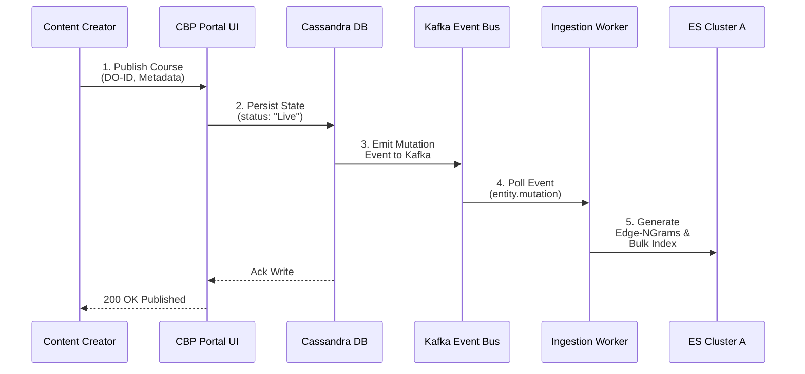
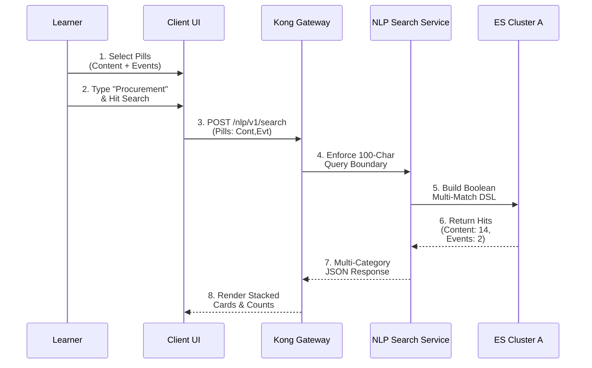
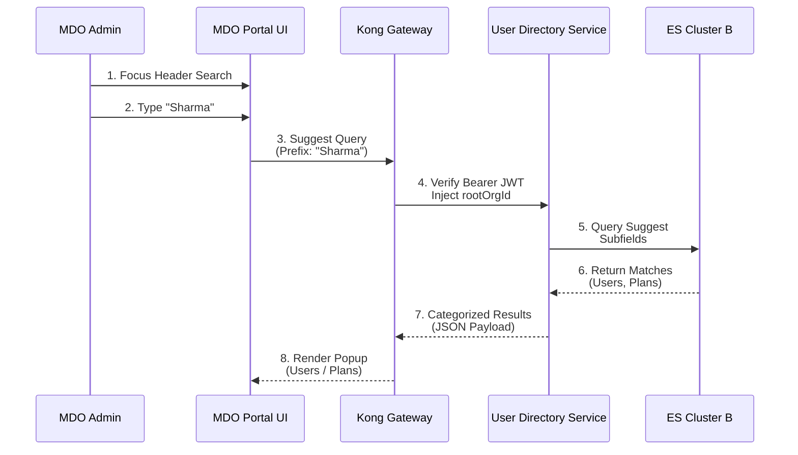
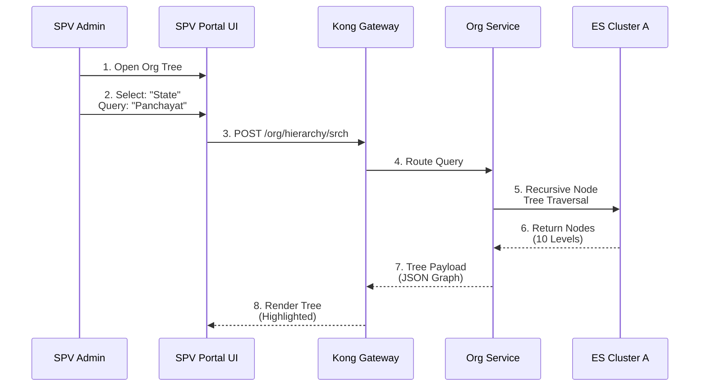
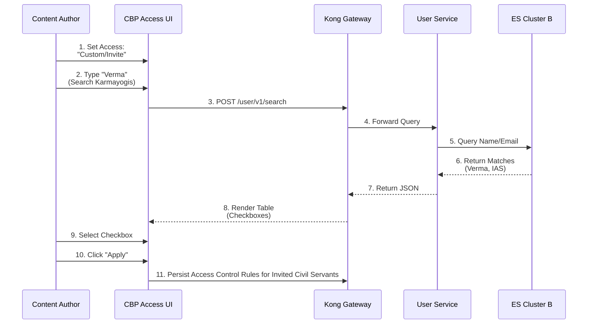
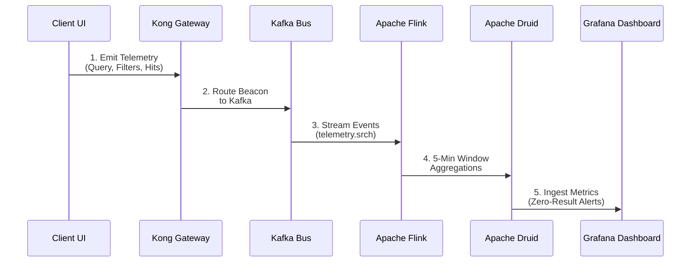

# Search — Generic Use Cases Specification Document

## 2. Use Case Model & Actor Catalog

### 2.1 Primary & Secondary Actors

**ACTOR TAXONOMY**

[HUMAN ACTORS]

| | |
|---|---|
| Civil Servant Learner (Demand Side): | Explores platform catalog, executes multi-modal discovery, filters by competency/theme, and transitions from search results to course enrollment and consumption. |
| MDO Administrator / Approver (Departmental Governance): | Manages department personnel, executes multi-field directory searches, verifies profiles, approves transfers, and monitors Annual Performance Assessment Report (APAR) training plans. |
| SPV Administrator / Operations Lead (Platform Governance): | Administers national tenant directories, audits 10-level organizational hierarchy trees, onboards external content partners, and manages the Karmayogi Competency Model (KCM). |
| CBP Content Creator / Publisher (Supply Side): | Searches live and draft repositories to prevent content duplication, manages course licensing, and configures invite-only access control rules for target civil servants. |

[SYSTEM & INFRASTRUCTURE ACTORS]

| | |
|---|---|
| Kong API Gateway: | Ingress boundary enforcer (100-character cap, rate limiting, JWT tenancy scoping). |
| NLP Search Microservice: | Query normalization, stop-word stripping, spelling correction, Redis cache. |
| Sunbird Search Service: | Composite search builder, facet aggregations, server-side pagination. |
| Elasticsearch Infrastructure: | Segregated datastores (Cluster A: Content/Org; Cluster B: Users/Auth). |
| Redis Cache Cluster: | Query-to-response cache store (TTL: 3600s) and atomic query usage counter. |
| Telemetry Engine (Kafka -> Flink -> Druid): | Captures search events and identifies zero-result gaps. |

## 3. Evolutionary Use Case Mapping (Q2 – Q13 Timeline)

| Quarter | Milestone Focus | Functional & Technical Progression | Jira References |
|---|---|---|---|
| **Q2–Q4** | Foundational Search & Telemetry | Monolithic Elasticsearch 6.7 cluster; keyword-to-field matching; introduction of dedicated search landing page; search queries captured in Kafka Druid. | [KB-1684: Q2\| Request for new content Flow \| MDO User should be able to view the "Request for New Content" trigger on the search page of capacity building plan.](https://karmayogibharat.atlassian.net/browse/KB-1684) (Prod Deployed), [KB-2131: Q3 \| Ad-Hoc Requests \| Request for Keyword search Data on the platform.](https://karmayogibharat.atlassian.net/browse/KB-2131) (In-Progress), [KB-2152: Q3 \| Ad-Hoc Requests \| Ingesting keyword search in Druid.](https://karmayogibharat.atlassian.net/browse/KB-2152) (In-Progress), [KB-3494 \| Q4 \| Platform Search \| Search Bar and Search Page enhancements](https://karmayogibharat.atlassian.net/wiki/spaces/TPT/pages/69599499/KB-3494+Q4+Platform+Search+Search+Bar+and+Search+Page+enhancements), [KB-3504: Q4 \| Platform Search \| Facet Search](https://karmayogibharat.atlassian.net/browse/KB-3504) (Open), [KB-3898: Q4 \| Tech Debt \| Optimization of Elastic Search](https://karmayogibharat.atlassian.net/browse/KB-3898) (Open) |
| **Q6–Q8** | Admin Backend Search & Hierarchy | SPV/MDO client-side filtering replaced with server-side API queries; 10-level Org Hierarchy tree search; Recent Searches (last 5) and Trending Searches added. | [KB-7053: Q6 \| SPV Portal \| Real time Search and Sort functionality](https://karmayogibharat.atlassian.net/browse/KB-7053) (Prod Deployed), [KB-7854: Q7 \| Search & listing \| Learner Portal & Mobile App](https://karmayogibharat.atlassian.net/browse/KB-7854) (KB Approved), [KB-7919: Q7 \| Ad-Hoc \| SPV Portal \| User Management \| User Search](https://karmayogibharat.atlassian.net/browse/KB-7919) (In Progress), [KB-7920: Q7 \| Ad-Hoc \| SPV Portal \| User Management \| User Search \| Search to implement via backend calls not from loaded data.](https://karmayogibharat.atlassian.net/browse/KB-7920) (In-Progress), [KB-8701: Q7 \| Search & Listing \| Recent Searches Need Information](https://karmayogibharat.atlassian.net/browse/KB-8701), [KB-9738: Q8 \| Org Search Funcationality \| Organisation Hierarchy Management](https://karmayogibharat.atlassian.net/browse/KB-9738) (Prod Deployed), [KB-9794: Q8 \| Organisation Search Filters \| Organisations \| SPV Portal Need Information](https://karmayogibharat.atlassian.net/browse/KB-9794) |
| **Q9–Q10** | Infrastructure Partitioning & Caps | **Elasticsearch Cluster Split** (Cluster A: Content/Org; Cluster B: Users/Auth); 100-character query cap; universal header searches; server-side pagination (20/50/100). | [KB-8980: Q10 \| Search, Sorting & Filters \| Content Portal](https://karmayogibharat.atlassian.net/browse/KB-8980) (KB Review), [KB-10564: Q9 \| Enable Multi-page/Full-Table Search \| SPV Portal](https://karmayogibharat.atlassian.net/browse/KB-10564) (Open), [KB-10579: Q9 \| Implement Multi-Field Search Ability \| MDO Portal](https://karmayogibharat.atlassian.net/browse/KB-10579) (In-Progress), [KB-11175: Q9 \| Search, Sorting & Filters \| MDO Portal](https://karmayogibharat.atlassian.net/browse/KB-11175) (KB Review), [KB-11907: Q10\| Tech Debt \| Elastic Search Index Split for User And Content Index](https://karmayogibharat.atlassian.net/browse/KB-11907) (Internal Review), [KB-12369: Q10 \| Tech Debt \| iGOT ES Search API Enhancements](https://karmayogibharat.atlassian.net/browse/KB-12369) (Open) |
| **Q11–Q13** | Multi-Modal Pills & NLP Hardening | Multi-Select Category Pills (Content, Events, People, Marketplace, Communities, AGK); NLP Search Microservice deployed with Redis caching, retry circuits, and spelling correction. | [KB-12730: Q11 \| Content Archival \| Search & Visibility of Archived Content](https://karmayogibharat.atlassian.net/browse/KB-12730) (Open), [KB-12837: Q11 \| Marketplace \| Marketplace Enhancements and New Integrations \| Enhance the search and filter of the Marketplace Providers Listing Page for logged-in users​](https://karmayogibharat.atlassian.net/browse/KB-12837) (Prod Deployed), [KB-14937: Q13 \| Search optimisation - Learner Portal](https://karmayogibharat.atlassian.net/browse/KB-14937) (KB Review), [KB-15545: Search - Phase 1](https://karmayogibharat.atlassian.net/browse/KB-15545) (Open), [KB-15717: Q13 \| NLP Search Service \| Implement Caching and Retry Mechanism UAT Completed](https://karmayogibharat.atlassian.net/browse/KB-15717) |

## 4. Platform Ingestion & Search Creation Use Cases (Async Write Path)

**CREATION & INGESTION USE CASE MATRIX**

- UC-CR-01: Course / Content Ingestion, Taxonomy Mapping & Indexing (CBP / System)
- UC-CR-02: Civil Servant Account & Profile Mutation Indexing (MDO / System)
- UC-CR-03: Organization Master & Hierarchy Ingestion (SPV / System)
- UC-CR-04: Course Archival & Search Catalog Purging / Exclusion (CBP / System)

### UC-CR-01: Course / Content Ingestion, Taxonomy Mapping & Indexing

- **Primary Actor**: CBP Content Creator / System Ingestion Worker.
- **Preconditions**: Course metadata, competencies, modules, and assessments pass validation and are published.
- **Postconditions**: Course document is indexed in Elasticsearch Cluster A (`composite_search`) and immediately discoverable via search.
- **Detailed Step-by-Step Flow**:
  - *User Action*: Content Creator clicks "Publish" on a validated course within the CBP Portal.
  - *Frontend Behavior*: UI sends `POST /api/content/v1/publish` with course DO-ID (`do_11384920194857`).
  - *Backend Processing*: Content Service sets course state to `Live` in Cassandra and generates an asynchronous CDC mutation event.
  - *CDC Pipeline*: Event is dispatched to Kafka topic `karmayogi.entity.content.mutation`.
  - *Worker Indexation*: Ingestion worker consumes the message, resolves Karmayogi Competency Model (KCM) theme mappings, generates edge-ngram tokens (lengths 2–15) on Title and Keywords, and applies field boosts (Title: 3.0, Keywords: 2.0, Description: 1.0).
  - *Elasticsearch Write*: Worker executes a bulk index write to **Cluster A** under `composite_search`.
  - *Cache Eviction*: System evicts any Redis query cache keys tagged with the course DO-ID.

- **Exceptions**: Kafka consumer lag or ES connection timeout triggers up to 3 worker retries with exponential backoff before routing the failed mutation to a Dead-Letter Queue (DLQ).
- **Traceability**: [KB-8980: Q10 | Search, Sorting & Filters | Content Portal](https://karmayogibharat.atlassian.net/browse/KB-8980) (KB Review), [KB-11045: Q9 | "Content Search" with search, Filters and sorting| CBP Portal](https://karmayogibharat.atlassian.net/browse/KB-11045) (Prod Deployed), Confluence `46301539`.

### UC-CR-02: Civil Servant Account & Profile Mutation Indexing

- **Primary Actor**: MDO Administrator / Bulk Onboarding Pipeline.
- **Preconditions**: Civil servant user accounts are created via self-registration or MDO CSV bulk onboarding.
- **Postconditions**: User record is indexed in Elasticsearch Cluster B (`user` and `user-profile`) with full designation and organizational mappings.
- **Detailed Step-by-Step Flow**:
  - *User Action*: MDO Administrator approves an employee verification or uploads an onboarding CSV file.
  - *Frontend Behavior*: Portal submits user payload to `POST /api/user/v1/create` or `/v1/verify`.
  - *Backend Processing*: User Service writes transactional account data to PostgreSQL.
  - *CDC Dispatch*: CDC engine dispatches user mutation record to Kafka topic `karmayogi.entity.user.mutation`.
  - *Index Worker Ingestion*: Worker parses user properties (`firstName`, `lastName`, `email`, `designation`, `cadre`, `group`, `rootOrgId`).
  - *Index Target Routing*: Worker writes document to **Cluster B** (`user` index), keeping User index operations isolated from Content queries (`KB-11907`).
  - *Edge-NGram Construction*: Analyzers tokenize designations and names for suggestive auto-complete in MDO and SPV directories.

- **Exceptions**: Invalid email domain or missing `rootOrgId` causes index rejection; an error is logged and flagged in the administrative audit log.
- **Traceability**: [KB-7919: Q7 | Ad-Hoc | SPV Portal | User Management | User Search](https://karmayogibharat.atlassian.net/browse/KB-7919) (In Progress), [KB-10579: Q9 | Implement Multi-Field Search Ability | MDO Portal](https://karmayogibharat.atlassian.net/browse/KB-10579) (In-Progress), [KB-11907: Q10| Tech Debt | Elastic Search Index Split for User And Content Index](https://karmayogibharat.atlassian.net/browse/KB-11907) (Internal Review), Confluence `61538718`.

### UC-CR-03: Organization Master & Hierarchy Ingestion

- **Primary Actor**: SPV Administrator / Ministry Onboarding Lead.
- **Preconditions**: SPV Administrator has appropriate permissions to create or restructure Central Ministries, State Departments, or field units.
- **Postconditions**: New organizational nodes are indexed in Cluster A (`organisations`) with up to 10 hierarchy levels.
- **Detailed Step-by-Step Flow**:
  - *User Action*: SPV Admin adds a new Directorate under a parent Ministry in the Org Hierarchy module.
  - *Frontend Behavior*: UI validates relationship constraints and calls `POST /api/org/v1/hierarchy/create`.
  - *Backend Processing*: Hierarchy Service persists the relational parent-child graph in PostgreSQL and generates tree paths (e.g., `/Ministry/Department/Directorate`).
  - *Asynchronous Indexing*: Worker ingests node metadata into **Cluster A**, indexing `orgName`, `orgType`, `jurisdiction` (`State` vs `Central`), and recursive hierarchy depth paths (`KB-9790`, `KB-9794`).
  - *Search Availability*: Node becomes immediately searchable in SPV directory grids and public registration dropdowns.

- **Traceability**: [KB-9738: Q8 | Org Search Funcationality | Organisation Hierarchy Management](https://karmayogibharat.atlassian.net/browse/KB-9738) (Prod Deployed), [KB-9790: Q8 | Organisation Hierarchy View | SPV & State Admin | SPV Portal](https://karmayogibharat.atlassian.net/browse/KB-9790) (To Do), [KB-9794: Q8 | Organisation Search Filters | Organisations | SPV Portal Need Information](https://karmayogibharat.atlassian.net/browse/KB-9794), Confluence `616497179`.

### UC-CR-04: Course Archival & Search Catalog Purging / Exclusion

- **Primary Actor**: CBP Publisher / SPV Content Manager.
- **Preconditions**: A course reaches its end-of-life date or is formally approved for retirement.
- **Postconditions**: Course is flagged as `status: "Retired"` and removed from all active learner catalog aliases, while remaining available to already enrolled learners.
- **Detailed Step-by-Step Flow**:
  - *User Action*: Content Publisher schedules retirement for a deprecated course (`KB-12366`, `KB-12730`).
  - *Backend Mutation*: Content status is updated to `Retired` in Cassandra.
  - *Index Alias Modification*: Indexing worker updates document in Elasticsearch Cluster A. Document is removed from alias `composite_search_live` and moved to `composite_search_archive`.
  - *Cache Eviction*: Worker purges Redis cache keys matching the retired course ID.
  - *Search Isolation Verification*: Search queries executed against `/api/nlp/v1/search` strictly enforce `filter: { status: "Live" }`, excluding the retired course from public results (`KB-12730`).

- **Traceability**: [KB-12366: Q10 | Versioning | Course Display, Learner Experience & Certificates](https://karmayogibharat.atlassian.net/browse/KB-12366) (Prod Deployed), [KB-12730: Q11 | Content Archival | Search & Visibility of Archived Content](https://karmayogibharat.atlassian.net/browse/KB-12730) (Open).

## 5. Learner Portal & Mobile App Discovery & Consumption Use Cases (Read Path)

**LEARNER & MOBILE USE CASE MATRIX**

- UC-LRN-01: Multi-Select Category Pill Search (Content, Events, People, Marketplace, AGK)
- UC-LRN-02: NLP Query Normalization, Stop-Word Stripping & Auto-Spelling Correction
- UC-LRN-03: Suggestive Search Auto-Complete & Highlight Dropdown
- UC-LRN-04: Recent & Trending Searches Popover Consumption
- UC-LRN-05: Advanced Faceted Filtering & Dynamic Sort Execution
- UC-LRN-06: Mobile Touch Search, Filter Drawer & Card Clamping
- UC-LRN-07: Search-to-TOC-to-Enrolment & Content Streaming Journey

### UC-LRN-01: Multi-Select Category Pill Search (Q13 `KB-15545`)

- **Primary Actor**: Civil Servant Learner (Web Browser or Mobile App).
- **Preconditions**: Learner navigates to the platform homepage or dedicated `/app/search` results page.
- **Postconditions**: Results are returned in stacked category blocks with independent hit counts in brackets.
- **Detailed Step-by-Step Flow**:
  - *User Action*: Learner clicks category chips to select both `Content` and `Events`. Learner types `"Procurement rules"` and presses Enter.
  - *Frontend Behavior*: UI state machine retains both pills. If user attempts to deselect the last active pill, UI blocks the action and maintains a minimum of one active category.
  - *Gateway Ingress*: Kong API Gateway validates string length ( characters) and passes the payload to the NLP Search Service.
  - *Service Orchestration*: NLP service compiles an Elasticsearch query targeting **Cluster A** containing a `bool` `should` clause spanning categories `Content` and `Events`.
  - *Result Formulation*: Elasticsearch aggregates hit counts per category. The service structures results into:
    - `Content (14)`: Top 3 cards rendered on Web.
    - `Events (2)`: Top 2 event cards rendered on Web.

  - *Client Presentation*: UI displays the results page with a left-hand navigation panel. Clicking a category in the left panel smoothly scrolls the page to that category's stacked card block.

- **Traceability**: [KB-15545: Search - Phase 1](https://karmayogibharat.atlassian.net/browse/KB-15545) (Open), Confluence `311296099`.

### UC-LRN-02: NLP Query Normalization, Stop-Word Stripping & Auto-Spelling Correction

- **Primary Actor**: Civil Servant Learner.
- **Preconditions**: Learner enters an informal, conversational, or mistyped query string.
- **Postconditions**: Query is cleaned, stop-words are stripped, spelling is corrected, and an informational banner is displayed.
- **Detailed Step-by-Step Flow**:
  - *User Action*: Learner enters `"I want to learn about grievence redressal"` into the search input.
  - *Gateway Processing*: Gateway checks string length ( characters) and routes to NLP Service.
  - *Atomic Metrics*: Service increments atomic Redis query counter: `INCR search:counter:i_want_to_learn_about_grievence_redressal`.
  - *Intent Stripping*: Normalization regex identifies and removes conversational filler `"I want to learn about"`, isolating `"grievence redressal"`.
  - *Spell-Check Engine*: SymSpell module detects `"grievence"` as an unrecognized token, maps it to dictionary word `"grievance"`, and sets `isCorrected = true`.
  - *Downstream Query*: The cleaned query `"grievance redressal"` is passed to Elasticsearch.
  - *UI Feedback Banner*: The search page displays the informational banner: *"Showing results for* ***grievance redressal. Search instead for grievence redressal"*.

- **Traceability**: [KB-15545: Search - Phase 1](https://karmayogibharat.atlassian.net/browse/KB-15545) (Open), [KB-15717: Q13 | NLP Search Service | Implement Caching and Retry Mechanism UAT Completed](https://karmayogibharat.atlassian.net/browse/KB-15717), Confluence `334725526`.

### UC-LRN-03: Suggestive Search Auto-Complete & Highlight Dropdown

- **Primary Actor**: Civil Servant Learner.
- **Preconditions**: Learner focuses on the search bar and types at least 2 characters.
- **Postconditions**: An auto-complete dropdown appears displaying categorized matches with matched substrings highlighted in bold.
- **Detailed Step-by-Step Flow**:
  - *User Action*: Learner types `"lead"` into the global search bar.
  - *Client Debounce*: Angular controller applies a debounce timer before sending an API request.
  - *Suggestive Query*: Gateway routes request to `/api/content/v1/suggest?q=lead`.
  - *ES Edge-NGram Execution*: Cluster A queries `.suggest` edge-ngram subfields, returning top matches:
    - `"Leadership Skills in Governance"`
    - `"Public Leadership and Ethics"`

  - *Substring Highlighting*: Backend wraps matching characters in HTML tags: `<b>Lead</b>ership Skills in Governance`.
  - *UI Dropdown*: Popover renders suggestions grouped by category. Clicking a suggestion executes that search immediately.

- **Traceability**: [KB-10563: Q9 | Develop Searchable Dropdown (Suggestive Search) | SPV Portal](https://karmayogibharat.atlassian.net/browse/KB-10563) (Open), [KB-10581: Q9 | Develop Searchable Dropdown (Suggestive Search) | MDO Portal](https://karmayogibharat.atlassian.net/browse/KB-10581) (In-Progress), [KB-10624: Q7 | Search & Listing | Trending & Suggestion in Search functionality](https://karmayogibharat.atlassian.net/browse/KB-10624) (Open), Confluence `336887857`.

### UC-LRN-04: Recent & Trending Searches Popover Consumption

- **Primary Actor**: Civil Servant Learner.
- **Preconditions**: Learner clicks on an empty search input field.
- **Postconditions**: A popover opens showing the user's **Last 5 Recent Searches** or platform-wide **Trending Searches**.
- **Detailed Step-by-Step Flow**:
  - *User Action*: Learner clicks into the empty global search input.
  - *Local Storage Check*: Client reads `localStorage.getItem('recent_searches')`.
  - *Recent Searches Rendering*: If history exists, the UI renders up to 5 past search queries with a clock icon and a delete ("X") icon next to each entry (`KB-8701`, `KB-15545`).
  - *Trending Searches Fallback*: If the user's local search history is empty, the client calls `GET /api/content/v1/trending` to display platform-wide top search terms (`KB-10624`).
  - *Search Execution*: Clicking any past or trending term immediately populates the input and executes the search.
  - *History Deletion*: Clicking the "X" icon next to a past term removes it from `localStorage` and triggers an async sync call to the backend.

- **Traceability**: [KB-8701: Q7 | Search & Listing | Recent Searches Need Information](https://karmayogibharat.atlassian.net/browse/KB-8701), [KB-10624: Q7 | Search & Listing | Trending & Suggestion in Search functionality](https://karmayogibharat.atlassian.net/browse/KB-10624) (Open), Confluence `527335441`.

### UC-LRN-05: Advanced Faceted Filtering & Dynamic Sort Execution

- **Primary Actor**: Civil Servant Learner.
- **Preconditions**: Search results are displayed on the `/app/search` page.
- **Postconditions**: Results update dynamically based on selected facets and sort order without a full page reload.
- **Detailed Step-by-Step Flow**:
  - *User Action*: Learner opens the filter panel, checks `Competency: Domain`, `Duration: 30-60 mins`, `Rating: >= 4.0`, and selects sort order `Newest First`.
  - *Query Formulation*: Client constructs filter parameters and dispatches request to `/api/nlp/v1/search`.
  - *Elasticsearch Filtering*: Cluster A executes a `bool` query with `filter` clauses for `competencyArea: "Domain"`, `duration: [1800 TO 3600]`, and `rating: { "gte": 4.0 }`.
  - *Sort Execution*: The query applies sort clause `[{"createdOn": {"order": "desc"}}]` instead of default BM25 score ranking.
  - *UI Update*: Result cards update dynamically while preserving category pill states and filter selections.

- **Traceability**: [KB-7871: Q7 | Search & listing | Filters | Learner Portal](https://karmayogibharat.atlassian.net/browse/KB-7871) (Prod Deployed), [KB-7873: Q7 | Search & listing | Sorting | Learner Portal](https://karmayogibharat.atlassian.net/browse/KB-7873) (Prod Deployed), [KB-9333: Q8 | Implement Course Catalog Filters | Course Catelog | Learner Portal & Mobile App & M-Site](https://karmayogibharat.atlassian.net/browse/KB-9333) (Prod Deployed).

### UC-LRN-06: Mobile Touch Search, Filter Drawer & Card Clamping

- **Primary Actor**: Mobile App Learner (Android / iOS).
- **Preconditions**: Learner opens the native iGOT Karmayogi mobile application.
- **Postconditions**: Mobile-optimized search layout displays touch-friendly filter drawers and clamped result cards.
- **Detailed Step-by-Step Flow**:
  - *User Action*: Learner taps the search bar on the mobile home screen.
  - *Touch Optimization*: Native keyboard opens, and category pills render inside a horizontally swipeable scroll container with touch targets .
  - *Filter Modal*: Tapping "Filters" opens a full-screen slide-up modal with touch controls and explicit "Clear All" and "Apply" buttons (`KB-7872`, `KB-9337`).
  - *Card Clamping*: When search results load, the People category clamps to 4 profile cards (compared to 5 on Web) to prevent vertical scroll exhaustion (`KB-15545`).

- **Traceability**: [KB-7870: Q7 | Search & listing | NLP & Elastic search | Mobile App](https://karmayogibharat.atlassian.net/browse/KB-7870) (Prod Deployed), [KB-7872: Q7 | Search & listing | Filters | Mobile App](https://karmayogibharat.atlassian.net/browse/KB-7872) (Prod Deployed), [KB-9337: Q8 | Course catalog | Mobile App](https://karmayogibharat.atlassian.net/browse/KB-9337) (Open), [KB-15545: Search - Phase 1](https://karmayogibharat.atlassian.net/browse/KB-15545) (Open).

### UC-LRN-07: Search-to-TOC-to-Enrolment & Content Streaming Journey

- **Primary Actor**: Civil Servant Learner.
- **Preconditions**: Course cards are displayed in search results.
- **Postconditions**: Learner successfully enrollees in the selected course and begins streaming content.
- **Detailed Step-by-Step Flow**:
  - *User Action*: Learner clicks on a course card titled *"Public Finance Management"*.
  - *TOC Navigation*: Client opens the Table of Contents (TOC) page (`/app/toc/do_11384920194857/overview`).
  - *Enrolment Status Verification*: Client checks user enrollment state via `GET /api/course/v1/hierarchy`.
  - *Enrolment Execution*: Learner clicks "Enrol for Free". Client calls `POST /api/course/v1/enrol`.
  - *Streaming Launch*: Enrolment is confirmed; UI updates CTA to "Start Learning" and launches the Course Player, streaming the first video module.

- **Traceability**: [KB-8825: Q7 | Search & Listing | User enrolments on Learner Portal](https://karmayogibharat.atlassian.net/browse/KB-8825) (Open), [KB-9333: Q8 | Implement Course Catalog Filters | Course Catelog | Learner Portal & Mobile App & M-Site](https://karmayogibharat.atlassian.net/browse/KB-9333) (Prod Deployed), [KB-15545: Search - Phase 1](https://karmayogibharat.atlassian.net/browse/KB-15545) (Open).

## 6. MDO Portal Administrative Search & Consumption Use Cases

**MDO PORTAL USE CASE MATRIX**

- UC-MDO-01: Global Header Multi-Entity Suggestive Search
- UC-MDO-02: Scoped Civil Servant Directory Multi-Field Search (Tenancy Enforcement)
- UC-MDO-03: Departmental Capacity Building Plan (CBP) / APAR Search
- UC-MDO-04: Approval Workflow & Transfer Request Search & Action

### UC-MDO-01: Global Header Multi-Entity Suggestive Search

- **Primary Actor**: MDO Administrator / Department Leader.
- **Preconditions**: Administrator logs into the MDO Portal (`/app/mdo/home`).
- **Postconditions**: Global header search returns grouped suggestions across department Users, Training Plans, Events, and Communities.
- **Detailed Step-by-Step Flow**:
  - *User Action*: Administrator clicks the global header search input and types `"Sharma"`.
  - *Gateway Tenancy Scoping*: Kong Gateway validates the user's JWT and injects the authenticated `rootOrgId`.
  - *Suggestive Execution*: User Directory Service queries **Cluster B** (`user` index), while Plan Service queries **Cluster A** (`training_plan` index).
  - *Dropdown Categorization*: UI popover displays grouped suggestions:
    - *Users*: "Ramesh Sharma (Director Finance)", "Anita Sharma (Under Secretary)"
    - *Training Plans*: "Finance Leadership Annual Plan"

  - *Navigation*: Clicking a user record navigates directly to that civil servant's profile page.

- **Traceability**: [KB-10581: Q9 | Develop Searchable Dropdown (Suggestive Search) | MDO Portal](https://karmayogibharat.atlassian.net/browse/KB-10581) (In-Progress), [KB-11175: Q9 | Search, Sorting & Filters | MDO Portal](https://karmayogibharat.atlassian.net/browse/KB-11175) (KB Review), [KB-11176: Q9 | MDO Search & Listing | Implement Global Search with Filters & Sorting for MDO Portal](https://karmayogibharat.atlassian.net/browse/KB-11176) (Prod Deployed), Confluence `514916410`.

### UC-MDO-02: Scoped Civil Servant Directory Multi-Field Search (Tenancy Enforcement)

- **Primary Actor**: MDO Administrator.
- **Preconditions**: Administrator opens the departmental user management roster (`/app/mdo/users`).
- **Postconditions**: Server-side multi-field query returns matching employees strictly within the administrator's department.
- **Detailed Step-by-Step Flow**:
  - *User Action*: Administrator types `"Deputy Secretary IAS"` in the directory table search bar.
  - *Tenancy Guardrail*: Gateway extracts `rootOrgId = "012849581029485716"` from the JWT token and hardcodes it into the request filters.
  - *Multi-Field Search*: The backend compiles a multi-match query across `designation`, `cadre`, `group`, and `firstName` targeting **Cluster B**.
  - *Server-Side Pagination*: Request passes `offset: 0` and `limit: 50`. The search executes across the full departmental database, eliminating legacy client-side 10-row DOM truncation (`KB-10579`).
  - *Table Display*: Results render in a paginated table showing Employee Name, Designation, Cadre, Verification Status, and Action buttons.

- **Traceability**: [KB-10579: Q9 | Implement Multi-Field Search Ability | MDO Portal](https://karmayogibharat.atlassian.net/browse/KB-10579) (In-Progress), [KB-11177: Q9 | MDO Search & Listing | Implement "Users" Search with Filters, Sorting, and User Detail Management on MDO Portal](https://karmayogibharat.atlassian.net/browse/KB-11177) (Prod Deployed), Confluence `423264475`.

### UC-MDO-03: Departmental Capacity Building Plan (CBP) / APAR Search

- **Primary Actor**: MDO Training Coordinator.
- **Preconditions**: Administrator is responsible for assigning and monitoring annual APAR training quotas.
- **Postconditions**: Coordinator locates specific training plans and audits assigned course progress.
- **Detailed Step-by-Step Flow**:
  - *User Action*: Coordinator navigates to Training Plans (`/app/mdo/training-plans`) and searches `"Ethics 2026"`.
  - *Backend Query*: Request is dispatched to `POST /api/trainingplan/v1/search` with filter `mdoId: rootOrgId`.
  - *Result Retrieval*: Cluster A returns matching training plans, including total assigned course count, target cadre, and completion percentages (`KB-11185`, `KB-14245`).
  - *Downstream Action*: Coordinator opens the matched plan to add required courses or review employee completion rates.

- **Traceability**: [KB-11185: Q9 | MDO Search & Listing | Implement "Training Plan" Search with Filters and Sorting](https://karmayogibharat.atlassian.net/browse/KB-11185) (Prod Deployed), [KB-14245: Training plan / APAR not shown in profile](https://karmayogibharat.atlassian.net/browse/KB-14245) (Prod Deployed).

### UC-MDO-04: Approval Workflow & Transfer Request Search & Action

- **Primary Actor**: MDO Access Manager / Approver.
- **Preconditions**: Civil servants submit departmental transfer requests or profile verification updates.
- **Postconditions**: Approver searches pending requests, reviews submitted credentials, and executes approval or rejection.
- **Detailed Step-by-Step Flow**:
  - *User Action*: Approver opens the Approvals dashboard (`/app/mdo/approvals`) and searches `"Transfer"`.
  - *Filter Application*: Approver selects filter `wfStatus = "Pending Approval"`.
  - *Server Paging*: Backend scans Cluster B `workflow_approvals` index across all server pages and returns matching requests.
  - *Administrative Decision*: Approver selects a user record, inspects transferred designation credentials, and clicks "Approve", updating the user's mapped department in PostgreSQL.

- **Traceability**: [KB-11177: Q9 | MDO Search & Listing | Implement "Users" Search with Filters, Sorting, and User Detail Management on MDO Portal](https://karmayogibharat.atlassian.net/browse/KB-11177) (Prod Deployed), [KB-14248: Access revoked](https://karmayogibharat.atlassian.net/browse/KB-14248) (Prod Deployed), [KB-14251: Comprehensive Assessment Issues](https://karmayogibharat.atlassian.net/browse/KB-14251) (Prod Deployed).

## 7. SPV Portal Operations & Directory Search Use Cases

**SPV PORTAL USE CASE MATRIX**

- UC-SPV-01: Full-Table Server-Side Multi-Column Directory Search
- UC-SPV-02: 10-Level Org Hierarchy Tree Search & Jurisdiction Filtering
- UC-SPV-03: External Marketplace Partner Discovery & Verification Search
- UC-SPV-04: Karmayogi Competency Model (KCM) Master & Designation Search

### UC-SPV-01: Full-Table Server-Side Multi-Column Directory Search

- **Primary Actor**: SPV Administrator.
- **Preconditions**: Administrator opens the master organizational directory (`/app/spv/directory`).
- **Postconditions**: Table query scans all organizational records across the national database with configurable page sizes.
- **Detailed Step-by-Step Flow**:
  - *User Action*: SPV Admin enters `"Agriculture"` into the table search input and sets display density to 100 rows per page (`KB-10565`).
  - *Multi-Column Search*: The query indexes Organization Name, State, Ministry, Registration Status, and SPOC Email simultaneously (`KB-10562`).
  - *Server-Side Execution*: Search executes via `POST /api/org/v1/search` with parameters `offset: 0`, `limit: 100`, searching across thousands of registered entities rather than filtering the local DOM page (`KB-10564`).
  - *Tiered Match Ranking*: Results sort exact name matches ahead of partial and substring matches (`KB-10566`).

- **Traceability**: [KB-10562: Q9 | Implement Multi-Field Search Ability | SPV Portal](https://karmayogibharat.atlassian.net/browse/KB-10562) (Open), [KB-10564: Q9 | Enable Multi-page/Full-Table Search | SPV Portal](https://karmayogibharat.atlassian.net/browse/KB-10564) (Open), [KB-10565: Q9 | Improve Pagination Support | SPV Portal](https://karmayogibharat.atlassian.net/browse/KB-10565) (Open), [KB-10566: Q9 | Develop Search Accuracy / Sorting Improve | SPV Portal](https://karmayogibharat.atlassian.net/browse/KB-10566) (Open).

### UC-SPV-02: 10-Level Org Hierarchy Tree Search & Jurisdiction Filtering

- **Primary Actor**: SPV Operations Administrator.
- **Preconditions**: Administrator opens the Org Hierarchy Management module (`/app/spv/org-hierarchy`).
- **Postconditions**: Search traverses and highlights organizational nodes down to 10 hierarchy levels.
- **Detailed Step-by-Step Flow**:
  - *User Action*: Admin selects jurisdiction filter `State Government` and enters `"Panchayat"` into the node search input.
  - *Depth-First Search*: Org Service executes recursive path traversal on **Cluster A** (`organisations` index), querying paths like `/State/Department/Commissionerate/Panchayat`.
  - *Tree Expansion*: UI auto-expands the hierarchy tree to highlight matched nodes while keeping non-matching branches collapsed (`KB-9738`, `KB-9790`).
  - *Node Inspection*: Admin clicks a matched node to view user counts, child unit totals, and assigned SPOC contacts.

- **Traceability**: [KB-9738: Q8 | Org Search Funcationality | Organisation Hierarchy Management](https://karmayogibharat.atlassian.net/browse/KB-9738) (Prod Deployed), [KB-9790: Q8 | Organisation Hierarchy View | SPV & State Admin | SPV Portal](https://karmayogibharat.atlassian.net/browse/KB-9790) (To Do), [KB-9794: Q8 | Organisation Search Filters | Organisations | SPV Portal Need Information](https://karmayogibharat.atlassian.net/browse/KB-9794).

### UC-SPV-03: External Marketplace Partner Discovery & Verification Search

- **Primary Actor**: SPV Content Partner Lead.
- **Preconditions**: External content providers submit onboarding applications for the Content Marketplace.
- **Postconditions**: Partner records and onboarded courses are searched, verified, and approved.
- **Detailed Step-by-Step Flow**:
  - *User Action*: Partner Lead opens Partner Management (`/app/spv/marketplace/providers`) and searches `"Harvard"`.
  - *Partner Discovery*: Query returns the provider profile, contract status, and onboarded course catalog (`KB-10599`, `KB-12783`).
  - *Course Verification*: Admin inspects the partner's course list, verifying course metadata, licensing terms, and SSO configurations.

- **Traceability**: [KB-10599: Q10 | Marketplace | SPV onboarding of External Content Providers](https://karmayogibharat.atlassian.net/browse/KB-10599) (Prod Deployed), [KB-12783: Q11 | Marketplace Enhancements and New Integrations](https://karmayogibharat.atlassian.net/browse/KB-12783) (Prod Deployed).

### UC-SPV-04: Karmayogi Competency Model (KCM) Master & Designation Search

- **Primary Actor**: SPV Competency Framework Lead.
- **Preconditions**: Standardized competency dictionary requires updates.
- **Postconditions**: Competencies and linked designations are retrieved and modified.
- **Detailed Step-by-Step Flow**:
  - *User Action*: Lead opens KCM Management and searches `"Financial Management"`.
  - *Multi-Level Taxonomy Search*: Service matches across Competency Area, Theme, and Sub-theme (`KB-5134`).
  - *Designation Mapping*: Admin audits designations linked to the competency and updates role requirement associations.

- **Traceability**: [KB-5134: Q4 | KCM & Designation master | SPV Portal | Basic Search | Search competency theme-competency subtheme](https://karmayogibharat.atlassian.net/browse/KB-5134) (QA In Progress), Confluence `61571416`.

## 8. CBP Portal Content Publisher & Authoring Search Use Cases

**CBP PORTAL USE CASE MATRIX**

- UC-CBP-01: Content Authoring Repository Search & Duplicate Detection
- UC-CBP-02: Course Access Control Karmayogi User Finder & Rule Configuration
- UC-CBP-03: Departmental Content Request Pipeline Search

### UC-CBP-01: Content Authoring Repository Search & Duplicate Detection

- **Primary Actor**: CBP Content Creator / Institute Publisher.
- **Preconditions**: Author begins conceptualizing a new course and needs to verify existing offerings.
- **Postconditions**: Search audits draft, in-review, and live courses, preventing redundant course creation.
- **Detailed Step-by-Step Flow**:
  - *User Action*: Author opens Content Builder (`/app/cbp/content`) and searches `"General Financial Rules"`.
  - *Catalog Audit*: Search queries **Cluster A**, scanning active courses across title, description, DO-ID, and primary category (`KB-8980`, `KB-11045`).
  - *Archival Exclusion Check*: Retired courses (`status: "Retired"`) are automatically excluded from the default view (`KB-12730`).
  - *Authoring Decision*: Author confirms no existing course covers the specific module and initiates course creation.

- **Traceability**: [KB-8980: Q10 | Search, Sorting & Filters | Content Portal](https://karmayogibharat.atlassian.net/browse/KB-8980) (KB Review), [KB-11045: Q9 | "Content Search" with search, Filters and sorting| CBP Portal](https://karmayogibharat.atlassian.net/browse/KB-11045) (Prod Deployed), [KB-12730: Q11 | Content Archival | Search & Visibility of Archived Content](https://karmayogibharat.atlassian.net/browse/KB-12730) (Open).

### UC-CBP-02: Course Access Control Karmayogi User Finder & Rule Configuration

- **Primary Actor**: CBP Course Creator.
- **Preconditions**: Author creates an "Invite-Only" or restricted departmental course.
- **Postconditions**: Specific civil servants are identified via search and granted course access.
- **Detailed Step-by-Step Flow**:
  - *User Action*: Author navigates to Course Access Settings, sets visibility to `Custom Users (Invite Only)`, and opens the Search Karmayogis tab (`KB-9602`, `KB-9603`).
  - *User Lookup*: Author enters `"Verma"` into the embedded user finder.
  - *Directory Query*: Backend queries **Cluster B** by name and email across verified accounts.
  - *Multi-Select Checkbox Selection*: Author selects specific civil servants from the result grid and clicks "Apply", binding their accounts to the course access control list.

- **Traceability**: [KB-9602: Q8 | Access Control | Single/Multi Select User Access Control](https://karmayogibharat.atlassian.net/browse/KB-9602) (Prod Deployed), [KB-9603: Q8 | Access Control | User Group based Access Control](https://karmayogibharat.atlassian.net/browse/KB-9603) (Prod Deployed).

### UC-CBP-03: Departmental Content Request Pipeline Search

- **Primary Actor**: CBP Commission Coordinator.
- **Preconditions**: MDOs submit requests for custom capacity-building content.
- **Postconditions**: Coordinator locates specific requests, reviews requirements, and assigns them to training institutes.
- **Detailed Step-by-Step Flow**:
  - *User Action*: Coordinator opens the Content Requests pipeline (`/app/cbp/requests`) and searches `"Cyber Security Training"`.
  - *Pipeline Search*: Table query filters inbound requests by Request ID, Submitting Ministry, and Urgency Level.
  - *Assignment Action*: Coordinator opens the request and assigns curriculum authoring to a designated Central Training Institute (e.g., ISTM).

- **Traceability**: [KB-1684: Q2| Request for new content Flow | MDO User should be able to view the "Request for New Content" trigger on the search page of capacity building plan.](https://karmayogibharat.atlassian.net/browse/KB-1684) (Prod Deployed), [KB-11045: Q9 | "Content Search" with search, Filters and sorting| CBP Portal](https://karmayogibharat.atlassian.net/browse/KB-11045) (Prod Deployed).

## 9. End-to-End System Integration & Cross-Cutting Scenarios

**CROSS-CUTTING SYSTEM USE CASES**

- UC-SYS-01: High-Concurrency Burst Caching & Redis Query Counter Tracking
- UC-SYS-02: Search Telemetry Emission, Streaming Ingestion & Gap Analytics
- UC-SYS-03: Query Length Guardrail Enforcement & ES JVM Protection (100-Char Cap)
- UC-SYS-04: Circuit Breaking & Graceful Failover Under Service Degradation

### UC-SYS-01: High-Concurrency Burst Caching & Redis Query Counter Tracking

- **Primary Actor**: System / Concurrent Civil Servant Learners.
- **Preconditions**: A national training initiative drives hundreds of concurrent searches for the same topic (e.g., `"Ethics in Governance"`).
- **Postconditions**: First query populates the cache; subsequent queries resolve from Redis in , shielding Elasticsearch.
- **Detailed Step-by-Step Flow**:
  - *User Action*: User A submits query `"Ethics in Governance"`.
  - *Cache Miss*: NLP service checks Redis key `search:cache:<hash>`, detects a miss, compiles Elasticsearch DSL, executes query on Cluster A, caches response for 3600 seconds, and returns results.
  - *Atomic Increment*: Redis command `INCR search:counter:ethics_in_governance` increments query count to 1 (`KB-15717`).
  - *Concurrent Bursts*: Users B through Z submit the same query within seconds.
  - *Cache Hit*: NLP service resolves requests directly from Redis memory in .
  - *Metrics Accuracy*: Every request executes `INCR search:counter:ethics_in_governance`, maintaining accurate search volume tracking without re-querying Elasticsearch.

- **Traceability**: [KB-15717: Q13 | NLP Search Service | Implement Caching and Retry Mechanism UAT Completed](https://karmayogibharat.atlassian.net/browse/KB-15717), Confluence `338853924`.

### UC-SYS-02: Search Telemetry Emission, Streaming Ingestion & Gap Analytics

- **Primary Actor**: Client Applications / Platform Analytics Engine.
- **Preconditions**: Search queries are executed across Web and Mobile portals.
- **Postconditions**: Telemetry events are ingested into Apache Druid to identify search trends and content gaps.
- **Detailed Step-by-Step Flow**:
  - *Telemetry Beacon*: Client dispatches asynchronous event `POST /api/data/v1/telemetry` containing `query`, `filters`, `resultsCount`, `latencyMs`, and `userId` (`KB-11049`).
  - *Kafka Ingestion*: Gateway forwards event to Kafka topic `karmayogi.telemetry.search`.
  - *Flink Stream Processing*: Apache Flink aggregates search events across 5-minute tumbling windows, calculating total volume, P95 latency, and zero-result queries.
  - *Druid Analytics & Alerts*: If zero-result searches for a term exceed configured thresholds, Druid triggers an alert to content curation teams to commission missing learning modules.

- **Traceability**: [KB-2131: Q3 | Ad-Hoc Requests | Request for Keyword search Data on the platform.](https://karmayogibharat.atlassian.net/browse/KB-2131) (In-Progress), [KB-2152: Q3 | Ad-Hoc Requests | Ingesting keyword search in Druid.](https://karmayogibharat.atlassian.net/browse/KB-2152) (In-Progress), [KB-8423: Q7 | Search & Listing | Data Tracking](https://karmayogibharat.atlassian.net/browse/KB-8423) (Prod Deployed), [KB-11049: Q9 | Data Tracking | Search and Sorting and Filters](https://karmayogibharat.atlassian.net/browse/KB-11049) (In-Progress).

### UC-SYS-03: Query Length Guardrail Enforcement & ES JVM Protection (100-Char Cap)

- **Primary Actor**: Malicious User / Automated Test Script / Errant Client.
- **Preconditions**: Ingress search request exceeds standard query lengths.
- **Postconditions**: Gateway truncates query to 100 characters, protecting Elasticsearch JVM memory from excessive heap allocation.
- **Detailed Step-by-Step Flow**:
  - *User Action*: Client submits a 180-character unindexed query string.
  - *Gateway Boundary Check*: Kong Gateway ingress filter detects length characters (`KB-12369`, `KB-15545`).
  - *Query Truncation*: Gateway truncates string to the first 100 characters and sets header `X-Query-Truncated: true`.
  - *Safe Execution*: Downstream NLP Service and Elasticsearch process the safe 100-character string without risking Out-Of-Memory (OOM) heap faults.
  - *User Feedback*: Client UI displays an informational notice: *"Search queries are capped at 100 characters"*.

- **Traceability**: [KB-12369: Q10 | Tech Debt | iGOT ES Search API Enhancements](https://karmayogibharat.atlassian.net/browse/KB-12369) (Open), [KB-15545: Search - Phase 1](https://karmayogibharat.atlassian.net/browse/KB-15545) (Open).

### UC-SYS-04: Circuit Breaking & Graceful Failover Under Service Degradation

- **Primary Actor**: System Resilience Engine.
- **Preconditions**: NLP Search Service experiences high latency or memory exhaustion.
- **Postconditions**: Circuit breaker trips, failing over to direct Sunbird Search queries to ensure continuous platform availability.
- **Detailed Step-by-Step Flow**:
  - *Degradation Detection*: Kong Gateway detects NLP Search Service error rate exceeding 5% or response latency breaching over a 30-second window (`KB-15717`).
  - *Circuit State Transition*: Circuit breaker trips from `Closed` to `Open`.
  - *Failover Routing*: Gateway bypasses the NLP service and routes search requests directly to the Sunbird Composite Search API using raw tokens.
  - *Service Impact*: Spelling correction is temporarily disabled, but core search execution remains functional.
  - *Circuit Recovery*: When health check endpoints return 200 OK consistently, the circuit transitions back to `Closed`.

- **Traceability**: [KB-15717: Q13 | NLP Search Service | Implement Caching and Retry Mechanism UAT Completed](https://karmayogibharat.atlassian.net/browse/KB-15717).
