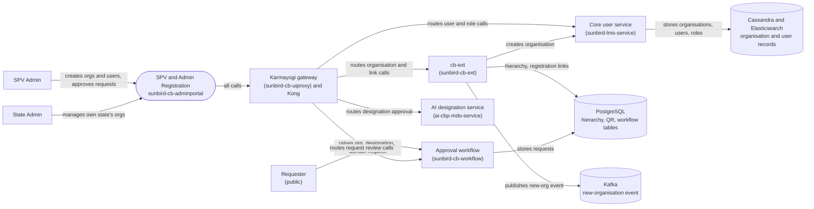

# SPV & Admin Registration — Context Diagram

## System boundary

Inside the feature is the SPV / super-admin Angular portal (`sunbird-cb-adminportal`):
the Directory, create-organisation drawer, Create user and Add-admin screens, the
registration-link drawer, and the Requests and Designation-approval screens. Outside it are
the admins and requesters who use it, the uiproxy gateway and Kong in front of the backend
services (cb-ext, the core user service, the workflow service), the separate AI designation
service, and the Postgres, Cassandra, Elasticsearch and Kafka stores those services use.

## Diagram

## Elements

| Element | Role | Detailed in |
|---|---|---|
| SPV & Admin Registration (`sunbird-cb-adminportal`) | Central system: Angular super-admin portal for organisation, first-admin, registration-link and request-review screens | [hld.md](hld.md) |
| SPV Admin | Creates organisations and users, works the Requests queue, manages volunteer organisations | [use-cases.md](use-cases.md) |
| State Admin | Same screens scoped to their own state | [use-cases.md](use-cases.md) |
| Requester | Raises organisation, designation or domain requests through public workflow endpoints | [apis.md](apis.md) |
| Karmayogi gateway and Kong | Session, path-based role allow-list and routing to the backend services | [apis.md](apis.md) |
| cb-ext (`sunbird-cb-ext`) | Organisation create/update orchestration, registration link and QR, designation-master upsert | [hld.md](hld.md) |
| Core user service (`sunbird-lms-service`) | Organisation record, users and role assignment | [hld.md](hld.md) |
| Approval workflow (`sunbird-cb-workflow`) | Organisation, position and domain request records and transitions | [apis.md](apis.md) |
| AI designation service (`ai-cbp-mdo-service`) | Serves designation approval requests; not analysed from source | [apis.md](apis.md) |
| PostgreSQL | Organisation hierarchy, registration QR and workflow tables | [hld.md](hld.md) |
| Cassandra and Elasticsearch | Organisation and user records and search indexes | [hld.md](hld.md) |
| Kafka | Carries the new-organisation event | [hld.md](hld.md) |

> **Verification boundary:** elements and interactions come from the feature's own pages
> read in full: index, use cases, APIs and HLD. The LLD, operations manual and as-built
> requirements were not read, and no source repository was spot-checked for this diagram.
> Not analysed from source (per those pages): the left-menu page configuration, the portal
> entry roles, the workflow state graphs, the consumer of the new-organisation event, and
> `ai-cbp-mdo-service`.
